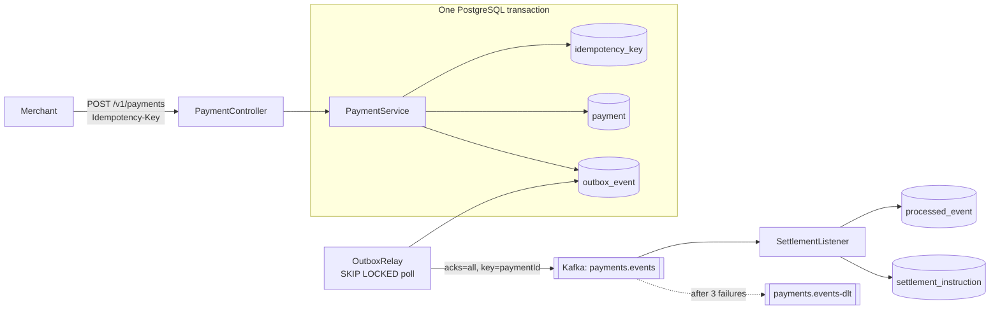
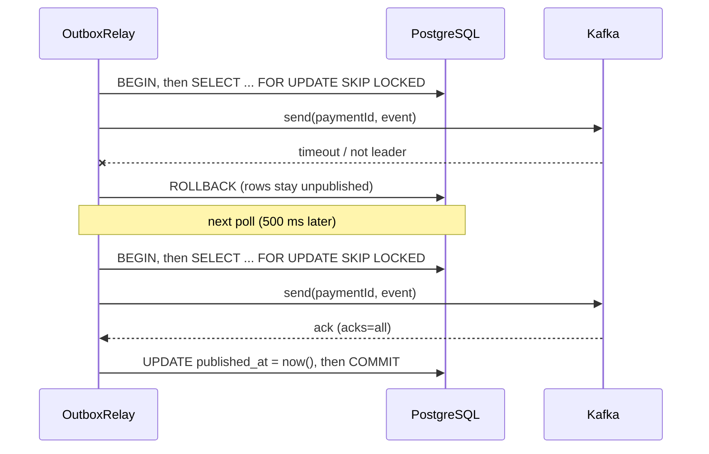

<!-- Arabic translation of index.md (generated from examples/capstone-1-payment-service/README.md). Update it when the English page changes. -->

**الشيفرة المصدرية:** [`examples/capstone-1-payment-service`](https://github.com/mostafasroor1983/fintech-engineering-mastery/tree/v1/examples/capstone-1-payment-service) · نفّذ `mvn test -pl capstone-1-payment-service -am` من داخل `examples/`

> خدمة صغيرة لقبول المدفوعات لا تأخذ الدفعة مرتين أبدًا، ولا تُضيّع أبدًا الحدث الذي يُبلغ التسوية بها.
> ‏Spring Boot 4.0.9، وJava 21، وPostgreSQL 17، وKafka 4.1 (العميل 4.1.2).

## المشكلة

يستدعي خادم التاجر `POST /v1/payments`. تنقضي مهلة الشبكة. هل تمت الدفعة؟ يعيد التاجر المحاولة.
وبدون حذر يدفع العميل مرتين. وبعد قبول الدفعة يجب على الخدمة أيضًا إبلاغ التسوية (عبر Kafka). فإذا كتبت في
قاعدة البيانات *ثم* نشرت إلى Kafka، فإن انهيارًا بين الخطوتين يترك دفعة لا تسمع بها التسوية أبدًا. هذه هي
**مشكلة الكتابة المزدوجة**.

تحل هذه الخدمة المشكلتين:

| الخطر | الحل في هذا المشروع | الدرس المرجعي |
|---|---|---|
| إعادات محاولة العميل تُنشئ مدفوعات مكررة | ترويسة `Idempotency-Key` + مفتاح أساسي على `(merchant_id, idempotency_key)` | [أنماط منع التكرار](#/tracks/track-05/lessons/track-05-lesson-12) |
| طلبان متطابقان يصلان في اللحظة نفسها | `INSERT ... ON CONFLICT DO NOTHING`: يجعل PostgreSQL الطلب الثاني ينتظر الأول | [السيناريو B: دفعة مكررة](#/tracks/track-05/lessons/track-05-lesson-03) |
| ينجح الالتزام في قاعدة البيانات ويضيع النشر إلى Kafka | Transactional outbox: صف الحدث في المعاملة نفسها، ومرحّل ينشره لاحقًا | [Transactional outbox](#/tracks/track-05/lessons/track-05-lesson-13)، [السيناريو F: الكتابة المزدوجة](#/tracks/track-05/lessons/track-05-lesson-07) |
| يسلّم Kafka أو outbox الحدث نفسه مرتين | مستهلك آمن من التكرار: مفتاح أساسي في `processed_event` ضمن معاملة الأثر الجانبي نفسها | [السيناريو G: تسليم Kafka مكرر](#/tracks/track-05/lessons/track-05-lesson-08) |
| رسالة واحدة سيئة تحجب قسمًا للأبد | إعادة المحاولة 3 مرات، ثم موضوع الرسائل الميتة `payments.events-dlt` | [طوابير الرسائل الميتة](#/tracks/track-09/lessons/track-09-lesson-11) |

## البنية



مسار الفشل: Kafka متعطل عندما يعمل المرحّل.



## القرارات الأساسية والمفاضلات

| القرار | السبب | الكلفة / متى لا تستخدمه |
|---|---|---|
| مفتاح منع التكرار والدفعة وصف outbox في معاملة **واحدة** | كل شيء أو لا شيء؛ لا توجد حالة "المفتاح محفوظ والدفعة مفقودة" | ينجح لأن لا شيء بطيئًا يحدث داخل المعاملة. إذا استدعيت مزوّد خدمة دفع (PSP) بشكل متزامن فقسّمها: احجز المفتاح (`IN_PROGRESS`)، واستدعِ المزوّد خارج المعاملة، ثم خزّن النتيجة. |
| تخزين **جسم الرد الأصلي** للإعادات | تحصل إعادة المحاولة على الرد نفسه حرفًا بحرف، حتى لو تغيرت الدفعة لاحقًا | يكبر التخزين: احذف المفاتيح بعد فترة الاحتفاظ التي تَعِد بها العملاء (توثّق Stripe ‏24 ساعة؛ اختر فترتك ووثّقها). |
| المفتاح محصور بكل تاجر | قد يختار تاجران المفتاح نفسه | يتطلب هوية تاجر موثوقة (هنا ترويسة تقوم مقام هوية OAuth2؛ والمشروع التطبيقي 5 يفعلها بالشكل الصحيح). |
| مرحّل بالاستطلاع (لا CDC) | بلا بنية تحتية إضافية؛ وسهل الاختبار | يضيف تأخرًا يصل إلى فترة استطلاع واحدة وبعض الحمل على قاعدة البيانات. مع الحجم الكبير استخدم Debezium CDC ‏([Outbox + CDC](#/tracks/track-09/lessons/track-09-lesson-06)). |
| "مرة واحدة على الأقل" + مستهلك آمن من التكرار، لا معاملات Kafka | تغطي EOS في Kafka المعالجة من Kafka إلى Kafka فقط. والأثر الجانبي لدينا كتابة في قاعدة البيانات، ولا تستطيع معاملات Kafka تضمينها | يجب على المستهلك إزالة التكرار. ويحتاج جدول `processed_event` مهمة حذف دورية. |
| مفتاح Kafka = معرّف الدفعة | ترتيب لكل دفعة (قسم واحد) | لا توجد دفعات "ساخنة"، فلا خطر قسم ساخن هنا؛ أما مفتاح لكل تاجر فقد يسببه. |
| خيوط افتراضية + مجمّع Hikari من 20 اتصالًا | خيوط طلبات رخيصة | يصبح المجمّع هو الحد الحقيقي للتزامن؛ و`connection-timeout: 2000` يفشل سريعًا بدل الانتظار بلا نهاية. |

## طريقة التشغيل

المتطلبات: Java 21، وMaven 3.9 أو أحدث، وDocker يعمل.

```bash
cd examples
mvn test -pl capstone-1-payment-service -am          # 13 tests, real PostgreSQL + Kafka via Testcontainers
```

Docker Desktop على macOS: إذا أبلغ Testcontainers عن "Could not find a valid Docker environment"، فصدّر أولًا
`DOCKER_HOST=unix://$HOME/.docker/run/docker.sock`.

شغّل التطبيق على PostgreSQL وKafka الخاصين بك:

```bash
export DB_URL=jdbc:postgresql://localhost:5432/payments DB_USER=payments DB_PASSWORD=...   # never commit secrets
export KAFKA_BOOTSTRAP=localhost:9092
mvn spring-boot:run -pl capstone-1-payment-service

curl -i -X POST localhost:8080/v1/payments \
  -H 'Content-Type: application/json' -H 'X-Merchant-Id: acme' -H 'Idempotency-Key: order-1001-attempt' \
  -d '{"debtorAccount":"GB33BUKB20201555555555","creditorAccount":"DE89370400440532013000","amount":10.50,"currency":"GBP","reference":"Invoice 42"}'
# Run it again: same body, same id, header Idempotent-Replayed: true
```

## الواجهة البرمجية

| الطريقة | المسار | ملاحظات |
|---|---|---|
| `POST` | `/v1/payments` | الترويستان `Idempotency-Key` (من 8 إلى 64 حرفًا) و`X-Merchant-Id`. الرد 201 مع `Location`. الإعادة ترجع الرد 201 المخزن مع `Idempotent-Replayed: true`. المفتاح نفسه بجسم مختلف: **422** بصيغة problem+json. |
| `GET` | `/v1/payments/{id}` | لا يراها إلا التاجر المالك؛ وأي جهة أخرى تحصل على 404 (لا 403)، فلا يمكن تخمين المعرّفات (OWASP API1). |

تستخدم إدارة الإصدارات ميزة إصدارات الواجهة المدمجة في Spring Framework 7 ‏(`spring.mvc.apiversion.use.path-segment=0`).
ويُرفض `/v2/...` بالرد 400. والأخطاء بصيغة RFC 9457 ‏`application/problem+json`.

## الاختبارات (ما يثبته كل اختبار)

| الاختبار | ما يثبته |
|---|---|
| `createsPaymentAndOutboxEventInOneTransaction` | تُكتب الدفعة وصف outbox معًا |
| `retryWithSameKeyReplaysTheOriginalResponse` | المعرّف نفسه، و`Idempotent-Replayed: true`، وما زالت دفعة واحدة وحدث واحد |
| `concurrentDuplicatesCreateExactlyOnePayment` | ‏20 طلبًا متزامنًا بمفتاح واحد ← دفعة واحدة بالضبط |
| `sameKeyWithDifferentBodyIsRejected` | إعادة استخدام المفتاح بجسم آخر ← 422، بلا دفعة جديدة |
| `tooManyDecimalsForTheCurrencyIsRejectedNotRounded` | ‏`10.005 GBP` ← 400 وتتراجع المعاملة كلها (بلا مفتاح يتيم) |
| `anotherMerchantCannotReadMyPayment` | التفويض على مستوى الكائن |
| `unsupportedApiVersionIsRejected` | ‏`/v2` ← 400 |
| `brokerDownKeepsEventsInTheOutboxUntilItRecovers` | **فشل ثم إصلاح**: يفشل الإرسال ← يبقى الصف معلّقًا ← تنشره الدورة التالية |
| `duplicateDeliveryIsAppliedOnce` | الحدث نفسه أُرسل مرتين ← تعليمة تسوية واحدة |
| `poisonMessageGoesToDeadLetterTopicAndDoesNotBlockTheNextOne` | دفعة غير معروفة ← موضوع الرسائل الميتة بعد إعادات المحاولة؛ وتُعالج الرسالة السليمة التالية |

مخرجات حقيقية (2026-11-12، `mvn test -pl capstone-1-payment-service -am`):

```text
Tests run: 9, Failures: 0, Errors: 0, Skipped: 0 -- in com.fintechmastery.payments.PaymentApiTest
Tests run: 4, Failures: 0, Errors: 0, Skipped: 0 -- in com.fintechmastery.payments.OutboxFlowTest
BUILD SUCCESS
```

## اختبار الحمل

```bash
mvn test -pl capstone-1-payment-service -am -Dgroups=load
```

يرسل 200 عميل متزامن 4,000 طلب؛ ويعيد كل طلب عاشر محاولة مفتاح سابق. ويتحقق الاختبار من انعدام الأخطاء
ومن وجود 3,600 دفعة و3,600 صف outbox بالضبط.

قيس مرة واحدة على حاسوب Apple M1 Pro محمول (8 أنوية، 16 GB) مع PostgreSQL وKafka داخل Docker على الجهاز
نفسه. **للتوضيح فقط، وليس ادعاءً بالسعة:**

```text
LOAD capstone-1: 4000 requests in 3.0 s = 1353 req/s; p50 116.0 ms, p99 590.8 ms, errors 0
```

أين يذهب الوقت: يتشارك 200 عميل مجمّعًا من 20 اتصالًا، فمعظم الزمن انتظار للحصول على اتصال. وهذه هي النقطة
التي تُناقش: كبّر المجمّع فقط إذا كان لدى PostgreSQL سعة فائضة. وإلا فأبقِه صغيرًا ووسّع المرحّل والمستهلكين
بدلًا من ذلك.

## الحدود المعروفة

- هوية التاجر ترويسة. وفي الإنتاج تؤخذ من رمز OAuth2 (انظر المشروع التطبيقي 5).
- لا توجد مهمة لإنهاء صلاحية مفاتيح منع التكرار (دفعة `DELETE ... WHERE created_at < now() - interval '24 hours'`).
- جدول `processed_event` ينمو للأبد؛ قسّمه حسب اليوم واحذف الأقسام القديمة.
- تأخر المرحّل بالاستطلاع يصل إلى `poll-interval`. استخدم CDC للأحجام الكبيرة.
- لا يوجد مزوّد تسوية: يكتب المستهلك صف `settlement_instruction` كأثر جانبي.
- منطقة واحدة. انظر [النشط-النشط متعدد المناطق](#/tracks/track-06/lessons/track-06-lesson-07).

## ابنِه بنفسك في نحو 12 ساعة

| الخطوة | الساعات | يكتمل عندما |
|---|---|---|
| 1. المخطط، والكيان `Payment`، و`POST` بدون منع التكرار | 1.5 | ينجح اختبار المسار السعيد |
| 2. اكتب اختبار التكرار المتزامن **أولًا**، وشاهده يفشل مع "اقرأ ثم أدخل" الساذج | 1.5 | الاختبار أحمر، وتستطيع شرح السبب |
| 3. مفتاح منع التكرار في المعاملة نفسها، والإعادة، و422 عند اختلاف الجسم | 2 | الاختبارات خضراء، ومنها اختبار الـ 20 خيطًا |
| 4. جدول outbox + مرحّل مع `SKIP LOCKED`، واختبار تعطل الوسيط | 2.5 | ينجح اختبار الفشل ← التعافي |
| 5. مستهلك آمن من التكرار + موضوع الرسائل الميتة | 2 | تنجح اختبارات التكرار والرسالة المسمومة |
| 6. اختبار الحمل، وأرقام README، وتدرّب على العرض بصوت عالٍ | 2.5 | تستطيع رسم المخطط من الذاكرة في دقيقتين |

## كيف أشرح هذا في مقابلة

"إنها واجهة دفع تضمن أمرين: تُؤخذ الدفعة مرة واحدة على الأكثر لكل مفتاح منع تكرار، وكل دفعة مقبولة تصل إلى
التسوية مرة واحدة على الأقل. للأول، يُكتب المفتاح والدفعة وحدث outbox في معاملة PostgreSQL واحدة. والمفتاح
مفتاح أساسي، فتتسلسل إعادتا محاولة متزامنتان على الإدخال: الثانية تنتظر، وترى الصف الملتزم، وتعيد الرد المخزن.
وللثاني، لا أنشر إلى Kafka داخل الطلب. يقرأ مرحّل صفوف outbox غير المنشورة باستخدام `FOR UPDATE SKIP LOCKED`،
ويرسلها مع `acks=all`، وبعدها فقط يعلّمها منشورة. هذا يعطي تسليمًا "مرة واحدة على الأقل"، لذا يزيل المستهلك
التكرار بمعرّف الحدث في معاملة أثره الجانبي نفسها. وأثبتُّ كل ضمان باختبار فاشل أولًا: التكرارات المتزامنة،
وتعطل الوسيط، والتسليم المكرر، والرسالة المسمومة."

## أصعب 5 أسئلة متابعة

1. **"لماذا لا تفحص وجود المفتاح ثم تُدخل؟"**
   قد يرى طلبان كلاهما "غير موجود" فيُدخل كلاهما دفعة (تسابق "افحص ثم نفّذ"). وقيد التفرّد في قاعدة البيانات
   هو الحَكَم الوحيد الذي يرى الطلبين معًا. و`ON CONFLICT DO NOTHING` يحوّل التسابق إلى انتظار.
   *إجابة خاطئة شائعة:* "استخدم `synchronized`". تفشل بمجرد تشغيل نسختين.

2. **"لماذا لا تستخدم معاملات Kafka / ‏exactly-once بدل outbox؟"**
   تجعل معاملات Kafka *الكتابات في Kafka* ذرية مع *التزام إزاحات Kafka*. أما تغيير الحالة عندي ففي
   PostgreSQL، ولا تستطيع أي معاملة Kafka تضمين التزام PostgreSQL. ويجعل outbox قاعدة البيانات نقطة الالتزام
   الوحيدة. ثم تأتي *الآثار* "مرة واحدة فقط" من التسليم "مرة واحدة على الأقل" مع مستهلك آمن من التكرار.

3. **"ماذا يحدث إذا انهار المرحّل بعد أن أكّد Kafka الاستلام وقبل تعليم الصف؟"**
   تتراجع المعاملة، ويبقى الصف غير منشور، فيُرسل مجددًا. ويرى المستهلك `eventId` نفسه فيتخطاه. ولهذا يُولَّد
   معرّف الحدث مرة واحدة عند كتابة صف outbox، لا بواسطة المرحّل.

4. **"نسختان من المرحّل: هل ترسلان الصف نفسه مرتين؟"**
   ليس في الوقت نفسه: يعطي `SKIP LOCKED` كل صف لنسخة واحدة في كل مرة. لكن التكرار المتتابع ما زال ممكنًا
   (حالة الانهيار أعلاه). ويبقى الترتيب لكل دفعة محفوظًا لأن الصفوف تُقرأ بترتيب المعرّف وتُرسل بمفتاح معرّف
   الدفعة. ومع انهيار ثم إعادة محاولة قد يسبق حدثٌ لاحق حدثًا أقدم، لذا يفحص المستهلكون المعنيون إصدارًا أو حالة
   (انظر [السيناريو H: أحداث خارج الترتيب](#/tracks/track-05/lessons/track-05-lesson-09)).

5. **"زمن p99 لديك 590 ms محليًا. كيف تجد عنق الزجاجة وتصلحه؟"**
   قِس أولًا: يُظهر المقياس `hikaricp.connections.pending` ومقاييس زمن الحصول على الاتصال في Hikari هل تنتظر
   الطلبات اتصالات. ومع 200 عميل و20 اتصالًا فهي تنتظر. الخيارات بالترتيب: قصّر المعاملة (لا تحتوي أصلًا على
   استدعاءات بعيدة)، وافحص SQL البطيء بـ `EXPLAIN ANALYZE`، ثم وسّع النسخ مع مراقبة معالج PostgreSQL و
   `max_connections`. لا تكبّر المجمّع فحسب: المجمّع الأكبر على قاعدة بيانات مشبعة يزيد الزمن سوءًا.

## انظر أيضًا

- [المسار 05: أنماط منع التكرار](#/tracks/track-05/lessons/track-05-lesson-12)
- [المسار 05: Transactional outbox](#/tracks/track-05/lessons/track-05-lesson-13)
- [المسار 13: ‏Spring Kafka 4](#/tracks/track-13/lessons/track-13-lesson-06)
- [المسار 14: تصميم خدمة مدفوعات (الجزء 2)](#/tracks/track-14/lessons/track-14-lesson-03)
