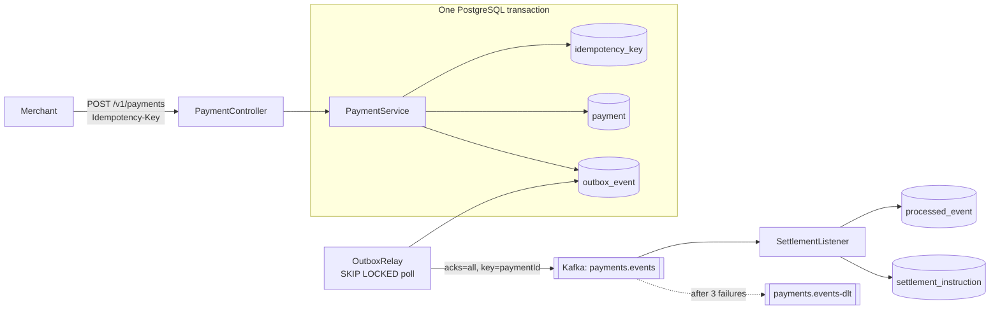
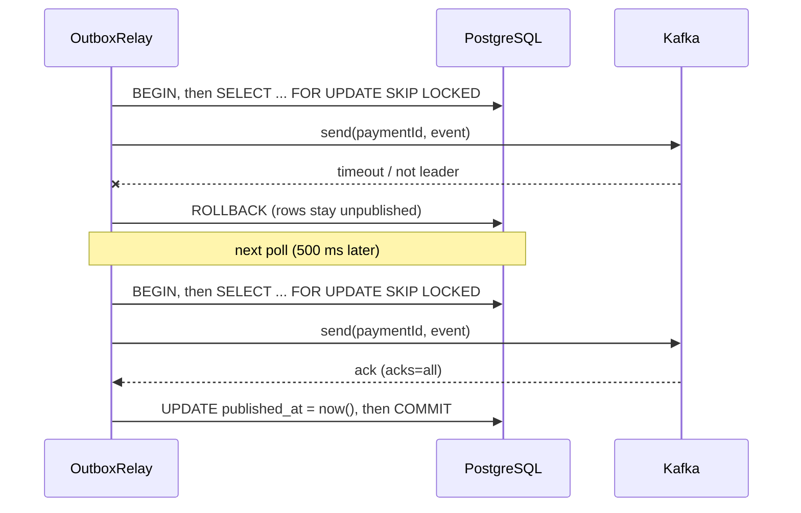

<!-- GENERATED from examples/capstone-1-payment-service/README.md by tools/build_capstone_pages.py. Edit the README, then re-run the script. -->

**Source code:** [`examples/capstone-1-payment-service`](https://github.com/mostafasroor1983/fintech-engineering-mastery/tree/v1/examples/capstone-1-payment-service) · run `mvn test -pl capstone-1-payment-service -am` from `examples/`

> A small payment-acceptance service that never takes a payment twice and never loses the event
> that tells settlement about it. Spring Boot 4.0.9, Java 21, PostgreSQL 17, Kafka 4.1 (client 4.1.2).

## The problem

A merchant's server calls `POST /v1/payments`. The network times out. Did the payment happen? The
merchant retries. Without care, the customer pays twice. After accepting a payment, the
service must also tell settlement (over Kafka). If it writes to the database and *then* publishes to
Kafka, a crash between the two leaves a payment that settlement never hears about. This is the
**dual-write problem**.

This service solves both:

| Risk | Fix in this project | Canonical lesson |
|---|---|---|
| Client retries create duplicate payments | `Idempotency-Key` header + primary key on `(merchant_id, idempotency_key)` | [Idempotency patterns](#/tracks/track-05/lessons/track-05-lesson-12) |
| Two identical requests arrive at the same instant | `INSERT ... ON CONFLICT DO NOTHING`: PostgreSQL makes the second one wait for the first | [Scenario B: duplicate payment](#/tracks/track-05/lessons/track-05-lesson-03) |
| DB commit succeeds, Kafka publish lost | Transactional outbox: event row in the same transaction, relay publishes later | [Transactional outbox](#/tracks/track-05/lessons/track-05-lesson-13), [Scenario F: dual write](#/tracks/track-05/lessons/track-05-lesson-07) |
| Kafka/outbox deliver the same event twice | Idempotent consumer: `processed_event` primary key in the same transaction as the side effect | [Scenario G: duplicate Kafka delivery](#/tracks/track-05/lessons/track-05-lesson-08) |
| One bad message blocks a partition forever | Retry 3×, then dead-letter topic `payments.events-dlt` | [Dead letter queues](#/tracks/track-09/lessons/track-09-lesson-11) |

## Architecture



Failure path: Kafka is down when the relay runs.



## Key decisions and trade-offs

| Decision | Why | Cost / when not to |
|---|---|---|
| Idempotency key, payment and outbox row in **one** transaction | All-or-nothing; no "key stored but payment missing" state | Works because nothing slow happens inside the transaction. If you call a PSP synchronously, split it: claim key (`IN_PROGRESS`), call outside the transaction, then store the result. |
| Store the **original response body** for replays | A retry gets byte-for-byte the same answer, even if the payment changed later | Storage grows: purge keys after the retention window you promise clients (Stripe documents 24 h; pick and document yours). |
| Key scoped per merchant | Two merchants may pick the same key | Requires a trusted merchant identity (here a header stands in for the OAuth2 principal; capstone 5 does it properly). |
| Polling relay (not CDC) | No extra infrastructure; easy to test | Adds up to one poll interval of latency and some DB load. At high volume use Debezium CDC ([Outbox + CDC](#/tracks/track-09/lessons/track-09-lesson-06)). |
| At-least-once + idempotent consumer, not Kafka transactions | Kafka EOS covers Kafka-to-Kafka. Our side effect is a DB write, which Kafka transactions cannot include | The consumer must de-duplicate. The `processed_event` table needs a retention job. |
| Kafka key = payment id | Ordering per payment (one partition) | Hot payments do not exist, so no hot-partition risk here; a per-merchant key would be. |
| Virtual threads + Hikari pool of 20 | Cheap request threads | The pool is now the real concurrency limit; `connection-timeout: 2000` fails fast instead of queueing forever. |

## How to run

Prerequisites: Java 21, Maven 3.9+, Docker running.

```bash
cd examples
mvn test -pl capstone-1-payment-service -am          # 13 tests, real PostgreSQL + Kafka via Testcontainers
```

Docker Desktop on macOS: if Testcontainers reports "Could not find a valid Docker environment", export
`DOCKER_HOST=unix://$HOME/.docker/run/docker.sock` first.

Run the app against your own PostgreSQL and Kafka:

```bash
export DB_URL=jdbc:postgresql://localhost:5432/payments DB_USER=payments DB_PASSWORD=...   # never commit secrets
export KAFKA_BOOTSTRAP=localhost:9092
mvn spring-boot:run -pl capstone-1-payment-service

curl -i -X POST localhost:8080/v1/payments \
  -H 'Content-Type: application/json' -H 'X-Merchant-Id: acme' -H 'Idempotency-Key: order-1001-attempt' \
  -d '{"debtorAccount":"GB33BUKB20201555555555","creditorAccount":"DE89370400440532013000","amount":10.50,"currency":"GBP","reference":"Invoice 42"}'
# Run it again: same body, same id, header Idempotent-Replayed: true
```

## API

| Method | Path | Notes |
|---|---|---|
| `POST` | `/v1/payments` | Headers `Idempotency-Key` (8–64 chars) and `X-Merchant-Id`. 201 + `Location`. Replay returns the stored 201 with `Idempotent-Replayed: true`. Same key, different body: **422** problem+json. |
| `GET` | `/v1/payments/{id}` | Only the owning merchant sees it; anyone else gets 404 (not 403), so ids cannot be probed (OWASP API1). |

Versioning uses Spring Framework 7 built-in API versioning (`spring.mvc.apiversion.use.path-segment=0`).
`/v2/...` is rejected with 400. Errors are RFC 9457 `application/problem+json`.

## Tests (what each one proves)

| Test | Proves |
|---|---|
| `createsPaymentAndOutboxEventInOneTransaction` | Payment and outbox row are written together |
| `retryWithSameKeyReplaysTheOriginalResponse` | Same id, `Idempotent-Replayed: true`, still 1 payment and 1 event |
| `concurrentDuplicatesCreateExactlyOnePayment` | 20 simultaneous requests with one key → exactly 1 payment |
| `sameKeyWithDifferentBodyIsRejected` | Key reuse with another body → 422, no new payment |
| `tooManyDecimalsForTheCurrencyIsRejectedNotRounded` | `10.005 GBP` → 400 and the whole transaction rolls back (no orphan key) |
| `anotherMerchantCannotReadMyPayment` | Object-level authorisation |
| `unsupportedApiVersionIsRejected` | `/v2` → 400 |
| `brokerDownKeepsEventsInTheOutboxUntilItRecovers` | **Failure then fix**: send fails → row stays pending → next run publishes |
| `duplicateDeliveryIsAppliedOnce` | Same event sent twice → 1 settlement instruction |
| `poisonMessageGoesToDeadLetterTopicAndDoesNotBlockTheNextOne` | Unknown payment → DLT after retries; the next good message is processed |

Real output (2026-11-12, `mvn test -pl capstone-1-payment-service -am`):

```text
Tests run: 9, Failures: 0, Errors: 0, Skipped: 0 -- in com.fintechmastery.payments.PaymentApiTest
Tests run: 4, Failures: 0, Errors: 0, Skipped: 0 -- in com.fintechmastery.payments.OutboxFlowTest
BUILD SUCCESS
```

## Load test

```bash
mvn test -pl capstone-1-payment-service -am -Dgroups=load
```

200 concurrent clients send 4,000 requests; every 10th request retries an earlier key. The test asserts
zero errors and exactly 3,600 payments and 3,600 outbox rows.

Measured once on an Apple M1 Pro laptop (8 cores, 16 GB) with PostgreSQL and Kafka in Docker on the
same machine. **Illustrative only, not a capacity claim:**

```text
LOAD capstone-1: 4000 requests in 3.0 s = 1353 req/s; p50 116.0 ms, p99 590.8 ms, errors 0
```

Where the time goes: 200 clients share a pool of 20 connections, so most of the latency is waiting for a
connection. That is the point to discuss: raise the pool only if PostgreSQL has headroom. Otherwise keep
it small and scale out the relay and consumers instead.

## Known limits

- Merchant identity is a header. Production takes it from the OAuth2 token (see capstone 5).
- No idempotency-key expiry job (a `DELETE ... WHERE created_at < now() - interval '24 hours'` batch).
- `processed_event` grows forever; partition by day and drop old partitions.
- Polling relay latency is up to `poll-interval`. Use CDC for high volume.
- No settlement provider: the consumer writes a `settlement_instruction` row as its side effect.
- Single region. See [Multi-region active-active](#/tracks/track-06/lessons/track-06-lesson-07).

## Build it yourself in about 12 hours

| Step | Hours | Done when |
|---|---|---|
| 1. Schema, `Payment` entity, `POST` without idempotency | 1.5 | Happy-path test green |
| 2. Write the concurrent-duplicate test **first**, watch it fail with a naive "select then insert" | 1.5 | Test red, you can explain why |
| 3. Idempotency key in the same transaction, replay, 422 on body mismatch | 2 | Tests green, including the 20-thread one |
| 4. Outbox table + relay with `SKIP LOCKED`, broker-down test | 2.5 | Failure → recovery test green |
| 5. Idempotent consumer + DLT | 2 | Duplicate and poison tests green |
| 6. Load test, README numbers, practise the pitch aloud | 2.5 | You can draw the diagram from memory in 2 minutes |

## How I would explain this in an interview

"It is a payment API that guarantees two things: a payment is taken at most once per idempotency key,
and every accepted payment reaches settlement at least once. For the first, the key, the payment and the
outbox event are written in one PostgreSQL transaction. The key is a primary key, so two concurrent
retries serialise on the insert: the second waits, sees the committed row, and replays the stored
response. For the second, I don't publish to Kafka inside the request. A relay reads unpublished outbox
rows with `FOR UPDATE SKIP LOCKED`, sends with `acks=all`, and only then marks them published. That gives
at-least-once delivery, so the consumer de-duplicates by event id in the same transaction as its side
effect. I proved each guarantee with a failing test first: concurrent duplicates, broker down, duplicate
delivery, poison message."

## The 5 hardest follow-up questions

1. **"Why not just check if the key exists, then insert?"**
   Two requests can both see "not there" and both insert a payment (check-then-act race). The
   database's unique constraint is the only arbiter that sees both. `ON CONFLICT DO NOTHING` turns the race
   into a wait. *Common wrong answer:* "use `synchronized`". It fails as soon as you run two instances.

2. **"Why not Kafka transactions / exactly-once instead of the outbox?"**
   Kafka transactions make *Kafka writes* atomic with *Kafka offset commits*. My state change is in
   PostgreSQL, and no Kafka transaction can include a PostgreSQL commit. The outbox makes the DB the single
   commit point. Exactly-once *effects* then come from at-least-once delivery plus an idempotent consumer.

3. **"What happens if the relay crashes after Kafka acked but before marking the row?"**
   The transaction rolls back, the row is still unpublished, and it is sent again. The consumer sees the
   same `eventId` and skips it. That is why the event id is generated once, when the outbox row is written,
   not by the relay.

4. **"Two relay instances: do they send the same row twice?"**
   Not concurrently: `SKIP LOCKED` hands each row to one instance at a time. Sequential duplicates are still
   possible (crash case above). Ordering per payment holds because rows are read in id order and keyed
   by payment id. Across a crash and retry, a later event could overtake an earlier one, so consumers that
   care check a version or state (see [Scenario H: out-of-order events](#/tracks/track-05/lessons/track-05-lesson-09)).

5. **"Your p99 is 590 ms locally. How do you find and fix the bottleneck?"**
   Measure first: Hikari's `hikaricp.connections.pending` and acquire-time metrics show if requests wait for
   connections. With 200 clients and 20 connections, they do. Options, in order: shorten the transaction
   (it already has no remote calls), check slow SQL with `EXPLAIN ANALYZE`, then scale instances while
   watching PostgreSQL CPU and `max_connections`. Do not just raise the pool: a bigger pool on a saturated
   database makes latency worse.

## See also

- [Track 05: Idempotency patterns](#/tracks/track-05/lessons/track-05-lesson-12)
- [Track 05: Transactional outbox](#/tracks/track-05/lessons/track-05-lesson-13)
- [Track 13: Spring Kafka 4](#/tracks/track-13/lessons/track-13-lesson-06)
- [Track 14: Design a payment service (part 2)](#/tracks/track-14/lessons/track-14-lesson-03)
