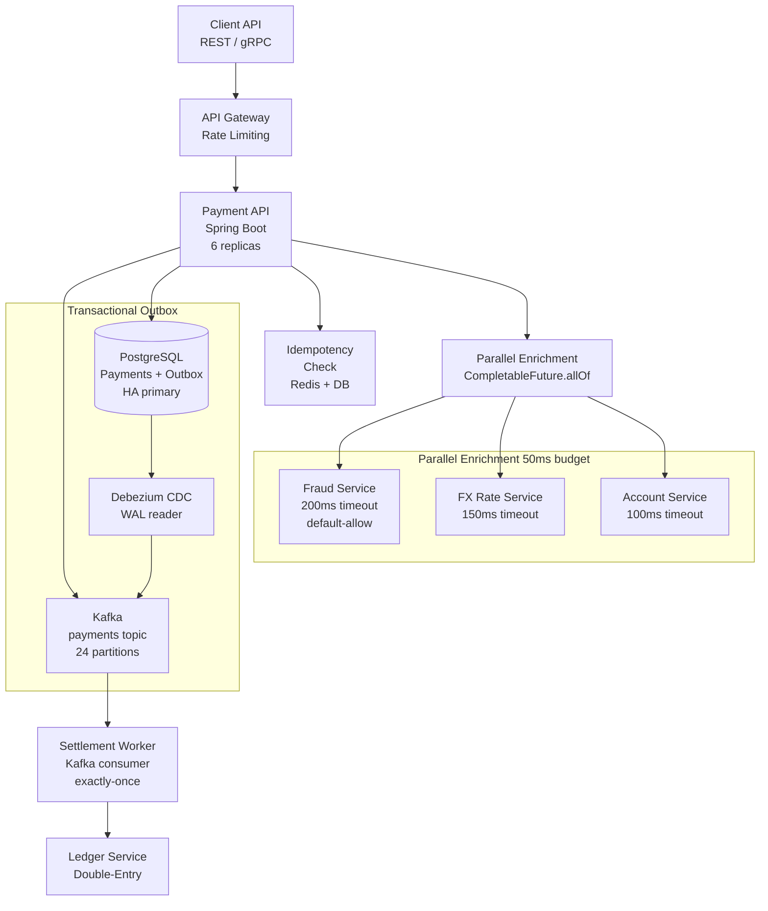
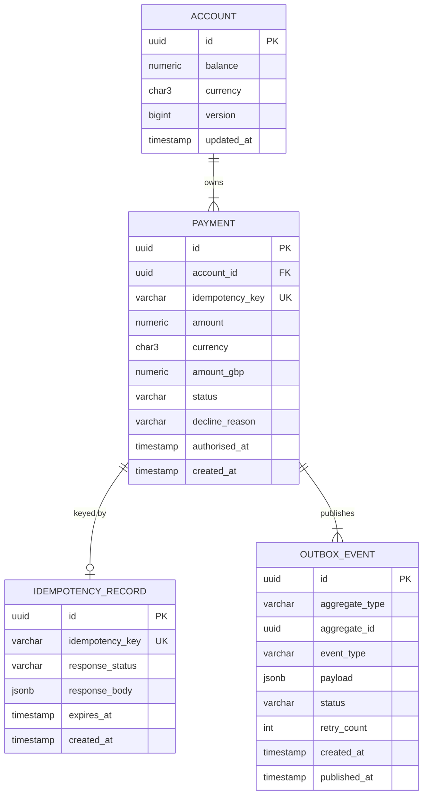
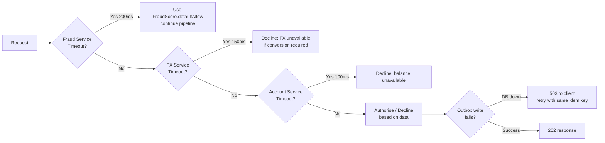

# High-Throughput Payment Processing Platform

## Project Overview

Build a production-grade payment gateway capable of processing **50,000 transactions per second** with sub-100ms P99 authorisation latency, exactly-once delivery semantics, and financial-grade idempotency guarantees.

This project integrates: distributed systems, concurrency, async processing, transaction integrity, and reliability engineering.

**What you will build:**
- Payment authorisation API with parallel enrichment pipeline
- Idempotency engine with distributed deduplication
- Transactional Outbox for exactly-once Kafka event publishing
- Settlement worker with Kafka consumer exactly-once semantics
- SLO dashboards and alerting

---

## System Requirements

### Functional Requirements

| Requirement | Specification |
|---|---|
| Payment submission | Synchronous authorisation response |
| Idempotency | Same request replayed ≤ 24h returns identical result |
| Currencies | GBP, EUR, USD — real-time FX conversion |
| Fraud screening | Third-party call, 200ms timeout, default allow |
| Settlement | Asynchronous, at-least-once with idempotent consumer |
| Audit | Every decision logged with actor, timestamp, decision |

### Non-Functional Requirements

| SLO | Target |
|---|---|
| P50 authorisation latency | < 30ms |
| P99 authorisation latency | < 100ms |
| Availability | 99.95% (20-min/month error budget) |
| Throughput | 50,000 TPS sustained |
| Idempotency window | 24 hours |
| Data durability | Zero loss (acks=all, min.insync.replicas=2) |

---

## Architecture



---

## Domain Model



---

## Database Schema

```sql
CREATE TABLE payments (
    id               UUID DEFAULT gen_random_uuid() PRIMARY KEY,
    account_id       UUID NOT NULL,
    idempotency_key  VARCHAR(255) NOT NULL,
    amount           NUMERIC(20,4) NOT NULL CHECK (amount > 0),
    currency         CHAR(3) NOT NULL,
    amount_gbp       NUMERIC(20,4) NOT NULL,
    fx_rate          NUMERIC(16,8) NOT NULL DEFAULT 1,
    status           VARCHAR(20) NOT NULL DEFAULT 'PENDING',
    decline_reason   VARCHAR(100),
    fraud_score      INTEGER,
    authorised_at    TIMESTAMPTZ,
    created_at       TIMESTAMPTZ NOT NULL DEFAULT now(),
    
    CONSTRAINT payments_status_check CHECK (
        status IN ('PENDING', 'AUTHORISED', 'DECLINED', 'REVERSED', 'SETTLED')
    ),
    CONSTRAINT payments_idempotency_key_uk UNIQUE (idempotency_key)
);

CREATE TABLE outbox_events (
    id              UUID DEFAULT gen_random_uuid() PRIMARY KEY,
    aggregate_type  VARCHAR(100) NOT NULL,
    aggregate_id    UUID NOT NULL,
    event_type      VARCHAR(100) NOT NULL,
    payload         JSONB NOT NULL,
    status          VARCHAR(20) NOT NULL DEFAULT 'PENDING',
    retry_count     INTEGER NOT NULL DEFAULT 0,
    created_at      TIMESTAMPTZ NOT NULL DEFAULT now(),
    published_at    TIMESTAMPTZ,
    
    CONSTRAINT outbox_status_check CHECK (status IN ('PENDING', 'PUBLISHED', 'FAILED'))
);

-- Partial index: only unpublished events are queried for dispatch
CREATE INDEX idx_outbox_pending ON outbox_events (created_at) WHERE status = 'PENDING';
CREATE INDEX idx_payments_account ON payments (account_id, created_at DESC);
```

---

## API Design

### POST /v1/payments — Authorise Payment

**Request:**
```json
{
  "idempotencyKey": "client-ref-abc123",
  "accountId": "acc-00000001",
  "amount": "250.00",
  "currency": "EUR",
  "description": "Invoice payment INV-2024-0042"
}
```

**Response (202 Accepted — first call):**
```json
{
  "paymentId": "pay-xxxxxxxx",
  "status": "AUTHORISED",
  "amountGBP": "214.73",
  "fxRate": "1.1642",
  "authorisedAt": "2024-11-07T14:23:01.123Z"
}
```

**Response (200 OK — duplicate call, same idempotency key):**
```json
{
  "paymentId": "pay-xxxxxxxx",
  "status": "AUTHORISED",
  "amountGBP": "214.73",
  "fxRate": "1.1642",
  "authorisedAt": "2024-11-07T14:23:01.123Z",
  "idempotent": true
}
```

---

## Implementation

### Idempotency Engine

```java
@Service
public class IdempotencyService {

    private final IdempotencyRepository repository;
    private final RedisTemplate<String, String> redis;
    
    private static final Duration WINDOW = Duration.ofHours(24);
    private static final String REDIS_PREFIX = "idem:";

    // Check-then-store with database UNIQUE constraint as the final arbiter
    // Redis provides fast-path cache; DB provides correctness under concurrent load
    public Optional<IdempotencyRecord> check(String key) {
        // Fast path: check Redis cache
        String cached = redis.opsForValue().get(REDIS_PREFIX + key);
        if (cached != null) {
            return Optional.of(IdempotencyRecord.fromJson(cached));
        }
        // Slow path: check database
        return repository.findByKeyAndNotExpired(key, Instant.now());
    }

    @Transactional
    public IdempotencyRecord store(String key, PaymentResult result) {
        IdempotencyRecord record = IdempotencyRecord.builder()
            .idempotencyKey(key)
            .responseStatus(result.getStatus().name())
            .responseBody(result.toJson())
            .expiresAt(Instant.now().plus(WINDOW))
            .build();
        
        try {
            repository.insert(record);  // throws DataIntegrityViolationException on duplicate key
        } catch (DataIntegrityViolationException e) {
            // Race condition: another request stored the result concurrently
            // Return the winning result — caller gets idempotent response
            return repository.findByKeyAndNotExpired(key, Instant.now())
                .orElseThrow(() -> new IllegalStateException("Idempotency store inconsistency"));
        }
        
        // Write through to Redis cache
        redis.opsForValue().set(REDIS_PREFIX + key, record.toJson(), WINDOW);
        return record;
    }
}
```

### Parallel Enrichment Pipeline (Java 21 — Virtual Threads)

```java
@Service
public class PaymentEnrichmentService {

    private final FraudService fraudService;
    private final FxService fxService;
    private final AccountService accountService;
    private final ExecutorService executor = Executors.newVirtualThreadPerTaskExecutor();

    public EnrichedPayment enrich(PaymentRequest request) {
        // All three calls are I/O-bound → virtual threads make them cheap
        var fraudFuture = CompletableFuture
            .supplyAsync(() -> fraudService.score(request), executor)
            .completeOnTimeout(FraudScore.defaultAllow(), 200, TimeUnit.MILLISECONDS);

        var fxFuture = request.getCurrency().equals("GBP")
            ? CompletableFuture.completedFuture(FxRate.one())
            : CompletableFuture
                .supplyAsync(() -> fxService.getRate(request.getCurrency(), "GBP"), executor)
                .orTimeout(150, TimeUnit.MILLISECONDS);

        var accountFuture = CompletableFuture
            .supplyAsync(() -> accountService.getWithBalance(request.getAccountId()), executor)
            .orTimeout(100, TimeUnit.MILLISECONDS);

        return CompletableFuture.allOf(fraudFuture, fxFuture, accountFuture)
            .thenApply(ignored -> EnrichedPayment.builder()
                .request(request)
                .fraudScore(fraudFuture.join())
                .fxRate(fxFuture.join())
                .account(accountFuture.join())
                .enrichedAt(Instant.now())
                .build())
            .join();
    }
}
```

### Transactional Outbox — Exactly-Once Kafka Publishing

```java
@Service
@Transactional
public class PaymentService {

    private final PaymentRepository paymentRepository;
    private final OutboxRepository outboxRepository;
    private final IdempotencyService idempotencyService;
    private final PaymentEnrichmentService enrichmentService;

    public PaymentResult authorise(PaymentRequest request) {
        // 1. Check idempotency
        var existing = idempotencyService.check(request.getIdempotencyKey());
        if (existing.isPresent()) {
            return PaymentResult.idempotent(existing.get());
        }

        // 2. Enrich (outside transaction — network calls should not hold DB connections)
        // Note: enrichment is called before @Transactional opens a connection
        var enriched = enrichmentService.enrich(request);

        // 3. Make authorisation decision
        var decision = makeDecision(enriched);

        // 4. Persist payment + outbox event in ONE TRANSACTION
        var payment = Payment.from(request, decision, enriched);
        paymentRepository.insert(payment);

        outboxRepository.insert(OutboxEvent.builder()
            .aggregateType("Payment")
            .aggregateId(payment.getId())
            .eventType("PaymentAuthorised")
            .payload(PaymentAuthorisedEvent.from(payment))
            .build());

        // 5. Store idempotency record (also in same transaction)
        var result = PaymentResult.from(payment);
        idempotencyService.store(request.getIdempotencyKey(), result);

        return result;
        // Outbox event will be picked up by Debezium CDC → Kafka
        // No dual-write problem: DB write and "Kafka publish" are atomic
    }
}
```

### Settlement Worker — Exactly-Once Consumer

```java
@Service
public class SettlementWorker {

    private final KafkaConsumer<String, PaymentEvent> consumer;
    private final KafkaProducer<String, SettlementEvent> producer;
    private final LedgerService ledgerService;

    public void run() {
        consumer.subscribe(List.of("payments.authorised"));

        while (true) {
            var records = consumer.poll(Duration.ofMillis(100));
            
            producer.beginTransaction();
            try {
                for (var record : records) {
                    var settlement = ledgerService.settle(record.value());
                    producer.send(new ProducerRecord<>("settlements.completed",
                        record.key(), settlement));
                }
                // Commit offsets AND output messages atomically
                producer.sendOffsetsToTransaction(
                    getOffsets(records), consumer.groupMetadata());
                producer.commitTransaction();
                
            } catch (Exception e) {
                producer.abortTransaction();
                log.error("Settlement transaction aborted, will retry", e);
            }
        }
    }
}
```

---

## Concurrency Strategy

| Operation | Strategy | Rationale |
|---|---|---|
| Balance debit | Conditional atomic UPDATE (`WHERE balance >= amount`) | Prevents overdraft without locking |
| Idempotency store | DB UNIQUE constraint | Correct under concurrent insertions |
| Outbox dispatch | Single Debezium reader per partition | No concurrent dispatch races |
| FX rate reads | Stale-tolerant (Redis cache, 30s TTL) | AP — eventual consistency acceptable |

```java
// Atomic conditional debit — prevents double-spend race condition
int updated = jdbcTemplate.update(
    "UPDATE accounts SET balance = balance - ?, version = version + 1 " +
    "WHERE id = ? AND balance >= ? AND version = ?",
    amount, accountId, amount, expectedVersion
);
if (updated == 0) {
    throw new InsufficientFundsException(accountId);
}
```

---

## Failure Handling



---

## Architecture Decision Records

### ADR-001: Transactional Outbox over Direct Kafka Write

**Status:** Accepted

**Context:** Payment service must publish a Kafka event and persist the payment record atomically. Direct producer.send() after DB commit risks: DB committed, process crashes before Kafka write → event lost.

**Decision:** Use the Transactional Outbox pattern. Write to `outbox_events` table in the same DB transaction as the payment record. Debezium reads the WAL and publishes to Kafka, ensuring exactly-once publishing.

**Consequences:** Requires Debezium CDC deployment. Introduces ~100-500ms publishing delay. Eliminates dual-write failure mode entirely.

### ADR-002: Redis + DB for Idempotency (Not Redis Alone)

**Status:** Accepted

**Context:** Redis provides fast idempotency checks but can lose data on eviction or failure. A pure Redis solution violates durability requirements for 24-hour idempotency windows.

**Decision:** Redis as a performance cache layer; PostgreSQL UNIQUE constraint as the correctness guarantee. `UNIQUE (idempotency_key)` prevents duplicates even when Redis is down or returns a cache miss on concurrent requests.

**Consequences:** Idempotency checks hit DB on cache miss (~1-2% of requests). `DataIntegrityViolationException` handling required for race conditions (handled gracefully in `IdempotencyService.store()`).

### ADR-003: Virtual Threads for Enrichment Pipeline

**Status:** Accepted (Java 21 target)

**Context:** Payment enrichment calls 3 external services in parallel. Original implementation used a fixed thread pool of 100 threads. Under 50k TPS, each enrichment call holds a thread for up to 200ms → pool exhaustion.

**Decision:** Use `Executors.newVirtualThreadPerTaskExecutor()` for the enrichment executor. Virtual threads are cheap (~1KB stack vs 512KB for platform threads), making 50k concurrent enrichment calls feasible.

**Consequences:** Requires Java 21. Libraries pinning carrier threads (synchronized blocks in JDBC drivers) may cause performance degradation; monitor with `-Djdk.tracePinnedThreads=full`.

---

## Testing Strategy

### Unit Tests — Idempotency Race Condition

```java
@Test
void concurrentRequests_sameIdempotencyKey_onlyOneProcessed() throws Exception {
    int threads = 50;
    var latch = new CountDownLatch(1);
    var successCount = new AtomicInteger(0);
    var idempotentCount = new AtomicInteger(0);
    
    var futures = IntStream.range(0, threads).mapToObj(i ->
        CompletableFuture.runAsync(() -> {
            try {
                latch.await();
                var result = paymentService.authorise(
                    PaymentRequest.builder()
                        .idempotencyKey("test-key-concurrent-001")
                        .accountId(testAccountId)
                        .amount(new BigDecimal("100.00"))
                        .currency("GBP")
                        .build()
                );
                if (result.isIdempotent()) idempotentCount.incrementAndGet();
                else successCount.incrementAndGet();
            } catch (Exception e) { /* expected */ }
        })
    ).toArray(CompletableFuture[]::new);
    
    latch.countDown();  // Release all 50 threads simultaneously
    CompletableFuture.allOf(futures).get(10, TimeUnit.SECONDS);
    
    assertThat(successCount.get()).isEqualTo(1);       // exactly 1 original
    assertThat(idempotentCount.get()).isEqualTo(49);   // 49 idempotent replays
}
```

### Integration Tests — Outbox Delivery

```java
@Test
@Testcontainers
void outboxEvent_publishedToKafka_afterDbCommit() {
    // Execute a payment
    var result = paymentService.authorise(testRequest);
    
    // Verify: event appears in Kafka within 5 seconds
    var consumer = kafkaConsumerForTopic("payments.authorised");
    var records = consumer.poll(Duration.ofSeconds(5));
    
    assertThat(records.count()).isEqualTo(1);
    assertThat(records.iterator().next().value().getPaymentId())
        .isEqualTo(result.getPaymentId());
}
```

---

## Performance Targets & Analysis

```
Target: 50,000 TPS, P99 < 100ms

Latency budget breakdown:
  Network ingress:         3ms
  Idempotency check:       2ms  (Redis hit)
  Parallel enrichment:    50ms  (bounded by slowest: fraud at 200ms timeout,
                                 but p50 is ~40ms)
  DB write (payment):      5ms  (NVMe SSD, single insert)
  Outbox write:            2ms  (same transaction)
  Response serialisation:  1ms
  Network egress:          3ms
  Total p50:              ~66ms ✓

For P99:
  Fraud service p99:      180ms → exceeds 100ms budget alone
  
Mitigation: completeOnTimeout(200ms) with defaultAllow
  → p99 enrichment bounded at ~100ms (account service timeout)
  → Total p99: ~115ms — requires further optimisation

Optimisation options:
  1. Move fraud scoring async post-auth (risk-based accept/challenge)
  2. Pre-fetch fraud features from Redis (reduces to 10ms lookup)  
  3. Use gRPC instead of HTTP for internal calls (saves ~15ms on serialisation)
```

---

## Deployment

```yaml
# Kubernetes HPA — scale for payment peak days
apiVersion: autoscaling/v2
kind: HorizontalPodAutoscaler
metadata:
  name: payment-api
  namespace: payments-prod
spec:
  scaleTargetRef:
    apiVersion: apps/v1
    kind: Deployment
    name: payment-api
  minReplicas: 6
  maxReplicas: 24
  metrics:
  - type: Resource
    resource:
      name: cpu
      target:
        type: Utilization
        averageUtilization: 60
  - type: Pods
    pods:
      metric:
        name: payment_queue_depth
      target:
        type: AverageValue
        averageValue: "500"
```

---

## Principal Engineer Review Criteria

Your implementation will be evaluated against:

- [ ] **Idempotency is correct under concurrent load** — 50 concurrent requests, same key → 1 success, 49 idempotent
- [ ] **No dual-write failures** — payment record and Kafka event published atomically
- [ ] **No race conditions** in balance debit — atomic conditional UPDATE used
- [ ] **Timeouts configured** on all external calls with appropriate fallback strategy
- [ ] **P99 latency measured** under realistic load with JMH or Gatling
- [ ] **SLO defined** — SLI, 28-day window, error budget policy documented
- [ ] **ADRs written** for the top 3 architectural decisions
- [ ] **Testcontainers integration test** for the full payment-to-Kafka flow
