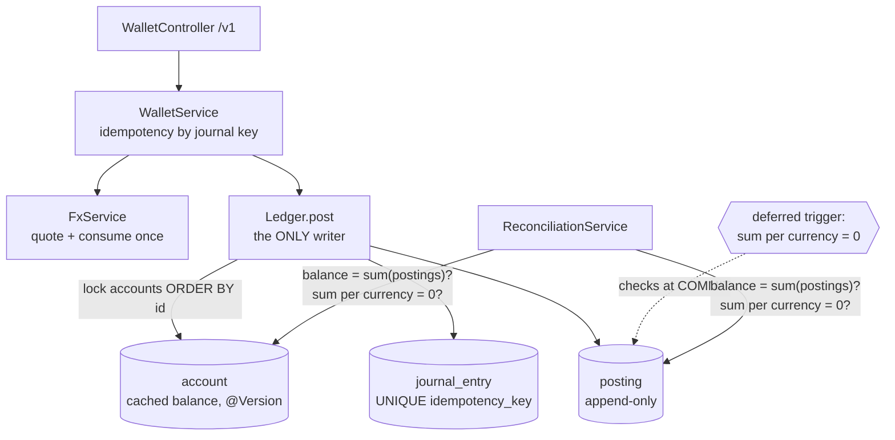

<!-- Arabic translation of index.md (generated from examples/capstone-2-wallet-ledger/README.md). Update it when the English page changes. -->

**الشيفرة المصدرية:** [`examples/capstone-2-wallet-ledger`](https://github.com/mostafasroor1983/fintech-engineering-mastery/tree/v1/examples/capstone-2-wallet-ledger) · نفّذ `mvn test -pl capstone-2-wallet-ledger -am` من داخل `examples/`

> محافظ لا يمكن أن تصبح أرصدتها سالبة، ولا أن تنحرف عن دفتر الأستاذ، ولا أن تُنشئ مالًا أو تُضيّعه، حتى عندما
> يبدّل العملاء الجنيه الإسترليني (GBP) باليورو (EUR). ‏Spring Boot 4.0.9، وJava 21، وPostgreSQL 17.

## المشكلة

تبدو المحفظة مثل "عمود رصيد". لكن بمجرد أن يتحرك المال تحدث ثلاثة أخطاء:

1. سحبان متزامنان يرى كل منهما 100 فينفقها كلاهما (**تحديث مفقود / إنفاق مزدوج**).
2. خطأ برمجي يحدّث رصيدًا دون حركة مقابلة في مكان آخر، فيظهر مال من العدم.
3. صرف عملة "يقرّب قليلًا" فيترك الدفاتر غير متوازنة في إحدى العملتين.

الحل هو **دفتر أستاذ بالقيد المزدوج**. كل حركة قيد يومية مجموع أطرافه صفر *لكل عملة*. والرصيد المخزن
وسيلة للراحة فقط؛ أما الترحيلات (postings) فهي الحقيقة، ومهمة مطابقة تثبت أن الاثنين متفقان.

| الخطر | الحل | الدرس المرجعي |
|---|---|---|
| الإنفاق المتزامن يسبب سحبًا على المكشوف | أقفال متشائمة على الصفوف **بترتيب المعرّف**، و`CHECK (balance_minor >= 0)` | [السيناريو A: سحوبات متزامنة](#/tracks/track-05/lessons/track-05-lesson-02)، [القفل المتشائم](#/tracks/track-05/lessons/track-05-lesson-17) |
| جمود بين A←B وB←A | ترتيب أقفال عام واحد لكل المعاملات | [السيناريو D: ترحيل متزامن إلى دفتر الأستاذ](#/tracks/track-05/lessons/track-05-lesson-05) |
| قيد غير متوازن | فحص في Java **و**مُطلِق قيد مؤجل في PostgreSQL عند COMMIT | [دفتر الأستاذ بالقيد المزدوج](#/tracks/track-05/lessons/track-05-lesson-01) |
| إعادة كتابة التاريخ | ‏`UPDATE`/`DELETE` على الترحيلات وقيود اليومية يرمي خطأ | [سجلات التدقيق](#/tracks/track-05/lessons/track-05-lesson-21) |
| انحراف الرصيد عن الترحيلات | استعلام مطابقة تحت `REPEATABLE READ` | [مطابقة الأرصدة](#/tracks/track-05/lessons/track-05-lesson-22) |
| إعادة استخدام عرض سعر الصرف أو استخدامه متأخرًا | عرض سعر لمرة واحدة ينتهي صلاحيته، يُستهلك بعبارة `UPDATE` شرطية واحدة | [أنظمة صرف العملات](#/tracks/track-04/lessons/track-04-lesson-10) |

## البنية



تحويل صرف بقيمة 100.00 GBP من Alice إلى محفظة Bob باليورو (سعر وسطي توضيحي 1.15، وهامش 50 نقطة أساس،
فيكون السعر 1.15 × (1 − 0.005) = 1.14425؛ و100.00 × 1.14425 = 114.425، مقرّبًا **للأسفل** إلى 114.42):

| الطرف | الحساب | المبلغ |
|---|---|---|
| 1 | محفظة Alice بالجنيه | ‎−100.00 GBP |
| 2 | مركز صرف المؤسسة بالجنيه | ‎+100.00 GBP |
| 3 | مركز صرف المؤسسة باليورو | ‎−114.42 EUR |
| 4 | محفظة Bob باليورو | ‎+114.42 EUR |

مجموع الجنيه صفر ومجموع اليورو صفر. وتحتفظ المؤسسة بكسر التقريب 0.005 EUR وفق سياسة معلنة، واختبار يثبّت هذه
السياسة.

## القرارات الأساسية والمفاضلات

| القرار | السبب | الكلفة / متى لا تستخدمه |
|---|---|---|
| أقفال متشائمة للتحويلات | المحافظ الساخنة (تاجر يتلقى مدفوعات كثيرة) ستسبب عواصف إعادة محاولة مع القفل المتفائل | انتظار على الأقفال تحت التنافس. وللنقاط الساخنة جدًا، قسّم الحساب إلى حسابات فرعية أو اجمع الإيداعات في مخزن مؤقت. |
| الإبقاء على `@Version` أيضًا | شبكة أمان لأي كاتب ينسى أخذ القفل | عمود إضافي واحد؛ بلا ضرر. |
| رصيد مخزن + ترحيلات | قراءة الرصيد تبقى O(1) | نسختان من الحقيقة، ولهذا توجد مهمة المطابقة. |
| وحدات صغرى بإشارة (`bigint`) | دقيقة وسريعة وبلا أخطاء في عدد المنازل العشرية | تحتاج `Money` للتحويل عند الأطراف؛ والمبالغ التي تتجاوز ±9.2×10¹⁸ وحدة صغرى مستحيلة (لا مشكلة في المال). |
| ثوابت تفرضها قاعدة البيانات (CHECK، ومُطلِقات) | خطأ في أي خدمة أو سكربت أو ترحيل مخطط لا يستطيع مع ذلك إخلال توازن الدفاتر | المنطق في مكانين؛ وكلفة المُطلِق عند الإدخال (تجميع مفهرس واحد لكل ترحيل). |
| منع التكرار عبر مفتاح يومية `UNIQUE` | القيد *هو* سجل الطلب؛ بلا جدول إضافي | لا يستطيع إعادة رد HTTP كامل (المشروع التطبيقي 1 يُظهر ذلك النمط). |
| يحصل العميل على مبلغ الصرف مقرّبًا للأسفل | قاعدة عمل: الكسور تبقى للمؤسسة، باتساق | يجب الإفصاح عنها للعملاء؛ وبعض الولايات القضائية تنظّم ذلك. ليست استشارة قانونية. |

## طريقة التشغيل

```bash
cd examples
mvn test -pl capstone-2-wallet-ledger -am     # 13 tests on real PostgreSQL (Testcontainers)
```

على macOS مع Docker Desktop: نفّذ `export DOCKER_HOST=unix://$HOME/.docker/run/docker.sock` إذا لم يجد
Testcontainers ‏Docker.

```bash
export DB_URL=jdbc:postgresql://localhost:5432/wallet DB_USER=wallet DB_PASSWORD=...
mvn spring-boot:run -pl capstone-2-wallet-ledger
curl -s -X POST localhost:8080/v1/wallets -H 'Content-Type: application/json' -d '{"ownerId":"alice","currency":"GBP"}'
curl -s -X POST localhost:8080/v1/fx/quotes -H 'Content-Type: application/json' \
     -d '{"sellAmount":100.00,"sellCurrency":"GBP","buyCurrency":"EUR"}'
curl -s -X POST localhost:8080/v1/fx/transfers -H 'Content-Type: application/json' -H 'Idempotency-Key: fx-0000001' \
     -d '{"quoteId":"<id>","from":"<alice-gbp>","to":"<bob-eur>"}'
```

| الطريقة | المسار | ملاحظات |
|---|---|---|
| `POST` | `/v1/wallets` | فتح محفظة (المالك، العملة) |
| `GET` | `/v1/wallets/{id}` | الرصيد |
| `POST` | `/v1/transfers` | العملة نفسها؛ و`Idempotency-Key` مطلوب؛ و422 بصيغة problem+json عند عدم كفاية الرصيد |
| `POST` | `/v1/fx/quotes` | السعر صالح 30 ثانية |
| `POST` | `/v1/fx/transfers` | يستهلك عرض السعر مرة واحدة؛ و409 إذا كان مستخدمًا أو منتهيًا |

## الاختبارات (ما يثبته كل اختبار)

| الاختبار | ما يثبته |
|---|---|
| `concurrentSpendingNeverOverdraws` | ‏50 عملية إنفاق متزامنة بقيمة 10.00 من 100.00 ← تنجح 10 بالضبط، والرصيد 0، والدفاتر سليمة |
| `opposingTransfersDoNotDeadlock` | ‏40 تحويلًا متزامنًا A←B / ‏B←A تنجح كلها (قفل مرتّب) |
| `databaseRejectsAnUnbalancedEntry` | قيد بطرف واحد أُدخل بـ SQL خام يفشل عند COMMIT |
| `ledgerIsAppendOnly` | ترفض قاعدة البيانات `UPDATE posting` / ‏`DELETE journal_entry` |
| `reconciliationDetectsABalanceThatDriftedFromThePostings` | يُبلَّغ عن رصيد تغيّر دون ترحيل |
| `fxTransferBalancesPerCurrencyAndRoundsDownForTheCustomer` | ‏100.00 GBP ← 114.42 EUR؛ ومجموع كل عملة صفر |
| `quoteCanBeUsedOnlyOnceAndNotAfterExpiry` | تُرفض إعادة الاستخدام والانتهاء معًا |
| `concurrentRetriesOfOneFxTransferReturnTheSameEntry` | ‏10 إعادات محاولة متزامنة ← قيد واحد، وتحرك المال مرة واحدة |
| `retryWithSameKeyDoesNotMoveMoneyTwice`، `insufficientFundsWritesNothing`، `transferMovesMoney...` | الأساسيات |
| `WalletApiTest` ‏(2) | طبقة HTTP، وأخطاء RFC 9457، والتحقق عند الطرف |

مخرجات حقيقية (2026-11-12):

```text
Tests run: 11, Failures: 0, Errors: 0, Skipped: 0 -- in com.fintechmastery.wallet.LedgerTest
Tests run: 2, Failures: 0, Errors: 0, Skipped: 0 -- in com.fintechmastery.wallet.WalletApiTest
BUILD SUCCESS
```

## اختبار الحمل

```bash
mvn test -pl capstone-2-wallet-ledger -am -Dgroups=load
```

‏5,000 تحويل عشوائي بين 50 محفظة من 100 عامل متزامن، في الاتجاهين على أزواج ساخنة.
يتحقق من عدم حدوث جمود، ومن مطابقة سليمة، ومن ثبات إجمالي المال (5,000.00 EUR).
قيس مرة واحدة على حاسوب Apple M1 Pro محمول، وPostgreSQL داخل Docker. **للتوضيح فقط:**

```text
LOAD capstone-2: 4764 ok + 123 rejected in 4.3 s = 1146 tx/s; p50 77.1 ms, p99 240.8 ms
```

(الاختيارات العشوائية الـ 113 الأخرى كان فيها `from == to` فتم تخطيها.)

## الحدود المعروفة

- لا توجد مصادقة: ‏`ownerId` يقوم مقام المستدعي (المشروع التطبيقي 5 يُظهر OAuth2).
- أسعار الصرف تأتي من الإعدادات. والنظام الحقيقي يتلقى الأسعار بثًا من مزوّد بيانات سوق، وتحوّط المؤسسة مركزها
  في العملات. ولا شيء من ذلك ممثل هنا.
- الإنشاء الكسول لحسابات المؤسسة غير مضبوط لعدد كبير من العملات.
- المطابقة تفحص كل شيء. ومع الحجم الكبير، طابِق لكل حساب تدريجيًا انطلاقًا من نقطة تحقق.
- قاعدة PostgreSQL واحدة. تجزئة دفتر الأستاذ مشروحة في [تصميم دفتر أستاذ على نطاق واسع](#/tracks/track-14/lessons/track-14-lesson-05).

## ابنِه بنفسك في نحو 12 ساعة

| الخطوة | الساعات | يكتمل عندما |
|---|---|---|
| 1. ‏`Money` (من `fintech-common`)، والمخطط، و`Ledger.post` لتحويل واحد بالعملة نفسها | 2 | ينجح المسار السعيد |
| 2. اختبار الإنفاق المتزامن على قراءة-تعديل-كتابة ساذجة؛ شاهده يسحب على المكشوف؛ أضف الأقفال | 2 | ينجح اختبار الـ 50 خيطًا |
| 3. اختبار التحويلات المتعاكسة؛ شاهد PostgreSQL يبلّغ عن جمود؛ أضف الترتيب بالمعرّف | 1.5 | ينجح |
| 4. ثوابت قاعدة البيانات: CHECK، ومُطلِق التوازن المؤجل، ومُطلِقات الإلحاق فقط، واختبارات بـ SQL خام | 2 | ينجح |
| 5. عرض سعر الصرف + تحويل بأربعة أطراف + عرض لمرة واحدة + تسابق إعادة المحاولة | 2.5 | تنجح اختبارات الصرف |
| 6. المطابقة، واختبار الحمل، وأرقام README، وتدرّب على العرض | 2 | تستطيع شرح أطراف الصرف الأربعة على السبورة |

## كيف أشرح هذا في مقابلة

"الأرصدة ذاكرة مؤقتة. والحقيقة دفتر أستاذ للإلحاق فقط، مجموع أطراف كل قيد فيه صفر في كل عملة. وصنف واحد فقط
يكتب فيه. يقفل الحسابات المعنية بترتيب المعرّف، فلا تستطيع التحويلات المتزامنة السحب على المكشوف ولا الوقوع في
جمود. ويحدّث الأرصدة المخزنة ويُلحق الترحيلات، كل ذلك في معاملة واحدة. وتفرض قاعدة البيانات الثوابت أيضًا: لا رصيد
عميل سالب، ومُطلِق مؤجل يرفض أي قيد غير متوازن عند الالتزام، ولا تحديث ولا حذف للترحيلات. والتحويل بين عملتين له
أربعة أطراف تمر بحسابات مركز الصرف لدى المؤسسة، فتتوازن كل عملة وحدها. وعرض السعر لمرة واحدة وينتهي، ويُقرّب مبلغ
العميل للأسفل بقاعدة صريحة ومختبرة. واستعلام مطابقة يثبت أن الأرصدة المخزنة ما زالت تساوي الترحيلات."

## أصعب 5 أسئلة متابعة

1. **"لماذا القفل المتشائم لا المتفائل؟"**
   في حساب عليه تنافس، يحوّل القفل المتفائل التنافس إلى إعادات محاولة، وإعادات المحاولة تضيف حملًا بالضبط حين
   يكون في ذروته. أما القفل فيضع العمل في طابور. ويناسب القفل المتفائل الصفوف نادرة التنافس (تعديلات الملف الشخصي).
   وهنا يبقى `@Version` كشبكة أمان. *إجابة خاطئة:* "المتشائم أبطأ دائمًا". تحت التنافس تكون إنتاجيته غالبًا أفضل
   من عاصفة إعادة محاولة.

2. **"أليس المُطلِق بطيئًا؟ ولماذا الفحص في قاعدة البيانات أصلًا؟"**
   ينفّذ تجميعًا واحدًا على ترحيلات القيد (مفهرس بـ `entry_id`)، عادة من 2 إلى 4 صفوف. وهو موجود لأن أي مسار
   شيفرة، حتى سكربت إصلاح عاجل في الثانية فجرًا، قد يحتوي على خطأ. فحص Java يعطي رسالة خطأ ودودة؛ وفحص قاعدة
   البيانات يجعل كسر الثابت مستحيلًا.

3. **"كيف توسّع هذا إلى 100 ضعف الحجم؟"**
   قسّم (جزّئ) حسب الحساب. التحويل بين جزأين لم يعد معاملة محلية واحدة، فيصبح Saga مع حساب معلّق/مقاصة
   وتعويضات ([نمط Saga](#/tracks/track-05/lessons/track-05-lesson-14)). وللحسابات الساخنة استخدم حسابات فرعية.
   وانقل قراءات الرصيد إلى نموذج قراءة CQRS عند الحاجة.

4. **"يشتكي العميل أنه حصل على 114.42 لا 114.43. من المحق؟"**
   القاعدة "قرّب للأسفل، والمؤسسة تحتفظ بالكسر". تُطبَّق عبر `RoundingMode.DOWN` في مكان واحد ويثبّتها اختبار.
   المهم أن تكون القاعدة صريحة ومُفصحًا عنها ومتسقة، وأن يبقى دفتر الأستاذ متوازنًا (طرف اليورو لدى المؤسسة
   ‎−114.42 بالضبط).

5. **"وجدت المطابقة فرقًا. ماذا الآن؟"**
   لا "تصلح" الرصيد أبدًا بعبارة `UPDATE`. اعثر على السبب، ثم رحّل قيد يومية تصحيحيًا (عكسًا أو تسوية) مع ذكر
   السبب، ليشرحه سجل التدقيق. ونبّه على كل فرق: فرق واحد يعني أن مسار شيفرة ما تجاوز دفتر الأستاذ.

## انظر أيضًا

- [المسار 05: دفتر الأستاذ بالقيد المزدوج](#/tracks/track-05/lessons/track-05-lesson-01)
- [المسار 05: السيناريو J: تحديثات أرصدة متزامنة على نطاق واسع](#/tracks/track-05/lessons/track-05-lesson-11)
- [المسار 04: بنية المحفظة الرقمية](#/tracks/track-04/lessons/track-04-lesson-19)
- [المسار 08: الأقفال في PostgreSQL](#/tracks/track-08/lessons/track-08-lesson-04)
