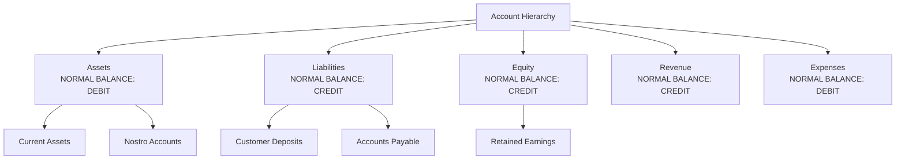

# Concurrent Double-Entry Ledger Engine

## Project Overview

Build a production-grade **double-entry ledger engine** that handles 10,000 concurrent balance updates with no race conditions, guaranteed accounting invariants, and a tamper-evident audit trail that meets regulatory record-keeping requirements.

This project is the most concurrency-intensive of the six capstones. It requires deep understanding of database locking, optimistic concurrency control, and the correctness proofs that principal engineers must be able to provide.

**What you will build:**
- Double-entry ledger with chart of accounts
- Concurrent balance management with correctness proofs (jcstress)
- Reversal mechanism with compensating journal entries
- Tamper-evident hash-chained audit log
- Reconciliation query engine for accounting invariant verification

---

## System Requirements

### Functional Requirements

| Requirement | Specification |
|---|---|
| Double-entry | Every transaction must have equal debits and credits |
| Atomicity | A journal entry containing N lines either all posts or none post |
| Idempotency | Re-posting same journal entry ID is a no-op |
| Reversal | Any posted entry can be reversed via compensating entry |
| Balance | Running balance queryable at any point in time |
| Audit | Every balance change produces an immutable, verifiable audit record |

### Non-Functional Requirements

| SLO | Target |
|---|---|
| Write throughput | 10,000 concurrent balance updates |
| P99 write latency | < 50ms |
| Balance query latency | < 10ms (indexed) |
| Audit log integrity | SHA-256 hash chain, no gaps |
| Idempotency window | Unlimited (permanent deduplication by journal entry ID) |

---

## Architecture

```mermaid
graph TB
    API[Ledger API\nPOST /journal-entries] --> IDEM[Idempotency\nCheck]
    IDEM --> VAL[Double-Entry\nValidation\nΣdebits = Σcredits]
    VAL --> TX[Atomic Transaction\nPostgres]
    
    subgraph PostgreSQL Transaction
        JE[(journal_entries\njournal_lines)]
        BAL[(account_balances\nrunning totals)]
        AUD[(audit_events\nhash chain)]
    end
    
    TX --> JE
    TX --> BAL
    TX --> AUD
    
    QUERY[Balance Query\nGET /accounts/{id}/balance] --> BAL
    RECON[Reconciliation\nΣassets = Σliabilities + Σequity] --> JE
    REVERSE[Reversal API\nPOST /journal-entries/{id}/reverse] --> TX
```

---

## Domain Model

### Chart of Accounts



The fundamental accounting equation must hold at all times:

**Assets = Liabilities + Equity**

---

## Database Schema

```sql
-- Chart of accounts
CREATE TABLE accounts (
    id              UUID DEFAULT gen_random_uuid() PRIMARY KEY,
    code            VARCHAR(20) NOT NULL UNIQUE,
    name            VARCHAR(255) NOT NULL,
    account_type    VARCHAR(20) NOT NULL,  -- ASSET, LIABILITY, EQUITY, REVENUE, EXPENSE
    normal_balance  VARCHAR(10) NOT NULL,  -- DEBIT, CREDIT
    currency        CHAR(3) NOT NULL DEFAULT 'GBP',
    is_leaf         BOOLEAN NOT NULL DEFAULT true,
    parent_id       UUID REFERENCES accounts(id),
    created_at      TIMESTAMPTZ NOT NULL DEFAULT now(),
    
    CONSTRAINT account_type_check CHECK (
        account_type IN ('ASSET','LIABILITY','EQUITY','REVENUE','EXPENSE')
    )
);

-- Journal entries (the header record)
CREATE TABLE journal_entries (
    id              UUID DEFAULT gen_random_uuid() PRIMARY KEY,
    reference       VARCHAR(255) NOT NULL UNIQUE, -- idempotency key
    description     VARCHAR(500) NOT NULL,
    entry_date      DATE NOT NULL,
    status          VARCHAR(20) NOT NULL DEFAULT 'DRAFT',
    reversal_of     UUID REFERENCES journal_entries(id),
    reversed_by     UUID REFERENCES journal_entries(id),
    created_by      VARCHAR(100) NOT NULL,
    created_at      TIMESTAMPTZ NOT NULL DEFAULT now(),
    posted_at       TIMESTAMPTZ,
    
    CONSTRAINT status_check CHECK (status IN ('DRAFT','POSTED','REVERSED'))
);

-- Journal lines (debit and credit legs)
CREATE TABLE journal_lines (
    id              UUID DEFAULT gen_random_uuid() PRIMARY KEY,
    journal_id      UUID NOT NULL REFERENCES journal_entries(id),
    account_id      UUID NOT NULL REFERENCES accounts(id),
    side            CHAR(6) NOT NULL,  -- DEBIT or CREDIT
    amount          NUMERIC(20,4) NOT NULL CHECK (amount > 0),
    currency        CHAR(3) NOT NULL,
    sequence        INTEGER NOT NULL,
    
    CONSTRAINT side_check CHECK (side IN ('DEBIT','CREDIT'))
);

-- Running account balances (denormalised for query performance)
CREATE TABLE account_balances (
    account_id      UUID PRIMARY KEY REFERENCES accounts(id),
    balance         NUMERIC(20,4) NOT NULL DEFAULT 0,
    debit_total     NUMERIC(20,4) NOT NULL DEFAULT 0,
    credit_total    NUMERIC(20,4) NOT NULL DEFAULT 0,
    last_updated_at TIMESTAMPTZ NOT NULL DEFAULT now(),
    version         BIGINT NOT NULL DEFAULT 0  -- optimistic locking
);

-- Tamper-evident audit log (append-only)
CREATE TABLE ledger_audit_events (
    id              BIGSERIAL PRIMARY KEY,
    journal_id      UUID NOT NULL,
    event_type      VARCHAR(50) NOT NULL,
    actor           VARCHAR(100) NOT NULL,
    payload         JSONB NOT NULL,
    event_hash      CHAR(64) NOT NULL,       -- SHA-256 of this event
    previous_hash   CHAR(64) NOT NULL,       -- hash of previous event for this journal
    created_at      TIMESTAMPTZ NOT NULL DEFAULT now()
);

-- Prevent any UPDATE or DELETE on audit events
CREATE RULE no_update_audit AS ON UPDATE TO ledger_audit_events DO INSTEAD NOTHING;
CREATE RULE no_delete_audit AS ON DELETE TO ledger_audit_events DO INSTEAD NOTHING;
```

---

## Implementation

### Double-Entry Validation

```java
@Service
public class JournalEntryValidator {

    public void validate(PostJournalEntryRequest request) {
        var lines = request.getLines();
        
        if (lines == null || lines.size() < 2) {
            throw new InvalidJournalEntryException("Journal entry must have at least 2 lines");
        }
        
        // Fundamental rule: sum of debits must equal sum of credits
        BigDecimal totalDebits = lines.stream()
            .filter(l -> l.getSide() == Side.DEBIT)
            .map(JournalLine::getAmount)
            .reduce(BigDecimal.ZERO, BigDecimal::add);
            
        BigDecimal totalCredits = lines.stream()
            .filter(l -> l.getSide() == Side.CREDIT)
            .map(JournalLine::getAmount)
            .reduce(BigDecimal.ZERO, BigDecimal::add);
        
        if (totalDebits.compareTo(totalCredits) != 0) {
            throw new UnbalancedJournalEntryException(
                "Debits (" + totalDebits + ") must equal credits (" + totalCredits + ")"
            );
        }
        
        // All lines must be in same currency
        long distinctCurrencies = lines.stream()
            .map(JournalLine::getCurrency)
            .distinct()
            .count();
        if (distinctCurrencies > 1) {
            throw new MultiCurrencyJournalException(
                "Multi-currency journal entries require FX conversion legs"
            );
        }
    }
}
```

### Concurrent Balance Update — Solving the Race Condition

```java
@Service
public class BalanceUpdateService {

    private final JdbcTemplate jdbc;

    // Strategy: optimistic locking with retry
    // Avoids pessimistic locking contention on high-velocity accounts
    @Retryable(
        retryFor = OptimisticLockException.class,
        maxAttempts = 3,
        backoff = @Backoff(delay = 10, multiplier = 2, random = true)
    )
    @Transactional
    public void applyLines(List<JournalLine> lines) {
        for (JournalLine line : lines) {
            int updated = jdbc.update("""
                UPDATE account_balances
                SET balance      = balance + ?,
                    debit_total  = debit_total  + ?,
                    credit_total = credit_total + ?,
                    version      = version + 1,
                    last_updated_at = now()
                WHERE account_id = ? AND version = ?
                """,
                line.getSignedAmount(),   // positive for debit on ASSET, negative otherwise
                line.getSide() == Side.DEBIT  ? line.getAmount() : BigDecimal.ZERO,
                line.getSide() == Side.CREDIT ? line.getAmount() : BigDecimal.ZERO,
                line.getAccountId(),
                line.getExpectedVersion()
            );
            
            if (updated == 0) {
                // Another transaction modified this account concurrently
                throw new OptimisticLockException(
                    "Concurrent modification on account " + line.getAccountId()
                );
            }
        }
    }
}
```

### Reversal — Compensating Journal Entry

```java
@Service
@Transactional
public class JournalReversalService {

    public JournalEntry reverse(UUID journalId, String actor, String reason) {
        JournalEntry original = journalRepository.findById(journalId)
            .orElseThrow(() -> new JournalNotFoundException(journalId));
        
        if (original.getStatus() != JournalStatus.POSTED) {
            throw new InvalidReversalException("Only POSTED entries can be reversed");
        }
        if (original.getReversedBy() != null) {
            throw new InvalidReversalException("Entry already reversed");
        }
        
        // Create compensating entry: flip all debits and credits
        JournalEntry reversal = JournalEntry.builder()
            .reference("REV-" + original.getReference())
            .description("Reversal of: " + original.getDescription() + " — " + reason)
            .entryDate(LocalDate.now())
            .reversalOf(original.getId())
            .createdBy(actor)
            .lines(original.getLines().stream()
                .map(line -> line.toBuilder()
                    .side(line.getSide() == Side.DEBIT ? Side.CREDIT : Side.DEBIT)
                    .build())
                .collect(toList()))
            .build();
        
        journalRepository.insert(reversal);
        journalRepository.markReversed(original.getId(), reversal.getId());
        balanceUpdateService.applyLines(reversal.getLines());
        auditService.record(reversal.getId(), AuditEventType.REVERSED, actor);
        
        return reversal;
    }
}
```

### Tamper-Evident Audit Chain

```java
@Service
public class LedgerAuditService {

    private final LedgerAuditRepository auditRepository;

    @Transactional
    public void record(UUID journalId, AuditEventType type, String actor) {
        String previousHash = auditRepository
            .findLatestHash(journalId)
            .orElse("GENESIS");
        
        Map<String, Object> payload = Map.of(
            "journalId", journalId,
            "eventType", type.name(),
            "actor", actor,
            "timestamp", Instant.now().toString()
        );
        
        String eventHash = computeHash(payload, previousHash);
        
        auditRepository.insert(LedgerAuditEvent.builder()
            .journalId(journalId)
            .eventType(type)
            .actor(actor)
            .payload(payload)
            .previousHash(previousHash)
            .eventHash(eventHash)
            .build());
    }

    private String computeHash(Map<String, Object> payload, String previousHash) {
        String content = payload.toString() + "|" + previousHash;
        return DigestUtils.sha256Hex(content);
    }

    // Verify the entire audit chain for a journal entry
    public boolean verifyChain(UUID journalId) {
        List<LedgerAuditEvent> events = auditRepository.findAllByJournalId(journalId);
        if (events.isEmpty()) return true;
        
        String expectedPreviousHash = "GENESIS";
        for (LedgerAuditEvent event : events) {
            if (!event.getPreviousHash().equals(expectedPreviousHash)) return false;
            String computed = computeHash(event.getPayload(), event.getPreviousHash());
            if (!computed.equals(event.getEventHash())) return false;
            expectedPreviousHash = event.getEventHash();
        }
        return true;
    }
}
```

---

## Concurrency Correctness — jcstress Tests

```java
// Verify: two concurrent debits from an account with exactly enough balance
// Expected: exactly one succeeds, one gets OptimisticLockException
@JCStressTest
@Outcome(id = "1, 0", expect = ACCEPTABLE, desc = "Thread 1 wins, Thread 2 fails")
@Outcome(id = "0, 1", expect = ACCEPTABLE, desc = "Thread 2 wins, Thread 1 fails")
@Outcome(id = "1, 1", expect = FORBIDDEN,  desc = "Both succeed — overdraft!")
@Outcome(id = "0, 0", expect = FORBIDDEN,  desc = "Both fail — funds not debited")
@State
public class ConcurrentDebitTest {

    private final LedgerEngine ledger = LedgerEngine.withBalance(new BigDecimal("100.00"));

    @Actor
    public void actor1(II_Result r) {
        try {
            ledger.debit(accountId, new BigDecimal("100.00"), "ref-001");
            r.r1 = 1;
        } catch (InsufficientFundsException | OptimisticLockException e) {
            r.r1 = 0;
        }
    }

    @Actor
    public void actor2(II_Result r) {
        try {
            ledger.debit(accountId, new BigDecimal("100.00"), "ref-002");
            r.r2 = 1;
        } catch (InsufficientFundsException | OptimisticLockException e) {
            r.r2 = 0;
        }
    }
}
```

---

## Reconciliation Queries

```sql
-- Verify double-entry invariant: total debits must equal total credits
SELECT
    SUM(CASE WHEN jl.side = 'DEBIT'  THEN jl.amount ELSE 0 END) AS total_debits,
    SUM(CASE WHEN jl.side = 'CREDIT' THEN jl.amount ELSE 0 END) AS total_credits,
    SUM(CASE WHEN jl.side = 'DEBIT'  THEN jl.amount ELSE 0 END) -
    SUM(CASE WHEN jl.side = 'CREDIT' THEN jl.amount ELSE 0 END) AS imbalance
FROM journal_lines jl
JOIN journal_entries je ON je.id = jl.journal_id
WHERE je.status = 'POSTED'
  AND je.entry_date BETWEEN :start_date AND :end_date;

-- Balance sheet invariant: Assets = Liabilities + Equity
SELECT
    SUM(CASE WHEN a.account_type = 'ASSET'     THEN ab.balance ELSE 0 END) AS total_assets,
    SUM(CASE WHEN a.account_type = 'LIABILITY' THEN ab.balance ELSE 0 END) AS total_liabilities,
    SUM(CASE WHEN a.account_type = 'EQUITY'    THEN ab.balance ELSE 0 END) AS total_equity,
    SUM(CASE WHEN a.account_type = 'ASSET'     THEN ab.balance ELSE 0 END) -
    SUM(CASE WHEN a.account_type IN ('LIABILITY','EQUITY') THEN ab.balance ELSE 0 END) AS imbalance
FROM account_balances ab
JOIN accounts a ON a.id = ab.account_id;
```

---

## Architecture Decision Records

### ADR-001: Optimistic Locking Over Pessimistic for Account Balances

**Status:** Accepted

**Context:** High-velocity accounts (e.g., a master clearing account) can receive thousands of concurrent updates. `SELECT FOR UPDATE` creates a serialisation queue, capping throughput at ~200 TPS per account.

**Decision:** Use optimistic locking (`version` column, conditional UPDATE). Retry up to 3 times with exponential backoff + jitter. Fall back to pessimistic locking only for multi-account journal entries where deadlock ordering cannot be guaranteed.

**Consequences:** 1-3% retry rate under high contention. Maximum throughput ~5,000 updates/second per account. Requires jcstress proof that the FORBIDDEN outcome (both succeed) is unreachable.

### ADR-002: Denormalised `account_balances` Table

**Status:** Accepted

**Context:** Calculating running balance by summing all journal lines is O(n) and grows unboundedly. At 10M transactions/day, a balance query would scan millions of rows.

**Decision:** Maintain a denormalised `account_balances` table updated atomically in the same transaction as journal lines. Balance queries are O(1) indexed lookups.

**Consequences:** `account_balances` must be recomputed from `journal_lines` on schema migration. Nightly reconciliation job verifies `account_balances` matches computed totals.

---

## Principal Engineer Review Criteria

- [ ] **jcstress test passes** — FORBIDDEN outcome (both concurrent debits succeed) is unreachable
- [ ] **Double-entry validation enforced** — unbalanced journal entries rejected with descriptive error
- [ ] **Reversal produces exact compensation** — reversed entry + original entry sum to zero
- [ ] **Audit chain verifiable** — `verifyChain()` returns true for all posted entries
- [ ] **Reconciliation query identifies imbalance** — test with intentionally corrupted balance
- [ ] **Performance under concurrency** — JMH benchmark at 10k concurrent writers, P99 < 50ms
- [ ] **Idempotency proven** — posting same journal reference twice produces 1 database row
