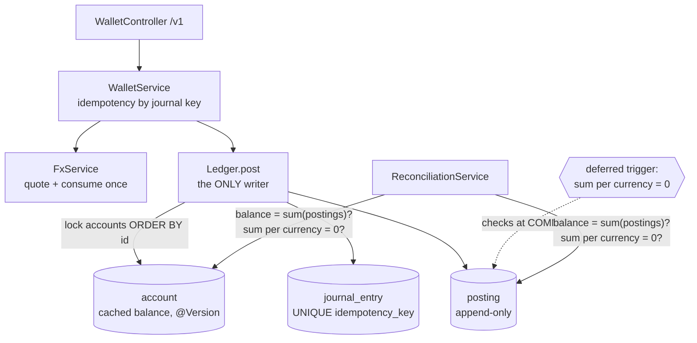

<!-- GENERATED from examples/capstone-2-wallet-ledger/README.md by tools/build_capstone_pages.py. Edit the README, then re-run the script. -->

**Source code:** [`examples/capstone-2-wallet-ledger`](https://github.com/mostafasroor1983/fintech-engineering-mastery/tree/v1/examples/capstone-2-wallet-ledger) · run `mvn test -pl capstone-2-wallet-ledger -am` from `examples/`

> Wallets whose balances can never go negative, never drift from the ledger, and never create or lose
> money, including when customers swap GBP for EUR. Spring Boot 4.0.9, Java 21, PostgreSQL 17.

## The problem

A wallet looks like "a balance column". The moment money moves, three things go wrong:

1. Two concurrent withdrawals both see 100 and both spend it (**lost update / double spend**).
2. A bug updates a balance without a matching movement elsewhere, and money appears from nowhere.
3. A currency exchange that "rounds a bit" leaves the books unbalanced in one currency.

The fix is a **double-entry ledger**. Every movement is a journal entry whose legs sum to zero *per
currency*. The cached balance is a convenience; the postings are the truth, and a reconciliation job
proves the two agree.

| Risk | Fix | Canonical lesson |
|---|---|---|
| Concurrent spending overdraws | Pessimistic row locks in **id order**, `CHECK (balance_minor >= 0)` | [Scenario A: concurrent withdrawals](#/tracks/track-05/lessons/track-05-lesson-02), [Pessimistic locking](#/tracks/track-05/lessons/track-05-lesson-17) |
| A→B and B→A deadlock | Same global lock order for every transaction | [Scenario D: concurrent ledger posting](#/tracks/track-05/lessons/track-05-lesson-05) |
| Unbalanced entry | Java check **and** a deferred PostgreSQL constraint trigger at COMMIT | [Double-entry ledger](#/tracks/track-05/lessons/track-05-lesson-01) |
| History rewritten | `UPDATE`/`DELETE` on postings and journal entries raise an error | [Audit trails](#/tracks/track-05/lessons/track-05-lesson-21) |
| Balance drifts from postings | Reconciliation query under `REPEATABLE READ` | [Balance reconciliation](#/tracks/track-05/lessons/track-05-lesson-22) |
| FX quote reused or used late | Single-use, expiring quote consumed by one conditional `UPDATE` | [FX systems](#/tracks/track-04/lessons/track-04-lesson-10) |

## Architecture



An FX transfer of 100.00 GBP from Alice to Bob's EUR wallet (illustrative mid rate 1.15, 50 bps spread,
so the rate is 1.15 × (1 − 0.005) = 1.14425; 100.00 × 1.14425 = 114.425, rounded **down** to 114.42):

| Leg | Account | Amount |
|---|---|---|
| 1 | Alice GBP wallet | −100.00 GBP |
| 2 | House GBP FX position | +100.00 GBP |
| 3 | House EUR FX position | −114.42 EUR |
| 4 | Bob EUR wallet | +114.42 EUR |

GBP sums to 0 and EUR sums to 0. The house keeps the 0.005 EUR rounding fraction by policy, and a test
pins that policy.

## Key decisions and trade-offs

| Decision | Why | Cost / when not to |
|---|---|---|
| Pessimistic locks for transfers | Hot wallets (a merchant receiving many payments) would cause retry storms under optimistic locking | Lock wait under contention. For extreme hot spots, split the account into sub-accounts or buffer credits. |
| `@Version` kept as well | Safety net for any writer that forgets to lock | One extra column; harmless. |
| Cached balance + postings | Balance reads stay O(1) | Two copies of the truth, hence the reconciliation job. |
| Signed minor units (`bigint`) | Exact, fast, no scale mistakes | Needs `Money` to convert at the edges; amounts beyond ±9.2×10¹⁸ minor units are impossible (fine for money). |
| DB-enforced invariants (CHECK, triggers) | A bug in any service, script or migration still cannot unbalance the books | Logic in two places; trigger cost on insert (one indexed aggregate per posting). |
| Idempotency via `UNIQUE` journal key | The entry *is* the record of the request; no extra table | Cannot replay a full HTTP response (capstone 1 shows that pattern). |
| Customer gets the FX amount rounded down | Business rule: fractions stay with the house, consistently | Must be disclosed to customers; some jurisdictions regulate this. Not legal advice. |

## How to run

```bash
cd examples
mvn test -pl capstone-2-wallet-ledger -am     # 13 tests on real PostgreSQL (Testcontainers)
```

macOS with Docker Desktop: `export DOCKER_HOST=unix://$HOME/.docker/run/docker.sock` if Testcontainers
cannot find Docker.

```bash
export DB_URL=jdbc:postgresql://localhost:5432/wallet DB_USER=wallet DB_PASSWORD=...
mvn spring-boot:run -pl capstone-2-wallet-ledger
curl -s -X POST localhost:8080/v1/wallets -H 'Content-Type: application/json' -d '{"ownerId":"alice","currency":"GBP"}'
curl -s -X POST localhost:8080/v1/fx/quotes -H 'Content-Type: application/json' \
     -d '{"sellAmount":100.00,"sellCurrency":"GBP","buyCurrency":"EUR"}'
curl -s -X POST localhost:8080/v1/fx/transfers -H 'Content-Type: application/json' -H 'Idempotency-Key: fx-0000001' \
     -d '{"quoteId":"<id>","from":"<alice-gbp>","to":"<bob-eur>"}'
```

| Method | Path | Notes |
|---|---|---|
| `POST` | `/v1/wallets` | Open a wallet (owner, currency) |
| `GET` | `/v1/wallets/{id}` | Balance |
| `POST` | `/v1/transfers` | Same currency; `Idempotency-Key` required; 422 problem+json on insufficient funds |
| `POST` | `/v1/fx/quotes` | Rate valid 30 s |
| `POST` | `/v1/fx/transfers` | Consumes the quote once; 409 if used or expired |

## Tests (what each one proves)

| Test | Proves |
|---|---|
| `concurrentSpendingNeverOverdraws` | 50 concurrent 10.00 spends from 100.00 → exactly 10 succeed, balance 0, books clean |
| `opposingTransfersDoNotDeadlock` | 40 concurrent A→B / B→A transfers all succeed (ordered locking) |
| `databaseRejectsAnUnbalancedEntry` | A one-legged entry inserted by raw SQL fails at COMMIT |
| `ledgerIsAppendOnly` | `UPDATE posting` / `DELETE journal_entry` are refused by the database |
| `reconciliationDetectsABalanceThatDriftedFromThePostings` | A balance changed without a posting is reported |
| `fxTransferBalancesPerCurrencyAndRoundsDownForTheCustomer` | 100.00 GBP → 114.42 EUR; both currencies sum to zero |
| `quoteCanBeUsedOnlyOnceAndNotAfterExpiry` | Reuse and expiry both rejected |
| `concurrentRetriesOfOneFxTransferReturnTheSameEntry` | 10 concurrent retries → 1 entry, money moved once |
| `retryWithSameKeyDoesNotMoveMoneyTwice`, `insufficientFundsWritesNothing`, `transferMovesMoney...` | Basics |
| `WalletApiTest` (2) | HTTP layer, RFC 9457 errors, validation at the edge |

Real output (2026-11-12):

```text
Tests run: 11, Failures: 0, Errors: 0, Skipped: 0 -- in com.fintechmastery.wallet.LedgerTest
Tests run: 2, Failures: 0, Errors: 0, Skipped: 0 -- in com.fintechmastery.wallet.WalletApiTest
BUILD SUCCESS
```

## Load test

```bash
mvn test -pl capstone-2-wallet-ledger -am -Dgroups=load
```

5,000 random transfers between 50 wallets from 100 concurrent workers, in both directions on hot pairs.
Asserts no deadlock, a clean reconciliation, and total money unchanged (5,000.00 EUR).
Measured once on an Apple M1 Pro laptop, PostgreSQL in Docker. **Illustrative only:**

```text
LOAD capstone-2: 4764 ok + 123 rejected in 4.3 s = 1146 tx/s; p50 77.1 ms, p99 240.8 ms
```

(The other 113 random picks had `from == to` and were skipped.)

## Known limits

- No authentication: `ownerId` stands in for the caller (capstone 5 shows OAuth2).
- FX rates come from configuration. A real system streams rates from a market-data provider, and the house
  hedges its FX position. Neither is modelled here.
- Lazy creation of house accounts is not tuned for many currencies.
- Reconciliation scans everything. At scale, reconcile per account incrementally, from a checkpoint.
- Single PostgreSQL. Sharding a ledger is covered in [Design a ledger at scale](#/tracks/track-14/lessons/track-14-lesson-05).

## Build it yourself in about 12 hours

| Step | Hours | Done when |
|---|---|---|
| 1. `Money` (from `fintech-common`), schema, `Ledger.post` for one same-currency transfer | 2 | Happy path green |
| 2. Concurrent-spend test against a naive read-modify-write; watch it overdraw; add locks | 2 | 50-thread test green |
| 3. Opposing-transfer test; watch PostgreSQL report a deadlock; add id ordering | 1.5 | Green |
| 4. DB invariants: CHECK, deferred balance trigger, append-only triggers, tests via raw SQL | 2 | Green |
| 5. FX quote + 4-leg transfer + single-use quote + retry race | 2.5 | FX tests green |
| 6. Reconciliation, load test, README numbers, rehearse the pitch | 2 | You can explain the 4 FX legs on a whiteboard |

## How I would explain this in an interview

"Balances are a cache. The truth is an append-only ledger where every entry's legs sum to zero in each
currency. One class writes to it. It locks the involved accounts in id order, so concurrent transfers
cannot overdraw or deadlock. It updates the cached balances and appends the postings, all in one
transaction. The database enforces the invariants too: no negative customer balance, a deferred trigger
that rejects any unbalanced entry at commit, and no updates or deletes on postings. A cross-currency
transfer has four legs through the house's FX position accounts, so each currency balances on its own.
The quote is single-use and expires, and the customer amount is rounded down by an explicit, tested
rule. A reconciliation query proves the cached balances still equal the postings."

## The 5 hardest follow-up questions

1. **"Why pessimistic locking, not optimistic?"**
   For a contended account, optimistic locking turns contention into retries, and retries add load exactly
   when it is highest. Locking queues the work instead. Optimistic suits rarely contended rows (profile
   edits). Here `@Version` stays as a safety net. *Wrong answer:* "pessimistic is always slower". Under
   contention it often has better throughput than a retry storm.

2. **"Isn't the trigger slow? Why check in the database at all?"**
   It runs one aggregate over the entry's postings (indexed by `entry_id`), usually 2–4 rows. It exists
   because any code path, including a hotfix script at 2 a.m., can contain a bug. The Java check gives a
   friendly error; the database check makes the invariant impossible to break.

3. **"How would you scale this to 100× the volume?"**
   Partition (shard) by account. A transfer between two shards is no longer one local transaction, so
   it becomes a saga with a suspense/clearing account and compensations ([Saga pattern](#/tracks/track-05/lessons/track-05-lesson-14)).
   For hot accounts, use sub-accounts. Move balance reads to a CQRS read model if needed.

4. **"The customer complains they got 114.42, not 114.43. Who is right?"**
   The rule is "round down, house keeps the fraction". It is applied by `RoundingMode.DOWN` in one place
   and pinned by a test. What matters is that the rule is explicit, disclosed and consistent, and that the
   ledger still balances (the house's EUR leg is exactly −114.42).

5. **"Reconciliation found a break. What now?"**
   Never "fix" the balance with an `UPDATE`. Find the cause, then post a correcting journal entry (a
   reversal or adjustment) with a reason, so the audit trail explains it. Alert on every break: a single
   break means some code path bypassed the ledger.

## See also

- [Track 05: Double-entry ledger](#/tracks/track-05/lessons/track-05-lesson-01)
- [Track 05: Scenario J: concurrent balance updates at scale](#/tracks/track-05/lessons/track-05-lesson-11)
- [Track 04: Digital wallet architecture](#/tracks/track-04/lessons/track-04-lesson-19)
- [Track 08: PostgreSQL locking](#/tracks/track-08/lessons/track-08-lesson-04)
