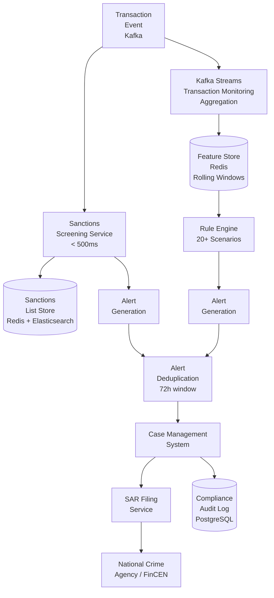
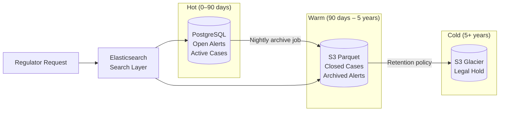

# Distributed AML & Sanctions Screening Platform

## Project Overview

Build a real-time Anti-Money Laundering (AML) and sanctions screening platform that processes every payment transaction for financial crime indicators, generates alerts for analyst review, and maintains a tamper-evident compliance audit trail.

This project integrates: Kafka Streams for windowed aggregation, rule engine design, Redis for feature store, and regulatory data architecture.

**What you will build:**
- Real-time sanctions screening engine with fuzzy name matching
- Kafka Streams transaction monitoring with rolling window aggregation
- Pluggable AML scenario rule engine (structuring, rapid movement, PEP exposure)
- Alert management system with prioritisation and deduplication
- Regulatory audit trail meeting FATF 5-year retention requirements

---

## System Requirements

### Functional Requirements

| Requirement | Specification |
|---|---|
| Sanctions screening | Every payment screened against OFAC, UN, EU lists |
| Transaction monitoring | 20+ AML scenarios evaluated per transaction |
| Alert generation | Alerts with score, evidence, and analyst assignment |
| Alert deduplication | 72-hour window per customer per scenario |
| SAR filing | Suspicious Activity Report generation workflow |
| Audit trail | 5-year tamper-evident retention, verifiable hash chain |

### Regulatory Latency Requirements

| Operation | Maximum Latency | Consequence of Breach |
|---|---|---|
| Sanctions screening decision | 500ms | Cannot authorise payment |
| Transaction monitoring alert | 60 seconds | Operational — not blocking |
| SAR filing deadline | 30 days from alert | Regulatory breach |

---

## Architecture



---

## Kafka Streams Topology

```java
@Component
public class AmlStreamProcessor {

    @Bean
    public KStream<String, TransactionEvent> buildTopology(StreamsBuilder builder) {
        
        KStream<String, TransactionEvent> transactions = builder
            .stream("transactions", Consumed.with(Serdes.String(), txnSerde))
            .filter((key, txn) -> txn.getStatus() == TransactionStatus.COMPLETED);

        // ── Structuring Detection: 7-day rolling window of cash deposits ──
        transactions
            .filter((k, txn) -> txn.getType() == TransactionType.CASH_DEPOSIT)
            .selectKey((k, txn) -> txn.getCustomerId())
            .groupByKey()
            .windowedBy(TimeWindows.ofSizeWithNoGrace(Duration.ofDays(7)))
            .aggregate(
                CashDepositAggregate::new,
                (customerId, txn, agg) -> agg.add(txn),
                Materialized.<String, CashDepositAggregate, WindowStore<Bytes, byte[]>>as("cash-deposit-windows")
                    .withValueSerde(cashDepositSerde)
            )
            .toStream()
            .filter((windowedKey, agg) -> agg.exceedsStructuringThreshold())
            .foreach((windowedKey, agg) ->
                featureStore.update(windowedKey.key(), "7d_cash_deposits", agg));

        // ── Rapid Movement: funds received and 90%+ sent within 24h ──
        transactions
            .selectKey((k, txn) -> txn.getCustomerId())
            .groupByKey()
            .windowedBy(TimeWindows.ofSizeWithNoGrace(Duration.ofHours(24)))
            .aggregate(
                MovementAggregate::new,
                (customerId, txn, agg) -> agg.add(txn),
                Materialized.as("movement-windows")
            )
            .toStream()
            .filter((wk, agg) -> agg.isRapidMovement())
            .foreach((wk, agg) ->
                ruleEngine.evaluate(wk.key(), AmlScenario.RAPID_MOVEMENT, agg));

        return transactions;
    }
}
```

---

## Sanctions Screening Engine

```java
@Service
public class SanctionsScreeningService {

    private final SanctionsListCache listCache;      // Redis — in-memory list snapshot
    private final ElasticsearchClient esClient;      // Elasticsearch — fuzzy search

    // Two-tier screening: exact match in Redis, fuzzy in Elasticsearch
    public ScreeningResult screen(PaymentInstruction instruction) {
        var screeningTargets = buildTargets(instruction);
        
        for (ScreeningTarget target : screeningTargets) {
            // Tier 1: exact/token match in Redis (< 1ms)
            var exactMatch = listCache.exactMatch(target.getName(), target.getIdentifiers());
            if (exactMatch.isPresent()) {
                return ScreeningResult.hit(exactMatch.get(), MatchType.EXACT);
            }
            
            // Tier 2: fuzzy match in Elasticsearch (< 50ms)
            var fuzzyMatches = esClient.search(SearchRequest.of(s -> s
                .index("sanctions-list")
                .query(q -> q.bool(b -> b
                    .should(sh -> sh.fuzzy(f -> f
                        .field("name")
                        .value(target.getName())
                        .fuzziness("AUTO")
                        .prefixLength(2)))
                    .minimumShouldMatch("1")))
                .minScore(0.85)
            ), SanctionsEntry.class);
            
            if (fuzzyMatches.hits().total().value() > 0) {
                var hit = fuzzyMatches.hits().hits().get(0).source();
                return ScreeningResult.hit(hit, MatchType.FUZZY);
            }
        }
        
        return ScreeningResult.clear();
    }

    private List<ScreeningTarget> buildTargets(PaymentInstruction instruction) {
        var targets = new ArrayList<ScreeningTarget>();
        targets.add(ScreeningTarget.of(instruction.getBeneficiaryName(), 
                                       instruction.getBeneficiaryAccountNumber()));
        targets.add(ScreeningTarget.of(instruction.getOrderingCustomerName(), 
                                       instruction.getOrderingCustomerAccountNumber()));
        if (instruction.getBeneficiaryBic() != null) {
            targets.add(ScreeningTarget.of(instruction.getBeneficiaryBic()));
        }
        return targets;
    }
}
```

---

## Rule Engine Architecture

```java
// Each scenario is a pluggable implementation — new typologies added without code changes
public interface AmlScenario {
    String getScenarioId();
    String getTypology();
    AlertSeverity getBaseSeverity();
    boolean evaluate(CustomerFeatures features, TransactionContext context);
    AlertEvidence collectEvidence(CustomerFeatures features, TransactionContext context);
}

@Component
public class AmlRuleEngine {

    private final List<AmlScenario> scenarios;  // Spring injection of all implementations
    private final AlertService alertService;

    public void evaluate(String customerId, CustomerFeatures features, 
                         TransactionContext context) {
        for (AmlScenario scenario : scenarios) {
            if (scenario.evaluate(features, context)) {
                var evidence = scenario.collectEvidence(features, context);
                alertService.generateAlert(
                    AmlAlert.builder()
                        .customerId(customerId)
                        .scenarioId(scenario.getScenarioId())
                        .typology(scenario.getTypology())
                        .severity(scenario.getBaseSeverity())
                        .evidence(evidence)
                        .build()
                );
            }
        }
    }
}

// Example: Structuring scenario
@Component
public class StructuringScenario implements AmlScenario {
    private static final BigDecimal THRESHOLD      = new BigDecimal("10000");
    private static final BigDecimal LOWER_BOUND    = new BigDecimal("9000");
    private static final int        MIN_TXNS       = 3;
    
    @Override public String getScenarioId()        { return "AML-001"; }
    @Override public String getTypology()          { return "STRUCTURING"; }
    @Override public AlertSeverity getBaseSeverity() { return AlertSeverity.HIGH; }
    
    @Override
    public boolean evaluate(CustomerFeatures features, TransactionContext context) {
        return features.get7dCashDepositCount() >= MIN_TXNS
            && features.get7dCashDepositTotal().compareTo(THRESHOLD) >= 0
            && features.getMaxSingleCashDeposit().compareTo(LOWER_BOUND) >= 0
            && features.getMaxSingleCashDeposit().compareTo(THRESHOLD) < 0;
    }
}
```

---

## Alert Management — Scoring and Deduplication

```java
@Service
public class AlertService {

    private final AlertRepository alertRepository;
    private final AlertScoringService scoringService;
    private static final Duration DEDUP_WINDOW = Duration.ofHours(72);

    @Transactional
    public void generateAlert(AmlAlert newAlert) {
        // Deduplication: same customer + scenario within 72h → merge evidence
        var existing = alertRepository.findOpen(
            newAlert.getCustomerId(),
            newAlert.getScenarioId(),
            Instant.now().minus(DEDUP_WINDOW)
        );
        
        if (existing.isPresent()) {
            alertRepository.mergeEvidence(existing.get().getId(), newAlert.getEvidence());
            return;
        }
        
        // Score the alert
        var customer = customerRepository.findById(newAlert.getCustomerId()).orElseThrow();
        var score = scoringService.score(newAlert, customer);
        
        var alert = newAlert.toBuilder()
            .score(score)
            .priority(AlertPriority.fromScore(score))
            .assignedTo(queueRouter.assignTo(score, customer.getRiskRating()))
            .status(AlertStatus.OPEN)
            .build();
        
        alertRepository.insert(alert);
        auditService.record(alert.getId(), AuditEventType.ALERT_GENERATED, "SYSTEM");
    }
}

@Component
public class AlertScoringService {
    public int score(AmlAlert alert, CustomerProfile customer) {
        int base        = alert.getSeverity().getBaseScore();      // HIGH=40, MEDIUM=25, LOW=10
        int pepBoost    = customer.isPep() ? 25 : 0;
        int jurisdBoost = alert.involvesHighRiskJurisdiction() ? 20 : 0;
        int repeatBoost = alertRepository.countRecentAlerts(customer.getId(), 
                              Duration.ofDays(30)) > 0 ? 15 : 0;
        int riskMod     = customer.getRiskRating().getScoreModifier(); // HIGH=+20, LOW=-5
        
        return Math.min(100, base + pepBoost + jurisdBoost + repeatBoost + riskMod);
    }
}
```

---

## Compliance Data Architecture



The hash-chained audit log provides tamper evidence across all three tiers. Each record's SHA-256 hash depends on the previous record, making retroactive modification detectable.

---

## Sanctions List Management

```java
// Sanctions list update — daily refresh from OFAC, UN, EU sources
@Scheduled(cron = "0 0 2 * * *")  // 02:00 UTC daily
public void refreshSanctionsList() {
    log.info("Starting sanctions list refresh");
    
    for (SanctionsListProvider provider : providers) {
        try {
            SanctionsList newList = provider.fetch();
            
            // Atomic swap: build new Redis set, then rename to active key
            String stagingKey = "sanctions:staging:" + provider.getListCode();
            String activeKey  = "sanctions:active:"  + provider.getListCode();
            
            newList.getEntries().forEach(entry ->
                redis.opsForSet().add(stagingKey, entry.toRedisValue()));
            
            redis.rename(stagingKey, activeKey);  // atomic RENAME
            redis.expire(activeKey, Duration.ofDays(2));
            
            // Update Elasticsearch for fuzzy search
            esIndexer.reindex(provider.getListCode(), newList.getEntries());
            
            log.info("Sanctions list {} refreshed: {} entries", 
                provider.getListCode(), newList.size());
                
        } catch (Exception e) {
            log.error("Failed to refresh sanctions list {}", provider.getListCode(), e);
            alertingService.notify(Alert.SANCTIONS_LIST_REFRESH_FAILURE);
            // Continue with existing list — do not block operations
        }
    }
}
```

---

## Architecture Decision Records

### ADR-001: Two-Tier Sanctions Screening (Redis + Elasticsearch)

**Status:** Accepted

**Context:** Exact name matching in Redis (~1ms) catches 95%+ of true sanctions hits. Fuzzy matching in Elasticsearch catches typos, transliterations, and abbreviated names. Elasticsearch alone would not meet the 500ms latency requirement at scale.

**Decision:** Redis for exact/token match (primary path), Elasticsearch for fuzzy match (secondary path). Both tiers are checked on every screening call. If Redis is unavailable, fall back to Elasticsearch only.

### ADR-002: Kafka Streams for Windowed Aggregation (Not Batch)

**Status:** Accepted

**Context:** Structuring detection requires 7-day rolling window aggregation. A batch job running hourly would detect structuring 60 minutes late, missing real-time blocking opportunities. Kafka Streams provides sub-minute aggregation updates.

**Decision:** Kafka Streams with `TimeWindows.ofSizeWithNoGrace(7 days)`. Feature store (Redis) updated on every aggregation state change. Rule engine evaluates pre-computed features, not raw transaction data.

### ADR-003: PostgreSQL Rules to Enforce Audit Immutability

**Status:** Accepted

**Context:** Application-level code that only does INSERTs can still be bypassed by a DBA or SQL injection. Regulatory compliance requires that audit records cannot be modified.

**Decision:** PostgreSQL `CREATE RULE no_update_audit AS ON UPDATE TO ledger_audit_events DO INSTEAD NOTHING` and equivalent for DELETE. Combined with row-level security denying UPDATE/DELETE to the application role.

---

## Principal Engineer Review Criteria

- [ ] **Sanctions screening responds within 500ms** — benchmark with 10,000 screening calls per second
- [ ] **Structuring scenario triggers correctly** — 3 cash deposits of £9,500 within 7 days → 1 AML-001 alert
- [ ] **Alert deduplication prevents duplicates** — same customer + scenario within 72h → 1 alert with merged evidence
- [ ] **Audit chain is tamper-evident** — `verifyChain()` returns false after any manual row modification
- [ ] **Sanctions list refresh is atomic** — no screening requests see a partially-updated list
- [ ] **High false-positive rate addressed** — scoring separates HIGH from LOW priority alerts
- [ ] **Testcontainers integration test** — full transaction-to-alert flow with real Kafka and PostgreSQL
