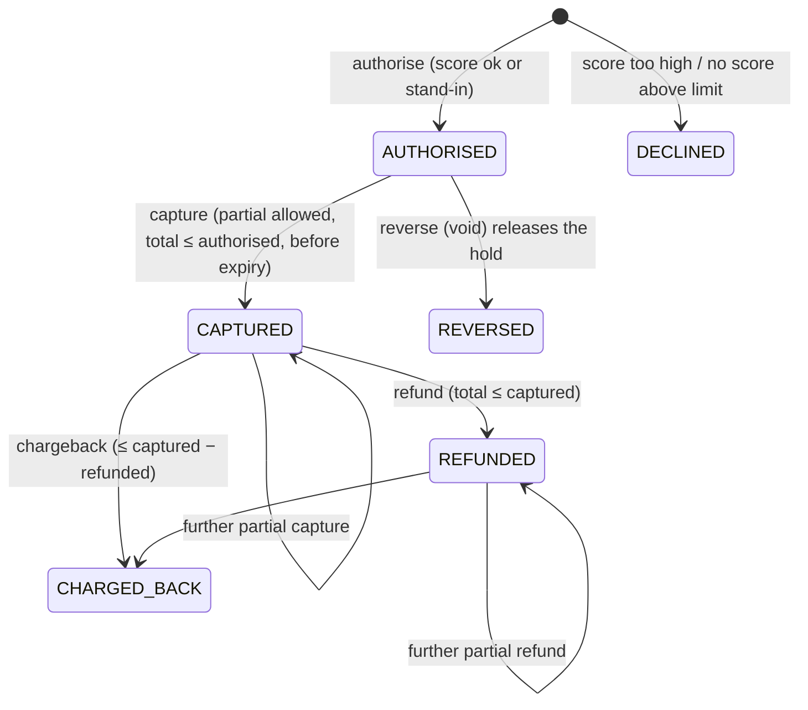
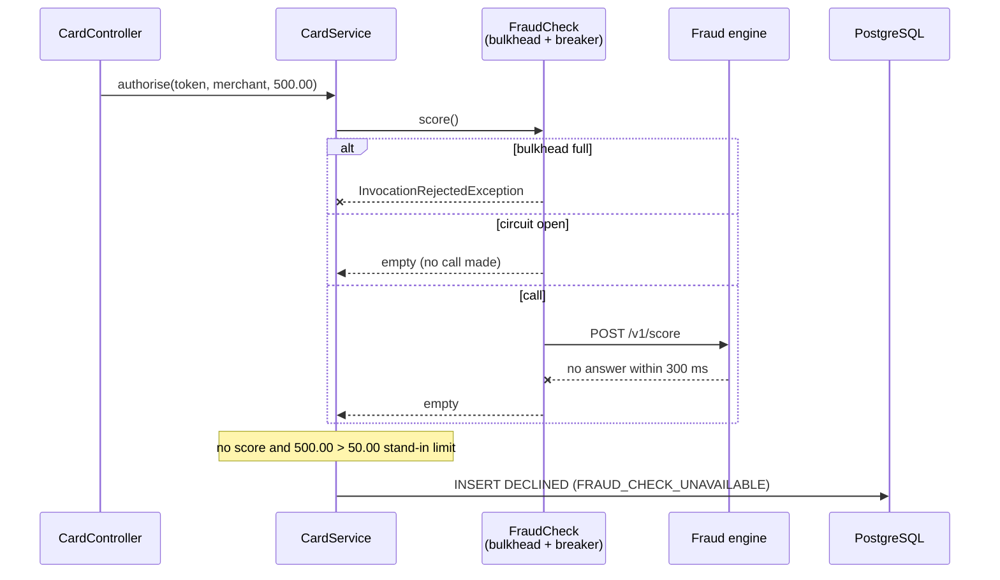

<!-- Arabic translation of index.md (generated from examples/capstone-3-card-authorisation/README.md). Update it when the English page changes. -->

**الشيفرة المصدرية:** [`examples/capstone-3-card-authorisation`](https://github.com/mostafasroor1983/fintech-engineering-mastery/tree/v1/examples/capstone-3-card-authorisation) · نفّذ `mvn test -pl capstone-3-card-authorisation -am` من داخل `examples/`

> جانب مُصدِر البطاقة في دفعة البطاقة: التفويض (حجز المبلغ)، والتحصيل (المقاصة)، والعكس، والاسترداد، والاعتراض
> (chargeback). إضافة إلى فحص احتيال يُسمح له بأن يكون بطيئًا أو متعطلًا دون أن يُسقط التفويضات معه.
> ‏Spring Boot 4.0.9، وتعليقات المرونة في Spring Framework 7.0، وResilience4j 2.4.0، وPostgreSQL 17.

## المشكلة

دفعة البطاقة ليست حدثًا واحدًا. يسأل التاجر أولًا "هل تستطيع هذه البطاقة دفع 100.00؟" (التفويض، الذي يضع حجزًا
على المبلغ). ثم يطلب المال لاحقًا (التحصيل، الذي يحدث عند المقاصة)، وربما على عدة أجزاء. وبعد ذلك قد يحدث
استرداد، أو قد يعترض حامل البطاقة (chargeback). كل خطوة مسموحة فقط في حالات معينة، ويجب ألا تتجاوز المبالغ أبدًا
ما سبقها.

وكل تفويض يستدعي أيضًا محرك احتيال. وللتفويضات ميزانية زمن ضيقة: حامل البطاقة واقف أمام نقطة البيع. فإذا كان محرك
الاحتيال بطيئًا فلا يجوز أن ننتظره. وإذا كان متعطلًا فلا يجوز أن نُغرقه بالطلبات. ونحتاج قاعدة مكتوبة لما نقرره
بدون درجة احتيال.

| الخطر | الحل | الدرس المرجعي |
|---|---|---|
| تحصيل أكثر من المفوَّض، أو استرداد أكثر من المحصَّل | آلة حالات على نوع أوامر **مختوم (sealed)** + قيود `CHECK` في قاعدة البيانات | [مدفوعات البطاقات](#/tracks/track-04/lessons/track-04-lesson-18) |
| تحصيلان جزئيان في الوقت نفسه يتجاوزان التفويض | قفل متفائل `@Version` + ‏`@Retryable` في Spring 7 يعيد التحقق للخاسر | [القفل المتفائل](#/tracks/track-05/lessons/track-05-lesson-16) |
| التاجر يعيد محاولة التحصيل | ‏`operation_id` ‏(Idempotency-Key) هو المفتاح الأساسي لصف التدقيق | [أنماط منع التكرار](#/tracks/track-05/lessons/track-05-lesson-12) |
| محرك احتيال بطيء يعطّل التفويضات | مهلة قراءة 300 ms في HTTP Service Client | [هندسة المهلات](#/tracks/track-06/lessons/track-06-lesson-05) |
| محرك الاحتيال متعطل: كل استدعاء ينتظر المهلة | قاطع دائرة من Resilience4j | [قاطع الدائرة](#/tracks/track-06/lessons/track-06-lesson-02) |
| استدعاءات الاحتيال تستهلك كل السعة | حاجز (Bulkhead): ‏`@ConcurrencyLimit(policy = REJECT)` في Spring 7 | [الحاجز](#/tracks/track-06/lessons/track-06-lesson-03) |
| بلا درجة احتيال: موافقة أم رفض؟ | بديل صريح: موافقة حتى 50.00 ("القرار البديل")، ورفض فوقها | [أنماط البدائل](#/tracks/track-06/lessons/track-06-lesson-14) |

## البنية





يحدث استدعاء الاحتيال **قبل** معاملة قاعدة البيانات، فلا يحتجز محرك احتيال بطيء اتصال قاعدة بيانات أبدًا.

## القرارات الأساسية والمفاضلات

| القرار | السبب | الكلفة / متى لا تستخدمه |
|---|---|---|
| ‏`CardCommand` مختوم + مطابقة الأنماط في `switch` | إضافة أمر جديد (مثل `IncrementalAuth`) لن تُترجم حتى تعالجه آلة الحالات | Java 21؛ وأنواع أكثر قليلًا. |
| قفل متفائل + `@Retryable` للتحصيلات | التنافس على تفويض واحد نادر؛ وإعادات المحاولة رخيصة وتعيد التحقق من القواعد | مع تنافس شديد على صف واحد استخدم `SELECT ... FOR UPDATE` بدلًا من ذلك (انظر المشروع التطبيقي 2). |
| ‏`@Retryable` يغلّف `TransactionTemplate` لا `@Transactional` | يجب أن تكون كل إعادة محاولة معاملة جديدة. وترتيب الوكلاء (proxies) لتعليقين سهل الخطأ. | سطر شيفرة صريح واحد. |
| ‏`@ConcurrencyLimit` ‏(REJECT) في Spring 7 كحاجز | مدمج في الإطار بلا مكتبة إضافية؛ يرفض بدل أن يضع في طابور | إشارة (semaphore) فقط. بلا طابور وبلا مقاييس خاصة به. و`Bulkhead` في Resilience4j فيه خيارات أكثر. |
| قاطع دائرة Resilience4j | في Spring Framework 7 إعادة محاولة وحدود تزامن لكن **بلا قاطع دائرة** | اعتماد إضافي واحد (يُستخدم برمجيًا، بلا حاجة إلى Boot starter). |
| موافقة عند التعطل تحت 50.00، ورفض فوقها | المشتريات الصغيرة تستمر أثناء الانقطاع؛ والخسائر الكبيرة محمية | الحد قرار مخاطر، لا قرار هندسي. و50.00 هنا للتوضيح. |
| تخزين **رمز** البطاقة (token)، لا رقمها الكامل (PAN) أبدًا | يُبقي هذه الخدمة خارج معظم نطاق بيانات حامل البطاقة في PCI DSS | يتطلب خدمة ترميز. والواجهة ترفض أرقام البطاقات الخام عند الطرف. |

## طريقة التشغيل

```bash
cd examples
mvn test -pl capstone-3-card-authorisation -am    # 10 tests: PostgreSQL via Testcontainers + a real local HTTP fraud stub
```

على macOS مع Docker Desktop: نفّذ `export DOCKER_HOST=unix://$HOME/.docker/run/docker.sock` عند الحاجة.

```bash
export DB_URL=jdbc:postgresql://localhost:5432/cards DB_USER=cards DB_PASSWORD=... FRAUD_URL=http://localhost:8090
mvn spring-boot:run -pl capstone-3-card-authorisation
curl -s -X POST localhost:8080/v1/authorisations -H 'Content-Type: application/json' \
  -d '{"cardToken":"tok_abcdefgh1234","merchantId":"shop-1","amount":100.00,"currency":"GBP"}'
curl -s -X POST localhost:8080/v1/authorisations/<id>/captures -H 'Content-Type: application/json' \
  -H 'Idempotency-Key: capture-0001' -d '{"amount":60.00,"currency":"GBP"}'
```

الإعدادات المهمة (`application.yml`):

```yaml
spring.http.serviceclient.fraud:          # Boot 4 HTTP Service Client group
  base-url: ${FRAUD_URL}
  connect-timeout: 200ms
  read-timeout: 300ms
cards:
  stand-in-limit: "50.00"
  fraud.max-concurrent-calls: 20
  fraud.circuit-breaker: { failure-rate-threshold: 50, sliding-window-size: 10, minimum-number-of-calls: 5, wait-in-open-state: 10s }
```

## الاختبارات (ما يثبته كل اختبار)

| الاختبار | ما يثبته |
|---|---|
| `happyPathAuthoriseCaptureRefund` | تحصيل متعدد واسترداد جزئي؛ و3 صفوف تدقيق |
| `illegalTransitionsAreRejected` | استرداد قبل التحصيل، وتحصيل زائد، وتحصيل بعد العكس |
| `chargebackCannotExceedWhatIsLeftAfterRefunds` | قواعد المبالغ عبر الاستردادات والاعتراضات |
| `sameOperationIdIsAppliedOnce` | تحصيل آمن من التكرار |
| `concurrentPartialCapturesNeverExceedTheAuthorisedAmount` | ‏10 تحصيلات متزامنة بقيمة 30.00 على 100.00 ← تنجح 3 بالضبط |
| `slowFraudEngineTimesOutAndFallsBackToStandInRules` | خادم يستغرق ثانية، والرد في أقل من 900 ms؛ يُوافق على الصغير ويُرفض الكبير |
| `circuitOpensAfterRepeatedFailuresAndStopsCallingTheFraudEngine` | بعد 5 إخفاقات يُفتح القاطع؛ ولا استدعاءات بعيدة بعدها |
| `bulkheadRejectsExcessConcurrentCallsInsteadOfQueueing` | حد 3 تحت 12 استدعاءً متزامنًا ← معظمها لا يصل إلى الخادم أبدًا |
| `highFraudScoreIsDeclined`، `httpApiReturnsProblemDetailForIllegalOperation` | قاعدة الرفض؛ وأخطاء RFC 9457؛ ورفض رقم البطاقة الخام |

مخرجات حقيقية (2026-11-12):

```text
Tests run: 10, Failures: 0, Errors: 0, Skipped: 0 -- in com.fintechmastery.cards.CardLifecycleTest
BUILD SUCCESS
```

## اختبار الحمل

```bash
mvn test -pl capstone-3-card-authorisation -am -Dgroups=load
```

‏2,000 زوج تفويض + تحصيل من 100 عامل؛ ومحاكي الاحتيال يرد فورًا. قيس مرة واحدة على حاسوب Apple M1 Pro محمول،
وPostgreSQL داخل Docker. **للتوضيح فقط:**

```text
LOAD capstone-3: 2000 auth+capture in 2.1 s = 967/s; p50 63.3 ms, p99 613.1 ms, fraud calls 1834
```

اقرأ الرقم الأخير. مع 100 عامل متزامن وحاجز بسعة 20، **لم يصل 166 تفويضًا (8.3%) إلى محرك الاحتيال أبدًا** وحُسمت
بالقرار البديل. هذا هو الحاجز يعمل كما صُمم، وهو أيضًا المفاضلة التي تُناقش: حدّد الحد من السعة الحقيقية لمحرك
الاحتيال، ونبّه على نسبة القرارات البديلة.

## الحدود المعروفة

- رؤية المُصدِر فقط. لا يوجد مستحوِذ، ولا رسائل الشبكات (ISO 8583 / ملفات المقاصة)، ولا مسار إعادة التقديم
  (representment) بعد الاعتراض.
- يُفحص انتهاء التفويض وقت التحصيل. ولا تتضمن مهمة مجدولة لعكس الحجوزات المنتهية.
- صلاحية التفويض (7 أيام) إعداد توضيحي. الحدود الحقيقية تعتمد على قواعد شبكة البطاقات وفئة التاجر؛ راجع القواعد
  الحالية للشبكة.
- لا يوجد فحص للرصيد أو حد الائتمان (المشروع التطبيقي 2 يُظهر الحجوزات والأرصدة في دفتر الأستاذ).
- إعدادات المرونة لكل نسخة: مع N نسخة قد يرى محرك الاحتيال N × 20 استدعاءً.

## ابنِه بنفسك في نحو 12 ساعة

| الخطوة | الساعات | يكتمل عندما |
|---|---|---|
| 1. الكيان، والأوامر المختومة، وآلة الحالات مختبرة وحديًا بلا Spring | 2.5 | تنجح اختبارات الانتقالات غير المسموحة |
| 2. الحفظ، وصفوف التدقيق، ومعرّف العملية الآمن من التكرار | 1.5 | ينجح اختبار الإعادة |
| 3. اختبار التحصيل المتزامن؛ شاهده يحصّل زيادة بدون `@Version`؛ أضف الإصدار + `@Retryable` | 2 | ينجح اختبار "3 بالضبط" |
| 4. ‏HTTP Service Client + مهلة + خادم احتيال مزيف؛ واختبار الخادم البطيء | 2 | ينجح اختبار المهلة |
| 5. قاطع الدائرة + الحاجز + سياسة البديل؛ واختباراتها | 2 | تنجح اختبارات القاطع والحاجز |
| 6. اختبار الحمل، وقراءة نسبة القرارات البديلة، وREADME، والتدرّب | 2 | تستطيع الدفاع عن حد 50.00 كقرار منتج |

## كيف أشرح هذا في مقابلة

"إنه جانب المُصدِر في مدفوعات البطاقات: تفويض، وتحصيل، وعكس، واسترداد، واعتراض. تعيش القواعد في آلة حالات على نوع
أوامر مختوم، فيجبرني المترجم على معالجة كل أمر، وتدعم قيود قاعدة البيانات قواعد المبالغ. والتحصيلات الجزئية
المتزامنة محمية بقفل متفائل مع `@Retryable` في Spring 7، الذي يعيد القراءة ويعيد التحقق. والجزء المثير هو استدعاء
الاحتيال. له مهلة 300 ms، وقاطع دائرة حتى نتوقف عن استدعاء خدمة ميتة، وحاجز يرفض بدل أن يضع في طابور، فلا
تستطيع استدعاءات الاحتيال أبدًا استهلاك كل السعة. وعندما لا توجد درجة، يكون البديل سياسة صريحة ومختبرة: وافق على
المبالغ الصغيرة وارفض الكبيرة. وأظهر اختبار الحمل أن الحاجز حوّل نحو 8% من الاستدعاءات إلى تلك السياسة عند 100 طلب
متزامن، وهذا بالضبط الرقم الذي سأضعه على لوحة المراقبة."

## أصعب 5 أسئلة متابعة

1. **"لماذا لا تعيد محاولة استدعاء الاحتيال بدل الرجوع إلى البديل؟"**
   الميزانية بضع مئات من المللي ثانية من الطرف إلى الطرف. وإعادة المحاولة تضاعف أسوأ حالة، وإعادات المحاولة على
   خدمة مثقلة تضيف حملًا في أسوأ لحظة. تناسب إعادات المحاولة العمل الآمن من التكرار وغير العاجل (التحصيل،
   وwebhooks). أما القرارات اللحظية فتحتاج بديلًا.

2. **"الموافقة عند التعطل أم الرفض عند التعطل؟"**
   لا هذا ولا ذاك على الإطلاق. الرفض عند التعطل يُضيّع كل الإيرادات أثناء الانقطاع. والموافقة عند التعطل تدعو
   المحتالين للهجوم أثناءه. والحد (هنا 50.00)، وربما لكل فئة تاجر، يحصر الخسارة. ونسبة القرارات البديلة مراقبة
   ومنبَّه عليها. إنه قرار فريق المخاطر؛ والهندسة تجعله صريحًا.

3. **"قاطع الدائرة لديك لكل نسخة. هل هذه مشكلة؟"**
   كل نسخة تتعلم وحدها، فمع 20 نسخة يتلقى محرك الاحتيال نحو 20 × 5 استدعاءات فاشلة قبل أن تُفتح كل القواطع.
   وهذا مقبول عادة ويتجنب الاعتماد على حالة مشتركة. وإن لم يكن مقبولًا، فأضف حدًا من جهة الخادم عند محرك الاحتيال
   أو قاطعًا على مستوى شبكة الخدمات (mesh).

4. **"لماذا `@ConcurrencyLimit` لا حاجز بمجمّع خيوط؟"**
   مع الخيوط الافتراضية تكون الخيوط رخيصة، فحاجز مجمّع الخيوط يحدّ الشيء الخطأ. الشيء النادر هو سعة محرك
   الاحتيال، لذا أحدّ الاستدعاءات المتزامنة بإشارة (semaphore). وسياسة REJECT مهمة: السياسة الافتراضية BLOCK
   تضع المستدعين في طابور وتنقل الانتظار فقط.

5. **"وصل تحصيلان في الوقت نفسه للتفويض نفسه. اشرح لي ما يحدث."**
   كلاهما يقرأ الإصدار 5. وكلاهما يجتاز التحقق في الذاكرة. يلتزم الأول بالإصدار 6. وعبارة `UPDATE ... WHERE
   version = 5` لدى الثاني تطابق 0 صفوف، فيرمي Hibernate استثناء قفل متفائل. وتعيد `@Retryable` تشغيله في معاملة
   جديدة. فيقرأ الإصدار 6، ويعيد فحص "المحصَّل + المبلغ ≤ المفوَّض"، فإما ينجح أو يُرفض بشكل نظيف. ويثبت الاختبار
   أن 3 من 10 تنجح بالضبط.

## انظر أيضًا

- [المسار 04: معالجة مدفوعات البطاقات](#/tracks/track-04/lessons/track-04-lesson-18)
- [المسار 04: بنية كشف الاحتيال](#/tracks/track-04/lessons/track-04-lesson-16)
- [المسار 13: ميزات Spring Framework 7](#/tracks/track-13/lessons/track-13-lesson-02)
- [المسار 14: تصميم خط معالجة لكشف الاحتيال](#/tracks/track-14/lessons/track-14-lesson-04)
