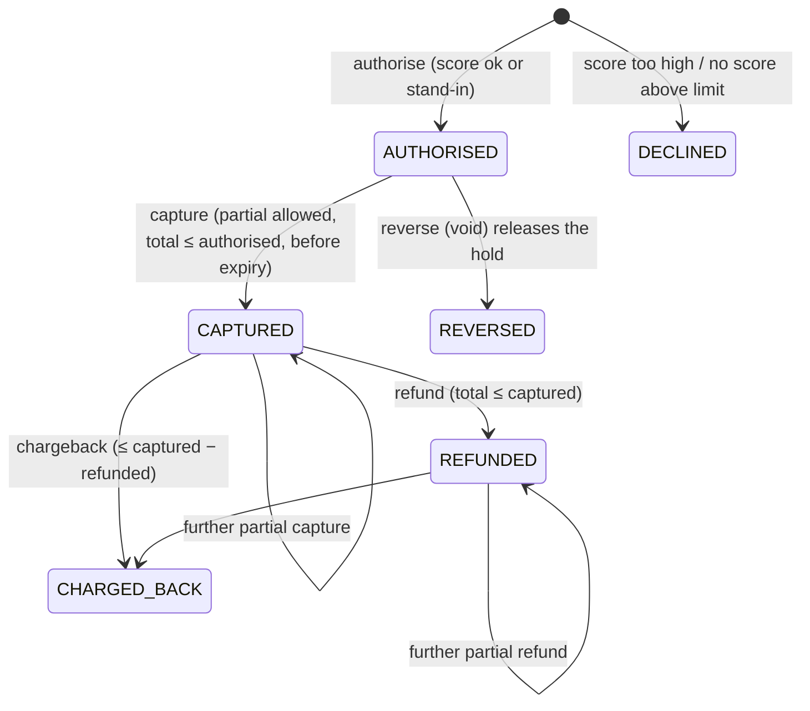
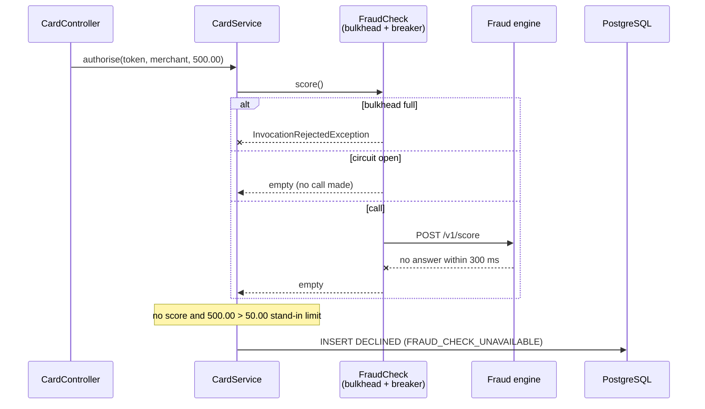

<!-- GENERATED from examples/capstone-3-card-authorisation/README.md by tools/build_capstone_pages.py. Edit the README, then re-run the script. -->

**Source code:** [`examples/capstone-3-card-authorisation`](https://github.com/mostafasroor1983/fintech-engineering-mastery/tree/v1/examples/capstone-3-card-authorisation) · run `mvn test -pl capstone-3-card-authorisation -am` from `examples/`

> The issuer side of a card payment: authorise (hold), capture (clearing), reverse, refund, chargeback.
> Plus a fraud check that is allowed to be slow or down without taking authorisations down with it.
> Spring Boot 4.0.9, Spring Framework 7.0 resilience annotations, Resilience4j 2.4.0, PostgreSQL 17.

## The problem

A card payment is not one event. The merchant first asks "can this card pay 100.00?" (authorisation,
which places a hold). Later it asks for the money (capture, which happens at clearing), possibly in
several parts. Later still there may be a refund, or the cardholder may dispute it (chargeback). Each
step is only legal in certain states, and amounts must never exceed what came before.

Every authorisation also calls a fraud engine. Authorisations have tight latency budgets: the
cardholder is standing at a till. If the fraud engine is slow, we must not wait for it. If it is down,
we must not hammer it. And we need a written rule for what to decide without a score.

| Risk | Fix | Canonical lesson |
|---|---|---|
| Capture more than authorised, refund more than captured | State machine on a **sealed** command type + DB `CHECK` constraints | [Card payments](#/tracks/track-04/lessons/track-04-lesson-18) |
| Two partial captures at once exceed the auth | `@Version` optimistic locking + Spring 7 `@Retryable` re-validates the loser | [Optimistic locking](#/tracks/track-05/lessons/track-05-lesson-16) |
| Merchant retries a capture | `operation_id` (Idempotency-Key) is the primary key of the audit row | [Idempotency patterns](#/tracks/track-05/lessons/track-05-lesson-12) |
| Slow fraud engine stalls authorisations | 300 ms read timeout on the HTTP Service Client | [Timeout engineering](#/tracks/track-06/lessons/track-06-lesson-05) |
| Fraud engine down: every call waits for the timeout | Resilience4j circuit breaker | [Circuit breaker](#/tracks/track-06/lessons/track-06-lesson-02) |
| Fraud calls use up all capacity | Bulkhead: Spring 7 `@ConcurrencyLimit(policy = REJECT)` | [Bulkhead](#/tracks/track-06/lessons/track-06-lesson-03) |
| No score: approve or decline? | Explicit fallback: approve ≤ 50.00 ("stand-in"), decline above | [Fallback patterns](#/tracks/track-06/lessons/track-06-lesson-14) |

## Architecture





The fraud call happens **before** the database transaction, so a slow fraud engine never holds a
database connection.

## Key decisions and trade-offs

| Decision | Why | Cost / when not to |
|---|---|---|
| Sealed `CardCommand` + `switch` pattern matching | Adding a command (e.g. `IncrementalAuth`) will not compile until the state machine handles it | Java 21; slightly more types. |
| Optimistic locking + `@Retryable` for captures | Contention on one authorisation is rare; retries are cheap and re-validate the rules | Under heavy contention on one row, use `SELECT ... FOR UPDATE` instead (see capstone 2). |
| `@Retryable` wraps a `TransactionTemplate`, not `@Transactional` | Each retry must be a new transaction. Proxy ordering of two annotations is easy to get wrong. | One explicit line of code. |
| Spring 7 `@ConcurrencyLimit` (REJECT) as bulkhead | Built into the framework, no extra library; rejects instead of queueing | Semaphore only. No queue, no metrics of its own. Resilience4j `Bulkhead` has more knobs. |
| Resilience4j circuit breaker | Spring Framework 7 has retry and concurrency limits but **no circuit breaker** | One more dependency (used programmatically, no Boot starter needed). |
| Fail open below 50.00, closed above | Small purchases keep working during an outage; the large-loss tail is protected | The limit is a risk decision, not an engineering one. 50.00 here is illustrative. |
| Store a card **token**, never the PAN | Keeps this service out of most PCI DSS cardholder-data scope | Requires a tokenisation service. The API rejects raw PANs at the edge. |

## How to run

```bash
cd examples
mvn test -pl capstone-3-card-authorisation -am    # 10 tests: PostgreSQL via Testcontainers + a real local HTTP fraud stub
```

macOS with Docker Desktop: `export DOCKER_HOST=unix://$HOME/.docker/run/docker.sock` if needed.

```bash
export DB_URL=jdbc:postgresql://localhost:5432/cards DB_USER=cards DB_PASSWORD=... FRAUD_URL=http://localhost:8090
mvn spring-boot:run -pl capstone-3-card-authorisation
curl -s -X POST localhost:8080/v1/authorisations -H 'Content-Type: application/json' \
  -d '{"cardToken":"tok_abcdefgh1234","merchantId":"shop-1","amount":100.00,"currency":"GBP"}'
curl -s -X POST localhost:8080/v1/authorisations/<id>/captures -H 'Content-Type: application/json' \
  -H 'Idempotency-Key: capture-0001' -d '{"amount":60.00,"currency":"GBP"}'
```

Configuration that matters (`application.yml`):

```yaml
spring.http.serviceclient.fraud:          # Boot 4 HTTP Service Client group
  base-url: ${FRAUD_URL}
  connect-timeout: 200ms
  read-timeout: 300ms
cards:
  stand-in-limit: "50.00"
  fraud.max-concurrent-calls: 20
  fraud.circuit-breaker: { failure-rate-threshold: 50, sliding-window-size: 10, minimum-number-of-calls: 5, wait-in-open-state: 10s }
```

## Tests (what each one proves)

| Test | Proves |
|---|---|
| `happyPathAuthoriseCaptureRefund` | Multi-capture and partial refund; 3 audit rows |
| `illegalTransitionsAreRejected` | Refund before capture, over-capture, capture after reversal |
| `chargebackCannotExceedWhatIsLeftAfterRefunds` | Amount rules across refunds and chargebacks |
| `sameOperationIdIsAppliedOnce` | Idempotent capture |
| `concurrentPartialCapturesNeverExceedTheAuthorisedAmount` | 10 concurrent 30.00 captures on 100.00 → exactly 3 succeed |
| `slowFraudEngineTimesOutAndFallsBackToStandInRules` | 1 s server, answer in < 900 ms; small approved, large declined |
| `circuitOpensAfterRepeatedFailuresAndStopsCallingTheFraudEngine` | After 5 failures the breaker opens; no more remote calls |
| `bulkheadRejectsExcessConcurrentCallsInsteadOfQueueing` | Limit 3 under 12 concurrent calls → most never reach the server |
| `highFraudScoreIsDeclined`, `httpApiReturnsProblemDetailForIllegalOperation` | Decline rule; RFC 9457 errors; a raw PAN is rejected |

Real output (2026-11-12):

```text
Tests run: 10, Failures: 0, Errors: 0, Skipped: 0 -- in com.fintechmastery.cards.CardLifecycleTest
BUILD SUCCESS
```

## Load test

```bash
mvn test -pl capstone-3-card-authorisation -am -Dgroups=load
```

2,000 authorise + capture pairs from 100 workers; the fraud stub answers immediately. Measured once on an
Apple M1 Pro laptop, PostgreSQL in Docker. **Illustrative only:**

```text
LOAD capstone-3: 2000 auth+capture in 2.1 s = 967/s; p50 63.3 ms, p99 613.1 ms, fraud calls 1834
```

Read the last number. With 100 concurrent workers and a bulkhead of 20, **166 authorisations (8.3%)
never reached the fraud engine** and were decided by the stand-in rule. That is the bulkhead working as
designed, and it is also the trade-off to discuss: size the limit from the fraud engine's real capacity,
and alert on the stand-in rate.

## Known limits

- Issuer view only. No acquirer, no scheme messages (ISO 8583 / clearing files), no representment flow
  after a chargeback.
- Authorisation expiry is checked at capture time. A scheduled job to reverse expired holds is not included.
- The authorisation validity (7 days) is an illustrative setting. Real limits depend on scheme rules and
  merchant category; check the current scheme rules.
- No balance or credit-limit check (capstone 2 shows ledger holds and balances).
- Resilience settings are per instance: with N instances the fraud engine can see N × 20 calls.

## Build it yourself in about 12 hours

| Step | Hours | Done when |
|---|---|---|
| 1. Entity, sealed commands, state machine unit-tested without Spring | 2.5 | Illegal-transition tests green |
| 2. Persistence, audit rows, idempotent operation id | 1.5 | Replay test green |
| 3. Concurrent-capture test; see it over-capture without `@Version`; add version + `@Retryable` | 2 | Exactly-3 test green |
| 4. HTTP Service Client + timeout + fake fraud server; slow-server test | 2 | Timeout test green |
| 5. Circuit breaker + bulkhead + fallback policy; their tests | 2 | Breaker and bulkhead tests green |
| 6. Load test, read the stand-in rate, README, rehearse | 2 | You can defend the 50.00 limit as a product decision |

## How I would explain this in an interview

"It is the issuer side of card payments: authorise, capture, reverse, refund, chargeback. The rules live
in a state machine over a sealed command type, so the compiler forces me to handle every command, and
database constraints back up the amount rules. Concurrent partial captures are protected by optimistic
locking with Spring 7's `@Retryable`, which re-reads and re-validates. The interesting part is the fraud
call. It has a 300 ms timeout, a circuit breaker so we stop calling a dead service, and a bulkhead that
rejects instead of queueing, so fraud calls can never use up all capacity. When there is no score, the
fallback is an explicit, tested policy: approve small amounts, decline large ones. The load test showed
the bulkhead shedding about 8% of calls to that policy at 100 concurrent requests, which is exactly the
number I would put on a dashboard."

## The 5 hardest follow-up questions

1. **"Why not retry the fraud call instead of falling back?"**
   The budget is a few hundred milliseconds end to end. A retry doubles the worst case, and retries
   against an overloaded service add load at the worst moment. Retries fit idempotent, non-urgent work
   (capture, webhooks). Real-time decisions need a fallback.

2. **"Fail open or fail closed?"**
   Neither, globally. Fail closed loses all revenue during an outage. Fail open invites fraudsters to
   attack during it. A threshold (here 50.00), possibly per merchant category, bounds the loss. The
   stand-in rate is monitored and alerting. It is a risk-team decision; engineering makes it explicit.

3. **"Your circuit breaker is per instance. Is that a problem?"**
   Each instance learns separately, so with 20 instances the fraud engine takes about 20 × 5 failing calls
   before every breaker opens. That is usually acceptable and avoids a shared-state dependency. If not,
   add a server-side limit at the fraud engine or a mesh-level breaker.

4. **"Why `@ConcurrencyLimit` and not a thread pool bulkhead?"**
   With virtual threads, threads are cheap, so a thread-pool bulkhead limits the wrong thing. What is
   scarce is the fraud engine's capacity, so I limit concurrent calls with a semaphore. REJECT policy
   matters: the default BLOCK policy queues callers and just moves the wait.

5. **"Two captures arrive at the same time for the same authorisation. Walk me through it."**
   Both read version 5. Both pass validation in memory. The first commits version 6. The second's `UPDATE
   ... WHERE version = 5` matches 0 rows, so Hibernate throws an optimistic lock exception. `@Retryable`
   re-runs it in a new transaction. It reads version 6, re-checks "captured + amount ≤ authorised", and
   either succeeds or is rejected cleanly. The test proves exactly 3 of 10 succeed.

## See also

- [Track 04: Card payment processing](#/tracks/track-04/lessons/track-04-lesson-18)
- [Track 04: Fraud detection architecture](#/tracks/track-04/lessons/track-04-lesson-16)
- [Track 13: Spring Framework 7 features](#/tracks/track-13/lessons/track-13-lesson-02)
- [Track 14: Design a fraud detection pipeline](#/tracks/track-14/lessons/track-14-lesson-04)
