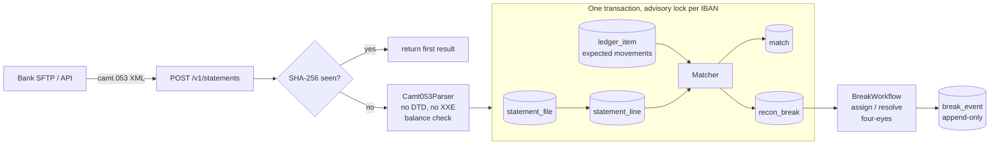

<!-- Arabic translation of index.md (generated from examples/capstone-4-reconciliation/README.md). Update it when the English page changes. -->

**الشيفرة المصدرية:** [`examples/capstone-4-reconciliation`](https://github.com/mostafasroor1983/fintech-engineering-mastery/tree/v1/examples/capstone-4-reconciliation) · نفّذ `mvn test -pl capstone-4-reconciliation -am` من داخل `examples/`

> كل مساء يرسل البنك كشف حساب. تثبت هذه الخدمة أن ما قيّده البنك يساوي ما توقعه دفتر الأستاذ لدينا، وتشرح كل فرق،
> وتعطي فريق العمليات طريقة مضبوطة لتسويته. ‏Spring Boot 4.0.9، وJava 21، وStAX، وPostgreSQL 17.

## المشكلة

يقول دفتر الأستاذ لدينا "أرسلنا 110.00 إلى المورّد X". ويقول كشف البنك إن 100.00 خرجت من الحساب. هل كانت هناك
رسوم؟ دفعة جزئية؟ خطأ برمجي؟ تقارن المطابقة سجلين مستقلين للمال نفسه وتحوّل كل اختلاف إلى **فرق (break)**: عنصر
له نوع ومالك وسجل تدقيق، يجب أن يحسمه شخص ما. ويتوقع المنظمون والمدققون أن تُشرح الفروقات، لا أن تُحذف.

ملفات البنك مدخلات غير موثوقة، وقد تصل مرتين، وقد تُصحَّح ويُعاد إرسالها، وقد تكون كبيرة. يجب أن يكون خط المعالجة
آمنًا، وآمنًا من التكرار، وقابلًا للشرح.

| الهاجس | الحل | الدرس المرجعي |
|---|---|---|
| ‏XML عدائي (XXE، وتضخيم الكيانات) | ‏StAX مع **تعطيل** DTD والكيانات الخارجية | [البرمجة الآمنة](#/tracks/track-11/lessons/track-11-lesson-18) |
| ملف مبتور أو تالف | رصيد الافتتاح + الدائن − المدين يجب أن يساوي رصيد الإقفال، وإلا يُرفض | [ISO 20022](#/tracks/track-04/lessons/track-04-lesson-07) |
| الملف نفسه يصل مرتين | ‏SHA-256 للبايتات `UNIQUE`؛ وإعادة التسليم ترجع النتيجة الأولى | [أنماط منع التكرار](#/tracks/track-05/lessons/track-05-lesson-12) |
| ملفان لحساب واحد يُعالجان في الوقت نفسه | ‏`pg_advisory_xact_lock(hashtext(iban))` + ‏`UNIQUE(ledger_item_id)` على المطابقات | [القفل المتشائم والأقفال الاستشارية](#/tracks/track-05/lessons/track-05-lesson-17) |
| قواعد المطابقة | ‏`Matcher` خالص ومختبر وحديًا: تامة ← اختلاف ← تقريبية ← متبقيات | [السيناريو I: اختلافات المطابقة](#/tracks/track-05/lessons/track-05-lesson-10) |
| "إصلاح" الفروقات دون أثر | سير عمل OPEN ← INVESTIGATING ← RESOLVED، و`break_event` للإلحاق فقط، وقفل متفائل، ومبدأ "العينين الأربع" للشطب الكبير | [سجلات التدقيق](#/tracks/track-05/lessons/track-05-lesson-21) |

## البنية



قواعد المطابقة بالترتيب:

| # | القاعدة | النتيجة |
|---|---|---|
| 1 | ‏`EndToEndId` نفسه، والمبلغ والاتجاه نفسهما | `MATCHED (EXACT)` |
| 2 | ‏`EndToEndId` نفسه، بمبلغ أو اتجاه مختلف | فرق `AMOUNT_MISMATCH` |
| 3 | بلا معرّف (`NOTPROVIDED`): عنصر دفتر واحد غير مطابق بالمبلغ والاتجاه نفسيهما، وتاريخ القيمة ضمن ±2 يوم | `MATCHED (FUZZY_AMOUNT_DATE)` |
| 3b | …أكثر من مرشح واحد | فرق `AMBIGUOUS` (يختار إنسان؛ لا تخمين أبدًا) |
| 4 | سطر بنك متبقٍ | `MISSING_IN_LEDGER` (رسوم، أو إيداعات غير متوقعة، أو احتيال) |
| 5 | عنصر دفتر متبقٍ وعمره أكثر من يومين | `MISSING_IN_BANK` (الأحدث *قيد العبور*، لا فروقات) |
| 6 | مرجع بنكي شوهد سابقًا | `DUPLICATE_IN_BANK` |

كشف لاحق يقيّد عنصرًا مفقودًا **يحسم تلقائيًا** فرق `MISSING_IN_BANK` القديم، مع حدث تدقيق.

## القرارات الأساسية والمفاضلات

| القرار | السبب | الكلفة / متى لا تستخدمه |
|---|---|---|
| محلل StAX تدفقي، بالأسماء المحلية فقط | الذاكرة تبقى ثابتة؛ ويعمل مع أي إصدار camt.053.001.xx | يدعم جزءًا فقط: كشف واحد لكل ملف، و`TxDtls` واحد لكل قيد (بلا قيود مجمّعة). |
| رفض الملف غير المتوازن كليًا | الملف الجزئي يُنشئ فروقات كاذبة بصمت | يجب على فريق العمليات مطالبة البنك بملف مصحَّح. |
| معرّف الكشف نفسه ببايتات مختلفة ← 409 | "الاستبدال" الصامت سيعيد كتابة التاريخ | التصحيحات تحتاج مسارًا يدويًا مدقَّقًا. |
| مطابقة تقريبية فقط عندما يكون المرشح فريدًا | المطابقة التلقائية الخاطئة تخفي فرقًا حقيقيًا؛ والفرق الكاذب يكلّف وقتًا فقط | عمل يدوي أكثر للمدفوعات المتساوية المبلغ. |
| هامش زمني قبل `MISSING_IN_BANK` | البنوك تقيّد بعد يوم أو يومين؛ والتنبيه الفوري يصنع ضجيجًا | تُرى الخسارة الحقيقية بعد يومين. اضبطه لكل بنك ولكل شبكة دفع (الشبكات الفورية تحتاج دقائق). |
| مبدأ "العينين الأربع" للشطب فوق 100.00 | ضابط رقابي معياري يمنع شخصًا واحدًا من إخفاء الخسائر | حسم أبطأ؛ والحد للتوضيح. |
| معاملة واحدة لكل ملف | استقبال كل شيء أو لا شيء؛ وتعافٍ بسيط | الملفات الكبيرة جدًا تحتجز القفل أطول (انظر اختبار الحمل). |

## طريقة التشغيل

```bash
cd examples
mvn test -pl capstone-4-reconciliation -am      # 15 tests: parser and matcher unit tests + PostgreSQL integration
```

على macOS مع Docker Desktop: نفّذ `export DOCKER_HOST=unix://$HOME/.docker/run/docker.sock` عند الحاجة.

```bash
export DB_URL=jdbc:postgresql://localhost:5432/recon DB_USER=recon DB_PASSWORD=...
mvn spring-boot:run -pl capstone-4-reconciliation
curl -s -X POST localhost:8080/v1/statements -H 'Content-Type: application/xml' \
     --data-binary @capstone-4-reconciliation/src/test/resources/camt053/statement-2026-11-10.xml
curl -s 'localhost:8080/v1/breaks?status=OPEN'
curl -s -X POST localhost:8080/v1/breaks/<id>/assign  -H 'Content-Type: application/json' -d '{"actor":"ana","version":0}'
curl -s -X POST localhost:8080/v1/breaks/<id>/resolve -H 'Content-Type: application/json' \
     -d '{"actor":"ana","resolution":"WRITE_OFF","comment":"Monthly account fee","version":1}'
```

كشف العيّنة (`src/test/resources/camt053/statement-2026-11-10.xml`، لحساب وهمي توضيحي) يحتوي سطرًا لكل حالة مهمة:
مطابقة تامة، واختلاف في المبلغ، ومطابقة تقريبية، ورسوم بنكية غير مقيّدة.

## الاختبارات (ما يثبته كل اختبار)

| الاختبار | ما يثبته |
|---|---|
| `Camt053ParserTest.parsesTheStatement` | الأرصدة، والقيود، و`NOTPROVIDED`، ومعلومات التحويل |
| `rejectsXxePayloads` | حمولة بكيان خارجي تُرفض ولا تُوسَّع |
| `rejectsAStatementThatDoesNotBalance` | فرق 0.01 يرفض الملف |
| `rejectsAmountsWithTooManyDecimals` | ‏`2.505 GBP` غير صالح (بلا تقريب صامت) |
| `MatcherTest` ‏(4) | كل نوع نتيجة؛ والغموض لا يُخمَّن؛ والاتجاه مهم |
| `ingestMatchesAndRaisesBreaks` | من الطرف إلى الطرف على ملف العيّنة: مطابقتان و3 فروقات |
| `reDeliveredFileIsIdempotent` | البايتات نفسها مرتين ← معرّف الملف نفسه، بلا أسطر أو فروقات مكررة |
| `sameStatementIdWithDifferentContentIsAConflict` | إعادة الإرسال المصحّحة تُرفض |
| `lateBankBookingAutoResolvesTheMissingInBankBreak` | كشف اليوم التالي يحسم الفرق مع حدث تدقيق |
| `workflowEnforcesAssigneeVersionAndFourEyes`، `largeWriteOffNeedsADifferentApprover` | إصدار قديم ← 409، ولا يحسم إلا المكلَّف، وشطب 500.00 يحتاج شخصًا ثانيًا |
| `httpUploadAndProblemDetails` | ‏201 ثم 200 عند إعادة الرفع، و422 بصيغة problem+json لملف سيئ |

مخرجات حقيقية (2026-11-12):

```text
Tests run: 4, Failures: 0, Errors: 0, Skipped: 0 -- in com.fintechmastery.recon.Camt053ParserTest
Tests run: 7, Failures: 0, Errors: 0, Skipped: 0 -- in com.fintechmastery.recon.ReconciliationIntegrationTest
Tests run: 4, Failures: 0, Errors: 0, Skipped: 0 -- in com.fintechmastery.recon.MatcherTest
BUILD SUCCESS
```

## اختبار الحمل

```bash
mvn test -pl capstone-4-reconciliation -am -Dgroups=load
```

كشف واحد من 10,000 قيد (نحو 2.1 MB) مقابل 10,000 عنصر في دفتر الأستاذ، 1% منها بمبلغ مختلف. قيس مرة واحدة على
حاسوب Apple M1 Pro محمول، وPostgreSQL داخل Docker. **للتوضيح فقط:**

```text
LOAD capstone-4: 10000 lines (2177 KB) ingested and matched in 9.0 s; matched 9900, breaks {AMOUNT_MISMATCH=100}
```

يذهب معظم الوقت تقريبًا في عبارات `INSERT` صفًا صفًا (نحو 30,000 رحلة). التحسين الأول هو الإدخال الجماعي
(`JdbcClient` ← ‏`JdbcTemplate.batchUpdate` أو `COPY`). والثاني هو الالتزام على دفعات كل 1,000 سطر مع نقطة تحقق
قابلة للاستئناف، وهذا يقصّر أيضًا مدة احتجاز القفل الاستشاري.

## الحدود المعروفة

- جزء من camt.053 فقط (انظر أعلاه)؛ لا camt.052 (خلال اليوم) ولا camt.054 (الإشعارات).
- جانب دفتر الأستاذ يُغذّى بدالة مساعدة (`expect(...)`)؛ وفي الإنتاج يكون تغذية CDC أو Kafka من خدمات المدفوعات
  والمحافظ (المشروعان التطبيقيان 1 و2).
- لا يوجد نقل للملفات (استطلاع SFTP، وفحوص PGP/التوقيع)؛ أضفها قبل التحليل.
- هوية المحلّل تأتي من جسم الطلب. وفي الإنتاج تأتي من الهوية المصادَق عليها.
- المطابقة من متعدد إلى واحد (سطر بنكي واحد يسوّي عدة عناصر في الدفتر) غير مطبّقة.

## ابنِه بنفسك في نحو 12 ساعة

| الخطوة | الساعات | يكتمل عندما |
|---|---|---|
| 1. محلل لملف العيّنة + فحص التوازن + اختبار XXE | 2.5 | تنجح اختبارات المحلل |
| 2. المطابِق كدالة خالصة، قاعدة بقاعدة، والاختبار أولًا | 2.5 | تنجح اختبارات المطابِق |
| 3. المخطط، ومعاملة الاستقبال، ومنع تكرار الملفات، والقفل الاستشاري | 2 | تنجح اختبارات الاستقبال وإعادة التسليم |
| 4. سير عمل الفروقات، والقفل المتفائل، و"العينان الأربع"، وأحداث التدقيق | 2 | تنجح اختبارات سير العمل |
| 5. الحسم التلقائي عند القيد المتأخر؛ وطبقة HTTP وتفاصيل المشكلات | 1.5 | تنجح الاختبارات الـ 15 كلها |
| 6. اختبار حمل بـ 10 آلاف سطر، واكتب ملاحظة الإدخال الجماعي، وتدرّب | 1.5 | تستطيع شرح كل نوع فرق بمثال |

## كيف أشرح هذا في مقابلة

"إنها تطابق دفتر الأستاذ لدينا مع كشف camt.053 الذي يرسله البنك في نهاية اليوم. المحلل StAX تدفقي مع تعطيل DTD،
لأن ملفات البنك غير موثوقة، ويرفض أي ملف لا تتجمع قيوده من رصيد الافتتاح إلى رصيد الإقفال. والاستقبال آمن من
التكرار على SHA-256 للملف، ومسلسل لكل حساب بقفل استشاري. والمطابقة دالة خالصة: تامة على معرّف end-to-end، ثم مرشح
تقريبي فريد على المبلغ والاتجاه والتاريخ، وكل ما يتبقى يصبح فرقًا له نوع. وعناصر الدفتر الأحدث من تأخر القيد لدى
البنك تُعتبر 'قيد العبور' لا فروقات، وهذا يقلل الضجيج. وتمر الفروقات بسير عمل مع قفل متفائل، وتاريخ للإلحاق فقط،
وقاعدة 'العينين الأربع' للشطب الكبير، لأن المنتج الحقيقي للمطابقة هو تفسير يقبله المدقق."

## أصعب 5 أسئلة متابعة

1. **"لماذا لا تطابق تلقائيًا على المبلغ وحده عندما لا يوجد مرجع؟"**
   المدفوعات بالمبلغ نفسه شائعة (الرواتب، والاشتراكات). والمطابقة الخاطئة تخفي فرقين حقيقيين خلف مطابقة مزيفة
   واحدة. لذا تتطلب المطابقة التقريبية مرشحًا فريدًا ضمن نافذة تاريخ، والغموض يذهب إلى إنسان. الفروقات الكاذبة
   تكلّف دقائق؛ والمطابقات الكاذبة قد تكلّف ملاحظة تدقيق.

2. **"يعيد البنك إرسال كشف الأمس مع تغيير سطر واحد. ماذا يحدث؟"**
   بايتات مختلفة، فـ SHA-256 مختلف، لكن معرّف الكشف نفسه ← 409. استبداله بصمت سيغيّر المطابقات والفروقات بعد أن
   تصرّف الناس بناءً عليها. يُعالج التصحيح صراحة: اعكس الاستيراد القديم مع سجل تدقيق، ثم استورد الجديد.

3. **"كيف تعرف أن المطابقة نفسها صحيحة؟"**
   المطابِق دالة خالصة مع اختبار لكل قاعدة. والثابت على مستوى الملف (الافتتاح + القيود = الإقفال) يُفحص. وفي كل
   تشغيل ينتهي كل سطر بنكي في واحد فقط من: مطابَق أو فرق (عدد `statement_line` = المطابقات + فروقات الأسطر)،
   وهذا رخيص في الفحص والتنبيه.

4. **"كشوف بـ 5 ملايين سطر؟"**
   حلّلها تدفقيًا إلى جدول مرحلي باستخدام `COPY`. والتزم على دفعات مع نقطة تحقق. وطابِق بعمليات ربط SQL على
   `end_to_end_id` المفهرس بدل خرائط في الذاكرة، ثم نفّذ المطابقة التقريبية على المتبقيات فقط. وقسّم حسب الحساب
   لتعمل الحسابات بالتوازي؛ فالقفل الاستشاري أصلًا لكل حساب.

5. **"ما الفرق بين هذا والمطابقة الداخلية في المحفظة (المشروع التطبيقي 2)؟"**
   المطابقة الداخلية تفحص بياناتنا مقابل نفسها (الرصيد المخزن مقابل الترحيلات) ويجب ألا تفشل أبدًا. والمطابقة
   الخارجية تفحصنا مقابل طرف مستقل، وبعض الفروقات *طبيعية* (رسوم، وتوقيت). توقعات مختلفة وتنبيه مختلف: أي فرق
   داخلي يوقظ أحدًا؛ والفروقات الخارجية تُفرز حسب العمر والمبلغ.

## انظر أيضًا

- [المسار 04: بنية المطابقة المالية](#/tracks/track-04/lessons/track-04-lesson-12)
- [المسار 05: استراتيجيات مطابقة الأرصدة](#/tracks/track-05/lessons/track-05-lesson-22)
- [المسار 04: ‏ISO 20022](#/tracks/track-04/lessons/track-04-lesson-07)
- [المسار 08: الأقفال في PostgreSQL](#/tracks/track-08/lessons/track-08-lesson-04)
