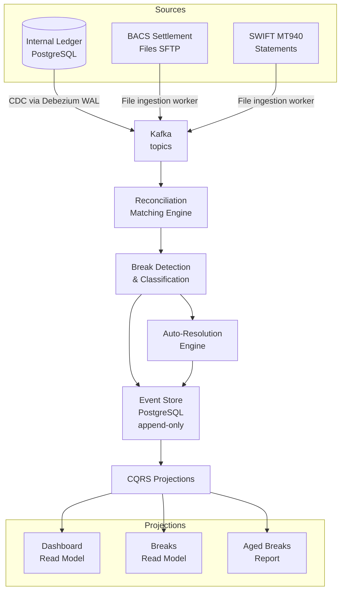
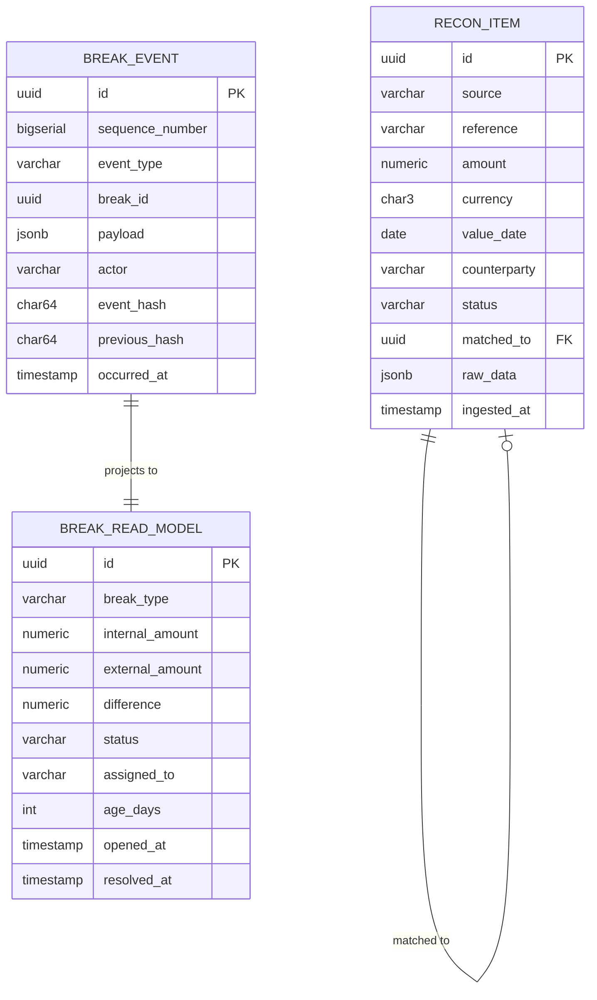

# Financial Reconciliation Engine

## Project Overview

Build a financial reconciliation system that automatically detects discrepancies between internal ledger records and external settlement reports (BACS, CHAPS, SWIFT MT940), investigates breaks, and provides real-time reconciliation dashboards.

Reconciliation is a critical but often under-engineered component of financial systems. Undetected breaks represent either missing money (operational loss) or misreported positions (regulatory risk).

**What you will build:**
- Multi-source reconciliation pipeline using CDC (Debezium) and file ingestion
- Break detection engine with configurable tolerance rules
- Event-sourced break investigation workflow
- CQRS read projections for real-time reconciliation dashboards
- Automated resolution for common break patterns

---

## System Requirements

### Functional Requirements

| Requirement | Specification |
|---|---|
| Sources | Internal ledger (via CDC), BACS settlement files, SWIFT MT940 statements |
| Match logic | Match by transaction reference, amount (within tolerance), value date |
| Break detection | Report unmatched internal records and unmatched external records |
| Tolerance rules | Configurable per counterparty, currency, amount tier |
| Investigation | Each break tracked through lifecycle: OPEN → IN_INVESTIGATION → RESOLVED |
| Dashboard | Real-time summary: matched %, break count, total break amount |

### Non-Functional Requirements

| Requirement | Target |
|---|---|
| Settlement file processing | Within 30 minutes of file arrival |
| Break detection latency | < 60 seconds from CDC event |
| Dashboard refresh | Near real-time (< 5 seconds) via CQRS projections |
| Historical query | Any day's reconciliation queryable within 10 seconds |

---

## Architecture



---

## Domain Model

### Reconciliation Items and Breaks



---

## Database Schema

```sql
-- Reconciliation items from all sources
CREATE TABLE recon_items (
    id              UUID DEFAULT gen_random_uuid() PRIMARY KEY,
    source          VARCHAR(50) NOT NULL,   -- INTERNAL_LEDGER, BACS, SWIFT_MT940
    reference       VARCHAR(255) NOT NULL,
    amount          NUMERIC(20,4) NOT NULL,
    currency        CHAR(3) NOT NULL,
    value_date      DATE NOT NULL,
    counterparty    VARCHAR(255),
    sort_code       CHAR(6),
    account_number  VARCHAR(20),
    status          VARCHAR(30) NOT NULL DEFAULT 'UNMATCHED',
    matched_to      UUID REFERENCES recon_items(id),
    raw_data        JSONB NOT NULL,
    ingested_at     TIMESTAMPTZ NOT NULL DEFAULT now(),
    
    CONSTRAINT source_check CHECK (source IN ('INTERNAL_LEDGER','BACS','SWIFT_MT940','CHAPS'))
);

-- Break event store (append-only — event sourcing)
CREATE TABLE break_events (
    id              UUID DEFAULT gen_random_uuid() PRIMARY KEY,
    sequence_number BIGSERIAL NOT NULL,
    event_type      VARCHAR(50) NOT NULL,
    break_id        UUID NOT NULL,
    payload         JSONB NOT NULL,
    actor           VARCHAR(100) NOT NULL DEFAULT 'SYSTEM',
    event_hash      CHAR(64) NOT NULL,
    previous_hash   CHAR(64) NOT NULL DEFAULT 'GENESIS',
    occurred_at     TIMESTAMPTZ NOT NULL DEFAULT now()
);

-- CQRS read model — derived from break events
CREATE TABLE break_read_models (
    id              UUID PRIMARY KEY,
    break_type      VARCHAR(50) NOT NULL,
    internal_ref    VARCHAR(255),
    external_ref    VARCHAR(255),
    internal_amount NUMERIC(20,4),
    external_amount NUMERIC(20,4),
    difference      NUMERIC(20,4),
    currency        CHAR(3),
    value_date      DATE,
    status          VARCHAR(30) NOT NULL DEFAULT 'OPEN',
    assigned_to     VARCHAR(100),
    resolution_code VARCHAR(50),
    opened_at       TIMESTAMPTZ NOT NULL,
    resolved_at     TIMESTAMPTZ,
    last_updated_at TIMESTAMPTZ NOT NULL
);

-- Dashboard read model — updated by projection
CREATE TABLE recon_dashboard (
    recon_date      DATE PRIMARY KEY,
    total_items     INTEGER NOT NULL DEFAULT 0,
    matched_items   INTEGER NOT NULL DEFAULT 0,
    open_breaks     INTEGER NOT NULL DEFAULT 0,
    total_break_gbp NUMERIC(20,4) NOT NULL DEFAULT 0,
    match_rate_pct  NUMERIC(5,2),
    last_updated_at TIMESTAMPTZ NOT NULL DEFAULT now()
);
```

---

## Implementation

### CDC with Debezium — Internal Ledger to Kafka

```java
// Debezium connector configuration (via Spring Boot auto-config)
@Bean
public io.debezium.engine.DebeziumEngine<ChangeEvent<String, String>> debeziumEngine(
        ReconciliationEventHandler handler) {
    
    var props = io.debezium.config.Configuration.create()
        .with("connector.class", "io.debezium.connector.postgresql.PostgresConnector")
        .with("database.hostname", postgresHost)
        .with("database.port", "5432")
        .with("database.user", "debezium_replication_user")
        .with("database.dbname", "ledger")
        .with("database.server.name", "ledger-cdc")
        .with("plugin.name", "pgoutput")
        .with("slot.name", "recon_cdc_slot")
        .with("publication.name", "recon_cdc_publication")
        .with("table.include.list", "public.journal_lines")
        .with("transforms", "unwrap")
        .with("transforms.unwrap.type", 
              "io.debezium.transforms.ExtractNewRecordState")
        .build();
    
    return DebeziumEngine.create(Json.class)
        .using(props.asProperties())
        .notifying(handler::handleChange)
        .build();
}
```

### Settlement File Ingestion — BACS

```java
@Component
public class BacsFileIngestionWorker {

    private final KafkaTemplate<String, ReconItem> kafkaTemplate;
    private final BacsFileParser parser;

    // Triggered by SFTP poll or S3 event notification
    public void ingest(Path bacsFile) {
        log.info("Ingesting BACS file: {}", bacsFile.getFileName());
        
        try (var stream = parser.parse(bacsFile)) {
            stream.forEach(record -> {
                var item = ReconItem.builder()
                    .source(ReconSource.BACS)
                    .reference(record.getTransactionReference())
                    .amount(record.getAmount())
                    .currency("GBP")
                    .valueDate(record.getValueDate())
                    .sortCode(record.getSortCode())
                    .accountNumber(record.getAccountNumber())
                    .rawData(record.toJson())
                    .build();
                
                kafkaTemplate.send("recon.items.external", 
                    item.getReference(), item);
            });
        } catch (Exception e) {
            // Dead-letter with original file reference for manual investigation
            dlqService.send("recon.items.dlq", bacsFile.toString(), e);
            alertingService.notify(Alert.BACS_INGESTION_FAILURE, bacsFile.toString());
        }
    }
}

// SWIFT MT940 Parser — standard cash management statement format
@Component
public class SwiftMt940Parser {
    
    public List<Mt940Transaction> parse(String mt940Content) {
        var transactions = new ArrayList<Mt940Transaction>();
        // MT940 format: :61: value-date booking-date credit/debit amount
        //               :86: narrative (3 continuation lines)
        var pattern = Pattern.compile(
            ":61:(\\d{6})(\\d{4})?([CD])(\\d+,\\d{2})(\\w+)\\s+(\\S+)", Pattern.MULTILINE);
        
        var matcher = pattern.matcher(mt940Content);
        while (matcher.find()) {
            transactions.add(Mt940Transaction.builder()
                .valueDate(parseDate(matcher.group(1)))
                .bookingDate(parseDate(matcher.group(2)))
                .side(matcher.group(3).equals("C") ? Side.CREDIT : Side.DEBIT)
                .amount(parseAmount(matcher.group(4)))
                .reference(matcher.group(6))
                .build());
        }
        return transactions;
    }
}
```

### Matching Engine

```java
@Service
public class ReconMatchingEngine {

    private final ToleranceRuleRepository toleranceRules;

    public MatchResult match(ReconItem internal, List<ReconItem> candidates) {
        for (ReconItem candidate : candidates) {
            if (isMatch(internal, candidate)) {
                return MatchResult.matched(internal, candidate);
            }
        }
        return MatchResult.unmatched(internal);
    }

    private boolean isMatch(ReconItem internal, ReconItem external) {
        // Reference must match (primary match key)
        if (!internal.getReference().equals(external.getReference())) {
            return false;
        }
        
        // Value date must match (or within 1 business day for BACS T+1)
        if (Math.abs(ChronoUnit.DAYS.between(internal.getValueDate(), 
                                              external.getValueDate())) > 1) {
            return false;
        }
        
        // Amount within tolerance
        var tolerance = toleranceRules.getFor(
            internal.getCurrency(), internal.getAmount());
        return internal.getAmount().subtract(external.getAmount())
            .abs()
            .compareTo(tolerance.getMaxAbsoluteDifference()) <= 0;
    }
}
```

### Event-Sourced Break Investigation

```java
// Every action on a break produces an immutable event
@Service
public class BreakEventStore {

    @Transactional
    public void append(UUID breakId, BreakEventType type, 
                       Object payload, String actor) {
        String prevHash = breakEventRepository.findLatestHash(breakId)
            .orElse("GENESIS");
        
        String eventHash = DigestUtils.sha256Hex(
            type.name() + payload.toString() + actor + prevHash);
        
        breakEventRepository.insert(BreakEvent.builder()
            .breakId(breakId)
            .eventType(type)
            .payload(objectMapper.valueToTree(payload))
            .actor(actor)
            .previousHash(prevHash)
            .eventHash(eventHash)
            .build());
        
        // Update CQRS read model
        breakProjector.project(breakId, type, payload);
    }
}

// CQRS projector — builds read model from events
@Component
public class BreakProjector {

    public void project(UUID breakId, BreakEventType type, Object payload) {
        switch (type) {
            case BREAK_OPENED:
                breakReadModelRepository.create(BreakReadModel.from(breakId, payload));
                dashboardProjector.incrementBreakCount();
                break;
            case INVESTIGATOR_ASSIGNED:
                breakReadModelRepository.update(breakId, 
                    m -> m.withAssignedTo(((AssignedPayload)payload).getAssignee()));
                break;
            case BREAK_RESOLVED:
                breakReadModelRepository.update(breakId, m -> m
                    .withStatus(BreakStatus.RESOLVED)
                    .withResolvedAt(Instant.now())
                    .withResolutionCode(((ResolvedPayload)payload).getResolutionCode()));
                dashboardProjector.decrementBreakCount();
                break;
        }
    }
}
```

---

## Automated Break Resolution

Common break patterns that can be auto-resolved without analyst intervention:

```java
@Component
public class AutoResolutionEngine {

    // Rule 1: Timing break — internal record posted 1 day before external
    // Resolution: re-match with next day's external items
    public Optional<Resolution> resolveTimingBreak(Break b) {
        if (b.getBreakType() != BreakType.MISSING_EXTERNAL) return Optional.empty();
        
        var nextDayItems = reconItemRepository.findByDateRange(
            b.getInternalItem().getValueDate().plusDays(1),
            b.getInternalItem().getValueDate().plusDays(1),
            ReconSource.BACS
        );
        
        return matchingEngine.match(b.getInternalItem(), nextDayItems)
            .asResolution("TIMING_BREAK_T_PLUS_1");
    }
    
    // Rule 2: Penny difference — amount differs by < £0.01 (rounding in legacy system)
    public Optional<Resolution> resolvePennyDifference(Break b) {
        if (b.getBreakType() != BreakType.AMOUNT_MISMATCH) return Optional.empty();
        
        var diff = b.getInternalAmount().subtract(b.getExternalAmount()).abs();
        if (diff.compareTo(new BigDecimal("0.01")) <= 0) {
            return Optional.of(Resolution.autoApprove("PENNY_DIFFERENCE_ROUNDING"));
        }
        return Optional.empty();
    }
}
```

---

## Architecture Decision Records

### ADR-001: Event Sourcing for Break Investigation (Not Mutable Status)

**Status:** Accepted

**Context:** Regulatory auditors need a complete history of every action taken on a break: who assigned it, what investigation steps were taken, why it was resolved. A mutable `status` column loses this history.

**Decision:** Break lifecycle stored as an immutable event log. CQRS read model derived from events for query performance. The event store is the system of record; the read model can be rebuilt by replaying events.

### ADR-002: Debezium CDC for Internal Ledger (Not Polling)

**Status:** Accepted

**Context:** Polling the ledger database for new transactions adds load and introduces latency. At 50k TPS, polling would require a high-frequency query that competes with write workload.

**Decision:** Debezium reads the PostgreSQL WAL via logical replication. Zero additional read load on the primary. Sub-second latency from ledger write to reconciliation stream. Requires a dedicated replication slot and careful monitoring of WAL retention.

---

## Principal Engineer Review Criteria

- [ ] **End-to-end flow works** — BACS file arrives → items ingested → matched/unmatched in < 30 minutes
- [ ] **CDC events produce recon items** — journal line inserted in ledger → recon item in Kafka within 1 second
- [ ] **Break detection is correct** — amount tolerance, timing tolerance, and reference matching all tested
- [ ] **Event sourced breaks are replayable** — drop and rebuild `break_read_models` by replaying `break_events`
- [ ] **Auto-resolution handles timing breaks** — T+1 BACS items matched to previous day's internal records
- [ ] **Dashboard reflects breaks in near real-time** — CQRS projection updates within 5 seconds of break event
- [ ] **MT940 parser handles malformed records** — test with real SWIFT statement samples including edge cases
