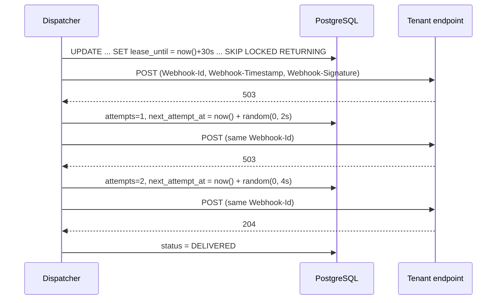

<!-- Arabic translation of index.md (generated from examples/capstone-5-instant-p2p/README.md). Update it when the English page changes. -->

**الشيفرة المصدرية:** [`examples/capstone-5-instant-p2p`](https://github.com/mostafasroor1983/fintech-engineering-mastery/tree/v1/examples/capstone-5-instant-p2p) · نفّذ `mvn test -pl capstone-5-instant-p2p -am` من داخل `examples/`

> واجهة متعددة المستأجرين تنقل المال بين المستخدمين فورًا، ولا تثق إلا برمز مُتحقَّق منه، وتمنع مستأجرًا مزعجًا
> من إيذاء الآخرين، وتُبلغ الخادم الخلفي لكل مستأجر بكل تحويل بموثوقية. ‏Spring Boot 4.0.9، وSpring Security 7.0،
> وRedis 7.4، وPostgreSQL 17.

## المشكلة

عدة شركاء في التقنية المالية (مستأجرون) يشغّلون مدفوعات مستخدميهم بين الأفراد (P2P) على منصتنا. يجب أن تتحقق أربعة
أمور:

1. **الهوية تأتي من الرمز، لا من الطلب.** لا يستطيع المستخدم الإنفاق إلا من حسابه، ولا يرى المستأجر بيانات مستأجر
   آخر أبدًا.
2. **العدالة.** يجب ألا تُجوّع قفزة حركة لدى مستأجر واحد، أو حلقة إعادة محاولة معطوبة لديه، بقية المستأجرين.
3. **إشعار موثوق.** يتلقى الخادم الخلفي لكل مستأجر webhook موقّعًا لكل تحويل مكتمل، حتى لو كان متعطلًا لفترة، دون
   أن نحتجز موارد بينما هو بطيء.
4. **لا SSRF.** يسجّل المستأجرون عناوين webhooks؛ ويجب ألا نسمح لهم بتوجيه خوادمنا نحو أهداف داخلية.

| الهاجس | الحل | الدرس المرجعي |
|---|---|---|
| المصادقة | خادم موارد OAuth2 عديم الحالة: التحقق من التوقيع والمُصدِر والانتهاء و**الجمهور (audience)** | [OAuth2 وJWT](#/tracks/track-11/lessons/track-11-lesson-10) |
| التفويض | نطاقات (scopes) عبر `@PreAuthorize`؛ وفحص الملكية داخل SQL ‏(OWASP API1 BOLA) | [OWASP Top 10](#/tracks/track-11/lessons/track-11-lesson-13) |
| العدالة | دلو رموز في Redis لكل مستأجر، بـ Lua ذري ووقت الخادم؛ و429 + `Retry-After` | [تحديد المعدل الموزع](#/tracks/track-02/lessons/track-02-lesson-17) |
| الإنفاق المزدوج | خصم شرطي بعبارة واحدة `... WHERE balance_minor >= :m`؛ وترتيب أقفال ثابت | [السيناريو C: الإنفاق المزدوج](#/tracks/track-05/lessons/track-05-lesson-04) |
| webhook ضائع أو مكرر | صف التسليم في معاملة التحويل؛ وإيجار (lease)، وإعادة محاولة مع تراجع + تذبذب كامل، ثم DEAD | [أنماط إعادة المحاولة](#/tracks/track-06/lessons/track-06-lesson-04)، [Transactional outbox](#/tracks/track-05/lessons/track-05-lesson-13) |
| webhook مزوّر | ‏HMAC-SHA256 على `id.timestamp.body`؛ والمستقبِل يقارن بزمن ثابت | [أمان الواجهات البرمجية](#/tracks/track-11/lessons/track-11-lesson-11) |
| SSRF عبر عنوان webhook ‏(OWASP API7) | ‏https فقط، بلا أهداف خاصة/loopback/link-local، وبلا إعادة توجيه | [البرمجة الآمنة](#/tracks/track-11/lessons/track-11-lesson-18) |

## البنية

```mermaid
flowchart LR
    C[Tenant app] -- "Bearer JWT<br/>Idempotency-Key" --> SF[Security filter chain<br/>JWT: sig, iss, exp, aud]
    SF --> RL[RateLimitInterceptor] -- "EVALSHA token_bucket<br/>key rl:{tenant}" --> RD[(Redis)]
    RL --> CT[P2pController<br/>@PreAuthorize scope]
    CT --> TS[TransferService]
    subgraph TX["One PostgreSQL transaction"]
        TS --> AC[(account<br/>conditional debit)]
        TS --> TR[(transfer)]
        TS --> MV[(account_movement)]
        TS --> WD[(webhook_delivery)]
    end
    D[WebhookDispatcher] -- "1. lease rows (short tx)" --> WD
    D -- "2. POST signed, no tx held" --> T[Tenant endpoint]
    D -- "3. DELIVERED / retry at / DEAD" --> WD
```

إعادة محاولة webhook، فشل ثم تعافٍ:



## القرارات الأساسية والمفاضلات

| القرار | السبب | الكلفة / متى لا تستخدمه |
|---|---|---|
| المستأجر والمستخدم من مطالبات JWT فقط | الترويسات والأجسام يتحكم فيها المهاجم | يتطلب أن يُصدر مزوّد الهوية مطالبة `tenant_id`. |
| ‏404 (لا 403) لموارد الآخرين | لا يؤكد وجود المعرّف | تصحيح أصعب قليلًا للعملاء الصادقين. |
| تعطيل CSRF | رموز Bearer لا يرسلها المتصفح تلقائيًا؛ بلا ملفات تعريف ارتباط ولا جلسات | سيكون خطأً إذا أضفت لاحقًا تسجيل دخول قائمًا على ملفات تعريف الارتباط. |
| دلو رموز في Redis + Lua | ذري عبر كل النسخ؛ ويسمح باندفاع حتى السعة | ‏Redis على المسار الساخن؛ ويُخفَّف ذلك بمهلة 200 ms و**السماح بالمرور عند التعطل** مع تنبيه. أما الرفض عند التعطل فسيحوّل انقطاع Redis إلى انقطاع كامل. |
| ‏`TIME` من Redis داخل السكربت | ساعات خوادم التطبيق قد تنحرف | يتطلب نسخ التأثيرات في Redis 5 أو أحدث (الافتراضي منذ Redis 5). |
| تحديد المعدل بعد المصادقة | الدلو لكل مستأجر *مُتحقَّق منه*؛ والإغراق المجهول يُوقف قبل ذلك (WAF / البوابة) | الإغراق غير المصادَق ما زال يكلّف التحقق من JWT؛ ضع حدًا تقريبيًا لكل IP عند الطرف. |
| إيجار webhook بدل `FOR UPDATE` أثناء الاستدعاء | نقطة نهاية بطيئة لدى المستأجر لا تحتجز أبدًا اتصال قاعدة بيانات أو قفل صف | انهيار في منتصف التسليم ينتظر انتهاء الإيجار (30 ثانية) قبل إعادة المحاولة. |
| تراجع بتذبذب كامل، حتى 8 محاولات، ثم DEAD | يوزّع إعادات المحاولة؛ وجهد محدود؛ وصفوف DEAD يستطيع فريق العمليات إعادة تشغيلها | التسليم "مرة واحدة على الأقل": يجب أن يزيل المستقبِلون التكرار على `Webhook-Id`. |
| ‏`UPDATE` شرطي بدل دفتر أستاذ كامل | أصغر خصم صحيح؛ وهذا المشروع يركز على طرف الواجهة | المشروع التطبيقي 2 فيه دفتر الأستاذ بالقيد المزدوج. وفي الإنتاج ترحّل هذه الخدمة إليه. |

## طريقة التشغيل

```bash
cd examples
mvn test -pl capstone-5-instant-p2p -am   # 8 tests: PostgreSQL + Redis via Testcontainers, real RS256 tokens
```

على macOS مع Docker Desktop: نفّذ `export DOCKER_HOST=unix://$HOME/.docker/run/docker.sock` عند الحاجة.

تعمل الاختبارات كمزوّد هوية صغير: تولّد زوج مفاتيح RSA، وتوقّع الرموز به، وتضبط `JwtDecoder` يفحص التوقيع والمُصدِر
والانتهاء والجمهور. ويتراجع مفكك الرموز المبني على issuer-uri في Boot لأن bean من نوع `JwtDecoder` موجود.

التشغيل مع مزوّد هوية حقيقي (Keycloak، وAuth0، وEntra ID، …):

```bash
export DB_URL=jdbc:postgresql://localhost:5432/p2p DB_USER=p2p DB_PASSWORD=... REDIS_HOST=localhost
export JWT_ISSUER_URI=https://idp.example.com/realms/p2p     # tokens need aud=p2p-api and a tenant_id claim
mvn spring-boot:run -pl capstone-5-instant-p2p
curl -s -X POST localhost:8080/v1/transfers -H "Authorization: Bearer $TOKEN" -H 'Idempotency-Key: p2p-000001' \
     -H 'Content-Type: application/json' -d '{"from":"<my-account>","to":"<friend-account>","amount":5.00,"currency":"GBP"}'
```

| الطريقة | المسار | النطاق | ملاحظات |
|---|---|---|---|
| `POST` | `/v1/transfers` | `transfers:write` | ‏201؛ والإعادة ترجع التحويل نفسه؛ و422 عند عدم كفاية الرصيد؛ و429 + `Retry-After` |
| `GET` | `/v1/transfers/{id}` | `transfers:read` | مرئي فقط للمرسل أو المستلم في المستأجر نفسه |
| `PUT` | `/v1/webhooks` | `webhooks:manage` | يتحقق من العنوان، ويعيد سر التوقيع **مرة واحدة** |

التحقق من webhook من جهة المستقبِل:

```java
String expected = "v1=" + Hashing.hmacSha256Hex(secret, id + "." + timestamp + "." + rawBody);
boolean ok = Hashing.constantTimeEquals(expected, signatureHeader)
        && Math.abs(nowEpochSeconds - Long.parseLong(timestamp)) <= 300;   // reject replays older than 5 minutes
```

## الاختبارات (ما يثبته كل اختبار)

| الاختبار | ما يثبته |
|---|---|
| `authenticationAndScopesAreEnforced` | بلا رمز 401؛ ونطاق قراءة فقط 403؛ وجمهور خاطئ 401؛ ومنتهٍ 401؛ ولم يتحرك أي مال |
| `transferMovesMoneyAndReplaysOnRetry` | يتحرك المال مرة واحدة؛ ومجموع الحركات صفر |
| `cannotSpendFromSomeoneElsesAccountOrPayIntoAnotherTenant` | محاولات BOLA وعبر المستأجرين ← 404؛ ويستطيع المستلم القراءة |
| `insufficientFundsChangesNothing` | ‏422 بصيغة problem+json، بلا صف تحويل |
| `rateLimitIsPerTenant` | مستأجر بدلو من 3 رموز يحصل على 429 + `Retry-After`؛ ومستأجر آخر لا يتأثر |
| `webhookIsSignedRetriedWithBackoffAndDelivered` | تفشل نقطة النهاية مرتين، وتنجح المحاولة الثالثة؛ والمستقبِل يتحقق من التوقيع |
| `webhookGoesDeadAfterMaxAttempts` | يتوقف بعد `max-attempts`؛ والحالة DEAD |
| `webhookUrlsPointingInsideOurNetworkAreRejected` | عنوان IP للبيانات الوصفية، وIP خاص، وhttp عادي، وبيانات اعتماد مضمّنة ← 400 |

مخرجات حقيقية (2026-11-12):

```text
Tests run: 8, Failures: 0, Errors: 0, Skipped: 0 -- in com.fintechmastery.p2p.P2pApiTest
BUILD SUCCESS
```

## اختبار الحمل

```bash
mvn test -pl capstone-5-instant-p2p -am -Dgroups=load
```

يرسل مستأجران 1,000 تحويل لكل منهما عبر 100 اتصال متزامن. المستأجر "الهادئ" على دلو كبير؛ و"المزعج" على دلو من
50 رمزًا يُعاد ملؤه بمعدل 5 في الثانية. قيس مرة واحدة على حاسوب Apple M1 Pro محمول، وPostgreSQL وRedis داخل
Docker. **للتوضيح فقط:**

```text
LOAD capstone-5: 2000 requests in 3.5 s = 575 req/s; p50 113.6 ms, p99 968.9 ms; {noisy-201=64, quiet-201=1000, noisy-429=936}
```

مرّت كل التحويلات الـ 1,000 للمستأجر الهادئ. وحصل المستأجر المزعج على اندفاعه البالغ 50، إضافة إلى نحو 14 رمزًا
أُعيد ملؤها خلال 3.5 ثانية (5 في الثانية × ~3 ثوانٍ)، و936 ردًا بـ `429`. وإجمالي المال لدى المستأجرين لم يتغير.

## الحدود المعروفة

- أسرار webhook مخزنة كنص صريح في مخطط العرض التوضيحي؛ وفي الإنتاج تُشفَّر (تشفير مغلّف عبر KMS) وتدعم التدوير بسرّين
  نشطين.
- التحقق من SSRF يحل DNS مرة واحدة؛ وقد يعيد DNS rebinding التوجيه لاحقًا. وفي الإنتاج تُرسل webhooks عبر وكيل خروج
  (egress proxy) يفرض القواعد نفسها وقت الاتصال.
- لا حدود لكل مستخدم ولا فحوص سرعة (احتيال)، فقط عدالة لكل مستأجر.
- تحويلات بالعملة نفسها وداخل المستأجر نفسه فقط؛ بلا شبكات دفع خارجية (Faster Payments، وSEPA Inst). انظر
  [أنظمة الدفع اللحظي](#/tracks/track-04/lessons/track-04-lesson-08).
- ترويسات تحديد المعدل تتبع `Retry-After` فقط؛ فحقول ترويسة `RateLimit` من IETF ما زالت مسودة.

## ابنِه بنفسك في نحو 12 ساعة

| الخطوة | الساعات | يكتمل عندما |
|---|---|---|
| 1. سلسلة الأمان، ومزوّد هوية للاختبار (زوج مفاتيح، ومرمّز، ومفكك مع فحص الجمهور) | 2.5 | تنجح اختبارات 401/403 |
| 2. تحويل بخصم شرطي، والملكية في SQL، ومنع التكرار | 2 | تنجح اختبارات BOLA والإعادة |
| 3. دلو رموز بـ Lua + معترض (interceptor) + تفاصيل مشكلة 429 | 2 | ينجح اختبار "لكل مستأجر" |
| 4. جدول webhook في معاملة التحويل، وموزّع مع إيجار، وتوقيع | 2.5 | ينجح اختبار "التسليم بعد إعادات المحاولة" |
| 5. تراجع مع تذبذب، وحالة DEAD، والتحقق من SSRF | 1.5 | تنجح اختبارات DEAD وSSRF |
| 6. اختبار حمل بمستأجرين، وأرقام README، والتدرّب | 1.5 | تستطيع شرح لماذا السماح بالمرور عند التعطل صحيح هنا وخاطئ لفحص الاحتيال |

## كيف أشرح هذا في مقابلة

"إنها واجهة تحويلات فورية متعددة المستأجرين. الهوية تأتي فقط من JWT مُتحقَّق منه: التوقيع والمُصدِر والانتهاء
والجمهور. ويأتي المستأجر والمستخدم من المطالبات، وكل استعلام يُصفّي بهما، فمعرّف حساب مستخدم آخر يرجع ببساطة 404.
والعدالة دلو رموز لكل مستأجر في Redis. يقرأ سكربت Lua الدلو، ويعيد ملأه، ويأخذ رمزًا ذريًا باستخدام ساعة Redis،
فيكون صحيحًا عبر كل النسخ. والخصم عبارة UPDATE شرطية واحدة، فلا يمكن أن يسحب على المكشوف. ويُكتب webhook في معاملة
التحويل نفسها، فلا حدث بلا تحويل ولا تحويل بلا حدث. والتسليم يستأجر الصفوف بدل احتجاز الأقفال أثناء استدعاء HTTP،
ويوقّع بـ HMAC، ويعيد المحاولة بتراجع أسي وتذبذب كامل، ويستسلم إلى حالة DEAD يستطيع فريق العمليات إعادة تشغيلها.
وتُفحص عناوين المستأجرين ضد SSRF ولا تُتبع إعادات التوجيه."

## أصعب 5 أسئلة متابعة

1. **"Redis متعطل. ماذا تفعل واجهتك؟"**
   يسمح محدد المعدل بالمرور بعد مهلة 200 ms ويسجّل وينبّه، فتستمر التحويلات بلا عدالة طوال المدة. والبديل، الرفض
   عند التعطل، يجعل Redis نقطة فشل وحيدة للمدفوعات. السماح بالمرور صحيح لضابط *عدالة*. أما لضابط *أمان* مثل فحص
   الاحتيال في المشروع التطبيقي 3، فاستخدم بديلًا محدودًا بدلًا من ذلك.

2. **"لماذا لا تتحقق من JWT باستدعاء مزوّد الهوية في كل طلب؟"**
   الاستعلام عن الرمز (introspection) يضيف رحلة شبكة ويجعل مزوّد الهوية اعتمادًا صلبًا على المسار الساخن. والتحقق
   المحلي بمفاتيح JWKS مخزنة مؤقتًا سريع. والكلفة أن الإلغاء لا يسري إلا عند الانتهاء، لذا تكون رموز الوصول قصيرة
   العمر (دقائق)، ويمكن أن تتطلب الإجراءات عالية المخاطر أيضًا مصادقة إضافية (step-up) أو استعلامًا عن الرمز.

3. **"يقول مستأجر إنه تلقى webhook نفسه مرتين."**
   متوقع: التسليم "مرة واحدة على الأقل" (مثلًا أعادت نقطة نهايته 200 بعد مهلة القراءة لدينا البالغة 5 ثوانٍ).
   وكل تسليم يحتفظ بـ `Webhook-Id` نفسه عبر إعادات المحاولة، والتوثيق يطلب من المستقبِلين إزالة التكرار عليه.
   والتسليم "مرة واحدة فقط" عبر HTTP إلى طرف ثالث غير ممكن؛ أما *المعالجة* "مرة واحدة فقط" فمسؤولية المستقبِل
   باستخدام ذلك المعرّف.

4. **"لماذا دلو رموز لا عدّاد بنافذة ثابتة؟"**
   النافذة الثابتة تسمح بضعف الحد عبر حد النافذة وتُصفَّر فجأة. والسجل المنزلق دقيق لكنه يخزن كل طلب. أما دلو
   الرموز فذاكرته O(1) لكل مستأجر، ويسمح باندفاع مضبوط (السعة) ويفرض معدلًا ثابتًا (إعادة الملء). وفي واجهات
   المدفوعات يطابق السماح بالاندفاع الحركة الحقيقية (دفعات الرواتب).

5. **"كيف تمنع SSRF تمامًا؟"**
   التحقق عند التسجيل ضروري لكنه غير كافٍ (DNS rebinding، وإعادات التوجيه). عطّل إعادات التوجيه (تم). ثم مرّر كل
   حركة webhooks عبر وكيل خروج مخصص في قطاع شبكة بلا مسار إلى النطاقات الداخلية أو نقطة البيانات الوصفية، وأعد
   فحص عنوان IP المحلول وقت الاتصال. دفاع متعدد الطبقات: الشبكة تجعل الهجوم مستحيلًا حتى لو تم تجاوز فحص الشيفرة.

## انظر أيضًا

- [المسار 13: ‏Spring Security 7](#/tracks/track-13/lessons/track-13-lesson-05)
- [المسار 14: تصميم محدِّد معدل](#/tracks/track-14/lessons/track-14-lesson-06)
- [المسار 04: الخدمات المصرفية المفتوحة وPSD2](#/tracks/track-04/lessons/track-04-lesson-20)
- [المسار 06: تحديد المعدل من أجل الموثوقية](#/tracks/track-06/lessons/track-06-lesson-13)
