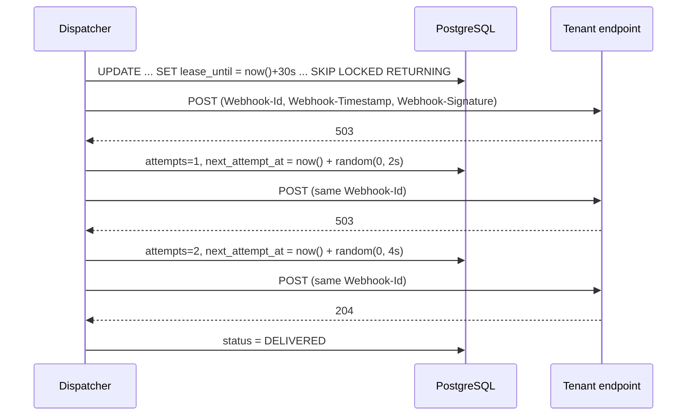

<!-- GENERATED from examples/capstone-5-instant-p2p/README.md by tools/build_capstone_pages.py. Edit the README, then re-run the script. -->

**Source code:** [`examples/capstone-5-instant-p2p`](https://github.com/mostafasroor1983/fintech-engineering-mastery/tree/v1/examples/capstone-5-instant-p2p) · run `mvn test -pl capstone-5-instant-p2p -am` from `examples/`

> A multi-tenant API that moves money between users instantly, trusts nothing but a verified token,
> keeps one noisy tenant from hurting the others, and tells each tenant's backend about every transfer
> reliably. Spring Boot 4.0.9, Spring Security 7.0, Redis 7.4, PostgreSQL 17.

## The problem

Several fintech partners (tenants) run their users' P2P payments on our platform. Four things must hold:

1. **Identity comes from the token, not the request.** A user can spend only from their own account, and
   a tenant never sees another tenant's data.
2. **Fairness.** One tenant's traffic spike or buggy retry loop must not starve the others.
3. **Reliable notification.** Each tenant's backend gets a signed webhook for every completed transfer,
   even if it is down for a while, without us holding resources while it is slow.
4. **No SSRF.** Tenants register webhook URLs; we must not let them aim our servers at internal targets.

| Concern | Fix | Canonical lesson |
|---|---|---|
| Authentication | Stateless OAuth2 resource server: signature, issuer, expiry and **audience** validated | [OAuth2 and JWT](#/tracks/track-11/lessons/track-11-lesson-10) |
| Authorisation | Scopes via `@PreAuthorize`; ownership checked in the SQL (OWASP API1 BOLA) | [OWASP Top 10](#/tracks/track-11/lessons/track-11-lesson-13) |
| Fairness | Redis token bucket per tenant, atomic Lua, server time; 429 + `Retry-After` | [Distributed rate limiting](#/tracks/track-02/lessons/track-02-lesson-17) |
| Double spend | Single-statement conditional debit `... WHERE balance_minor >= :m`; fixed lock order | [Scenario C: double spending](#/tracks/track-05/lessons/track-05-lesson-04) |
| Lost or duplicated webhook | Delivery row in the transfer transaction; lease, retry with backoff + full jitter, then DEAD | [Retry patterns](#/tracks/track-06/lessons/track-06-lesson-04), [Transactional outbox](#/tracks/track-05/lessons/track-05-lesson-13) |
| Spoofed webhook | HMAC-SHA256 over `id.timestamp.body`; receiver compares in constant time | [API security](#/tracks/track-11/lessons/track-11-lesson-11) |
| SSRF via webhook URL (OWASP API7) | https only, no private/loopback/link-local targets, no redirects | [Secure coding](#/tracks/track-11/lessons/track-11-lesson-18) |

## Architecture

```mermaid
flowchart LR
    C[Tenant app] -- "Bearer JWT<br/>Idempotency-Key" --> SF[Security filter chain<br/>JWT: sig, iss, exp, aud]
    SF --> RL[RateLimitInterceptor] -- "EVALSHA token_bucket<br/>key rl:{tenant}" --> RD[(Redis)]
    RL --> CT[P2pController<br/>@PreAuthorize scope]
    CT --> TS[TransferService]
    subgraph TX["One PostgreSQL transaction"]
        TS --> AC[(account<br/>conditional debit)]
        TS --> TR[(transfer)]
        TS --> MV[(account_movement)]
        TS --> WD[(webhook_delivery)]
    end
    D[WebhookDispatcher] -- "1. lease rows (short tx)" --> WD
    D -- "2. POST signed, no tx held" --> T[Tenant endpoint]
    D -- "3. DELIVERED / retry at / DEAD" --> WD
```

Webhook retry, failure then recovery:



## Key decisions and trade-offs

| Decision | Why | Cost / when not to |
|---|---|---|
| Tenant and user only from JWT claims | Headers and bodies are attacker-controlled | Requires the identity provider to issue a `tenant_id` claim. |
| 404 (not 403) for other people's resources | Does not confirm that an id exists | Slightly harder debugging for honest clients. |
| CSRF disabled | Bearer tokens are not sent automatically by browsers; no cookies, no sessions | Would be wrong if you later add cookie-based login. |
| Token bucket in Redis + Lua | Atomic across all instances; allows bursts up to capacity | Redis on the hot path; mitigated by a 200 ms timeout and **fail-open** with an alert. Fail-closed would turn a Redis outage into a full outage. |
| Redis `TIME` inside the script | App servers' clocks can drift | Requires Redis ≥ 5 effect replication (default since Redis 5). |
| Rate limit after authentication | The bucket is per *verified* tenant; anonymous floods are stopped earlier (WAF / gateway) | An unauthenticated flood still costs JWT validation; put a coarse per-IP limit at the edge. |
| Webhook lease instead of `FOR UPDATE` during the call | A slow tenant endpoint never holds a DB connection or row lock | A crash mid-delivery waits for the lease (30 s) before a retry. |
| Full jitter backoff, max 8 attempts, then DEAD | Spreads retries; bounded effort; DEAD rows are replayable by ops | Delivery is at-least-once: receivers must de-duplicate on `Webhook-Id`. |
| Conditional `UPDATE` instead of a full ledger | Smallest correct debit; this capstone focuses on the API edge | Capstone 2 has the double-entry ledger. In production this service posts to it. |

## How to run

```bash
cd examples
mvn test -pl capstone-5-instant-p2p -am   # 8 tests: PostgreSQL + Redis via Testcontainers, real RS256 tokens
```

macOS with Docker Desktop: `export DOCKER_HOST=unix://$HOME/.docker/run/docker.sock` if needed.

The tests act as a tiny identity provider: they generate an RSA key pair, sign tokens with it, and
configure a `JwtDecoder` that checks signature, issuer, expiry and audience. Boot's issuer-uri decoder
backs off because a `JwtDecoder` bean exists.

Run against a real identity provider (Keycloak, Auth0, Entra ID, …):

```bash
export DB_URL=jdbc:postgresql://localhost:5432/p2p DB_USER=p2p DB_PASSWORD=... REDIS_HOST=localhost
export JWT_ISSUER_URI=https://idp.example.com/realms/p2p     # tokens need aud=p2p-api and a tenant_id claim
mvn spring-boot:run -pl capstone-5-instant-p2p
curl -s -X POST localhost:8080/v1/transfers -H "Authorization: Bearer $TOKEN" -H 'Idempotency-Key: p2p-000001' \
     -H 'Content-Type: application/json' -d '{"from":"<my-account>","to":"<friend-account>","amount":5.00,"currency":"GBP"}'
```

| Method | Path | Scope | Notes |
|---|---|---|---|
| `POST` | `/v1/transfers` | `transfers:write` | 201; replay returns the same transfer; 422 insufficient funds; 429 + `Retry-After` |
| `GET` | `/v1/transfers/{id}` | `transfers:read` | Visible only to sender or recipient in the same tenant |
| `PUT` | `/v1/webhooks` | `webhooks:manage` | Validates the URL, returns the signing secret **once** |

Verifying a webhook on the receiver side:

```java
String expected = "v1=" + Hashing.hmacSha256Hex(secret, id + "." + timestamp + "." + rawBody);
boolean ok = Hashing.constantTimeEquals(expected, signatureHeader)
        && Math.abs(nowEpochSeconds - Long.parseLong(timestamp)) <= 300;   // reject replays older than 5 minutes
```

## Tests (what each one proves)

| Test | Proves |
|---|---|
| `authenticationAndScopesAreEnforced` | No token 401; read-only scope 403; wrong audience 401; expired 401; no money moved |
| `transferMovesMoneyAndReplaysOnRetry` | Money moves once; movements sum to zero |
| `cannotSpendFromSomeoneElsesAccountOrPayIntoAnotherTenant` | BOLA and cross-tenant attempts → 404; recipient may read |
| `insufficientFundsChangesNothing` | 422 problem+json, no transfer row |
| `rateLimitIsPerTenant` | Tenant on a 3-token bucket gets 429 + `Retry-After`; another tenant is unaffected |
| `webhookIsSignedRetriedWithBackoffAndDelivered` | Endpoint fails twice, third attempt succeeds; signature verified by the receiver |
| `webhookGoesDeadAfterMaxAttempts` | Stops after `max-attempts`; status DEAD |
| `webhookUrlsPointingInsideOurNetworkAreRejected` | Metadata IP, private IP, plain http and embedded credentials → 400 |

Real output (2026-11-12):

```text
Tests run: 8, Failures: 0, Errors: 0, Skipped: 0 -- in com.fintechmastery.p2p.P2pApiTest
BUILD SUCCESS
```

## Load test

```bash
mvn test -pl capstone-5-instant-p2p -am -Dgroups=load
```

Two tenants send 1,000 transfers each through 100 concurrent connections. "quiet" is on a large bucket;
"noisy" is on a 50-token bucket refilling at 5 per second. Measured once on an Apple M1 Pro laptop,
PostgreSQL and Redis in Docker. **Illustrative only:**

```text
LOAD capstone-5: 2000 requests in 3.5 s = 575 req/s; p50 113.6 ms, p99 968.9 ms; {noisy-201=64, quiet-201=1000, noisy-429=936}
```

The quiet tenant got all 1,000 transfers through. The noisy tenant got its burst of 50, plus about 14
refilled tokens over 3.5 s (5/s × ~3 s), and 936 `429`s. Total money in both tenants is unchanged.

## Known limits

- Webhook secrets are stored in plain text in the demo schema; production encrypts them (KMS envelope
  encryption) and supports rotation with two active secrets.
- SSRF validation resolves DNS once; DNS rebinding can still redirect later. Production sends webhooks
  through an egress proxy that enforces the same rules at connect time.
- No per-user limits or velocity checks (fraud), only per-tenant fairness.
- Same-currency, same-tenant transfers only; no external rails (Faster Payments, SEPA Inst). See
  [Real-time payment systems](#/tracks/track-04/lessons/track-04-lesson-08).
- Rate-limit headers follow only `Retry-After`; the IETF `RateLimit` header fields are still a draft.

## Build it yourself in about 12 hours

| Step | Hours | Done when |
|---|---|---|
| 1. Security chain, test identity provider (key pair, encoder, decoder with audience check) | 2.5 | 401/403 tests green |
| 2. Transfer with conditional debit, ownership in SQL, idempotency | 2 | BOLA and replay tests green |
| 3. Lua token bucket + interceptor + 429 problem details | 2 | Per-tenant test green |
| 4. Webhook table in the transfer transaction, dispatcher with lease, signature | 2.5 | Delivered-after-retries test green |
| 5. Backoff with jitter, DEAD state, SSRF validation | 1.5 | DEAD and SSRF tests green |
| 6. Two-tenant load test, README numbers, rehearse | 1.5 | You can explain why fail-open is right here and wrong for a fraud check |

## How I would explain this in an interview

"It is a multi-tenant instant-transfer API. Identity comes only from a verified JWT: signature, issuer,
expiry and audience. Tenant and user come from claims, and every query filters by them, so another
user's account id simply returns 404. Fairness is a per-tenant token bucket in Redis. A Lua script reads,
refills and takes a token atomically using Redis's clock, so it is correct across all instances. The
debit is a single conditional UPDATE, so it can't overdraw. The webhook is written in the same
transaction as the transfer, so there's no event without a transfer and no transfer without an event.
Delivery leases rows instead of holding locks during the HTTP call, signs with HMAC, retries with
exponential backoff and full jitter, and gives up into a DEAD state ops can replay. Tenant URLs are
checked against SSRF and redirects are not followed."

## The 5 hardest follow-up questions

1. **"Redis is down. What does your API do?"**
   The limiter fails open after a 200 ms timeout and logs/alerts, so transfers continue without fairness
   for the duration. The alternative, fail closed, makes Redis a single point of failure for payments.
   Fail-open is right for a *fairness* control. For a *safety* control like the fraud check in capstone 3,
   use a bounded fallback instead.

2. **"Why not validate the JWT by calling the identity provider on every request?"**
   Introspection adds a network hop and makes the IdP a hard dependency on the hot path. Local validation
   with cached JWKS keys is fast. The cost is that revocation takes effect only at expiry, so access tokens
   are short-lived (minutes) and high-risk actions can additionally require step-up or introspection.

3. **"A tenant says they received the same webhook twice."**
   Expected: delivery is at-least-once (e.g. their endpoint returned 200 after our 5 s read timeout). Each
   delivery keeps the same `Webhook-Id` across retries, and the docs tell receivers to de-duplicate on it.
   Exactly-once delivery over HTTP to a third party is not achievable; exactly-once *processing* is the
   receiver's job with that id.

4. **"Why a token bucket and not a fixed window counter?"**
   A fixed window allows 2× the limit across a window boundary and resets abruptly. A sliding log is
   exact but stores every request. A token bucket is O(1) memory per tenant, allows controlled bursts
   (capacity) and enforces a steady rate (refill). For payments APIs, the burst allowance matches real
   traffic (payroll runs).

5. **"How would you prevent SSRF completely?"**
   Validation at registration is necessary but not enough (DNS rebinding, redirects). Disable redirects
   (done). Then route all webhook traffic through a dedicated egress proxy in a network segment with no
   route to internal ranges or the metadata endpoint, and re-check the resolved IP at connect time. Defence
   in depth: the network makes the attack impossible even if the code check is bypassed.

## See also

- [Track 13: Spring Security 7](#/tracks/track-13/lessons/track-13-lesson-05)
- [Track 14: Design a rate limiter](#/tracks/track-14/lessons/track-14-lesson-06)
- [Track 04: Open banking and PSD2](#/tracks/track-04/lessons/track-04-lesson-20)
- [Track 06: Rate limiting for reliability](#/tracks/track-06/lessons/track-06-lesson-13)
