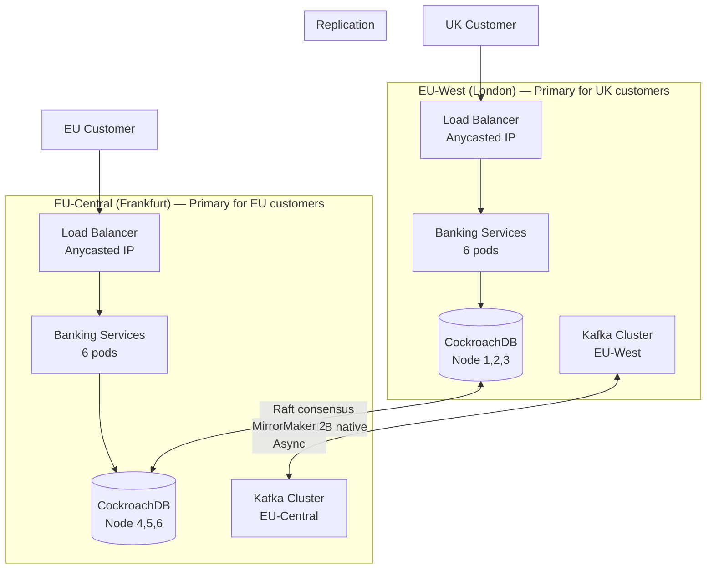
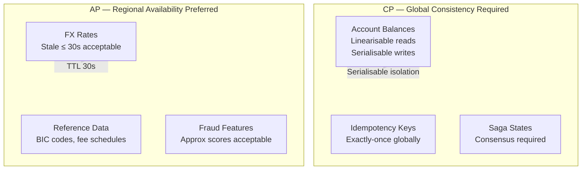
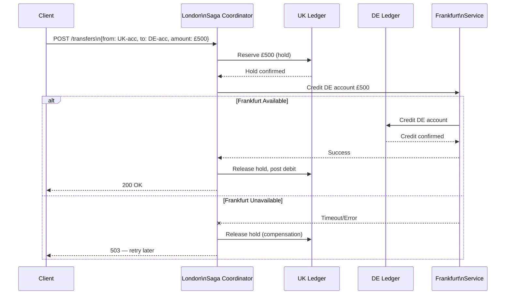

# Multi-Region Banking Platform

## Project Overview

Architect a **multi-region active-active banking platform** that serves customers from the nearest region with low latency, maintains strong consistency for critical financial operations across regions, and achieves sub-50ms RTO for region failover.

This is the most architecturally complex capstone. It requires deep understanding of the CAP theorem trade-offs, distributed consensus, and the patterns that make global-scale financial systems work.

**What you will build:**
- Active-active topology across EU-West (London) and EU-Central (Frankfurt)
- Region-local reads with globally consistent writes for account balances
- Cross-region Saga for international money transfers
- Conflict detection and resolution for concurrent cross-region operations
- Automatic region failover with sub-50ms RTO

---

## System Requirements

### Functional Requirements

| Requirement | Specification |
|---|---|
| Region topology | EU-West (London primary), EU-Central (Frankfurt) |
| Account operations | Balance read, debit, credit — served from nearest region |
| Consistency tier | Account balances: global CP; FX rates: regional AP |
| Cross-region transfer | London→Frankfurt: multi-step Saga with compensation |
| Failover | Automatic, sub-50ms RTO, zero manual intervention |
| Data residency | EU customer data must not leave EU regions |

### Non-Functional Requirements

| SLO | Target |
|---|---|
| Read P99 latency | < 10ms (region-local) |
| Write P99 latency | < 50ms (global consensus) |
| RTO (single region failure) | < 50ms |
| RPO (single region failure) | 0 (synchronous replication) |
| Throughput | 20,000 TPS per region |
| Availability | 99.99% (4.38 min/month error budget) |

---

## Architecture



---

## CAP Design Decisions by Data Type



**The critical insight:** Not all data has the same consistency requirement. Using global consensus (CockroachDB Raft) for FX rate lookups would add 50ms of cross-region latency to every payment for no business benefit. Use CP where money is at risk; use AP where staleness is acceptable.

---

## Implementation — CockroachDB Multi-Region

### Database Configuration

```sql
-- CockroachDB multi-region setup
-- Accounts table: data homed to region based on customer's primary region
ALTER TABLE accounts ADD COLUMN region crdb_internal_region NOT NULL DEFAULT 'eu-west-1';

ALTER TABLE accounts SET (
    locality = REGIONAL BY ROW
);
-- This pins each account row to its home region for fast local reads
-- Writes to a row require cross-region consensus when primary region is down

-- Transactions table: global — not region-pinned
-- (transfers cross regions — no single home region)
ALTER TABLE payment_transactions SET (
    locality = GLOBAL
);
-- GLOBAL tables: optimistic consistency, slightly slower reads, globally consistent
```

### Region-Aware Spring Boot Configuration

```java
@Configuration
public class MultiRegionDataSourceConfig {

    @Value("${app.region}")
    private String currentRegion;  // eu-west-1 or eu-central-1

    @Bean
    @Primary
    public DataSource primaryDataSource() {
        // CockroachDB connection — read preference routes to local replicas
        var ds = new HikariDataSource();
        ds.setJdbcUrl("jdbc:postgresql://" + cockroachdbEndpoint + 
                       "/banking?sslmode=verify-full" +
                       "&options=-c%20default_transaction_use_follower_reads%3Doff");
        // For strong reads: follower_reads=off (hits the leaseholder, potentially remote)
        return ds;
    }

    @Bean
    public DataSource staleReadDataSource() {
        // For FX rates, reference data — stale reads from local replica
        var ds = new HikariDataSource();
        ds.setJdbcUrl("jdbc:postgresql://" + cockroachdbEndpoint + 
                       "/banking?sslmode=verify-full" +
                       "&options=-c%20default_transaction_use_follower_reads%3Don");
        // Follower reads: served by local replica, 4.8s behind leaseholder
        return ds;
    }
}
```

---

## Cross-Region Saga — International Money Transfer

A transfer from a UK account (homed in London) to a German account (homed in Frankfurt) requires a distributed Saga with compensation.



```java
@Service
public class CrossRegionTransferSaga {

    private final SagaEventStore eventStore;
    private final UkLedgerService ukLedger;
    private final RemoteFrankfurtClient frankfurtClient;

    @Transactional
    public SagaState execute(TransferRequest request) {
        var sagaId = UUID.randomUUID();
        eventStore.record(sagaId, SagaEvent.STARTED, request);

        try {
            // Step 1: Reserve funds in source account (London-local)
            var holdRef = ukLedger.placeHold(
                request.getFromAccountId(), request.getAmount());
            eventStore.record(sagaId, SagaEvent.HOLD_PLACED, holdRef);

            // Step 2: Credit destination account (Frankfurt — remote call)
            try {
                var creditResult = frankfurtClient.creditAccount(
                    request.getToAccountId(), request.getAmount(),
                    request.getCurrency(), sagaId.toString());
                eventStore.record(sagaId, SagaEvent.DESTINATION_CREDITED, creditResult);

            } catch (RemoteCallException e) {
                // Compensation: release hold
                ukLedger.releaseHold(holdRef);
                eventStore.record(sagaId, SagaEvent.COMPENSATED_HOLD_RELEASED, holdRef);
                throw new TransferFailedException("Destination region unavailable", e);
            }

            // Step 3: Post the debit (convert hold to permanent debit)
            ukLedger.postDebitFromHold(holdRef);
            eventStore.record(sagaId, SagaEvent.SOURCE_DEBITED, holdRef);
            eventStore.record(sagaId, SagaEvent.COMPLETED, request);

            return SagaState.COMPLETED;

        } catch (Exception e) {
            eventStore.record(sagaId, SagaEvent.FAILED, e.getMessage());
            return SagaState.FAILED;
        }
    }
}
```

---

## Region Failover

### Kubernetes Multi-Cluster Routing (Istio)

```yaml
# Istio ServiceEntry: route payments to nearest healthy region
apiVersion: networking.istio.io/v1beta1
kind: DestinationRule
metadata:
  name: payment-api-multi-region
spec:
  host: payment-api.payments.svc.cluster.local
  trafficPolicy:
    outlierDetection:
      consecutiveGatewayErrors: 3
      interval: 10s
      baseEjectionTime: 30s
      maxEjectionPercent: 100  # Eject the entire region on failure
    connectionPool:
      http:
        http2MaxRequests: 1000
        maxRequestsPerConnection: 100
  subsets:
  - name: eu-west-1
    labels:
      region: eu-west-1
  - name: eu-central-1
    labels:
      region: eu-central-1
```

### Health Check — Region Availability Probe

```java
@Component
public class RegionHealthProbe {

    private final CockroachDbHealthCheck dbHealth;
    private final KafkaHealthCheck kafkaHealth;

    @ReadinessProbe
    public Health check() {
        var dbOk    = dbHealth.isLocalReplicaHealthy();
        var kafkaOk = kafkaHealth.isLocalBrokerHealthy();
        
        if (dbOk && kafkaOk) {
            return Health.up()
                .withDetail("region", currentRegion)
                .withDetail("db", "healthy")
                .build();
        }
        
        // If this region is degraded, fail the readiness probe
        // Kubernetes will remove this region's pods from load balancer
        // Istio will route traffic to the other region
        return Health.down()
            .withDetail("db", dbOk ? "healthy" : "degraded")
            .withDetail("kafka", kafkaOk ? "healthy" : "degraded")
            .build();
    }
}
```

---

## Kafka MirrorMaker 2 — Cross-Region Event Replication

```yaml
# MirrorMaker 2 configuration: replicate payment events EU-West → EU-Central
apiVersion: kafka.strimzi.io/v1beta2
kind: KafkaMirrorMaker2
metadata:
  name: payment-events-replicator
spec:
  clusters:
  - alias: eu-west
    bootstrapServers: kafka.eu-west.internal:9092
  - alias: eu-central
    bootstrapServers: kafka.eu-central.internal:9092
  
  mirrors:
  - sourceCluster: eu-west
    targetCluster: eu-central
    sourceConnector:
      config:
        replication.factor: "3"
        sync.topic.acls.enabled: "false"
        offset-syncs.topic.replication.factor: "3"
        # Bidirectional: eu-west → eu-central AND eu-central → eu-west
    topicsPattern: "payments.authorised|settlements.completed|audit.events"
    
  - sourceCluster: eu-central
    targetCluster: eu-west
    topicsPattern: "payments.authorised|settlements.completed|audit.events"
```

---

## Architecture Decision Records

### ADR-001: CockroachDB for Multi-Region (Not PostgreSQL + Replication)

**Status:** Accepted

**Context:** Standard PostgreSQL with streaming replication requires a primary region for all writes. During failover, 10-30 seconds of write unavailability while a new primary is elected. CockroachDB uses Raft consensus — any node can serve writes; regional failures don't require manual promotion.

**Decision:** CockroachDB with 6 nodes (3 per region). Regional tables use `REGIONAL BY ROW` for account data. Payment transactions use `GLOBAL` locality. This provides sub-50ms RTO without manual intervention.

**Consequences:** CockroachDB licensing cost (~3x PostgreSQL infrastructure). Team must learn CockroachDB-specific SQL dialect differences. Serialisable isolation has higher cross-region latency (50ms round trip) than local PostgreSQL.

### ADR-002: Saga Pattern for Cross-Region Transfers (Not 2PC)

**Status:** Accepted

**Context:** Two-Phase Commit (2PC) across regions is a blocking protocol. If the Frankfurt coordinator is unreachable during the PREPARE phase, the London transaction holds its locks indefinitely.

**Decision:** Saga pattern with explicit compensation. Each step is a local ACID transaction. Compensation transactions are designed to be idempotent and always succeed. The saga state is persisted in the event store after each step.

**Consequences:** Cross-region transfers are eventually consistent (not immediately consistent). The intermediate "hold" state is visible to the account holder for up to 2 seconds during normal operation. Compensation scenarios require thorough testing.

### ADR-003: Synchronous Kafka MirrorMaker for Audit Events, Async for Others

**Status:** Accepted

**Context:** Regulatory audit events must be durable across both regions. Payment events can tolerate async replication lag (affects analytics, not correctness). Using synchronous replication for all events increases cross-region latency.

**Decision:** Audit events: synchronous MirrorMaker write (producer.send waits for cross-region acknowledgement). Payment events: async MirrorMaker with at-most-once lag acceptable.

---

## Principal Engineer Review Criteria

- [ ] **Region failover is automatic and sub-50ms** — kill London pods, Frankfurt serves within 50ms
- [ ] **Saga compensation works** — simulate Frankfurt failure mid-transfer, verify London hold is released
- [ ] **CockroachDB REGIONAL BY ROW** — verify UK accounts served from London replicas (trace with EXPLAIN)
- [ ] **No data loss on region failure** — RPO = 0 verified by committing a transaction and immediately killing the region
- [ ] **CAP design documented** — which data types use CP vs AP, with justification
- [ ] **MirrorMaker lag monitored** — alert configured if replication lag exceeds 10 seconds
- [ ] **Load test both regions** — 20k TPS each; verify cross-region transfer latency < 100ms P99
