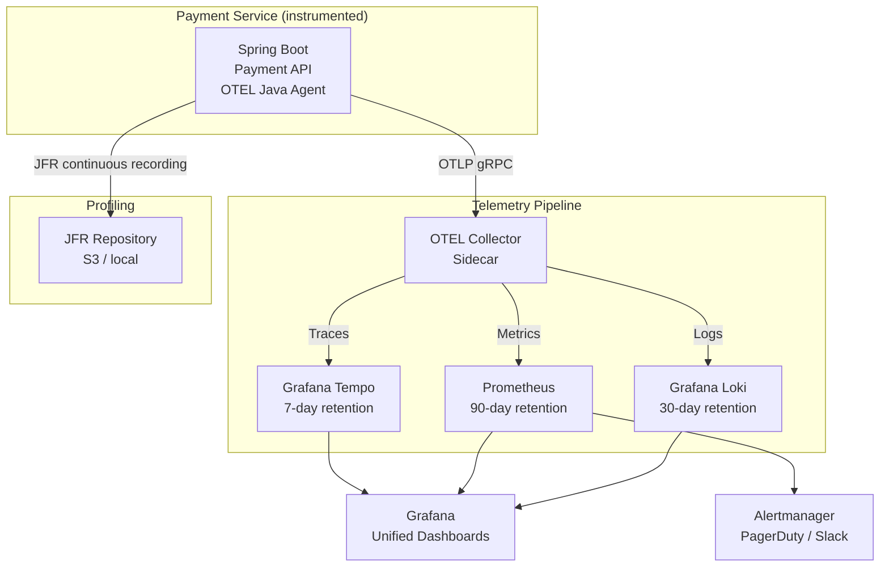

# Production Observability & Incident Investigation Platform

## Project Overview

Build a production-grade observability platform for a payment processing system. This is not just instrumentation — it is the complete operational intelligence layer that answers: "Is our system healthy right now?", "What happened during that incident?", and "Will we breach our SLO this month?"

**What you will build:**
- Full OpenTelemetry instrumentation (traces, metrics, logs) for a payment API
- SLO definitions with multi-window burn-rate alerting
- Correlated trace-to-log dashboards in Grafana
- JVM flight recorder profiling for production performance investigation
- On-call runbook for a P1 payment processing incident
- SLO-based incident severity classification

---

## System Requirements

### Observability Requirements

| Requirement | Specification |
|---|---|
| Traces | End-to-end for every payment, sampled for healthy requests |
| Metrics | P50/P95/P99 latency, error rate, throughput, saturation |
| Logs | Structured JSON, correlated via trace ID |
| SLOs | 99.95% availability, P99 < 100ms, over 28-day rolling window |
| Alerting | Multi-window burn rate (1h critical, 6h warning, 3d trend) |
| Dashboards | Payment health, SLO status, JVM internals, Kafka consumer lag |
| Profiling | Continuous profiling via Java Flight Recorder (JFR) |
| Retention | Traces: 7 days; Metrics: 90 days; Logs: 30 days; Compliance: 5 years |

---

## Architecture



---

## SLO Definition

### Payment API SLOs

```yaml
# SLO specification — formal definition
slos:
  - id: payment-api-availability
    description: "Payment authorisation API availability"
    service: payment-api
    
    sli:
      query: |
        sum(rate(http_server_requests_seconds_count{
          app="payment-api",
          status!~"5.."
        }[5m]))
        /
        sum(rate(http_server_requests_seconds_count{
          app="payment-api"
        }[5m]))
    
    target: 0.9995  # 99.95%
    window: 28d     # 28-day rolling window
    
    # Error budget: 28d × 24h × 60m × (1 - 0.9995) = 20.16 minutes
    
  - id: payment-api-latency-p99
    description: "Payment authorisation P99 latency"
    service: payment-api
    
    sli:
      query: |
        histogram_quantile(0.99, 
          sum(rate(http_server_requests_seconds_bucket{
            app="payment-api",
            uri="/v1/payments"
          }[5m])) by (le)
        )
    
    target: 0.1     # P99 < 100ms
    window: 28d
```

### Multi-Window Burn Rate Alerts (PromQL)

```yaml
# Prometheus alerting rules
groups:
  - name: payment-slo-alerts
    rules:
    
    # CRITICAL: fast burn — page on-call immediately
    # 1h + 5m: consuming budget at 14.4x rate → exhausted in ~2 days
    - alert: PaymentAPIAvailabilityCriticalBurnRate
      expr: |
        (
          1 - (
            sum(rate(http_server_requests_seconds_count{app="payment-api",status!~"5.."}[1h]))
            /
            sum(rate(http_server_requests_seconds_count{app="payment-api"}[1h]))
          )
        ) / (1 - 0.9995) > 14.4
        AND
        (
          1 - (
            sum(rate(http_server_requests_seconds_count{app="payment-api",status!~"5.."}[5m]))
            /
            sum(rate(http_server_requests_seconds_count{app="payment-api"}[5m]))
          )
        ) / (1 - 0.9995) > 14.4
      for: 2m
      labels:
        severity: critical
        team: payments-oncall
      annotations:
        summary: "Payment API: critical SLO burn rate — P1 incident"
        description: "Burning budget at {{ $value }}x rate. Will exhaust 28d budget in {{ printf \"%.1f\" (20.16 / $value) }} minutes."
        runbook: "https://runbooks.internal/payments/p1-availability"
    
    # WARNING: slow burn — page within 1 hour
    # 6h + 30m: consuming at 6x rate → exhausted in ~3 days
    - alert: PaymentAPIAvailabilityWarningBurnRate
      expr: |
        (
          1 - (
            sum(rate(http_server_requests_seconds_count{app="payment-api",status!~"5.."}[6h]))
            /
            sum(rate(http_server_requests_seconds_count{app="payment-api"}[6h]))
          )
        ) / (1 - 0.9995) > 6
      for: 15m
      labels:
        severity: warning
      annotations:
        summary: "Payment API: slow SLO burn rate — investigate"

    # Latency SLO: P99 approaching 100ms threshold
    - alert: PaymentAPILatencySLOBreach
      expr: |
        histogram_quantile(0.99,
          sum(rate(http_server_requests_seconds_bucket{app="payment-api",uri="/v1/payments"}[5m])) by (le)
        ) > 0.09  # Alert at 90ms (before breaching 100ms SLO)
      for: 5m
      labels:
        severity: warning
      annotations:
        summary: "Payment API P99 approaching 100ms SLO"
```

---

## OpenTelemetry Instrumentation

### JVM Agent Configuration (Kubernetes)

```yaml
# payment-api deployment with OTEL Java Agent
spec:
  containers:
  - name: payment-api
    image: bank-registry.internal/payment-api:2.4.1
    
    # Mount OTEL agent from init container
    volumeMounts:
    - name: otel-agent
      mountPath: /opt/otel
    
    env:
    - name: JAVA_TOOL_OPTIONS
      value: >-
        -javaagent:/opt/otel/opentelemetry-javaagent.jar
        -XX:StartFlightRecording=filename=/var/log/jfr/payment-api.jfr,
          dumponexit=true,settings=profile,maxsize=250m,maxage=1h
        -XX:FlightRecorderOptions=stackdepth=128
    
    - name: OTEL_SERVICE_NAME
      value: "payment-api"
    - name: OTEL_EXPORTER_OTLP_ENDPOINT
      value: "http://otel-collector.monitoring.svc.cluster.local:4317"
    - name: OTEL_TRACES_EXPORTER
      value: "otlp"
    - name: OTEL_METRICS_EXPORTER
      value: "otlp"
    - name: OTEL_LOGS_EXPORTER
      value: "otlp"
    - name: OTEL_RESOURCE_ATTRIBUTES
      value: "deployment.environment=production,k8s.namespace.name=payments-prod"
    
    # Tail sampling: keep all errors and large-amount payments
    - name: OTEL_TRACES_SAMPLER
      value: "parentbased_always_on"  # Let Collector handle tail sampling

  initContainers:
  - name: otel-agent-init
    image: ghcr.io/open-telemetry/opentelemetry-operator/autoinstrumentation-java:1.32.0
    command: ["cp", "/javaagent.jar", "/opt/otel/opentelemetry-javaagent.jar"]
    volumeMounts:
    - name: otel-agent
      mountPath: /opt/otel
```

### Custom Business Metrics

```java
// Beyond the default HTTP metrics — financial business observability
@Component
public class PaymentObservability {

    private final Meter meter;

    // Payment outcome counters — dimension by channel, decision, currency
    private final LongCounter paymentDecisions;
    
    // Fraud service performance — are we within the 200ms timeout?
    private final DoubleHistogram fraudLatency;
    
    // Error budget burn indicator — custom metric for SLO dashboard
    private final ObservableDoubleGauge errorBudgetConsumedPct;
    
    private volatile double _errorBudgetPct = 0.0;

    public PaymentObservability(OpenTelemetry otel, SloCalculator sloCalc) {
        meter = otel.getMeter("com.bank.payment.observability");
        
        paymentDecisions = meter.counterBuilder("payment.decisions.total")
            .setDescription("Payment authorisation decisions by outcome")
            .build();
        
        fraudLatency = meter.histogramBuilder("payment.fraud.score.duration.ms")
            .setDescription("Fraud scoring latency including timeouts")
            .setUnit("ms")
            .setExplicitBucketBoundariesAdvice(List.of(
                10.0, 25.0, 50.0, 100.0, 150.0, 200.0, 300.0))
            .build();
        
        // Observable gauge — polled by Prometheus scrape
        errorBudgetConsumedPct = meter.gaugeBuilder("payment.slo.error_budget.consumed_pct")
            .setDescription("Percentage of 28-day error budget consumed")
            .buildWithCallback(obs -> obs.record(_errorBudgetPct));
        
        // Update error budget calculation every minute
        // (In practice, computed from Prometheus query)
    }

    public void recordDecision(Payment payment, PaymentDecision decision, Duration latency) {
        var attrs = Attributes.of(
            AttributeKey.stringKey("channel"),  payment.getChannel().name(),
            AttributeKey.stringKey("decision"), decision.name(),
            AttributeKey.stringKey("currency"), payment.getCurrency()
        );
        paymentDecisions.add(1, attrs);
    }
}
```

---

## Grafana Dashboard Design

### Payment Health Dashboard — Key Panels

```
Row 1: Health Summary
  ┌─────────────────┬─────────────────┬──────────────────┬──────────────────┐
  │ Current TPS     │ P99 Latency     │ Error Rate       │ Error Budget Used│
  │ 32,450 req/s    │ 72ms            │ 0.003%           │ 23% (15.4 min)   │
  └─────────────────┴─────────────────┴──────────────────┴──────────────────┘

Row 2: SLO Burn Rate
  ┌──────────────────────────────────────────────────────────────────────────┐
  │ Availability Burn Rate (1h / 6h / 3d windows)                           │
  │ 1h: 0.8x ✓  6h: 0.6x ✓  3d: 0.5x ✓                                   │
  └──────────────────────────────────────────────────────────────────────────┘

Row 3: Latency Heatmap
  ┌──────────────────────────────────────────────────────────────────────────┐
  │ Request Duration Heatmap — POST /v1/payments                            │
  │ Shows P50/P95/P99 bands over time, easy visual of latency spikes        │
  └──────────────────────────────────────────────────────────────────────────┘

Row 4: Downstream Dependencies
  ┌─────────────────┬─────────────────┬──────────────────┐
  │ Fraud Service   │ FX Service      │ Account Service  │
  │ P99: 145ms      │ P99: 89ms       │ P99: 52ms        │
  │ Timeout rate: 2%│ Timeout rate: 0%│ Timeout rate: 0% │
  └─────────────────┴─────────────────┴──────────────────┘
```

### Trace-to-Log Correlation

```
Grafana Explore — correlated query:
  1. Search logs for paymentId
  2. Click trace ID in log line → opens Tempo trace
  3. Trace shows: 72ms total, fraud-service took 65ms (slow)
  4. Click span → opens logs for that specific service call
  
Configuration (Grafana datasource link):
  Loki → Tempo: { traceId: "{{log.traceId}}" }
  Tempo → Loki: { query: "{job=\"payment-api\"} | traceId=\"{{span.traceId}}\"" }
```

---

## JVM Flight Recorder — Production Profiling

```java
// Programmatic JFR recording for high-latency investigation
@Component
public class JfrProfilingService {

    // Triggered when P99 exceeds SLO threshold
    @EventListener
    public void onLatencyAnomaly(LatencyAnomalyEvent event) {
        if (event.getP99Ms() < 150) return;  // Only record for significant latency
        
        log.warn("P99 latency anomaly detected: {}ms — starting JFR recording", 
            event.getP99Ms());
        
        try {
            var recording = new Recording();
            recording.setSettings(Map.of(
                "jdk.ObjectAllocationInNewTLAB#enabled",    "true",
                "jdk.ObjectAllocationOutsideTLAB#enabled",  "true",
                "jdk.ExecutionSample#enabled",              "true",
                "jdk.ExecutionSample#period",               "1ms",
                "jdk.GarbageCollection#enabled",            "true",
                "jdk.GCHeapSummary#enabled",                "true",
                "jdk.ThreadPark#enabled",                   "true"  // detect lock contention
            ));
            recording.start();
            
            // Record for 60 seconds
            Thread.sleep(60_000);
            recording.stop();
            
            Path output = Paths.get("/var/log/jfr/anomaly-" + 
                Instant.now().getEpochSecond() + ".jfr");
            recording.dump(output);
            
            // Upload to S3 for async analysis
            s3Uploader.upload(output, "jfr-recordings/" + output.getFileName());
            log.info("JFR recording saved: {}", output);
            
        } catch (Exception e) {
            log.error("JFR recording failed", e);
        }
    }
}
```

---

## Incident Runbook — P1 Payment Processing Outage

```markdown
# RUNBOOK: Payment API P1 — Availability SLO Breach

## Severity Classification
P1: Error rate > 1% for > 2 minutes, OR complete unavailability

## Immediate Response (first 5 minutes)

### Step 1: Acknowledge the alert
1. Acknowledge in PagerDuty
2. Post to #payments-incidents: "@here P1 declared — payment API error rate {X}% — investigating"
3. Open incident in Jira Service Management

### Step 2: Establish current state
kubectl get pods -n payments-prod
kubectl get hpa -n payments-prod
kubectl top pods -n payments-prod

# Check error rate in Grafana:
# Dashboard: Payment Health → Panel: Error Rate (last 15 minutes)

### Step 3: Identify error type
kubectl logs -n payments-prod -l app=payment-api --since=5m | grep '"level":"ERROR"'

# Common patterns:
# "Connection refused" → database issue (see DB runbook)
# "TimeoutException" → downstream service slow (check fraud/FX/account services)
# "OutOfMemoryError" → JVM heap exhaustion (see JVM runbook)
# "HTTP 503" from upstream → rate limiting or circuit breaker open

### Step 4: Check database
kubectl exec -n database -it postgres-primary-0 -- \
  psql -U payments -c "SELECT count(*) FROM pg_stat_activity WHERE state='active';"
# > 100 active connections: pool exhaustion → restart pods to reset pools

### Step 5: Check Kafka consumer lag
kubectl exec -n kafka kafka-0 -- \
  kafka-consumer-groups.sh --bootstrap-server localhost:9092 \
  --describe --group payment-api-prod
# Consumer lag > 10,000: settlement workers behind → scale up

## If not resolved in 15 minutes: escalate to Principal Engineer on call

## Post-Incident (within 24 hours)
1. Write postmortem in Confluence
2. File action items in Jira
3. Update this runbook with new patterns found
```

---

## Architecture Decision Records

### ADR-001: Tail Sampling Over Head Sampling

**Status:** Accepted

**Context:** Head sampling (decided at first span) would discard 90% of error traces if sampling rate is 10%. For a financial service, every error trace must be retained.

**Decision:** Tail sampling in OTEL Collector: 100% of error traces, 100% of large-amount payments (>£10k), 10% of healthy sub-100ms requests. Tail sampling sees the complete trace outcome before deciding.

**Consequences:** Requires buffering up to 10 seconds of trace data in the Collector (memory overhead ~200MB). Sampling decisions delayed by up to 10 seconds.

### ADR-002: JFR for Production Profiling (Not Sampling Profiler)

**Status:** Accepted

**Context:** External profilers (async-profiler with JVMTI) have ~5% CPU overhead. JFR uses low-overhead kernel-level hooks and is designed for always-on production profiling (< 1% overhead at default settings).

**Decision:** Continuous JFR recording at profile settings with 1-hour circular buffer. On latency anomaly, dump the last 60 seconds of profiling data to S3 for investigation.

---

## Principal Engineer Review Criteria

- [ ] **SLO burn rate alert fires correctly** — simulate 2% error rate, verify critical alert within 2 minutes
- [ ] **Trace-to-log correlation works** — search logs by paymentId, click to trace, click to log
- [ ] **Error budget calculation is accurate** — verify against manual calculation of error rate × window
- [ ] **JFR recording captures GC events** — trigger a Full GC in test, verify in JFR recording
- [ ] **Runbook is actionable** — walk through the runbook with a simulated incident scenario
- [ ] **Dashboard covers the four golden signals** — latency, errors, traffic, saturation all visible
- [ ] **Alert suppression during maintenance** — Alertmanager silencing configured and tested
