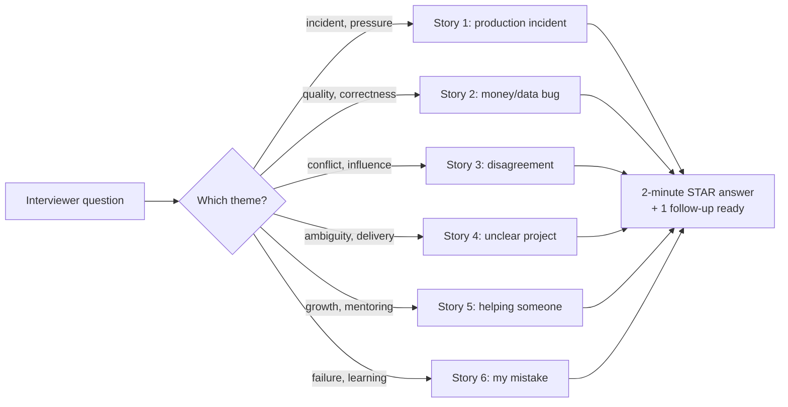

## في دقيقة واحدة

تختبر الجولات السلوكية ما إذا كنت تتصرف كمهندس أول حين تصعب الأمور: حادث، أو خلاف، أو متطلب غير واضح، أو مهندس مبتدئ متعثر. وتجيب بقصص قصيرة وحقيقية بصيغة **STAR** ‏(الموقف، والمهمة، والإجراء، والنتيجة). وجهّز **ست قصص** مسبقًا، تُروى كل منها في دقيقتين. ويمكن الإجابة عن معظم الأسئلة بإحداها. ومخرج هذا الدرس بنك قصص من صفحة واحدة تتدرب عليه بصوت عالٍ.

## تشبيه

بنك القصص يشبه مكتبة كود مفهرسة جيدًا. فلا تكتب دالة ترتيب جديدة في كل مقابلة؛ بل تمد يدك إلى واحدة مختبرة وتكيّف الاستدعاء. وست قصص مختبرة، موسومة حسب الموضوع، تغطي معظم الأسئلة التي ستُطرح عليك.

## المخطط



## ابنِه خطوة بخطوة

### 1. صيغة STAR، مع حدود زمنية

| الجزء | ما تقوله | الوقت |
|---|---|---|
| **الموقف (Situation)** | الفريق، والنظام، والحجم، ولماذا كان الأمر مهمًا. جملة أو جملتان. | 15 ثانية |
| **المهمة (Task)** | ما كنت *أنت* مسؤولًا عنه. | 10 ثوانٍ |
| **الإجراء (Action)** | ما فعلته *أنت*، في 3–4 خطوات ملموسة. استخدم "أنا"، لا "نحن". وسمِّ الاختيارات التقنية. | 60–70 ثانية |
| **النتيجة (Result)** | النتيجة برقم إن كان لديك رقم حقيقي، إضافة إلى ما تغير بعدها (اختبار، أو تنبيه، أو دليل تشغيل، أو عملية). | 20 ثانية |

المصطلحات: **STAR**، و**مراجعة ما بعد الحادث بلا لوم**.

### 2. القصص الست التي يحتاجها كل مهندس أول في الأنظمة الخلفية

| # | الموضوع | الأسئلة النموذجية التي تجيب عنها | نسخة التقنية المالية التي تبحث عنها في ماضيك |
|---|---|---|---|
| 1 | حادث إنتاج قدته أو ساعدت في حله | "أخبرني عن وقت عملت فيه تحت ضغط"، و"خطأ صعب" | مدفوعات عالقة، أو خصومات مكررة، أو تأخر المستهلكين، أو استنفاد المجمع |
| 2 | خطأ في الصحة اكتشفته أو أصلحته | "الانتباه للتفاصيل"، و"الجودة" | التقريب، أو الترحيل المزدوج، أو حالة سباق، أو خطأ في موعد إغلاق متعلق بالمنطقة الزمنية |
| 3 | خلاف مع زميل، أو قائد، أو فريق آخر | "الصراع"، و"التأثير دون سلطة" | متزامن مقابل غير متزامن، أو تغيير مخطط، أو موعد إطلاق محفوف بالمخاطر |
| 4 | التسليم بمتطلبات غير واضحة | "الغموض"، و"الملكية" | تغيير تنظيمي، أو قناة دفع جديدة، أو ترحيل |
| 5 | مساعدة شخص على النمو | "التوجيه"، و"العمل الجماعي" | العمل الثنائي على مراجعة صعبة، أو تعليم اختبار التزامن |
| 6 | خطأ ارتكبته | "الإخفاق"، و"ماذا كنت ستفعل بشكل مختلف" | ترحيل قفل جدولًا، أو حالة حدية فاتتك |

استخدم **القصص الحقيقية** فقط. فإن افتقدت واحدة، فاستخدم قصة حقيقية أصغر بدل اختلاق قصة كبيرة: فأسئلة المتابعة تكشف التفاصيل المختلقة بسرعة.

### 3. اكتب كل قصة على بطاقة واحدة

```text
Story 2 - Duplicate refund (correctness)
S: Refund service, ~ N refunds/day (use your real number or say "a few thousand"), retries from the PSP client.
T: I owned the refund API.
A: 1) Reproduced it: two retries 50 ms apart both passed "if not exists" -> two refunds.
   2) Added a unique key on (merchant, idempotency_key), insert-first, replay stored response.
   3) Wrote a concurrency test (20 threads, one key) that failed before and passed after.
   4) Back-filled: query for duplicates, reversed them with compensating entries, informed finance.
R: No duplicates since; the test runs in CI; added an alert on idempotency conflicts.
Follow-up ready: why not a distributed lock? (DB constraint is the arbiter; locks expire.)
```

العمق التقني في **الإجراء** هو ما يميز إجابة المهندس الأول. واربطه بما بنيته في المشاريع الختامية إن كان عملك السابق ضعيفًا: "بنيت هذا النمط في مشروع جانبي وهذا هو الاختبار الذي يثبته" إجابة صادقة وقوية.

### 4. تدرّب

سجّل نفسك على هاتفك. وتحقق من: أقل من دقيقتين و15 ثانية، وظهور كلمة "أنا" في كل خطوة إجراء، وتفصيل تقني ملموس واحد لكل خطوة، وأن النتيجة تسمّي تغييرًا دائمًا.

## ما الذي يسوء

**الخطأ: قصة "نحن".** "لاحظنا زمن استجابة، ووسّعنا، وأصلحناه." لا يستطيع المُقابِل معرفة ما فعلته، فيقيّمها كـ "مساهمة غير واضحة".

**الإصلاح:** أعد كتابة كل سطر إجراء بـ "أنا" وفعل: "أخذت تفريغ الخيوط"، و"اقترحت تحديد حجم المجمع"، و"كتبت دليل التشغيل". وانسب الفضل للفريق في جملة واحدة في النهاية.

**الاختبار:** اقرأ قصتك بصوت عالٍ وعدّ "أنا + فعل" في الإجراء. أقل من ثلاثة: أعد الكتابة.

## المقايضات: متى لا تستخدم STAR بجمود

- لسؤال "امشِ بي عبر نظامك الحالي"، أجب كنظرة عامة على البنية، لا كقصة STAR.
- إن قاطعك المُقابِل بسؤال تقني، فأجب عنه مباشرة. ولا تجرّه عائدًا إلى نصك.
- لا تُقحم رقمًا في النتيجة. "تنبيهات أقل بعد ذلك" مقبولة؛ ونسبة مئوية مختلقة ليست كذلك.

## أسئلة وأجوبة المقابلة

**إحماء: "حدثني عن نفسك."**
- *الإجابة النموذجية:* 60–90 ثانية: الدور الحالي والمجال، وشيئان تقنيان تملكهما، ونتيجة واحدة تفخر بها، ولماذا هذا الدور هو الخطوة التالية.
- *الإجابة الخاطئة الشائعة:* قراءة سيرتك الذاتية زمنيًا لخمس دقائق.
- *لماذا تفشل:* تستهلك الوقت الذي أراده المُقابِل للقصص ولا تُظهر ترتيبًا للأولويات.

**قياسي: "أخبرني عن حادث إنتاج."**
- *الإجابة النموذجية:* القصة 1. الاكتشاف (أي تنبيه أو بلاغ مستخدم)، والتخفيف أولًا (التراجع، أو التبديل، أو إسقاط الحمل)، ثم السبب الجذري، ثم الإصلاح الدائم (اختبار، أو تنبيه، أو دليل تشغيل). واذكر المراجعة بلا لوم.
- *الإجابة الخاطئة الشائعة:* البدء بالبحث عن السبب الجذري.
- *لماذا تفشل:* المهندسون الأوائل يوقفون النزيف أولًا. والتحقيق بينما يتعطل العملاء يُظهر أولوية خاطئة.

**قياسي: "أخبرني عن خلاف مع زميل."**
- *الإجابة النموذجية:* القصة 3. اعرض موقفه بإنصاف، وأظهر كيف اتخذت القرار بناءً على الأدلة (نموذج أولي، أو اختبار حمل، أو مقايضة مكتوبة)، وما تقرر، وكيف دعمته حتى لو لم يكن خيارك.
- *الإجابة الخاطئة الشائعة:* "أقنعته بأنني محق."
- *لماذا تفشل:* تشير إلى تفضيل الفوز على النتائج. ويبحث المُقابِلون عن "اختلف والتزم".

**عميق: "ماذا كنت ستفعل بشكل مختلف؟" (كسؤال متابعة لأي قصة)**
- *الإجابة النموذجية:* تغيير تقني أو إجرائي محدد واحد، مثل "كنت سأكتب اختبار التزامن قبل الإصلاح، لا بعده."
- *الإجابة الخاطئة الشائعة:* "لا شيء، سار الأمر جيدًا."
- *لماذا تفشل:* توحي بغياب التأمل، وهذا بالضبط ما يختبره السؤال.

**عميق: "أخبرني عن وقت كنت فيه مخطئًا."**
- *الإجابة النموذجية:* القصة 6: الخطأ، وكيف اكتشفته، وكيف أبلغت الناس بسرعة، والإصلاح، والضمانة التي تمنعه الآن (مثل مراجعة الترحيلات مع تحليل الأقفال).
- *الإجابة الخاطئة الشائعة:* نقطة قوة متنكرة ("عملت بجد زائد").
- *لماذا تفشل:* يسمعها المُقابِلون باستمرار. فتبدو تهربًا.

## قلها في 30 ثانية

"أُبقي ست قصص حقيقية جاهزة: حادث، وخطأ في الصحة، وخلاف، ومشروع غامض، وتوجيه، وخطأ ارتكبته. وكل منها دقيقتان بصيغة STAR، حيث يحتوي جزء الإجراء ثلاثة أو أربعة أشياء ملموسة فعلتها *أنا* بتفاصيل تقنية حقيقية، وتسمّي النتيجة تغييرًا دائمًا مثل اختبار أو تنبيه."

## الخلاصة

- ست قصص حقيقية تغطي معظم الأسئلة السلوكية؛ فجهّزها، ولا ترتجل.
- اقضِ معظم الوقت على إجراءاتك **أنت**، بتفاصيل تقنية.
- اختم بتغيير دائم، وجهّز سؤال متابعة واحدًا لكل قصة.

## انظر أيضًا

- [المسار 06: مراجعات ما بعد الحوادث](#/tracks/track-06/lessons/track-06-lesson-16)
- [المسار 06: إدارة الحوادث](#/tracks/track-06/lessons/track-06-lesson-15)
- [المقابلات التجريبية مع معايير التقييم](#/tracks/track-15/lessons/track-15-lesson-05)

<!-- KNOWLEDGE-CHECK
[
  {
    "id": "kc-1501-01",
    "question": "في إجابة STAR مدتها دقيقتان، أين يجب أن يذهب معظم الوقت؟",
    "options": [
      "الموقف: كلما زاد السياق كان أفضل",
      "الإجراء: ثلاث أو أربع خطوات ملموسة اتخذتها *أنت*، بتفاصيل تقنية",
      "النتيجة: قائمة طويلة من الأرقام",
      "المهمة: شرح أهداف الفريق"
    ],
    "correct": 1,
    "explanation": "الإجراء نحو 60–70 ثانية من الدقيقتين. والموقف والمهمة جملة أو جملتان؛ والنتيجة تسمّي المحصلة وتغييرًا دائمًا."
  },
  {
    "id": "kc-1501-02",
    "question": "تقول قصتك: \"لاحظنا زمن استجابة، ووسّعنا، وأصلحناه.\" ما المشكلة؟",
    "options": [
      "إنها قصيرة جدًا",
      "ليس فيها أرقام",
      "لا يستطيع المُقابِل معرفة ما فعلته، فتُقيّم كمساهمة غير واضحة. أعد كتابة كل إجراء بـ \"أنا\" وفعل",
      "يجب أن تبدأ بالنتيجة"
    ],
    "correct": 2,
    "explanation": "أعد الكتابة: \"أخذت تفريغ الخيوط\"، و\"اقترحت تحديد حجم المجمع\"، و\"كتبت دليل التشغيل\". وانسب الفضل للفريق في جملة واحدة في النهاية."
  },
  {
    "id": "kc-1501-03",
    "question": "حين تُسأل عن حادث إنتاج، ماذا يجب أن تصف أولًا بعد الاكتشاف؟",
    "options": [
      "التخفيف (التراجع، أو التبديل، أو إسقاط الحمل)، ثم السبب الجذري، ثم الإصلاح الدائم",
      "التحقيق في السبب الجذري، خطوة بخطوة",
      "من تسبب في الحادث",
      "اجتماع ما بعد الحادث"
    ],
    "correct": 0,
    "explanation": "المهندسون الأوائل يوقفون النزيف أولًا. والتحقيق بينما ما زال العملاء يتعطلون يُظهر أولوية خاطئة."
  },
  {
    "id": "kc-1501-04",
    "question": "تفتقد قصة كبيرة لأحد المواضيع الستة. ماذا يجب أن تفعل؟",
    "options": [
      "اختلق واحدة؛ لا أحد يتحقق",
      "اجمع تفاصيل من قصتي زميلين",
      "تجاوز الموضوع وتمنَّ ألا يُسأل عنه",
      "استخدم قصة حقيقية أصغر؛ فأسئلة المتابعة تكشف التفاصيل المختلقة بسرعة"
    ],
    "correct": 3,
    "explanation": "القصص الحقيقية وحدها تصمد أمام أسئلة المتابعة. وقصة حقيقية أصغر، تُروى بتفاصيل تقنية حقيقية، تحصل على تقييم أفضل من قصة كبيرة مختلقة."
  }
]
-->

<!-- PRACTICAL-CHALLENGE
{
  "id": "pc-1501",
  "title": "ابنِ بنك قصصك",
  "description": "جهّز القصص الست التي يصفها هذا الدرس وتدرّب عليها.",
  "tasks": [
    {
      "id": "pc-1501-01",
      "description": "اكتب ست بطاقات STAR (حادث، وخطأ في الصحة، وخلاف، وغموض، وتوجيه، وخطأ ارتكبته) بصيغة البطاقة الواحدة: الموقف، والمهمة، والإجراء في 3–4 خطوات مرقمة، والنتيجة مع تغيير دائم، وإجابة واحدة جاهزة لسؤال متابعة."
    },
    {
      "id": "pc-1501-02",
      "description": "عدّ عبارات \"أنا + فعل\" في قسم الإجراء لكل بطاقة. وأعد كتابة أي بطاقة فيها أقل من ثلاث."
    },
    {
      "id": "pc-1501-03",
      "description": "سجّل كل قصة على هاتفك. وتحقق أن كلًا منها أقل من دقيقتين و15 ثانية، وفيها تفصيل تقني واحد لكل خطوة إجراء، وتنتهي بتغيير دائم (اختبار، أو تنبيه، أو دليل تشغيل، أو عملية)."
    }
  ]
}
-->
