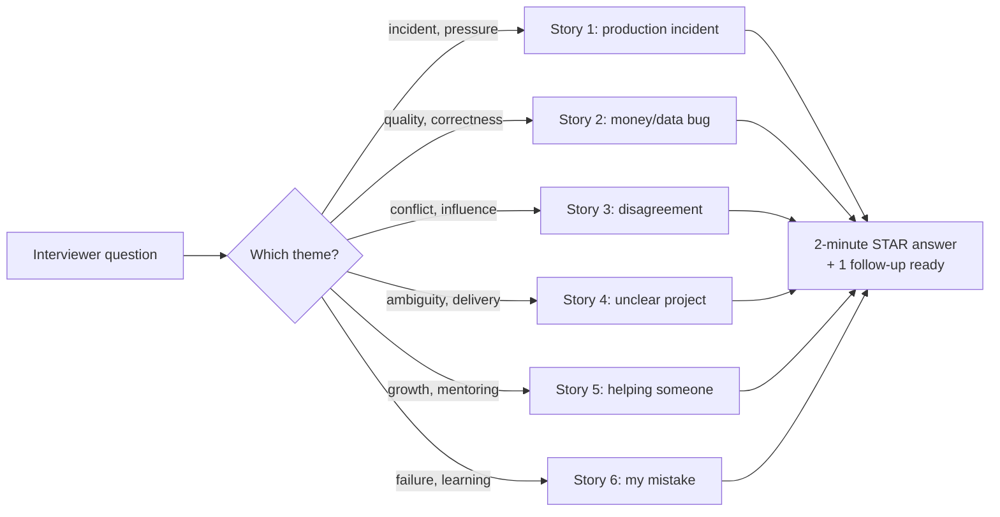

## In one minute

Behavioural rounds test whether you behave like a senior engineer when things are hard: an
incident, a disagreement, an unclear requirement, a junior who is stuck. You answer with short,
true stories in the **STAR** shape (Situation, Task, Action, Result). Prepare **six stories** in
advance, each told in two minutes. Most questions can be answered with one of them. The output of
this lesson is a one-page story bank you rehearse aloud.

## Analogy

A story bank is like a well-indexed code library. You don't write a new sort function in every
interview; you reach for a tested one and adapt the call. Six tested stories, tagged by theme, cover
most questions you will get.

## Diagram



## Build it step by step

### 1. The STAR shape, with time limits

| Part | What to say | Time |
|---|---|---|
| **Situation** | Team, system, scale, and why it mattered. One or two sentences. | 15 s |
| **Task** | What *you* were responsible for. | 10 s |
| **Action** | What *you* did, in 3–4 concrete steps. Use "I", not "we". Name the technical choices. | 60–70 s |
| **Result** | The outcome with a number if you have a real one, plus what changed afterwards (a test, alert, runbook, process). | 20 s |

Glossary: **STAR**, **blameless post-incident review**.

### 2. The six stories every senior backend engineer needs

| # | Theme | Typical prompts it answers | Fintech version to look for in your past |
|---|---|---|---|
| 1 | Production incident you led or helped resolve | "Tell me about a time you worked under pressure", "a hard bug" | Payments stuck, duplicate charges, consumer lag, pool exhaustion |
| 2 | A correctness bug you caught or fixed | "Attention to detail", "quality" | Rounding, double posting, a race condition, a timezone cut-off bug |
| 3 | Disagreement with a peer, lead or another team | "Conflict", "influence without authority" | Sync vs async, schema change, a risky release date |
| 4 | Delivering with unclear requirements | "Ambiguity", "ownership" | A regulatory change, a new payment rail, a migration |
| 5 | Helping someone grow | "Mentoring", "teamwork" | Pairing on a hard review, teaching testing of concurrency |
| 6 | A mistake you made | "Failure", "what would you do differently" | A migration that locked a table, a missed edge case |

Use only **true stories**. If you lack one, use a smaller true story rather than inventing a big one:
follow-up questions expose invented detail quickly.

### 3. Write each story on one card

```text
Story 2 - Duplicate refund (correctness)
S: Refund service, ~ N refunds/day (use your real number or say "a few thousand"), retries from the PSP client.
T: I owned the refund API.
A: 1) Reproduced it: two retries 50 ms apart both passed "if not exists" -> two refunds.
   2) Added a unique key on (merchant, idempotency_key), insert-first, replay stored response.
   3) Wrote a concurrency test (20 threads, one key) that failed before and passed after.
   4) Back-filled: query for duplicates, reversed them with compensating entries, informed finance.
R: No duplicates since; the test runs in CI; added an alert on idempotency conflicts.
Follow-up ready: why not a distributed lock? (DB constraint is the arbiter; locks expire.)
```

The technical depth in **Action** is what separates a senior answer. Link it to what you built in
the capstones if your past work is thin: "I built this pattern in a side project and here is the test
that proves it" is honest and strong.

### 4. Rehearse

Record yourself on your phone. Check: under 2:15, the word "I" appears in every action step, there
is one concrete technical detail per step, and the result names a lasting change.

## What goes wrong

**Bug: the "we" story.** "We noticed latency, we scaled up, we fixed it." The interviewer cannot
tell what you did, so they score it as "unclear contribution".

**Fix:** rewrite every Action line with "I" and a verb: "I took the thread dump", "I proposed capping
the pool", "I wrote the runbook". Credit the team in one sentence at the end.

**Test:** read your story aloud and count "I + verb" in Action. Fewer than three: rewrite.

## Trade-offs: when NOT to use STAR rigidly

- For "walk me through your current system", answer as an architecture overview, not a STAR story.
- If the interviewer interrupts with a technical question, answer it directly. Don't drag them back
  into your script.
- Don't force a number into Result. "Fewer pages after that" is fine; a made-up percentage is not.

## Interview Q&A

**Warm-up: "Tell me about yourself."**
- *Model answer:* 60–90 seconds: current role and domain, two technical things you own, one result
  you are proud of, and why this role is the next step.
- *Common wrong answer:* reading your CV chronologically for five minutes.
- *Why it fails:* it uses the time the interviewer wanted for stories and shows no prioritisation.

**Standard: "Tell me about a production incident."**
- *Model answer:* Story 1. Detection (which alert or user report), mitigation first (roll back,
  fail over, shed load), then root cause, then the lasting fix (test, alert, runbook). Mention the
  blameless review.
- *Common wrong answer:* starting with the root-cause hunt.
- *Why it fails:* seniors stop the bleeding first. Investigating while customers are failing shows the
  wrong priority.

**Standard: "Tell me about a disagreement with a colleague."**
- *Model answer:* Story 3. State their position fairly, show how you made the decision on evidence
  (a prototype, a load test, a written trade-off), what was decided, and how you supported it even if it
  was not your option.
- *Common wrong answer:* "I convinced them I was right."
- *Why it fails:* it signals winning over outcomes. Interviewers look for "disagree and commit".

**Deep: "What would you do differently?" (as a follow-up to any story)**
- *Model answer:* one specific technical or process change, e.g. "I would have written the
  concurrency test before the fix, not after."
- *Common wrong answer:* "Nothing, it went well."
- *Why it fails:* it suggests no reflection, which is exactly what the question tests.

**Deep: "Tell me about a time you were wrong."**
- *Model answer:* Story 6: the mistake, how you found out, how you told people quickly, the fix, and
  the guard that now prevents it (for example, migrations reviewed with lock analysis).
- *Common wrong answer:* a disguised strength ("I worked too hard").
- *Why it fails:* interviewers hear it constantly. It reads as evasive.

## Say it in 30 seconds

"I keep six true stories ready: an incident, a correctness bug, a disagreement, an ambiguous
project, mentoring, and a mistake. Each is two minutes in STAR form, where the Action part has three
or four concrete things *I* did with real technical detail, and the Result names a lasting change like
a test or an alert."

## Recap

- Six true stories cover most behavioural questions; prepare them, don't improvise.
- Spend most of the time on **your** actions, with technical detail.
- End with a lasting change, and have one follow-up ready per story.

## See also

- [Track 06: Post-incident reviews](#/tracks/track-06/lessons/track-06-lesson-16)
- [Track 06: Incident management](#/tracks/track-06/lessons/track-06-lesson-15)
- [Mock interviews with rubrics](#/tracks/track-15/lessons/track-15-lesson-05)
