## في دقيقة واحدة

جولة التصميم محادثة مدتها 45 دقيقة تقودها *أنت*. ويقيّم المُقابِلون البنية، والمقايضات، والعمق، لا مخططًا "صحيحًا". فاستخدم خطة زمنية ثابتة (RESHADED)، وقل افتراضاتك بصوت عالٍ، وأجرِ الحسابات، واقضِ النصف الثاني على تعمق أو اثنين حيث يمكن فقدان الأموال (عدم التكرار، والاتساق، ومعالجة الإخفاقات). وهذا الدرس هو قائمة *كيف تدير الجولة*. أما أنماط التصميم نفسها فتُشرح في المسارات 05 و06 و14.

## تشبيه

إنها كقائمة تحقق الطيار: الخطوات نفسها بالترتيب نفسه في كل رحلة، فيذهب الانتباه إلى الطقس (المفاجأة التي يطرحها المُقابِل)، لا إلى تذكر ما يأتي بعد ذلك.

## المخطط

```mermaid
gantt
    title 45-minute plan (RESHADED)
    dateFormat mm
    axisFormat %M
    section Scope
    Requirements and questions        :r, 00, 5m
    Estimation                        :e, after r, 4m
    section Shape
    Schema                            :s, after e, 4m
    High-level design                 :h, after s, 7m
    API                               :a, after h, 4m
    section Depth
    Deep dive 1 and 2                 :d, after a, 13m
    Evaluate failures and trade-offs  :v, after d, 5m
    Deliver summary                   :x, after v, 3m
```



## ابنِه خطوة بخطوة

**RESHADED** = المتطلبات (Requirements)، والتقدير (Estimation)، والمخطط (Schema)، والتصميم عالي المستوى (High-level design)، والواجهة (API)، والتعمق (Deep dive)، والتقييم (Evaluate)، والتسليم (Deliver). ويشرح درس الإطار ([المسار 14 الدرس 1](#/tracks/track-14/lessons/track-14-lesson-01)) كل خطوة؛ وهذه ورقة التشغيل.

| الدقيقة | الخطوة | ماذا تقول / تفعل | ضروريات التقنية المالية |
|---|---|---|---|
| 0–5 | **R** المتطلبات | الوظيفية (3–5 نقاط)، وغير الوظيفية (زمن الاستجابة، والإتاحة، والاتساق)، وما هو خارج النطاق. واطرح 3–4 أسئلة توضيحية. | "هل يمكن تنفيذ دفعة مرتين؟" "أي عملات؟" "الاحتفاظ التنظيمي؟" |
| 5–9 | **E** التقدير | المستخدمون النشطون يوميًا ← الطلبات/ثانية ← الذروة ← التخزين/السنة ← العقد. واكتب الحسابات. | أيام الذروة (يوم الرواتب، والجمعة السوداء)؛ والبيانات تُحفظ لسنوات للتدقيق. |
| 9–13 | **S** المخطط | 3–5 جداول بمفاتيحها. | المبلغ بالوحدات الصغرى + العملة؛ ومفتاح عدم تكرار فريد؛ ودفتر أستاذ للإلحاق فقط. |
| 13–20 | **H** عالي المستوى | مخطط واحد: العملاء، والواجهة، والخدمات، وقاعدة البيانات، والطابور، والقنوات الخارجية. | افصل مسار القبول المتزامن عن التسوية غير المتزامنة. |
| 20–24 | **A** الواجهة | 2–3 نقاط بالأفعال، والترويسات، ورموز الحالة. | ‏`Idempotency-Key`، و`If-Match`/ETag للتحديثات، والإصدارات، وأخطاء RFC 9457. |
| 24–37 | **D** التعمق | اختر الجزء أو الجزأين الأكثر خطورة، أو اسأل أيهما يريدون. | منع الإنفاق المزدوج، وصندوق الصادر، والمطابقة، والحسابات الساخنة. |
| 37–42 | **E** التقييم | جدول الإخفاقات: ما الذي يفشل ← كيف نكتشفه ← التخفيف ← نطاق الضرر. | انتهاء مهلة مزوّد الدفع، وتعطل Kafka، وتبديل قاعدة البيانات، والأحداث المكررة. |
| 42–45 | **D** التسليم | ملخص في 60 ثانية + ما ستفعله لاحقًا لو كان لديك وقت أكثر. | سمِّ المخاطر المتبقية بصدق. |

### التقدير، معروضًا بشكل صحيح (أرقام توضيحية)

افترض 10 ملايين مستخدم نشط يوميًا ودفعتين لكل مستخدم يوميًا:

```text
20,000,000 payments/day / 86,400 s ≈ 231 payments/s average
peak factor 5 (assumption: payday / evening peak) -> ≈ 1,160 payments/s peak
storage: 20 M/day × 1 KB per payment row + ledger postings (2 × 200 B) ≈ 28 GB/day ≈ 10 TB/year
one PostgreSQL primary handles this write rate comfortably if transactions are short (state the assumption);
plan partitioning by month for retention, not for throughput.
```

قل بصوت عالٍ إن المدخلات افتراضات. فالمُقابِلون يهتمون بالطريقة ورتبة الحجم، لا بالأرقام الدقيقة.

### لغة المقايضات التي تحصد درجات جيدة

- "سأختار X بسبب Y؛ والكلفة هي Z؛ وسأعيد النظر لو حدث W."
- "يجب أن يكون هذا متسقًا بقوة (فحص الرصيد)؛ ويمكن أن يكون هذا متسقًا في النهاية (التحليلات، والإشعارات)."
- "*التسليم* مرة واحدة بالضبط غير قابل للتحقيق عبر شبكة؛ وسأحصل على *آثار* مرة واحدة بالضبط بمستهلكين عديمي الأثر عند التكرار."

## ما الذي يسوء

**الخطأ: رسم الصناديق لمدة 25 دقيقة.** يرسم المرشح كل خدمة مصغّرة، ولا يصل أبدًا إلى التعمق، فلا يستطيع المُقابِل رؤية العمق.

**الإصلاح:** اضبط مؤقتًا في رأسك. وعند الدقيقة 20، توقف عن الرسم وقل: "أخطر جزء هو كيف نتجنب الخصم مرتين. هل أتعمق هناك؟"

**الاختبار (التدريب):** في كل مقابلة تجريبية، اكتب الوقت الذي تبدأ فيه التعمق. فإن كان بعد الدقيقة 25 في مقابلتين تجريبيتين متتاليتين، فقلّص تصميمك عالي المستوى إلى خمسة صناديق.

## المقايضات: متى لا تتبع الخطة بجمود

- إن قفز المُقابِل مباشرة إلى تعمق ("افترض أن الواجهة موجودة، كيف تمنع الإنفاق المزدوج؟")، فاذهب إلى هناك. فالخطة تخدم المحادثة، لا العكس.
- تجاوز تفاصيل التقدير حين تكون المشكلة عن الصحة لا عن الحجم (مثل سير عمل مطابقة). وأعطِ سطرًا واحدًا من الأرقام وامضِ.

## أسئلة وأجوبة المقابلة

**إحماء: "من أين تبدأ؟"**
- *الإجابة النموذجية:* أوضّح المتطلبات والحجم، ثم أتفق على ما هو خارج النطاق، قبل الرسم.
- *الإجابة الخاطئة الشائعة:* "سأستخدم خدمات مصغّرة مع Kafka."
- *لماذا تفشل:* حل قبل المشكلة يُظهر مطابقة أنماط، لا تصميمًا.

**قياسي: "لماذا اخترت PostgreSQL على Cassandra هنا؟"**
- *الإجابة النموذجية:* يحتاج الجوهر معاملات ذرية متعددة الصفوف واتساقًا قويًا (خصم + إضافة + مفتاح عدم تكرار في تأكيد واحد). ومعدل الكتابة يتسع في خادم أساسي واحد مع التقسيم. وسأضيف نسخ قراءة أو نموذج قراءة CQRS للقراءات الكثيفة.
- *الإجابة الخاطئة الشائعة:* "‏Cassandra يتوسع أفضل."
- *لماذا تفشل:* تتجاهل متطلب الصحة، والتقدير يُظهر أن الحجم ليس عنق الزجاجة.

**قياسي: "ماذا يحدث إن انتهت مهلة مزوّد الدفع؟"**
- *الإجابة النموذجية:* النتيجة *غير معروفة*، لا فاشلة. أبقِ الدفعة في حالة معلقة، وأعد المحاولة بمفتاح عدم التكرار نفسه أو استعلم عن الحالة لدى المزوّد، وطابق في نهاية اليوم.
- *الإجابة الخاطئة الشائعة:* "علّمها فاشلة ودع المستخدم يعيد المحاولة."
- *لماذا تفشل:* إن كان المزوّد قد خصم فعلًا، يعيد المستخدم المحاولة ويدفع مرتين.

**عميق: "كيف تضمن اتفاق دفتر الأستاذ وتدفق الأحداث؟"**
- *الإجابة النموذجية:* صندوق الصادر المعاملاتي، ومرحّل مرة واحدة على الأقل، ومستهلكون عديمو الأثر عند التكرار، إضافة إلى مهمة مطابقة كشبكة أمان.
- *الإجابة الخاطئة الشائعة:* "اكتب في قاعدة البيانات وKafka في معاملة واحدة."
- *لماذا تفشل:* لا توجد معاملة مشتركة بين PostgreSQL وKafka دون XA، وXA عادة غير متاح أو بطيء جدًا.

## قلها في 30 ثانية

"أدير الجولة على ساعة ثابتة: خمس دقائق للمتطلبات والأسئلة، وتقديرات سريعة مكتوبة، ومخطط صغير، ورسم واحد والواجهة بحلول الدقيقة 24، ثم تعمقان حيث يمكن فقدان الأموال، وجدول إخفاقات، وملخص في دقيقة. وأذكر الافتراضات، وأستخدم 'لأن … والكلفة هي …' لكل اختيار، وأدع المُقابِل يعيد توجيهي."

## الخلاصة

- خطة زمنية ثابتة؛ والوصول إلى التعمق بحلول الدقيقة 25.
- أظهر حسابات التقدير واذكر الافتراضات.
- في التقنية المالية، يعني العمق عدم التكرار، والاتساق، ومعالجة الإخفاقات، والمطابقة.

## انظر أيضًا

- [المسار 14: إطار تصميم الأنظمة](#/tracks/track-14/lessons/track-14-lesson-01)
- [المسار 14: أوراق مرجعية (الأنماط، والتقدير، وقواعد البيانات)](#/tracks/track-14/lessons/track-14-lesson-08)
- [المسار 05: صندوق الصادر المعاملاتي](#/tracks/track-05/lessons/track-05-lesson-13)
- [المشروع الختامي 1: خدمة الدفع](#/capstone/payment-service)

<!-- KNOWLEDGE-CHECK
[
  {
    "id": "kc-1502-01",
    "question": "بحلول أي دقيقة يجب أن تبدأ التعمق في جولة تصميم مدتها 45 دقيقة؟",
    "options": [
      "الدقيقة 10",
      "نحو الدقيقة 24–25",
      "الدقيقة 40",
      "فقط إن طلب المُقابِل"
    ],
    "correct": 1,
    "explanation": "المتطلبات، والتقدير، والمخطط، والتصميم عالي المستوى، والواجهة تتسع في أول 24 دقيقة. فإن كنت ما زلت ترسم عند الدقيقة 25 في التدريب، فقلّص التصميم عالي المستوى إلى خمسة صناديق."
  },
  {
    "id": "kc-1502-02",
    "question": "يسأل المُقابِل لماذا اخترت PostgreSQL على Cassandra. أي إجابة تحصل على أفضل تقييم؟",
    "options": [
      "\"Cassandra يتوسع أفضل، فـ PostgreSQL افتراضي أكثر أمانًا.\"",
      "\"PostgreSQL أكثر شعبية.\"",
      "\"يحتاج الجوهر معاملات ذرية متعددة الصفوف واتساقًا قويًا، والتقدير يُظهر أن خادمًا أساسيًا واحدًا مع التقسيم يتحمل معدل الكتابة؛ وسأضيف نسخًا مكررة أو نموذج قراءة للقراءات الكثيفة.\"",
      "\"أستخدم PostgreSQL دائمًا.\""
    ],
    "correct": 2,
    "explanation": "اربط الاختيار بمتطلب (خصم + إضافة + مفتاح عدم تكرار ذرية في تأكيد واحد) وبتقديرك، وسمِّ ما ستضيفه إن نما الحمل."
  },
  {
    "id": "kc-1502-03",
    "question": "تنتهي مهلة مزوّد الدفع. ما العبارة الصحيحة في جولة التصميم؟",
    "options": [
      "النتيجة غير معروفة، لا فاشلة: أبقِ الدفعة معلقة، وأعد المحاولة بالمفتاح نفسه أو استعلم لدى المزوّد، وطابق في نهاية اليوم",
      "علّمها فاشلة ودع المستخدم يعيد المحاولة",
      "اخصم مجددًا بمفتاح جديد احتياطًا",
      "أعد المبلغ فورًا"
    ],
    "correct": 0,
    "explanation": "إن كان المزوّد قد خصم فعلًا وعلّمتها فاشلة، يعيد المستخدم المحاولة ويدفع مرتين."
  },
  {
    "id": "kc-1502-04",
    "question": "كيف تُبقي دفتر الأستاذ وتدفق الأحداث متفقين؟",
    "options": [
      "اكتب في قاعدة البيانات وKafka في معاملة واحدة",
      "انشر إلى Kafka أولًا، ثم اكتب في قاعدة البيانات",
      "استخدم قفلًا موزعًا حول الكتابتين",
      "صندوق صادر معاملاتي مع مرحّل مرة واحدة على الأقل، ومستهلكين عديمي الأثر عند التكرار، ومهمة مطابقة كشبكة أمان"
    ],
    "correct": 3,
    "explanation": "لا توجد معاملة مشتركة بين PostgreSQL وKafka دون XA، وXA عادة غير متاح أو بطيء جدًا."
  }
]
-->

<!-- PRACTICAL-CHALLENGE
{
  "id": "pc-1502",
  "title": "أدِر جولة تصميم مؤقتة",
  "description": "تدرّب على ورقة التشغيل تحت ساعة حقيقية.",
  "tasks": [
    {
      "id": "pc-1502-01",
      "description": "اضبط مؤقتًا لمدة 45 دقيقة وصمّم \"واجهة قبول مدفوعات للتجار\" على الورق، متبعًا ورقة تشغيل RESHADED. واكتب الوقت عند بداية كل خطوة."
    },
    {
      "id": "pc-1502-02",
      "description": "اكتب كتلة التقدير مع إظهار الحسابات، وذكر كل افتراض (المستخدمون، والدفعات لكل مستخدم، ومعامل الذروة، والبايتات لكل صف)."
    },
    {
      "id": "pc-1502-03",
      "description": "بعد ذلك، قارن أوقات خطواتك بالخطة. فإن بدأ التعمق بعد الدقيقة 25، فاكتب ما ستقلّصه في المرة القادمة."
    }
  ]
}
-->
