## In one minute

A design round is a 45-minute conversation where *you* drive. Interviewers score structure,
trade-offs and depth, not a "correct" diagram. Use a fixed time plan (RESHADED), say your
assumptions aloud, do the arithmetic, and spend the second half on one or two deep dives where money
can be lost (idempotency, consistency, failure handling). This lesson is the *how to run the round*
checklist. The design patterns themselves are taught in Tracks 05, 06 and 14.

## Analogy

It is like a pilot's checklist: the same steps in the same order every flight, so attention goes to the
weather (the interviewer's twist), not to remembering what comes next.

## Diagram

```mermaid
gantt
    title 45-minute plan (RESHADED)
    dateFormat mm
    axisFormat %M
    section Scope
    Requirements and questions        :r, 00, 5m
    Estimation                        :e, after r, 4m
    section Shape
    Schema                            :s, after e, 4m
    High-level design                 :h, after s, 7m
    API                               :a, after h, 4m
    section Depth
    Deep dive 1 and 2                 :d, after a, 13m
    Evaluate failures and trade-offs  :v, after d, 5m
    Deliver summary                   :x, after v, 3m
```



## Build it step by step

**RESHADED** = Requirements, Estimation, Schema, High-level design, API, Deep dive, Evaluate, Deliver.
The framework lesson ([Track 14 lesson 1](#/tracks/track-14/lessons/track-14-lesson-01)) explains each step;
here is the run-sheet.

| Min | Step | Say / do | Fintech must-haves |
|---|---|---|---|
| 0–5 | **R**equirements | Functional (3–5 bullets), non-functional (latency, availability, consistency), out of scope. Ask 3–4 clarifying questions. | "Can a payment be executed twice?" "Which currencies?" "Regulatory retention?" |
| 5–9 | **E**stimation | DAU → requests/s → peak → storage/year → nodes. Write the arithmetic. | Peak days (payday, Black Friday); data kept for years for audit. |
| 9–13 | **S**chema | 3–5 tables with keys. | Amount as minor units + currency; unique idempotency key; append-only ledger. |
| 13–20 | **H**igh-level | One diagram: clients, API, services, DB, queue, external rails. | Separate the synchronous accept path from asynchronous settlement. |
| 20–24 | **A**PI | 2–3 endpoints with verbs, headers, status codes. | `Idempotency-Key`, `If-Match`/ETag for updates, versioning, RFC 9457 errors. |
| 24–37 | **D**eep dive | Pick the 1–2 riskiest parts, or ask which one they want. | Double-spend prevention, outbox, reconciliation, hot accounts. |
| 37–42 | **E**valuate | Failure table: what fails → how we detect → mitigation → blast radius. | PSP timeout, Kafka down, DB failover, duplicate events. |
| 42–45 | **D**eliver | 60-second summary + what you would do next with more time. | Name the remaining risks honestly. |

### Estimation, shown properly (illustrative numbers)

Assume 10 million daily active users and 2 payments per user per day:

```text
20,000,000 payments/day / 86,400 s ≈ 231 payments/s average
peak factor 5 (assumption: payday / evening peak) -> ≈ 1,160 payments/s peak
storage: 20 M/day × 1 KB per payment row + ledger postings (2 × 200 B) ≈ 28 GB/day ≈ 10 TB/year
one PostgreSQL primary handles this write rate comfortably if transactions are short (state the assumption);
plan partitioning by month for retention, not for throughput.
```

Say aloud that the inputs are assumptions. Interviewers care about the method and the order of
magnitude, not the exact numbers.

### Trade-off language that scores well

- "I'll choose X because of Y; the cost is Z; I'd revisit if W."
- "This must be strongly consistent (balance check); this can be eventually consistent (analytics,
  notifications)."
- "Exactly-once *delivery* isn't achievable across a network; I'll get exactly-once *effects* with
  idempotent consumers."

## What goes wrong

**Bug: drawing boxes for 25 minutes.** The candidate draws every microservice, never reaches a deep
dive, and the interviewer cannot see depth.

**Fix:** set a timer in your head. At minute 20, stop drawing and say: "The riskiest part is how we
avoid charging twice. Shall I go deep there?"

**Test (practice):** in each mock, write the clock time when you start the deep dive. If it is later
than minute 25 in two mocks in a row, cut your high-level design to five boxes.

## Trade-offs: when NOT to follow the plan rigidly

- If the interviewer jumps straight to a deep dive ("assume the API exists, how do you prevent double
  spending?"), go there. The plan serves the conversation, not the other way round.
- Skip estimation detail when the problem is about correctness rather than scale (for example, a
  reconciliation workflow). Give one line of numbers and move on.

## Interview Q&A

**Warm-up: "Where do you start?"**
- *Model answer:* clarify requirements and scale, then agree what is out of scope, before drawing.
- *Common wrong answer:* "I'd use microservices with Kafka."
- *Why it fails:* a solution before the problem shows pattern-matching, not design.

**Standard: "Why did you choose PostgreSQL over Cassandra here?"**
- *Model answer:* the core needs multi-row atomic transactions and strong consistency (debit + credit
  + idempotency key in one commit). The write rate fits one primary with partitioning. I'd add read
  replicas or a CQRS read model for heavy reads.
- *Common wrong answer:* "Cassandra scales better."
- *Why it fails:* it ignores the correctness requirement, and the estimate shows scale is not the bottleneck.

**Standard: "What happens if the payment provider times out?"**
- *Model answer:* the outcome is *unknown*, not failed. Keep the payment in a pending state, retry
  with the same idempotency key or query the provider's status, and reconcile at end of day.
- *Common wrong answer:* "Mark it failed and let the user retry."
- *Why it fails:* if the provider did charge, the user retries and pays twice.

**Deep: "How do you guarantee the ledger and the event stream agree?"**
- *Model answer:* transactional outbox, at-least-once relay, idempotent consumers, plus a
  reconciliation job as the safety net.
- *Common wrong answer:* "Write to the DB and Kafka in one transaction."
- *Why it fails:* there is no shared transaction between PostgreSQL and Kafka without XA, and XA is
  usually unavailable or too slow.

## Say it in 30 seconds

"I run the round on a fixed clock: five minutes of requirements and questions, quick estimates
written out, a small schema, one diagram and the API by minute 24, then two deep dives on where
money can be lost, a failure table, and a one-minute summary. I state assumptions, use 'because …
the cost is …' for every choice, and let the interviewer redirect me."

## Recap

- Fixed time plan; reach the deep dive by minute 25.
- Show the estimation arithmetic and state assumptions.
- In fintech, depth means idempotency, consistency, failure handling and reconciliation.

## See also

- [Track 14: System design framework](#/tracks/track-14/lessons/track-14-lesson-01)
- [Track 14: Reference sheets (patterns, estimation, databases)](#/tracks/track-14/lessons/track-14-lesson-08)
- [Track 05: Transactional outbox](#/tracks/track-05/lessons/track-05-lesson-13)
- [Capstone 1: payment service](#/capstone/payment-service)

<!-- KNOWLEDGE-CHECK
[
  {
    "id": "kc-1502-01",
    "question": "By which minute should you be starting the deep dive in a 45-minute design round?",
    "options": [
      "Minute 10",
      "Around minute 24–25",
      "Minute 40",
      "Only if the interviewer asks"
    ],
    "correct": 1,
    "explanation": "Requirements, estimation, schema, high-level design and API fit in the first 24 minutes. If you are still drawing at minute 25 in practice, cut the high-level design to five boxes."
  },
  {
    "id": "kc-1502-02",
    "question": "The interviewer asks why you chose PostgreSQL over Cassandra. Which answer scores best?",
    "options": [
      "\"Cassandra scales better, so PostgreSQL is a safer default.\"",
      "\"PostgreSQL is more popular.\"",
      "\"The core needs multi-row atomic transactions and strong consistency, and the estimate shows one primary with partitioning handles the write rate; I'd add replicas or a read model for heavy reads.\"",
      "\"I always use PostgreSQL.\""
    ],
    "correct": 2,
    "explanation": "Tie the choice to a requirement (atomic debit + credit + idempotency key in one commit) and to your estimate, and name what you'd add if load grows."
  },
  {
    "id": "kc-1502-03",
    "question": "The payment provider times out. What is the right statement in the design round?",
    "options": [
      "The outcome is unknown, not failed: keep the payment pending, retry with the same key or query the provider, and reconcile at end of day",
      "Mark it failed and let the user retry",
      "Charge again with a new key to be safe",
      "Refund immediately"
    ],
    "correct": 0,
    "explanation": "If the provider did charge and you mark it failed, the user retries and pays twice."
  },
  {
    "id": "kc-1502-04",
    "question": "How do you keep the ledger and the event stream in agreement?",
    "options": [
      "Write to the database and Kafka in one transaction",
      "Publish to Kafka first, then write the database",
      "Use a distributed lock around both writes",
      "A transactional outbox with an at-least-once relay, idempotent consumers, and a reconciliation job as the safety net"
    ],
    "correct": 3,
    "explanation": "There's no shared transaction between PostgreSQL and Kafka without XA, which is usually unavailable or too slow."
  }
]
-->

<!-- PRACTICAL-CHALLENGE
{
  "id": "pc-1502",
  "title": "Run a timed design round",
  "description": "Practise the run-sheet under a real clock.",
  "tasks": [
    {
      "id": "pc-1502-01",
      "description": "Set a 45-minute timer and design \"a payment acceptance API for merchants\" on paper, following the RESHADED run-sheet. Write the clock time at the start of each step."
    },
    {
      "id": "pc-1502-02",
      "description": "Write the estimation block with the arithmetic shown, stating every assumption (users, payments per user, peak factor, bytes per row)."
    },
    {
      "id": "pc-1502-03",
      "description": "Afterwards, compare your step times with the plan. If the deep dive started after minute 25, write down what you will cut next time."
    }
  ]
}
-->
