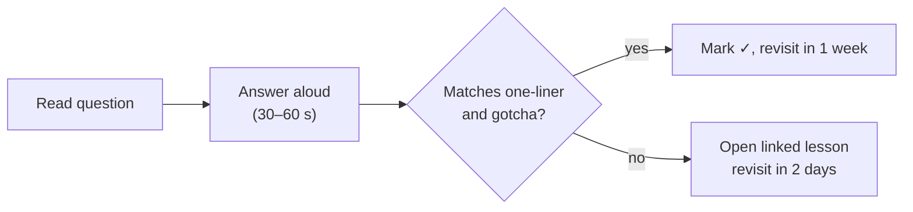

## في دقيقة واحدة

ثلاثون سؤالًا في Java وSpring تتكرر مرارًا في مقابلات مهندسي الأنظمة الخلفية الأوائل، لكل منها إجابة من سطر واحد تستطيع توسيعها، ومستوى (**W** إحماء، و**S** قياسي، و**D** عميق)، و⚠ **فخ** يتعثر فيه المرشحون كثيرًا. واستخدمها للمراجعة المتباعدة: غطِّ عمود الإجابة، وقل إجابتك بصوت عالٍ، ثم تحقق. وكل إجابة مرتبطة بالدرس الذي يشرحها كما ينبغي.

## تشبيه

بطاقات استذكار لامتحان درست له بالفعل: لا تعلّم، بل تكشف الفجوات بسرعة.

## المخطط

## ابنِه خطوة بخطوة: الأسئلة

### لغة Java وJVM

| # | المستوى | السؤال | الإجابة في سطر | ⚠ الفخ |
|---|---|---|---|---|
| 1 | W | عقد `equals`/`hashCode`؟ | الكائنات المتساوية يجب أن يكون لها رموز تجزئة متساوية؛ واستخدم الحقول نفسها في الاثنين. | حقول قابلة للتغيير في مفتاح `HashMap`: تغييرها "يُضيع" المُدخل. |
| 2 | W | لماذا السجلات (records) جيدة لكائنات نقل البيانات وكائنات القيمة؟ | غير قابلة للتغيير، وحقول نهائية، و`equals`/`hashCode`/`toString` مولدة، ومُنشئ مختصر للتحقق. | السجلات غير قابلة للتغيير سطحيًا: مكوّن `List` يمكن تعديله ما لم تنسخه (`List.copyOf`). |
| 3 | S | ‏`BigDecimal("0.10")` مقابل `new BigDecimal(0.1)`؟ | مُنشئ النص دقيق؛ ومُنشئ double يحمل خطأً ثنائيًا (0.1000000000000000055…). | ‏`equals` تقارن المقياس (`1.0` ≠ `1.00`)؛ فاستخدم `compareTo` لتساوي القيمة. |
| 4 | S | ماذا تضيف الواجهات المختومة (sealed)؟ | مجموعة مغلقة من التنفيذات، فيمكن لمطابقة الأنماط في `switch` أن تكون شاملة دون `default`. | إضافة نوع مسموح جديد تكسر ترجمة كل switch غير شامل. وهذا هو المقصود. |
| 5 | S | الاستثناءات المفحوصة مقابل غير المفحوصة في الخدمات؟ | استخدم غير المفحوصة لأخطاء الأعمال/البرمجة؛ وحوّلها عند الحدود إلى خطأ واجهة واضح. | ‏`@Transactional` يتراجع افتراضيًا عند الاستثناءات غير المفحوصة، و**لا** يتراجع عند المفحوصة. |
| 6 | D | ماذا يفعل G1، ومتى تفكر في ZGC؟ | ‏G1: قائم على المناطق، وجيلي، وبهدف لزمن التوقف. وZGC: متزامن، وتوقفات قصيرة جدًا، وعبء أكبر على المعالج/الذاكرة؛ فكّر فيه للكومات الكبيرة ذات متطلبات زمن الاستجابة الصارمة. | قِس أولًا (سجلات GC، وp99). فمعظم مشكلات زمن الاستجابة ليست من GC. |

### التزامن

| # | المستوى | السؤال | الإجابة في سطر | ⚠ الفخ |
|---|---|---|---|---|
| 7 | W | ماذا يضمن `volatile`؟ | الرؤية والترتيب (happens-before) لذلك المتغير، لا ذرية الإجراءات المركبة. | ‏`count++` على متغير volatile ما زال سباقًا. |
| 8 | S | علاقة happens-before في جملة؟ | إن كان A يحدث-قبل B، يرى B كتابات A؛ وتنشأ بالأقفال، وvolatile، وبدء/انضمام الخيوط، وتسليمات المجموعات المتزامنة. | "نُفذ أولًا زمنيًا" ليست happens-before. |
| 9 | S | ‏`synchronized` مقابل `ReentrantLock`؟ | كلاهما يعطي الاستبعاد المتبادل والرؤية؛ ويضيف `ReentrantLock` المحاولة مع مهلة (tryLock)، والقفل القابل للمقاطعة، والإنصاف. | على JDK 21–23، الحجب داخل `synchronized` يثبّت الخيط الافتراضي؛ وأصلح JDK 24 ذلك (JEP 491). |
| 10 | S | ‏`ConcurrentHashMap.compute` مقابل القراءة ثم الكتابة؟ | ‏`compute`/`merge` ذريتان لكل مفتاح؛ والقراءة ثم الكتابة سباق فحص-ثم-فعل. | لا تقم بعمل بطيء أو حاجب داخل `compute`: فهو يحجز قفل الحاوية. |
| 11 | S | كيف تحدد حجم مجمع الخيوط؟ | المرتبط بالمعالج: نحو عدد الأنوية. والمرتبط بالإدخال/الإخراج: الأنوية × (1 + الانتظار/الحساب)، ثم قِس. | مع الخيوط الافتراضية، حدد **الحدود اللاحقة** (مجمع قاعدة البيانات، والإشارات) بدل مجمع الخيوط. |
| 12 | D | فيمَ تجيد الخيوط الافتراضية وفيمَ تسوء؟ | تجيد: مهام إدخال/إخراج حاجبة متزامنة كثيرة. وتسوء: العمل المرتبط بالمعالج؛ ولا تجعل الطلب الواحد أسرع. | تصبح ذواكر `ThreadLocal` المؤقتة لكل مهمة (نسخ كثيرة)؛ وتجميع الخيوط الافتراضية نمط مضاد. |
| 13 | D | كيف تثبت وجود سباق وإصلاحه؟ | اختبار يشغّل خيوطًا كثيرة على حالة مشتركة مع مزلاج بدء، ويتحقق من ثابت، ويُشغّل مرارًا؛ وjcstress للحالات منخفضة المستوى. | تشغيل أخضر واحد لا يثبت شيئًا؛ واختبار لم يفشل قط قبل الإصلاح لا يثبت شيئًا أيضًا. |
| 14 | D | ‏`CompletableFuture`: أين تعمل الاستدعاءات الراجعة؟ | الاستدعاءات غير `Async` تعمل على الخيط الذي يُكمل المستقبل (أو على المستدعي إن كان مكتملًا بالفعل)؛ و`*Async` تستخدم المنفذ المعطى أو المجمع المشترك. | الإدخال/الإخراج الحاجب في مجمع ForkJoin المشترك يجوّع كل ما يشاركه. فمرّر منفذًا. |

### نواة Spring وBoot

| # | المستوى | السؤال | الإجابة في سطر | ⚠ الفخ |
|---|---|---|---|---|
| 15 | W | الحقن عبر المُنشئ مقابل الحقن في الحقل؟ | المُنشئ: غير قابل للتغيير، وقابل للاختبار، وتبعيات صريحة، ويفشل مبكرًا. | الحقن في الحقل يخفي التبعيات ويحتاج الانعكاس في الاختبارات. |
| 16 | S | كيف تقرر الإعدادات التلقائية ما تنشئه؟ | تُطبق فئات الإعدادات التلقائية المدرجة في `AutoConfiguration.imports` إن نجحت فحوص `@Conditional…` الخاصة بها (مسار الفئات، والخصائص، والكائنات المفقودة). | اطّلع على القرارات بنقطة `/actuator/conditions` أو `--debug`. |
| 17 | S | لماذا "لا يعمل" `@Transactional` أحيانًا؟ | إنه وكيل: الاستدعاء الذاتي (`this.method()`)، والدوال الخاصة، والكائنات المنشأة بـ `new` تتجاوزه. | والأمر نفسه لـ `@Async`، و`@Cacheable`، و`@Retryable`، و`@PreAuthorize`. |
| 18 | S | ‏`REQUIRED` مقابل `REQUIRES_NEW`؟ | ‏`REQUIRED` ينضم إلى المعاملة الحالية؛ و`REQUIRES_NEW` يعلّقها ويؤكد بشكل مستقل. | ‏`REQUIRES_NEW` يأخذ اتصالًا **ثانيًا**: الاستخدام المتداخل تحت الحمل قد يجمّد المجمع. |
| 19 | S | نطاقات الكائنات التي تستخدمها فعلًا؟ | المفرد (الافتراضي، ويجب أن يكون آمنًا للخيوط)، والنموذج الأولي (prototype)، والطلب/الجلسة في تطبيقات الويب. | حقن prototype في singleton يعطيك نسخة واحدة إلى الأبد ما لم تستخدم `ObjectProvider`. |
| 20 | S | الإعداد مطبوع الأنواع؟ | ‏`@ConfigurationProperties` على record، مع قيود `@Validated`؛ والفشل عند الإقلاع. | ‏`@Value` المبعثرة في كل مكان بلا تحقق وبلا مصدر حقيقة واحد. |
| 21 | D | ما تغييرات Spring Boot 4 الأهم لفريق خدمة؟ | ‏Java 17+ ‏(يُنصح بـ 21)، وSpring Framework 7، وJakarta EE 11، ومُشغّلات معيارية (`spring-boot-starter-webmvc`)، وJackson 3 ‏(`tools.jackson`)، و`@MockitoBean` يحل محل `@MockBean`، وإصدار واجهات مدمج وتعليقات مرونة توضيحية. | يغيّر Jackson 3 افتراضيات JSON ‏(ترتيب الخصائص، وnull للأنواع البدائية): فثبّت عقود واجهتك بالاختبارات. |

### الويب والبيانات والاختبار في Spring

| # | المستوى | السؤال | الإجابة في سطر | ⚠ الفخ |
|---|---|---|---|---|
| 22 | W | كيف تعيد الأخطاء؟ | ‏`ProblemDetail` وفق RFC 9457 من `@RestControllerAdvice`؛ ولا تتبعات مكدس أو SQL في الاستجابات. | إعادة 200 مع `{"error": …}` تكسر العملاء والمراقبة. |
| 23 | S | ما مشكلة N+1 وكيف تصلحها؟ | تحميل N أبًا ثم تحميل قائمة أبناء كل منهم بكسل = N+1 استعلامًا؛ وأصلحها بـ fetch join، أو `@EntityGraph`، أو استعلام إسقاط. | ‏`FetchType.EAGER` في كل مكان ليس إصلاحًا: يحمّل الكثير على كل مسار. |
| 24 | S | القفل المتفائل مقابل المتشائم في JPA؟ | ‏`@Version` يكتشف التحديثات المتعارضة عند التأكيد (إعادة المحاولة)؛ و`PESSIMISTIC_WRITE` ‏(`SELECT … FOR UPDATE`) يحجب الآخرين. | إعادات المحاولة المتفائلة تحت تنافس شديد تصبح عاصفة إعادات محاولة. |
| 25 | S | ‏`open-in-view`: مفعّل أم معطّل؟ | معطّل للواجهات: يُبقي جلسة (وربما اتصالًا) مفتوحة أثناء عرض الواجهة ويخفي أخطاء التحميل الكسول. | يفعّله Boot افتراضيًا ويسجّل تحذيرًا. |
| 26 | S | اختبارات الشرائح مقابل `@SpringBootTest`؟ | الشرائح (`@WebMvcTest`، و`@DataJpaTest`) تحمّل طبقة واحدة بسرعة؛ والسياق الكامل لمسارات التكامل. | كل إعداد سياق مختلف يبدأ سياقًا جديدًا: تنويعات `@MockitoBean` الكثيرة تبطئ مجموعة الاختبارات. |
| 27 | D | كيف تختبر مقابل قاعدة بيانات حقيقية؟ | ‏Testcontainers مع `@ServiceConnection` ‏(PostgreSQL، وKafka)؛ والمحرك نفسه كما في الإنتاج. | ‏"وضع PostgreSQL" في H2 يخفي السلوك الحقيقي للأقفال وSQL والقيود. |
| 28 | D | المهل على استدعاءات HTTP الصادرة؟ | اضبط دائمًا مهلتي الاتصال والقراءة (`spring.http.serviceclient.<group>.*` أو مصنع العميل)؛ وأضف إعادة المحاولة فقط للاستدعاءات عديمة الأثر عند التكرار. | قد يكون الافتراضي بلا مهلة قراءة إطلاقًا. فتعلّق تبعية بطيئة واحدة حينها كل خيط طلب. |
| 29 | D | أين يوضع `@Retryable`؟ | حول العمليات عديمة الأثر عند التكرار (GET، أو POST بمفتاح عدم تكرار) مع تراجع وتشتيت. | إعادة محاولة POST ليس عديم الأثر عند التكرار قد تخصم من العميل مرتين. |
| 30 | D | الإيقاف الرشيق في Kubernetes؟ | الإيقاف الرشيق (افتراضي منذ Boot 3.4؛ `server.shutdown`): تتحول الجاهزية إلى رفض الحركة، وتنتهي الطلبات الجارية خلال `spring.lifecycle.timeout-per-shutdown-phase`، والتي يجب أن تكون أقل من فترة سماح إنهاء الـ pod. | يجب أن يتوقف المستهلكون عن الاستطلاع ويؤكدوا الإزاحات، وإلا أعادت النسخة التالية معالجة الرسائل. |

## ما الذي يسوء

**الخطأ: حفظ الإجابات ذات السطر الواحد.** يسأل المُقابِل "لماذا؟" مرتين فتنهار الإجابة.

**الإصلاح:** لكل ⚠ فخ، كن قادرًا على إظهاره: مقتطف من 10 أسطر أو اختبار من الدرس المرتبط أو المشاريع الختامية (مثل اختبار `@Retryable` + القفل المتفائل في المشروع الختامي 3، أو اختبار التكرار المتزامن في المشروع الختامي 1).

**الاختبار:** اختر خمسة صفوف عشوائية، واشرح كلًا منها لمدة دقيقتين دون ملاحظات، مع مثال.

## المقايضات: متى لا تستخدم هذه القائمة

ليست للتعلم الأول: إنها أداة مراجعة. فإن كان أكثر من ثلث الإجابات جديدًا عليك، فعد إلى المسارات أولًا.

## أسئلة وأجوبة المقابلة

الجدول *هو* بنك الأسئلة. تدرّب على أربعة منها كإجابات كاملة مقيّمة:

**إحماء (#7): "ماذا يفعل `volatile`؟"**
- *الإجابة النموذجية:* يضمن أن الكتابات مرئية للخيوط الأخرى ولا يُعاد ترتيبها عبره. ولا يجعل `++` ذريًا؛ فاستخدم `AtomicLong` أو قفلًا لذلك.
- *الإجابة الخاطئة الشائعة:* "يجعل المتغير آمنًا للخيوط."
- *لماذا تفشل:* الإجراءات المركبة ما زالت تتسابق؛ وسيسأل المُقابِل عن `count++`.

**قياسي (#17): "لماذا لم يتراجع `@Transactional` لدي؟"**
- *الإجابة النموذجية:* ثلاثة أسباب معتادة: استُدعيت الدالة من الفئة نفسها (لا وكيل)، أو رُمي استثناء مفحوص (لا تراجع افتراضيًا)، أو التُقط الاستثناء في الداخل.
- *الإجابة الخاطئة الشائعة:* "قاعدة البيانات لا تدعم المعاملات."
- *لماذا تفشل:* ‏PostgreSQL يدعمها. ونموذج الوكيل هو ما يختبره السؤال.

**قياسي (#24): "متفائل أم متشائم لرصيد محفظة؟"**
- *الإجابة النموذجية:* متشائم، بترتيب أقفال ثابت، للأرصدة الساخنة (المشروع الختامي 2). ومتفائل للصفوف نادرة التنافس. واحتفظ دائمًا بقيد في قاعدة البيانات (`balance >= 0`) كدعم أخير.
- *الإجابة الخاطئة الشائعة:* "المتفائل أسرع دائمًا."
- *لماذا تفشل:* تحت التنافس، تضيف إعادات المحاولة حملًا وزمن استجابة.

**عميق (#12): "هل يجب أن ننتقل إلى الخيوط الافتراضية؟"**
- *الإجابة النموذجية:* نعم، لمعالجة الطلبات المرتبطة بالإدخال/الإخراج، بعد فحص مخاطر التثبيت (إصدار JDK، و`synchronized` + الحجب)، والمكتبات كثيفة استخدام `ThreadLocal`، وأن الحدود اللاحقة (مجمع قاعدة البيانات، وحدود المعدل) صريحة. وقِس باختبار حمل قبل وبعد.
- *الإجابة الخاطئة الشائعة:* "نعم، تجعل كل شيء أسرع."
- *لماذا تفشل:* تزيد التزامن، لا السرعة. ودون حدود قد تُحمّل قاعدة البيانات فوق طاقتها أسرع.

## قلها في 30 ثانية

"تغطي هذه الثلاثون أسئلة Java وSpring التي أتوقعها على مستوى المهندس الأول: نموذج الذاكرة والأقفال، والخيوط الافتراضية، و`BigDecimal`، والوكلاء والمعاملات، وأقفال JPA وN+1، والاختبار بحاويات حقيقية، واستدعاءات HTTP الآمنة. ولكل منها أعرف الإجابة في سطر، والفخ الشائع، ومثال كود أستطيع إظهاره."

## الخلاصة

- أجب بصوت عالٍ، ثم تحقق. وأعد زيارة ما أخطأت فيه بعد يومين.
- عمود الفخاخ هو حيث تُكسب المقابلات.
- ادعم كل إجابة بمقتطف أو اختبار شغّلته.

## انظر أيضًا

- [الجزء 2: البيانات، والأنظمة الموزعة، والتقنية المالية](#/tracks/track-15/lessons/track-15-lesson-04)
- [المسار 03: CompletableFuture](#/tracks/track-03/lessons/track-03-lesson-11)
- [المسار 03: الخيوط الافتراضية](#/tracks/track-03/lessons/track-03-lesson-12)
- [المسار 05: القفل المتفائل](#/tracks/track-05/lessons/track-05-lesson-16)
- [المشروع الختامي 3: تفويض البطاقات](#/capstone/card-authorisation)

<!-- KNOWLEDGE-CHECK
[
  {
    "id": "kc-1503-01",
    "question": "لماذا قد لا تتراجع دالة @Transactional؟",
    "options": [
      "PostgreSQL لا يدعم التراجع",
      "استُدعيت من الفئة نفسها (لا وكيل)، أو رُمي استثناء مفحوص (لا تراجع افتراضيًا)، أو التُقط الاستثناء في الداخل",
      "المعاملات تعمل على الواجهات فقط",
      "Spring Boot 4 يعطّل التراجع افتراضيًا"
    ],
    "correct": 1,
    "explanation": "يُطبَّق @Transactional عبر وكيل. والاستدعاء الذاتي يتجاوزه، وافتراضيًا تطلق الاستثناءات غير المفحوصة وحدها التراجع."
  },
  {
    "id": "kc-1503-02",
    "question": "ماذا يضمن volatile؟",
    "options": [
      "ذرية الإجراءات المركبة مثل count++",
      "أن خيطًا واحدًا فقط يستطيع الوصول إلى الحقل",
      "الرؤية والترتيب (happens-before) لذلك المتغير، لا ذرية الإجراءات المركبة",
      "أن القيمة تُخزن في الذاكرة الرئيسية ولا تُخزن مؤقتًا أبدًا"
    ],
    "correct": 2,
    "explanation": "count++ على حقل volatile ما زال سباقًا. فاستخدم AtomicLong، أو LongAdder، أو قفلًا للتحديثات المركبة."
  },
  {
    "id": "kc-1503-03",
    "question": "هل يجب أن ينتقل فريق إلى الخيوط الافتراضية؟",
    "options": [
      "نعم لمعالجة الطلبات المرتبطة بالإدخال/الإخراج، بعد فحص مخاطر التثبيت (إصدار JDK، وsynchronized + الحجب)، والمكتبات كثيفة استخدام ThreadLocal، والحدود اللاحقة الصريحة، مع القياس باختبار حمل",
      "نعم، تجعل كل طلب أسرع",
      "لا، ما زالت ميزة تجريبية",
      "فقط للعمل المرتبط بالمعالج"
    ],
    "correct": 0,
    "explanation": "الخيوط الافتراضية تضيف تزامنًا، لا سرعة. ودون حدود على مجمع قاعدة البيانات والتبعيات الأخرى قد تُحمّلها فوق طاقتها أسرع."
  },
  {
    "id": "kc-1503-04",
    "question": "ما الطريقة الصحيحة لمقارنة قيم BigDecimal للتحقق من تساوي المبلغ؟",
    "options": [
      "equals()، لأنها تقارن القيمة",
      "==، لأن قيم BigDecimal مخزنة مؤقتًا",
      "حوّل الاثنين إلى double وقارن",
      "compareTo() == 0، لأن equals() تقارن المقياس أيضًا (1.0 لا تساوي 1.00)"
    ],
    "correct": 3,
    "explanation": "تتحقق BigDecimal.equals من القيمة والمقياس معًا. وأنشئ المبالغ من نصوص، لا من double: فـ new BigDecimal(0.1) تحمل خطأً ثنائيًا."
  }
]
-->

<!-- PRACTICAL-CHALLENGE
{
  "id": "pc-1503",
  "title": "أثبت الفخاخ",
  "description": "حوّل خمسة من الفخاخ الثلاثين إلى كود تستطيع إظهاره في مقابلة.",
  "tasks": [
    {
      "id": "pc-1503-01",
      "description": "اكتب اختبارًا يُظهر أن الاستدعاء الذاتي لـ @Transactional لا يتراجع، ثم أصلحه (انقل الدالة إلى كائن آخر) وأظهر نجاح الاختبار."
    },
    {
      "id": "pc-1503-02",
      "description": "اكتب اختبارًا متعدد الخيوط بمزلاج بدء يُظهر أن count++ على int من نوع volatile يفقد تحديثات، ثم أصلحه بـ AtomicLong. وشغّله في حلقة لإظهار أن الإخفاق حقيقي."
    },
    {
      "id": "pc-1503-03",
      "description": "اكتب ثلاثة أمثلة صغيرة مع شرح قصير لكل منها: BigDecimal ‏equals مقابل compareTo، وConcurrentHashMap القراءة ثم الكتابة مقابل compute، واستدعاء عميل HTTP مع ضبط مهلتي الاتصال والقراءة."
    }
  ]
}
-->
