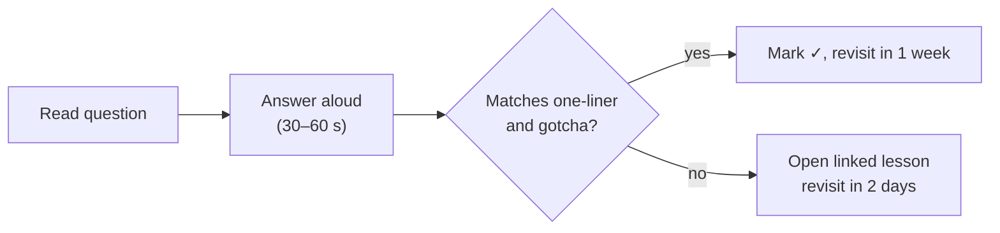

## In one minute

Thirty Java and Spring questions that come up again and again in senior backend interviews, each with
a one-line answer you can expand, a level (**W** warm-up, **S** standard, **D** deep), and a
⚠ **gotcha** where candidates often slip. Use it for spaced revision: cover the answer column, say your
answer aloud, then check. Every answer links to the lesson that teaches it properly.

## Analogy

Flash cards for an exam you have already studied for: they don't teach, they find gaps fast.

## Diagram

## Build it step by step: the questions

### Java language and JVM

| # | Lvl | Question | One-line answer | ⚠ Gotcha |
|---|---|---|---|---|
| 1 | W | `equals`/`hashCode` contract? | Equal objects must have equal hash codes; use the same fields in both. | Mutable fields in a `HashMap` key: changing them "loses" the entry. |
| 2 | W | Why are records good for DTOs and value objects? | Immutable, final fields, generated `equals`/`hashCode`/`toString`, compact constructor for validation. | Records are shallowly immutable: a `List` component can still be mutated unless you copy it (`List.copyOf`). |
| 3 | S | `BigDecimal("0.10")` vs `new BigDecimal(0.1)`? | The string constructor is exact; the double constructor carries binary error (0.1000000000000000055…). | `equals` compares scale (`1.0` ≠ `1.00`); use `compareTo` for value equality. |
| 4 | S | What do sealed interfaces add? | A closed set of implementations, so `switch` pattern matching can be exhaustive with no `default`. | Adding a new permitted type breaks compilation of every non-exhaustive switch. That is the point. |
| 5 | S | Checked vs unchecked exceptions in services? | Use unchecked for business/programming errors; translate at the boundary to a clear API error. | `@Transactional` rolls back on unchecked exceptions by default, **not** on checked ones. |
| 6 | D | What does G1 do, and when would you consider ZGC? | G1: region-based, generational, pause-time goal. ZGC: concurrent, very short pauses, more CPU/memory overhead; consider it for large heaps with strict latency needs. | Measure first (GC logs, p99). Most latency problems are not GC. |

### Concurrency

| # | Lvl | Question | One-line answer | ⚠ Gotcha |
|---|---|---|---|---|
| 7 | W | What does `volatile` guarantee? | Visibility and ordering (happens-before) for that variable, not atomicity of compound actions. | `count++` on a volatile is still a race. |
| 8 | S | Happens-before in one sentence? | If A happens-before B, B sees A's writes; established by locks, volatile, thread start/join, and concurrent-collection hand-offs. | "It ran earlier in time" is not happens-before. |
| 9 | S | `synchronized` vs `ReentrantLock`? | Both give mutual exclusion and visibility; `ReentrantLock` adds tryLock with timeout, interruptible lock, and fairness. | On JDK 21–23, blocking inside `synchronized` pins a virtual thread; JDK 24 fixed that (JEP 491). |
| 10 | S | `ConcurrentHashMap.compute` vs get-then-put? | `compute`/`merge` are atomic per key; get-then-put is a check-then-act race. | Don't do slow or blocking work inside `compute`: it holds the bin lock. |
| 11 | S | How do you size a thread pool? | CPU-bound: about the number of cores. I/O-bound: cores × (1 + wait/compute), then measure. | With virtual threads, size the **downstream limits** (DB pool, semaphores) instead of the thread pool. |
| 12 | D | What are virtual threads good and bad at? | Good: many concurrent blocking I/O tasks. Bad: CPU-bound work; they do not make one request faster. | `ThreadLocal` caches become per-task (many copies); pooling virtual threads is an anti-pattern. |
| 13 | D | How do you prove a race exists and is fixed? | A test that runs many threads on shared state with a start latch, asserting an invariant, run repeatedly; jcstress for low-level cases. | One green run proves nothing; a test that never failed before the fix proves nothing either. |
| 14 | D | `CompletableFuture`: where do callbacks run? | Non-`Async` callbacks run on the thread that completes the future (or the caller if already complete); `*Async` use the given executor or the common pool. | Blocking I/O in the common ForkJoin pool starves everything that shares it. Pass an executor. |

### Spring core and Boot

| # | Lvl | Question | One-line answer | ⚠ Gotcha |
|---|---|---|---|---|
| 15 | W | Constructor vs field injection? | Constructor: immutable, testable, explicit dependencies, fails fast. | Field injection hides dependencies and needs reflection in tests. |
| 16 | S | How does auto-configuration decide what to create? | Auto-configuration classes listed in `AutoConfiguration.imports` are applied if their `@Conditional…` checks pass (classpath, properties, missing beans). | See the decisions with the `/actuator/conditions` endpoint or `--debug`. |
| 17 | S | Why does `@Transactional` sometimes "not work"? | It is a proxy: self-invocation (`this.method()`), private methods and objects created with `new` bypass it. | Same for `@Async`, `@Cacheable`, `@Retryable`, `@PreAuthorize`. |
| 18 | S | `REQUIRED` vs `REQUIRES_NEW`? | `REQUIRED` joins the current transaction; `REQUIRES_NEW` suspends it and commits independently. | `REQUIRES_NEW` takes a **second** connection: nested use under load can deadlock the pool. |
| 19 | S | Bean scopes you actually use? | Singleton (default, must be thread-safe), prototype, request/session in web apps. | Injecting a prototype into a singleton gives you one instance forever unless you use `ObjectProvider`. |
| 20 | S | Typed configuration? | `@ConfigurationProperties` on a record, with `@Validated` constraints; fail at start-up. | `@Value` scattered everywhere has no validation and no single source of truth. |
| 21 | D | What changes in Spring Boot 4 matter most for a service team? | Java 17+ (21 recommended), Spring Framework 7, Jakarta EE 11, modular starters (`spring-boot-starter-webmvc`), Jackson 3 (`tools.jackson`), `@MockitoBean` replaces `@MockBean`, built-in API versioning and resilience annotations. | Jackson 3 changes JSON defaults (property order, null for primitives): pin your API contracts with tests. |

### Spring web, data and testing

| # | Lvl | Question | One-line answer | ⚠ Gotcha |
|---|---|---|---|---|
| 22 | W | How do you return errors? | RFC 9457 `ProblemDetail` from a `@RestControllerAdvice`; no stack traces or SQL in responses. | Returning 200 with `{"error": …}` breaks clients and monitoring. |
| 23 | S | What is the N+1 problem and how do you fix it? | Loading N parents then lazily loading each child list = N+1 queries; fix with fetch join, `@EntityGraph`, or a projection query. | `FetchType.EAGER` everywhere is not a fix: it loads too much on every path. |
| 24 | S | Optimistic vs pessimistic locking in JPA? | `@Version` detects conflicting updates at commit (retry); `PESSIMISTIC_WRITE` (`SELECT … FOR UPDATE`) blocks others. | Optimistic retries under heavy contention become a retry storm. |
| 25 | S | `open-in-view` - on or off? | Off for APIs: it keeps a session (and possibly a connection) open during view rendering and hides lazy-loading bugs. | Boot enables it by default and logs a warning. |
| 26 | S | Slice tests vs `@SpringBootTest`? | Slices (`@WebMvcTest`, `@DataJpaTest`) load one layer fast; full context for integration paths. | Each distinct context configuration starts a new context: many `@MockitoBean` variations slow the suite. |
| 27 | D | How do you test against a real database? | Testcontainers with `@ServiceConnection` (PostgreSQL, Kafka); same engine as production. | H2 "PostgreSQL mode" hides real locking, SQL and constraint behaviour. |
| 28 | D | Timeouts on outgoing HTTP calls? | Always set connect and read timeouts (`spring.http.serviceclient.<group>.*` or the client factory); add a retry only for idempotent calls. | The default can be no read timeout at all. One slow dependency then hangs every request thread. |
| 29 | D | Where does `@Retryable` belong? | Around idempotent operations (GET, or POST with an idempotency key) with backoff and jitter. | Retrying a non-idempotent POST can charge a customer twice. |
| 30 | D | Graceful shutdown in Kubernetes? | Graceful shutdown (default since Boot 3.4; `server.shutdown`): readiness switches to refusing traffic, in-flight requests finish within `spring.lifecycle.timeout-per-shutdown-phase`, which must be below the pod's termination grace period. | Consumers must stop polling and commit offsets, or the next instance reprocesses messages. |

## What goes wrong

**Bug: memorising one-liners.** The interviewer asks "why?" twice and the answer collapses.

**Fix:** for every ⚠ gotcha, be able to show it: a 10-line snippet or a test from the linked lesson
or the capstones (for example, capstone 3's `@Retryable` + optimistic-locking test, or capstone 1's
concurrent-duplicate test).

**Test:** pick five random rows, and explain each for 2 minutes without notes, including an example.

## Trade-offs: when NOT to use this list

Not for first learning: it is a revision tool. If more than a third of the answers are new to you,
go back to the tracks first.

## Interview Q&A

The table *is* the question bank. Practise four of them as full graded answers:

**Warm-up (#7) - "What does `volatile` do?"**
- *Model answer:* guarantees that writes are visible to other threads and are not reordered across it.
  It does not make `++` atomic; use `AtomicLong` or a lock for that.
- *Common wrong answer:* "It makes the variable thread-safe."
- *Why it fails:* compound actions still race; the interviewer will ask about `count++`.

**Standard (#17) - "Why didn't my `@Transactional` roll back?"**
- *Model answer:* three usual causes: the method was called from the same class (no proxy), a checked
  exception was thrown (no rollback by default), or the exception was caught inside.
- *Common wrong answer:* "The database doesn't support transactions."
- *Why it fails:* PostgreSQL does. The proxy model is what the question tests.

**Standard (#24) - "Optimistic or pessimistic for a wallet balance?"**
- *Model answer:* pessimistic, with a fixed lock order, for hot balances (capstone 2). Optimistic
  for rarely contended rows. Always keep a DB constraint (`balance >= 0`) as a backstop.
- *Common wrong answer:* "Optimistic is always faster."
- *Why it fails:* under contention, retries add load and latency.

**Deep (#12) - "Should we switch to virtual threads?"**
- *Model answer:* yes, for I/O-bound request handling, after checking pinning risks (JDK version,
  `synchronized` + blocking), `ThreadLocal`-heavy libraries, and that downstream limits (DB pool,
  rate limits) are explicit. Measure with a load test before and after.
- *Common wrong answer:* "Yes, they make everything faster."
- *Why it fails:* they increase concurrency, not speed. Without limits they can overload the database faster.

## Say it in 30 seconds

"These thirty cover the Java and Spring questions I expect at senior level: memory model and locks,
virtual threads, `BigDecimal`, proxies and transactions, JPA locking and N+1, testing with real
containers, and safe HTTP calls. For each I know the one-liner, the common trap, and a code example
I can show."

## Recap

- Answer aloud, then check. Revisit misses in two days.
- The gotcha column is where interviews are won.
- Back every answer with a snippet or test you have run.

## See also

- [Part 2: data, distributed systems and fintech](#/tracks/track-15/lessons/track-15-lesson-04)
- [Track 03: CompletableFuture](#/tracks/track-03/lessons/track-03-lesson-11)
- [Track 03: Virtual threads](#/tracks/track-03/lessons/track-03-lesson-12)
- [Track 05: Optimistic locking](#/tracks/track-05/lessons/track-05-lesson-16)
- [Capstone 3: card authorisation](#/capstone/card-authorisation)

<!-- KNOWLEDGE-CHECK
[
  {
    "id": "kc-1503-01",
    "question": "Why might a @Transactional method not roll back?",
    "options": [
      "PostgreSQL does not support rollback",
      "It was called from the same class (no proxy), a checked exception was thrown (no rollback by default), or the exception was caught inside",
      "Transactions only work on interfaces",
      "Spring Boot 4 disables rollback by default"
    ],
    "correct": 1,
    "explanation": "@Transactional is applied by a proxy. Self-invocation bypasses it, and by default only unchecked exceptions trigger a rollback."
  },
  {
    "id": "kc-1503-02",
    "question": "What does volatile guarantee?",
    "options": [
      "Atomic compound actions such as count++",
      "That only one thread can access the field",
      "Visibility and ordering (happens-before) for that variable, but not atomicity of compound actions",
      "That the value is stored in main memory and never cached"
    ],
    "correct": 2,
    "explanation": "count++ on a volatile field is still a race. Use AtomicLong, LongAdder or a lock for compound updates."
  },
  {
    "id": "kc-1503-03",
    "question": "Should a team move to virtual threads?",
    "options": [
      "Yes for I/O-bound request handling, after checking pinning risks (JDK version, synchronized + blocking), ThreadLocal-heavy libraries and explicit downstream limits, measured with a load test",
      "Yes, they make every request faster",
      "No, they are still a preview feature",
      "Only for CPU-bound work"
    ],
    "correct": 0,
    "explanation": "Virtual threads add concurrency, not speed. Without limits on the DB pool and other dependencies they can overload them faster."
  },
  {
    "id": "kc-1503-04",
    "question": "Which is the correct way to compare BigDecimal values for equality of amount?",
    "options": [
      "equals(), because it compares the value",
      "==, because BigDecimal values are cached",
      "Convert both to double and compare",
      "compareTo() == 0, because equals() also compares scale (1.0 is not equal to 1.00)"
    ],
    "correct": 3,
    "explanation": "BigDecimal.equals checks both value and scale. Also create amounts from strings, not doubles: new BigDecimal(0.1) carries binary error."
  }
]
-->

<!-- PRACTICAL-CHALLENGE
{
  "id": "pc-1503",
  "title": "Prove the gotchas",
  "description": "Turn five of the thirty gotchas into code you can show in an interview.",
  "tasks": [
    {
      "id": "pc-1503-01",
      "description": "Write a test that shows @Transactional self-invocation not rolling back, then fix it (move the method to another bean) and show the test passing."
    },
    {
      "id": "pc-1503-02",
      "description": "Write a multi-threaded test with a start latch that shows count++ on a volatile int losing updates, then fix it with AtomicLong. Run it in a loop to show the failure is real."
    },
    {
      "id": "pc-1503-03",
      "description": "Write three small examples with a short explanation each: BigDecimal equals vs compareTo, ConcurrentHashMap get-then-put vs compute, and an HTTP client call with connect and read timeouts set."
    }
  ]
}
-->
