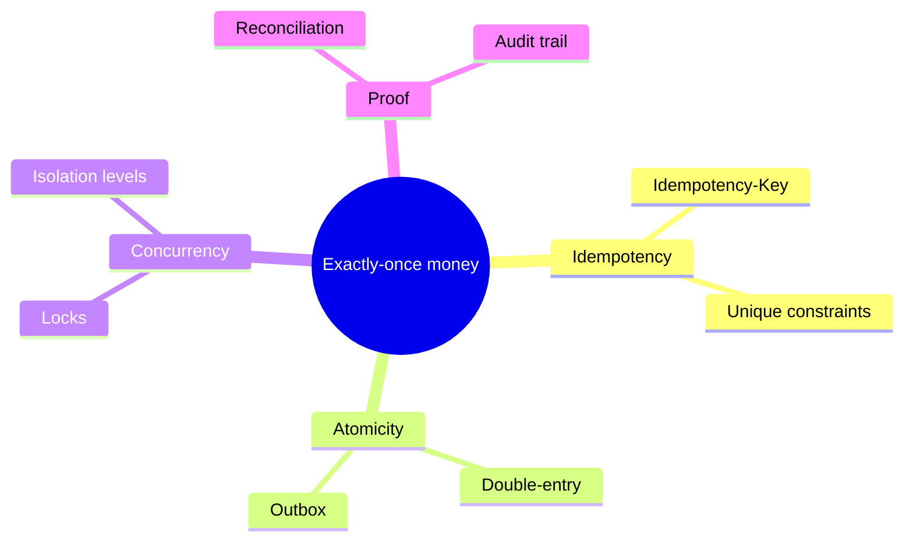

## في دقيقة واحدة

الثلاثون الثانية: قواعد البيانات، وKafka، والأنظمة الموزعة، وأسئلة مجال المدفوعات. بالصيغة نفسها: المستوى (**W**/**S**/**D**)، والإجابة في سطر، و⚠ الفخ، ورابط للدرس الذي يشرحها. وتعود جولات التقنية المالية إلى الفكرة الجوهرية نفسها بأشكال كثيرة: *يجب أن تتحرك الأموال مرة واحدة بالضبط، ويجب أن تستطيع إثبات ذلك.* وكثير من الإجابات هنا تنويعات على ذلك.

## تشبيه

بطاقة طوارئ الطيار: استجابات قصيرة متدرب عليها للمواقف التي تتكرر.

## المخطط

## ابنِه خطوة بخطوة: الأسئلة

### قواعد البيانات

| # | المستوى | السؤال | الإجابة في سطر | ⚠ الفخ |
|---|---|---|---|---|
| 31 | W | ‏ACID في سطر لكل حرف؟ | ذرية (الكل أو لا شيء)، ومتسقة (القيود تبقى صحيحة)، ومعزولة (المعاملات المتزامنة لا تتداخل أبعد من المستوى)، ودائمة (المؤكد ينجو من التعطل). | ‏"الاتساق" في ACID ليس الـ "C" في CAP. |
| 32 | S | مستوى العزل الافتراضي في PostgreSQL وما يسمح به؟ | ‏READ COMMITTED: كل عبارة ترى البيانات المؤكدة قبل بدئها؛ والقراءات غير القابلة للتكرار والتحديثات المفقودة بالقراءة-التعديل-الكتابة ممكنة. | الافتراضي في MySQL InnoDB هو REPEATABLE READ: المحركات تختلف. |
| 33 | S | كيف تمنع تحديثًا مفقودًا على رصيد؟ | ‏`UPDATE … SET balance = balance - :x WHERE id = :id AND balance >= :x` ذري، أو `SELECT … FOR UPDATE`، أو `@Version`. | قراءة الرصيد في Java، والطرح، وكتابته مجددًا هي الخطأ. |
| 34 | S | ما MVCC؟ | يرى القراء لقطة؛ وينشئ الكتّاب نسخًا جديدة من الصفوف، فلا يحجب القراء الكتّاب. | المعاملات الطويلة تُبقي النسخ القديمة حية (تضخم) وتحجز اللقطات. |
| 35 | S | متى تستخدم `FOR UPDATE SKIP LOCKED`؟ | طوابير العمل ومرحّلات صندوق الصادر: كل عامل يطالب بصفوف لا يحجزها غيره. | لا يعطي ضمان ترتيب عبر العمال. |
| 36 | D | تغيير المخطط دون توقف؟ | التوسيع/التقليص: أضف عمودًا يقبل null ← انشر كودًا يكتب في الاثنين ← املأ القديم على دفعات ← حوّل القراءات ← احذف القديم لاحقًا. | ‏`ALTER TABLE … ADD COLUMN … DEFAULT` بقيمة افتراضية متغيرة (volatile)، أو فهرس جديد دون `CONCURRENTLY`، قد يقفل جدولًا ساخنًا. |
| 37 | D | التقسيم مقابل التوزيع (sharding)؟ | التقسيم يجزّئ جدولًا داخل قاعدة بيانات واحدة (الاحتفاظ، والتقليم)؛ والتوزيع يجزّئ البيانات عبر قواعد بيانات (توسع الكتابة). | انتهت المعاملات بين الأجزاء: تحتاج الآن الساغات. |

### ‏Kafka والمراسلة

| # | المستوى | السؤال | الإجابة في سطر | ⚠ الفخ |
|---|---|---|---|---|
| 38 | W | كيف يرتّب Kafka الرسائل؟ | داخل القسم فقط؛ والمفتاح يختار القسم. | زيادة عدد الأقسام تعيد توزيع المفاتيح وتكسر الترتيب لكل مفتاح أثناء التغيير. |
| 39 | S | ‏`acks=all` و`min.insync.replicas`؟ | يؤكد القائد حين تمتلك كل النسخ المتزامنة السجل؛ ومع `min.insync.replicas=2` تفشل الكتابة إن كان أقل من نسختين متزامنتين. | ‏`acks=all` مع `min.insync.replicas=1` قد يفقد البيانات إن ماتت النسخة المتزامنة الوحيدة. |
| 40 | S | مرة واحدة على الأقل مقابل مرة واحدة بالضبط؟ | مرة واحدة على الأقل: أكّد الإزاحات بعد المعالجة، فالتكرارات ممكنة. وEOS في Kafka: معاملات عبر كتابات Kafka وتأكيدات الإزاحات (قراءة-معالجة-كتابة داخل Kafka). | لا يغطي EOS كتابات قاعدة بياناتك: تحتاج مستهلكين عديمي الأثر عند التكرار أو صندوق الصادر. |
| 41 | S | ما الذي يطلق إعادة توازن مجموعة المستهلكين، ولماذا تؤلم؟ | انضمام أعضاء أو مغادرتهم، أو نبضات قلب فائتة، أو تجاوز `max.poll.interval.ms`؛ فتنتقل الأقسام وقد يُعاد العمل الجاري. | المعالجة البطيئة داخل `poll` تبدو كمستهلك ميت. فأبقِ وقت المعالجة أقل بكثير من فترة الاستطلاع. |
| 42 | S | موضوع الرسائل الميتة (DLT): متى؟ | بعد إعادات محاولة محدودة للرسائل السامة، فلا يحجب سجل سيئ واحد قسمًا. | ‏DLT لا يراقبه أحد هو فقدان بيانات بخطوات إضافية. |
| 43 | D | صندوق الصادر المعاملاتي مقابل CDC؟ | صندوق الصادر: صف الحدث في معاملة قاعدة البيانات نفسها، يُنشر بمستطلِع أو بـ CDC ‏(مثل Debezium يقرأ WAL). | الاستطلاع يضيف زمن انتظار وحملًا؛ وCDC يضيف بنية تحتية. وكلاهما مرة واحدة على الأقل. |

### الأنظمة الموزعة

| # | المستوى | السؤال | الإجابة في سطر | ⚠ الفخ |
|---|---|---|---|---|
| 44 | W | ‏CAP في سطر؟ | أثناء انقسام الشبكة تختار بين الاتساق والإتاحة. | دون انقسام، المقايضة الحقيقية هي زمن الاستجابة مقابل الاتساق (PACELC). |
| 45 | S | الساغا مقابل 2PC؟ | ‏2PC: تأكيد ذري بمنسق حاجب. والساغا: تسلسل من المعاملات المحلية مع تعويضات. | التعويض إجراء أعمال *جديد* (استرداد)، لا تراجع؛ والحالات الوسيطة مرئية. |
| 46 | S | كيف تصمم إعادات المحاولة؟ | محاولات محدودة، وتراجع أسي مع تشتيت، فقط للعمليات عديمة الأثر عند التكرار أو ذات المفاتيح، إضافة إلى ميزانية مهلة. | إعادة المحاولة في كل طبقة تضاعف الحمل (3 طبقات × 3 إعادات = حتى 27 استدعاءً). |
| 47 | S | قاطع الدائرة مقابل الحاجز مقابل المهلة؟ | المهلة تحدّ استدعاءً واحدًا؛ والحاجز يحدّ الاستدعاءات المتزامنة؛ وقاطع الدائرة يوقف استدعاء تبعية فاشلة. | قاطع بلا بديل يفشل أسرع فقط. فقرر البديل. |
| 48 | D | لماذا قفل Redis بمدة صلاحية غير آمن للأموال؟ | قد يفقد عميل متوقف القفل (انتهاء المدة) ويكتب مع ذلك؛ وتحتاج رموز تسييج يفحصها المورد، أو قيدًا في قاعدة البيانات. | ‏"Redlock عبر 5 عقد" لا يصلح مشكلة العميل المتوقف. |
| 49 | D | كيف تحدد المعدل عبر نسخ كثيرة؟ | حالة مشتركة (مثل دلو رموز في Redis عبر سكربت Lua ذري) لكل مستأجر أو مفتاح؛ وحدود محلية كبديل. | الفشل مفتوحًا مقابل مغلقًا قرار منتج؛ فقل أيهما ولماذا. |
| 50 | D | مشكلات الساعات في الأنظمة الموزعة؟ | الساعات الجدارية تنحرف وتقفز؛ فاستخدم ساعة قاعدة البيانات/الخادم للترتيب داخل نظام واحد، والإصدارات المنطقية أو الأرقام التسلسلية عبر الأنظمة. | ترتيب الأحداث حسب `Instant.now()` من خوادم مختلفة غير موثوق. |

### مجال المدفوعات والتقنية المالية

| # | المستوى | السؤال | الإجابة في سطر | ⚠ الفخ |
|---|---|---|---|---|
| 51 | W | لماذا لا `double` للأموال أبدًا؟ | الفاصلة العائمة الثنائية لا تستطيع تمثيل معظم الكسور العشرية بدقة؛ والأخطاء تتراكم. | ‏`BigDecimal` بمقياس وتقريب صريحين، أو وحدات صغرى من نوع long، إضافة إلى العملة. |
| 52 | W | ما القيد المزدوج؟ | لكل حركة قيود متساوية ومتعاكسة؛ ومجموع كل مُدخل صفر (لكل عملة). | الأرصدة مشتقة من القيود؛ فلا "تصلح" رصيدًا بـ UPDATE أبدًا. |
| 53 | S | تصميم مفتاح عدم التكرار؟ | مفتاح يولّده العميل لكل عملية، ونطاقه لكل عميل، ويُخزن مع تجزئة الطلب تحت قيد تفرد، مع استجابة مخزنة للإعادات. | المفتاح نفسه + جسم مختلف يجب رفضه (مثل 422)، لا إعادته بصمت. |
| 54 | S | تفويض البطاقة مقابل التحصيل؟ | التفويض يحجز الأموال؛ والتحصيل (المقاصة) يطلب المال، ربما جزئيًا، قبل انتهاء صلاحية التفويض. | مبلغ التحصيل لا يمكن أن يتجاوز المبلغ المفوّض (مع بعض استثناءات الشبكات/رموز فئة التاجر: راجع قواعد الشبكة). |
| 55 | S | ما المطابقة؟ | مقارنة سجلين مستقلين للأموال نفسها (دفتر الأستاذ مقابل كشف البنك) وتفسير كل فرق (كسر). | فروقات التوقيت طبيعية؛ فنبّه حسب العمر والمبلغ، لا على كل كسر. |
| 56 | S | ما رد المبلغ (chargeback)؟ | يعترض حامل البطاقة على دفعة عبر مُصدِره؛ وتعكس الشبكة الأموال من جانب التاجر بانتظار الأدلة. | قد يصل بعد أسابيع أو أشهر: فيجب أن يظل نموذج بياناتك قادرًا على إيجاد الدفعة الأصلية. |
| 57 | S | ‏ISO 20022 في سطر؟ | معيار المراسلة المالية بـ XML/JSON ‏(مثل pacs.008 لتحويل الائتمان، وcamt.053 للكشف) الذي يحل محل SWIFT MT للمدفوعات العابرة للحدود. | تحقق من حالة الترحيل الحالية وتواريخها في صفحات SWIFT نفسها؛ ولا تذكر تواريخ من الذاكرة. |
| 58 | D | تحويل العملات: أي تقريب؟ | قاعدة صريحة موثقة (مثل تقريب مبلغ العميل للأسفل)، تُطبق في مكان واحد؛ وكل عملة ما زالت تتوازن في دفتر الأستاذ. | التحويل ذهابًا وإيابًا مع التقريب قد يخلق المال أو يعدمه. |
| 59 | D | كيف تصمم سجل تدقيق غير قابل للتغيير؟ | جداول للإلحاق فقط (لا صلاحيات UPDATE/DELETE أو بالمشغلات)، ومن/ماذا/متى/لماذا على كل حدث، والتصحيحات كمُدخلات جديدة. | السجلات (logs) ليست سجل تدقيق: تُدوّر، وتُؤخذ منها عينات، ويمكن تعديلها. |
| 60 | D | أثر PCI DSS على تصميم النظام الخلفي؟ | قلّل نطاق بيانات حاملي البطاقات: رمّز أرقام البطاقات، واحفظ الأرقام الخام في خدمة منفصلة محصّنة، ولا تسجّلها أبدًا. | القواعد تعتمد على دورك والإصدار الحالي من PCI DSS؛ فتعامل مع هذا كتوجيه معماري، لا كاستشارة قانونية. |

## ما الذي يسوء

**الخطأ: إجابات عامة دون عواقب مالية.** "سأضيف إعادة محاولة" دون قول ما يحدث لأموال العميل إن نجحت إعادة المحاولة مرتين.

**الإصلاح:** اختم كل إجابة بالعاقبة المالية: "…فلا يمكن الخصم من العميل مرتين، وستُظهر المطابقة كسرًا لو حدث ذلك يومًا."

**الاختبار:** لخمسة صفوف عشوائية، قل الإجابة، ثم أضف جملة "فالمال…".

## المقايضات: متى لا تستخدم هذه القائمة

ليست بديلًا عن التعمقات التصميمية. فإن تحول سؤال إلى "صمّمه"، فانتقل إلى خطة الـ 45 دقيقة ([إدارة جولة التصميم](#/tracks/track-15/lessons/track-15-lesson-02)).

## أسئلة وأجوبة المقابلة

**إحماء (#51): "كيف تخزن الأموال؟"**
- *الإجابة النموذجية:* ‏`BigDecimal` بمقياس العملة أو وحدات صغرى من نوع `long`، دائمًا مع عملة ISO 4217، والتقريب الصريح فقط حيث تقول السياسة.
- *الإجابة الخاطئة الشائعة:* "‏`double` بخانتين عشريتين."
- *لماذا تفشل:* ‏0.1 + 0.2 ≠ 0.3 في الفاصلة العائمة الثنائية.

**قياسي (#40): "هل يعني exactly-once في Kafka أن مستهلكي لن يعالج مرتين؟"**
- *الإجابة النموذجية:* فقط للمعالجة من Kafka إلى Kafka داخل معاملة. فإن كتب المستهلك في قاعدة بيانات، فقد يرى سجلًا مرتين، فيزيل التكرار حسب معرّف الحدث في معاملة قاعدة البيانات نفسها.
- *الإجابة الخاطئة الشائعة:* "نعم، اضبط `enable.idempotence=true`."
- *لماذا تفشل:* عدم التكرار لدى المنتج يمنع *الكتابات المكررة إلى Kafka* الناتجة عن إعادات محاولة المنتج، لا شيء غير ذلك.

**قياسي (#45): "ساغا أم 2PC لتحويل بين الخدمات؟"**
- *الإجابة النموذجية:* ساغا مع تعويضات وحساب مقاصة/معلّق، لأن الخدمات تملك قواعد بيانات منفصلة و2PC يحجب عند إخفاق المنسق. وكل خطوة عديمة الأثر عند التكرار.
- *الإجابة الخاطئة الشائعة:* "‏2PC، لأنه ذري."
- *لماذا تفشل:* تتجاهل الإتاحة وغياب دعم XA عبر مخازن كثيرة.

**عميق (#48): "هل أستطيع استخدام قفل Redis لمنع الإنفاق المزدوج؟"**
- *الإجابة النموذجية:* ليس وحده. فقد تعيش عملية متوقفة أطول من عقد إيجارها. وافرض الصحة في قاعدة البيانات (تحديث مشروط أو قيد تفرد) أو برموز التسييج. واستخدم القفل فقط لتقليل التنافس.
- *الإجابة الخاطئة الشائعة:* "نعم، مع Redlock."
- *لماذا تفشل:* المشكلة توقف العميل، لا عدد عقد Redis.

## قلها في 30 ثانية

"يعود نصف التقنية المالية إلى فكرة واحدة: تتحرك الأموال مرة واحدة بالضبط ونستطيع إثبات ذلك. ومفاتيح عدم التكرار وقيود التفرد توقف التكرارات. والقيد المزدوج وصندوق الصادر يحافظان على الذرية. والأقفال ومستويات العزل تعالج التزامن. والمطابقة وسجل التدقيق للإلحاق فقط هما الإثبات."

## الخلاصة

- اعرف الحقائق الخاصة بكل محرك (افتراضيات PostgreSQL ≠ MySQL).
- ‏EOS في Kafka ≠ مرة واحدة بالضبط من طرف إلى طرف؛ والمستهلكون عديمو الأثر عند التكرار يسدّون الفجوة.
- اختم دائمًا بالعاقبة المالية.

## انظر أيضًا

- [الجزء 1: Java وSpring](#/tracks/track-15/lessons/track-15-lesson-03)
- [المسار 05: أنماط عدم التكرار](#/tracks/track-05/lessons/track-05-lesson-12)
- [المسار 09: دلالات المرة الواحدة بالضبط](#/tracks/track-09/lessons/track-09-lesson-05)
- [المسار 02: الأقفال الموزعة](#/tracks/track-02/lessons/track-02-lesson-09)
- [المشروع الختامي 4: المطابقة](#/capstone/settlement-reconciliation)

<!-- KNOWLEDGE-CHECK
[
  {
    "id": "kc-1504-01",
    "question": "هل تعني دلالات المرة الواحدة بالضبط في Kafka أن مستهلكًا يكتب في قاعدة بيانات لن يعالج سجلًا مرتين؟",
    "options": [
      "نعم، إن كان enable.idempotence=true",
      "لا: EOS يغطي المعالجة من Kafka إلى Kafka داخل معاملة؛ والمستهلك الذي يكتب في قاعدة بيانات يجب أن يزيل التكرار حسب معرّف الحدث في معاملة قاعدة البيانات نفسها",
      "نعم، إن كان acks=all",
      "نعم، إن كان في مجموعة المستهلكين عضو واحد"
    ],
    "correct": 1,
    "explanation": "عدم التكرار لدى المنتج يمنع فقط الكتابات المكررة إلى Kafka الناتجة عن إعادات محاولة المنتج. وآثار قاعدة البيانات تحتاج مستهلكًا عديم الأثر عند التكرار أو صندوق الصادر."
  },
  {
    "id": "kc-1504-02",
    "question": "كيف تمنع تحديثًا مفقودًا على رصيد حساب؟",
    "options": [
      "اقرأ الرصيد في Java، واطرح، واكتبه مجددًا",
      "استخدم مستوى العزل READ COMMITTED، الذي يمنع التحديثات المفقودة",
      "UPDATE … SET balance = balance - :x WHERE id = :id AND balance >= :x ذري، أو SELECT … FOR UPDATE، أو @Version",
      "خزّن الرصيد مؤقتًا في Redis"
    ],
    "correct": 2,
    "explanation": "القراءة-التعديل-الكتابة في كود التطبيق هي الخطأ. ومستوى READ COMMITTED الافتراضي في PostgreSQL يسمح بالتحديثات المفقودة بهذا النمط."
  },
  {
    "id": "kc-1504-03",
    "question": "ساغا أم تأكيد على مرحلتين لتحويل بين خدمات تملك قواعد بيانات منفصلة؟",
    "options": [
      "ساغا مع تعويضات وحساب مقاصة/معلّق، وكل خطوة عديمة الأثر عند التكرار، لأن 2PC يحجب عند إخفاق المنسق وXA نادرًا ما يتوفر عبر المخازن",
      "2PC، لأنه ذري",
      "لا هذا ولا ذاك: اكتب في قاعدتي البيانات وتمنَّ الأفضل",
      "قفل Redis موزع"
    ],
    "correct": 0,
    "explanation": "التعويض إجراء أعمال جديد (مثل الاسترداد)، لا تراجع، والحالات الوسيطة مرئية، فيجب نمذجتها."
  },
  {
    "id": "kc-1504-04",
    "question": "ما الذي يجعل تصميم مفتاح عدم التكرار صحيحًا؟",
    "options": [
      "مفتاح يولّده الخادم ويُعاد بعد الطلب الأول",
      "مفتاح مخزن في الذاكرة فقط لدقيقة واحدة",
      "قبول المفتاح نفسه مع جسم مختلف كطلب جديد",
      "مفتاح يولّده العميل لكل عملية، ونطاقه لكل عميل، ويُخزن مع تجزئة الطلب تحت قيد تفرد، مع تخزين الاستجابة للإعادات؛ والمفتاح نفسه + جسم مختلف يُرفض"
    ],
    "correct": 3,
    "explanation": "تجزئة الطلب تكشف أخطاء العملاء الذين يعيدون استخدام مفتاح لعملية مختلفة؛ والإعادة بصمت ستخفيها."
  }
]
-->

<!-- PRACTICAL-CHALLENGE
{
  "id": "pc-1504",
  "title": "أجب بالعاقبة المالية",
  "description": "تدرّب على نصف التقنية المالية من بنك الأسئلة.",
  "tasks": [
    {
      "id": "pc-1504-01",
      "description": "اختر عشرة صفوف عشوائية من الأسئلة 31–60. لكل منها، قل الإجابة في سطر بصوت عالٍ، ثم أضف جملة \"…فالمال…\" التي تذكر العاقبة على أموال العميل."
    },
    {
      "id": "pc-1504-02",
      "description": "اكتب عرضًا قصيرًا بـ SQL في PostgreSQL يُظهر تحديثًا مفقودًا تحت READ COMMITTED بجلستين، والـ UPDATE المشروط الذي يمنعه."
    },
    {
      "id": "pc-1504-03",
      "description": "اكتب جدول عدم تكرار (المفتاح، ومعرّف العميل، وتجزئة الطلب، والاستجابة، وcreated_at) واختبارًا يثبت: أن الإعادة تعيد الاستجابة المخزنة، وأن المفتاح نفسه مع جسم مختلف يعيد 422."
    }
  ]
}
-->
