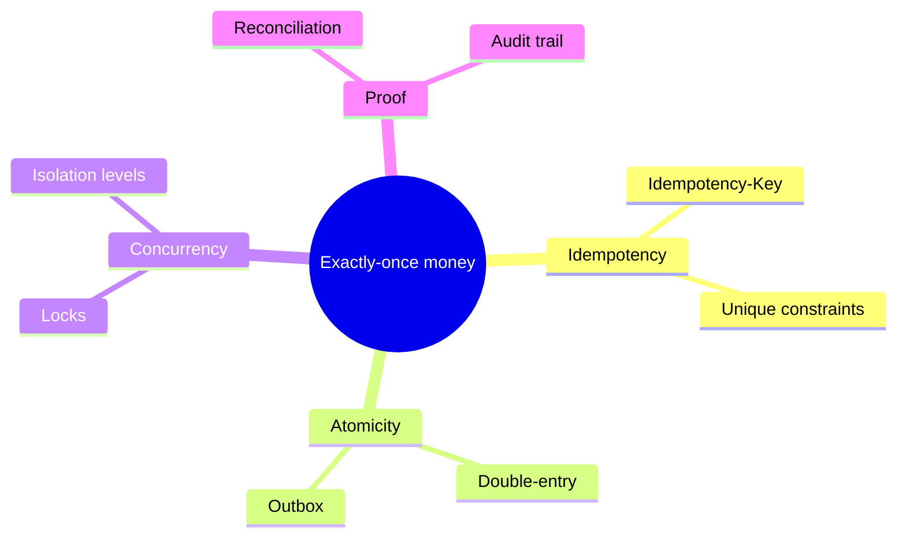

## In one minute

The second thirty: databases, Kafka, distributed systems, and payments domain questions. Same format:
level (**W**/**S**/**D**), one-line answer, ⚠ gotcha, and a link to the lesson that teaches it.
Fintech rounds return to the same core idea in many forms: *money must move exactly once, and you must
be able to prove it.* Many answers here are variations of that.

## Analogy

A pilot's emergency card: short, practised responses to the situations that recur.

## Diagram

## Build it step by step: the questions

### Databases

| # | Lvl | Question | One-line answer | ⚠ Gotcha |
|---|---|---|---|---|
| 31 | W | ACID in one line each? | Atomic (all or nothing), Consistent (constraints hold), Isolated (concurrent transactions don't interfere beyond the level), Durable (committed survives a crash). | "Consistency" in ACID is not the "C" in CAP. |
| 32 | S | PostgreSQL's default isolation level and what it allows? | READ COMMITTED: each statement sees data committed before it began; non-repeatable reads and lost updates by read-modify-write are possible. | MySQL InnoDB defaults to REPEATABLE READ: the engines differ. |
| 33 | S | How do you prevent a lost update on a balance? | Atomic `UPDATE … SET balance = balance - :x WHERE id = :id AND balance >= :x`, or `SELECT … FOR UPDATE`, or `@Version`. | Reading the balance in Java, subtracting, and writing it back is the bug. |
| 34 | S | What is MVCC? | Readers see a snapshot; writers create new row versions, so readers don't block writers. | Long transactions keep old versions alive (bloat) and hold snapshots. |
| 35 | S | When would you use `FOR UPDATE SKIP LOCKED`? | Work queues and outbox relays: each worker claims rows nobody else holds. | It gives no ordering guarantee across workers. |
| 36 | D | Zero-downtime schema change? | Expand/contract: add nullable column → deploy code that writes both → backfill in batches → switch reads → drop old later. | `ALTER TABLE … ADD COLUMN … DEFAULT` with a volatile default, or a new index without `CONCURRENTLY`, can lock a hot table. |
| 37 | D | Partitioning vs sharding? | Partitioning splits a table inside one database (retention, pruning); sharding splits data across databases (write scale). | Cross-shard transactions are gone: you now need sagas. |

### Kafka and messaging

| # | Lvl | Question | One-line answer | ⚠ Gotcha |
|---|---|---|---|---|
| 38 | W | How does Kafka order messages? | Only within a partition; the key chooses the partition. | Increasing the partition count remaps keys and breaks per-key ordering during the change. |
| 39 | S | `acks=all` and `min.insync.replicas`? | The leader acknowledges when all in-sync replicas have the record; with `min.insync.replicas=2` a write fails if fewer than 2 replicas are in sync. | `acks=all` with `min.insync.replicas=1` can still lose data if the only in-sync replica dies. |
| 40 | S | At-least-once vs exactly-once? | At-least-once: commit offsets after processing, so duplicates are possible. Kafka EOS: transactions across Kafka writes and offset commits (read-process-write within Kafka). | EOS does not cover your database writes: those need idempotent consumers or the outbox. |
| 41 | S | What triggers a consumer group rebalance, and why does it hurt? | Members joining or leaving, missed heartbeats, or `max.poll.interval.ms` exceeded; partitions move and in-flight work may be redone. | Slow processing inside `poll` looks like a dead consumer. Keep processing time well under the poll interval. |
| 42 | S | Dead-letter topic: when? | After bounded retries for poison messages, so one bad record doesn't block a partition. | A DLT nobody monitors is data loss with extra steps. |
| 43 | D | Transactional outbox vs CDC? | Outbox: event row in the same DB transaction, published by a poller or by CDC (e.g. Debezium reading the WAL). | Polling adds latency and load; CDC adds infrastructure. Both are at-least-once. |

### Distributed systems

| # | Lvl | Question | One-line answer | ⚠ Gotcha |
|---|---|---|---|---|
| 44 | W | CAP in one line? | During a network partition you choose between consistency and availability. | Without a partition, the real trade-off is latency vs consistency (PACELC). |
| 45 | S | Saga vs 2PC? | 2PC: atomic commit with a blocking coordinator. Saga: a sequence of local transactions with compensations. | Compensation is a *new* business action (refund), not a rollback; intermediate states are visible. |
| 46 | S | How do you design retries? | Bounded attempts, exponential backoff with jitter, only for idempotent or keyed operations, plus a timeout budget. | Retrying at every layer multiplies load (3 layers × 3 retries = up to 27 calls). |
| 47 | S | Circuit breaker vs bulkhead vs timeout? | Timeout bounds one call; bulkhead bounds concurrent calls; circuit breaker stops calling a failing dependency. | A breaker without a fallback just fails faster. Decide the fallback. |
| 48 | D | Why is a Redis lock with TTL unsafe for money? | A paused client can lose the lock (TTL expiry) and still write; you need fencing tokens checked by the resource, or a database constraint. | "Redlock across 5 nodes" doesn't fix the paused-client problem. |
| 49 | D | How do you rate-limit across many instances? | Shared state (e.g. a Redis token bucket via an atomic Lua script) per tenant or key; local limits as a fallback. | Fail-open vs fail-closed is a product decision; say which and why. |
| 50 | D | Clock problems in distributed systems? | Wall clocks drift and jump; use the DB/server clock for ordering in one system, logical versions or sequence numbers across systems. | Ordering events by `Instant.now()` from different hosts is unreliable. |

### Payments and fintech domain

| # | Lvl | Question | One-line answer | ⚠ Gotcha |
|---|---|---|---|---|
| 51 | W | Why never `double` for money? | Binary floating point cannot represent most decimal fractions exactly; errors accumulate. | `BigDecimal` with explicit scale and rounding, or long minor units, plus the currency. |
| 52 | W | What is double-entry bookkeeping? | Every movement has equal and opposite postings; each entry sums to zero (per currency). | Balances are derived from postings; never "fix" a balance with an UPDATE. |
| 53 | S | Idempotency key design? | Client-generated key per operation, scoped per client, stored with a request hash under a unique constraint, with a stored response for replays. | Same key + different body must be rejected (e.g. 422), not silently replayed. |
| 54 | S | Card authorisation vs capture? | Authorisation reserves (holds) funds; capture (clearing) asks for the money, possibly partially, before the authorisation expires. | Capture amount cannot exceed the authorised amount (with some scheme/MCC exceptions: check scheme rules). |
| 55 | S | What is reconciliation? | Comparing two independent records of the same money (ledger vs bank statement) and explaining every difference (break). | Timing differences are normal; alert by age and amount, not on every break. |
| 56 | S | What is a chargeback? | The cardholder disputes a payment through their issuer; the scheme reverses funds from the merchant's side pending evidence. | It can arrive weeks or months later: your data model must still find the original payment. |
| 57 | S | ISO 20022 in one line? | The XML/JSON financial messaging standard (e.g. pacs.008 credit transfer, camt.053 statement) replacing SWIFT MT for cross-border payments. | Check the current migration status and dates against SWIFT's own pages; don't quote dates from memory. |
| 58 | D | FX conversion: which rounding? | An explicit, documented rule (e.g. customer amount rounded down), applied in one place; each currency still balances in the ledger. | Converting back and forth with rounding can create or destroy money. |
| 59 | D | How do you design an immutable audit trail? | Append-only tables (no UPDATE/DELETE grants or triggers), who/what/when/why on each event, corrections as new entries. | Logs are not an audit trail: they rotate, sample, and can be edited. |
| 60 | D | PCI DSS impact on a backend design? | Minimise cardholder-data scope: tokenise PANs, keep raw PANs in a separate, hardened service, never log them. | Rules depend on your role and the current PCI DSS version; treat this as architecture guidance, not legal advice. |

## What goes wrong

**Bug: generic answers without fintech consequences.** "I'd add a retry" without saying what happens to
the customer's money if the retry succeeds twice.

**Fix:** end each answer with the money consequence: "…so the customer can't be charged twice,
and reconciliation would show a break if it ever happened."

**Test:** for five random rows, say the answer, then add the "so the money…" sentence.

## Trade-offs: when NOT to use this list

Not a substitute for the design deep dives. If a question turns into "design it", switch to the
45-minute plan ([Running the design round](#/tracks/track-15/lessons/track-15-lesson-02)).

## Interview Q&A

**Warm-up (#51) - "How do you store money?"**
- *Model answer:* `BigDecimal` with the currency's scale or `long` minor units, always with an ISO 4217
  currency, explicit rounding only where policy says.
- *Common wrong answer:* "A `double` with two decimals."
- *Why it fails:* 0.1 + 0.2 ≠ 0.3 in binary floating point.

**Standard (#40) - "Does Kafka exactly-once mean my consumer won't process twice?"**
- *Model answer:* only for Kafka-to-Kafka processing inside a transaction. If the consumer writes to a
  database, it can still see a record twice, so it de-duplicates by event id in the same DB transaction.
- *Common wrong answer:* "Yes, set `enable.idempotence=true`."
- *Why it fails:* producer idempotence prevents duplicate *writes to Kafka* from producer retries, nothing else.

**Standard (#45) - "Saga or 2PC for a cross-service transfer?"**
- *Model answer:* saga with compensations and a clearing/suspense account, because services own
  separate databases and 2PC blocks on coordinator failure. Each step is idempotent.
- *Common wrong answer:* "2PC, because it's atomic."
- *Why it fails:* it ignores availability and the lack of XA support across many stores.

**Deep (#48) - "Can I use a Redis lock to prevent double spending?"**
- *Model answer:* not on its own. A paused process can outlive its lease. Enforce correctness in the
  database (conditional update or unique constraint) or with fencing tokens. Use the lock only to
  reduce contention.
- *Common wrong answer:* "Yes, with Redlock."
- *Why it fails:* the problem is the client pause, not the number of Redis nodes.

## Say it in 30 seconds

"The fintech half comes back to one idea: money moves exactly once and we can prove it. Idempotency
keys and unique constraints stop duplicates. Double-entry and the outbox keep things atomic. Locks
and isolation levels handle concurrency. Reconciliation and an append-only audit trail are the proof."

## Recap

- Know the engine-specific facts (PostgreSQL ≠ MySQL defaults).
- Kafka EOS ≠ end-to-end exactly-once; idempotent consumers close the gap.
- Always finish with the money consequence.

## See also

- [Part 1: Java and Spring](#/tracks/track-15/lessons/track-15-lesson-03)
- [Track 05: Idempotency patterns](#/tracks/track-05/lessons/track-05-lesson-12)
- [Track 09: Exactly-once semantics](#/tracks/track-09/lessons/track-09-lesson-05)
- [Track 02: Distributed locks](#/tracks/track-02/lessons/track-02-lesson-09)
- [Capstone 4: reconciliation](#/capstone/settlement-reconciliation)
