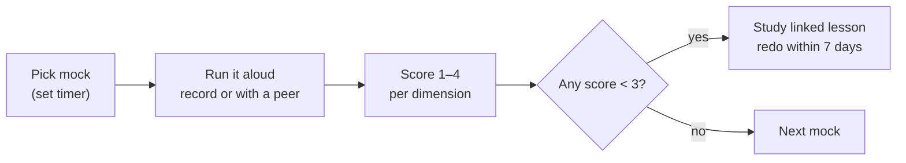

## في دقيقة واحدة

عشر مقابلات تجريبية تحاكي سلسلة مقابلات لمهندس أول في التقنية المالية: أربع لتصميم الأنظمة، واثنتان للبرمجة، واثنتان للتعمق، وواحدة سلوكية، وواحدة لعرض مشروع. وقراءة هذه الصفحة تستغرق نحو 35 دقيقة. أما **أداء** المقابلات التجريبية فيستغرق نحو 10 ساعات، وهو مجدول في الأسابيع 27–30 من خطة الدراسة (الوقت المخصص للمقابلات التجريبية والمراجعة، لا ميزانية الدروس). ولكل مقابلة وقت ثابت، وسؤال، والنقاط التي تغطيها الإجابة القوية، ومعيار تقييم من 1 إلى 4. وسجّل نفسك أو تدرّب مع زميل، وقيّم بصدق، وأعد أي مقابلة تحصل فيها على أقل من 3 في أي بُعد.

> شكل سلسلة المقابلات **افتراض**، لا حقيقة موثقة المصدر: فالشركات تنشر القليل عن مقابلاتها، والمقابلات تتغير. فتحقق من إعلان الوظيفة وملاحظات مسؤول التوظيف لمعرفة الصيغة الحقيقية.

## تشبيه

ساعات محاكي الطيران: حالات الطوارئ نفسها، يُتدرب عليها تحت ساعة، حتى تصبح الاستجابة هادئة.

## المخطط

## ابنِه خطوة بخطوة

### معيار التقييم (تستخدمه كل مقابلة تجريبية)

| البُعد | 1: ضعيف | 2: على الحد | 3: توظيف | 4: توظيف بقوة |
|---|---|---|---|---|
| **تأطير المشكلة** | يبدأ البناء فورًا | بعض الأسئلة، ويفوّت قيدًا أساسيًا | يوضّح النطاق، والحجم، واحتياجات الاتساق | يكتشف المخاطرة الخفية (الأموال، والتكرارات) في الدقائق الأولى |
| **العمق التقني** | كلمات رنانة | صحيح لكن سطحي | آلية صحيحة مع مستوى واحد من "لماذا" | يشرح أنماط الإخفاق ويثبتها (اختبار، أو مقياس، أو مثال) |
| **المقايضات** | خيار واحد، بلا تكاليف | يذكر البدائل | "اخترت X بسبب Y، والكلفة Z" | يسمّي متى سيتغير القرار |
| **الصحة والأمان** | يمكن فقدان الأموال أو تكرارها | المسار السعيد فقط | عدم التكرار، والذرية، وإعادات المحاولة معالجة | إضافة إلى المطابقة/التدقيق وحالات الأمان الحدية |
| **التواصل والوقت** | غير منظم، وينفد وقته | منظم لكنه ينزلق | يتبع خطة، ويتحقق مع المُقابِل | موجز، ويقود الجلسة، ويلخّص |

معيار النجاح في المقابلة التجريبية: **≥ 3 في كل بُعد** (لا متوسط).

### المقابلات التجريبية العشر

| # | النوع | الوقت | السؤال | ما تغطيه الإجابة القوية | استعد بـ |
|---|---|---|---|---|---|
| 1 | تصميم أنظمة | 45 دقيقة | صمّم واجهة قبول مدفوعات للتجار (≈ ألف دفعة/ثانية في الذروة). | مفتاح عدم تكرار + قيد تفرد، وصندوق الصادر إلى التسوية، وانتهاء مهلة مزوّد الدفع = حالة غير معروفة، والمطابقة | المشروع الختامي 1، و[المسار 14 الدروس 2–3](#/tracks/track-14/lessons/track-14-lesson-02) |
| 2 | تصميم أنظمة | 45 دقيقة | صمّم محفظة متعددة العملات مع تحويلات فورية بين المستخدمين. | القيد المزدوج، والتوازن لكل عملة، والحسابات الساخنة، ودورة حياة عرض سعر الصرف، وسياسة التقريب | المشروع الختامي 2، و[المسار 14 الدرس 5](#/tracks/track-14/lessons/track-14-lesson-05) |
| 3 | تصميم أنظمة | 45 دقيقة | صمّم محدد معدل لواجهة دفع عامة بحدود لكل مستأجر. | دلو الرموز مقابل النوافذ، وسكربت Redis ذري، والفشل مفتوحًا/مغلقًا، والترويسات (`Retry-After`) | المشروع الختامي 5، و[المسار 14 الدرس 6](#/tracks/track-14/lessons/track-14-lesson-06) |
| 4 | تصميم أنظمة | 45 دقيقة | صمّم تسوية نهاية اليوم ومطابقتها مع كشوف البنوك. | عدم تكرار الملفات، وقواعد المطابقة، وأنواع الكسور، وسماحية التوقيت، ومبدأ الصانع والمدقق | المشروع الختامي 4 |
| 5 | برمجة | 45 دقيقة | بـ Java عادية: `transfer(from, to, amount)` على مخزن حسابات في الذاكرة، آمن للخيوط، بلا جمود، وبلا أرصدة سالبة، مع اختبار تزامن. | قفل مرتب أو أقفال لكل حساب، و`BigDecimal`/الوحدات الصغرى، واختبار متعدد الخيوط بمزلاج | [المسار 05 السيناريو A](#/tracks/track-05/lessons/track-05-lesson-02) |
| 6 | برمجة | 45 دقيقة | نفّذ دلو رموز (`tryAcquire()`)، آمنًا للخيوط، بساعة قابلة للحقن؛ ثم وسّعه إلى دلاء لكل مفتاح. | حسابات التعبئة، ونانوثوانٍ من نوع `long`، و`ConcurrentHashMap.computeIfAbsent`، واختبارات بساعة مزيفة | سكربت Lua في المشروع الختامي 5 |
| 7 | تعمق | 45 دقيقة | ‏"قفز زمن الاستجابة p99 من 80 مللي ثانية إلى ثانيتين بعد تفعيل الخيوط الافتراضية." تتبّع الخطأ بصوت عالٍ. | الاتصالات المعلقة في Hikari، والتثبيت (إصدار JDK)، والحدود اللاحقة، وتفريغات الخيوط / JFR | [المسار 03 الدرس 20](#/tracks/track-03/lessons/track-03-lesson-20)، و[المسار 03 الدرس 13](#/tracks/track-03/lessons/track-03-lesson-13) |
| 8 | تعمق | 45 دقيقة | ‏"يرى العملاء إشعارات مكررة، ومرة واحدة، ترحيلًا مكررًا في دفتر الأستاذ." اعثر على الأسباب والإصلاحات. | التسليم مرة واحدة على الأقل، وإعادة المعالجة عند إعادة التوازن، والمستهلك عديم الأثر عند التكرار، وقيد قاعدة البيانات كخط أخير | [المسار 05 السيناريو G](#/tracks/track-05/lessons/track-05-lesson-08) |
| 9 | سلوكية | 45 دقيقة | ستة أسئلة: حادث، وخلاف، وغموض، وتوجيه، وخطأ، و"لماذا هذه الشركة". | قصصك الست بصيغة STAR، كل منها ≤ دقيقتين و15 ثانية، وإجراءات بـ "أنا"، وتغيير دائم | [قصص STAR](#/tracks/track-15/lessons/track-15-lesson-01) |
| 10 | عرض مشروع | 30 دقيقة | اعرض مشروعًا ختاميًا واحدًا في 10 دقائق، ثم 20 دقيقة من أسئلة المتابعة العدائية. | المشكلة، والمخطط، وقراران أساسيان مع مقايضاتهما، وأدلة الاختبار، والحدود المعروفة | قسم "أصعب 5 أسئلة" في ملف README للمشروع الختامي |

### كيف تدير مقابلة تجريبية وحدك

1. اضبط مؤقتًا واقرأ السؤال مرة واحدة.
2. تحدث بصوت عالٍ وارسم على ورق أو أداة سبورة؛ وسجّل الصوت.
3. توقف عند الحد الزمني حتى لو لم تنتهِ: نفاد الوقت معلومة بحد ذاته.
4. استمع للتسجيل بسرعة 1.5× وقيّم بمعيار التقييم *قبل* قراءة عمود "ما تغطيه الإجابة القوية".
5. اكتب أكبر ثلاث فجوات وجدول إعادة.

## ما الذي يسوء

**الخطأ: التقييم بسخاء.** تتذكر ما *قصدت* قوله وتقيّمه.

**الإصلاح:** قيّم من التسجيل فقط. فإن لم يُقل بصوت عالٍ، فلم يحدث.

**الاختبار:** لمقابلة تجريبية واحدة، اطلب من زميل أن يقيّم من تسجيلك أيضًا. فإن كانت درجاته أقل في بُعدين أو أكثر، فخفّض معاييرك لبقية المقابلات.

## المقايضات: متى لا تستخدم هذه المقابلات التجريبية

- لا تؤدها قبل تغطية الدروس المرتبطة: فالمقابلة التجريبية دون استعداد تدرّب على الذعر، لا على المهارة.
- لا تعد السؤال نفسه في اليوم التالي؛ فستردد بدل أن تفكر. وانتظر بضعة أيام، أو غيّر الحجم (10× الحركة) أو قيدًا (متعدد المناطق).

## أسئلة وأجوبة المقابلة

**إحماء: "كيف تستعد لمقابلات تصميم الأنظمة؟"**
- *الإجابة النموذجية:* خطة زمنية ثابتة، ومجموعة مشكلات متدرب عليها، ومقابلات تجريبية مؤقتة تُقيّم بمعيار تقييم، وإعادة الضعيفة منها.
- *الإجابة الخاطئة الشائعة:* "أقرأ الكثير من مقالات تصميم الأنظمة."
- *لماذا تفشل:* القراءة لا تدرّب على إدارة الوقت أو التحدث تحت الضغط.

**قياسي: "نفد وقتك في الجولة الأخيرة. ماذا ستغيّر؟"**
- *الإجابة النموذجية:* أبدأ التعمق بحلول الدقيقة 25؛ وأقلّص المخطط عالي المستوى إلى خمسة صناديق؛ وأسأل المُقابِل في أي مجال أتعمق.
- *الإجابة الخاطئة الشائعة:* "أتحدث أسرع."
- *لماذا تفشل:* المشكلة ترتيب الأولويات، لا السرعة.

**عميق: "اعرض مشروعًا بنيته" (المقابلة التجريبية 10).**
- *الإجابة النموذجية:* دقيقتان للمشكلة والمخطط، وقراران مع المقايضات والاختبار الذي يثبت كلًا منهما، والحدود المعروفة، وما ستبنيه بعد ذلك.
- *الإجابة الخاطئة الشائعة:* جولة في الكود، ملفًا ملفًا.
- *لماذا تفشل:* يقيّم المُقابِلون الحكم، لا بنية الملفات.

## قلها في 30 ثانية

"أؤدي عشر مقابلات تجريبية مؤقتة في الأسابيع الأربعة الأخيرة: أربعة تصاميم، واثنتان للبرمجة، واثنتان لتعمقات تتبع الأخطاء، وسلوكية وعرض مشروع. وأسجّلها، وأقيّم من التسجيل بمعيار تقييم من خمسة أجزاء، وأعيد أي شيء دون 'توظيف' في أي بُعد خلال أسبوع."

## الخلاصة

- معيار التقييم نفسه لكل مقابلة تجريبية؛ ومعيار النجاح ≥ 3 في كل بُعد.
- قيّم من التسجيل، لا من الذاكرة.
- أعد المقابلات الضعيفة مع تنويع، بعد بضعة أيام.

## انظر أيضًا

- [المسار 14: أوراق مرجعية](#/tracks/track-14/lessons/track-14-lesson-08)
- [إدارة جولة التصميم ذات الـ 45 دقيقة](#/tracks/track-15/lessons/track-15-lesson-02)
- [المشاريع الختامية](#/capstone)

<!-- KNOWLEDGE-CHECK
[
  {
    "id": "kc-1505-01",
    "question": "ما معيار النجاح في مقابلة تجريبية بمعيار التقييم ذي الأبعاد الخمسة؟",
    "options": [
      "متوسط 3 أو أكثر",
      "3 على الأقل في كل بُعد",
      "4 على الأقل في العمق التقني",
      "الانتهاء ضمن الحد الزمني"
    ],
    "correct": 1,
    "explanation": "المتوسط قد يخفي بُعدًا ضعيفًا. وأي درجة أقل من 3 تعني دراسة الدرس المرتبط وإعادة المقابلة التجريبية خلال أسبوع."
  },
  {
    "id": "kc-1505-02",
    "question": "كيف يجب أن تقيّم مقابلة تجريبية أجريتها وحدك؟",
    "options": [
      "من الذاكرة، فور الانتهاء",
      "بقراءة عمود \"ما تغطيه الإجابة القوية\" أولًا",
      "من التسجيل فقط: إن لم يُقل بصوت عالٍ، فلم يحدث",
      "بسؤال نفسك عن مدى ثقتك"
    ],
    "correct": 2,
    "explanation": "يتذكر المرشحون ما قصدوا قوله. والتقييم من التسجيل، قبل قراءة النقاط النموذجية، يزيل هذا التحيز."
  },
  {
    "id": "kc-1505-03",
    "question": "حصلت على أقل من 3 في مقابلة تجريبية أمس. متى يجب أن تعيدها؟",
    "options": [
      "ليس في اليوم التالي بالسؤال نفسه: انتظر بضعة أيام أو غيّر الحجم أو قيدًا، لكي تفكر بدل أن تردد",
      "فورًا، بالسؤال نفسه",
      "أبدًا؛ انتقل إلى المقابلة التجريبية التالية",
      "فقط بعد إنهاء المقابلات التجريبية العشر"
    ],
    "correct": 0,
    "explanation": "إعادة السؤال نفسه في اليوم التالي تدرّب على التذكر، لا على التفكير. فغيّر الحركة (10×) أو أضف قيدًا (متعدد المناطق)."
  },
  {
    "id": "kc-1505-04",
    "question": "في المقابلة التجريبية 10 (عرض مشروع)، على ماذا يجب أن يركز العرض ذو الدقائق العشر؟",
    "options": [
      "جولة في الكود ملفًا ملفًا",
      "كل مكتبة في ملف البناء",
      "سجل التعديلات الكامل",
      "المشكلة، ومخطط، وقراران أساسيان مع مقايضاتهما والاختبارات التي تثبتهما، والحدود المعروفة"
    ],
    "correct": 3,
    "explanation": "يقيّم المُقابِلون الحكم، لا بنية الملفات. وقراران مدعومان جيدًا بالأدلة أفضل من جولة كاملة."
  }
]
-->

<!-- PRACTICAL-CHALLENGE
{
  "id": "pc-1505",
  "title": "أدِر مقابلاتك التجريبية وقيّمها",
  "description": "ابدأ دورة المقابلات التجريبية بتقييم صادق.",
  "tasks": [
    {
      "id": "pc-1505-01",
      "description": "أدِر المقابلة التجريبية 1 (واجهة قبول المدفوعات) بمؤقت 45 دقيقة وسجّل الصوت. وقيّم الأبعاد الخمسة كلها من التسجيل قبل قراءة عمود \"ما تغطيه الإجابة القوية\"."
    },
    {
      "id": "pc-1505-02",
      "description": "اكتب أكبر ثلاث فجوات من تلك المقابلة، والدرس الذي ستعيد قراءته لكل منها، وتاريخ الإعادة (مع تنويع في الحجم أو القيد)."
    },
    {
      "id": "pc-1505-03",
      "description": "اطلب من زميل تقييم أحد تسجيلاتك. وقارن درجاته بدرجاتك ودوّن أي بُعد قيّمت فيه نفسك أعلى بنقطة أو أكثر."
    }
  ]
}
-->
