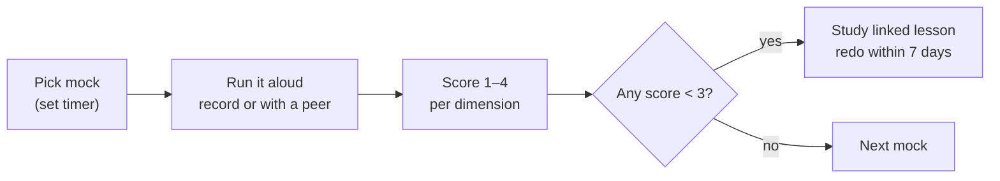

## In one minute

Ten mocks that mirror a senior fintech loop: four system design, two coding, two deep-dive, one
behavioural, one project presentation. Reading this page takes about 35 minutes. **Doing** the mocks
takes about 10 hours and is scheduled in weeks 27–30 of the study plan (the reserved mock/review time,
not the lesson budget). Each mock has a fixed time, a prompt, the points a strong answer covers, and a
1–4 rubric. Record yourself or practise with a peer, score honestly, and redo any mock that scores
below 3 in any dimension.

> Loop shape is an **assumption**, not a sourced fact: companies publish little about their loops, and
> loops change. Check the job post and recruiter notes for the real format.

## Analogy

Flight-simulator hours: the same emergencies, rehearsed under a clock, until the response is calm.

## Diagram

## Build it step by step

### The rubric (used by every mock)

| Dimension | 1: weak | 2: borderline | 3: hire | 4: strong hire |
|---|---|---|---|---|
| **Problem framing** | Starts building immediately | Some questions, misses key constraint | Clarifies scope, scale, consistency needs | Spots the hidden risk (money, duplicates) in the first minutes |
| **Technical depth** | Buzzwords | Correct but shallow | Correct mechanism with one level of "why" | Explains failure modes and proves them (test, metric, example) |
| **Trade-offs** | One option, no costs | Mentions alternatives | "Chose X because Y, cost Z" | Names when the decision would change |
| **Correctness & safety** | Money can be lost or duplicated | Happy path only | Idempotency, atomicity, retries handled | Plus reconciliation/audit and security edges |
| **Communication & time** | Unstructured, runs out of time | Structure but slips | Follows a plan, checks in | Concise, drives the session, summarises |

Pass bar for a mock: **≥ 3 in every dimension** (not an average).

### The ten mocks

| # | Type | Time | Prompt | A strong answer covers | Prepare with |
|---|---|---|---|---|---|
| 1 | System design | 45 min | Design a payment acceptance API for merchants (≈1k payments/s peak). | Idempotency key + unique constraint, outbox to settlement, PSP timeout = unknown state, reconciliation | Capstone 1, [Track 14 L2–3](#/tracks/track-14/lessons/track-14-lesson-02) |
| 2 | System design | 45 min | Design a multi-currency wallet with instant transfers between users. | Double-entry, per-currency balancing, hot accounts, FX quote lifecycle, rounding policy | Capstone 2, [Track 14 L5](#/tracks/track-14/lessons/track-14-lesson-05) |
| 3 | System design | 45 min | Design a rate limiter for a public payments API with per-tenant limits. | Token bucket vs windows, atomic Redis script, fail-open/closed, headers (`Retry-After`) | Capstone 5, [Track 14 L6](#/tracks/track-14/lessons/track-14-lesson-06) |
| 4 | System design | 45 min | Design end-of-day settlement and reconciliation against bank statements. | File idempotency, matching rules, break types, timing tolerance, maker-checker | Capstone 4 |
| 5 | Coding | 45 min | In plain Java: `transfer(from, to, amount)` on an in-memory account store, thread-safe, no deadlocks, no negative balances, with a concurrency test. | Ordered locking or per-account locks, `BigDecimal`/minor units, a multi-threaded test with a latch | [Track 05 Scenario A](#/tracks/track-05/lessons/track-05-lesson-02) |
| 6 | Coding | 45 min | Implement a token bucket (`tryAcquire()`), thread-safe, with an injectable clock; then extend to per-key buckets. | Refill math, `long` nanos, `ConcurrentHashMap.computeIfAbsent`, tests with a fake clock | Capstone 5 Lua script |
| 7 | Deep dive | 45 min | "p99 latency jumped from 80 ms to 2 s after enabling virtual threads." Debug it aloud. | Hikari pending connections, pinning (JDK version), downstream limits, thread dumps / JFR | [Track 03 L20](#/tracks/track-03/lessons/track-03-lesson-20), [Track 03 L13](#/tracks/track-03/lessons/track-03-lesson-13) |
| 8 | Deep dive | 45 min | "Customers see duplicate notifications and, once, a duplicate ledger posting." Find causes and fixes. | At-least-once delivery, rebalance reprocessing, idempotent consumer, DB constraint as last line | [Track 05 Scenario G](#/tracks/track-05/lessons/track-05-lesson-08) |
| 9 | Behavioural | 45 min | Six questions: incident, disagreement, ambiguity, mentoring, mistake, "why this company". | Your six STAR stories, each ≤ 2:15, "I" actions, lasting change | [STAR stories](#/tracks/track-15/lessons/track-15-lesson-01) |
| 10 | Project presentation | 30 min | Present one capstone in 10 minutes, then 20 minutes of hostile follow-ups. | Problem, diagram, two key decisions with trade-offs, test evidence, known limits | The capstone's README "5 hardest questions" |

### How to run a mock alone

1. Set a timer and read the prompt once.
2. Speak aloud and draw on paper or a whiteboard tool; record audio.
3. Stop at the time limit even if unfinished: running out of time is data.
4. Listen back at 1.5× speed and score with the rubric *before* reading the "strong answer covers" column.
5. Write the three biggest gaps and schedule a redo.

## What goes wrong

**Bug: scoring generously.** You remember what you *meant* to say and score that.

**Fix:** score from the recording only. If it was not said aloud, it did not happen.

**Test:** for one mock, ask a peer to score from your recording too. If their scores are lower in two
or more dimensions, recalibrate down for the rest.

## Trade-offs: when NOT to use these mocks

- Don't do them before covering the related lessons: an unprepared mock trains panic, not skill.
- Don't redo the same prompt the next day; you will recite rather than reason. Wait a few days, or vary
  the scale (10× traffic) or a constraint (multi-region).

## Interview Q&A

**Warm-up: "How do you prepare for system design interviews?"**
- *Model answer:* a fixed time plan, a set of practised problems, timed mocks scored with a rubric, and
  redoing the weak ones.
- *Common wrong answer:* "I read a lot of system design articles."
- *Why it fails:* reading doesn't train time management or speaking under pressure.

**Standard: "You ran out of time in the last round. What would you change?"**
- *Model answer:* start the deep dive by minute 25; cut the high-level diagram to five boxes; ask the
  interviewer which area to go deep on.
- *Common wrong answer:* "Talk faster."
- *Why it fails:* the problem is prioritisation, not speed.

**Deep: "Present a project you built" (mock 10).**
- *Model answer:* two-minute problem and diagram, two decisions with trade-offs and the test that
  proves each, known limits, and what you would build next.
- *Common wrong answer:* a tour of the code, file by file.
- *Why it fails:* interviewers assess judgement, not file structure.

## Say it in 30 seconds

"I run ten timed mocks in the last four weeks: four designs, two coding, two debugging deep dives,
behavioural and a project presentation. I record them, score from the recording with a five-part
rubric, and redo anything below 'hire' in any dimension within a week."

## Recap

- Same rubric for every mock; the pass bar is ≥ 3 in every dimension.
- Score from the recording, not from memory.
- Redo weak mocks with a variation, a few days later.

## See also

- [Track 14: Reference sheets](#/tracks/track-14/lessons/track-14-lesson-08)
- [Running the 45-minute design round](#/tracks/track-15/lessons/track-15-lesson-02)
- [Capstone projects](#/capstone)
