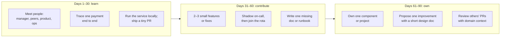

## في دقيقة واحدة

يُحكم على المهندس الأول الجديد مبكرًا من خلال أمرين: مدى سرعة أن يصبح مفيدًا، وما إذا كان من الآمن الوثوق به في الإنتاج. فاقضِ الأيام 1–30 في التعلم (الناس، والأنظمة، وتدفق الأموال)، والأيام 31–60 في تسليم تغييرات صغيرة آمنة والانضمام إلى المناوبة، والأيام 61–90 في امتلاك شيء من البداية إلى النهاية. وبالنسبة للكود نفسه، دع التطبيق العامل يخبرك بماهيته: نقاط `/beans` و`/mappings` و`/conditions` في Spring Boot Actuator تُظهر الربط الحقيقي أسرع من قراءة الحزم.

## تشبيه

الطيار الجديد على نوع طائرة غير مألوف لا يعيد تصميم قمرة القيادة؛ بل يتعلم قوائم التحقق، ويطير مع قائد، ثم يطير المسار بنفسه. والتغييرات تأتي بعد الثقة.

## المخطط



## ابنِه خطوة بخطوة

### 1. قائمة 30/60/90

| الفترة | افعل | الدليل الذي تستطيع إظهاره لمديرك |
|---|---|---|
| **الأيام 1–30** | لقاءات فردية مع مديرك وكل زميل في الفريق (اسأل: "ما الذي يجب ألا أكسره؟"). شغّل الخدمة محليًا واجعل اختباراتها خضراء. وتتبّع دفعة واحدة من الواجهة إلى دفتر الأستاذ إلى التسوية وارسمها. وسلّم طلب دمج صغيرًا (اختبار، أو إصلاح سجل، أو توثيق). | مخطط لتدفق الأموال؛ وأول طلب دمج مدموج؛ وقائمة بالأسئلة المفتوحة التي أُجيب عنها. |
| **الأيام 31–60** | خذ 2–3 تذاكر محددة النطاق جيدًا. ورافق مناوبة كمراقب، ثم انضم إلى الجدول. واقرأ آخر بضع مراجعات للحوادث. وأصلح فجوة واحدة وجدتها (تنبيه مفقود، أو دليل تشغيل، أو اختبار). | تغييرات مدموجة مع اختبارات؛ وتحسين واحد لدليل تشغيل أو تنبيه. |
| **الأيام 61–90** | امتلك مكونًا أو مشروعًا صغيرًا من البداية إلى النهاية. واكتب وثيقة تصميم قصيرة لتحسين واحد واجعلها تُراجع. وراجع طلبات الدمج بانتظام. | مشروع مُسلَّم؛ ووثيقة تصميم مقبولة؛ وتعليقات مراجعة تكتشف مشكلات حقيقية. |

اتفق على أهداف الـ 90 يومًا مع مديرك في الأسبوع الأول، كتابةً، وراجعها في اليوم 30 واليوم 60.

### 2. قراءة خدمة Spring Boot غير مألوفة

ابدأ مما *يعمل*، لا من شجرة الحزم.

1. **ابنِها وشغّلها محليًا.** ‏`./mvnw verify` أو `./gradlew build` يخبرك بإصدار Java، والوحدات، وإعداد الاختبارات. والبناء الفاشل في اليوم الأول معلومة مفيدة لمشاركتها.
2. **اكشف Actuator محليًا فقط** (لا علنيًا في الإنتاج أبدًا). في ملف تعريف محلي:

   ```yaml
   # application-local.yml - local machine only
   management:
     endpoints:
       web:
         exposure:
           include: health,info,beans,mappings,conditions,configprops,env,loggers
   ```

3. **اسأل التطبيق عن نفسه:**

   | النقطة | تجيب عن | ابحث عن |
   |---|---|---|
   | `/actuator/mappings` | كل مسار HTTP، ودالة المعالجة، وما يستهلكه/ينتجه | سطح الواجهة العامة؛ والمسارات بإصدارات؛ ونقاط الإدارة |
   | `/actuator/beans` | كل كائن، ونوعه وتبعياته | أي تنفيذ لـ `PaymentGateway` مربوط فعلًا |
   | `/actuator/conditions` | أي إعدادات تلقائية تطابقت ولماذا (أو لماذا لا) | ‏"لماذا لا يوجد `KafkaTemplate`؟" يُجاب عنه في ثوانٍ |
   | `/actuator/configprops` | ‏`@ConfigurationProperties` المربوطة | المهل، وأحجام المجمعات، وإعدادات إعادة المحاولة السارية |
   | `/actuator/env` | مصادر الخصائص وأسبقيتها | من أين تأتي القيمة فعلًا (القيم مقنّعة افتراضيًا) |
   | `/actuator/loggers` | مستويات المسجّلات، قابلة للتغيير وقت التشغيل | فعّل تسجيل SQL أو عميل HTTP محليًا |

   ```bash
   curl -s localhost:8080/actuator/mappings | jq '.contexts[].mappings.dispatcherServlets[][] | .predicate' | head
   curl -s localhost:8080/actuator/conditions | jq '.contexts[].negativeMatches | keys' | head
   ```

4. **اتبع طلبًا واحدًا عبر الكود:** المتحكم ← الخدمة ← المستودع ← الاستدعاءات الصادرة ← الأحداث المنشورة. واكتب المسار في ملاحظة بأسماء الملفات.
5. **اقرأ المخطط والترحيلات** (`db/migration`): الجداول والقيود والفهارس تخبرك بالثوابت الحقيقية أسرع مما تفعل الكيانات.
6. **اقرأ الاختبارات الأكثر فشلًا** في سجل CI: تُظهر الأجزاء الهشة.

### 3. اطرح أسئلة جيدة

- أدِّ واجبك أولًا (15–30 دقيقة)، ثم اسأل مع السياق: "تتبعت X إلى Y وتوقعت Z، لكنني أرى W. هل W مقصود؟"
- اجمع الأسئلة غير العاجلة لموعد يومي مع رفيق التهيئة.
- اسأل عن التاريخ، لا عن الآليات فقط: "لماذا التسوية دفعية وليست متدفقة؟" فالإجابة غالبًا تتضمن حادثًا سابقًا.
- دوّن الإجابات في توثيق الفريق، لا في ملاحظاتك فقط.

## ما الذي يسوء

**الخطأ: إعادة الكتابة الكبيرة في الشهر الأول.** يرى مهندس أول جديد كودًا قديمًا، فيقترح استبداله، ويكتشف لاحقًا أن الجزء "القبيح" كان يعالج قاعدة شبكة أو إصلاح حادث.

**الإصلاح:** اتبع سياج تشسترتون (Chesterton's fence): افهم لماذا يوجد الشيء (git blame، ومراجعات الحوادث، والأشخاص الذين بنوه) قبل اقتراح إزالته. واقترح التغييرات بعد اليوم 60، بوثيقة تصميم تُظهر أنك تعرف التاريخ.

**الاختبار:** لأي تغيير تقترحه، هل تستطيع تسمية السبب الذي جعل الكود الحالي على ما هو عليه؟ إن لم تستطع، فلست جاهزًا لتغييره.

## المقايضات: متى لا تتبع الخطة

- إن انضممت أثناء فترة كثيرة الحوادث، فقد تبدأ مرافقة المناوبة في الأسبوع الثاني: فهي أسرع طريقة لتعلم السلوك الحقيقي للنظام.
- قد تتوقع الشركات الصغيرة التسليم في الأسبوع الثاني. فاضغط الخطة، لكن حافظ على الترتيب: التعلم، ثم التغيير الصغير، ثم الملكية.

## أسئلة وأجوبة المقابلة

**إحماء: "كيف ستتعامل مع أسابيعك الأولى هنا؟"**
- *الإجابة النموذجية:* أتفق على أهداف الـ 90 يومًا مع مديري، وألتقي الفريق، وأشغّل النظام وأتتبع دفعة من البداية إلى النهاية، وأسلّم تغييرات صغيرة مبكرًا، وأنضم إلى المناوبة بعد أن أرافقها كمراقب.
- *الإجابة الخاطئة الشائعة:* "سأبحث عن أشياء لتحسينها فورًا."
- *لماذا تفشل:* تبدو كتغيير الأشياء قبل فهمها.

**قياسي: "كيف تصبح منتجًا في قاعدة كود كبيرة غير مألوفة؟"**
- *الإجابة النموذجية:* أشغّلها، وأسألها عن نفسها (mappings وbeans وconditions في Actuator)، وأتبع طلبًا واحدًا من البداية إلى النهاية، وأقرأ المخطط والترحيلات، وأقرأ مراجعات الحوادث الأخيرة.
- *الإجابة الخاطئة الشائعة:* "أقرأ الكود حزمة حزمة."
- *لماذا تفشل:* بطيئة، وتفوّت الربط وقت التشغيل والتاريخ.

**عميق: "تعتقد أن مكونًا أساسيًا مصمم بشكل سيئ. ماذا تفعل في ربعك الأول؟"**
- *الإجابة النموذجية:* أتعلم لماذا هو كذلك، وأجمع الأدلة (الحوادث، وزمن الاستجابة، ومعدل فشل التغييرات)، وأكتب وثيقة تصميم قصيرة بخيارات ومسار ترحيل، وأحصل على التأييد قبل تغييره.
- *الإجابة الخاطئة الشائعة:* "أعيد كتابته."
- *لماذا تفشل:* مخاطرة عالية، وثقة منخفضة، واحتمال إعادة إدخال أخطاء قديمة.

**عميق: "متى يجب كشف نقاط Actuator مثل `/env` أو `/beans`؟"**
- *الإجابة النموذجية:* محليًا أو على منفذ إدارة منفصل لا يمكن الوصول إليه إلا داخليًا، مع مصادقة. وفي الإنتاج، اكشف فقط الصحة والمقاييس التي تحتاجها المراقبة.
- *الإجابة الخاطئة الشائعة:* "اكشف كل النقاط؛ فهي للقراءة فقط."
- *لماذا تفشل:* تسرّب الإعدادات والتفاصيل الداخلية وتوسّع سطح الهجوم. وقد يحتوي `/heapdump` على أسرار.

## قلها في 30 ثانية

"في أول 30 يومًا أتعلم الناس وتدفق الأموال وأسلّم شيئًا صغيرًا. وبحلول 60 يومًا أسلّم إصلاحات مع اختبارات وأكون في المناوبة. وبحلول 90 يومًا أمتلك مكونًا واقترحت تحسينًا واحدًا بوثيقة تصميم. ولقراءة الكود أشغّل الخدمة وأستخدم mappings وbeans وconditions في Actuator، وأتبع طلبًا واحدًا من البداية إلى النهاية، وأقرأ الترحيلات."

## الخلاصة

- تعلّم ← ساهم ← امتلك، بأهداف مكتوبة متفق عليها في الأسبوع الأول.
- دع التطبيق العامل يشرح نفسه (Actuator)، محليًا فقط.
- افهم السبب قبل تغيير أي شيء كبير.

## انظر أيضًا

- [أمان الإنتاج: أول طلب دمج، والمناوبة، والترحيلات](#/tracks/track-16/lessons/track-16-lesson-02)
- [المسار 06: فحوص الصحة والمجسات](#/tracks/track-06/lessons/track-06-lesson-10)
- [المسار 11: قائمة الجاهزية للإنتاج](#/tracks/track-11/lessons/track-11-lesson-19)

<!-- KNOWLEDGE-CHECK
[
  {
    "id": "kc-1601-01",
    "question": "ما الترتيب الصحيح لأول 90 يومًا لك؟",
    "options": [
      "اقترح تحسينات في الأسبوع الأول، ثم تعلّم النظام",
      "تعلّم (الناس، والأنظمة، وتدفق الأموال) ← ساهم بتغييرات صغيرة آمنة وانضم إلى المناوبة ← امتلك مكونًا من البداية إلى النهاية",
      "أعد كتابة أضعف مكون أولًا لإظهار الأثر",
      "انتظر أن تُسند إليك التذاكر"
    ],
    "correct": 1,
    "explanation": "اتفق على أهداف مكتوبة للـ 90 يومًا مع مديرك في الأسبوع الأول وراجعها في اليوم 30 واليوم 60. والتغييرات تأتي بعد الثقة."
  },
  {
    "id": "kc-1601-02",
    "question": "أي نقطة في Actuator تجيب عن \"لماذا لا يوجد كائن KafkaTemplate؟\" في ثوانٍ؟",
    "options": [
      "/actuator/health",
      "/actuator/loggers",
      "/actuator/conditions",
      "/actuator/metrics"
    ],
    "correct": 2,
    "explanation": "تسرد /actuator/conditions الإعدادات التلقائية التي تطابقت ولماذا، أو لماذا لا. وتُظهر /beans الربط الحقيقي و/mappings كل مسار HTTP."
  },
  {
    "id": "kc-1601-03",
    "question": "أين يجب كشف نقاط مثل /actuator/env، أو /beans، أو /heapdump؟",
    "options": [
      "محليًا، أو على منفذ إدارة منفصل لا يمكن الوصول إليه إلا داخليًا ومع مصادقة؛ وفي الإنتاج اكشف فقط الصحة والمقاييس التي تحتاجها المراقبة",
      "علنيًا، لأنها للقراءة فقط",
      "فقط على منفذ الواجهة العامة، للسهولة",
      "في كل مكان، ما دامت الخدمة خلف موازن حمل"
    ],
    "correct": 0,
    "explanation": "تسرّب الإعدادات والتفاصيل الداخلية وتوسّع سطح الهجوم؛ وقد يحتوي تفريغ الكومة على أسرار."
  },
  {
    "id": "kc-1601-04",
    "question": "تعتقد أن مكونًا أساسيًا مصمم بشكل سيئ. ماذا تفعل في ربعك الأول؟",
    "options": [
      "أعد كتابته بسرعة قبل أن يعتمد عليه أحد أكثر",
      "اشتكِ في قناة الفريق",
      "تجاهله",
      "تعلّم لماذا هو كذلك (سياج تشسترتون)، واجمع الأدلة، واكتب وثيقة تصميم قصيرة بخيارات ومسار ترحيل، واحصل على التأييد"
    ],
    "correct": 3,
    "explanation": "الجزء \"القبيح\" قد يعالج قاعدة شبكة أو إصلاح حادث قديم. وفهم التاريخ أولًا يتجنب إعادة إدخال أخطاء قديمة."
  }
]
-->

<!-- PRACTICAL-CHALLENGE
{
  "id": "pc-1601",
  "title": "خطة التهيئة الخاصة بك",
  "description": "تدرّب على أنشطة أول 30 يومًا على قاعدة كود حقيقية (مشروع ختامي يفي بالغرض).",
  "tasks": [
    {
      "id": "pc-1601-01",
      "description": "شغّل خدمة Spring Boot محليًا بملف تعريف محلي فقط يكشف beans وmappings وconditions وconfigprops. واستخدم النقاط لسرد كل مسار HTTP والمهل وأحجام المجمعات السارية."
    },
    {
      "id": "pc-1601-02",
      "description": "تتبّع دفعة واحدة من المتحكم إلى الخدمة، والمستودع، والاستدعاءات الصادرة، والأحداث المنشورة. واكتب المسار بأسماء الملفات وارسم تدفق الأموال."
    },
    {
      "id": "pc-1601-03",
      "description": "اكتب خطة 30/60/90 لوظيفتك القادمة: الأهداف لكل فترة والدليل الذي ستُظهره لمديرك في اليوم 30 و60 و90."
    }
  ]
}
-->
