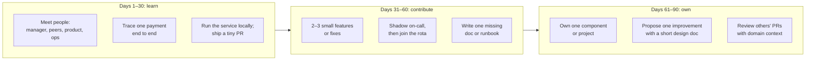

## In one minute

A new senior engineer is judged early on two things: how fast they become useful, and whether they
are safe to trust with production. Spend days 1–30 learning (people, systems, the money flow), days
31–60 delivering small safe changes and joining on-call, and days 61–90 owning something end to end.
For the code itself, let the running application tell you what it is: Spring Boot Actuator's
`/beans`, `/mappings` and `/conditions` endpoints show the real wiring faster than reading packages.

## Analogy

A new pilot on an unfamiliar aircraft type doesn't redesign the cockpit; they learn the checklists,
fly with a captain, then fly the route themselves. Changes come after trust.

## Diagram



## Build it step by step

### 1. The 30/60/90 checklist

| Window | Do | Evidence you can show your manager |
|---|---|---|
| **Days 1–30** | 1:1s with your manager and each teammate (ask: "what should I not break?"). Get the service running locally and its tests green. Trace one payment from API to ledger to settlement and draw it. Ship a small PR (a test, a log fix, a doc). | A diagram of the money flow; first merged PR; list of open questions answered. |
| **Days 31–60** | Take 2–3 well-scoped tickets. Shadow an on-call shift, then join the rota. Read the last few incident reviews. Fix one gap you found (missing alert, runbook, test). | Merged changes with tests; one runbook or alert improvement. |
| **Days 61–90** | Own a component or small project end to end. Write a short design doc for one improvement and get it reviewed. Review PRs regularly. | A delivered project; an accepted design doc; review comments that catch real issues. |

Agree the 90-day goals with your manager in week 1, in writing, and review them at day 30 and day 60.

### 2. Reading an unfamiliar Spring Boot service

Start from what *runs*, not from the package tree.

1. **Build and run it locally.** `./mvnw verify` or `./gradlew build` tells you the Java version, the
   modules and the test setup. A failing build on day 1 is useful information to share.
2. **Expose Actuator locally only** (never publicly in production). In a local profile:

   ```yaml
   # application-local.yml - local machine only
   management:
     endpoints:
       web:
         exposure:
           include: health,info,beans,mappings,conditions,configprops,env,loggers
   ```

3. **Ask the application about itself:**

   | Endpoint | Answers | Look for |
   |---|---|---|
   | `/actuator/mappings` | Every HTTP route, handler method, consumes/produces | The public API surface; versioned paths; admin endpoints |
   | `/actuator/beans` | Every bean, its type and dependencies | Which `PaymentGateway` implementation is really wired |
   | `/actuator/conditions` | Which auto-configurations matched and why (or why not) | "Why is there no `KafkaTemplate`?" answered in seconds |
   | `/actuator/configprops` | Bound `@ConfigurationProperties` | Timeouts, pool sizes, retry settings in effect |
   | `/actuator/env` | Property sources and precedence | Where a value really comes from (values are masked by default) |
   | `/actuator/loggers` | Logger levels, changeable at runtime | Turn on SQL or HTTP client logging locally |

   ```bash
   curl -s localhost:8080/actuator/mappings | jq '.contexts[].mappings.dispatcherServlets[][] | .predicate' | head
   curl -s localhost:8080/actuator/conditions | jq '.contexts[].negativeMatches | keys' | head
   ```

4. **Follow one request through the code:** controller → service → repository → outgoing calls →
   events published. Write the path in a note with file names.
5. **Read the schema and migrations** (`db/migration`): tables, constraints and indexes tell you the
   real invariants faster than the entities do.
6. **Read the tests that fail most often** in CI history: they show the fragile parts.

### 3. Ask good questions

- Do your homework first (15–30 minutes), then ask with context: "I traced X to Y and expected Z, but
  I see W. Is W intentional?"
- Batch non-urgent questions for a daily slot with your onboarding buddy.
- Ask about history, not just mechanics: "Why is settlement batch and not streaming?" The answer often
  contains a past incident.
- Write down the answers in the team's docs, not only your notes.

## What goes wrong

**Bug: the big rewrite in month one.** A new senior sees old code, proposes replacing it, and
discovers later that the "ugly" part handled a scheme rule or an incident fix.

**Fix:** follow Chesterton's fence: understand why something exists (git blame, incident reviews,
the people who built it) before proposing to remove it. Propose changes after day 60, with a design
doc that shows you know the history.

**Test:** for any change you propose, can you name the reason the current code is the way it is? If
not, you are not ready to change it.

## Trade-offs: when NOT to follow the plan

- If you join during an incident-heavy period, on-call shadowing may start in week 2: it is the fastest
  way to learn the system's real behaviour.
- Small companies may expect delivery in week 2. Compress the plan, but keep the order: learn, small
  change, then ownership.

## Interview Q&A

**Warm-up: "How would you approach your first weeks here?"**
- *Model answer:* agree 90-day goals with my manager, meet the team, run the system and trace a payment
  end to end, ship small changes early, join on-call once I've shadowed.
- *Common wrong answer:* "I'd look for things to improve straight away."
- *Why it fails:* it sounds like changing things before understanding them.

**Standard: "How do you get productive in a large unfamiliar codebase?"**
- *Model answer:* run it, ask it about itself (Actuator mappings, beans, conditions), follow one request
  end to end, read the schema and migrations, and read recent incident reviews.
- *Common wrong answer:* "Read the code package by package."
- *Why it fails:* it is slow, and it misses runtime wiring and history.

**Deep: "You think a core component is badly designed. What do you do in your first quarter?"**
- *Model answer:* learn why it is that way, collect evidence (incidents, latency, change failure rate),
  write a short design doc with options and a migration path, and get buy-in before changing it.
- *Common wrong answer:* "Rewrite it."
- *Why it fails:* high risk, low trust, and possibly reintroducing old bugs.

**Deep: "When should Actuator endpoints like `/env` or `/beans` be exposed?"**
- *Model answer:* locally or on a separate management port reachable only internally, with
  authentication. In production, expose only health and the metrics needed by monitoring.
- *Common wrong answer:* "Expose all endpoints; they're read-only."
- *Why it fails:* they leak configuration and internals and enlarge the attack surface. `/heapdump` can
  contain secrets.

## Say it in 30 seconds

"In the first 30 days I learn the people and the money flow and ship something small. By 60 days I'm
delivering fixes with tests and I'm on call. By 90 days I own a component and have proposed one
improvement with a design doc. To read the code I run the service and use Actuator's mappings, beans
and conditions, follow one request end to end, and read the migrations."

## Recap

- Learn → contribute → own, with written goals agreed in week 1.
- Let the running app explain itself (Actuator), locally only.
- Understand why before changing anything big.

## See also

- [Production safety: first PR, on-call, migrations](#/tracks/track-16/lessons/track-16-lesson-02)
- [Track 06: Health checks and probes](#/tracks/track-06/lessons/track-06-lesson-10)
- [Track 11: Production readiness checklist](#/tracks/track-11/lessons/track-11-lesson-19)
