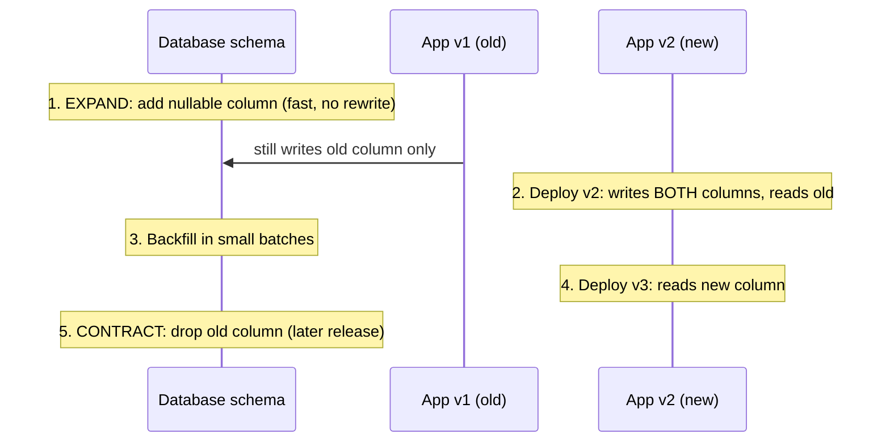

## في دقيقة واحدة

ثلاث عادات تجعل المهندس الجديد آمنًا في قاعدة كود للمدفوعات. **طلبات دمج صغيرة وقابلة للتراجع** مع اختبارات وخطة تراجع. و**الجاهزية للمناوبة**: اعرف لوحات المتابعة والتنبيهات وأدلة التشغيل قبل أول مناوبة لك. و**ترحيلات قاعدة البيانات بالتوسيع/التقليص**، فلا تحتاج تغييرات المخطط توقفًا أبدًا ولا تقفل جدولًا ساخنًا أبدًا.

## تشبيه

تغيير نظام دفع عامل يشبه تغيير إطار سيارة متحركة: تفعله بخطوات صغيرة، كل منها آمنة بذاتها، ولا تزيل العجلة القديمة أبدًا قبل أن تثبت الجديدة.

## المخطط



## ابنِه خطوة بخطوة

### 1. قائمة التحقق لأول طلب دمج

- [ ] صغير: غرض واحد، قابل للمراجعة في 15 دقيقة.
- [ ] اختبارات تفشل دون التغيير؛ واختبار تزامن أو عدم تكرار إن كانت الأموال أو الحالة معنية.
- [ ] متوافق مع الإصدار السابق الذي يعمل بجانبه (النشر المتدرج).
- [ ] علم ميزة (feature flag) لأي شيء مرئي للمستخدم أو محفوف بالمخاطر؛ ومعطّل افتراضيًا.
- [ ] قابلية المراقبة: سطر سجل أو مقياس يثبت أنه يعمل في الإنتاج؛ ولا بيانات شخصية أو بيانات بطاقات في السجلات.
- [ ] خطة تراجع مكتوبة في وصف طلب الدمج ("التراجع آمن لأن …").
- [ ] يتبع أعراف الفريق، حتى لو كنت ستختار بشكل مختلف. واقترح التغييرات بشكل منفصل.

### 2. الجاهزية للمناوبة

قبل أول مناوبة منفردة لك تستطيع الإجابة بـ "نعم" عن كل مما يلي:

| السؤال | أين تبحث |
|---|---|
| هل أعرف أهداف مستوى الخدمة للخدمة وما يعنيه كل تنبيه؟ | تعريفات التنبيهات، ولوحة أهداف مستوى الخدمة |
| هل أستطيع إيجاد السجلات والتتبعات لمعرّف دفعة واحد في أقل من دقيقتين؟ | أداة التسجيل/التتبع، ومعرّف الترابط |
| هل أعرف كيف أتراجع عن نشر وأبدّل علم ميزة؟ | أداة النشر، وخدمة الأعلام، ودليل التشغيل |
| هل أعرف أول ثلاثة أشياء أفحصها لـ "المدفوعات عالقة"؟ | دليل التشغيل: تأخر المستهلكين، ومجمع قاعدة البيانات، وحالة مزوّد الدفع |
| هل أعرف إلى من أصعّد، ومتى؟ | سياسة التصعيد |
| هل قرأت آخر بضع مراجعات للحوادث؟ | أرشيف مراجعات الحوادث |

أثناء الحادث: **خفّف أولًا** (تراجع، أو بدّل، أو أسقط الحمل)، وأبلغ بالحالة على إيقاع ثابت، وحقق في السبب الجذري بعد ذلك، واكتب مراجعة بلا لوم.

### 3. ترحيلات قاعدة البيانات الآمنة بـ Flyway ‏(PostgreSQL)

القاعدة: يجب أن يكون كل ترحيل آمنًا بينما **إصدار التطبيق السابق ما زال يعمل**.

```sql
-- V12__add_payment_channel.sql  (EXPAND: safe, no table rewrite for a nullable column without a default)
ALTER TABLE payment ADD COLUMN channel VARCHAR(16);
```

```sql
-- V13__index_payment_channel.sql  (separate migration, and not inside a transaction)
CREATE INDEX CONCURRENTLY IF NOT EXISTS payment_channel_idx ON payment (channel);
```

لا يمكن تشغيل `CREATE INDEX CONCURRENTLY` داخل كتلة معاملة. فأبقِه وحده في ترحيله الخاص وأخبر Flyway ألا يغلّفه في معاملة، بملف إعداد سكربت بجانبه (`V13__index_payment_channel.sql.conf` يحتوي `executeInTransaction=false`). وراجع توثيق Flyway لإصدارك.

املأ البيانات على دفعات من كود التطبيق أو مهمة، لا في `UPDATE` عملاق واحد:

```sql
-- run repeatedly until 0 rows are updated
UPDATE payment SET channel = 'API'
WHERE id IN (SELECT id FROM payment WHERE channel IS NULL ORDER BY id LIMIT 5000);
```

فقط بعد أن تقرأ كل الإصدارات العمود الجديد وتكتب فيه: أضف `NOT NULL` في إصدار لاحق. وفي PostgreSQL، إضافة قيد `CHECK (channel IS NOT NULL) NOT VALID` ثم تشغيل `VALIDATE CONSTRAINT` يتجنب قفلًا حصريًا طويلًا أثناء فحص الصفوف الموجودة. ومنذ PostgreSQL 12، يستخدم `ALTER COLUMN channel SET NOT NULL` اللاحق ذلك القيد المتحقق منه ويتجاوز مسح الجدول الكامل؛ ثم تستطيع حذف قيد `CHECK`.

اضبط مهلة قفل للترحيلات، فيفشل الترحيل المنتظر خلف معاملة طويلة بسرعة بدل أن يضع كل استعلام آخر في طابور خلفه:

```sql
SET lock_timeout = '5s';
```

## ما الذي يسوء

**الخطأ: ترحيل "بسيط" يُخرج جدول المدفوعات من الخدمة.** في ذروة الحركة، يشغّل ترحيل `ALTER TABLE payment ADD COLUMN …` ثم `CREATE INDEX` دون `CONCURRENTLY`. ويحتاج `ALTER` قفل `ACCESS EXCLUSIVE` قصيرًا. فينتظر خلف معاملة طويلة التشغيل، ويصطف كل استعلام جديد على `payment` خلف `ALTER`. ثم يحجب بناء الفهرس العادي كل الكتابات حتى ينتهي. فتنتهي مهلة الواجهة.

**الإصلاح:** التوسيع/التقليص كما أعلاه: عمود يقبل null، وفهرس متزامن في ترحيله الخاص، وملء على دفعات، وقيد يُتحقق منه بشكل منفصل، وضبط `lock_timeout`، والنشر خارج الذروة مع خطة تراجع.

**الاختبار:** شغّل الترحيلات في CI مقابل PostgreSQL حقيقي (Testcontainers)، وفي نسخة تجريبية بحجم بيانات شبيه بالإنتاج. وافحص سلوك الأقفال بـ `pg_locks` أثناء تشغيل اختبار حمل.

## المقايضات: متى لا تستخدم التوسيع/التقليص

- الجداول الجديدة تمامًا بلا حركة يمكن إنشاؤها في خطوة واحدة.
- الجداول الصغيرة جدًا (بضع مئات من الصفوف) تتحمل قفلًا قصيرًا. ومع ذلك اضبط `lock_timeout`.
- التوسيع/التقليص يكلّف إصدارات إضافية وكود كتابة مزدوجة مؤقتًا؛ فخطط للتنظيف كي لا يبقى إلى الأبد.

## أسئلة وأجوبة المقابلة

**إحماء: "ماذا تفحص قبل دمج أول طلب دمج لك في فريق جديد؟"**
- *الإجابة النموذجية:* اختبارات تثبت التغيير، والتوافق مع الإصدارات السابقة للنشر المتدرج، وخطة تراجع، وقابلية المراقبة، وأعراف الفريق.
- *الإجابة الخاطئة الشائعة:* "أن CI أخضر."
- *لماذا تفشل:* نادرًا ما يختبر CI التوافق مع النشر المتدرج أو التراجع.

**قياسي: "كيف تعيد تسمية عمود دون توقف؟"**
- *الإجابة النموذجية:* أضف العمود الجديد، واكتب في الاثنين، واملأ على دفعات، وحوّل القراءات، وتوقف عن الكتابة في العمود القديم، واحذفه في إصدار لاحق.
- *الإجابة الخاطئة الشائعة:* ‏`ALTER TABLE … RENAME COLUMN` في الإصدار نفسه مع تغيير الكود.
- *لماذا تفشل:* أثناء النشر المتدرج، ما زالت النسخ القديمة تستخدم الاسم القديم فتفشل.

**قياسي: "إنها أول مناوبة لك والمدفوعات عالقة. ماذا تفعل؟"**
- *الإجابة النموذجية:* أقرّ بالتنبيه، وأفحص الخطوات الأولى في دليل التشغيل (تأخر المستهلكين، ومجمع قاعدة البيانات، وحالة مزوّد الدفع)، وأخفّف (أتراجع عن آخر نشر إن كان مرتبطًا)، وأصعّد مبكرًا، وأنشر تحديثات الحالة، ثم أحقق.
- *الإجابة الخاطئة الشائعة:* "أتتبع الكود لإيجاد السبب الجذري."
- *لماذا تفشل:* العملاء متأثرون الآن؛ والتخفيف يأتي أولًا.

**عميق: "لماذا قد يسبب ترحيل يستغرق ثانيتين في البيئة التجريبية انقطاعًا لدقيقتين في الإنتاج؟"**
- *الإجابة النموذجية:* يحتاج قفلًا حصريًا وينتظر خلف معاملة طويلة التشغيل. وأثناء انتظاره، يصطف كل استعلام جديد على الجدول خلفه. و`lock_timeout` والجدولة خارج الذروة يمنعان ذلك.
- *الإجابة الخاطئة الشائعة:* "الإنتاج فيه بيانات أكثر."
- *لماذا تفشل:* حجم البيانات مهم لإعادة كتابة الجدول، لكن طابور الأقفال هو ما يسبب الانقطاع.

## قلها في 30 ثانية

"أُبقي التغييرات صغيرة، ومختبرة، ومتوافقة مع الإصدارات السابقة، وسهلة التراجع. وقبل المناوبة أتعلم أهداف مستوى الخدمة، والتنبيهات، وأدلة التشغيل، ومسار التصعيد، وأخفّف قبل أن أتتبع الخطأ. وتغييرات المخطط تسير بالتوسيع/التقليص: عمود يقبل null، وفهرس متزامن وحده، وملء على دفعات، وقيود يُتحقق منها بشكل منفصل، مع مهلة قفل."

## الخلاصة

- طلبات دمج صغيرة وقابلة للتراجع مع خطة تراجع مكتوبة.
- المناوبة: اعرف التنبيهات، وأدلة التشغيل، والتراجع، والتصعيد قبل أول مناوبة.
- ترحيلات بالتوسيع/التقليص، ولا قفل حصري طويل على جدول ساخن أبدًا.

## انظر أيضًا

- [المسار 08: تطور المخطط](#/tracks/track-08/lessons/track-08-lesson-09)
- [المسار 06: إدارة الحوادث](#/tracks/track-06/lessons/track-06-lesson-15)
- [المسار 06: مراجعات ما بعد الحوادث](#/tracks/track-06/lessons/track-06-lesson-16)
- [أول 90 يومًا](#/tracks/track-16/lessons/track-16-lesson-01)

<!-- KNOWLEDGE-CHECK
[
  {
    "id": "kc-1602-01",
    "question": "كيف تعيد تسمية عمود دون توقف؟",
    "options": [
      "ALTER TABLE … RENAME COLUMN في الإصدار نفسه مع تغيير الكود",
      "أضف العمود الجديد، واكتب في الاثنين، واملأ على دفعات، وحوّل القراءات، وتوقف عن الكتابة في العمود القديم، واحذفه في إصدار لاحق",
      "أوقف الخدمة لفترة صيانة قصيرة",
      "أنشئ عرضًا (view) بالاسم الجديد واحذف الجدول"
    ],
    "correct": 1,
    "explanation": "أثناء النشر المتدرج، ما زالت النسخ القديمة تستخدم الاسم القديم. والتوسيع/التقليص يُبقي الكود القديم والجديد يعملان في كل خطوة."
  },
  {
    "id": "kc-1602-02",
    "question": "لماذا قد يسبب CREATE INDEX على جدول مزدحم انقطاعًا، وما الإصلاح؟",
    "options": [
      "يحذف صفوفًا أثناء البناء",
      "يحتاج إعادة تشغيل Flyway",
      "CREATE INDEX العادي يحجب الكتابات حتى ينتهي؛ فاستخدم CREATE INDEX CONCURRENTLY في ترحيله الخاص، خارج معاملة",
      "يغيّر المفتاح الأساسي"
    ],
    "correct": 2,
    "explanation": "لا يمكن تشغيل CONCURRENTLY داخل كتلة معاملة، فيوضع وحده في ترحيله الخاص مع إخبار Flyway ألا يغلّفه (executeInTransaction=false)."
  },
  {
    "id": "kc-1602-03",
    "question": "استغرق ترحيل ثانيتين في البيئة التجريبية لكنه سبب انقطاعًا لدقيقتين في الإنتاج. ما السبب الأرجح؟",
    "options": [
      "احتاج قفلًا حصريًا وانتظر خلف معاملة طويلة التشغيل؛ واصطف كل استعلام جديد على الجدول خلفه. ومهلة القفل (lock_timeout) والجدولة خارج الذروة تمنعان ذلك",
      "الإنتاج فيه صفوف أكثر، فكان ALTER أبطأ",
      "قاعدة البيانات التجريبية على عتاد أسرع",
      "يشغّل Flyway الترحيلات مرتين في الإنتاج"
    ],
    "correct": 0,
    "explanation": "طابور الأقفال، لا حجم البيانات، هو ما يسبب الانقطاع. وSET lock_timeout = '5s' تجعل الترحيل يفشل بسرعة بدلًا من ذلك."
  },
  {
    "id": "kc-1602-04",
    "question": "إنها أول مناوبة لك والمدفوعات عالقة. ما الذي يأتي أولًا؟",
    "options": [
      "تتبّع الكود لإيجاد السبب الجذري",
      "انتظر حتى يستيقظ مهندس أقدم",
      "أعد تشغيل كل خدمة",
      "أقرّ بالتنبيه، واتبع الفحوص الأولى في دليل التشغيل (تأخر المستهلكين، ومجمع قاعدة البيانات، وحالة مزوّد الدفع)، وخفّف (مثل التراجع عن نشر مرتبط)، وصعّد مبكرًا وانشر تحديثات الحالة؛ ثم حقق بعد ذلك"
    ],
    "correct": 3,
    "explanation": "العملاء متأثرون الآن، فالتخفيف يأتي قبل تحليل السبب الجذري."
  }
]
-->

<!-- PRACTICAL-CHALLENGE
{
  "id": "pc-1602",
  "title": "التغييرات الآمنة عمليًا",
  "description": "تدرّب على ترحيل دون توقف وقائمة تحقق لأول طلب دمج على PostgreSQL حقيقي.",
  "tasks": [
    {
      "id": "pc-1602-01",
      "description": "اكتب ترحيلات Flyway تضيف عمودًا يقبل null، وتبني فهرسه بـ CREATE INDEX CONCURRENTLY في ترحيل منفصل غير معاملاتي، وتملأ البيانات على دفعات من 5,000. وشغّلها مقابل PostgreSQL في Testcontainers."
    },
    {
      "id": "pc-1602-02",
      "description": "أضف NOT NULL بأمان: قيد CHECK (col IS NOT NULL) NOT VALID، ثم VALIDATE CONSTRAINT، ثم SET NOT NULL. وأثناء تشغيل اختبار حمل، استعلم من pg_locks لترى أي أقفال تأخذها كل خطوة."
    },
    {
      "id": "pc-1602-03",
      "description": "اكتب وصف طلب الدمج القادم لك باستخدام قائمة التحقق لأول طلب دمج: الغرض، والاختبارات، والتوافق مع النشر المتدرج، وعلم الميزة، وقابلية المراقبة، وخطة تراجع (\"التراجع آمن لأن …\")."
    }
  ]
}
-->
