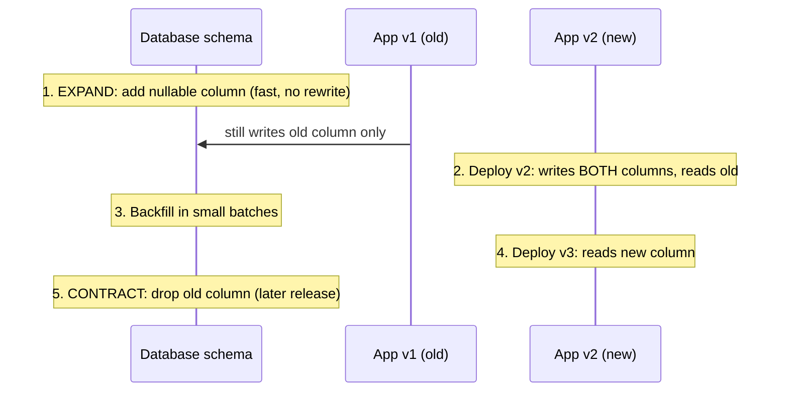

## In one minute

Three habits make a new engineer safe in a payments codebase. **Small, reversible PRs** with tests
and a rollback plan. **On-call readiness**: know the dashboards, alerts and runbooks before your first
shift. **Expand/contract database migrations**, so schema changes never need downtime and never lock
a hot table.

## Analogy

Changing a running payment system is like changing a tyre on a moving car: you do it in small steps,
each one safe on its own, and you never remove the old wheel before the new one holds.

## Diagram



## Build it step by step

### 1. First-PR checklist

- [ ] Small: one purpose, reviewable in 15 minutes.
- [ ] Tests that fail without the change; a concurrency or idempotency test if money or state is involved.
- [ ] Backwards compatible with the previous version running alongside it (rolling deploys).
- [ ] Feature flag for anything user-visible or risky; default off.
- [ ] Observability: a log line or metric that proves it works in production; no PII or card data in logs.
- [ ] Rollback plan written in the PR description ("revert is safe because …").
- [ ] Follows the team's conventions, even if you'd choose differently. Propose changes separately.

### 2. On-call readiness

Before your first solo shift you can answer "yes" to each:

| Question | Where to look |
|---|---|
| Do I know the service's SLOs and what each alert means? | Alert definitions, SLO dashboard |
| Can I find logs and traces for one payment id in under 2 minutes? | Logging/tracing tool, correlation id |
| Do I know how to roll back a deploy and toggle a feature flag? | Deployment tool, flag service, runbook |
| Do I know the first three things to check for "payments stuck"? | Runbook: consumer lag, DB pool, PSP status |
| Do I know who to escalate to, and when? | Escalation policy |
| Have I read the last few incident reviews? | Incident review archive |

During an incident: **mitigate first** (roll back, fail over, shed load), communicate status on a
fixed rhythm, investigate the root cause afterwards, and write a blameless review.

### 3. Safe database migrations with Flyway (PostgreSQL)

Rule: every migration must be safe while the **previous application version is still running**.

```sql
-- V12__add_payment_channel.sql  (EXPAND: safe, no table rewrite for a nullable column without a default)
ALTER TABLE payment ADD COLUMN channel VARCHAR(16);
```

```sql
-- V13__index_payment_channel.sql  (separate migration, and not inside a transaction)
CREATE INDEX CONCURRENTLY IF NOT EXISTS payment_channel_idx ON payment (channel);
```

`CREATE INDEX CONCURRENTLY` cannot run inside a transaction block. Keep it alone in its own migration
and tell Flyway not to wrap it in a transaction, with a script configuration file next to it
(`V13__index_payment_channel.sql.conf` containing `executeInTransaction=false`). Check the Flyway
documentation for your version.

Backfill in batches from application code or a job, not in one giant `UPDATE`:

```sql
-- run repeatedly until 0 rows are updated
UPDATE payment SET channel = 'API'
WHERE id IN (SELECT id FROM payment WHERE channel IS NULL ORDER BY id LIMIT 5000);
```

Only after all versions read and write the new column: add `NOT NULL` in a later release.
In PostgreSQL, adding a `CHECK (channel IS NOT NULL) NOT VALID` constraint and then running
`VALIDATE CONSTRAINT` avoids a long exclusive lock while the existing rows are checked. From PostgreSQL 12,
a following `ALTER COLUMN channel SET NOT NULL` uses that validated constraint and skips the full-table scan;
you can then drop the `CHECK`.

Set a lock timeout for migrations, so a migration waiting behind a long transaction fails fast instead of
queueing every other query behind it:

```sql
SET lock_timeout = '5s';
```

## What goes wrong

**Bug: a "simple" migration takes the payments table offline.** At peak traffic, a migration runs
`ALTER TABLE payment ADD COLUMN …` and then `CREATE INDEX` without `CONCURRENTLY`. The `ALTER` needs a
brief `ACCESS EXCLUSIVE` lock. It waits behind a long-running transaction, and every new query on
`payment` queues behind the `ALTER`. Then the plain index build blocks all writes until it finishes.
The API times out.

**Fix:** expand/contract as above: nullable column, concurrent index in its own migration,
batched backfill, constraint validated separately, `lock_timeout` set, deployed off-peak with a
rollback plan.

**Test:** run migrations in CI against a real PostgreSQL (Testcontainers), and in a staging copy with
production-like data size. Check lock behaviour with `pg_locks` while a load test runs.

## Trade-offs: when NOT to use expand/contract

- Brand-new tables with no traffic can be created in one step.
- Very small tables (a few hundred rows) can tolerate a short lock. Still set `lock_timeout`.
- Expand/contract costs extra releases and temporary dual-write code; plan the cleanup so it doesn't
  stay forever.

## Interview Q&A

**Warm-up: "What do you check before merging your first PR in a new team?"**
- *Model answer:* tests that prove the change, backwards compatibility for rolling deploys, a rollback
  plan, observability, and the team's conventions.
- *Common wrong answer:* "That CI is green."
- *Why it fails:* CI rarely tests rolling-deploy compatibility or rollback.

**Standard: "How do you rename a column with zero downtime?"**
- *Model answer:* add the new column, dual-write, backfill in batches, switch reads, stop writing the
  old column, drop it in a later release.
- *Common wrong answer:* `ALTER TABLE … RENAME COLUMN` in the same release as the code change.
- *Why it fails:* during a rolling deploy, old instances still use the old name and fail.

**Standard: "It's your first on-call shift and payments are stuck. What do you do?"**
- *Model answer:* acknowledge, check the runbook's first steps (consumer lag, DB pool, PSP status),
  mitigate (roll back the latest deploy if correlated), escalate early, post status updates, then
  investigate.
- *Common wrong answer:* "Debug the code to find the root cause."
- *Why it fails:* customers are affected now; mitigation comes first.

**Deep: "Why can a migration that takes 2 seconds in staging cause a 2-minute outage in production?"**
- *Model answer:* it needs an exclusive lock and waits behind a long-running transaction. While it waits,
  every new query on the table queues behind it. `lock_timeout` and off-peak scheduling prevent that.
- *Common wrong answer:* "Production has more data."
- *Why it fails:* data size matters for rewrites, but the lock queue is what causes the outage.

## Say it in 30 seconds

"I keep changes small, tested, backwards compatible and easy to roll back. Before on-call I learn the
SLOs, alerts, runbooks and escalation path, and I mitigate before I debug. Schema changes go
expand/contract: nullable column, concurrent index alone, batched backfill, constraints validated
separately, with a lock timeout."

## Recap

- Small, reversible PRs with a written rollback plan.
- On-call: know alerts, runbooks, rollback and escalation before the first shift.
- Expand/contract migrations, never a long exclusive lock on a hot table.

## See also

- [Track 08: Schema evolution](#/tracks/track-08/lessons/track-08-lesson-09)
- [Track 06: Incident management](#/tracks/track-06/lessons/track-06-lesson-15)
- [Track 06: Post-incident reviews](#/tracks/track-06/lessons/track-06-lesson-16)
- [First 90 days](#/tracks/track-16/lessons/track-16-lesson-01)

<!-- KNOWLEDGE-CHECK
[
  {
    "id": "kc-1602-01",
    "question": "How do you rename a column with zero downtime?",
    "options": [
      "ALTER TABLE … RENAME COLUMN in the same release as the code change",
      "Add the new column, dual-write, backfill in batches, switch reads, stop writing the old column, and drop it in a later release",
      "Take the service down for a short maintenance window",
      "Create a view with the new name and drop the table"
    ],
    "correct": 1,
    "explanation": "During a rolling deploy, old instances still use the old name. Expand/contract keeps old and new code working at every step."
  },
  {
    "id": "kc-1602-02",
    "question": "Why can CREATE INDEX on a busy table cause an outage, and what is the fix?",
    "options": [
      "It deletes rows while building",
      "It needs Flyway to be restarted",
      "A plain CREATE INDEX blocks writes until it finishes; use CREATE INDEX CONCURRENTLY in its own migration, outside a transaction",
      "It changes the primary key"
    ],
    "correct": 2,
    "explanation": "CONCURRENTLY can't run inside a transaction block, so it goes alone in its own migration with Flyway told not to wrap it (executeInTransaction=false)."
  },
  {
    "id": "kc-1602-03",
    "question": "A migration took 2 seconds in staging but caused a 2-minute outage in production. What is the most likely cause?",
    "options": [
      "It needed an exclusive lock and waited behind a long-running transaction; every new query on the table queued behind it. A lock_timeout and off-peak scheduling prevent this",
      "Production has more rows, so the ALTER was slower",
      "The staging database is faster hardware",
      "Flyway runs migrations twice in production"
    ],
    "correct": 0,
    "explanation": "The lock queue, not data size, is what causes the outage. SET lock_timeout = '5s' makes the migration fail fast instead."
  },
  {
    "id": "kc-1602-04",
    "question": "It's your first on-call shift and payments are stuck. What comes first?",
    "options": [
      "Debug the code to find the root cause",
      "Wait for a senior engineer to wake up",
      "Restart every service",
      "Acknowledge, follow the runbook's first checks (consumer lag, DB pool, PSP status), mitigate (for example roll back a correlated deploy), escalate early and post status updates; investigate afterwards"
    ],
    "correct": 3,
    "explanation": "Customers are affected now, so mitigation comes before root-cause analysis."
  }
]
-->

<!-- PRACTICAL-CHALLENGE
{
  "id": "pc-1602",
  "title": "Safe changes in practice",
  "description": "Practise a zero-downtime migration and a first-PR checklist on a real PostgreSQL.",
  "tasks": [
    {
      "id": "pc-1602-01",
      "description": "Write Flyway migrations that add a nullable column, build its index with CREATE INDEX CONCURRENTLY in a separate non-transactional migration, and backfill in batches of 5,000. Run them against PostgreSQL in Testcontainers."
    },
    {
      "id": "pc-1602-02",
      "description": "Add NOT NULL safely: a CHECK (col IS NOT NULL) NOT VALID constraint, then VALIDATE CONSTRAINT, then SET NOT NULL. While a load test runs, query pg_locks to see which locks each step takes."
    },
    {
      "id": "pc-1602-03",
      "description": "Write the description of your next pull request using the first-PR checklist: purpose, tests, rolling-deploy compatibility, feature flag, observability and a rollback plan (\"revert is safe because …\")."
    }
  ]
}
-->
