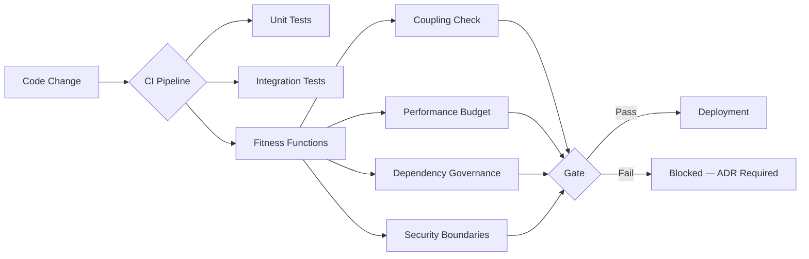
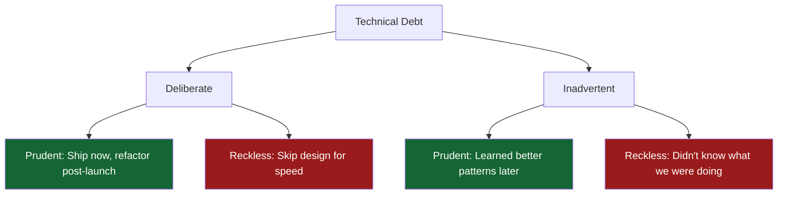
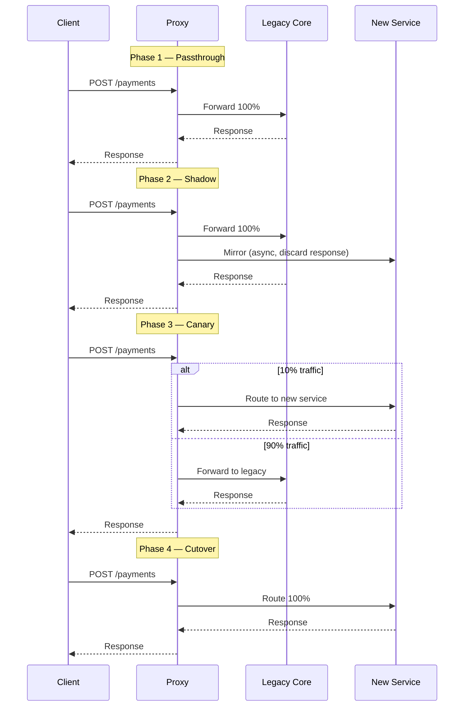

# البنية المعمارية التطورية — دوال اللياقة والدَّين التقني

> [!NOTE]
> يقدّم هذا الدرس البنية المعمارية التطورية كأسلوب منضبط لبناء أنظمة تستطيع التغيّر بأمان مع الوقت — وهي قدرة حاسمة للمنصات المالية طويلة العمر.

## لماذا يجب أن تتطور البنية المعمارية

لا يوجد نظام مالي يُصمَّم مرة واحدة ثم يُترك دون تغيير. تصل المتطلبات التنظيمية فجأة. ويجب دمج الشركات المستحوَذ عليها. وتتغير أنماط الحركة مع إطلاق المنتجات. والأنظمة التي تصمد على نطاق واسع ليست تلك ذات التصميم الأولي الأكثر تخطيطًا — بل تلك المبنية لتمتص التغيير دون أن تنكسر.

**البنية المعمارية التطورية (Evolutionary Architecture)** هي ممارسة تصميم الأنظمة لتدعم *تغييرًا موجّهًا وتدريجيًا* عبر عدة أبعاد في الوقت نفسه، مع الحفاظ على خصائصها الأساسية.

أبعاد التغيير الثلاثة التي يجب أن يديرها المهندس الرئيسي:

| البُعد | أمثلة | الخطر عند الإهمال |
|---|---|---|
| **تقني** | إصدارات اللغات، والأطر، والبروتوكولات | ثغرات أمنية، وانهيارات مفاجئة في الأداء |
| **المجال** | قواعد العمل، وميزات المنتج، والامتثال | اقتران غير مقصود، وتغييرات تنتشر عبر الخدمات |
| **تشغيلي** | بيئات النشر، ومزوّدو السحابة، وأدوات SRE | الارتهان لمزوّد واحد، ومخاطر الترحيل |

---

## دوال اللياقة — اختبارات معمارية قابلة للتنفيذ

الآلية المركزية في البنية التطورية هي **دالة اللياقة (fitness function)**: دالة موضوعية تقيس مدى محافظة التغيير المقترح على خاصية معمارية مرغوبة.

دوال اللياقة ليست نوعًا جديدًا من الاختبارات — بل هي *تصنيف* للاختبارات التي تحرس الخصائص المعمارية.



### أنواع دوال اللياقة

**دوال اللياقة الذرية (atomic)** تعمل على مكوّن واحد بمعزل عن غيره:

```java
// Dependency governance: payment module must not import fraud module directly
@Test
void paymentModule_mustNotDependOnFraudModule() {
    JavaClasses classes = new ClassFileImporter()
        .withImportOption(ImportOption.Predefined.DO_NOT_INCLUDE_TESTS)
        .importPackages("com.bank.payment");

    noClasses()
        .that().resideInAPackage("com.bank.payment..")
        .should().dependOnClassesThat()
        .resideInAPackage("com.bank.fraud..")
        .check(classes);
}
```

**دوال اللياقة الشاملة (holistic)** تقيس خصائص النظام كله، وتُنفَّذ عادة في بيئة ما قبل الإنتاج:

```java
// Performance budget: P99 payment submission must stay under 200ms
// (GatlingRunner is a small in-house wrapper around the load-test tool)
@Test
void paymentSubmission_p99Latency_mustBeUnder200ms() throws Exception {
    GatlingRunner runner = GatlingRunner.forSimulation(PaymentSubmissionSimulation.class)
        .withUsers(500)
        .withDuration(Duration.ofMinutes(5));

    SimulationResult result = runner.run();
    
    assertThat(result.percentile(99))
        .as("P99 latency SLO")
        .isLessThanOrEqualTo(Duration.ofMillis(200));
}
```

**دوال اللياقة المُطلَقة بحدث (triggered)** تعمل عندما تتغير شروط معينة:

```java
// Schema compatibility: new Avro schema must be backward compatible
@Test
void paymentEvent_newSchemaVersion_mustBeBackwardCompatible() throws IOException {
    Schema current  = new Schema.Parser().parse(new File("schemas/payment-event-v2.avsc"));
    Schema proposed = new Schema.Parser().parse(new File("schemas/payment-event-v3.avsc"));

    // Backward compatible = consumers on the NEW schema can read data written with the OLD one
    var result = SchemaCompatibility.checkReaderWriterCompatibility(proposed, current);

    assertThat(result.getType())
        .as("Schema backward compatibility")
        .isEqualTo(SchemaCompatibility.SchemaCompatibilityType.COMPATIBLE);
}
```

---

## الدَّين التقني كخطر معماري

الدَّين التقني ليس مجرد تشبيه — بل هو عبء قابل للقياس على لياقة البنية. ويجب على المهندس الرئيسي أن ينتقل من الإحساس العام "لدينا دَين" إلى تقييمات كمية تؤثر في ترتيب الأولويات.

### تصنيف الدَّين في الأنظمة المالية



صاغ Ward Cunningham تشبيه الدَّين؛ ووصف Martin Fowler هذه الأرباع الأربعة: مقصود أو غير مقصود، وحكيم أو متهوّر. ومهمتك كمهندس رئيسي أن تمنع الربعين المتهوّرين وأن تدير الربعين الحكيمين عن وعي.

### قياس الاقتران المعماري

**الاقتران الوارد (Ca)** — عدد المكوّنات التي تعتمد *على* هذا المكوّن. ارتفاع Ca = أثر كبير لأي تغيير.

**الاقتران الصادر (Ce)** — عدد المكوّنات التي يعتمد هذا المكوّن *عليها*. ارتفاع Ce = هشاشة، وأسباب كثيرة للتغيير.

**عدم الاستقرار (I)** = Ce / (Ca + Ce). القيمة I → 0 تعني أن مكوّنات كثيرة تعتمد على هذا المكوّن وهو لا يعتمد إلا على القليل: فهو *مستقر* وصعب التغيير، ولذلك يجب أن يكون *مجرّدًا* (واجهات، وقواعد المجال الأساسية) حتى يمكن توسيعه دون تعديله. والقيمة I → 1 تعني أنه يعتمد على كثيرين ولا يعتمد عليه أحد: تفصيل ملموس (محوّل، أو متحكم) رخيص التغيير. ويجب أن تتجه الاعتماديات نحو الاستقرار (مبدآ الاعتماديات المستقرة والتجريدات المستقرة لـ Robert C. Martin).

```java
// ArchUnit: measure the instability of the core ledger module
@Test
void coreLedgerModule_mustStayStable() {
    JavaClasses classes = new ClassFileImporter().importPackages("com.bank");
    Set<JavaPackage> modules = classes.getPackage("com.bank").getSubpackages();

    ComponentDependencyMetrics metrics = ArchitectureMetrics.componentDependencyMetrics(
        MetricsComponents.fromPackages(modules));

    // I = Ce / (Ca + Ce): the ledger should be depended on (high Ca),
    // not depend on other modules (low Ce)
    assertThat(metrics.getInstability("com.bank.ledger"))
        .as("Instability of com.bank.ledger")
        .isLessThan(0.3);
}
```

### مصفوفة أولويات الدَّين التقني

| نوع الدَّين | خطر العمل | الجهد | الأولوية |
|---|---|---|---|
| ثغرة أمنية في المصادقة | حرج | منخفض | فورًا |
| حالة مشتركة قابلة للتغيير في محرك المدفوعات | مرتفع | مرتفع | تخطيط السبرنت |
| نقص تغطية اختبارات التكامل | متوسط | متوسط | قائمة المهام المؤجلة |
| توثيق قديم | منخفض | منخفض | عند توفر الوقت |
| تأخر إصدار الإطار (أقل من إصدار رئيسي واحد) | منخفض | متوسط | كل ربع سنة |
| تأخر إصدار الإطار (أكثر من إصدارين رئيسيين) | مرتفع | مرتفع | بند في خارطة الطريق |

---

## سجلات القرارات المعمارية (ADR)

تفرض دالة اللياقة ما قررته. ويشرح سجل القرار المعماري (ADR) *لماذا* قررته. وبدون ADR، سيحذف المهندسون في المستقبل دالة اللياقة عندما تفشل، دون أن يفهموا هدفها.

يجيب سجل ADR عن أربعة أسئلة:
1. **السياق** — ما الموقف الذي فرض اتخاذ قرار؟
2. **القرار** — ماذا اخترنا؟
3. **العواقب** — ماذا نكسب؟ وبماذا نضحّي؟
4. **الحالة** — هل هو ساري، أم حلّ محله غيره، أم أُلغي؟

```markdown
# ADR-0023: Keep Pessimistic Locking for Balances; Optimistic Locking for Low-Contention Records

**Status:** Accepted (2024-11-15)
**Authors:** Principal Engineer, Lead Engineer — Payments

## Context
Balance updates use SELECT FOR UPDATE. A proposal suggested switching every
entity to @Version optimistic locking to remove lock waits. A load test at the
projected salary-day peak showed some accounts receiving hundreds of updates
per second: with optimistic locking about a third of attempts conflicted and
retried, adding database load exactly at peak (illustrative figures).
Account settings and limits, in contrast, conflict in under 0.1% of updates.

## Decision
- Balances: keep SELECT FOR UPDATE, lock accounts in id order, keep the
  transaction short, and set lock_timeout = 2s.
- Account settings and limits: @Version optimistic locking with at most
  3 retries and jittered backoff.

## Consequences
**Gains:** Predictable throughput on hot accounts (no retry storms); no row
locks held for records that almost never conflict.
**Trade-offs:** Lock waits on the very hottest accounts (split them into
sub-accounts if this becomes a problem); two locking styles to document.
**Fitness functions added:** ConcurrentBalanceUpdateTest (200 concurrent debits:
no overdraft, no deadlock) and an ArchUnit rule that balance updates go
through LedgerRepository.lockForUpdate().
```

يبقى نص سجل ADR بالإنجليزية هنا لأنه مثال على مستند حقيقي في المستودع. فكرته: اختيار نوع القفل يعتمد على مقدار التنافس — القفل المتشائم للحسابات الساخنة (يوم الرواتب)، والقفل المتفائل للسجلات التي نادرًا ما تتعارض — مع دالتي لياقة تحرسان القرار.

---

## تطبيق البنية التطورية على الأنظمة المالية القديمة

أكثر سيناريو ستواجهه ليس تصميمًا من الصفر — بل تحديث نظام مصرفي أساسي قديم بينما يستمر في معالجة 5 مليارات جنيه إسترليني يوميًا.

### استراتيجية Strangler Fig



المراحل: (1) تمرير كل الحركة إلى النظام القديم، (2) نسخة ظل (shadow) تُرسل إلى الخدمة الجديدة ويُهمل ردها، (3) نشر تجريبي (Canary) يوجّه 10% من الحركة إلى الخدمة الجديدة، (4) التحويل الكامل.

في نظام المدفوعات يجب أن تعمل نسخة الظل في وضع تشغيل تجريبي (dry-run): تحسب إجابتها لكن يجب ألا تحرّك المال أبدًا، ولا تستدعي شبكة البطاقات، ولا ترسل أي رسالة. وكل مرحلة بوابة لدالة لياقة. لا تنتقل إلى المرحلة التالية حتى تجتاز الحالية معايير القبول المحددة — تكافؤ نسبة الأخطاء، وتكافؤ زمن الاستجابة، وتطابق المطابقة.

### دوال لياقة لأمان الترحيل

```java
// Reconciliation fitness function: new service must match legacy output
// (ShadowTestHarness is an in-house test utility, shown for illustration)
@Test
void shadowMode_newPaymentService_mustMatchLegacyForAllRequests() {
    ShadowTestHarness harness = ShadowTestHarness.builder()
        .withLegacy(legacyPaymentService)
        .withCandidate(newPaymentService)
        .withSampleSize(10_000)
        .build();

    ShadowResult result = harness.runComparison(paymentRequestCorpus);

    assertThat(result.mismatchRate())
        .as("Shadow comparison mismatch rate")
        .isLessThan(0.001); // <0.1% acceptable during canary
    
    assertThat(result.candidateErrorRate())
        .as("New service error rate must not exceed legacy")
        .isLessThanOrEqualTo(result.legacyErrorRate() * 1.05);
}
```

---

## قائمة تحقق المهندس الرئيسي — البنية التطورية

قبل الموافقة على أي تغيير معماري مهم في نظام مالي:

- [ ] **توجد دوال لياقة** لكل الخصائص المعمارية المعلنة (الأداء، والأمان، والاقتران)
- [ ] **كُتب سجل ADR** يشرح القرار والسياق والمفاضلات
- [ ] **حُدد ربع الدَّين** — هل الدَّين الجديد مقصود أم غير مقصود؟ حكيم أم متهوّر؟
- [ ] **حُدد مسار الترحيل** — إذا كان التغيير يستبدل سلوكًا قائمًا، فهل توجد خطة Strangler Fig؟
- [ ] **وُثّق التراجع** — ما إجراء التراجع إذا فشل التغيير في الإنتاج؟
- [ ] **قيس الاقتران** — هل يزيد هذا التغيير عدم الاستقرار في المكوّنات المستقرة؟
- [ ] **رُوجع الامتثال** — هل يؤثر في سجل التدقيق، أو موقع تخزين البيانات، أو الحدود التنظيمية؟

<!-- KNOWLEDGE-CHECK
{
  "questions": [
    {
      "id": "q1",
      "text": "فشلت دالة لياقة في CI لوحدة لم تتغير، والفشل يحجب إصدارًا. ماذا تفعل؟",
      "options": [
        "تعطّل دالة اللياقة مؤقتًا لفك حجب الإصدار",
        "تحقق في سبب فشل دالة اللياقة الآن — فقد يكون تغيير في البيئة أو في الاعتماديات قد خالف القيد المعماري",
        "تحذف دالة اللياقة لأنها غير موثوقة",
        "ترفع الحد حتى ينجح الاختبار"
      ],
      "correct": 1,
      "explanation": "فشل دالة لياقة دون تغيير في الشيفرة يدل على أن تغييرًا خارجيًا (ترقية اعتمادية، أو انحراف في البيئة) خالف القيد المعماري. الاستجابة الصحيحة هي التحقيق، لا الإسكات. فتعطيل الدالة أو حذفها يُفشل الغرض منها."
    },
    {
      "id": "q2",
      "text": "تقيس عدم الاستقرار (I = Ce / (Ca + Ce)) لوحدة مجال المدفوعات، والنتيجة 0.85. علامَ يدل ذلك؟",
      "options": [
        "الوحدة مستقرة جدًا ويجب ألا تتغير",
        "للوحدة معتمدون كثيرون ويجب إدارة إصداراتها بعناية",
        "الوحدة تعتمد على مكوّنات كثيرة أخرى، ومعرّضة بشدة للتغيّر عندما تتغير تلك المكوّنات",
        "اقتران الوحدة منخفض وتطويرها بحرية آمن"
      ],
      "correct": 2,
      "explanation": "القيمة I = 0.85 تعني أن Ce أكبر بكثير من Ca — الوحدة تعتمد على كثيرين وقليلون يعتمدون عليها. هذه وحدة غير مستقرة إلى حد كبير وتميل إلى التغيّر كلما تغيرت اعتمادياتها. هذا مقبول للتفاصيل الملموسة على أطراف النظام (المحوّلات، والمتحكمات)، لكنه علامة تحذير لوحدة مجال أساسية، التي يجب أن تكون مستقرة ومجرّدة."
    },
    {
      "id": "q3",
      "text": "أثناء ترحيل Strangler Fig في المرحلة 2 (وضع الظل)، نسبة أخطاء الخدمة الجديدة 2% مقابل 0.1% للنظام القديم. ما الإجراء الصحيح؟",
      "options": [
        "الانتقال إلى المرحلة 3 (Canary) لأن 2% مقبولة لحركة الظل",
        "إيقاف الترحيل والتحقيق في أخطاء الخدمة الجديدة قبل التقدم",
        "زيادة نسبة حركة الظل لجمع بيانات أكثر",
        "قبول فرق نسبة الأخطاء لأن ردود الظل تُهمل"
      ],
      "correct": 1,
      "explanation": "أخطاء حركة الظل لا يراها العميل، لكن نسبة أخطاء أعلى 20 مرة تعني أن الخدمة الجديدة ليست مكافئة للنظام القديم. والانتقال إلى Canary سيعرّض مستخدمين حقيقيين لتلك الأخطاء. ومرحلة الظل موجودة بالضبط لاكتشاف ذلك — أوقف وأصلح قبل المتابعة."
    },
    {
      "id": "q4",
      "text": "يقترح مهندس حذف دالة لياقة تفحص الاعتماديات الدائرية بين السياقات المحدودة، بحجة أنها تنتج إنذارات كاذبة. ما ردك كمهندس رئيسي؟",
      "options": [
        "أوافق — دوال اللياقة التي تسبب احتكاكًا يجب حذفها",
        "أحقق في الإنذارات الكاذبة: إذا تغيرت البنية فعلًا بشكل مشروع، أحدّث سجل ADR ودالة اللياقة؛ ولا أحذفها",
        "أنقل دالة اللياقة لتعمل أسبوعيًا بدل كل تشغيل CI",
        "أستبدلها ببند في قائمة تحقق مراجعة الشيفرة"
      ],
      "correct": 1,
      "explanation": "الإنذارات الكاذبة تعني إما أن دالة اللياقة خاطئة أو أن البنية تغيرت دون سجل ADR. والاستجابة الصحيحة هي تحديث دالة اللياقة وسجل ADR معًا ليعكسا القرارات الحالية — لا إزالة الحارس. فقائمة تحقق مراجعة الشيفرة لا توفر الفرض الآلي نفسه."
    }
  ]
}
-->

<!-- PRACTICAL-CHALLENGE
{
  "title": "البنية المعمارية التطورية — دوال اللياقة والدَّين التقني — تطبيق في بيئة الإنتاج",
  "difficulty": "advanced",
  "estimatedMinutes": 85,
  "tasks": [
    {
      "id": "1",
      "description": "اكتب دالة لياقة باستخدام ArchUnit"
    },
    {
      "id": "2",
      "description": "احسب عدم الاستقرار"
    },
    {
      "id": "3",
      "description": "اكتب سجل ADR"
    },
    {
      "id": "4",
      "description": "صمّم دالة لياقة"
    }
  ]
}
-->
