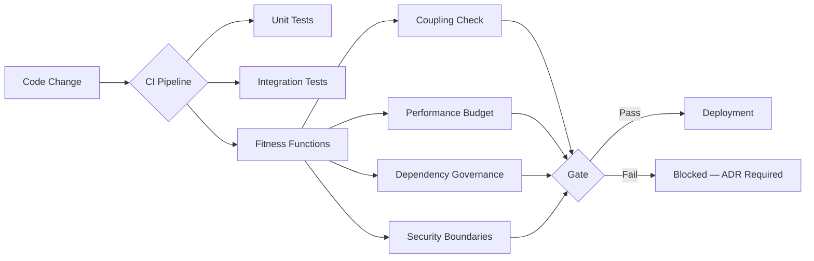
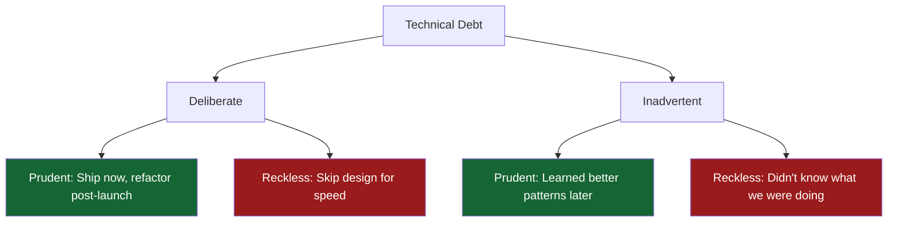
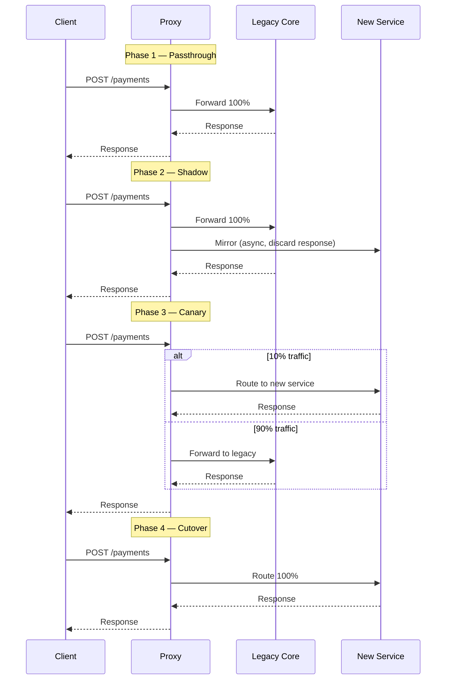

# Evolutionary Architecture — Fitness Functions and Technical Debt

> [!NOTE]
> This lesson introduces evolutionary architecture as a disciplined approach to building systems that can change safely over time — a critical capability for long-lived financial platforms.

## Why Architecture Must Evolve

No financial system is designed once and left unchanged. Regulatory mandates arrive unexpectedly. Acquisition targets must be integrated. Traffic patterns shift with product launches. The systems that survive at scale are not the ones with the most carefully planned initial design — they are the ones built to absorb change without breaking.

**Evolutionary architecture** is the practice of designing systems to support *guided, incremental change* across multiple dimensions simultaneously, while preserving essential characteristics.

The three dimensions of change that principal engineers must manage:

| Dimension | Examples | Risk if ignored |
|---|---|---|
| **Technical** | Language versions, frameworks, protocols | Security vulnerabilities, performance cliffs |
| **Domain** | Business rules, product features, compliance | Accidental coupling, changes that ripple across services |
| **Operational** | Deployment targets, cloud providers, SRE tooling | Vendor lock-in, migration risk |

---

## Fitness Functions — Executable Architectural Tests

The central mechanism of evolutionary architecture is the **fitness function**: an objective function used to assess how well a proposed change preserves a desired architectural characteristic.

Fitness functions are not new tests — they are a *classification* of tests that guard architectural properties.



### Categories of Fitness Functions

**Atomic fitness functions** run against a single component in isolation:

```java
// Dependency governance: payment module must not import fraud module directly
@Test
void paymentModule_mustNotDependOnFraudModule() {
    JavaClasses classes = new ClassFileImporter()
        .withImportOption(ImportOption.Predefined.DO_NOT_INCLUDE_TESTS)
        .importPackages("com.bank.payment");

    noClasses()
        .that().resideInAPackage("com.bank.payment..")
        .should().dependOnClassesThat()
        .resideInAPackage("com.bank.fraud..")
        .check(classes);
}
```

**Holistic fitness functions** assess system-wide properties, typically executed in a staging environment:

```java
// Performance budget: P99 payment submission must stay under 200ms
// (GatlingRunner is a small in-house wrapper around the load-test tool)
@Test
void paymentSubmission_p99Latency_mustBeUnder200ms() throws Exception {
    GatlingRunner runner = GatlingRunner.forSimulation(PaymentSubmissionSimulation.class)
        .withUsers(500)
        .withDuration(Duration.ofMinutes(5));

    SimulationResult result = runner.run();
    
    assertThat(result.percentile(99))
        .as("P99 latency SLO")
        .isLessThanOrEqualTo(Duration.ofMillis(200));
}
```

**Triggered fitness functions** run when specific conditions change:

```java
// Schema compatibility: new Avro schema must be backward compatible
@Test
void paymentEvent_newSchemaVersion_mustBeBackwardCompatible() throws IOException {
    Schema current  = new Schema.Parser().parse(new File("schemas/payment-event-v2.avsc"));
    Schema proposed = new Schema.Parser().parse(new File("schemas/payment-event-v3.avsc"));

    // Backward compatible = consumers on the NEW schema can read data written with the OLD one
    var result = SchemaCompatibility.checkReaderWriterCompatibility(proposed, current);

    assertThat(result.getType())
        .as("Schema backward compatibility")
        .isEqualTo(SchemaCompatibility.SchemaCompatibilityType.COMPATIBLE);
}
```

---

## Technical Debt as Architectural Risk

Technical debt is not a metaphor — it is a measurable drag on architectural fitness. Principal engineers must move beyond the intuitive "we have debt" to quantified assessments that influence prioritisation.

### Debt Taxonomy for Financial Systems



Ward Cunningham coined the debt metaphor; Martin Fowler described these four quadrants. As a principal engineer, your job is to prevent the reckless quadrants and consciously manage the prudent ones.

### Measuring Architectural Coupling

**Afferent coupling (Ca)** — how many components depend *on* this component. High Ca = high impact of change.

**Efferent coupling (Ce)** — how many components this component depends *on*. High Ce = fragile, many reasons to change.

**Instability (I)** = Ce / (Ca + Ce). I → 0 means many components depend on this one and it depends on little: it is *stable*, hard to change, and should therefore be *abstract* (interfaces, core domain rules) so it can be extended without being edited. I → 1 means it depends on many others and nothing depends on it: a concrete detail (adapter, controller) that is cheap to change. Dependencies should point towards stability (Robert C. Martin's Stable Dependencies and Stable Abstractions principles).

```java
// ArchUnit: measure the instability of the core ledger module
@Test
void coreLedgerModule_mustStayStable() {
    JavaClasses classes = new ClassFileImporter().importPackages("com.bank");
    Set<JavaPackage> modules = classes.getPackage("com.bank").getSubpackages();

    ComponentDependencyMetrics metrics = ArchitectureMetrics.componentDependencyMetrics(
        MetricsComponents.fromPackages(modules));

    // I = Ce / (Ca + Ce): the ledger should be depended on (high Ca),
    // not depend on other modules (low Ce)
    assertThat(metrics.getInstability("com.bank.ledger"))
        .as("Instability of com.bank.ledger")
        .isLessThan(0.3);
}
```

### Technical Debt Prioritisation Matrix

| Debt Type | Business Risk | Effort | Priority |
|---|---|---|---|
| Security vulnerability in auth | Critical | Low | Immediate |
| Shared mutable state in payment engine | High | High | Sprint planning |
| Missing integration test coverage | Medium | Medium | Backlog |
| Outdated documentation | Low | Low | Whenever |
| Framework version lag (< 1 major) | Low | Medium | Quarterly |
| Framework version lag (> 2 major) | High | High | Roadmap item |

---

## Architectural Decision Records (ADRs)

The fitness function enforces what you have decided. The ADR explains *why* you decided it. Without the ADR, future engineers will remove the fitness function when it fails, not understanding its purpose.

An ADR answers four questions:
1. **Context** — What situation forced a decision?
2. **Decision** — What did we choose?
3. **Consequences** — What do we gain? What do we trade off?
4. **Status** — Is this current, superseded, or deprecated?

```markdown
# ADR-0023: Keep Pessimistic Locking for Balances; Optimistic Locking for Low-Contention Records

**Status:** Accepted (2024-11-15)
**Authors:** Principal Engineer, Lead Engineer — Payments

## Context
Balance updates use SELECT FOR UPDATE. A proposal suggested switching every
entity to @Version optimistic locking to remove lock waits. A load test at the
projected salary-day peak showed some accounts receiving hundreds of updates
per second: with optimistic locking about a third of attempts conflicted and
retried, adding database load exactly at peak (illustrative figures).
Account settings and limits, in contrast, conflict in under 0.1% of updates.

## Decision
- Balances: keep SELECT FOR UPDATE, lock accounts in id order, keep the
  transaction short, and set lock_timeout = 2s.
- Account settings and limits: @Version optimistic locking with at most
  3 retries and jittered backoff.

## Consequences
**Gains:** Predictable throughput on hot accounts (no retry storms); no row
locks held for records that almost never conflict.
**Trade-offs:** Lock waits on the very hottest accounts (split them into
sub-accounts if this becomes a problem); two locking styles to document.
**Fitness functions added:** ConcurrentBalanceUpdateTest (200 concurrent debits:
no overdraft, no deadlock) and an ArchUnit rule that balance updates go
through LedgerRepository.lockForUpdate().
```

---

## Applying Evolutionary Architecture to Legacy Financial Systems

The most common scenario you will face is not greenfield design — it is modernising a legacy core banking system while it continues processing £5B/day.

### The Strangler Fig Strategy



In a payment system, the shadow copy must run in a dry-run mode: it computes its answer but must never move money, call the card network or send a message. Each phase is a fitness function gate. You do not advance to the next phase until the current one passes defined acceptance criteria — error rate parity, latency parity, reconciliation match.

### Fitness Functions for Migration Safety

```java
// Reconciliation fitness function: new service must match legacy output
// (ShadowTestHarness is an in-house test utility, shown for illustration)
@Test
void shadowMode_newPaymentService_mustMatchLegacyForAllRequests() {
    ShadowTestHarness harness = ShadowTestHarness.builder()
        .withLegacy(legacyPaymentService)
        .withCandidate(newPaymentService)
        .withSampleSize(10_000)
        .build();

    ShadowResult result = harness.runComparison(paymentRequestCorpus);

    assertThat(result.mismatchRate())
        .as("Shadow comparison mismatch rate")
        .isLessThan(0.001); // <0.1% acceptable during canary
    
    assertThat(result.candidateErrorRate())
        .as("New service error rate must not exceed legacy")
        .isLessThanOrEqualTo(result.legacyErrorRate() * 1.05);
}
```

---

## Principal Engineer Checklist — Evolutionary Architecture

Before approving any significant architectural change to a financial system:

- [ ] **Fitness functions exist** for all stated architectural characteristics (performance, security, coupling)
- [ ] **ADR written** explaining the decision, context, and trade-offs
- [ ] **Debt quadrant identified** — is new debt deliberate or inadvertent? Is it prudent or reckless?
- [ ] **Migration path defined** — if replacing existing behaviour, is there a strangler fig plan?
- [ ] **Rollback documented** — what is the rollback procedure if the change fails in production?
- [ ] **Coupling measured** — does this change increase instability in stable components?
- [ ] **Compliance reviewed** — does this affect audit trail, data residency, or regulatory boundaries?

<!-- KNOWLEDGE-CHECK
{
  "questions": [
    {
      "id": "q1",
      "text": "A fitness function fails in CI for a module that hasn't changed. The CI failure is blocking a release. What should you do?",
      "options": [
        "Temporarily disable the fitness function to unblock the release",
        "Investigate why the fitness function now fails — an environmental or dependency change may have violated the architectural constraint",
        "Delete the fitness function since it's unreliable",
        "Increase the threshold so the test passes"
      ],
      "correct": 1,
      "explanation": "A fitness function failing without code changes indicates an external change (dependency upgrade, environment drift) has violated the architectural constraint. The correct response is investigation, not suppression. Disabling or deleting the function defeats its purpose."
    },
    {
      "id": "q2",
      "text": "You are measuring instability (I = Ce / (Ca + Ce)) for your payment domain module. It scores 0.85. What does this indicate?",
      "options": [
        "The module is highly stable and should not be changed",
        "The module has many dependants and must be carefully versioned",
        "The module depends on many other components and is at high risk of needing to change when they do",
        "The module has low coupling and is safe to evolve freely"
      ],
      "correct": 2,
      "explanation": "I = 0.85 means Ce >> Ca — the module depends on many others but few depend on it. This is a highly unstable module that tends to change whenever its dependencies do. That is fine for concrete details at the edges of the system (adapters, controllers), but a warning sign for a core domain module, which should be stable and abstract."
    },
    {
      "id": "q3",
      "text": "During a Strangler Fig migration in Phase 2 (shadow mode), the new service has a 2% error rate compared to the legacy system's 0.1%. What is the correct action?",
      "options": [
        "Proceed to Phase 3 (canary) since 2% is acceptable for shadow traffic",
        "Halt the migration and investigate the new service's errors before advancing",
        "Increase the shadow traffic percentage to gather more data",
        "Accept the error rate differential since shadow responses are discarded"
      ],
      "correct": 1,
      "explanation": "Shadow traffic errors are discarded from the client perspective, but a 20x higher error rate signals the new service is not equivalent to the legacy. Advancing to canary would expose real users to those errors. The shadow phase exists precisely to catch this — halt and fix before proceeding."
    },
    {
      "id": "q4",
      "text": "An engineer proposes removing a fitness function that checks for circular dependencies between bounded contexts, arguing it generates false positives. What is your response as the principal engineer?",
      "options": [
        "Agree — fitness functions that cause friction should be removed",
        "Investigate the false positives: if the architecture has legitimately changed, update the ADR and the fitness function; don't remove it",
        "Move the fitness function to run weekly instead of on every CI run",
        "Replace it with a code review checklist item"
      ],
      "correct": 1,
      "explanation": "False positives mean either the fitness function is wrong or the architecture has changed without an ADR. The correct response is to update both the fitness function and the ADR to reflect current decisions — not to remove the guard. A code review checklist does not provide the same automated enforcement."
    }
  ]
}
-->

<!-- PRACTICAL-CHALLENGE
{
  "title": "Evolutionary Architecture \u2014 Fitness Functions and Technical Debt \u2014 Production Implementation",
  "difficulty": "advanced",
  "estimatedMinutes": 85,
  "tasks": [
    {
      "id": "1",
      "description": "Write an ArchUnit fitness function"
    },
    {
      "id": "2",
      "description": "Calculate instability"
    },
    {
      "id": "3",
      "description": "Write an ADR"
    },
    {
      "id": "4",
      "description": "Design a fitness function"
    }
  ]
}
-->
