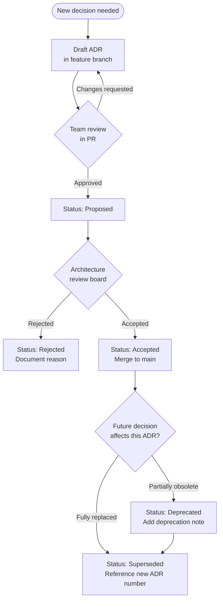

Architecture decisions are among the most expensive artifacts a fintech engineering team produces, yet they are almost universally under-documented. When a principal engineer leaves and the team inherits a system built on choices nobody can explain, every future change becomes an archaeological excavation — slowing delivery, increasing risk, and eroding confidence in the codebase. Architectural Decision Records (ADRs) are a lightweight, text-file practice that captures *why* a decision was made, not just *what* was decided, so the institutional memory survives team churn, regulatory audits, and system rewrites.

## Learning Objectives

- Explain why architecture decisions decay and what organisational risks that creates in a regulated fintech environment
- Describe the MADR template structure and populate each section with accurate, non-trivial content
- Trace the full ADR lifecycle from Proposed through Accepted to Superseded and know when each transition is appropriate
- Write a production-quality ADR for a real database selection decision including context, drivers, considered options, and consequences
- Configure ADR tooling (`adr-tools` or `Log4brains`) in a Java/Maven project and wire it into a CI pipeline
- Integrate the ADR review process into a GitHub pull request workflow with branch protection rules
- Apply the "30-minute debate" heuristic and other decision filters to decide which decisions warrant an ADR
- Organise an ADR corpus in a monorepo across multiple bounded contexts without creating a documentation sprawl problem

## Business Context

Meridian Payments is a Series-C fintech processing £4.2 billion in annual transaction volume. During a PCI-DSS Level 1 audit in Q3 2025, the QSA asked the team to justify why the transaction ledger stores monetary values as floating-point doubles instead of `BigDecimal`-backed `NUMERIC(19,4)` columns. Nobody on the current team knew — the engineer who made the choice left two years earlier. Reconstructing the rationale took 11 engineering-days, delayed the audit by three weeks, and cost the company a £180,000 penalty for late certification renewal. A single ADR written at the time of the original decision would have resolved the QSA's question in under five minutes. This lesson addresses that exact class of institutional risk.

## Why Architecture Decisions Decay

Every production system is the fossilised residue of thousands of decisions. Most were made quickly, under pressure, with incomplete information, and they were never written down. The people who made them move on. The context that made the decision sensible disappears. What remains is a constraint that future engineers work around without understanding — often re-introducing the problem the original decision was trying to solve.

In fintech specifically, decision decay carries regulatory weight. When a system processes payments, moves money across borders, or stores KYC data, regulators and auditors routinely ask *why* particular technical choices were made. "We don't know" is not an acceptable audit response.

Four mechanisms drive decision decay:

1. **Team turnover.** The average tenure of a software engineer at a growth-stage fintech is 18–24 months. Within two years, the majority of the people who shaped a system's architecture have left.
2. **Context invisibility.** A decision that was clearly correct given the constraints of 2022 (a monolith, three engineers, one geography) looks puzzling once the system has grown to 40 services across five regions. Without the recorded context, the decision looks like incompetence.
3. **Implicit supersession.** A team adopts a new framework that makes an old pattern obsolete, but the old ADR is never marked Superseded. Junior engineers follow the outdated record and introduce regressions.
4. **Knowledge hoarding.** In the absence of a formal record, tribal knowledge accumulates in Slack threads, Confluence pages, and individual memories — none of which are searchable, versioned, or auditable.

> [!WARNING]
> In a PCI-DSS or SOC 2 Type II audit, the absence of architecture documentation is not a neutral finding. Auditors interpret undocumented decisions as uncontrolled decisions. The remediation cost of a failed audit dwarfs the cost of maintaining an ADR corpus.

## The MADR Template

The Markdown Architectural Decision Records (MADR) format, maintained at `adr.github.io/madr`, is the most widely adopted ADR template in the Java ecosystem. It is plain text, lives in source control, and renders cleanly on GitHub and GitLab without tooling. The full template has eight sections, but five are mandatory for decisions in a fintech context.

```markdown
# ADR-0012: Use PostgreSQL over MongoDB for the Transaction Ledger

**Status:** Accepted
**Date:** 2026-03-14
**Deciders:** Alice Chen (Principal Architect), Bob Okafor (Head of Engineering)
**Technical Story:** JIRA-4821 — Ledger storage engine selection

## Context and Problem Statement

The new transaction ledger service must store immutable financial records with
sub-millisecond read latency for statement generation and strict consistency
for double-entry bookkeeping. The team evaluated two candidate stores during
a two-week spike (2026-02-28 – 2026-03-14).

## Decision Drivers

* Regulatory requirement: financial records must support ACID transactions
  across multiple rows (a debit and credit entry are always written atomically)
* Auditability: the PCI-DSS QSA expects row-level change history
* Team capability: 4 of 5 engineers have production PostgreSQL experience;
  none have MongoDB in fintech production
* Operational maturity: existing SRE runbooks, Terraform modules, and RDS
  parameter groups are PostgreSQL-specific

## Considered Options

* Option A: PostgreSQL 16 on Amazon RDS Multi-AZ
* Option B: MongoDB Atlas M30 cluster with multi-document transactions
* Option C: Amazon Aurora PostgreSQL-Compatible

## Decision Outcome

**Chosen option: Option A — PostgreSQL 16 on Amazon RDS Multi-AZ**, because it
satisfies all decision drivers without introducing new operational risk.
Aurora was eliminated due to the 35% cost premium over RDS at our current
volume (<500 GB); we will revisit Aurora when write IOPS exceed the RDS gp3
ceiling.

### Positive Consequences

* Full ACID guarantees across the debit/credit pair with standard SQL transactions
* Native `NUMERIC(19,4)` column type eliminates floating-point rounding errors
* Row Security Policies enable tenant isolation at the database layer
* Team can operate the system without an operational learning curve

### Negative Consequences

* Horizontal write scaling requires application-level sharding; accepted as a
  known constraint until volume exceeds 50,000 TPS (current peak: 1,200 TPS)
* Schema migrations require coordinated deployment with the application; we
  will mitigate with Flyway and backward-compatible migration scripts

## Pros and Cons of the Options

### Option B — MongoDB Atlas

* Pro: flexible document model accommodates varying payment metadata schemas
* Pro: horizontal sharding is built-in
* Con: multi-document transactions require a 4-node replica set minimum,
  increasing baseline cost by £2,100/month
* Con: no team has production MongoDB experience in a PCI environment
* Con: `NumberDecimal` type is less ergonomic than SQL `NUMERIC` for accounting

### Links

* [Spike branch: feature/ledger-store-spike](https://github.com/meridian/ledger/tree/feature/ledger-store-spike)
* Supersedes: ADR-0007 (Use in-memory H2 for ledger — dev/test only)
```

> [!NOTE]
> The **Decision Drivers** section is the most valuable part of the ADR for future readers. It records the *constraints* active at the time of the decision. When those constraints change, an engineer reading the ADR will immediately understand whether the decision still applies.

## ADR Lifecycle

An ADR is not a static document. It moves through a defined lifecycle, and each transition should be an explicit, reviewable event.



| Status | Meaning | Who Transitions | When |
|---|---|---|---|
| **Proposed** | Draft open for review; not yet binding | Author | On PR creation |
| **Accepted** | Binding decision; team must follow | Architecture lead | After PR approval |
| **Deprecated** | Still valid but phased out; new work should not follow it | Architecture lead | When a superior pattern emerges |
| **Superseded** | Replaced entirely by a newer ADR | Architecture lead | When a new ADR explicitly replaces this one |
| **Rejected** | Considered but not adopted | Architecture lead | When an alternative was chosen |

> [!IMPORTANT]
> Never delete an ADR, even if it is Superseded. The historical record of *why* you stopped doing something is as valuable as the record of why you started. Auditors and future engineers need the full chain of reasoning.

## Tooling and Repo Integration

### Directory Layout

The conventional location for ADRs in a Java/Maven project is `docs/adr/`. Each file is named `NNNN-kebab-case-title.md` where `NNNN` is a zero-padded sequence number.

```
payments-service/
├── docs/
│   └── adr/
│       ├── 0001-use-spring-boot-3.md
│       ├── 0002-use-flyway-for-migrations.md
│       ├── 0003-use-kafka-for-integration-events.md
│       └── 0012-use-postgresql-for-ledger.md
├── src/
└── pom.xml
```

### Log4brains Maven Integration

Log4brains is the most capable ADR tool for teams using Java/Maven. It provides a browsable web UI and can publish an ADR site to GitHub Pages.

```xml
<!-- pom.xml — plugin execution for ADR site generation -->
<build>
  <plugins>
    <plugin>
      <groupId>org.codehaus.mojo</groupId>
      <artifactId>exec-maven-plugin</artifactId>
      <version>3.1.0</version>
      <executions>
        <execution>
          <id>adr-build</id>
          <phase>site</phase>
          <goals><goal>exec</goal></goals>
          <configuration>
            <executable>npx</executable>
            <arguments>
              <argument>log4brains</argument>
              <argument>build</argument>
              <argument>--out</argument>
              <argument>${project.build.directory}/adr-site</argument>
            </arguments>
          </configuration>
        </execution>
      </executions>
    </plugin>
  </plugins>
</build>
```

```json
// .log4brains.yml — placed at project root
project:
  name: Payments Service
  RepositoryPath: "."
workspaces:
  - path: "."
    name: Payments Service
    adrFolder: docs/adr
```

### CLI Workflow

```bash
# Install globally (or via npx in CI)
npm install -g @log4brains/cli

# Create a new ADR interactively
log4brains adr new

# Preview the ADR site locally
log4brains preview

# Check for broken links and malformed ADRs in CI
log4brains adr list --format json | jq '.[] | select(.status == null)'
```

> [!NOTE]
> `adr-tools` (the original Bash-based tooling by Nygard) works for simple cases but does not support MADR format or multi-workspace monorepos. Prefer Log4brains for teams with more than 20 ADRs or multiple services.

## PR Workflow and Team Adoption

The most effective way to institutionalise ADRs is to enforce them at the pull-request boundary. When a PR introduces a decision that meets the ADR threshold (see the heuristic below), the author must include an ADR file in the same PR.

### GitHub Actions Validation

```yaml
# .github/workflows/adr-lint.yml
name: ADR Lint
on:
  pull_request:
    paths:
      - 'docs/adr/**'

jobs:
  lint:
    runs-on: ubuntu-latest
    steps:
      - uses: actions/checkout@v4
      - name: Validate ADR format
        run: |
          npx @log4brains/cli adr list --format json \
            | jq -e 'map(select(.status == null)) | length == 0'
      - name: Check ADR sequence numbers are unique
        run: |
          ls docs/adr/*.md \
            | sed 's/.*\/\([0-9]*\).*/\1/' \
            | sort | uniq -d | wc -l \
            | xargs -I{} sh -c 'test {} -eq 0'
```

### The 30-Minute Debate Heuristic

Write an ADR when the decision meets **any** of these criteria:

- The team would spend more than 30 minutes debating the options in a meeting
- The decision affects more than one service or team boundary
- The decision has a non-trivial cost to reverse (e.g., database engine selection, messaging platform)
- A regulatory or compliance requirement influences the choice
- The decision contradicts the team's established patterns (this is especially important — a deliberate deviation needs a written justification)

Decisions that do NOT typically need ADRs: library minor version upgrades, code style choices covered by linting rules, naming conventions for a single service.

### CODEOWNERS Integration

```
# .github/CODEOWNERS
# Require architecture lead review on all ADR changes
docs/adr/  @meridian/architecture-leads
```

This ensures that every new ADR gets reviewed by someone with the authority to accept or reject it, without blocking the author from opening the PR.

## Knowledge Check

**Q:** A new engineer on your team argues that ADRs are redundant because "the code is the documentation." What is the most precise counter-argument specific to fintech?

**A:** Code documents *what* was built, not *why* it was built that way. In fintech, regulators and auditors specifically ask about the reasoning behind technical choices — particularly those that affect data integrity, security controls, and compliance scope. A PCI-DSS QSA or SOC 2 auditor cannot read source code to understand why a particular encryption scheme, database type, or data retention policy was selected. ADRs provide the auditable, human-readable rationale that closes this gap. Additionally, code cannot document the options that were *rejected* — but rejected options are often exactly what future engineers are tempted to re-evaluate without understanding why they failed before.

**Q:** An ADR written in 2023 recommended using MongoDB for a feature store. The team has since moved all persistence to PostgreSQL and MongoDB is no longer deployed. What is the correct lifecycle action, and what must the ADR file contain after the transition?

**A:** The correct action is to transition the ADR's status to **Superseded** — not Deprecated (which implies partial validity) and not to delete the file (which would destroy the historical record). The updated ADR file must add a `superseded-by` reference pointing to the ADR number of the PostgreSQL decision (e.g., `Superseded by: ADR-0031`), retain all original content intact, and include a brief note explaining the trigger for supersession (e.g., "Superseded in 2025-Q2 as part of the platform consolidation initiative — JIRA-9910"). The original ADR for MongoDB should itself reference the superseding ADR so the chain of reasoning is navigable in both directions.

## Practical Challenge

1. **Bootstrap an ADR corpus.** In a fresh Spring Boot 3 project (`payments-service`), create the directory `docs/adr/` and write three foundational ADRs using the MADR template: (a) choice of Spring Boot 3 over Quarkus, (b) choice of Flyway over Liquibase for schema migrations, and (c) choice of PostgreSQL over MySQL for the primary datastore. Each ADR must include at least three decision drivers and document at least two considered options with pros/cons.

2. **Simulate a lifecycle transition.** Take your ADR for Flyway vs Liquibase. Imagine the team has decided to migrate to Liquibase 18 months later because it supports XML changelogs required by a third-party integration. Write the new Liquibase ADR (ADR-0004) that supersedes the Flyway ADR, then update ADR-0002 (Flyway) to `Status: Superseded` and add the reference link to ADR-0004.

3. **Wire ADR linting into CI.** Write a GitHub Actions workflow (`.github/workflows/adr-lint.yml`) that runs on every PR touching `docs/adr/**`, validates that all ADRs have a non-null `Status` field using `log4brains adr list`, and fails the check if any ADR is missing a status. The workflow should use `actions/checkout@v4` and `node:20`.

4. **Conduct an ADR retrospective.** Review three architectural decisions made in a system you currently work on that do not have ADRs. For each one, write a one-paragraph "retrospective ADR" (even if the decision is old) documenting the context as best you can reconstruct it, the choice made, and what you would document differently if you were making the decision today. Identify which of the three decisions has the highest risk of causing an audit finding and explain why.

<!-- KNOWLEDGE-CHECK
{
  "questions": [
    {
      "text": "A PCI-DSS QSA asks your team to explain why the transaction ledger stores monetary values as NUMERIC(19,4) rather than floating-point doubles. No one on the current team knows — the original engineer left two years ago. Which of the following best describes the root cause of this problem?",
      "options": [
        "The team failed to write unit tests covering the data type decision.",
        "The decision was not captured in an Architectural Decision Record at the time it was made.",
        "The team lacked a schema migration tool like Flyway or Liquibase.",
        "The QSA's question is out of scope for a PCI-DSS Level 1 audit."
      ],
      "correct": 1,
      "explanation": "The root cause is that the decision was never recorded in an ADR. ADRs capture the context and rationale behind technical choices, enabling future engineers and auditors to understand why a decision was made without depending on the original author's memory."
    },
    {
      "text": "An ADR written in 2022 recommended MongoDB for a feature store. The team has since moved all persistence to PostgreSQL and MongoDB is no longer deployed. What is the correct ADR lifecycle transition?",
      "options": [
        "Delete the ADR file to keep the corpus clean and up to date.",
        "Change the ADR status to Deprecated and add a note that it is no longer recommended.",
        "Change the ADR status to Superseded and add a reference to the new PostgreSQL ADR.",
        "Leave the ADR status unchanged because historical decisions should never be modified."
      ],
      "correct": 2,
      "explanation": "The correct action is to transition the status to Superseded and reference the new ADR. Deprecated implies the decision is partially valid; Superseded means it has been fully replaced. ADRs should never be deleted — the historical chain of reasoning has audit and institutional value."
    },
    {
      "text": "According to the 30-minute debate heuristic, which of the following decisions does NOT typically warrant writing an ADR?",
      "options": [
        "Choosing between PostgreSQL and MySQL as the primary datastore for a new service.",
        "Selecting a messaging platform (Kafka vs RabbitMQ) that will serve multiple teams.",
        "Upgrading a third-party library from version 2.1.3 to version 2.1.4 for a bug fix.",
        "Deciding to deviate from the team's established pattern of using Spring Boot for a new Rust-based service."
      ],
      "correct": 2,
      "explanation": "Minor library version upgrades (patch releases for bug fixes) do not meet the ADR threshold because they are easily reversible, do not affect other teams, and have no compliance implications. The other options involve decisions that are costly to reverse, affect multiple teams or services, or represent deliberate deviations from established patterns."
    }
  ]
}
-->

<!-- PRACTICAL-CHALLENGE
{
  "title": "Bootstrap and Maintain an ADR Corpus",
  "difficulty": "advanced",
  "estimatedMinutes": 45,
  "tasks": [
    {"id": "1", "description": "In a fresh Spring Boot 3 project, create docs/adr/ and write three MADR-format ADRs: (a) Spring Boot 3 over Quarkus, (b) Flyway over Liquibase, and (c) PostgreSQL over MySQL. Each ADR must include at least three decision drivers and document at least two considered options with pros and cons."},
    {"id": "2", "description": "Simulate a lifecycle transition: the team decides to replace Flyway with Liquibase 18 months later. Write ADR-0004 for Liquibase superseding Flyway, then update ADR-0002 to Status: Superseded with a reference link to ADR-0004. Verify the cross-reference is navigable in both directions."},
    {"id": "3", "description": "Write a GitHub Actions workflow (.github/workflows/adr-lint.yml) that runs on every PR touching docs/adr/**, validates that all ADRs have a non-null Status field using log4brains adr list, and fails the check if any ADR is missing a status. The workflow must use actions/checkout@v4 and node:20."},
    {"id": "4", "description": "Configure CODEOWNERS so that all changes under docs/adr/ require review from @your-org/architecture-leads. Write a one-paragraph justification explaining why requiring architecture lead review on ADR changes — rather than any team member — is specifically important in a PCI-DSS or SOC 2 regulated environment."}
  ]
}
-->
