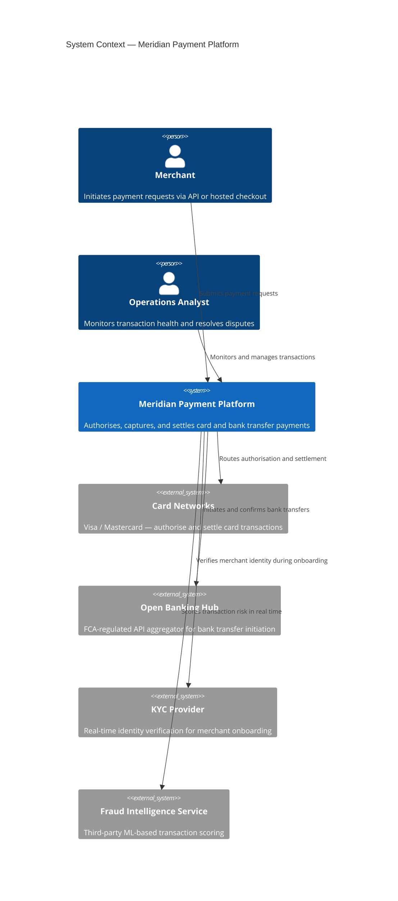
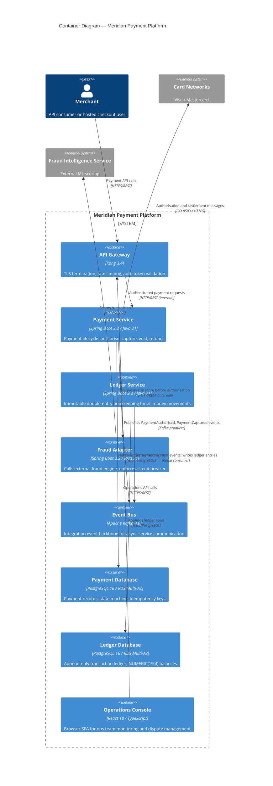

توصيل البنية المعمارية لجمهور متنوع — من مدير منتج يسأل "كيف يعمل تفويض الدفع؟" إلى مدقق PCI-DSS يسأل "أي المكوّنات تتعامل مع بيانات حامل البطاقة؟" — يتطلب مخططات بمستوى التجريد المناسب. يوفر نموذج C4، الذي ابتكره Simon Brown، أربعة مستويات هرمية تجيب عن هذه الأسئلة بالضبط دون الحاجة إلى شهادة UML أو أداة نمذجة باهظة. ولفرق هندسة التقنية المالية، تكتسب مخططات C4 قيمة خاصة لأنها تطابق بوضوح حدود الأنظمة وتدفقات البيانات والاختيارات التقنية التي تسأل عنها أطر الامتثال.

## أهداف التعلّم

- وصف كل مستوى من مستويات C4 الأربعة، وتحديد جمهوره والسؤال الأساسي الذي يجيب عنه
- تطبيق قواعد ترميز C4 بشكل صحيح، والتمييز بين عناصر الشخص (Person)، والنظام البرمجي (Software System)، والحاوية (Container)، والمكوّن (Component)
- رسم مخطط سياق النظام (المستوى 1) لمنصة معالجة مدفوعات باستخدام Mermaid
- رسم مخطط الحاويات (المستوى 2) للمنصة نفسها، مع إظهار الاختيارات التقنية والتواصل بين الحاويات
- كتابة نموذج بلغة Structurizr DSL يولّد مخططي المستوى 1 والمستوى 2 بشكل متسق من مصدر حقيقة واحد
- تحديد وتصحيح الأخطاء الخمسة الأكثر شيوعًا في رسم مخططات C4 لدى المهندسين ذوي الخبرة
- شرح المفاضلات بين أدوات "المخطط كشيفرة" (Structurizr، وMermaid) وأدوات السحب والإفلات (draw.io، وLucidchart)
- إرساء سير عمل للفريق يبقي مخططات C4 متزامنة مع شيفرة الإنتاج والبنية التحتية

## سياق العمل

لنأخذ وسيطًا ماليًا يعالج 2.3 مليون صفقة يوميًا (مثال مركّب، لا شركة بعينها) يفشل في مراجعة تقنية من الجهة الرقابية لأنه لا يستطيع تقديم مخططات دقيقة تُظهر الأنظمة التي ترسل بيانات الأوامر إلى جهات التداول الخارجية. لدى فريق الهندسة مخططات، لكن رسمها في Lucidchart مهندس حلول غادر قبل 18 شهرًا، ولم تُحدَّث منذ ثلاثة تغييرات كبيرة في النظام. وإعداد مخططات دقيقة للجهة الرقابية يستغرق مهندسَين كبيرين يعملان بدوام كامل لأسبوعين — كلفة عشرات الآلاف من الجنيهات كان يمكن تجنبها. والسبب الجذري ليس غياب الانضباط في الرسم، بل غياب ممارسات "المخطط كشيفرة" التي كانت ستبقي المخططات محدَّثة مع تغيّر قاعدة الشيفرة.

## مستويات C4 الأربعة

ينظّم نموذج C4 الرؤى المعمارية في أربعة مستويات تجريد، يجيب كل منها عن سؤال محدد لجمهور محدد. وتشكّل المستويات تسلسلًا للتكبير: كل مستوى يكبّر جزءًا من المستوى الذي فوقه.

| المستوى | الاسم | السؤال الأساسي | الجمهور الأساسي |
|---|---|---|---|
| **1** | سياق النظام (System Context) | ماذا يفعل النظام ومن يستخدمه؟ | أصحاب المصلحة غير التقنيين، والامتثال |
| **2** | الحاويات (Container) | ما الأجزاء القابلة للنشر وكيف تتواصل؟ | المعماريون، والمهندسون الكبار، وفرق التشغيل |
| **3** | المكوّنات (Component) | ما الأجزاء البنيوية الرئيسية داخل الحاوية؟ | مهندسو البرمجيات العاملون على تلك الحاوية |
| **4** | الشيفرة (Code) | كيف يُنفَّذ مكوّن معين؟ | المهندسون الذين ينفّذون ذلك المكوّن أو يراجعونه |

> [!NOTE]
> تعني "الحاوية" (Container) في مصطلحات C4 أي وحدة قابلة للنشر والتشغيل — تطبيق Spring Boot، أو قاعدة بيانات PostgreSQL، أو عنقود Kafka، أو تطبيق React أحادي الصفحة. ولا علاقة لها بحاويات Docker (وإن كانت حاوية Docker أيضًا حاوية بمفهوم C4). يربك هذا التشابه في الاسم المهندسين الجدد على C4؛ استخدم عبارة "حاوية C4" في الحديث لتجنب الالتباس.

## قواعد ترميز C4

يستخدم C4 خمسة أنواع من العناصر بأعراف بصرية ثابتة. وعند الرسم في Mermaid أو Structurizr، تحمل تسميات التقنية والوصف معلومات بقدر ما يحمله الشكل.

| العنصر | ما يمثله | عرف التسمية |
|---|---|---|
| **شخص (Person)** | مستخدم بشري للنظام | الاسم + الدور |
| **نظام برمجي (Software System)** | نظام برمجي كامل (لك أو خارجي) | الاسم + وصف في سطر واحد |
| **حاوية (Container)** | وحدة قابلة للنشر داخل نظام برمجي | الاسم + التقنية + وصف في سطر واحد |
| **مكوّن (Component)** | تجميع منطقي داخل حاوية | الاسم + التقنية + المسؤولية |
| **علاقة (Relationship)** | اعتمادية أو رابط تواصل | الوصف يقول *ماذا* يُتبادل؛ وتسمية تقنية اختيارية تقول كيف (مثل "HTTPS/JSON") |

> [!IMPORTANT]
> كل علاقة تحتاج وصفًا لـ *ما* يمر عبرها. اكتب "يرسل طلب تفويض دفع"، لا مجرد "HTTPS POST". والبروتوكول اختياري ويُكتب في حقل التقنية المنفصل للعلاقة (في Mermaid، الوسيط الرابع للدالة `Rel`)، ولا يحل محل الوصف أبدًا. أما التفاصيل الأدنى مثل المنافذ وإعدادات TLS فمكانها مخطط النشر (deployment diagram).

## المستوى 1: مخطط سياق النظام

يجيب مخطط سياق النظام عن سؤال واحد: لهذا النظام، من يستخدمه، وعلى أي أنظمة أخرى يعتمد؟ ويُغفل عمدًا التقنية، ومخططات قواعد البيانات، والبنية الداخلية.



> [!NOTE]
> يجب أن يتسع مخطط المستوى 1 في شريحة عرض واحدة وأن يقرأه غير المهندس. فإذا كان فيه أكثر من 8 عناصر، فأنت إما توسّع حدود النظام أكثر من اللازم أو تخلط مستويات التجريد.

## المستوى 2: مخطط الحاويات

يكبّر مخطط الحاويات صندوق منصة Meridian للمدفوعات ويُظهر الوحدات القابلة للنشر، وتقنياتها، وكيف تتواصل. وهو أكثر المخططات استخدامًا في نقاشات الهندسة اليومية.



## مخططات المكوّنات والشيفرة

لا تُرسم مخططات المستوى 3 والمستوى 4 إلا عند الحاجة. يناسب المستوى 3 انضمام مهندس جديد إلى خدمة معينة، أو عندما تكون الخدمة معقدة بما يكفي ليصبح هيكلها الداخلي غير واضح. أما المستوى 4 (مستوى الشيفرة) فنادرًا ما تستحق صيانته، لأن بيئات التطوير الحديثة تولّد رؤى مكافئة عند الطلب.

لخدمة المدفوعات، سيُظهر مخطط المستوى 3 المكوّنات التالية:

- **PaymentController** — محوّل REST في Spring MVC؛ يتعامل مع شؤون HTTP فقط
- **PaymentApplicationService** — ينسّق حالات الاستخدام (التفويض، والتحصيل، والاسترداد)
- **PaymentDomainService** — يفرض ثوابت المجال؛ بلا اعتماد على أي إطار
- **FraudCheckPort** — واجهة منفذ صادر لمحوّل الاحتيال
- **PaymentRepositoryPort** — واجهة منفذ صادر لمحوّل قاعدة البيانات
- **PaymentEventPublisher** — واجهة منفذ صادر لـ Kafka

> [!NOTE]
> يجب رسم مخططات المستوى 3 عند حدود المكوّن، لا حدود الصنف. "المكوّن" في C4 تجميع لأصناف مترابطة تؤدي معًا مسؤولية واحدة — وليس مطابقة واحد لواحد مع أصناف Java.

## لغة Structurizr DSL

‏Structurizr DSL أقوى أداة "مخطط كشيفرة" لنموذج C4. يعرّف ملف DSL واحد النموذج (العناصر والعلاقات) بشكل منفصل عن العروض (أي المخططات تُرسم). وهذا يمنع مشكلة "النظام نفسه موصوف بشكل مختلف في مخططين" التي تصيب المخططات المرسومة يدويًا.

```
// structurizr/workspace.dsl
workspace "Meridian Payment Platform" "Architecture model for the Meridian payment processing platform" {

  model {
    merchant = person "Merchant" "Initiates payment requests via API or hosted checkout"
    ops = person "Operations Analyst" "Monitors transactions and resolves disputes"

    mpp = softwareSystem "Meridian Payment Platform" "Authorises, captures, and settles payments" {
      apiGateway = container "API Gateway" "TLS termination, rate limiting, auth token validation" "Kong 3.4"
      paymentService = container "Payment Service" "Payment lifecycle management" "Spring Boot 3.2 / Java 21"
      ledgerService = container "Ledger Service" "Immutable double-entry bookkeeping" "Spring Boot 3.2 / Java 21"
      fraudAdapter = container "Fraud Adapter" "External fraud engine integration" "Spring Boot 3.2 / Java 21"
      eventBus = container "Event Bus" "Integration event backbone" "Apache Kafka 3.6"
      paymentDb = container "Payment Database" "Payment state and idempotency" "PostgreSQL 16" {
        tags "Database"
      }
      ledgerDb = container "Ledger Database" "Append-only ledger" "PostgreSQL 16" {
        tags "Database"
      }
    }

    cardNetworks = softwareSystem "Card Networks" "Visa / Mastercard" {
      tags "External System"
    }
    fraudEngine = softwareSystem "Fraud Intelligence Service" "Third-party ML scoring" {
      tags "External System"
    }

    # Relationships
    merchant -> apiGateway "Submits payment requests" "HTTPS/REST"
    ops -> apiGateway "Monitors and manages transactions" "HTTPS/REST"
    apiGateway -> paymentService "Authenticated requests" "HTTP"
    paymentService -> paymentDb "Reads/writes payment state" "JDBC"
    paymentService -> eventBus "Publishes payment events" "Kafka"
    paymentService -> fraudAdapter "Requests risk score" "HTTP"
    fraudAdapter -> fraudEngine "Scores transaction" "HTTPS"
    ledgerService -> eventBus "Consumes payment events" "Kafka"
    ledgerService -> ledgerDb "Appends ledger entries" "JDBC"
    paymentService -> cardNetworks "Authorisation and settlement" "ISO 8583"
  }

  views {
    systemContext mpp "SystemContext" {
      include *
      autoLayout
    }
    container mpp "Containers" {
      include *
      autoLayout
    }
    styles {
      element "Person" {
        background "#1168bd"
        color "#ffffff"
        shape Person
      }
      element "Database" {
        shape Cylinder
      }
      element "External System" {
        background "#999999"
        color "#ffffff"
      }
    }
  }
}
```

يولّد ملف DSL هذا مخطط سياق النظام ومخطط الحاويات معًا من تعريف نموذج واحد. وعندما تكتسب خدمة المدفوعات اعتمادية جديدة، يحدّث المهندسون ملف DSL في طلب الدمج نفسه مع تغيير الشيفرة، فيتحدّث المخططان تلقائيًا.

## "المخطط كشيفرة" أم السحب والإفلات

| البُعد | المخطط كشيفرة (Structurizr، وMermaid) | السحب والإفلات (draw.io، وLucidchart) |
|---|---|---|
| **التحكم في الإصدارات** | تاريخ فروقات كامل في Git | ملف ثنائي أو XML غامض؛ الفروقات غير مقروءة |
| **المراجعة** | تُراجع تغييرات المخطط في طلبات الدمج | تتطلب أداة منفصلة أو لقطة شاشة في طلب الدمج |
| **الاتساق** | النموذج يفرض الاتساق بين العروض | كل مخطط مستقل؛ والانحراف شائع |
| **منحنى التعلّم** | صياغة DSL تحتاج تعلّمًا | استجابة بصرية فورية |
| **التعاون** | تعاون غير متزامن عبر طلبات الدمج | تحرير مشترك لحظي (Lucidchart) |
| **التحقق في CI** | يمكن فحصه ورسمه داخل خط CI | يتطلب خطوة تصدير يدوية |
| **الأدلة الرقابية** | تاريخ Git يثبت متى وُجدت المخططات | لا يوجد سجل تدقيق يكشف العبث |

لفرق التقنية المالية ذات الالتزامات التنظيمية، "المخطط كشيفرة" هو الخيار الافتراضي الصحيح. فالقدرة على إثبات وجود مخطط معماري دقيق في تاريخ معين عبر تاريخ Git ميزة امتثال حقيقية.

## إبقاء المخططات متزامنة مع الشيفرة

أصعب مشكلة في المخططات المعمارية ليست رسمها — بل إبقاؤها دقيقة بعد الرسم الأول. أربع ممارسات تحافظ على التزامن دون الحاجة إلى صيانة المخططات بدوام كامل:

**1. قاعدة طلب الدمج نفسه.** أي طلب دمج يغيّر طوبولوجيا النظام (يضيف خدمة، أو يغيّر نمط تواصل، أو يضيف اعتمادية خارجية) يجب أن يتضمن تحديثًا لملف DSL أو Mermaid المعني. وتُفرض هذه القاعدة عبر ملف CODEOWNERS وقوالب طلبات الدمج.

**2. دوال اللياقة المعمارية.** اكتب اختبارات تتحقق من أن مخطط الاعتماديات الفعلي يطابق البنية الموثقة. ومكتبة ArchUnit هي الأداة المعيارية لذلك في Java.

```java
// src/test/java/com/meridian/architecture/ContainerDependencyTest.java
@AnalyzeClasses(packages = "com.meridian.payment")
public class ContainerDependencyTest {

    @ArchTest
    static final ArchRule domainHasNoDependencyOnAdapters =
        noClasses()
            .that().resideInAPackage("..domain..")
            .should().dependOnClassesThat()
            .resideInAnyPackage("..adapter..", "..infrastructure..");

    @ArchTest
    static final ArchRule applicationHasNoDependencyOnAdapters =
        noClasses()
            .that().resideInAPackage("..application..")
            .should().dependOnClassesThat()
            .resideInAPackage("..adapter..");
}
```

**3. مراجعة ربع سنوية للمخططات.** خصّص 60 دقيقة كل ربع سنة يمر فيها الفريق على كل مخطط من المستوى 1 والمستوى 2 ويتحقق منه مقابل طوبولوجيا الإنتاج الحالية. وسجّل تاريخ المراجعة في ملف DSL كتعليق.

**4. اختبار الانضمام.** عندما ينضم مهندس جديد، اطلب منه التحقق من مخطط C4 مقابل قاعدة الشيفرة الفعلية كجزء من انضمامه. وأي اختلاف يجده عيب في المخطط يُصلح فورًا. وهكذا يتحول الانضمام إلى بوابة لجودة المخططات.

> [!WARNING]
> أخطر مخطط هو المخطط شبه الصحيح. فالمخطط القديم تمامًا يُتجاهل؛ أما المخطط الدقيق بنسبة 90% فيُوثق به ويُتّبع — بما في ذلك الـ 10% الخاطئة. استثمر في ممارسات تبقي المخططات دقيقة بالكامل لا جزئيًا.

## أخطاء C4 الشائعة

| الخطأ | لماذا يحدث | الممارسة الصحيحة |
|---|---|---|
| **البروتوكول بدل الوصف** | يميل المهندسون إلى تسميات مثل "يستخدم REST" | كل علاقة تقول *ماذا* يُتبادل؛ والبروتوكول، إن ظهر، يوضع في حقل التقنية المنفصل |
| **أصناف داخلية في مخطط السياق** | حماس زائد للتفاصيل | المستوى 1 يُظهر الأشخاص والأنظمة البرمجية وعلاقاتها فقط |
| **أنظمة خارجية مفقودة** | تركّز الفرق على ما تملكه | يجب أن يظهر كل نظام خارجي تتواصل معه المنصة |
| **مخطط واحد ضخم** | مقاومة صيانة عدة مخططات | استخدم تسلسل التكبير؛ لكل مستوى جمهور مختلف |
| **مخططات قديمة في ويكي** | المخططات محفوظة في Confluence أو Notion لا في الشيفرة | احفظ DSL في نظام التحكم بالمصدر؛ وعامل المخططات كمنتجات إنتاج |

## اختبر فهمك

**س:** رسم زميل مخطط حاويات من المستوى 2 لخدمة المدفوعات، وسمّى العلاقة بين خدمة المدفوعات وPostgreSQL بعبارة "JDBC over port 5432, SSL required". ما الخطأ في هذه التسمية وكيف تُصحَّح؟

**ج:** التسمية تصف *آلية النقل* فقط (JDBC، والمنفذ 5432، وSSL) ولا تقول شيئًا عن *ما يُتبادل*. في C4، تحتاج كل علاقة وصفًا للمعلومات أو الإجراء الذي يمر عبرها، مثل "يقرأ سجلات الدفع ويكتبها" أو "يحفظ حالة الدفع ومفاتيح منع التكرار". ويمكن أن يظهر البروتوكول، لكن في حقل التقنية المنفصل للعلاقة ("JDBC")؛ وتقنية قاعدة البيانات (PostgreSQL 16) توضع على عنصر الحاوية؛ وتفاصيل مثل المنفذ وإعداد TLS مكانها مخطط النشر. ويهمّ ذلك لأن الوصف يجب أن يبقى ذا معنى إذا تغيّر النقل — فالترحيل مستقبلًا من JDBC إلى R2DBC يجب أن يغيّر حقل التقنية فقط.

**س:** يحتفظ فريقك بمخططات C4 في Confluence. طلب منك مفتش من FINRA إثبات أن مخططاتك المعمارية عكست بدقة طوبولوجيا نظام الإنتاج بتاريخ 15 مارس 2026. كيف يختلف حفظ المخططات في Confluence عن حفظها كملفات DSL في Git، وأي الأسلوبين يجعل تلبية الطلب أسهل؟

**ج:** يحفظ Confluence المخططات ككتل بيانات في قاعدة بيانات مملوكة للمزوّد. ومع أن لصفحاته تاريخًا، إلا أنه لا يوفر سجلًا يكشف العبث ويمكن تدقيقه خارجيًا لوقت وجود إصدار معين من المخطط. أما Git فيوفر تاريخ التزامات مسلسلًا بالتجزئة (hash)، كل تغيير فيه على ملف DSL مؤرخ ومنسوب إلى كاتبه؛ ومع فرع رئيسي محمي، والتزامات موقّعة، وسجلات الدفع على الخادم، تصبح إعادة كتابة هذا التاريخ قابلة للكشف. ولتلبية طلب المفتش، تجد آخر التزام قبل ذلك التاريخ بالأمر `git rev-list -1 --before="2026-03-15" main`، وتطبع الملف كما كان بالأمر `git show <sha>:docs/architecture/workspace.dsl`، وترسم المخططات من ذلك الالتزام — عملية تستغرق دقائق وتنتج دليلًا يستطيع المفتش التحقق منه بنفسه. أما الطلب نفسه مع Confluence فيتطلب إعادة بناء يدوية، والتنقيب في تاريخ الصفحات، وعلى المفتش أن يثق بكلامك بأن التاريخ دقيق.

## تحدٍّ عملي

1. **ارسم مخططي المستوى 1 والمستوى 2.** باستخدام صياغة `C4Context` و`C4Container` في Mermaid، ارسم مخطط سياق النظام ومخطط الحاويات لمنصة "الإقراض كخدمة" تتضمن: خدمة إنشاء القروض (Spring Boot)، ومحوّل مكتب الائتمان (Spring Boot)، وخدمة تخزين المستندات (Spring Boot)، وقاعدة بيانات PostgreSQL لسجلات القروض، ومخزن كائنات متوافقًا مع S3 للمستندات، وعنقود Kafka لأحداث التكامل، وثلاثة أنظمة خارجية (مكتب الائتمان Equifax، وDocuSign للتوقيع الإلكتروني، ودفتر أستاذ مصرفي أساسي داخلي). يجب أن تتبع المخططات كل قواعد ترميز C4 (التقنية على العناصر، ووصف لما يُتبادل على كل علاقة).

2. **اكتب نموذجًا بلغة Structurizr DSL.** حوّل مخططي Mermaid من المهمة 1 إلى ملف `workspace.dsl` واحد. يجب أن يعرّف قسم النموذج كل العناصر والعلاقات مرة واحدة بالضبط. ويجب أن يولّد قسم العروض عرض `systemContext` وعرض `container` معًا. وأضف أنماطًا مناسبة لتمييز قواعد البيانات والأنظمة الخارجية والخدمات الداخلية بصريًا.

3. **اكتشف انحراف المخطط وأصلحه.** لديك مخطط حاويات من المستوى 2 يُظهر خدمة المدفوعات تتواصل مباشرة مع شبكة البطاقات. لكن في قاعدة الشيفرة الفعلية أُضيفت قبل 6 أشهر حاوية بوابة ISO 8583 جديدة، وكل استدعاءات شبكة البطاقات تمر عبرها الآن. حدّث مخطط Mermaid وملف Structurizr DSL ليعكسا الطوبولوجيا الحالية. واكتب سجل ADR (باستخدام قالب MADR من الدرس 02) لإدخال بوابة ISO 8583.

4. **اكتب اختبارات ArchUnit.** اكتب ثلاث قواعد `@ArchTest` لخدمة المدفوعات تفرض قيود الاعتماديات الظاهرة في مخطط المستوى 2: (أ) حزمة المجال لا تعتمد على حزمة المحوّلات، (ب) محوّل Kafka لا يستورد إلا من واجهات منافذ طبقة التطبيق (لا من المجال مباشرة)، (ج) لا يستورد أي صنف في حزمة `controller` من حزمة `repository`. شغّل الاختبارات على هيكل حزم تجريبي وتحقق من نجاحها.

<!-- KNOWLEDGE-CHECK
{
  "questions": [
    {
      "text": "رسم زميل مخطط حاويات من المستوى 2 وسمّى العلاقة بين خدمة المدفوعات وPostgreSQL بعبارة 'JDBC over port 5432, SSL required'. ما الخطأ في هذه التسمية؟",
      "options": [
        "التسمية قصيرة جدًا وتحتاج تفاصيل تقنية أكثر عن سلسلة شهادات SSL.",
        "التسمية تصف آلية النقل فقط ولا تقول أبدًا ما الذي يُتبادل عبر العلاقة.",
        "يجب ألا تظهر أرقام المنافذ في مخططات C4 في أي مستوى.",
        "يجب ألا تُظهر مخططات المستوى 2 حاويات قواعد البيانات إطلاقًا."
      ],
      "correct": 1,
      "explanation": "في C4، يجب أن تصف كل علاقة ما يمر عبرها (مثل 'يقرأ سجلات الدفع ويكتبها'). ويمكن أن يظهر البروتوكول في حقل التقنية المنفصل للعلاقة ('JDBC')، وتفاصيل المنفذ وTLS مكانها مخطط النشر — لكن البروتوكول لا يحل محل الوصف أبدًا."
    },
    {
      "text": "ماذا تعني 'الحاوية' (Container) في مصطلحات نموذج C4؟",
      "options": [
        "صورة حاوية Docker أو OCI تحزم تطبيقًا.",
        "أي وحدة قابلة للنشر والتشغيل، مثل تطبيق Spring Boot أو قاعدة بيانات أو عنقود Kafka.",
        "حدود سياق محدود تجمع خدمات مصغّرة مترابطة.",
        "تجميع للمكوّنات من المستوى 3 داخل نظام برمجي."
      ],
      "correct": 1,
      "explanation": "في C4، الحاوية هي أي وحدة قابلة للنشر والتشغيل — تطبيق Spring Boot، أو قاعدة بيانات PostgreSQL، أو عنقود Kafka، أو تطبيق React أحادي الصفحة. ولا علاقة لها بحاويات Docker، وإن كانت حاوية Docker أيضًا حاوية بمفهوم C4. وهذا التشابه في الاسم مصدر شائع للالتباس."
    },
    {
      "text": "يطلب منك مفتش من FINRA إثبات أن مخططاتك المعمارية عكست بدقة طوبولوجيا نظام الإنتاج في تاريخ سابق محدد. لماذا يجعل حفظ المخططات كملفات DSL في Git تلبية الطلب أسهل بكثير من حفظها في Confluence؟",
      "options": [
        "يضغط Git الملفات بكفاءة أكبر من Confluence، فتُحمَّل المخططات أسرع.",
        "يوفر Git تاريخ التزامات مسلسلًا بالتجزئة (يكشف العبث مع فرع محمي والتزامات موقّعة) يستطيع إظهار ما احتواه المخطط بالضبط في أي تاريخ سابق.",
        "لا يدعم Confluence إرفاق ملفات المخططات، بل الصور المضمّنة فقط.",
        "تُعرض مخططات Git تلقائيًا في المتصفحات دون أي أدوات إضافية."
      ],
      "correct": 1,
      "explanation": "يوفر Git تاريخ التزامات مسلسلًا بالتجزئة، كل تغيير فيه مؤرخ ومنسوب؛ ومع فرع محمي والتزامات موقّعة تصبح إعادة كتابته قابلة للكشف. تستطيع استرجاع حالة ملف DSL بالضبط في أي تاريخ سابق (git rev-list -1 --before=<date>، ثم git show <sha>:<path>) ورسم المخططات من ذلك الالتزام — فتنتج دليلًا يستطيع المفتش التحقق منه بنفسه. أما تاريخ صفحات Confluence فيفتقر إلى هذه الخاصية القابلة للتدقيق خارجيًا والكاشفة للعبث."
    }
  ]
}
-->

<!-- PRACTICAL-CHALLENGE
{
  "title": "بناء مخططات C4 وصيانتها لمنصة إقراض",
  "difficulty": "advanced",
  "estimatedMinutes": 60,
  "tasks": [
    {"id": "1", "description": "باستخدام صياغة C4Context وC4Container في Mermaid، ارسم مخطط سياق النظام (المستوى 1) ومخطط الحاويات (المستوى 2) لمنصة إقراض كخدمة تتضمن خدمة إنشاء القروض، ومحوّل مكتب الائتمان، وخدمة تخزين المستندات، وقاعدة بيانات PostgreSQL، ومخزن كائنات متوافقًا مع S3، وعنقود Kafka، وثلاثة أنظمة خارجية (Equifax، وDocuSign، ودفتر أستاذ مصرفي أساسي داخلي). يجب أن تصف كل علاقة ما يُتبادل؛ والبروتوكولات توضع في حقل التقنية فقط."},
    {"id": "2", "description": "حوّل مخططي Mermaid إلى ملف Structurizr DSL واحد باسم workspace.dsl. يجب أن يعرّف قسم النموذج كل العناصر والعلاقات مرة واحدة بالضبط، وأن يولّد قسم العروض عرض systemContext وعرض container معًا. أضف أنماطًا لتمييز قواعد البيانات والأنظمة الخارجية والخدمات الداخلية بصريًا."},
    {"id": "3", "description": "لديك مخطط حاويات من المستوى 2 يُظهر خدمة المدفوعات تتواصل مباشرة مع شبكة البطاقات. لكن في قاعدة الشيفرة أُضيفت قبل 6 أشهر حاوية بوابة ISO 8583، وكل استدعاءات شبكة البطاقات تمر عبرها الآن. حدّث مخطط Mermaid وملف Structurizr DSL ليعكسا الطوبولوجيا الحالية، ثم اكتب سجل ADR بصيغة MADR لإدخال بوابة ISO 8583."},
    {"id": "4", "description": "اكتب ثلاث قواعد ArchUnit من نوع @ArchTest لخدمة المدفوعات تفرض قيود الاعتماديات الظاهرة في مخطط المستوى 2: (أ) حزمة المجال لا تعتمد على حزمة المحوّلات، (ب) محوّل Kafka لا يستورد إلا من واجهات منافذ طبقة التطبيق، (ج) لا يستورد أي صنف في حزمة controller من حزمة repository. شغّل الاختبارات على هيكل حزم تجريبي وتحقق من نجاحها."}
  ]
}
-->
