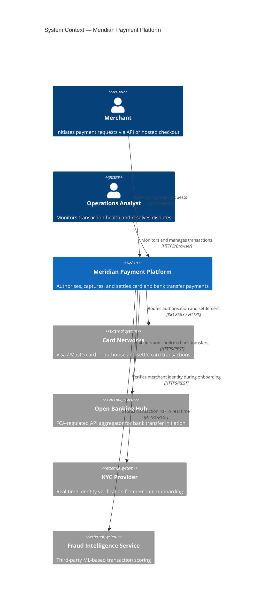
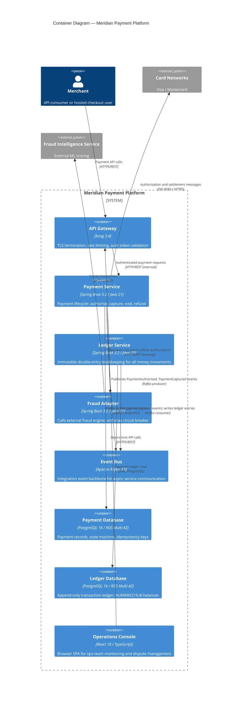

Communicating architecture to a diverse audience — from a product manager asking "how does payment authorisation work?" to a PCI-DSS auditor asking "which components handle cardholder data?" — requires diagrams pitched at the right level of abstraction. The C4 model, created by Simon Brown, provides four hierarchical levels that answer exactly those questions without requiring a UML certification or an expensive modelling tool. For fintech engineering teams, C4 diagrams are particularly valuable because they map cleanly onto the system boundaries, data flows, and technology choices that compliance frameworks ask about.

## Learning Objectives

- Describe each of the four C4 levels and identify the audience and primary question each level answers
- Apply C4 notation rules correctly, distinguishing between Person, Software System, Container, and Component elements
- Draw a Level 1 System Context diagram for a payment processing platform using Mermaid
- Draw a Level 2 Container diagram for the same platform, showing technology choices and inter-container communication
- Write a Structurizr DSL model that generates consistent Level 1 and Level 2 diagrams from a single source of truth
- Identify and correct the five most common C4 diagramming mistakes made by experienced engineers
- Explain the trade-offs between diagram-as-code tools (Structurizr, Mermaid) and drag-and-drop tools (draw.io, Lucidchart)
- Establish a team workflow that keeps C4 diagrams synchronised with production code and infrastructure

## Business Context

Apex Clearing, a broker-dealer processing 2.3 million trades per day, failed a FINRA technology review in Q2 2025 because the firm could not produce accurate diagrams showing which systems transmitted order data to external venues. The engineering team had diagrams, but they were drawn in Lucidchart by a solutions architect who left 18 months earlier and had not been updated since three major system changes. Producing accurate diagrams for the regulator required two senior engineers working full-time for two weeks — a £95,000 engineering cost that could have been avoided. The root cause was not a lack of diagramming discipline but a lack of diagram-as-code practices that would have kept the diagrams updated as the codebase changed.

## The Four Levels of C4

The C4 model organises architectural views into four abstraction levels, each answering a specific question for a specific audience. The levels form a zoom hierarchy: each level zooms into a subset of the level above.

| Level | Name | Primary Question | Primary Audience |
|---|---|---|---|
| **1** | System Context | What does the system do and who uses it? | Non-technical stakeholders, compliance |
| **2** | Container | What are the deployable parts and how do they communicate? | Architects, senior engineers, ops teams |
| **3** | Component | What are the major structural parts inside a container? | Software engineers working on that container |
| **4** | Code | How is a specific component implemented? | Engineers implementing or reviewing that component |

> [!NOTE]
> "Container" in C4 terminology means any deployable, runnable unit — a Spring Boot application, a PostgreSQL database, a Kafka cluster, a React SPA. It has nothing to do with Docker containers (though a Docker container is also a C4 container). This name collision confuses engineers new to C4; use "C4 Container" in conversation to avoid ambiguity.

## C4 Notation Rules

C4 uses five element types with consistent visual conventions. When rendering in Mermaid or Structurizr, the technology and description labels carry as much information as the shape.

| Element | Represents | Label Convention |
|---|---|---|
| **Person** | A human user of the system | Name + role |
| **Software System** | An entire software system (yours or external) | Name + one-line description |
| **Container** | A deployable unit within a Software System | Name + technology + one-line description |
| **Component** | A logical grouping within a Container | Name + technology + responsibility |
| **Relationship** | A dependency or communication link | Label describes *what* is communicated, not how |

> [!IMPORTANT]
> Every relationship label must describe *what* flows across it, not the protocol. Write "Submits payment authorisation request" not "HTTPS POST". The technology label belongs on the element, not the relationship arrow.

## Level 1: System Context Diagram

The System Context diagram answers one question: given this system, who uses it and what other systems does it depend on? It deliberately omits technology, database schemas, and internal structure.



> [!NOTE]
> A Level 1 diagram should fit on one slide and be readable by a non-engineer. If you have more than 8 elements on a Level 1 diagram, you are either over-scoping the system boundary or mixing abstraction levels.

## Level 2: Container Diagram

The Container diagram zooms into the Meridian Payment Platform box and shows the deployable units, their technology stacks, and how they communicate. This is the most heavily used diagram in day-to-day engineering discussions.



## Component and Code Diagrams

Level 3 and Level 4 diagrams are drawn only when needed. Level 3 is appropriate when onboarding a new engineer to a specific service or when a service is complex enough that its internal structure is non-obvious. Level 4 (code-level) is rarely worth maintaining because modern IDEs generate equivalent views on demand.

For the Payment Service, a Level 3 diagram would reveal the following components:

- **PaymentController** — Spring MVC REST adapter; handles HTTP concerns only
- **PaymentApplicationService** — orchestrates use cases (authorise, capture, refund)
- **PaymentDomainService** — enforces domain invariants; no framework dependency
- **FraudCheckPort** — outbound port interface for the fraud adapter
- **PaymentRepositoryPort** — outbound port interface for the database adapter
- **PaymentEventPublisher** — outbound port interface for Kafka

> [!NOTE]
> Level 3 diagrams should be drawn at the component boundary, not the class boundary. A "component" in C4 is a grouping of related classes that together fulfil a single responsibility — not a 1:1 mapping to Java classes.

## Structurizr DSL

Structurizr DSL is the most powerful diagram-as-code tool for C4. A single DSL file defines the model (elements and relationships) separately from the views (which diagrams to render). This prevents the "same system described differently on two diagrams" problem that plagues manually maintained diagrams.

```
// structurizr/workspace.dsl
workspace "Meridian Payment Platform" "Architecture model for the Meridian payment processing platform" {

  model {
    merchant = person "Merchant" "Initiates payment requests via API or hosted checkout"
    ops = person "Operations Analyst" "Monitors transactions and resolves disputes"

    mpp = softwareSystem "Meridian Payment Platform" "Authorises, captures, and settles payments" {
      apiGateway = container "API Gateway" "TLS termination, rate limiting, auth token validation" "Kong 3.4"
      paymentService = container "Payment Service" "Payment lifecycle management" "Spring Boot 3.2 / Java 21"
      ledgerService = container "Ledger Service" "Immutable double-entry bookkeeping" "Spring Boot 3.2 / Java 21"
      fraudAdapter = container "Fraud Adapter" "External fraud engine integration" "Spring Boot 3.2 / Java 21"
      eventBus = container "Event Bus" "Integration event backbone" "Apache Kafka 3.6"
      paymentDb = container "Payment Database" "Payment state and idempotency" "PostgreSQL 16" {
        tags "Database"
      }
      ledgerDb = container "Ledger Database" "Append-only ledger" "PostgreSQL 16" {
        tags "Database"
      }
    }

    cardNetworks = softwareSystem "Card Networks" "Visa / Mastercard" {
      tags "External System"
    }
    fraudEngine = softwareSystem "Fraud Intelligence Service" "Third-party ML scoring" {
      tags "External System"
    }

    # Relationships
    merchant -> apiGateway "Submits payment requests" "HTTPS/REST"
    ops -> apiGateway "Monitors and manages transactions" "HTTPS/REST"
    apiGateway -> paymentService "Authenticated requests" "HTTP"
    paymentService -> paymentDb "Reads/writes payment state" "JDBC"
    paymentService -> eventBus "Publishes payment events" "Kafka"
    paymentService -> fraudAdapter "Requests risk score" "HTTP"
    fraudAdapter -> fraudEngine "Scores transaction" "HTTPS"
    ledgerService -> eventBus "Consumes payment events" "Kafka"
    ledgerService -> ledgerDb "Appends ledger entries" "JDBC"
    paymentService -> cardNetworks "Authorisation and settlement" "ISO 8583"
  }

  views {
    systemContext mpp "SystemContext" {
      include *
      autoLayout
    }
    container mpp "Containers" {
      include *
      autoLayout
    }
    styles {
      element "Person" {
        background "#1168bd"
        color "#ffffff"
        shape Person
      }
      element "Database" {
        shape Cylinder
      }
      element "External System" {
        background "#999999"
        color "#ffffff"
      }
    }
  }
}
```

This DSL file generates both the System Context and Container diagrams from a single model definition. When the Payment Service gains a new dependency, engineers update the DSL file in the same PR as the code change, and both diagrams update automatically.

## Diagram-as-Code vs Drag-and-Drop

| Dimension | Diagram-as-Code (Structurizr, Mermaid) | Drag-and-Drop (draw.io, Lucidchart) |
|---|---|---|
| **Version control** | Full diff history in Git | Binary or opaque XML; diffs are unreadable |
| **Review process** | Diagram changes reviewed in PRs | Requires separate tool or screenshot in PR |
| **Consistency** | Model enforces consistency across views | Each diagram is independent; drift is common |
| **Learning curve** | DSL syntax to learn | Immediate visual feedback |
| **Collaboration** | PR-based async collaboration | Real-time co-editing (Lucidchart) |
| **CI validation** | Can lint and render in CI pipeline | Requires manual export step |
| **Regulatory evidence** | Git history proves when diagrams existed | No tamper-evident audit trail |

For fintech teams with regulatory obligations, diagram-as-code is the correct default. The ability to prove via Git history that an accurate architecture diagram existed at a specific date is a material compliance advantage.

## Keeping Diagrams in Sync with Code

The hardest problem with architecture diagrams is not drawing them — it is keeping them accurate after the initial drawing. Four practices maintain synchronisation without requiring full-time diagram maintenance:

**1. Same PR rule.** Any PR that changes system topology (adds a service, changes a communication pattern, adds an external dependency) must include an update to the relevant DSL or Mermaid file. This is enforced via CODEOWNERS and PR templates.

**2. Architecture fitness functions.** Write tests that verify the actual dependency graph matches the documented architecture. ArchUnit is the standard library for this in Java.

```java
// src/test/java/com/meridian/architecture/ContainerDependencyTest.java
@AnalyzeClasses(packages = "com.meridian.payment")
public class ContainerDependencyTest {

    @ArchTest
    static final ArchRule domainHasNoDependencyOnAdapters =
        noClasses()
            .that().resideInAPackage("..domain..")
            .should().dependOnClassesThat()
            .resideInAnyPackage("..adapter..", "..infrastructure..");

    @ArchTest
    static final ArchRule applicationHasNoDependencyOnAdapters =
        noClasses()
            .that().resideInAPackage("..application..")
            .should().dependOnClassesThat()
            .resideInAPackage("..adapter..");
}
```

**3. Quarterly diagram review.** Schedule a 60-minute review each quarter where the team walks through every Level 1 and Level 2 diagram and validates it against the current production topology. Record the review date in the DSL file as a comment.

**4. Onboarding test.** When a new engineer joins, ask them to validate a C4 diagram against the actual codebase as part of their onboarding. Any discrepancy they find is a diagram defect to fix immediately. This turns onboarding into a diagram quality gate.

> [!WARNING]
> The most dangerous diagram is one that is almost correct. A completely outdated diagram is ignored; a 90%-accurate diagram is trusted and followed — including the wrong 10%. Invest in practices that keep diagrams fully accurate rather than partially accurate.

## Common C4 Mistakes

| Mistake | Why It Happens | Correct Practice |
|---|---|---|
| **Technology on relationship arrows** | Engineers default to "it uses REST" descriptions | Technology goes on elements; relationships describe *what* is communicated |
| **Internal classes on a Context diagram** | Over-eager detail | Level 1 shows only persons, software systems, and their relationships |
| **Missing external systems** | Teams focus on what they own | Every external system the platform communicates with must appear |
| **One monolithic diagram** | Resistance to maintaining multiple diagrams | Use the zoom hierarchy; each level has a distinct audience |
| **Stale diagrams in a wiki** | Diagrams stored in Confluence or Notion, not code | Store DSL in source control; treat diagrams as production artifacts |

## Knowledge Check

**Q:** A colleague draws a Level 2 Container diagram for the payment service and labels the relationship between the Payment Service and PostgreSQL as "JDBC over port 5432, SSL required." What is wrong with this label and how should it be corrected?

**A:** The label describes the *transport mechanism* (JDBC, port 5432, SSL) rather than *what is communicated*. In C4, relationship labels describe the nature of the information or action flowing across the relationship, not the protocol. The correct label would be something like "Reads and writes payment records" or "Persists payment state and idempotency keys." The technology detail (JDBC, PostgreSQL 16) belongs on the Container element itself, not on the arrow. This distinction matters because the relationship label must remain meaningful if the transport technology changes — a future migration from JDBC to R2DBC should not require updating the relationship label.

**Q:** Your team maintains C4 diagrams in Confluence. A FINRA examiner asks you to demonstrate that your architecture diagrams accurately reflected the production system topology as of 15 March 2026. How does storing diagrams in Confluence differ from storing them as DSL files in Git, and which approach makes this request easier to satisfy?

**A:** Confluence stores diagrams as blobs in a proprietary database. While Confluence has page history, it does not provide a tamper-evident, externally auditable record of when a specific diagram version existed. Git, by contrast, provides a cryptographically chained commit history where every change to the DSL file is timestamped, attributed, and immutable (assuming a protected main branch). To satisfy the FINRA examiner's request with Git-stored diagrams, you would run `git log --before="2026-03-15" docs/architecture/workspace.dsl` to retrieve the exact DSL state on that date and render the diagrams from that commit — a process that takes minutes and produces evidence the examiner can verify independently. The same request against Confluence requires manual reconstruction, page archaeology, and the examiner must trust your word that the history is accurate.

## Practical Challenge

1. **Draw Level 1 and Level 2 diagrams.** Using Mermaid's `C4Context` and `C4Container` syntax, draw a System Context diagram and a Container diagram for a Lending-as-a-Service platform that includes: a Loan Origination Service (Spring Boot), a Credit Bureau Adapter (Spring Boot), a Document Storage Service (Spring Boot), a PostgreSQL database for loan records, an S3-compatible object store for documents, a Kafka cluster for integration events, and three external systems (Equifax credit bureau, DocuSign for e-signatures, and an internal core banking ledger). The diagrams must follow all C4 notation rules (technology on elements, communication label on relationships).

2. **Write a Structurizr DSL model.** Convert both Mermaid diagrams from task 1 into a single `workspace.dsl` file. The model section must define all elements and relationships exactly once. The views section must generate both a `systemContext` view and a `container` view. Add appropriate styles to distinguish databases, external systems, and internal services visually.

3. **Identify and fix diagram drift.** You are given a Level 2 Container diagram that shows the Payment Service communicating directly with the Card Network. In the actual codebase, a new ISO 8583 Gateway container was added 6 months ago and all card network calls now route through it. Update both the Mermaid diagram and the Structurizr DSL to reflect the current topology. Write an ADR (using the MADR template from Lesson 02) for the ISO 8583 Gateway introduction.

4. **Write ArchUnit tests.** Write three `@ArchTest` rules for the Payment Service that enforce the dependency constraints visible in your Level 2 diagram: (a) the domain package has no dependency on the adapter package, (b) the Kafka adapter only imports from the application port interfaces (not from the domain directly), and (c) no class in the `controller` package imports from the `repository` package. Run the tests against a sample package structure and verify they pass.

<!-- KNOWLEDGE-CHECK
{
  "questions": [
    {
      "text": "A colleague draws a Level 2 Container diagram and labels the relationship between the Payment Service and PostgreSQL as 'JDBC over port 5432, SSL required.' What is wrong with this label?",
      "options": [
        "The label is too short and needs more technical detail about the SSL certificate chain.",
        "The label describes the transport mechanism instead of what is communicated across the relationship.",
        "Port numbers should never appear in C4 diagrams at any level.",
        "Level 2 diagrams should not show database containers at all."
      ],
      "correct": 1,
      "explanation": "In C4, relationship labels must describe what flows across the relationship (e.g., 'Reads and writes payment records'), not the protocol or transport. Technology details like JDBC and port numbers belong on the Container element itself, not on the arrow."
    },
    {
      "text": "What does 'Container' mean in C4 model terminology?",
      "options": [
        "A Docker or OCI container image that packages an application.",
        "Any deployable, runnable unit such as a Spring Boot app, a database, or a Kafka cluster.",
        "A bounded context boundary that groups related microservices.",
        "A Level 3 grouping of components within a software system."
      ],
      "correct": 1,
      "explanation": "In C4, a Container is any deployable, runnable unit — a Spring Boot application, a PostgreSQL database, a Kafka cluster, or a React SPA. It has nothing to do with Docker containers, though a Docker container is also a C4 container. This name collision is a common source of confusion."
    },
    {
      "text": "A FINRA examiner asks you to demonstrate that your architecture diagrams accurately reflected the production system topology as of a specific past date. Why does storing diagrams as DSL files in Git make this significantly easier to satisfy than storing them in Confluence?",
      "options": [
        "Git compresses files more efficiently than Confluence, so the diagrams load faster.",
        "Git provides a cryptographically chained, tamper-evident commit history that can prove exactly what a diagram contained on any past date.",
        "Confluence does not support diagram file attachments, only embedded images.",
        "Git diagrams render automatically in browsers without any additional tooling."
      ],
      "correct": 1,
      "explanation": "Git provides a cryptographically chained commit history where every change is timestamped and attributed. You can retrieve the exact DSL state on any past date with git log --before and render the diagrams from that commit — producing evidence the examiner can independently verify. Confluence page history lacks this tamper-evident, externally auditable property."
    }
  ]
}
-->

<!-- PRACTICAL-CHALLENGE
{
  "title": "Build and Maintain C4 Diagrams for a Lending Platform",
  "difficulty": "advanced",
  "estimatedMinutes": 60,
  "tasks": [
    {"id": "1", "description": "Using Mermaid C4Context and C4Container syntax, draw a Level 1 System Context diagram and a Level 2 Container diagram for a Lending-as-a-Service platform with a Loan Origination Service, Credit Bureau Adapter, Document Storage Service, PostgreSQL database, S3-compatible object store, Kafka cluster, and three external systems (Equifax, DocuSign, and an internal core banking ledger). All relationship labels must describe what is communicated, not the protocol."},
    {"id": "2", "description": "Convert both Mermaid diagrams into a single Structurizr DSL workspace.dsl file. The model section must define all elements and relationships exactly once. The views section must generate both a systemContext view and a container view. Add styles to visually distinguish databases, external systems, and internal services."},
    {"id": "3", "description": "You are given a Level 2 Container diagram showing the Payment Service communicating directly with the Card Network. In the actual codebase, a new ISO 8583 Gateway container was added 6 months ago and all card network calls now route through it. Update both the Mermaid diagram and the Structurizr DSL to reflect the current topology, then write a MADR-format ADR for the introduction of the ISO 8583 Gateway."},
    {"id": "4", "description": "Write three ArchUnit @ArchTest rules for the Payment Service enforcing the dependency constraints visible in your Level 2 diagram: (a) the domain package has no dependency on the adapter package, (b) the Kafka adapter only imports from application port interfaces, and (c) no class in the controller package imports from the repository package. Run the tests against a sample package structure and verify they pass."}
  ]
}
-->
