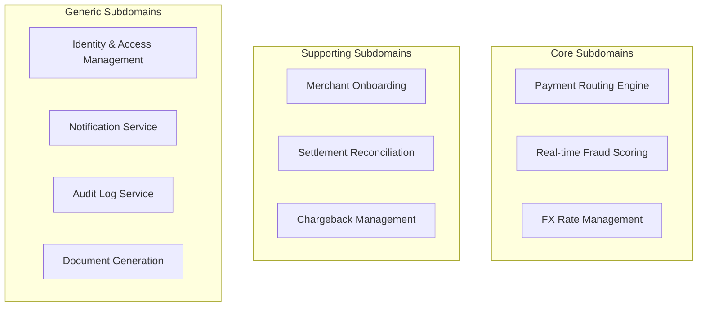
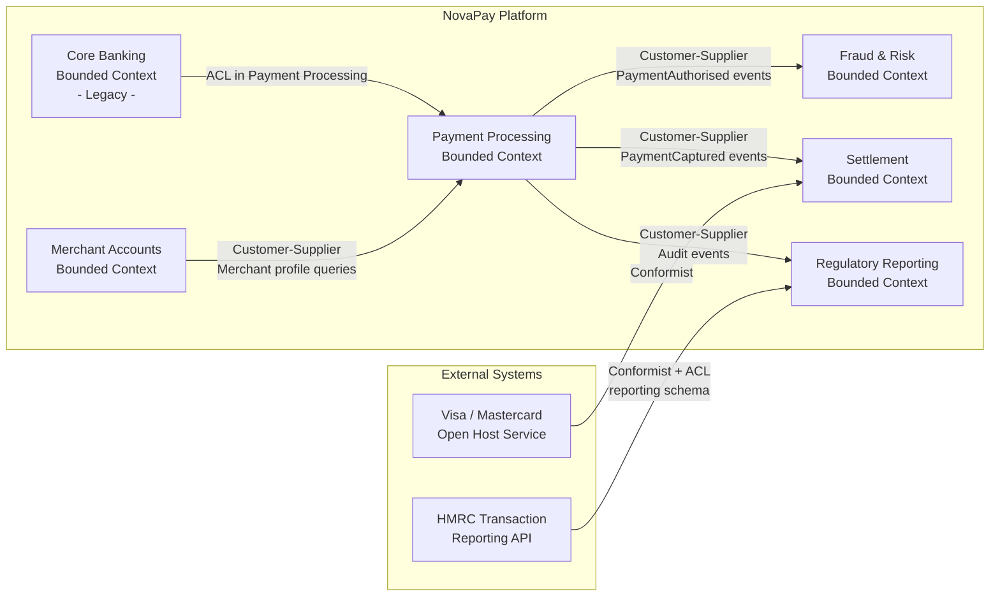

تعالج الأنماط الاستراتيجية في التصميم الموجّه بالمجال (DDD) السؤال الذي يُعثر معظم أنظمة التقنية المالية الكبيرة: كيف تنظّم مجالًا معقدًا — المدفوعات، والإقراض، والامتثال، والمخاطر — عبر عدة فرق وقواعد شيفرة دون أن تصنع "نظامًا موحّدًا موزعًا" يتطلب فيه كل تغيير تنسيقًا بين الفرق؟ يعطي التصميم الاستراتيجي قادة الهندسة المفردات والأدوات لتقسيم مجال كبير إلى نماذج محددة الحدود وقابلة للتطور باستقلال، لكل منها لغته وقواعده، ومتصلة عبر عقود صريحة. وفي التقنية المالية الخاضعة للتنظيم، حيث تظهر كلفة الاقتران في بطء الإصدارات وفشل عمليات التدقيق وتتالي حوادث الإنتاج، ليست هذه الأنماط ترفًا أكاديميًا — بل أدوات للبقاء.

## أهداف التعلّم

- تعريف المجال (domain)، والمجال الفرعي (subdomain)، والسياق المحدود (bounded context)، واللغة المشتركة (ubiquitous language) والتمييز بينها بأمثلة من التقنية المالية
- تصنيف المجالات الفرعية لمنصة مدفوعات إلى أساسية أو داعمة أو عامة، وتبرير آثار كل تصنيف على الاستثمار
- تطبيق عملية منهجية لتحديد حدود السياقات المحدودة من قدرات العمل والاختلافات اللغوية
- وصف أنماط العلاقات الثمانية في خريطة السياقات، واختيار النمط المناسب لعلاقة معينة بين فريقين
- تنفيذ طبقة مكافحة الفساد (Anti-Corruption Layer) في Java تترجم بين نموذج نظام مصرفي أساسي قديم ونموذج مجال مدفوعات جديد
- قراءة خريطة سياقات بأسلوب C4 لمنصة مالية فيها أربعة سياقات محدودة على الأقل وإنتاجها
- شرح العلاقة بين ورشة Event Storming واكتشاف السياقات المحدودة
- توضيح لماذا تُعد السياقات المحدودة والخدمات المصغّرة قرارين تصميميين مستقلين، ومتى تكون المطابقة واحد لواحد غير مناسبة

## سياق العمل

‏NovaPay مؤسسة دفع متكاملة عمرها ست سنوات. فُكّك تطبيقها الأصلي الموحّد بلغة Java إلى 34 خدمة مصغّرة، لكن الفريق يعاني من مشكلة "النظام الموحّد الموزع" الكلاسيكية: تغيير منطق معالجة المدفوعات يتطلب تنسيق عمليات نشر عبر 11 خدمة، وجداول قاعدة البيانات المشتركة لا يملكها أحد، وكلمة "حساب" تعني ثلاثة أشياء مختلفة بحسب قناة Slack التي تكون فيها. وكشفت ورشة استكشاف مدتها ثلاثة أسابيع أن السبب الجذري ليس التقنية — بل غياب الانضباط في السياقات المحدودة. فمعالجة المدفوعات، وتقييم المخاطر، وإدارة التجار، والتسوية، والتقارير التنظيمية كلها تتشارك نموذج المجال واللغة نفسيهما، فينشأ اقتران خفي يجعل التطور المستقل مستحيلًا. وقُدّرت الكلفة الهندسية لهذا الاقتران بـ 2.1 مليون جنيه إسترليني سنويًا في الميزات المتأخرة ومعالجة الحوادث.

## المفردات الأساسية في DDD

الدقة في اللغة أساس DDD. فكثير من الخلافات في فرق الهندسة الكبيرة ينشأ من استخدام الكلمات نفسها بمعانٍ مختلفة، أو كلمات مختلفة بالمعنى نفسه. ويوفر DDD مفردات تجعل هذه الخلافات صريحة وقابلة للحل.

**المجال (Domain)** — موضوع العمل الذي يعالجه البرنامج. في NovaPay، المجال هو "معالجة المدفوعات الإلكترونية والخدمات المالية". والمجال موجود في العالم الحقيقي بمعزل عن أي برنامج؛ والبرنامج نموذج لجزء منه.

**المجال الفرعي (Subdomain)** — جزء متماسك من المجال له منطق عمله ومصطلحاته وقواعده. معالجة المدفوعات، وكشف الاحتيال، وانضمام التجار، والتقارير التنظيمية مجالات فرعية متمايزة في مجال NovaPay.

**السياق المحدود (Bounded Context)** — حدود منطقية يُعرَّف داخلها نموذج مجال محدد ويُطبَّق. داخل السياق المحدود، لكل مصطلح معنى واحد بالضبط، ولكل مفهوم تمثيل واحد بالضبط، والفريق يملك النموذج. السياق المحدود قرار *تصميمي*؛ أما المجال الفرعي فهو *اكتشاف* لما يفعله العمل.

**اللغة المشتركة (Ubiquitous Language)** — المفردات المشتركة التي يستخدمها خبراء المجال والمهندسون معًا داخل سياق محدود. وتظهر هذه اللغة في الشيفرة (أسماء الأصناف والدوال والمتغيرات)، وفي الحوارات، والتوثيق، والاختبارات. فإذا قالت الشيفرة `PaymentOrder` بينما يقول فريق العمل "معاملة"، فهناك فجوة في اللغة المشتركة ستنتج أخطاء.

> [!NOTE]
> اللغة المشتركة محصورة في سياق محدود. فكلمة "حساب" في سياق معالجة المدفوعات (حساب الدفع لدى التاجر) تعني شيئًا مختلفًا تمامًا عن "حساب" في سياق النظام المصرفي الأساسي (الحساب الجاري للعميل). وهذه ليست مشكلة يجب إصلاحها — بل ميزة في التصميم. كل سياق يملك تعريفه.

**خريطة السياقات (Context Map)** — مستند أو مخطط يُظهر العلاقات بين السياقات المحدودة، وطبيعة هذه العلاقات (أي فريق في المنبع وأيهما في المصب)، ونمط التكامل المستخدم عند كل حد.

## المجالات الفرعية: أساسية وداعمة وعامة

لا تستحق كل المجالات الفرعية استثمارًا هندسيًا متساويًا. ويرشد تصنيف DDD للمجالات الفرعية — أساسي، وداعم، وعام — إلى أين تبني برمجيات مخصصة وأين تشتري حلولًا جاهزة أو تستخدمها.

| نوع المجال الفرعي | التعريف | استراتيجية الاستثمار | أمثلة من NovaPay |
|---|---|---|---|
| **أساسي (Core)** | يحقق ميزة تنافسية مباشرة؛ فريد للشركة | داخليًا، وبأفضل المهندسين، وتحسين مستمر | محرك توجيه المدفوعات اللحظي، ونموذج تقييم الاحتيال المملوك |
| **داعم (Supporting)** | ضروري لعمل الأساسي لكنه لا يميّز الشركة | داخليًا مع قبول أنماط أبسط؛ والشراء أو البناء كلاهما ممكن | سير عمل انضمام التجار، ومطابقة التسوية |
| **عام (Generic)** | وظيفة عمل معيارية لها حلول سلعية متاحة | الشراء (SaaS)، أو المصدر المفتوح، أو استخدام إطار جاهز | إشعارات البريد الإلكتروني، وتوليد PDF، والمصادقة (OAuth2/OIDC)، وسجلات التدقيق |

> [!IMPORTANT]
> تصنيف المجال الفرعي يحدد كيف توزّع عليه الموارد البشرية. يجب أن يملك أكثر مهندسيك خبرة المجالات الفرعية الأساسية. واستخدام مهندس رئيسي لبناء نظام إشعارات بريد إلكتروني مخصص (مجال عام) بدل التكامل مع SendGrid سوء توزيع لأثمن مواردك. وهذا قرار استراتيجي، لا تقني.



## تحديد السياقات المحدودة

تحديد حدود السياقات المحدودة عملية اكتشاف، لا تمرين تصميم. فالحدود تنبثق من العمل نفسه — تُكتشف ولا تُخترع. وثلاث قواعد استدلالية ترشد الاكتشاف:

**1. الانقطاع اللغوي.** عندما تعني الكلمة نفسها أشياء مختلفة لأصحاب مصلحة مختلفين، فقد عبرت حدًا محتملًا بين سياقين. في NovaPay، تعني "المعاملة" تعليمة دفع لدى فريق معالجة المدفوعات، وقيدًا في دفتر الأستاذ لدى فريق المحاسبة، وحدث مخاطر لدى فريق الاحتيال. ويجب أن تعيش هذه المعاني الثلاثة في ثلاثة سياقات محدودة متمايزة بثلاثة أصناف `Transaction` متمايزة (أو بلا صنف `Transaction` أصلًا — فربما تكون `PaymentOrder` و`LedgerEntry` و`RiskEvent` أدق في سياقاتها).

**2. الحدود التنظيمية.** ينص قانون Conway على أن الأنظمة تعكس هياكل التواصل في المؤسسات التي تبنيها. فإذا لم يحتج فريقا الاحتيال والمدفوعات أبدًا إلى التنسيق ليسلّم كل منهما ميزة باستقلال، فهما على الأرجح في سياقين منفصلين. وإذا كانا ينسّقان دائمًا، فقد يكونان في السياق نفسه، أو بينهما علاقة اقتران وثيقة يجب جعلها صريحة.

**3. تماسك قدرات العمل.** يجمع السياق المحدود قدرات العمل التي تتغير معًا للسبب نفسه. فتفويض الدفع وتحصيله يتغيران معًا عندما تتغير قواعد شبكات البطاقات. ومطابقة التسوية تتغير عندما تتغير مواعيد الإقفال المصرفية. وهذه الدوافع المختلفة تشير إلى سياقات مختلفة.

> [!WARNING]
> تجنب فخ مطابقة السياقات المحدودة مباشرة مع جداول قاعدة البيانات أو مع عمليات نشر الخدمات المصغّرة. فهذه شؤون تنفيذية. حدّد السياقات بلغة العمل وقدراته أولًا؛ وتأتي طوبولوجيا النشر لاحقًا.

## أنماط خريطة السياقات

بعد تحديد السياقات المحدودة، يجب أن توثّق العلاقات بينها وتصممها. ويصف DDD ثمانية أنماط شائعة للعلاقات (إضافة إلى وصف "الكرة الكبيرة من الطين" Big Ball of Mud للمناطق التي لا نموذج واضحًا لها)، تلتقط الديناميكيات التقنية والتنظيمية لتكامل السياقات.

| النمط | نوع العلاقة | الديناميكية التنظيمية | آلية التكامل |
|---|---|---|---|
| **الشراكة (Partnership)** | اعتماد متبادل | الفريقان يخططان معًا؛ وإصدارات مشتركة | واجهات مشتركة، وواجهات برمجية منسّقة |
| **النواة المشتركة (Shared Kernel)** | جزء مشترك من النموذج | يتفق عليه الفريقان؛ والتغيير يتطلب توافقًا | مكتبة مشتركة، أو جزء مشترك من المخطط |
| **العميل-المورّد (Customer-Supplier)** | المصب يعتمد على المنبع | المنبع يعطي أولوية لاحتياجات المصب | عقد واجهة برمجية، ونقاط نهاية بإصدارات |
| **الامتثال (Conformist)** | المصب يتبنى نموذج المنبع دون تغيير | لا حافز لدى المنبع لخدمة المصب | تبنٍّ مباشر للنموذج، بلا ترجمة |
| **طبقة مكافحة الفساد (ACL)** | المصب يترجم نموذج المنبع | المصب يحمي نموذجه من تأثير المنبع | طبقة ترجمة، ونمط المحوّل |
| **خدمة المضيف المفتوح (OHS)** | المنبع ينشر بروتوكولًا رسميًا | المنبع يخدم عدة مستهلكين | مواصفة واجهة برمجية منشورة |
| **اللغة المنشورة (PL)** | صيغة تبادل مشتركة | معيار مجتمعي أو معيار للشركة | JSON Schema، أو مخطط Avro، أو AsyncAPI |
| **الطرق المنفصلة (Separate Ways)** | لا تكامل | الفريقان يعملان باستقلال | لا شيء |

> [!NOTE]
> يتشابه نمطا العميل-المورّد والامتثال لكنهما يختلفان في موازين القوة. ففي العميل-المورّد، يستجيب فريق المنبع لاحتياجات فريق المصب (فريق المصب هو "العميل"). أما في الامتثال، فلا يراعي فريق المنبع فريق المصب، فيضطر فريق المصب لتبنّي نموذج المنبع كما هو — وهذا شائع عند التكامل مع شريك خارجي مهيمن مثل Visa أو SWIFT.

## طبقة مكافحة الفساد في Java

طبقة مكافحة الفساد (ACL) أهم نمط لفرق التقنية المالية التي ترث أنظمة مصرفية أساسية قديمة. تقع هذه الطبقة على الحد بين النظام القديم (بنموذجه المتشابك وغير المتسق) ونموذج مجالك النظيف، فتترجم بين الاثنين دون أن تلوّث مجالك بمفاهيم النظام القديم.

لنأخذ تكامل NovaPay مع نظامها المصرفي الأساسي القديم، الذي يعرض واجهة SOAP/XML بمصطلحات مصرفية من التسعينيات. يسمي النظام القديم الدفعة `FinancialTransaction` مع مؤشر `DrCrIndicator` قيمته `D` (مدين) أو `C` (دائن). أما خدمة المدفوعات الجديدة فتستخدم `PaymentOrder` بمفهومين صريحين للحساب المدين والحساب الدائن.

```java
// domain/model/PaymentOrder.java — clean domain model
public record PaymentOrder(
    PaymentOrderId id,
    Money amount,
    Currency currency,
    AccountId debitAccount,
    AccountId creditAccount,
    PaymentOrderStatus status,
    Instant createdAt
) {}

// domain/model/Money.java
public record Money(BigDecimal amount, Currency currency) {
    public Money {
        Objects.requireNonNull(amount, "amount must not be null");
        Objects.requireNonNull(currency, "currency must not be null");
        if (amount.compareTo(BigDecimal.ZERO) < 0) {
            throw new IllegalArgumentException("Money amount must not be negative");
        }
    }

    public Money add(Money other) {
        if (!this.currency.equals(other.currency)) {
            throw new CurrencyMismatchException(this.currency, other.currency);
        }
        return new Money(this.amount.add(other.amount), this.currency);
    }
}
```

```java
// infrastructure/acl/CoreBankingTranslator.java — the Anti-Corruption Layer
@Component
public class CoreBankingTranslator {

    // Translates FROM legacy core banking model TO domain model
    public PaymentOrder fromLegacyTransaction(FinancialTransactionDto legacyTx) {
        validateLegacyTransaction(legacyTx);

        // Translate legacy DrCrIndicator to explicit debit/credit accounts
        AccountId debitAccount = legacyTx.getDrCrIndicator().equals("D")
            ? AccountId.of(legacyTx.getAccountNumber())
            : AccountId.of(legacyTx.getCounterpartyAccountNumber());

        AccountId creditAccount = legacyTx.getDrCrIndicator().equals("C")
            ? AccountId.of(legacyTx.getAccountNumber())
            : AccountId.of(legacyTx.getCounterpartyAccountNumber());

        // Translate legacy amount (stored as pence integer) to Money
        BigDecimal amount = BigDecimal.valueOf(legacyTx.getAmountPence())
            .divide(BigDecimal.valueOf(100), 2, RoundingMode.UNNECESSARY);

        return new PaymentOrder(
            PaymentOrderId.of(legacyTx.getTxRef()),
            new Money(amount, Currency.getInstance(legacyTx.getCurrencyCode())),
            Currency.getInstance(legacyTx.getCurrencyCode()),
            debitAccount,
            creditAccount,
            translateStatus(legacyTx.getStatusCode()),
            legacyTx.getValueDate().atStartOfDay(ZoneOffset.UTC).toInstant() // LocalDate value date
        );
    }

    // Translates FROM domain model TO legacy core banking model
    public FinancialTransactionDto toLegacyTransaction(PaymentOrder order) {
        FinancialTransactionDto dto = new FinancialTransactionDto();
        dto.setTxRef(order.id().value());
        dto.setAccountNumber(order.debitAccount().value());
        dto.setCounterpartyAccountNumber(order.creditAccount().value());
        dto.setDrCrIndicator("D"); // Debit the source account
        dto.setAmountPence(
            order.amount().amount()
                .multiply(BigDecimal.valueOf(100))
                .setScale(0, RoundingMode.UNNECESSARY)
                .longValueExact()
        );
        dto.setCurrencyCode(order.currency().getCurrencyCode());
        dto.setStatusCode(translateStatusToLegacy(order.status()));
        return dto;
    }

    private PaymentOrderStatus translateStatus(String legacyCode) {
        return switch (legacyCode) {
            case "00" -> PaymentOrderStatus.ACCEPTED;
            case "01" -> PaymentOrderStatus.PENDING;
            case "10" -> PaymentOrderStatus.REJECTED;
            case "99" -> PaymentOrderStatus.FAILED;
            default -> throw new UnknownLegacyStatusException(legacyCode);
        };
    }

    private void validateLegacyTransaction(FinancialTransactionDto legacyTx) {
        if (legacyTx.getDrCrIndicator() == null ||
            (!legacyTx.getDrCrIndicator().equals("D") && !legacyTx.getDrCrIndicator().equals("C"))) {
            throw new InvalidLegacyModelException(
                "Invalid DrCrIndicator: " + legacyTx.getDrCrIndicator()
            );
        }
    }
}
```

تحوّل الطبقة مؤشر المدين/الدائن إلى حسابين صريحين، وتحوّل المبلغ المخزن بالبنسات (عدد صحيح) إلى `Money`، وتترجم رموز الحالة القديمة إلى حالات المجال، وترفض أي رمز غير معروف بدل تخمينه.

> [!IMPORTANT]
> يجب أن تعيش طبقة مكافحة الفساد في طبقة **البنية التحتية**، لا في طبقة المجال. ويجب ألا يعرف نموذج المجال أبدًا بوجود `FinancialTransactionDto` القديم. فإذا استُورد `FinancialTransactionDto` يومًا في صنف من أصناف المجال، فقد انتُهكت الطبقة ولوّث النموذج القديم مجالك.

## خريطة سياقات لمنصة مالية



تشير الأسهم من سياق المنبع إلى سياق المصب؛ وتسمّي التسمية النمط الذي يستخدمه جانب المصب. فمثلًا، تحمي معالجة المدفوعات نفسها من نموذج النظام المصرفي الأساسي القديم بطبقة ACL، وتمتثل التسوية لصيغ شبكات البطاقات.

## نظرة عامة على Event Storming

‏Event Storming، الذي ابتكره Alberto Brandolini، أسلوب ورشة تعاونية لاكتشاف السياقات المحدودة والتجميعات (aggregates) وأحداث المجال. وهو أكثر أداة فاعلية في مرحلة الاكتشاف الأولى في DDD قبل كتابة أي شيفرة.

في جلسة Event Storming شاملة (Big Picture) لتدفق المدفوعات في NovaPay، تظهر أحداث المجال على ملصقات برتقالية، والأوامر على ملصقات زرقاء، والفاعلون على ملصقات صفراء، والتجميعات على ملصقات صفراء كبيرة. والتجمّع الطبيعي للأحداث حول حالة مشتركة (كل الأحداث المتعلقة بمفهوم `Payment` تتجمع معًا، وكل الأحداث المتعلقة بمفهوم `Settlement` تتجمع في مكان آخر) يكشف حدود السياقات المحدودة.

المخرج الأساسي لجلسة Event Storming ليس تصميمًا مكتملًا — بل تحديد:
- أحداث المجال التي تهم العمل (لا الأحداث التقنية)
- الأوامر التي تطلق تلك الأحداث
- التجميعات التي تحتفظ بالحالة
- الحدود اللغوية الطبيعية حيث تتغير المصطلحات

> [!NOTE]
> ‏Event Storming ورشة، لا نشاط فردي. فالقيمة تأتي من الحوارات بين خبراء المجال والمهندسين عندما يختلفون حول المصطلحات أو التسلسل. ومهندس واحد يمارس Event Storming على سبورة إنما يمارس النمذجة، لا الاكتشاف.

## السياقات المحدودة والخدمات المصغّرة

من أكثر أخطاء تطبيق DDD شيوعًا وكلفة الاعتقاد بأن كل سياق محدود يجب أن يطابق خدمة مصغّرة واحدة بالضبط. هذه المطابقة واحد لواحد خيار افتراضي، لا قاعدة، وكثيرًا ما تكون الخيار الخاطئ.

| السيناريو | المطابقة المناسبة | السبب |
|---|---|---|
| فريق صغير (أقل من 5 مهندسين)، وسياقان مترابطان بشدة | خدمة واحدة، وسياقان | كلفة النشر غير مبررة؛ والسياقان يتشاركان قدرًا كافيًا من البنية التحتية |
| سياق ناضج بملكية واضحة واحتياجات توسع مستقلة | سياق واحد ← خدمة واحدة | الحالة الكلاسيكية؛ والمطابقة مناسبة هنا |
| سياق معقد بتنوع داخلي كبير | سياق واحد ← عدة وحدات داخل خدمة واحدة | نظام موحّد معياري داخليًا؛ يتجنب تعقيد المعاملات الموزعة |
| فريقان يملكان قدرة المجال نفسها | سياقان ← خدمة واحدة (مؤقتًا) | نمط Strangler Fig أثناء فصل السياقات |

القاعدة: **حدود السياقات المحدودة تُحترم دائمًا في نموذج المجال؛ وقد تُحترم أو لا تُحترم في طوبولوجيا النشر.** والنظام الموحّد المعياري جيد التصميم ذو الحدود الواضحة بين السياقات أسهل بكثير في التقسيم لاحقًا من نشر "خدمات مصغّرة" رُسمت حدودها اعتباطيًا وتشابكت سياقاتها عبر الخدمات.

> [!WARNING]
> إنشاء خدمة مصغّرة لكل تجميع أو كيان هو أغلى خطأ في تطبيق DDD في التقنية المالية. فكل حد بين خدمتين هو حد معاملة موزعة، والمعاملات الموزعة عبر أنظمة الدفع تجلب مخاطر اتساق يصعب إدارتها ويصعب تدقيقها أكثر. قسّم الخدمات عندما تدفعك حاجة تنظيمية أو تشغيلية، لا من باب المبدأ.

## اختبر فهمك

**س:** لدى فريق المخاطر وفريق المدفوعات في NovaPay مفهوم يُسمى "حساب" (Account). حساب فريق المخاطر يتضمن حد الائتمان ودرجة المخاطر وتاريخ التعرض. وحساب فريق المدفوعات يتضمن عملة التسوية ورمز فئة التاجر وتوجيه المستحوِذ. يقترح معماري حسن النية إنشاء خدمة `Account` مشتركة ليستخدم الفريقان النموذج نفسه. اشرح لماذا يُعد هذا نمطًا خاطئًا في DDD، وما الأسلوب الصحيح.

**ج:** ينتهك هذا الاقتراح مبدأ السياق المحدود بإجبار نموذجين متمايزين على تمثيل مشترك واحد. فحساب فريق المخاطر وحساب فريق المدفوعات مفهومان مختلفان يتشاركان الاسم فقط — لهما خصائص مختلفة، وثوابت مختلفة، ومعدلات تغيّر مختلفة، ومالكون مختلفون. وخدمة `Account` مشتركة ستنشئ علاقة نواة مشتركة تتطلب تنسيق الفريقين عند كل تغيير في النموذج. وعمليًا، تعني كلفة التنسيق هذه ألا يستطيع أي فريق تطوير نموذجه باستقلال، فينشأ بالضبط الاقتران الذي صُممت السياقات المحدودة لمنعه. والأسلوب الصحيح هو الإبقاء على نموذجين متمايزين — `RiskAccount` في سياق الاحتيال والمخاطر، و`MerchantPaymentAccount` في سياق معالجة المدفوعات — واستخدام علاقة عميل-مورّد أو ACL لمشاركة البيانات التي يحتاجها كل سياق من الآخر فقط، في شكل أحداث أو استدعاءات واجهة برمجية صريحة. وكون الاثنين يُسميان "حساب" في الحديث صدفة لغوية تُحل بتبنّي مصطلحات اللغة المشتركة الأدق في كل سياق.

**س:** يستدعي سياق معالجة المدفوعات في NovaPay شبكة الدفع لدى SWIFT، التي تستخدم صيغة رسائل ISO 20022. ويتناقش الفريق: هل يتبنى نموذج رسائل ISO 20022 مباشرة في مجاله (الامتثال)، أم يترجمه إلى نموذج مجال المدفوعات (ACL)؟ ما المعايير التي يجب أن تحسم القرار؟

**ج:** يتوقف القرار على ما إذا كان نموذج ISO 20022 تمثيلًا مناسبًا للمفاهيم الأساسية في مجال معالجة المدفوعات، أم أنه معيار خارجي يصادف أنه يحمل البيانات نفسها. صُمم ISO 20022 للتشغيل البيني بين كل المؤسسات المالية في العالم — فهو صيغة رسائل عامة عن قصد، لا نموذج مجال محسّن لقواعد عمل NovaPay. وتبنّيه نموذجًا للمجال (الامتثال) يعني أن شيفرة المجال ستتحدث لغة SWIFT من `Debtor` و`CreditTransferTransaction` و`RemittanceInformation` بدل لغة NovaPay من `PaymentOrder` و`Beneficiary` و`PaymentReference`. وأسلوب ACL هو الصحيح هنا: محوّل ISO 20022 في طبقة البنية التحتية يترجم رسائل SWIFT الواردة إلى كائنات `PaymentOrder` في المجال، ويترجم كائنات `PaymentOrder` الصادرة إلى رسائل ISO 20022. وهذا يعزل المجال عن تغييرات إصدارات رسائل ISO 20022 (لكل تعريف رسالة إصدارات تُحدَّث بانتظام، مثل pacs.008.001.08 إلى pacs.008.001.10) ويتيح لنموذج المجال التطور باستقلال عن معيار التشغيل البيني.

## تحدٍّ عملي

1. **ورشة تصنيف المجالات الفرعية.** خذ منصة إقراض رقمية بالقدرات التالية: إنشاء القروض، وتقييم الجدارة الائتمانية (نموذج تعلم آلي مملوك)، والتحقق من المستندات، وخدمة القروض (معالجة السداد)، والتحصيل (إدارة التأخر في السداد)، والتقارير التنظيمية (تقارير الائتمان الاستهلاكي لهيئة FCA)، وإدارة هوية العملاء، وإشعارات البريد الإلكتروني والرسائل القصيرة. صنّف كل قدرة إلى أساسية أو داعمة أو عامة. ولكل مجال أساسي، اكتب جملة واحدة تبرر لماذا يميّز الشركة. ولكل مجال عام، اذكر حلًا واحدًا من نوع SaaS أو مفتوح المصدر يمكن أن يحل محل تنفيذ مخصص.

2. **إنشاء خريطة سياقات.** للمنصة نفسها، حدّد خمسة سياقات محدودة على الأقل بتطبيق قاعدتي الانقطاع اللغوي وتماسك قدرات العمل. ارسم خريطة سياقات (مخطط Mermaid) تُظهر السياقات وعلاقاتها ونمط التكامل عند كل حد (عميل-مورّد، أو ACL، أو امتثال، إلخ). وسمّ كل سهم علاقة باسم النمط وجملة واحدة تصف ما يمر عبره.

3. **نفّذ طبقة ACL.** يستدعي سياق تقييم الجدارة الائتمانية في منصة الإقراض واجهة برمجية خارجية لمكتب الائتمان Equifax تعيد كائن `CreditReport` بحقول منها `experiancScore` (لاحظ: خطأ إملائي مقصود من الواجهة الخارجية)، و`ccjCount`، و`bankruptcyFlag`، و`annualIncomeVerified`. ويستخدم نموذج مجال الإقراض `CreditAssessment` بالحقول `creditScore` و`adverseEventCount` و`isInsolvent` و`verifiedAnnualIncome`. اكتب صنف Java باسم `EquifaxCreditBureauTranslator` يترجم بين النموذجين. وضمّنه تحققًا على مستوى الحقول، ومعالجة أخطاء للحقول المفقودة أو المشوهة، واختبارات وحدة تغطي ثلاثة سيناريوهات ترجمة على الأقل منها حالة خطأ واحدة.

4. **تدقيق اللغة المشتركة.** راجع أسماء أصناف Java التالية من قاعدة شيفرة مالية قائمة، وحدّد أيها ينتهك مبادئ اللغة المشتركة (باستخدام أسماء عامة أو تقنية بدل أسماء خاصة بالمجال): `DataProcessor`، و`AccountManager`، و`TransactionHandler`، و`PaymentOrderSubmissionService`، و`EntityRepository`، و`UserAccount`، و`BusinessLogicService`، و`FraudCheckResult`. ولكل اسم مخالف، اقترح بديلًا يستخدم اللغة المشتركة لسياق معالجة المدفوعات واشرح مفهوم العمل الذي يجب أن يمثله.

<!-- KNOWLEDGE-CHECK
{
  "questions": [
    {
      "text": "لدى فريقي المدفوعات والمخاطر في NovaPay مفهوم يُسمى 'حساب'. يقترح معماري حسن النية إنشاء خدمة Account مشتركة ليستخدم الفريقان النموذج نفسه. أي مبدأ من مبادئ DDD ينتهكه هذا؟",
      "options": [
        "نمط المستودع (Repository)، لأن الفريقين لا يستطيعان مشاركة واجهة مستودع واحدة.",
        "مبدأ السياق المحدود، لأن نموذجين متمايزين بخصائص ومالكين مختلفين يُجبران على تمثيل مشترك واحد.",
        "مبدأ جذر التجميع (Aggregate Root)، لأن الحساب لا يمكن أن يكون كيان دفع وكيان مخاطر في الوقت نفسه.",
        "نمط طبقة مكافحة الفساد، لأن الخدمة المشتركة ستحتاج إلى الترجمة بين نموذجين مختلفين."
      ],
      "correct": 1,
      "explanation": "ينتهك هذا مبدأ السياق المحدود. فحساب فريق المخاطر وحساب فريق المدفوعات مفهومان مختلفان يتشاركان الاسم. وإجبارهما على خدمة مشتركة ينشئ علاقة نواة مشتركة تتطلب التنسيق عند كل تغيير في النموذج، فيزول التطور المستقل — وهذا بالضبط ما صُممت السياقات المحدودة لمنعه."
    },
    {
      "text": "ما أفضل تصنيف لمحرك توجيه المدفوعات اللحظي في NovaPay من حيث نوع المجال الفرعي؟",
      "options": [
        "عام — قدرة سلعية متاحة من عدة مزوّدين.",
        "داعم — ضروري لكنه لا يميّز NovaPay عن المنافسين.",
        "أساسي — يحقق ميزة تنافسية مباشرة وفريد للشركة.",
        "بنية تحتية — أساس تقني لا قدرة عمل."
      ],
      "correct": 2,
      "explanation": "محرك توجيه المدفوعات اللحظي المملوك مجال فرعي أساسي لأنه يحقق ميزة تنافسية مباشرة وفريد للشركة. ويجب أن يعمل على المجالات الأساسية أفضل المهندسين وأن تُحسَّن باستمرار لأنها المصدر الرئيسي لتميّز العمل."
    },
    {
      "text": "تتكامل NovaPay مع شبكة الدفع ISO 20022 لدى SWIFT. ويتناقش الفريق: هل يتبنى نموذج رسائل ISO 20022 مباشرة في مجاله (الامتثال) أم يترجمه إلى نموذج مجال المدفوعات (ACL)؟ أي الأسلوبين صحيح ولماذا؟",
      "options": [
        "الامتثال، لأن استخدام النموذج المعياري في الصناعة يقلل إجمالي الشيفرة التي يجب على الفريق صيانتها.",
        "طبقة مكافحة الفساد، لأن ISO 20022 معيار عام للتشغيل البيني غير محسّن لقواعد عمل NovaPay، والطبقة تعزل المجال عن تغييرات إصدارات الرسائل.",
        "الامتثال، لأن لـ SWIFT سلطة تنظيمية على صيغ رسائل الدفع ولا خيار للفريق سوى تبنّي نموذجها.",
        "طبقة مكافحة الفساد في التكامل الأولي فقط؛ وبعد ستة أشهر يجب أن ينتقل الفريق إلى الامتثال لتقليل كلفة الترجمة."
      ],
      "correct": 1,
      "explanation": "طبقة ACL هي الصحيحة. صُمم ISO 20022 للتشغيل البيني العالمي، لا لمجال NovaPay تحديدًا. واستخدامه نموذجًا للمجال يعني أن شيفرة المجال ستتحدث مفردات SWIFT بدل مفردات NovaPay. وتعزل الطبقة المجال عن تغييرات إصدارات رسائل ISO 20022 (لكل تعريف رسالة إصدارات تُحدَّث بانتظام) وتتيح لنموذج المجال التطور باستقلال عن معيار التشغيل البيني."
    }
  ]
}
-->

<!-- PRACTICAL-CHALLENGE
{
  "title": "التصميم الاستراتيجي بـ DDD لمنصة إقراض رقمية",
  "difficulty": "advanced",
  "estimatedMinutes": 60,
  "tasks": [
    {"id": "1", "description": "لمنصة إقراض رقمية بقدرات تشمل إنشاء القروض، وتقييم الجدارة الائتمانية بنموذج تعلم آلي مملوك، والتحقق من المستندات، وخدمة القروض، والتحصيل، وتقارير FCA التنظيمية، وإدارة هوية العملاء، وإشعارات البريد والرسائل القصيرة — صنّف كل قدرة إلى أساسية أو داعمة أو عامة. ولكل مجال أساسي اكتب جملة تبرر تميّزه. ولكل مجال عام اذكر حلًا من نوع SaaS أو مفتوح المصدر يمكن أن يحل محل تنفيذ مخصص."},
    {"id": "2", "description": "حدّد خمسة سياقات محدودة على الأقل لمنصة الإقراض بتطبيق قاعدتي الانقطاع اللغوي وتماسك قدرات العمل. ارسم خريطة سياقات بـ Mermaid تُظهر كل سياق وعلاقاته ونمط التكامل عند كل حد (عميل-مورّد، أو ACL، أو امتثال، إلخ). وسمّ كل سهم باسم النمط وجملة تصف ما يمر عبره."},
    {"id": "3", "description": "يستدعي سياق تقييم الجدارة الائتمانية واجهة Equifax خارجية تعيد كائن CreditReport بحقول منها experiancScore (خطأ إملائي مقصود من الواجهة الخارجية)، وccjCount، وbankruptcyFlag، وannualIncomeVerified. ويستخدم نموذج المجال CreditAssessment بالحقول creditScore وadverseEventCount وisInsolvent وverifiedAnnualIncome. اكتب صنف ACL بلغة Java باسم EquifaxCreditBureauTranslator يترجم بين النموذجين، مع تحقق على مستوى الحقول، ومعالجة للحقول المفقودة أو المشوهة، واختبارات وحدة تغطي ثلاثة سيناريوهات على الأقل منها حالة خطأ."},
    {"id": "4", "description": "راجع أسماء الأصناف DataProcessor وAccountManager وTransactionHandler وPaymentOrderSubmissionService وEntityRepository وUserAccount وBusinessLogicService وFraudCheckResult من قاعدة شيفرة قائمة. حدّد أيها ينتهك مبادئ اللغة المشتركة. ولكل اسم مخالف اقترح بديلًا خاصًا بالمجال واشرح مفهوم العمل الذي يجب أن يمثله في سياق معالجة المدفوعات."}
  ]
}
-->
