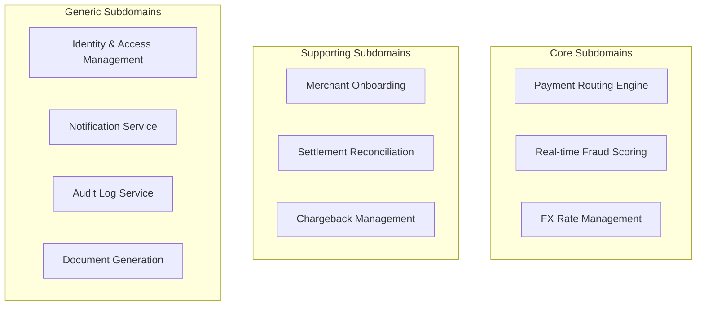
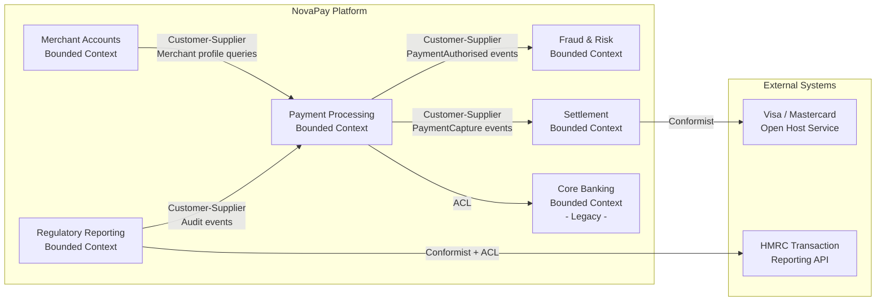

Domain-Driven Design's strategic patterns address the question that derails most large-scale fintech systems: how do you structure a complex domain — payments, lending, compliance, risk — across multiple teams and codebases without creating a distributed monolith where every change requires cross-team coordination? Strategic DDD gives engineering leaders the vocabulary and tools to carve a large domain into well-bounded, independently evolvable models, each with its own language and rules, connected through explicit contracts. In regulated fintech, where the cost of coupling manifests as slow releases, failed audits, and cascading production incidents, these patterns are not academic — they are survival tools.

## Learning Objectives

- Define and distinguish domain, subdomain, bounded context, and ubiquitous language using fintech-specific examples
- Classify the subdomains of a payment platform as core, supporting, or generic and justify the investment implications of each classification
- Apply a systematic process for identifying bounded context boundaries from business capabilities and linguistic differences
- Describe all eight context map relationship patterns and select the appropriate pattern for a given inter-team relationship
- Implement an Anti-Corruption Layer in Java that translates between a legacy core banking model and a new payments domain model
- Read and produce a C4-style context map diagram for a fintech platform with at least four bounded contexts
- Explain the relationship between event storming and bounded context discovery
- Articulate why bounded contexts and microservices are independent design decisions and when a 1:1 mapping is inappropriate

## Business Context

NovaPay, a full-stack payment institution, is six years old. Its original monolithic Java application has been decomposed into 34 microservices, but the team is experiencing the classic "distributed monolith" problem: changing the payment processing logic requires coordinating deployments across 11 services, shared database tables are owned by nobody, and the word "account" means three different things depending on which Slack channel you're in. A three-week discovery workshop revealed that the root cause is not the technology — it is the absence of bounded context discipline. Payment processing, risk scoring, merchant management, settlement, and compliance reporting all share the same domain model and language, creating invisible coupling that makes independent evolution impossible. The engineering cost of this coupling has been estimated at £2.1 million per year in delayed features and incident remediation.

## Core DDD Vocabulary

Precision in language is the foundation of DDD. Many of the conflicts in large engineering teams arise from using the same words to mean different things, or different words to mean the same thing. DDD provides a vocabulary that makes these conflicts explicit and resolvable.

**Domain** — The subject area the software addresses. For NovaPay, the domain is "electronic payment processing and financial services." The domain exists in the real world, independent of any software; the software is a model of a subset of the domain.

**Subdomain** — A coherent segment of the domain with its own business logic, terminology, and rules. Payment processing, fraud detection, merchant onboarding, and regulatory reporting are distinct subdomains of NovaPay's domain.

**Bounded Context** — A logical boundary within which a specific domain model is defined and applicable. Within a bounded context, every term has exactly one meaning, every concept has exactly one representation, and the team owns the model. A bounded context is a *design* decision; a subdomain is a *discovery* of what the business does.

**Ubiquitous Language** — The shared vocabulary used by both domain experts and engineers within a bounded context. The language appears in code (class names, method names, variable names), in conversations, in documentation, and in tests. If the code says `PaymentOrder` but the business team says "transaction," there is a ubiquitous language gap that will produce bugs.

> [!NOTE]
> A ubiquitous language is scoped to a bounded context. The word "account" in the Payment Processing context (a merchant's payment account) means something entirely different from "account" in the Core Banking context (a customer's current account). This is not a problem to fix — it is a design feature. Each context owns its definition.

**Context Map** — A document or diagram that shows the relationships between bounded contexts, the nature of those relationships (which team is upstream/downstream), and the integration pattern used at each boundary.

## Subdomains: Core, Supporting, and Generic

Not all subdomains deserve equal engineering investment. DDD's subdomain classification — core, supporting, and generic — guides where to build bespoke software and where to buy or use off-the-shelf solutions.

| Subdomain Type | Definition | Investment Strategy | NovaPay Examples |
|---|---|---|---|
| **Core** | Directly delivers competitive advantage; unique to the company | In-house, best engineers, continuous refinement | Real-time payment routing engine, proprietary fraud scoring model |
| **Supporting** | Necessary for the core to function but not differentiating | In-house but simpler patterns acceptable; buy-vs-build viable | Merchant onboarding workflow, settlement reconciliation |
| **Generic** | Standard business function with commodity solutions available | Buy (SaaS), use open source, or use a framework | Email notifications, PDF generation, authentication (OAuth2/OIDC), audit logging |

> [!IMPORTANT]
> The classification of a subdomain determines how you staff it. Your most experienced engineers should own core subdomains. Using a principal engineer to build a custom email notification system (a generic subdomain) instead of integrating SendGrid is a misallocation of your most valuable resource. This is a strategic, not a technical, decision.



## Bounded Context Identification

Identifying bounded context boundaries is a discovery process, not a design exercise. The boundaries emerge from the business — they are found, not invented. Three heuristics guide the discovery:

**1. Linguistic discontinuity.** When the same word means different things to different business stakeholders, you have crossed a potential context boundary. At NovaPay, "transaction" means a payment instruction in the Payment Processing team, a ledger entry in the Accounting team, and a risk event in the Fraud team. These three meanings should live in three distinct bounded contexts with three distinct `Transaction` classes (or no `Transaction` class at all — perhaps `PaymentOrder`, `LedgerEntry`, and `RiskEvent` are more precise in their respective contexts).

**2. Organisational boundaries.** Conway's Law states that systems reflect the communication structures of their organisations. If the Fraud team and the Payments team never need to coordinate to deliver a feature independently, they are probably in separate bounded contexts. If they always coordinate, they may be in the same context or have a tightly coupled relationship that needs to be made explicit.

**3. Business capability cohesion.** A bounded context groups business capabilities that change together for the same reason. Payment authorisation and payment capture change together when card network rules change. Settlement reconciliation changes when banking cutoff times change. These different drivers suggest different contexts.

> [!WARNING]
> Avoid the trap of mapping bounded contexts directly to database tables or microservice deployments. These are implementation concerns. Identify contexts by business language and capability first; the deployment topology follows later.

## Context Map Patterns

Once you have identified bounded contexts, you must document and design the relationships between them. DDD defines eight relationship patterns that describe both the technical and organisational dynamics of context integration.

| Pattern | Relationship Type | Organisational Dynamic | Integration Mechanism |
|---|---|---|---|
| **Partnership** | Mutual dependency | Teams plan together; joint releases | Shared interfaces, coordinated APIs |
| **Shared Kernel** | Shared model subset | Agreed by both teams; changes require consensus | Shared library, shared schema subset |
| **Customer-Supplier** | Downstream depends on upstream | Upstream prioritises downstream's needs | API contract, versioned endpoints |
| **Conformist** | Downstream adopts upstream model unchanged | Upstream has no incentive to serve downstream | Direct model adoption, no translation |
| **Anti-Corruption Layer (ACL)** | Downstream translates upstream model | Downstream protects its model from upstream influence | Translation layer, adapter pattern |
| **Open Host Service (OHS)** | Upstream publishes a formal protocol | Upstream serves multiple consumers | Published API specification |
| **Published Language (PL)** | Shared exchange format | Community standard or company standard | JSON Schema, Avro schema, AsyncAPI |
| **Separate Ways** | No integration | Teams operate independently | None |

> [!NOTE]
> Customer-Supplier and Conformist look similar but differ in power dynamics. In Customer-Supplier, the upstream team responds to the downstream team's needs (the downstream team is the "customer"). In Conformist, the upstream team does not accommodate the downstream team, so the downstream team must adopt the upstream model as-is — a common situation when integrating with a dominant external partner like Visa or SWIFT.

## Anti-Corruption Layer in Java

The Anti-Corruption Layer is the most important pattern for fintech teams inheriting legacy core banking systems. The ACL sits at the boundary between the legacy system (with its entangled, inconsistent model) and your clean domain model, translating between the two without polluting your domain with legacy concepts.

Consider NovaPay's integration with its legacy core banking system, which exposes a SOAP/XML API using 1990s banking terminology. The legacy system calls a payment a `FinancialTransaction` with a `DrCrIndicator` of `D` or `C`. The new Payment Service uses `PaymentOrder` with explicit `debit` and `credit` concepts.

```java
// domain/model/PaymentOrder.java — clean domain model
public record PaymentOrder(
    PaymentOrderId id,
    Money amount,
    Currency currency,
    AccountId debitAccount,
    AccountId creditAccount,
    PaymentOrderStatus status,
    Instant createdAt
) {}

// domain/model/Money.java
public record Money(BigDecimal amount, Currency currency) {
    public Money {
        Objects.requireNonNull(amount, "amount must not be null");
        Objects.requireNonNull(currency, "currency must not be null");
        if (amount.compareTo(BigDecimal.ZERO) < 0) {
            throw new IllegalArgumentException("Money amount must not be negative");
        }
    }

    public Money add(Money other) {
        if (!this.currency.equals(other.currency)) {
            throw new CurrencyMismatchException(this.currency, other.currency);
        }
        return new Money(this.amount.add(other.amount), this.currency);
    }
}
```

```java
// infrastructure/acl/CoreBankingTranslator.java — the Anti-Corruption Layer
@Component
public class CoreBankingTranslator {

    // Translates FROM legacy core banking model TO domain model
    public PaymentOrder fromLegacyTransaction(FinancialTransactionDto legacyTx) {
        validateLegacyTransaction(legacyTx);

        // Translate legacy DrCrIndicator to explicit debit/credit accounts
        AccountId debitAccount = legacyTx.getDrCrIndicator().equals("D")
            ? AccountId.of(legacyTx.getAccountNumber())
            : AccountId.of(legacyTx.getCounterpartyAccountNumber());

        AccountId creditAccount = legacyTx.getDrCrIndicator().equals("C")
            ? AccountId.of(legacyTx.getAccountNumber())
            : AccountId.of(legacyTx.getCounterpartyAccountNumber());

        // Translate legacy amount (stored as pence integer) to Money
        BigDecimal amount = BigDecimal.valueOf(legacyTx.getAmountPence())
            .divide(BigDecimal.valueOf(100), 2, RoundingMode.UNNECESSARY);

        return new PaymentOrder(
            PaymentOrderId.of(legacyTx.getTxRef()),
            new Money(amount, Currency.getInstance(legacyTx.getCurrencyCode())),
            Currency.getInstance(legacyTx.getCurrencyCode()),
            debitAccount,
            creditAccount,
            translateStatus(legacyTx.getStatusCode()),
            legacyTx.getValueDate().toInstant(ZoneOffset.UTC)
        );
    }

    // Translates FROM domain model TO legacy core banking model
    public FinancialTransactionDto toLegacyTransaction(PaymentOrder order) {
        FinancialTransactionDto dto = new FinancialTransactionDto();
        dto.setTxRef(order.id().value());
        dto.setAccountNumber(order.debitAccount().value());
        dto.setCounterpartyAccountNumber(order.creditAccount().value());
        dto.setDrCrIndicator("D"); // Debit the source account
        dto.setAmountPence(
            order.amount().amount()
                .multiply(BigDecimal.valueOf(100))
                .setScale(0, RoundingMode.UNNECESSARY)
                .longValueExact()
        );
        dto.setCurrencyCode(order.currency().getCurrencyCode());
        dto.setStatusCode(translateStatusToLegacy(order.status()));
        return dto;
    }

    private PaymentOrderStatus translateStatus(String legacyCode) {
        return switch (legacyCode) {
            case "00" -> PaymentOrderStatus.ACCEPTED;
            case "01" -> PaymentOrderStatus.PENDING;
            case "10" -> PaymentOrderStatus.REJECTED;
            case "99" -> PaymentOrderStatus.FAILED;
            default -> throw new UnknownLegacyStatusException(legacyCode);
        };
    }

    private void validateLegacyTransaction(FinancialTransactionDto legacyTx) {
        if (legacyTx.getDrCrIndicator() == null ||
            (!legacyTx.getDrCrIndicator().equals("D") && !legacyTx.getDrCrIndicator().equals("C"))) {
            throw new InvalidLegacyModelException(
                "Invalid DrCrIndicator: " + legacyTx.getDrCrIndicator()
            );
        }
    }
}
```

> [!IMPORTANT]
> The ACL must live in the **infrastructure** layer, not the domain layer. The domain model must never know about the legacy `FinancialTransactionDto`. If `FinancialTransactionDto` is ever imported in a domain class, the ACL has been violated and the legacy model has contaminated your domain.

## Context Map for a Fintech Platform



## Event Storming Overview

Event Storming, created by Alberto Brandolini, is a collaborative workshop technique for discovering bounded contexts, aggregates, and domain events. It is the most effective tool for the initial DDD discovery phase before writing any code.

A Big Picture Event Storming session for NovaPay's payment flow would surface domain events on orange sticky notes, commands on blue, actors on yellow, and aggregates on large yellow stickies. The natural clustering of events around shared state (all events touching the `Payment` concept cluster together; all events touching the `Settlement` concept cluster separately) reveals bounded context boundaries.

The key output of an event storming session is not a finished design — it is the identification of:
- Domain events that the business cares about (not technical events)
- The commands that trigger those events
- The aggregates that maintain the state
- The natural language boundaries where terminology shifts

> [!NOTE]
> Event Storming is a workshop, not a solo activity. The value comes from the conversations between domain experts and engineers when they disagree about terminology or sequence. A single engineer doing event storming on a whiteboard is modelling, not discovering.

## Bounded Contexts vs Microservices

One of the most common and costly DDD misapplications is the belief that one bounded context must map to exactly one microservice. This 1:1 mapping is a default, not a rule, and it is frequently the wrong choice.

| Scenario | Appropriate Mapping | Reason |
|---|---|---|
| Small team (<5 engineers), two contexts tightly coupled | 1 service, 2 contexts | Deployment overhead not justified; contexts share enough infrastructure |
| Mature context with clear ownership and independent scaling needs | 1 context → 1 service | The classic case; mapping is appropriate here |
| Complex context with high internal variation | 1 context → multiple modules within 1 service | Internal modular monolith; avoids distributed transaction complexity |
| Two teams own the same domain capability | 2 contexts → 1 service (temporarily) | Strangler fig pattern during context separation |

The rule is: **bounded context boundaries are always respected in the domain model; they may or may not be respected in the deployment topology.** A well-designed modular monolith with clear bounded context boundaries is infinitely easier to split later than a "microservices" deployment where service boundaries were drawn arbitrarily and contexts are tangled across services.

> [!WARNING]
> Creating a microservice for every aggregate or entity is the most expensive DDD mistake in fintech. Each service boundary is a distributed transaction boundary, and distributed transactions across payment systems introduce consistency risks that are difficult to manage and even harder to audit. Split services when organisational or operational need drives it, not on principle.

## Knowledge Check

**Q:** The NovaPay risk team and payments team both have a concept called "Account." The risk team's Account includes credit limit, risk score, and exposure history. The payments team's Account includes settlement currency, merchant category code, and acquirer routing. A well-meaning architect proposes creating a shared `Account` service so both teams use the same model. Explain why this is a DDD anti-pattern and what the correct approach is.

**A:** This proposal violates the bounded context principle by forcing two distinct models into a single shared representation. The risk team's Account and the payments team's Account are different concepts that happen to share a name — they have different attributes, different invariants, different rates of change, and different owners. A shared `Account` service would create a Shared Kernel relationship, which requires both teams to coordinate on every model change. In practice, this coordination overhead means neither team can evolve their model independently, creating exactly the coupling that bounded contexts are designed to prevent. The correct approach is to maintain two distinct `Account` models — `RiskAccount` in the Fraud & Risk context and `MerchantPaymentAccount` in the Payment Processing context — and use a Customer-Supplier or ACL relationship to share only the data each context actually needs from the other, in the form of events or explicit API calls. The fact that both are called "Account" in English conversation is a linguistic coincidence that should be resolved by adopting the more precise ubiquitous language terms in each context.

**Q:** NovaPay's Payment Processing context calls SWIFT's payment network, which uses ISO 20022 message format. The team is debating whether to adopt the ISO 20022 message model directly in their domain (Conformist) or to translate it to the payment domain model (ACL). What criteria should drive this decision?

**A:** The decision turns on whether SWIFT's ISO 20022 model is a suitable representation for the Payment Processing domain's core concepts, or whether it is an external standard that happens to carry the same data. ISO 20022 is designed for interoperability across all financial institutions globally — it is a deliberately generic message format, not a domain model optimised for NovaPay's specific business rules. Adopting it as the domain model (Conformist) would mean the domain code speaks SWIFT's language of `FinancialInstrument`, `CreditTransferTransaction`, and `RemittanceInformation` rather than NovaPay's language of `PaymentOrder`, `Beneficiary`, and `PaymentReference`. The ACL approach is correct here: an ISO 20022 adapter in the infrastructure layer translates incoming SWIFT messages to `PaymentOrder` domain objects, and outgoing `PaymentOrder` objects to ISO 20022 messages. This isolates the domain from SWIFT schema version changes (ISO 20022 has had four major versions) and allows the domain model to evolve independently of the interoperability standard.

## Practical Challenge

1. **Subdomain classification workshop.** Take a digital lending platform with the following capabilities: loan origination, credit scoring (proprietary ML model), document verification, loan servicing (repayment processing), collections (late payment management), regulatory reporting (FCA consumer credit reporting), customer identity management, and email/SMS notifications. Classify each capability as Core, Supporting, or Generic. For each Core subdomain, write one sentence justifying why it is differentiating. For each Generic subdomain, name one SaaS or open-source solution that could replace a custom implementation.

2. **Context map creation.** For the same lending platform, identify at least five bounded contexts by applying the linguistic discontinuity and business capability cohesion heuristics. Draw a context map (Mermaid diagram) showing the contexts, their relationships, and the integration pattern at each boundary (Customer-Supplier, ACL, Conformist, etc.). Label every relationship arrow with the pattern name and a one-sentence description of what flows across it.

3. **Implement an ACL.** The lending platform's Credit Scoring context calls an external Equifax credit bureau API that returns a `CreditReport` DTO with fields including `experiancScore` (note: intentional typo from the external API), `ccjCount`, `bankruptcyFlag`, and `annualIncomeVerified`. The lending domain model uses a `CreditAssessment` with fields `creditScore`, `adverseEventCount`, `isInsolvent`, and `verifiedAnnualIncome`. Write a Java `EquifaxCreditBureauTranslator` class that translates between the two models. Include field-level validation, error handling for missing or malformed fields, and unit tests covering at least three translation scenarios including one error case.

4. **Ubiquitous language audit.** Review the following Java class names from an existing fintech codebase and identify any that violate ubiquitous language principles (using generic or technical names instead of domain-specific names): `DataProcessor`, `AccountManager`, `TransactionHandler`, `PaymentOrderSubmissionService`, `EntityRepository`, `UserAccount`, `BusinessLogicService`, `FraudCheckResult`. For each violating name, propose a replacement that uses the ubiquitous language of the payment processing bounded context and explain the business concept it should represent.

<!-- KNOWLEDGE-CHECK
{
  "questions": [
    {
      "text": "NovaPay's payments team and risk team both have a concept called 'Account.' A well-meaning architect proposes creating a shared Account service so both teams use the same model. Which DDD principle does this violate?",
      "options": [
        "The Repository pattern, because two teams cannot share a single repository interface.",
        "The Bounded Context principle, because two distinct domain models with different attributes and owners are being forced into a single shared representation.",
        "The Aggregate Root principle, because an Account cannot be both a payment entity and a risk entity simultaneously.",
        "The Anti-Corruption Layer pattern, because the shared service would need to translate between two different models."
      ],
      "correct": 1,
      "explanation": "This violates the Bounded Context principle. The risk team's Account and the payments team's Account are different concepts that share a name. Forcing them into a shared service creates a Shared Kernel relationship requiring coordination on every model change, eliminating independent evolution — exactly what bounded contexts are designed to prevent."
    },
    {
      "text": "NovaPay's real-time payment routing engine is best classified as which type of subdomain?",
      "options": [
        "Generic — it is a commodity capability available from multiple vendors.",
        "Supporting — it is necessary but does not differentiate NovaPay from competitors.",
        "Core — it directly delivers competitive advantage and is unique to the company.",
        "Infrastructure — it is a technical foundation rather than a business capability."
      ],
      "correct": 2,
      "explanation": "A proprietary real-time payment routing engine is a Core subdomain because it directly delivers competitive advantage and is unique to the company. Core subdomains should be staffed with the best engineers and continuously refined because they are the primary source of business differentiation."
    },
    {
      "text": "NovaPay integrates with SWIFT's ISO 20022 payment network. The team is debating whether to adopt the ISO 20022 message model directly in their domain (Conformist) or to translate it to the payment domain model (ACL). Which approach is correct and why?",
      "options": [
        "Conformist, because using the industry-standard model reduces the total code the team must maintain.",
        "Anti-Corruption Layer, because ISO 20022 is a generic interoperability standard not optimised for NovaPay's specific business rules, and the ACL isolates the domain from SWIFT schema version changes.",
        "Conformist, because SWIFT has regulatory authority over payment message formats and the team has no choice but to adopt their model.",
        "Anti-Corruption Layer only during the initial integration; after six months the team should switch to Conformist to reduce translation overhead."
      ],
      "correct": 1,
      "explanation": "The ACL is correct. ISO 20022 is designed for global interoperability, not for NovaPay's specific domain. Using it as the domain model would mean domain code speaks SWIFT's vocabulary rather than NovaPay's. The ACL isolates the domain from SWIFT schema version changes (there have been four major versions) and allows the domain model to evolve independently of the interoperability standard."
    }
  ]
}
-->

<!-- PRACTICAL-CHALLENGE
{
  "title": "Strategic DDD for a Digital Lending Platform",
  "difficulty": "advanced",
  "estimatedMinutes": 60,
  "tasks": [
    {"id": "1", "description": "For a digital lending platform with capabilities including loan origination, proprietary ML credit scoring, document verification, loan servicing, collections, FCA regulatory reporting, customer identity management, and email/SMS notifications — classify each capability as Core, Supporting, or Generic. For each Core subdomain, write one sentence justifying why it is differentiating. For each Generic subdomain, name one SaaS or open-source solution that could replace a custom implementation."},
    {"id": "2", "description": "Identify at least five bounded contexts for the lending platform by applying the linguistic discontinuity and business capability cohesion heuristics. Draw a Mermaid context map showing each context, its relationships, and the integration pattern at each boundary (Customer-Supplier, ACL, Conformist, etc.). Label every relationship arrow with the pattern name and a one-sentence description of what flows across it."},
    {"id": "3", "description": "The Credit Scoring context calls an external Equifax API that returns a CreditReport DTO with fields including experiancScore (intentional typo from the external API), ccjCount, bankruptcyFlag, and annualIncomeVerified. The domain model uses CreditAssessment with creditScore, adverseEventCount, isInsolvent, and verifiedAnnualIncome. Write a Java EquifaxCreditBureauTranslator ACL class that translates between the two models, includes field-level validation, handles missing or malformed fields, and has unit tests covering at least three translation scenarios including one error case."},
    {"id": "4", "description": "Review the class names DataProcessor, AccountManager, TransactionHandler, PaymentOrderSubmissionService, EntityRepository, UserAccount, BusinessLogicService, and FraudCheckResult from an existing codebase. Identify which violate ubiquitous language principles. For each violating name, propose a domain-specific replacement and explain the business concept it should represent in the payment processing bounded context."}
  ]
}
-->
