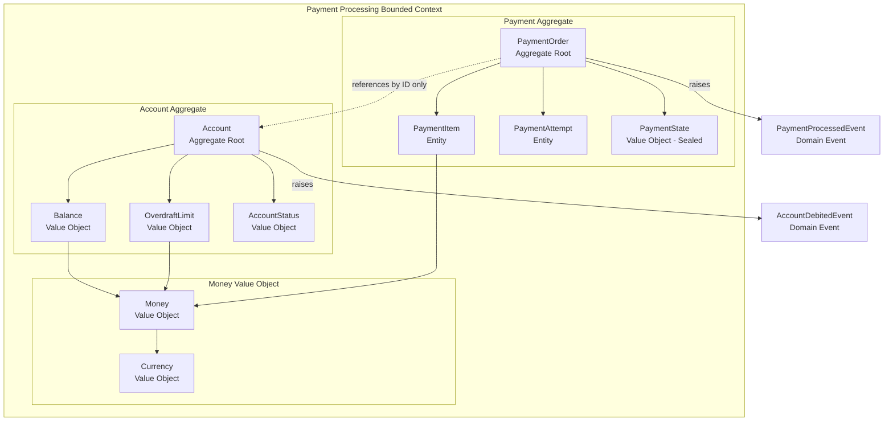

يحدد التصميم الاستراتيجي في DDD أين تقع حدود مجالك؛ أما التصميم التكتيكي فيحدد ما يعيش داخلها. والوحدات التكتيكية — الكيانات (Entities)، وكائنات القيمة (Value Objects)، والتجميعات (Aggregates)، والمستودعات (Repositories)، وأحداث المجال (Domain Events) — هي الأنماط التي تعطي نموذج المجال في Java سلامته البنيوية، وتضمن فرض قواعد العمل عند النقطة التي تتغير فيها الحالة، لا بعثرتها بين طبقات الخدمات ومُطلِقات قاعدة البيانات. وفي التقنية المالية، حيث قد يؤدي رصيد واحد محسوب خطأً أو انتقال حالة غير مُتحقَّق منه إلى غرامات تنظيمية وضرر للعملاء، ليست هذه الأنماط تحسينات اختيارية — بل خط الدفاع الأول ضد حركة الأموال الخاطئة.

## أهداف التعلّم

- التمييز بين الكيان وكائن القيمة والتجميع بتعريفات دقيقة وأمثلة من التقنية المالية
- تنفيذ كائن القيمة `Money` في Java بحيث يتعامل بشكل صحيح مع عدم القابلية للتغيير، ومعرفة العملة، والعمليات الحسابية
- تصميم تجميع `Account` يفرض ثوابت العمل ويمنع انتقالات الحالة غير الصالحة
- شرح أهمية جذر التجميع (Aggregate Root) ولماذا يجب أن يعمل الحفظ عند حدود التجميع
- كتابة واجهة `AccountRepository` تعيش في طبقة المجال دون استيراد JPA أو أي اعتمادية بنية تحتية
- إطلاق أحداث المجال من داخل التجميع ونشرها عبر `ApplicationEventPublisher` في Spring
- استخدام الواجهات المختومة (sealed interfaces) ومطابقة الأنماط في Java لتمثيل حالة المجال بشكل شامل وآمن
- التعرف على النمط الخاطئ "نموذج المجال الهزيل" (Anemic Domain Model) وإعادة هيكلة مثال من نموذج هزيل إلى نموذج غني

## سياق العمل

‏Zephyr Bank بنك رقمي بريطاني لديه 1.4 مليون حساب نشط. في الربع الأخير من 2025، تسبب حادث إنتاج في نزول 847 حسابًا تحت الصفر — رصيد سالب — أثناء دفقة معالجة مدفوعات متزامنة. السبب الجذري: كان التحقق من الرصيد يتم في الصنف `PaymentService`، لا داخل الكيان `Account`. فعندما وصلت ثلاثة طلبات دفع متزامنة إلى الحساب نفسه في اللحظة نفسها، قرأت الخيوط الثلاثة الرصيد نفسه، واجتازت الثلاثة فحص التحقق، وخصمت الثلاثة من الحساب. وكان نموذج التجميع الذي كان يجب على الفريق تنفيذه سيمنع ذلك: يُفحص الثابت داخل التجميع `Account`، ويُحمَّل التجميع مع قفل صف (أو يُحفظ مع فحص إصدار) حتى تتسلسل عمليات الخصم المتزامنة على الحساب نفسه. والثابت وحده لا يكفي — فبدون القفل أو فحص الإصدار، تستطيع ثلاثة خيوط اجتيازه على الرصيد القديم نفسه. وكلّف الحادث 340,000 جنيه إسترليني في المعالجة وتعويض العملاء وأعباء الإبلاغ إلى هيئة FCA.

## الكيان وكائن القيمة والتجميع

لوحدات البناء الأساسية الثلاث في نموذج مجال DDD تعريفات دقيقة. واستخدامها بشكل خاطئ أكثر مصادر العيوب شيوعًا في نماذج المجال في أنظمة التقنية المالية.

**الكيان (Entity)** — كائن تحدده هويته لا خصائصه. يكون كيانان هما الشيء نفسه إذا كانت لهما الهوية نفسها، حتى لو اختلفت كل خصائصهما الأخرى. الحساب `Account` كيان: رقم الحساب `GB29NWBK60161331926819` يشير إلى الحساب نفسه سواء كان رصيده 0 أو 10,000 جنيه.

**كائن القيمة (Value Object)** — كائن تحدده خصائصه بالكامل. كائنا قيمة بالخصائص نفسها قابلان للتبادل؛ ولا يوجد مفهوم هوية ذو معنى. فالقيمة `Money(100.00, GBP)` هي نفسها أي `Money(100.00, GBP)` أخرى. وكائنات القيمة غير قابلة للتغيير: أي "تغيير" ينتج نسخة جديدة.

**التجميع (Aggregate)** — مجموعة من الكيانات وكائنات القيمة يجب أن تبقى متسقة معًا، مع تعيين كيان واحد **جذرًا للتجميع**. وكل وصول إلى التجميع من الخارج يمر عبر الجذر. والجذر يفرض الثوابت على المجموعة كلها.

| الخاصية | الكيان | كائن القيمة | التجميع |
|---|---|---|---|
| **الهوية** | له هوية فريدة (معرّف) | تحدده خصائصه | الكيان الجذر يوفر الهوية |
| **قابلية التغيير** | قابل للتغيير (تتغير حالته خلال عمره) | غير قابل للتغيير (كائن جديد عند التغيير) | قابل للتغيير داخليًا؛ ومضبوط من الخارج |
| **المساواة** | مساواة المعرّف | مساواة الخصائص (كل الحقول) | مساواة هوية الجذر |
| **دورة الحياة** | له دورة حياة (إنشاء، وتعديل، وحذف) | بلا دورة حياة؛ يُنشأ عند الحاجة | الجذر يتحكم في دورة حياة كل الأعضاء |
| **أمثلة مالية** | ‏Account، وPaymentOrder، وMerchant | ‏Money، وCurrency، وIBAN، وAccountNumber | ‏Account (الجذر) + Balance + OverdraftLimit — لا كامل تاريخ معاملاته |

## كائن القيمة Money

‏`Money` أهم كائن قيمة في أي نموذج مجال مالي. يغلّف المبلغ والعملة، ويفرض عدم القابلية للتغيير، ويمنع أخطاء حساب الفاصلة العائمة، ويجعل عدم تطابق العملات أمرًا لا يمكن تجاهله.

```java
// domain/model/money/Money.java
public record Money(BigDecimal amount, Currency currency) {

    // Canonical constructor with validation
    public Money {
        Objects.requireNonNull(amount, "amount must not be null");
        Objects.requireNonNull(currency, "currency must not be null");
        // Normalise scale to the currency's default fraction digits
        amount = amount.setScale(currency.getDefaultFractionDigits(), RoundingMode.UNNECESSARY);
    }

    // Factory methods for common cases
    public static Money of(long units, Currency currency) {
        return new Money(BigDecimal.valueOf(units), currency);
    }

    public static Money of(String amount, String currencyCode) {
        return new Money(
            new BigDecimal(amount),
            Currency.getInstance(currencyCode)
        );
    }

    public static Money zero(Currency currency) {
        return new Money(BigDecimal.ZERO.setScale(
            currency.getDefaultFractionDigits()), currency);
    }

    // Arithmetic — always produces a new Money instance
    public Money add(Money other) {
        assertSameCurrency(other);
        return new Money(this.amount.add(other.amount), this.currency);
    }

    public Money subtract(Money other) {
        assertSameCurrency(other);
        return new Money(this.amount.subtract(other.amount), this.currency);
    }

    public Money multiply(BigDecimal factor) {
        return new Money(
            this.amount.multiply(factor).setScale(
                currency.getDefaultFractionDigits(), RoundingMode.HALF_EVEN),
            this.currency
        );
    }

    // Comparison
    public boolean isGreaterThan(Money other) {
        assertSameCurrency(other);
        return this.amount.compareTo(other.amount) > 0;
    }

    public boolean isNegative() {
        return this.amount.compareTo(BigDecimal.ZERO) < 0;
    }

    public boolean isZero() {
        return this.amount.compareTo(BigDecimal.ZERO) == 0;
    }

    private void assertSameCurrency(Money other) {
        if (!this.currency.equals(other.currency)) {
            throw new CurrencyMismatchException(
                "Cannot operate on %s and %s".formatted(this.currency, other.currency)
            );
        }
    }

    @Override
    public String toString() {
        return "%s %s".formatted(currency.getCurrencyCode(), amount.toPlainString());
    }
}
```

> [!NOTE]
> توفر سجلات Java (records) الدالتين `equals()` و`hashCode()` اعتمادًا على كل المكوّنات افتراضيًا، فيكون `Money` كائن قيمة صحيحًا بلا شيفرة متكررة. ويضمن `RoundingMode.UNNECESSARY` في المُنشئ القانوني أن المبلغ الذي فيه منازل عشرية أكثر مما تدعمه العملة (مثل `Money(10.001, GBP)`) يرمي `ArithmeticException` بدل أن يفقد الدقة بصمت — وهذا السلوك الصحيح في الحسابات المالية.

```java
// domain/model/money/CurrencyMismatchException.java
public class CurrencyMismatchException extends RuntimeException {
    public CurrencyMismatchException(String message) {
        super(message);
    }
}
```

## التجميع Account

يوضح التجميع `Account` كيف تُفرض ثوابت العمل على مستوى نموذج المجال. جذر التجميع (`Account`) هو نقطة الدخول الوحيدة لتغييرات الحالة؛ يتحقق من كل الثوابت قبل تغيير الحالة، ويطلق أحداث المجال لإبلاغ بقية النظام بالتغييرات.

```java
// domain/model/account/AccountId.java
public record AccountId(UUID value) {
    public AccountId {
        Objects.requireNonNull(value, "AccountId value must not be null");
    }
    public static AccountId generate() {
        return new AccountId(UUID.randomUUID());
    }
    public static AccountId of(String value) {
        return new AccountId(UUID.fromString(value));
    }
}
```

```java
// domain/model/account/Account.java
public class Account {

    private final AccountId id;
    private final AccountOwnerId ownerId;
    private Money balance;
    private AccountStatus status;
    private Money overdraftLimit;
    private final List<DomainEvent> domainEvents = new ArrayList<>();

    // Private constructor — use factory method
    private Account(AccountId id, AccountOwnerId ownerId, Money initialBalance,
                    Money overdraftLimit) {
        this.id = Objects.requireNonNull(id);
        this.ownerId = Objects.requireNonNull(ownerId);
        this.balance = Objects.requireNonNull(initialBalance);
        this.overdraftLimit = Objects.requireNonNull(overdraftLimit);
        this.status = AccountStatus.ACTIVE;
    }

    // Factory method — the only way to create an Account
    public static Account open(AccountOwnerId ownerId, Currency currency) {
        AccountId newId = AccountId.generate();
        Money zero = Money.zero(currency);
        Account account = new Account(newId, ownerId, zero, zero);
        account.domainEvents.add(new AccountOpenedEvent(newId, ownerId, currency));
        return account;
    }

    // ── Commands ───────────────────────────────────────────────────────────

    public void credit(Money amount, String reference) {
        assertActive();
        assertPositive(amount);
        this.balance = this.balance.add(amount);
        domainEvents.add(new AccountCreditedEvent(this.id, amount, reference, balance));
    }

    public void debit(Money amount, String reference) {
        assertActive();
        assertPositive(amount);
        // INVARIANT: balance must never go below -overdraftLimit
        Money projectedBalance = this.balance.subtract(amount);
        Money floor = Money.zero(balance.currency()).subtract(overdraftLimit);
        if (floor.isGreaterThan(projectedBalance)) {
            throw new InsufficientFundsException(
                "Debit of %s would breach overdraft limit. Balance: %s, Limit: %s"
                    .formatted(amount, balance, overdraftLimit)
            );
        }
        this.balance = projectedBalance;
        domainEvents.add(new AccountDebitedEvent(this.id, amount, reference, balance));
    }

    public void freeze(String reason) {
        if (this.status == AccountStatus.FROZEN) {
            return; // idempotent
        }
        this.status = AccountStatus.FROZEN;
        domainEvents.add(new AccountFrozenEvent(this.id, reason));
    }

    public void close() {
        if (!balance.isZero()) {
            throw new AccountNotEmptyException(
                "Cannot close account %s with non-zero balance: %s".formatted(id, balance)
            );
        }
        this.status = AccountStatus.CLOSED;
        domainEvents.add(new AccountClosedEvent(this.id));
    }

    // ── Queries ────────────────────────────────────────────────────────────

    public AccountId id() { return id; }
    public Money balance() { return balance; }
    public AccountStatus status() { return status; }

    public List<DomainEvent> drainDomainEvents() {
        List<DomainEvent> events = List.copyOf(domainEvents);
        domainEvents.clear();
        return events;
    }

    // ── Invariant guards ───────────────────────────────────────────────────

    private void assertActive() {
        if (status != AccountStatus.ACTIVE) {
            throw new AccountNotActiveException(
                "Account %s is %s".formatted(id, status)
            );
        }
    }

    private void assertPositive(Money amount) {
        if (amount.isNegative() || amount.isZero()) {
            throw new IllegalArgumentException(
                "Amount must be positive, got: " + amount
            );
        }
    }
}
```

لاحظ ثابت الخصم: الرصيد بعد الخصم يجب ألا ينزل تحت سالب حد السحب على المكشوف (`floor`). وإذا كان الحد صفرًا، فالأرضية صفر ولا يُسمح بأي رصيد سالب.

> [!IMPORTANT]
> تملأ كل عملية تغيّر الحالة القائمة `domainEvents` داخل التجميع، وتفرغها خدمة التطبيق بعد الحفظ. هذا النمط ("مجموعة أحداث المجال") يُبقي التجميع خاليًا من شيفرة المراسلة ويجعل الأحداث جزءًا من تغيير الحالة. لكنه **لا** يضمن وحده أن تُنشر الأحداث فقط بعد التزام البيانات: فمع JPA يصل `save()` عادة إلى قاعدة البيانات عند الالتزام، و`@EventListener` العادي يعمل داخل المعاملة نفسها. استخدم `@TransactionalEventListener(phase = AFTER_COMMIT)` للآثار الجانبية خارج قاعدة البيانات، ونمط Transactional Outbox للأحداث التي يجب أن تتلقاها خدمات أخرى.

## الواجهات المختومة لحالة المجال

تتيح الواجهات المختومة في Java 17 وما بعده تمثيل حالة المجال بشكل شامل وآمن، فتجعل انتقالات الحالة غير المسموحة غير قابلة للتمثيل وقت الترجمة.

```java
// domain/model/payment/PaymentState.java
public sealed interface PaymentState
    permits PaymentState.Pending, PaymentState.Authorised,
            PaymentState.Captured, PaymentState.Voided, PaymentState.Refunded {

    record Pending(Instant submittedAt) implements PaymentState {}

    record Authorised(Instant authorisedAt, String authorisationCode) implements PaymentState {}

    record Captured(Instant capturedAt, Money capturedAmount) implements PaymentState {}

    record Voided(Instant voidedAt, String voidReason) implements PaymentState {}

    record Refunded(Instant refundedAt, Money refundedAmount) implements PaymentState {}
}
```

```java
// Usage in an application service with pattern matching (Java 21)
public PaymentReceipt processPaymentEvent(Payment payment, PaymentEvent event) {
    return switch (payment.state()) {
        case PaymentState.Pending(var submittedAt) ->
            handlePendingPayment(payment, event, submittedAt);
        case PaymentState.Authorised(var authorisedAt, var code) ->
            handleAuthorisedPayment(payment, event, code);
        case PaymentState.Captured c ->
            throw new IllegalStateException(
                "Cannot process event on already-captured payment");
        case PaymentState.Voided v ->
            throw new IllegalStateException("Cannot process event on voided payment");
        case PaymentState.Refunded r ->
            throw new IllegalStateException("Cannot process event on refunded payment");
    };
}
```

تضمن الواجهة المختومة معالجة شاملة لكل الحالات. فإذا أُضيفت مستقبلًا حالة جديدة `PaymentState.Disputed`، فسيُنتج كل `switch` على `PaymentState` في قاعدة الشيفرة خطأ ترجمة حتى تُعالج الحالة الجديدة — فيصبح المترجم مدققًا لاكتمال آلة الحالات.

## نمط المستودع

تعيش الواجهة `AccountRepository` في طبقة المجال. تتحدث بلغة المجال ولا تعتمد على JPA أو Hibernate أو JDBC أو أي شأن من شؤون البنية التحتية. تحدد الواجهة ما يحتاجه المجال؛ وطبقة البنية التحتية تقرر كيف توفره.

```java
// domain/repository/AccountRepository.java
public interface AccountRepository {

    // Load the full aggregate by its identity
    Optional<Account> findById(AccountId accountId);

    // Load for modification: concurrent debits of the same account must be serialised
    Optional<Account> findByIdForUpdate(AccountId accountId);

    // Persist the entire aggregate (insert or update)
    void save(Account account);

    // Domain-meaningful query — not a generic findAll
    List<Account> findActiveAccountsByOwner(AccountOwnerId ownerId);

    boolean existsById(AccountId accountId);
}
```

```java
// infrastructure/persistence/JpaAccountRepository.java
@Repository
public class JpaAccountRepository implements AccountRepository {

    private final AccountJpaEntityRepository jpaRepository;
    private final AccountMapper mapper;

    public JpaAccountRepository(AccountJpaEntityRepository jpaRepository,
                                AccountMapper mapper) {
        this.jpaRepository = jpaRepository;
        this.mapper = mapper;
    }

    @Override
    public Optional<Account> findById(AccountId accountId) {
        return jpaRepository.findById(accountId.value())
            .map(mapper::toDomain);
    }

    @Override
    public Optional<Account> findByIdForUpdate(AccountId accountId) {
        // findByIdWithLock is a Spring Data method annotated with
        // @Lock(LockModeType.PESSIMISTIC_WRITE) -> SELECT ... FOR UPDATE.
        // (@Lock has no effect on a hand-written class like this one.)
        return jpaRepository.findByIdWithLock(accountId.value())
            .map(mapper::toDomain);
    }

    @Override
    @Transactional
    public void save(Account account) {
        AccountJpaEntity entity = mapper.toEntity(account);
        jpaRepository.save(entity);
    }

    @Override
    public List<Account> findActiveAccountsByOwner(AccountOwnerId ownerId) {
        return jpaRepository.findByOwnerIdAndStatus(ownerId.value(), "ACTIVE")
            .stream()
            .map(mapper::toDomain)
            .toList();
    }

    @Override
    public boolean existsById(AccountId accountId) {
        return jpaRepository.existsById(accountId.value());
    }
}
```

> [!NOTE]
> تستورد طبقة المجال `AccountRepository` (الواجهة). وتستورد طبقة البنية التحتية `AccountRepository` وتوفر `JpaAccountRepository` (التنفيذ). هذا هو عكس الاعتمادية: المجال يحدد العقد، والبنية التحتية تنفذه. ولا يظهر أبدًا أي وسم من Spring (`@Repository`، `@Transactional`) أو استيراد من JPA في طبقة المجال. وإذا استخدمت القفل المتفائل بدل قفل الصف، فيجب أن ينقل المحوّل (mapper) قيمة `@Version` من الكيان إلى التجميع ثم يعيدها عند الحفظ — وإلا فلن يعمل فحص الإصدار أبدًا.

## أحداث المجال

تُعلن أحداث المجال أن شيئًا ذا معنى حدث في المجال. إنها حقائق — أشياء وقعت بالفعل — لا أوامر ولا إشعارات. وفي التقنية المالية، تحرّك أحداث مثل `PaymentAuthorised` و`AccountFrozen` العمليات اللاحقة مثل تحديثات دفتر الأستاذ، وطوابير مراجعة الاحتيال، وإشعارات العملاء.

```java
// domain/event/DomainEvent.java
public sealed interface DomainEvent
    permits AccountOpenedEvent, AccountCreditedEvent, AccountDebitedEvent,
            AccountFrozenEvent, AccountClosedEvent {

    AccountId accountId();
    Instant occurredAt();
}
```

```java
// domain/event/AccountDebitedEvent.java
public record AccountDebitedEvent(
    AccountId accountId,
    Money amount,
    String reference,
    Money balanceAfterDebit,
    Instant occurredAt
) implements DomainEvent {

    public AccountDebitedEvent(AccountId accountId, Money amount,
                               String reference, Money balanceAfterDebit) {
        this(accountId, amount, reference, balanceAfterDebit, Instant.now());
    }
}
```

```java
// application/service/AccountApplicationService.java
@Service
@Transactional
public class AccountApplicationService {

    private final AccountRepository accountRepository;
    private final ApplicationEventPublisher eventPublisher;

    public AccountApplicationService(AccountRepository accountRepository,
                                     ApplicationEventPublisher eventPublisher) {
        this.accountRepository = accountRepository;
        this.eventPublisher = eventPublisher;
    }

    public void debitAccount(AccountId accountId, Money amount, String reference) {
        // Load aggregate
        Account account = accountRepository.findByIdForUpdate(accountId)
            .orElseThrow(() -> new AccountNotFoundException(accountId));

        // Execute command — invariants enforced inside aggregate
        account.debit(amount, reference);

        // Persist the aggregate FIRST
        accountRepository.save(account);

        // Then drain and publish domain events
        account.drainDomainEvents()
            .forEach(eventPublisher::publishEvent);
    }
}
```

```java
// application/handler/AccountDebitedEventHandler.java
// @EventListener runs synchronously in the same transaction: the ledger entry and
// the balance change commit or roll back together (both live in the same database).
@Component
public class AccountDebitedEventHandler {

    private final LedgerService ledgerService;

    @EventListener
    public void on(AccountDebitedEvent event) {
        ledgerService.recordDebitEntry(
            event.accountId(),
            event.amount(),
            event.reference(),
            event.occurredAt()
        );
    }
}
```

## مخطط حدود التجميعات



> [!WARNING]
> تشير التجميعات إلى التجميعات الأخرى بالهوية (المعرّف)، لا بمرجع كائن أبدًا. فإذا احتفظ `PaymentOrder` بمرجع مباشر إلى كائن `Account`، فقد يتجاوز جذر التجميع `Account` ويعدّل حالة الحساب دون فرض الثوابت. وهذا أكثر انتهاكات حدود التجميعات شيوعًا في قواعد شيفرة التقنية المالية.

## النمط الخاطئ: نموذج المجال الهزيل

نموذج المجال الهزيل — الذي سمّاه Martin Fowler أول مرة — هو نموذج مجال مكوّن بالكامل من كائنات تحمل البيانات (دوال get/set) مع كل منطق العمل في أصناف "خدمات" منفصلة. وهو أكثر الأنماط الخاطئة انتشارًا في أنظمة التقنية المالية المؤسسية المكتوبة بـ Java.

**النموذج الهزيل (نمط خاطئ):**
```java
// Everything is a data bag with setters
public class Account {
    private UUID id;
    private BigDecimal balance;
    private String status;
    // ... 20 more getters and setters
}

// All logic in a service class — this is a transaction script, not a domain model
@Service
public class AccountService {
    public void debit(UUID accountId, BigDecimal amount) {
        Account account = repository.findById(accountId);
        // Business rules scattered here, not in the Account class
        if (account.getStatus().equals("FROZEN")) throw new Exception("Frozen");
        if (account.getBalance().compareTo(amount) < 0) throw new Exception("NSF");
        account.setBalance(account.getBalance().subtract(amount)); // direct mutation
        repository.save(account);
    }
}
```

**نموذج المجال الغني (الصحيح):**
```java
// Business rules live inside the aggregate
public class Account {
    public void debit(Money amount, String reference) {
        assertActive();      // Rule enforced here
        assertPositive(amount);
        assertSufficientFunds(amount);  // Rule enforced here
        this.balance = this.balance.subtract(amount);
        domainEvents.add(new AccountDebitedEvent(this.id, amount, reference, balance));
    }
}
```

النموذج الغني ليس أنظف فقط — بل أكثر أمانًا. فقاعدة "لا يمكن الخصم من حساب مجمّد" تعيش في مكان واحد بالضبط. ولا يمكن أن ينساها مهندس مستقبلي يكتب دالة خدمة جديدة. وتُفرض القاعدة أيًا كانت خدمة التطبيق التي تستدعي `account.debit()`.

## اختبر فهمك

**س:** يرى فريق أن كائن القيمة `Money` عبء غير ضروري — فيمكنهم استخدام `BigDecimal` مباشرة في التجميع `Account` والتحقق من العملة في طبقة الخدمة. حدّد طريقتين محددتين قد يُنتج بهما هذا التصميم حسابات مالية خاطئة أو مخالفات في نظام إنتاج.

**ج:** أولًا، لا يحمل `BigDecimal` وحده أي سياق للعملة، فلا شيء يمنع الشيفرة من جمع مبالغ بالجنيه والدولار — والنتيجة رقم بلا معنى كقيمة نقدية لكنه يجتاز أي فحص أنواع. أما مع نوع `Money` يحمل `Currency` ويتحقق في `add()`، فيصبح الخطأ استثناء `CurrencyMismatchException` يُرمى عند نقطة العملية غير المسموحة بدل تلف بيانات صامت. ثانيًا، لا يُوحَّد عدد المنازل العشرية في `BigDecimal` تلقائيًا وفق أعراف العملة — فعملية ضرب لحساب فائدة أو صرف قد تنتج `10.005` على مبلغ بالجنيه، ولا شيء يعيدها إلى المنزلتين العشريتين اللتين تدعمهما العملة. وبدون مُنشئ `Money` الذي يفرض `setScale(currency.getDefaultFractionDigits(), ...)`، تُتخذ قرارات التقريب بشكل غير متسق في أنحاء قاعدة الشيفرة، وستجد المطابقة المالية فروقات. وكلا العيبين صامت: لا يرميان استثناءات، ولا يُفشلان الاختبارات ما لم تُكتب لهذه الحالة تحديدًا، وينتجان أخطاء مالية لا تظهر إلا أثناء المطابقة أو التدقيق.

**س:** تحفظ الدالة `AccountApplicationService.debitAccount()` التجميع ثم تنشر أحداث المجال. ما عطل الإنتاج الذي قد يحدث إذا عُكس هذا الترتيب (نُشرت الأحداث قبل الحفظ)، وما الذي يفعله نمط `drainDomainEvents()` وما الذي لا يفعله؟

**ج:** إذا نُشرت الأحداث قبل حفظ التجميع، فقد تتلقى خدمة لاحقة (مثل خدمة دفتر الأستاذ) الحدث `AccountDebitedEvent` وتعالجه — فتكتب قيدًا في دفتر الأستاذ وتؤكد الخصم للعميل — بينما يفشل حفظ التجميع `Account` نفسه بسبب خطأ في قاعدة البيانات. يبقى رصيد الحساب في قاعدة البيانات دون تغيير، لكن دفتر الأستاذ يسجل خصمًا وقد أُبلغ العميل. هذا خصم وهمي: يبدو أن المال خرج من الحساب لكن الرصيد لم يتغير، فينشأ عدم اتساق مكلف في اكتشافه وعكسه. أما `drainDomainEvents()` فيمنع فقط نشر الأحداث نفسها الموجودة في الذاكرة مرتين (مثلًا إذا حُفظ التجميع مرتين في وحدة عمل واحدة). ولا يحمي من الانهيارات: فالأحداث تعيش في الذاكرة فقط، فإذا توقفت العملية بعد الالتزام وقبل النشر ضاعت — وإعادة تحميل التجميع لا تعيدها. وحتى الترتيب "الصحيح" فيه فجوة، لأن المستمع المتزامن يعمل قبل الالتزام، وقد يفشل الالتزام مع ذلك. وللضمانات الحقيقية، اكتب الأحداث في جدول outbox ضمن معاملة التجميع نفسها وانشرها من هناك (Transactional Outbox)، أو استخدم `@TransactionalEventListener(phase = AFTER_COMMIT)` للعمل الذي يمكن أن يضيع ويُعاد.

## تحدٍّ عملي

1. **نفّذ التجميع `Payment`.** صمّم ونفّذ تجميع `Payment` لنظام معالجة مدفوعات البطاقات. يجب أن يفرض التجميع هذه الثوابت: (أ) لا يمكن تحصيل الدفعة إلا إذا كانت في حالة `Authorised`، (ب) لا يمكن إلغاء الدفعة بعد التحصيل، (ج) لا يمكن أن يتجاوز المبلغ المحصّل المبلغ المفوّض، (د) لا يمكن أن يتجاوز الاسترداد إجمالي المبلغ المحصّل. استخدم الواجهات المختومة في Java لـ `PaymentState`. ويجب أن يطلق التجميع أحداث المجال `PaymentAuthorisedEvent` و`PaymentCapturedEvent` و`PaymentRefundedEvent`. واكتب اختبارات وحدة (JUnit 5، بلا سياق Spring) تتحقق من كل ثابت بمحاولة الانتقال غير المسموح والتأكد من رمي الاستثناء المتوقع.

2. **وسّع كائن القيمة `Money`.** وسّع السجل `Money` من هذا الدرس ليدعم: (أ) دالة `percentage(BigDecimal rate)` تحسب نسبة من المبلغ (مثلًا `Money.of("100.00", "GBP").percentage(new BigDecimal("0.025"))` تعيد `Money(2.50, GBP)`)، (ب) دالة `distribute(int parts)` تقسم القيمة إلى N أجزاء، وتضيف بنسًا واحدًا من الباقي إلى كل جزء من الأجزاء الأولى (مثلًا `Money.of("10.00", "GBP").distribute(3)` تعيد `[3.34, 3.33, 3.33]`، ومجموعها ما زال 10.00 بالضبط)، (ج) دالة `compareTo(Money other)`. واكتب اختبارات توضح أن دالة التوزيع تعالج حالة تقريب البنسات بشكل صحيح.

3. **اكتب واجهة `PaymentRepository` ومحوّل JPA.** اكتب في طبقة المجال الواجهة `PaymentRepository` لتجميع `Payment` من المهمة 1 بالدوال `findById` و`findByIdForUpdate` و`save` و`findByMerchantIdAndStatus`. ثم اكتب المحوّل `JpaPaymentRepository` في طبقة البنية التحتية. يجب أن يخزن كيان JPA ‏(`PaymentJpaEntity`) الحالة `PaymentState` كتسلسل هرمي قائم على عمود تمييز (باستخدام `@Inheritance(strategy = InheritanceType.SINGLE_TABLE)`). واكتب `PaymentMapper` يترجم بشكل صحيح بين كيان JPA وتجميع المجال، بما في ذلك الحالة ذات الواجهة المختومة.

4. **أعد هيكلة نموذج هزيل.** لديك صنف `InvoiceService` يعالج مدفوعات الفواتير. يحتوي على 120 سطرًا من منطق if-else يعمل على صنف بيانات `Invoice` فيه 15 حقلًا ولا دوال. تفحص الخدمة حالة الفاتورة، وتحسب رسوم التأخير، وتعلّم الفواتير المتأخرة، وتسجل المدفوعات. حدّد التجميعات وكائنات القيمة وأحداث المجال التي يجب أن توجد في نموذج مجال غني لهذه القدرة. واكتب التجميع `Invoice` بثلاث دوال أوامر على الأقل، وكائن قيمة واحد (`InvoiceFee`)، وحدثَي مجال. ويجب أن يحل التجميع محل اثنين على الأقل من فحوص التحقق الموجودة حاليًا في الخدمة.

<!-- KNOWLEDGE-CHECK
{
  "questions": [
    {
      "text": "يرى فريق أن استخدام BigDecimal مباشرة في التجميع Account بدل كائن القيمة Money كافٍ — ويمكن التحقق من العملة في طبقة الخدمة. أي عيب إنتاج محدد قد يحدث بصمت مع هذا التصميم وكان كائن القيمة Money سيمنعه؟",
      "options": [
        "عمليات BigDecimal ترمي ArithmeticException لأي مبلغ يتجاوز Long.MAX_VALUE.",
        "جمع مبلغ بالجنيه ومبلغ بالدولار ينتج نتيجة رقمية بلا معنى دون أي خطأ أنواع، فيسمح لعدم تطابق العملات بإفساد الحسابات المالية بصمت.",
        "لا يستطيع BigDecimal تمثيل مبالغ نقدية بدقة تتجاوز 10 منازل عشرية.",
        "التحقق من العملة في طبقة الخدمة يتم قبل التجميع، فلا يحتاج التجميع نفسه إلى معرفة العملة."
      ],
      "correct": 1,
      "explanation": "بدون نوع Money يحمل Currency ويتحقق في add()، لا شيء يمنع الشيفرة من جمع مبالغ بالجنيه والدولار. والنتيجة رقم بلا معنى كقيمة نقدية لكنه يجتاز كل فحوص الأنواع. ويجعل كائن القيمة Money ذلك استثناء CurrencyMismatchException يُرمى عند نقطة العملية غير المسموحة، فيتحول تلف البيانات الصامت إلى فشل صريح وقت التشغيل."
    },
    {
      "text": "في الدالة debit() للتجميع Account، أي أسلوب يفرض بشكل صحيح الثابت 'لا يمكن الخصم من حساب مجمّد'؟",
      "options": [
        "تفحص PaymentService القيمة account.getStatus() قبل استدعاء دالة الخصم في المستودع.",
        "مُطلِق في قاعدة البيانات على جدول الحسابات يرفض التحديثات عندما يساوي عمود الحالة 'FROZEN'.",
        "تستدعي الدالة debit() في التجميع Account الدالة assertActive() داخليًا، فترمي AccountNotActiveException إذا لم تكن الحالة ACTIVE.",
        "تعرّف واجهة AccountRepository دالة منفصلة debitIfActive() تستدعيها طبقة الخدمة بدل الخصم العادي."
      ],
      "correct": 2,
      "explanation": "يجب فرض الثوابت داخل جذر التجميع، لا في طبقات الخدمات أو قواعد البيانات. فعندما تعيش assertActive() داخل Account.debit()، تُفرض القاعدة أيًا كانت خدمة التطبيق أو مسار الشيفرة المستقبلي الذي يستدعي الدالة. فحص طبقة الخدمة قد يُنسى؛ ومُطلِق قاعدة البيانات غير مرئي في نموذج المجال؛ والتجميع وحده يفرض القاعدة دون شروط."
    },
    {
      "text": "تحفظ AccountApplicationService التجميع في المستودع ثم تفرغ أحداث المجال وتنشرها. ما عطل الإنتاج الذي قد يحدث إذا عُكس الترتيب — أي نُشرت الأحداث قبل الحفظ؟",
      "options": [
        "ستُنشر أحداث المجال بطابع زمني خاطئ لأن التجميع لم يُحفظ بعد.",
        "قد تعالج خدمة لاحقة الحدث AccountDebitedEvent وتسجل قيدًا في دفتر الأستاذ بينما يفشل حفظ التجميع Account نفسه، فينشأ خصم وهمي لا يتغير فيه الرصيد لكن دفتر الأستاذ يسجل خصمًا.",
        "سيرفض منتِج Kafka الحدث لأن الرسالة تفتقر إلى رقم إصدار صالح للتجميع من قاعدة البيانات.",
        "يتطلب ApplicationEventPublisher في Spring أن يكون التجميع في حالة JPA مُدارة قبل نشر الأحداث."
      ],
      "correct": 1,
      "explanation": "إذا نُشرت الأحداث قبل حفظ التجميع، فقد تعالج خدمة لاحقة الحدث بينما يفشل حفظ الحساب بسبب خطأ في قاعدة البيانات. يبقى رصيد الحساب في قاعدة البيانات دون تغيير، لكن دفتر الأستاذ يسجل خصمًا وقد يُبلَّغ العميل — خصم وهمي مكلف في اكتشافه وعكسه. احفظ أولًا ثم انشر، ولضمان كامل استخدم Transactional Outbox."
    }
  ]
}
-->

<!-- PRACTICAL-CHALLENGE
{
  "title": "تنفيذ تجميعات مجال غنية لنظام مدفوعات البطاقات",
  "difficulty": "advanced",
  "estimatedMinutes": 60,
  "tasks": [
    {"id": "1", "description": "صمّم ونفّذ تجميع Payment لنظام معالجة مدفوعات البطاقات. افرض هذه الثوابت: (أ) لا يمكن تحصيل الدفعة إلا في حالة Authorised، (ب) لا يمكن إلغاء الدفعة بعد التحصيل، (ج) لا يمكن أن يتجاوز المبلغ المحصّل المبلغ المفوّض، (د) لا يمكن أن يتجاوز الاسترداد إجمالي المحصّل. استخدم الواجهات المختومة لـ PaymentState. ويجب أن يطلق التجميع PaymentAuthorisedEvent وPaymentCapturedEvent وPaymentRefundedEvent. واكتب اختبارات JUnit 5 (بلا سياق Spring) تتحقق من كل ثابت بمحاولة الانتقال غير المسموح والتأكد من الاستثناء المتوقع."},
    {"id": "2", "description": "وسّع السجل Money من هذا الدرس ليدعم: (أ) دالة percentage(BigDecimal rate) تعيد النسبة المحسوبة من المبلغ، (ب) دالة distribute(int parts) تقسم القيمة إلى N أجزاء وتضيف بنسًا واحدًا من الباقي إلى كل جزء من الأجزاء الأولى ليبقى المجموع محفوظًا، (ج) دالة compareTo(Money other). واكتب اختبارات توضح أن distribute(3) على Money.of('10.00', 'GBP') تنتج [3.34, 3.33, 3.33] وأن تقريب البنسات يُعالج بشكل صحيح."},
    {"id": "3", "description": "اكتب في طبقة المجال الواجهة PaymentRepository لتجميع Payment بالدوال findById وfindByIdForUpdate وsave وfindByMerchantIdAndStatus. ثم اكتب المحوّل JpaPaymentRepository في طبقة البنية التحتية. يجب أن يخزن كيان JPA الحالة PaymentState باستخدام @Inheritance(strategy = InheritanceType.SINGLE_TABLE). واكتب PaymentMapper يترجم بشكل صحيح بين كيان JPA وتجميع المجال، بما في ذلك حالة الواجهة المختومة."},
    {"id": "4", "description": "أعد هيكلة InvoiceService هزيل يحتوي على 120 سطرًا من منطق if-else يعمل على صنف بيانات Invoice. حدّد التجميعات وكائنات القيمة وأحداث المجال التي تنتمي إلى نموذج مجال غني. واكتب التجميع Invoice بثلاث دوال أوامر على الأقل، وكائن قيمة واحد (InvoiceFee)، وحدثَي مجال. ويجب أن يفرض التجميع اثنين على الأقل من فحوص التحقق المبعثرة حاليًا في صنف الخدمة."}
  ]
}
-->
