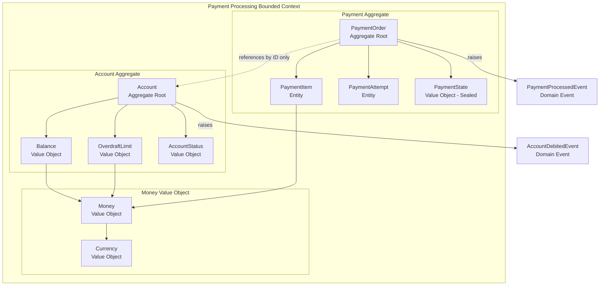

Strategic DDD defines where your domain boundaries are; tactical DDD defines what lives inside them. The tactical building blocks — Entities, Value Objects, Aggregates, Repositories, and Domain Events — are the patterns that give your Java domain model its structural integrity and ensure that business rules are enforced at the point where state changes, not scattered across service layers and database triggers. In fintech, where a single miscalculated balance or an unvalidated state transition can result in regulatory penalties and customer harm, these patterns are not optional refinements — they are the first line of defence against incorrect money movement.

## Learning Objectives

- Distinguish between Entity, Value Object, and Aggregate using precise definitions and fintech-specific examples
- Implement a `Money` value object in Java that correctly handles immutability, currency-awareness, and arithmetic operations
- Design an `Account` aggregate that enforces business invariants and prevents invalid state transitions
- Explain the significance of the Aggregate Root and why persistence must operate at the aggregate boundary
- Write an `AccountRepository` interface that lives in the domain layer without importing JPA or any infrastructure dependency
- Raise Domain Events from within an aggregate and publish them via Spring's `ApplicationEventPublisher`
- Use Java sealed interfaces and pattern matching to represent domain state exhaustively and safely
- Identify the anemic domain model anti-pattern and refactor an example from an anemic to a rich domain model

## Business Context

Zephyr Bank is a UK neo-bank with 1.4 million active accounts. In Q4 2025, a production incident caused 847 accounts to go below zero — negative balance — during a concurrent payment processing burst. The root cause: balance validation was performed in the `PaymentService` class, not inside the `Account` entity. When three concurrent payment requests hit the same account simultaneously, all three threads read the same balance, all three passed the validation check, and all three debited the account. The aggregate model the team should have implemented — with invariant enforcement inside the `Account` aggregate and optimistic locking — would have prevented this race condition entirely. The incident cost £340,000 in remediation, customer compensation, and FCA reporting overhead.

## Entity vs Value Object vs Aggregate

The three fundamental building blocks of a DDD domain model have precise definitions. Using them incorrectly is the most common source of domain model defects in fintech systems.

**Entity** — An object defined by its identity, not its attributes. Two entities are the same if they have the same identity, even if all their other attributes differ. An `Account` is an entity: account number `GB29NWBK60161331926819` refers to the same account regardless of whether the balance is £0 or £10,000.

**Value Object** — An object defined entirely by its attributes. Two value objects with the same attributes are interchangeable; there is no meaningful identity concept. `Money(100.00, GBP)` is the same as any other `Money(100.00, GBP)`. Value objects are immutable: any "change" produces a new instance.

**Aggregate** — A cluster of entities and value objects that must be kept consistent together, with one Entity designated as the **Aggregate Root**. All access to the aggregate from outside goes through the root. The root enforces invariants across the entire cluster.

| Characteristic | Entity | Value Object | Aggregate |
|---|---|---|---|
| **Identity** | Has a unique identity (ID) | Defined by its attributes | Root entity provides identity |
| **Mutability** | Mutable (state changes over lifetime) | Immutable (new object on change) | Internally mutable; externally controlled |
| **Equality** | ID equality | Attribute equality (all fields) | Root identity equality |
| **Lifecycle** | Has a lifecycle (created, modified, deleted) | No lifecycle; created when needed | Root controls lifecycle of all members |
| **Fintech examples** | Account, PaymentOrder, Merchant | Money, Currency, IBAN, AccountNumber | Account + Balance + Transactions |

## The Money Value Object

`Money` is the most critical value object in any fintech domain model. It encapsulates an amount and a currency, enforces immutability, prevents floating-point arithmetic errors, and makes currency mismatches impossible to ignore.

```java
// domain/model/money/Money.java
public record Money(BigDecimal amount, Currency currency) {

    // Canonical constructor with validation
    public Money {
        Objects.requireNonNull(amount, "amount must not be null");
        Objects.requireNonNull(currency, "currency must not be null");
        // Normalise scale to the currency's default fraction digits
        amount = amount.setScale(currency.getDefaultFractionDigits(), RoundingMode.UNNECESSARY);
    }

    // Factory methods for common cases
    public static Money of(long units, Currency currency) {
        return new Money(BigDecimal.valueOf(units), currency);
    }

    public static Money of(String amount, String currencyCode) {
        return new Money(
            new BigDecimal(amount),
            Currency.getInstance(currencyCode)
        );
    }

    public static Money zero(Currency currency) {
        return new Money(BigDecimal.ZERO.setScale(
            currency.getDefaultFractionDigits()), currency);
    }

    // Arithmetic — always produces a new Money instance
    public Money add(Money other) {
        assertSameCurrency(other);
        return new Money(this.amount.add(other.amount), this.currency);
    }

    public Money subtract(Money other) {
        assertSameCurrency(other);
        return new Money(this.amount.subtract(other.amount), this.currency);
    }

    public Money multiply(BigDecimal factor) {
        return new Money(
            this.amount.multiply(factor).setScale(
                currency.getDefaultFractionDigits(), RoundingMode.HALF_EVEN),
            this.currency
        );
    }

    // Comparison
    public boolean isGreaterThan(Money other) {
        assertSameCurrency(other);
        return this.amount.compareTo(other.amount) > 0;
    }

    public boolean isNegative() {
        return this.amount.compareTo(BigDecimal.ZERO) < 0;
    }

    public boolean isZero() {
        return this.amount.compareTo(BigDecimal.ZERO) == 0;
    }

    private void assertSameCurrency(Money other) {
        if (!this.currency.equals(other.currency)) {
            throw new CurrencyMismatchException(
                "Cannot operate on %s and %s".formatted(this.currency, other.currency)
            );
        }
    }

    @Override
    public String toString() {
        return "%s %s".formatted(currency.getCurrencyCode(), amount.toPlainString());
    }
}
```

> [!NOTE]
> Java records provide `equals()` and `hashCode()` based on all components by default, making `Money` a correct value object with zero boilerplate. The `RoundingMode.UNNECESSARY` in the canonical constructor ensures that an amount with more decimal places than the currency supports (e.g., `Money(10.001, GBP)`) throws an `ArithmeticException` rather than silently losing precision — the correct behaviour for financial calculations.

```java
// domain/model/money/CurrencyMismatchException.java
public class CurrencyMismatchException extends RuntimeException {
    public CurrencyMismatchException(String message) {
        super(message);
    }
}
```

## The Account Aggregate

The `Account` aggregate demonstrates how business invariants are enforced at the domain model level. The aggregate root (`Account`) is the only entry point for state changes; it validates all invariants before changing state and raises domain events to communicate changes to the rest of the system.

```java
// domain/model/account/AccountId.java
public record AccountId(UUID value) {
    public AccountId {
        Objects.requireNonNull(value, "AccountId value must not be null");
    }
    public static AccountId generate() {
        return new AccountId(UUID.randomUUID());
    }
    public static AccountId of(String value) {
        return new AccountId(UUID.fromString(value));
    }
}
```

```java
// domain/model/account/Account.java
public class Account {

    private final AccountId id;
    private final AccountOwnerId ownerId;
    private Money balance;
    private AccountStatus status;
    private Money overdraftLimit;
    private final List<DomainEvent> domainEvents = new ArrayList<>();

    // Private constructor — use factory method
    private Account(AccountId id, AccountOwnerId ownerId, Money initialBalance,
                    Money overdraftLimit) {
        this.id = Objects.requireNonNull(id);
        this.ownerId = Objects.requireNonNull(ownerId);
        this.balance = Objects.requireNonNull(initialBalance);
        this.overdraftLimit = Objects.requireNonNull(overdraftLimit);
        this.status = AccountStatus.ACTIVE;
    }

    // Factory method — the only way to create an Account
    public static Account open(AccountOwnerId ownerId, Currency currency) {
        AccountId newId = AccountId.generate();
        Money zero = Money.zero(currency);
        Account account = new Account(newId, ownerId, zero, zero);
        account.domainEvents.add(new AccountOpenedEvent(newId, ownerId, currency));
        return account;
    }

    // ── Commands ───────────────────────────────────────────────────────────

    public void credit(Money amount, String reference) {
        assertActive();
        assertPositive(amount);
        this.balance = this.balance.add(amount);
        domainEvents.add(new AccountCreditedEvent(this.id, amount, reference, balance));
    }

    public void debit(Money amount, String reference) {
        assertActive();
        assertPositive(amount);
        // INVARIANT: balance must not go below negative overdraft limit
        Money projectedBalance = this.balance.subtract(amount);
        if (projectedBalance.isNegative() &&
            projectedBalance.isGreaterThan(overdraftLimit.multiply(BigDecimal.ONE.negate()).subtract(Money.zero(balance.currency())))) {
            throw new InsufficientFundsException(
                "Debit of %s would breach overdraft limit. Balance: %s, Limit: %s"
                    .formatted(amount, balance, overdraftLimit)
            );
        }
        this.balance = projectedBalance;
        domainEvents.add(new AccountDebitedEvent(this.id, amount, reference, balance));
    }

    public void freeze(String reason) {
        if (this.status == AccountStatus.FROZEN) {
            return; // idempotent
        }
        this.status = AccountStatus.FROZEN;
        domainEvents.add(new AccountFrozenEvent(this.id, reason));
    }

    public void close() {
        if (!balance.isZero()) {
            throw new AccountNotEmptyException(
                "Cannot close account %s with non-zero balance: %s".formatted(id, balance)
            );
        }
        this.status = AccountStatus.CLOSED;
        domainEvents.add(new AccountClosedEvent(this.id));
    }

    // ── Queries ────────────────────────────────────────────────────────────

    public AccountId id() { return id; }
    public Money balance() { return balance; }
    public AccountStatus status() { return status; }

    public List<DomainEvent> drainDomainEvents() {
        List<DomainEvent> events = List.copyOf(domainEvents);
        domainEvents.clear();
        return events;
    }

    // ── Invariant guards ───────────────────────────────────────────────────

    private void assertActive() {
        if (status != AccountStatus.ACTIVE) {
            throw new AccountNotActiveException(
                "Account %s is %s".formatted(id, status)
            );
        }
    }

    private void assertPositive(Money amount) {
        if (amount.isNegative() || amount.isZero()) {
            throw new IllegalArgumentException(
                "Amount must be positive, got: " + amount
            );
        }
    }
}
```

> [!IMPORTANT]
> The `domainEvents` list inside the aggregate is populated by every state-changing operation and drained by the repository or application service after save. This pattern — sometimes called the "domain events collection" pattern — ensures that events are only published after the aggregate has been successfully persisted, preventing the classic "event published but save failed" inconsistency.

## Sealed Interfaces for Domain State

Java 17+ sealed interfaces allow you to represent domain state exhaustively and safely, making illegal state transitions unrepresentable at compile time.

```java
// domain/model/payment/PaymentState.java
public sealed interface PaymentState
    permits PaymentState.Pending, PaymentState.Authorised,
            PaymentState.Captured, PaymentState.Voided, PaymentState.Refunded {

    record Pending(Instant submittedAt) implements PaymentState {}

    record Authorised(Instant authorisedAt, String authorisationCode) implements PaymentState {}

    record Captured(Instant capturedAt, Money capturedAmount) implements PaymentState {}

    record Voided(Instant voidedAt, String voidReason) implements PaymentState {}

    record Refunded(Instant refundedAt, Money refundedAmount) implements PaymentState {}
}
```

```java
// Usage in an application service with pattern matching (Java 21)
public PaymentReceipt processPaymentEvent(Payment payment, PaymentEvent event) {
    return switch (payment.state()) {
        case PaymentState.Pending(var submittedAt) ->
            handlePendingPayment(payment, event, submittedAt);
        case PaymentState.Authorised(var authorisedAt, var code) ->
            handleAuthorisedPayment(payment, event, code);
        case PaymentState.Captured c ->
            throw new IllegalStateException(
                "Cannot process event on already-captured payment");
        case PaymentState.Voided v ->
            throw new IllegalStateException("Cannot process event on voided payment");
        case PaymentState.Refunded r ->
            throw new IllegalStateException("Cannot process event on refunded payment");
    };
}
```

The sealed interface guarantees exhaustive handling. If a new `PaymentState.Disputed` state is added in the future, every `switch` on `PaymentState` in the codebase will produce a compile-time error until the new case is handled — the compiler becomes a consistency checker for state machine completeness.

## Repository Pattern

The `AccountRepository` interface lives in the domain layer. It speaks the domain language and has no dependency on JPA, Hibernate, JDBC, or any infrastructure concern. The interface defines what the domain needs; the infrastructure layer decides how to provide it.

```java
// domain/repository/AccountRepository.java
public interface AccountRepository {

    // Load the full aggregate by its identity
    Optional<Account> findById(AccountId accountId);

    // Load with optimistic lock version for concurrent modification protection
    Optional<Account> findByIdForUpdate(AccountId accountId);

    // Persist the entire aggregate (insert or update)
    void save(Account account);

    // Domain-meaningful query — not a generic findAll
    List<Account> findActiveAccountsByOwner(AccountOwnerId ownerId);

    boolean existsById(AccountId accountId);
}
```

```java
// infrastructure/persistence/JpaAccountRepository.java
@Repository
public class JpaAccountRepository implements AccountRepository {

    private final AccountJpaEntityRepository jpaRepository;
    private final AccountMapper mapper;

    public JpaAccountRepository(AccountJpaEntityRepository jpaRepository,
                                AccountMapper mapper) {
        this.jpaRepository = jpaRepository;
        this.mapper = mapper;
    }

    @Override
    public Optional<Account> findById(AccountId accountId) {
        return jpaRepository.findById(accountId.value())
            .map(mapper::toDomain);
    }

    @Override
    @Lock(LockModeType.OPTIMISTIC_FORCE_INCREMENT)
    public Optional<Account> findByIdForUpdate(AccountId accountId) {
        return jpaRepository.findByIdWithLock(accountId.value())
            .map(mapper::toDomain);
    }

    @Override
    @Transactional
    public void save(Account account) {
        AccountJpaEntity entity = mapper.toEntity(account);
        jpaRepository.save(entity);
    }

    @Override
    public List<Account> findActiveAccountsByOwner(AccountOwnerId ownerId) {
        return jpaRepository.findByOwnerIdAndStatus(ownerId.value(), "ACTIVE")
            .stream()
            .map(mapper::toDomain)
            .toList();
    }

    @Override
    public boolean existsById(AccountId accountId) {
        return jpaRepository.existsById(accountId.value());
    }
}
```

> [!NOTE]
> The domain layer imports `AccountRepository` (the interface). The infrastructure layer imports `AccountRepository` and provides `JpaAccountRepository` (the implementation). This is dependency inversion: the domain defines the contract, the infrastructure fulfils it. No Spring annotation (`@Repository`, `@Transactional`) or JPA import ever appears in the domain layer.

## Domain Events

Domain events communicate that something meaningful happened in the domain. They are facts — things that have already occurred — not commands or notifications. In fintech, domain events like `PaymentAuthorised` and `AccountFrozen` drive downstream processes like ledger updates, fraud review queues, and customer notifications.

```java
// domain/event/DomainEvent.java
public sealed interface DomainEvent
    permits AccountOpenedEvent, AccountCreditedEvent, AccountDebitedEvent,
            AccountFrozenEvent, AccountClosedEvent {

    AccountId accountId();
    Instant occurredAt();
}
```

```java
// domain/event/AccountDebitedEvent.java
public record AccountDebitedEvent(
    AccountId accountId,
    Money amount,
    String reference,
    Money balanceAfterDebit,
    Instant occurredAt
) implements DomainEvent {

    public AccountDebitedEvent(AccountId accountId, Money amount,
                               String reference, Money balanceAfterDebit) {
        this(accountId, amount, reference, balanceAfterDebit, Instant.now());
    }
}
```

```java
// application/service/AccountApplicationService.java
@Service
@Transactional
public class AccountApplicationService {

    private final AccountRepository accountRepository;
    private final ApplicationEventPublisher eventPublisher;

    public AccountApplicationService(AccountRepository accountRepository,
                                     ApplicationEventPublisher eventPublisher) {
        this.accountRepository = accountRepository;
        this.eventPublisher = eventPublisher;
    }

    public void debitAccount(AccountId accountId, Money amount, String reference) {
        // Load aggregate
        Account account = accountRepository.findByIdForUpdate(accountId)
            .orElseThrow(() -> new AccountNotFoundException(accountId));

        // Execute command — invariants enforced inside aggregate
        account.debit(amount, reference);

        // Persist the aggregate FIRST
        accountRepository.save(account);

        // Then drain and publish domain events
        account.drainDomainEvents()
            .forEach(eventPublisher::publishEvent);
    }
}
```

```java
// application/handler/AccountDebitedEventHandler.java
@Component
public class AccountDebitedEventHandler {

    private final LedgerService ledgerService;

    @EventListener
    public void on(AccountDebitedEvent event) {
        ledgerService.recordDebitEntry(
            event.accountId(),
            event.amount(),
            event.reference(),
            event.occurredAt()
        );
    }
}
```

## Aggregate Boundaries Diagram



> [!WARNING]
> Aggregates reference other aggregates by identity (ID), never by object reference. If `PaymentOrder` holds a direct reference to an `Account` object, it can bypass the `Account` aggregate root and modify account state without invariant enforcement. This is the most common aggregate boundary violation in fintech codebases.

## The Anemic Domain Model Anti-Pattern

The anemic domain model — first named by Martin Fowler — is a domain model consisting entirely of data-holding objects (getters/setters) with all business logic in separate "service" classes. It is the most prevalent anti-pattern in Java enterprise fintech systems.

**Anemic (Anti-Pattern):**
```java
// Everything is a data bag with setters
public class Account {
    private UUID id;
    private BigDecimal balance;
    private String status;
    // ... 20 more getters and setters
}

// All logic in a service class — this is a transaction script, not a domain model
@Service
public class AccountService {
    public void debit(UUID accountId, BigDecimal amount) {
        Account account = repository.findById(accountId);
        // Business rules scattered here, not in the Account class
        if (account.getStatus().equals("FROZEN")) throw new Exception("Frozen");
        if (account.getBalance().compareTo(amount) < 0) throw new Exception("NSF");
        account.setBalance(account.getBalance().subtract(amount)); // direct mutation
        repository.save(account);
    }
}
```

**Rich Domain Model (Correct):**
```java
// Business rules live inside the aggregate
public class Account {
    public void debit(Money amount, String reference) {
        assertActive();      // Rule enforced here
        assertPositive(amount);
        assertSufficientFunds(amount);  // Rule enforced here
        this.balance = this.balance.subtract(amount);
        domainEvents.add(new AccountDebitedEvent(this.id, amount, reference, balance));
    }
}
```

The rich model is not just cleaner — it is safer. The rule "a frozen account cannot be debited" lives in exactly one place. It cannot be forgotten by a future engineer writing a new service method. The rule is enforced regardless of which application service calls `account.debit()`.

## Knowledge Check

**Q:** A team argues that the `Money` value object is unnecessary overhead — they can use `BigDecimal` directly in the `Account` aggregate and validate currency in the service layer. Identify two specific ways that this design can produce incorrect financial calculations or violations in a production system.

**A:** First, `BigDecimal` alone has no currency context, so there is nothing preventing code from adding GBP and USD amounts together — the result is a number that is meaningless as a monetary value but will pass any type check. With a `Money` type that carries its `Currency` and validates in `add()`, the error is a `CurrencyMismatchException` thrown at the point of the illegal operation rather than a silent data corruption. Second, `BigDecimal` scale is not automatically normalised to currency conventions — a rounding operation on a GBP amount using `RoundingMode.HALF_UP` might produce `10.005` where the currency only supports two decimal places. Without the `Money` constructor enforcing `setScale(currency.getDefaultFractionDigits(), ...)`, rounding decisions are made inconsistently across the codebase, and financial reconciliation will find discrepancies. Both defects are silent: they do not throw exceptions, they do not fail tests unless specifically written for this case, and they produce financial errors that only surface during reconciliation or audit.

**Q:** The `AccountApplicationService.debitAccount()` method saves the aggregate and then publishes domain events. What production failure can occur if this order is reversed (events published before save), and how does the `drainDomainEvents()` pattern mitigate the risk even with the correct order?

**A:** If events are published before the aggregate is saved, a downstream service (e.g., the Ledger Service) may receive and process the `AccountDebitedEvent` — writing a ledger entry and confirming the debit to the customer — while the `Account` aggregate itself fails to save due to a database error. The account balance in the database is unchanged, but the ledger records a debit and the customer has been notified. This is a phantom debit: money appears to leave the account but the account balance does not change, creating an inconsistency that is expensive to detect and reverse. The `drainDomainEvents()` pattern mitigates residual risk even with the correct order by ensuring events are removed from the aggregate's list at the moment of publication — if the application restarts after save but before event publication, a reconciliation or outbox process can replay the events by re-loading the aggregate, but only events not yet drained will be replayed, preventing double-publication. For full consistency guarantees, the Transactional Outbox pattern (writing events to a database table in the same transaction as the aggregate save) should be layered on top of this pattern.

## Practical Challenge

1. **Implement the `Payment` aggregate.** Design and implement a `Payment` aggregate for a card payment processing system. The aggregate must enforce these invariants: (a) a payment can only be captured if it is in `Authorised` state, (b) a payment cannot be voided after capture, (c) the captured amount cannot exceed the authorised amount, and (d) a refund cannot exceed the total captured amount. Use Java sealed interfaces for `PaymentState`. The aggregate must raise `PaymentAuthorisedEvent`, `PaymentCapturedEvent`, and `PaymentRefundedEvent` domain events. Write unit tests (JUnit 5, no Spring context) that verify each invariant by attempting the illegal transition and asserting the expected exception.

2. **Implement the `Money` value object extensions.** Extend the `Money` record from this lesson to support: (a) a `percentage(BigDecimal rate)` method that calculates a percentage of the amount (e.g., `Money.of("100.00", "GBP").percentage(new BigDecimal("0.025"))` returns `Money(2.50, GBP)`), (b) a `distribute(int parts)` method that splits a Money value into N equal parts, handling remainder cents by adding them to the last part (e.g., `Money.of("10.00", "GBP").distribute(3)` returns `[3.34, 3.33, 3.33]`), and (c) a `compareTo(Money other)` method. Write tests demonstrating that the distribute method handles the penny-rounding case correctly.

3. **Write a `PaymentRepository` interface and JPA adapter.** Write the domain-layer `PaymentRepository` interface for the `Payment` aggregate from task 1 with methods `findById`, `findByIdForUpdate`, `save`, and `findByMerchantIdAndStatus`. Then write a `JpaPaymentRepository` adapter in the infrastructure layer. The JPA entity (`PaymentJpaEntity`) must store `PaymentState` as a discriminator-based hierarchy (using `@Inheritance(strategy = InheritanceType.SINGLE_TABLE)`). Write a `PaymentMapper` that correctly translates between the JPA entity and the domain aggregate, including the state sealed interface.

4. **Refactor an anemic model.** You are given an `InvoiceService` class that processes invoice payments. It contains 120 lines of if-else logic operating on an `Invoice` data class with 15 fields and no methods. The service checks invoice status, calculates late fees, marks invoices overdue, and records payments. Identify the aggregates, value objects, and domain events that should exist in a rich domain model for this capability. Write the `Invoice` aggregate class with at least three command methods, one value object (`InvoiceFee`), and two domain events. The aggregate must replace at least two of the validation checks currently in the service.

<!-- KNOWLEDGE-CHECK
{
  "questions": [
    {
      "text": "A team argues that using BigDecimal directly in the Account aggregate instead of a Money value object is sufficient — currency can be validated in the service layer. Which specific production defect can silently occur with this design that the Money value object would prevent?",
      "options": [
        "BigDecimal operations throw ArithmeticException for any amount exceeding Long.MAX_VALUE.",
        "Adding a GBP amount and a USD amount produces a meaningless numeric result with no type error, allowing currency mismatches to corrupt financial calculations silently.",
        "BigDecimal cannot represent monetary amounts with more than 10 decimal places of precision.",
        "Service-layer currency validation is performed before the aggregate, so the aggregate itself does not need currency-awareness."
      ],
      "correct": 1,
      "explanation": "Without a Money type that carries Currency and validates in add(), there is nothing preventing code from adding GBP and USD amounts. The result is a number that is meaningless as a monetary value but passes all type checks. The Money value object makes this a CurrencyMismatchException thrown at the point of the illegal operation, turning a silent data corruption into an explicit runtime failure."
    },
    {
      "text": "In the Account aggregate's debit() method, which approach correctly enforces the invariant 'a frozen account cannot be debited'?",
      "options": [
        "The PaymentService checks account.getStatus() before calling the repository's debit method.",
        "A database trigger on the accounts table rejects updates when the status column equals 'FROZEN'.",
        "The Account aggregate's debit() method calls assertActive() internally, throwing AccountNotActiveException if status is not ACTIVE.",
        "The AccountRepository interface defines a separate debitIfActive() method that the service layer calls instead of the regular debit."
      ],
      "correct": 2,
      "explanation": "Invariants must be enforced inside the aggregate root, not in service layers or databases. When assertActive() lives inside Account.debit(), the rule is enforced regardless of which application service or future code path calls the method. A service-layer check can be forgotten; a database trigger is invisible in the domain model; only the aggregate enforces the rule unconditionally."
    },
    {
      "text": "The AccountApplicationService saves the aggregate to the repository and then drains and publishes domain events. What production failure can occur if the order is reversed — events published before save?",
      "options": [
        "The domain events would be published with an incorrect timestamp because the aggregate has not yet been persisted.",
        "A downstream service may process the AccountDebitedEvent and record a ledger entry while the Account aggregate itself fails to save, creating a phantom debit where the balance does not change but the ledger records a debit.",
        "The Kafka producer would reject the event because the message lacks a valid aggregate version number from the database.",
        "Spring's ApplicationEventPublisher requires the aggregate to be in a managed JPA state before events can be published."
      ],
      "correct": 1,
      "explanation": "If events are published before the aggregate is saved, a downstream service may process the event while the account save fails due to a database error. The account balance in the database is unchanged, but the ledger records a debit and the customer may be notified — a phantom debit that is expensive to detect and reverse. Always persist first, publish second."
    }
  ]
}
-->

<!-- PRACTICAL-CHALLENGE
{
  "title": "Implement Rich Domain Aggregates for a Card Payment System",
  "difficulty": "advanced",
  "estimatedMinutes": 60,
  "tasks": [
    {"id": "1", "description": "Design and implement a Payment aggregate for a card payment processing system. Enforce these invariants: (a) a payment can only be captured if in Authorised state, (b) a payment cannot be voided after capture, (c) the captured amount cannot exceed the authorised amount, and (d) a refund cannot exceed the total captured amount. Use Java sealed interfaces for PaymentState. The aggregate must raise PaymentAuthorisedEvent, PaymentCapturedEvent, and PaymentRefundedEvent. Write JUnit 5 unit tests (no Spring context) verifying each invariant by attempting the illegal transition and asserting the expected exception."},
    {"id": "2", "description": "Extend the Money record from this lesson to support: (a) a percentage(BigDecimal rate) method returning the calculated percentage of the amount, (b) a distribute(int parts) method splitting a Money value into N equal parts with remainder cents added to the last part, and (c) a compareTo(Money other) method. Write tests demonstrating that distribute(3) on Money.of('10.00', 'GBP') produces [3.34, 3.33, 3.33] and that the penny-rounding is handled correctly."},
    {"id": "3", "description": "Write the domain-layer PaymentRepository interface for the Payment aggregate with methods findById, findByIdForUpdate, save, and findByMerchantIdAndStatus. Then write a JpaPaymentRepository adapter in the infrastructure layer. The JPA entity must store PaymentState using @Inheritance(strategy = InheritanceType.SINGLE_TABLE). Write a PaymentMapper that correctly translates between the JPA entity and the domain aggregate, including the sealed interface state."},
    {"id": "4", "description": "Refactor an anemic InvoiceService that contains 120 lines of if-else logic operating on an Invoice data class. Identify the aggregates, value objects, and domain events that belong in a rich domain model. Write the Invoice aggregate with at least three command methods, one value object (InvoiceFee), and two domain events. The aggregate must enforce at least two of the validation checks currently scattered in the service class."}
  ]
}
-->
