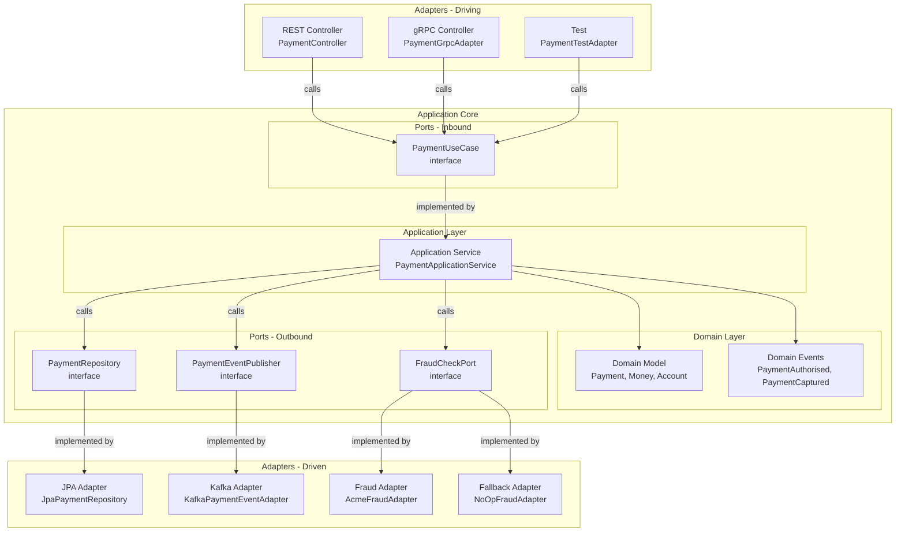

يحل نمط البنية السداسية (Hexagonal Architecture)، الذي قدّمه Alistair Cockburn عام 2005، مشكلة متأصلة في أنظمة التقنية المالية المبنية بـ Spring Boot: منطق عمل متشابك بإحكام مع الأطر وقواعد البيانات والأنظمة الخارجية التي يصادف أنه يستخدمها اليوم. فعندما يقرر فريق الانتقال من PostgreSQL إلى CockroachDB، أو استبدال مزوّد احتيال خارجي، أو إضافة مستهلك Kafka بجانب واجهة REST قائمة، تجعل الشيفرة المتشابكة هذه التغييرات مكلفة وخطرة. تخلق البنية السداسية فصلًا نظيفًا بين منطق العمل الأساسي وكل ما يلامس العالم الخارجي، فتتغير قرارات البنية التحتية دون المساس بالمجال. وفي أنظمة الدفع، حيث لا تفاوض على الموثوقية وقابلية التدقيق، فإن قابلية الاختبار التي تتيحها البنية السداسية — اختبار منطق المجال دون قاعدة بيانات أو وسيط رسائل — لا تقل أهمية عن الفائدة البنيوية.

## أهداف التعلّم

- وصف طبقات البنية السداسية الثلاث وقواعد الاعتمادية التي تحكم كلًا منها
- التمييز بين المنافذ القائدة (الأولية) والمنافذ المُقادة (الثانوية) وشرح أهمية هذا التمييز
- تنفيذ واجهة منفذ وارد وخدمة تطبيق لحالة استخدام في المدفوعات
- تنفيذ واجهات منافذ صادرة للحفظ ونشر الأحداث دون أي استيراد من البنية التحتية في المجال
- كتابة محوّلات JPA وKafka تنفّذ عقود المنافذ الصادرة
- صياغة قاعدة الاعتمادية في البنية السداسية بدقة، وإظهار كيف يفرضها ArchUnit في خط CI
- مقارنة البنية السداسية بالبنية النظيفة (Clean Architecture) وبنية البصلة (Onion Architecture)، وتحديد الفروق ذات المعنى
- تصميم هيكل حزم في Spring Boot يجعل حدود البنية السداسية مرئية وقابلة للفرض
- كتابة اختبارات وحدة لمنطق المجال وخدمة التطبيق تعمل دون سياق تطبيق Spring

## سياق العمل

لنأخذ فريق معالجة مدفوعات (مثال مركّب) يصون تطبيق Spring Boot موحّدًا تُستخدم فيه أصناف JPA ‏`@Entity` مباشرة في متحكمات REST، وتستدعي دوال الخدمة ذات `@Transactional` واجهات HTTP خارجية في السطر نفسه، ومزوّد كشف الاحتيال مربوط بإحكام في منطق معالجة المدفوعات عبر خدمة `@Autowired`. وعندما يتعطل مزوّد الاحتيال 90 دقيقة، تفشل كل تفويضات الدفع لأنه لا يوجد قاطع دائرة ولا بديل — فاستدعاء المزوّد ومنطق الدفع هما الدالة نفسها. ويتطلب استبدال المزوّد تغييرات في 23 ملفًا عبر 11 حزمة. وكانت البنية السداسية ستعزل مزوّد الاحتيال خلف واجهة منفذ صادر، فيصبح استبدال المزوّد تغييرًا في محوّل واحد، ويمكن تركيب تنفيذ بديل دون المساس بمنطق معالجة المدفوعات.

## طبقات البنية السداسية

تقسم البنية السداسية الخدمة إلى ثلاث مناطق متحدة المركز بقواعد اعتمادية صارمة.



**طبقة المجال (Domain)** — تحتوي نموذج المجال (التجميعات، وكائنات القيمة، وأحداث المجال، واستثناءات المجال). بلا أي اعتمادية على الأطر أو المكتبات أو البنية التحتية. ويمكن تشغيل هذه الطبقة في دالة main عادية في Java SE.

**طبقة التطبيق (Application)** — تحتوي خدمات التطبيق التي تنسّق حالات الاستخدام باستدعاء منطق المجال والمنافذ الصادرة. قد تعتمد على طبقة المجال وواجهات المنافذ. بلا استيرادات من البنية التحتية. والوسمان `@Service` و`@Transactional` من Spring مقبولان هنا، لكن يجب أن يكونا الاعتماديتين الوحيدتين على Spring.

**طبقة المحوّلات (Adapters)** — تحتوي المحوّلات القائدة (متحكمات REST، ومعالجات gRPC، ومستهلكي Kafka، ومشغّلات سطر الأوامر) والمحوّلات المُقادة (مستودعات JPA، ومنتجي Kafka، وعملاء HTTP للخدمات الخارجية). تستورد المحوّلات واجهات المنافذ وتنفّذها. ويمكن أن تعتمد على Spring وJPA وKafka وFeign وأي إطار آخر.

> [!IMPORTANT]
> قاعدة الاعتمادية مطلقة: لا شيء في طبقة المجال أو التطبيق يستورد من طبقة المحوّلات. واتجاه الاستيراد دائمًا نحو الداخل — المحوّلات تستورد المنافذ، والمنافذ معرّفة في نواة التطبيق. فإذا رأيت `import org.springframework.data.jpa.repository.JpaRepository` في صنف من أصناف المجال، فقد انتُهكت قاعدة الاعتمادية.

## المنفذ الوارد: PaymentUseCase

يحدد المنفذ الوارد (القائد) ما تقدمه نواة التطبيق للعالم الخارجي. وهو واجهة في طبقة التطبيق تنفّذها خدمة التطبيق.

```java
// application/port/in/PaymentUseCase.java
public interface PaymentUseCase {

    PaymentId authorisePayment(AuthorisePaymentCommand command);

    void capturePayment(CapturePaymentCommand command);

    void voidPayment(VoidPaymentCommand command);

    PaymentDetails getPayment(PaymentId paymentId);
}
```

```java
// application/port/in/AuthorisePaymentCommand.java
public record AuthorisePaymentCommand(
    MerchantId merchantId,
    Money amount,
    CardToken cardToken,
    String idempotencyKey
) {
    public AuthorisePaymentCommand {
        Objects.requireNonNull(merchantId);
        Objects.requireNonNull(amount);
        Objects.requireNonNull(cardToken);
        Objects.requireNonNull(idempotencyKey);
        if (idempotencyKey.isBlank()) {
            throw new IllegalArgumentException("idempotencyKey must not be blank");
        }
    }
}
```

## خدمة التطبيق

تنفّذ `PaymentApplicationService` المنفذ الوارد، وتنسّق حالة الاستخدام باستدعاء نموذج المجال والمنافذ الصادرة.

```java
// application/service/PaymentApplicationService.java
@Service
@Transactional
public class PaymentApplicationService implements PaymentUseCase {

    private final PaymentRepository paymentRepository;
    private final PaymentEventPublisher eventPublisher;
    private final FraudCheckPort fraudCheckPort;
    private final MerchantRepository merchantRepository;

    public PaymentApplicationService(
            PaymentRepository paymentRepository,
            PaymentEventPublisher eventPublisher,
            FraudCheckPort fraudCheckPort,
            MerchantRepository merchantRepository) {
        this.paymentRepository = paymentRepository;
        this.eventPublisher = eventPublisher;
        this.fraudCheckPort = fraudCheckPort;
        this.merchantRepository = merchantRepository;
    }

    @Override
    public PaymentId authorisePayment(AuthorisePaymentCommand command) {
        // Idempotency — a retry with the same key gets the same answer, not an error.
        // (Two concurrent first attempts both see "not found"; the UNIQUE constraint on
        // idempotency_key makes the second insert fail, and the caller retries into this branch.)
        Optional<Payment> existing = paymentRepository.findByIdempotencyKey(command.idempotencyKey());
        if (existing.isPresent()) {
            return existing.get().id();
        }

        // Load merchant via outbound port
        Merchant merchant = merchantRepository.findById(command.merchantId())
            .orElseThrow(() -> new MerchantNotFoundException(command.merchantId()));

        // Fraud check via outbound port — no HTTP client here
        FraudAssessment fraudAssessment = fraudCheckPort.assess(
            new FraudCheckRequest(merchant.id(), command.amount(), command.cardToken())
        );

        if (fraudAssessment.isHighRisk()) {
            throw new PaymentDeclinedForFraudException(fraudAssessment.riskScore());
        }

        // Domain logic — no infrastructure concern
        Payment payment = Payment.authorise(
            merchant.id(),
            command.amount(),
            command.cardToken(),
            command.idempotencyKey()
        );

        // Persist via outbound port
        paymentRepository.save(payment);

        // Publish domain events via outbound port
        payment.drainDomainEvents()
            .forEach(eventPublisher::publish);

        return payment.id();
    }

    @Override
    public void capturePayment(CapturePaymentCommand command) {
        Payment payment = paymentRepository.findByIdForUpdate(command.paymentId())
            .orElseThrow(() -> new PaymentNotFoundException(command.paymentId()));

        payment.capture(command.captureAmount());

        paymentRepository.save(payment);
        payment.drainDomainEvents().forEach(eventPublisher::publish);
    }

    @Override
    public void voidPayment(VoidPaymentCommand command) {
        Payment payment = paymentRepository.findByIdForUpdate(command.paymentId())
            .orElseThrow(() -> new PaymentNotFoundException(command.paymentId()));

        payment.voidPayment(command.voidReason());

        paymentRepository.save(payment);
        payment.drainDomainEvents().forEach(eventPublisher::publish);
    }

    @Override
    @Transactional(readOnly = true)
    public PaymentDetails getPayment(PaymentId paymentId) {
        return paymentRepository.findById(paymentId)
            .map(PaymentDetails::from)
            .orElseThrow(() -> new PaymentNotFoundException(paymentId));
    }
}
```

لاحظ معالجة منع التكرار: إعادة المحاولة بالمفتاح نفسه تحصل على الإجابة نفسها لا على خطأ. وإذا وصلت محاولتان أوليان متزامنتان ورأت كلتاهما "غير موجود"، فإن قيد التفرّد على `idempotency_key` يُفشل الإدخال الثاني، فيعيد المستدعي المحاولة ويدخل هذا الفرع.

> [!NOTE]
> لإبقاء المثال قصيرًا، يعمل فحص الاحتيال داخل `@Transactional` على مستوى الصنف، فيحتجز مزوّد احتيال بطيء اتصال قاعدة بيانات. وفي الإنتاج، استدعِ المنافذ البعيدة البطيئة *قبل* فتح المعاملة (مثلًا بـ `TransactionTemplate` حول الحفظ فقط)، كما يفعل المشروع التطبيقي 3.

## المنافذ الصادرة

تحدد المنافذ الصادرة (المُقادة) ما تحتاجه نواة التطبيق من العالم الخارجي. وهي واجهات في طبقة التطبيق تنفّذها محوّلات في طبقة البنية التحتية.

```java
// application/port/out/PaymentRepository.java
public interface PaymentRepository {
    Optional<Payment> findById(PaymentId paymentId);
    Optional<Payment> findByIdForUpdate(PaymentId paymentId);
    Optional<Payment> findByIdempotencyKey(String idempotencyKey);
    void save(Payment payment);
}

// application/port/out/PaymentEventPublisher.java
public interface PaymentEventPublisher {
    void publish(DomainEvent event);
}

// application/port/out/FraudCheckPort.java
public interface FraudCheckPort {
    FraudAssessment assess(FraudCheckRequest request);
}
```

## محوّل JPA

يعيش محوّل JPA في طبقة البنية التحتية وينفّذ المنفذ الصادر `PaymentRepository`. وهو المكان الوحيد في قاعدة الشيفرة الذي تظهر فيه وسوم JPA.

```java
// adapter/out/persistence/JpaPaymentRepository.java
@Repository
public class JpaPaymentRepository implements PaymentRepository {

    private final PaymentJpaEntityRepository springDataRepository;
    private final PaymentPersistenceMapper mapper;

    public JpaPaymentRepository(PaymentJpaEntityRepository springDataRepository,
                                PaymentPersistenceMapper mapper) {
        this.springDataRepository = springDataRepository;
        this.mapper = mapper;
    }

    @Override
    public Optional<Payment> findById(PaymentId paymentId) {
        return springDataRepository.findById(paymentId.value())
            .map(mapper::toDomain);
    }

    @Override
    public Optional<Payment> findByIdForUpdate(PaymentId paymentId) {
        // findWithLockById is declared on the Spring Data interface with
        // @Lock(LockModeType.PESSIMISTIC_WRITE); @Lock does nothing on this class.
        return springDataRepository.findWithLockById(paymentId.value())
            .map(mapper::toDomain);
    }

    @Override
    public Optional<Payment> findByIdempotencyKey(String idempotencyKey) {
        return springDataRepository.findByIdempotencyKey(idempotencyKey)
            .map(mapper::toDomain);
    }

    @Override
    public void save(Payment payment) {
        PaymentJpaEntity entity = mapper.toEntity(payment);
        springDataRepository.save(entity);
    }
}
```

```java
// adapter/out/persistence/PaymentJpaEntity.java
@Entity
@Table(name = "payments")
public class PaymentJpaEntity {

    @Id
    private UUID id;

    @Column(nullable = false)
    private UUID merchantId;

    @Column(precision = 19, scale = 4, nullable = false)
    private BigDecimal amount;

    @Column(length = 3, nullable = false)
    private String currencyCode;

    @Enumerated(EnumType.STRING)
    @Column(nullable = false)
    private PaymentStatusJpa status;

    @Column(nullable = false, unique = true)
    private String idempotencyKey;

    @Version
    private Long version;

    @Column(nullable = false)
    private Instant createdAt;

    @Column
    private Instant capturedAt;

    // getters, setters (JPA requirement for managed entities)
}
```

## محوّل Kafka

ينفّذ محوّل Kafka المنفذ الصادر `PaymentEventPublisher`. ونموذج المجال لا يستورد أبدًا أصناف Kafka.

```java
// adapter/out/messaging/KafkaPaymentEventAdapter.java
@Component
public class KafkaPaymentEventAdapter implements PaymentEventPublisher {

    private static final String PAYMENT_EVENTS_TOPIC = "payment-events";

    private final KafkaTemplate<String, PaymentEventMessage> kafkaTemplate;
    private final PaymentEventMessageMapper messageMapper;

    public KafkaPaymentEventAdapter(KafkaTemplate<String, PaymentEventMessage> kafkaTemplate,
                                     PaymentEventMessageMapper messageMapper) {
        this.kafkaTemplate = kafkaTemplate;
        this.messageMapper = messageMapper;
    }

    @Override
    public void publish(DomainEvent event) {
        PaymentEventMessage message = messageMapper.toMessage(event);
        kafkaTemplate.send(PAYMENT_EVENTS_TOPIC, message.paymentId(), message)
            .whenComplete((result, ex) -> {
                if (ex != null) {
                    // Runs on a Kafka I/O thread after this method returned:
                    // throwing here would reach nobody. Log and count it instead.
                    log.error("Failed to publish {}", event, ex);
                }
            });
    }
}
```

> [!WARNING]
> يُظهر هذا المحوّل آلية المنافذ، لا ناشرًا آمنًا للإنتاج. فالإرسال إلى Kafka داخل معاملة قاعدة البيانات كتابة مزدوجة: قد ينجح الإرسال وتتراجع المعاملة، أو تلتزم المعاملة ويفشل الإرسال. ويجب أن يُدخل محوّل `PaymentEventPublisher` في الإنتاج الحدث في جدول outbox ضمن المعاملة نفسها، ويترك لمرحّل نشره (Transactional Outbox، المسار 05). ولأن خدمة التطبيق لا ترى إلا المنفذ، فإن التحول إلى محوّل outbox لا يتطلب أي تغيير في النواة.

## المحوّل القائد: متحكم REST

```java
// adapter/in/web/PaymentController.java
@RestController
@RequestMapping("/v1/payments")
public class PaymentController {

    private final PaymentUseCase paymentUseCase;

    public PaymentController(PaymentUseCase paymentUseCase) {
        this.paymentUseCase = paymentUseCase;
    }

    @PostMapping("/authorise")
    @ResponseStatus(HttpStatus.CREATED)
    public AuthorisePaymentResponse authorisePayment(
            @Valid @RequestBody AuthorisePaymentRequest request) {
        AuthorisePaymentCommand command = new AuthorisePaymentCommand(
            MerchantId.of(request.merchantId()),
            Money.of(request.amount(), request.currency()),
            CardToken.of(request.cardToken()),
            request.idempotencyKey()
        );
        PaymentId paymentId = paymentUseCase.authorisePayment(command);
        return new AuthorisePaymentResponse(paymentId.value().toString());
    }

    @PostMapping("/{paymentId}/capture")
    @ResponseStatus(HttpStatus.OK)
    public void capturePayment(@PathVariable String paymentId,
                               @Valid @RequestBody CapturePaymentRequest request) {
        paymentUseCase.capturePayment(new CapturePaymentCommand(
            PaymentId.of(paymentId),
            Money.of(request.captureAmount(), request.currency())
        ));
    }
}
```

> [!NOTE]
> يستورد متحكم REST الواجهة `PaymentUseCase` (واجهة المنفذ الوارد)، لا `PaymentApplicationService` (التنفيذ). وهذا يعني أنه يمكن اختبار المتحكم بحقن تنفيذ وهمي (mock) أو بديل (stub) للواجهة `PaymentUseCase` دون تشغيل سياق تطبيق Spring أو أي بنية تحتية.

## هيكل الحزم

يجعل هيكل الحزم حدود البنية السداسية صريحة وقابلة للفرض.

```
com.meridian.payment/
├── domain/
│   ├── model/
│   │   ├── Payment.java                 ← Aggregate root
│   │   ├── PaymentId.java               ← Value object
│   │   ├── PaymentState.java            ← Sealed interface
│   │   └── Money.java                   ← Value object
│   ├── event/
│   │   ├── DomainEvent.java
│   │   ├── PaymentAuthorisedEvent.java
│   │   └── PaymentCapturedEvent.java
│   └── exception/
│       ├── InsufficientFundsException.java
│       └── PaymentDeclinedForFraudException.java
├── application/
│   ├── port/
│   │   ├── in/
│   │   │   ├── PaymentUseCase.java      ← Inbound port
│   │   │   ├── AuthorisePaymentCommand.java
│   │   │   └── CapturePaymentCommand.java
│   │   └── out/
│   │       ├── PaymentRepository.java   ← Outbound port
│   │       ├── PaymentEventPublisher.java
│   │       └── FraudCheckPort.java
│   └── service/
│       └── PaymentApplicationService.java
└── adapter/
    ├── in/
    │   └── web/
    │       ├── PaymentController.java
    │       ├── AuthorisePaymentRequest.java
    │       └── AuthorisePaymentResponse.java
    └── out/
        ├── persistence/
        │   ├── JpaPaymentRepository.java
        │   ├── PaymentJpaEntity.java
        │   └── PaymentPersistenceMapper.java
        ├── messaging/
        │   ├── KafkaPaymentEventAdapter.java
        │   └── PaymentEventMessageMapper.java
        └── fraud/
            ├── AcmeFraudAdapter.java
            └── NoOpFraudAdapter.java
```

## مقارنة: السداسية والنظيفة والبصلة

| البُعد | السداسية | البنية النظيفة | بنية البصلة |
|---|---|---|---|
| **الاستعارة الأساسية** | مسدس بجانبين قائد ومُقاد | دوائر متحدة المركز، الخارجية تعتمد على الداخلية | طبقات بصلة متحدة المركز |
| **مفهوم المنفذ** | واجهات منافذ صريحة في الجانبين | واجهات حالات الاستخدام (وارد)؛ وواجهات Gateway/Repository (صادر) | واجهات خدمات عند حد المجال/التطبيق |
| **عدد الطبقات** | 3 (المجال، والتطبيق، والمحوّلات) | 4 (الكيانات، وحالات الاستخدام، ومحوّلات الواجهات، والأطر) | 4 أو أكثر (نموذج المجال، وخدمات المجال، والتطبيق، والبنية التحتية) |
| **التسميات** | المنافذ والمحوّلات (مصطلحات Cockburn) | الكيانات، وحالات الاستخدام، والبوابات (مصطلحات Martin) | المجال، والتطبيق، والبنية التحتية (مصطلحات Palermo) |
| **قاعدة الاعتمادية** | لا شيء في النواة يستورد من المحوّلات | الحلقات الخارجية تعتمد على الداخلية؛ والداخلية لا تعرف شيئًا عن الخارجية | الطبقات الخارجية تعتمد على الداخلية؛ والداخلية تعرّف الواجهات |
| **الفرق ذو المعنى** | تميّز صراحة بين المنافذ القائدة والمُقادة | تسمّي 4 طبقات صراحة؛ أكثر توجيهًا قليلًا | مطابقة للسداسية عمليًا؛ بمصطلحات مختلفة |

> [!NOTE]
> البنية السداسية والنظيفة والبصلة ثلاث صياغات للفكرة الأساسية نفسها: مبدأ عكس الاعتمادية مطبّقًا على مستوى البنية. والاختيار ذو المعنى لفريق Java/Spring Boot ليس الاسم الذي يستخدمه — بل هيكل الحزم الذي يتبناه وقواعد ArchUnit التي يفرضها. فالأسماء أقل أهمية من الانضباط.

## استراتيجية الاختبار

تتيح البنية السداسية استراتيجية اختبار تفصل اختبارات البنية التحتية البطيئة (قاعدة البيانات، وKafka، ومحاكيات HTTP) عن اختبارات منطق العمل السريعة.

```java
// Unit test — no Spring context, no database, executes in <1ms
class PaymentApplicationServiceTest {

    private PaymentRepository paymentRepository = mock(PaymentRepository.class);
    private PaymentEventPublisher eventPublisher = mock(PaymentEventPublisher.class);
    private FraudCheckPort fraudCheckPort = mock(FraudCheckPort.class);
    private MerchantRepository merchantRepository = mock(MerchantRepository.class);

    private PaymentApplicationService sut = new PaymentApplicationService(
        paymentRepository, eventPublisher, fraudCheckPort, merchantRepository
    );

    @Test
    void authorisePayment_whenHighRiskFraudScore_throwsDeclinedException() {
        // Arrange
        AuthorisePaymentCommand command = new AuthorisePaymentCommand(
            MerchantId.of("merchant-1"),
            Money.of("100.00", "GBP"),
            CardToken.of("tok_visa_test"),
            "idempotency-key-1"
        );
        when(merchantRepository.findById(any())).thenReturn(Optional.of(testMerchant()));
        when(fraudCheckPort.assess(any())).thenReturn(FraudAssessment.highRisk(0.92));
        when(paymentRepository.findByIdempotencyKey(any())).thenReturn(Optional.empty());

        // Act & Assert
        assertThatThrownBy(() -> sut.authorisePayment(command))
            .isInstanceOf(PaymentDeclinedForFraudException.class);

        // Verify no payment was persisted
        verify(paymentRepository, never()).save(any());
        verify(eventPublisher, never()).publish(any());
    }
}
```

```java
// ArchUnit dependency rule enforcement
@AnalyzeClasses(packages = "com.meridian.payment")
class HexagonalArchitectureTest {

    @ArchTest
    static final ArchRule domainHasNoDependenciesOutsideDomain =
        classes().that().resideInAPackage("..domain..")
            .should().onlyDependOnClassesThat()
            .resideInAnyPackage("..domain..", "java..", "javax..");

    @ArchTest
    static final ArchRule applicationHasNoDependencyOnAdapters =
        noClasses().that().resideInAPackage("..application..")
            .should().dependOnClassesThat()
            .resideInAPackage("..adapter..");

    @ArchTest
    static final ArchRule adaptersDontDependOnEachOther =
        noClasses().that().resideInAPackage("..adapter.in..")
            .should().dependOnClassesThat()
            .resideInAPackage("..adapter.out..");
}
```

> [!WARNING]
> يجب أن تعمل اختبارات ArchUnit في CI على كل طلب دمج، لا محليًا فقط. فمخالفة قاعدة اعتمادية تجتاز مراجعة الشيفرة وتُدمج في الفرع الرئيسي مكلفة في إصلاحها لاحقًا. أضف اختبارات `@AnalyzeClasses` إلى مجموعة الاختبارات المعيارية بجانب اختبارات الوحدة والتكامل، وعامل فشل قواعد البنية كفشل في البناء.

## اختبر فهمك

**س:** أضاف أحد أعضاء الفريق `@Autowired private KafkaTemplate<String, Object> kafkaTemplate` إلى الصنف `PaymentApplicationService` لنشر الأحداث مباشرة دون المرور بالمنفذ `PaymentEventPublisher`. حدّد عاقبتين محددتين لهذه المخالفة غير "أنها ليست النمط".

**ج:** أولًا، أصبح لـ `PaymentApplicationService` اعتمادية وقت الترجمة على مكتبة Kafka. فكل اختبار لخدمة التطبيق — بما فيها اختبارات الوحدة الخالصة لمنطق العمل مثل رفض الاحتيال أو عدم كفاية الرصيد — يتطلب الآن إما وسيط Kafka حيًا، أو اعتمادية Kafka مدمجة للاختبار، أو إعداد `@MockBean` معقدًا يشغّل سياق Spring جزئيًا. ويزيد زمن تنفيذ الاختبارات من مللي ثوانٍ إلى ثوانٍ لكل صنف اختبار، وينكسر عزل الاختبارات: مشكلة في إعداد Kafka ستُفشل اختبارات منطق العمل. ثانيًا، استبدال Kafka بوسيط رسائل آخر (مثل الانتقال إلى AWS SNS لعميل يستخدم بنية AWS أصلية) يتطلب الآن تعديل `PaymentApplicationService` — صنف تطبيق أساسي — بدل كتابة محوّل جديد. فقد اقترن منطق العمل واختيار البنية التحتية: تغيير تقنية البنية التحتية يفرض تغيير الصنف الذي يفرض ثوابت العمل، فيتسع نطاق أثر تغييرات البنية التحتية ويُنتهك مبدأ المسؤولية الواحدة على مستوى البنية.

**س:** يتناقش فريق: هل يضع الوسم `@Transactional` على `PaymentApplicationService` أم على المحوّل `JpaPaymentRepository`؟ أين مكانه في البنية السداسية ولماذا؟

**ج:** مكان الوسم `@Transactional` هو `PaymentApplicationService` (طبقة التطبيق)، لا محوّل JPA. فحدود المعاملة شأن من شؤون العمل: حالة استخدام تفويض الدفع عملية ذرية واحدة يجب أن تنجح بالكامل أو تتراجع بالكامل — وهذا ثابت عمل، لا تفصيل حفظ. وخدمة التطبيق هي المكان المناسب للإعلان أن العملية كلها تعمل في معاملة واحدة لأنها تملك السياق الكامل لحالة الاستخدام. أما إذا كان الوسم على محوّل JPA، فإن كل استدعاء للمستودع يلتزم وحده: فعندما تكتب حالة استخدام شيئين (مثل صف الدفعة وصف حدث outbox الخاص بها، أو دفعة والحد اليومي للتاجر)، يترك فشل بينهما نصف العملية ملتزمًا — مخالفة لاتساق العمل. إضافة إلى ذلك، وضع `@Transactional` على المحوّل يخلق اعتمادية خفية بين المحوّل ومتطلبات المعاملات في خدمة التطبيق؛ فتغيير سلوك المعاملة يتطلب تغيير المحوّل، وهو صنف بنية تحتية، بدل صنف التطبيق الذي يعيش فيه متطلب العمل. والنتيجة العملية أن `@Transactional` من `org.springframework.transaction.annotation` مقبول كاستيراد Spring الوحيد تقريبًا في طبقة خدمات التطبيق.

## تحدٍّ عملي

1. **ابنِ المكدّس السداسي كاملًا.** نفّذ `FraudCheckPort` وتنفيذين لمحوّلاته: (أ) `AcmeFraudAdapter` يستدعي واجهة احتيال خارجية افتراضية على `POST https://api.acmefraud.com/v2/score` باستخدام `RestClient` من Spring، ويعيد `FraudAssessment` بدرجة مخاطر، (ب) `NoOpFraudAdapter` يعيد دائمًا `FraudAssessment.lowRisk(0.01)`. اربط الاثنين كـ beans في Spring، مع وسم `NoOpFraudAdapter` بـ `@Primary` لملف الاختبار، و`@ConditionalOnProperty(name = "fraud.provider", havingValue = "acme")` لـ bean الإنتاج. واكتب اختبار وحدة لـ `AcmeFraudAdapter` باستخدام `MockRestServiceServer` يتحقق من بنية الطلب ويطابق رد المخاطر العالية بشكل صحيح.

2. **افرض قاعدة الاعتمادية بـ ArchUnit.** اكتب صنف `HexagonalArchitectureTest` كاملًا باستخدام ArchUnit 1.3.x يفرض: (أ) لا يستورد أي صنف مجال من حزم `org.springframework` أو JPA أو Kafka، (ب) لا يستورد أي صنف تطبيق من حزم المحوّلات، (ج) كل تنفيذات المنافذ الصادرة في `adapter.out` تنفّذ واجهة من `application.port.out`، (د) كل الأصناف في `adapter.in.web` الموسومة بـ `@RestController` تعتمد على واجهة من `application.port.in`، لا على `application.service` مباشرة. وشغّل الاختبارات على هيكل الحزم المعرّف في هذا الدرس.

3. **اكتب هرم اختبارات لحالة استخدام الدفع.** لحالة الاستخدام `authorisePayment`، اكتب ثلاثة مستويات من الاختبارات: (أ) اختبار وحدة خالص (`PaymentApplicationServiceTest`) باستخدام Mockito يختبر قاعدة رفض الاحتيال دون أي سياق Spring، (ب) اختبار شريحة (`@WebMvcTest` للمتحكم) يتحقق من عقد REST — رموز حالة HTTP الصحيحة، وفك تسلسل الطلب، وتسلسل الرد — بمحاكاة المنفذ `PaymentUseCase`، (ج) اختبار لمحوّل الحفظ (`@DataJpaTest` لـ `JpaPaymentRepository`) يتحقق من أن الحفظ ثم `findById` يعملان ذهابًا وإيابًا بشكل صحيح على PostgreSQL داخل Testcontainers (فقاعدة H2 تخفي سلوك PostgreSQL الخاص مثل الأقفال وأخطاء القيود). يجب أن يعمل كل من اختبار الوحدة واختبار الشريحة في أقل من ثانية بكثير؛ وقد يستغرق اختبار الحفظ وقتًا أطول لأنه يشغّل قاعدة بيانات حقيقية.

4. **رحّل بنية طبقية إلى بنية سداسية.** لديك تطبيق Spring Boot تقليدي من ثلاث طبقات (`controller → service → repository`) لميزة إنشاء القروض. يربط الصنف `LoanService` مباشرة `LoanRepository` (واجهة Spring Data JPA)، و`CreditBureauClient` (مكوّن `@Component` يغلّف استدعاءات RestTemplate)، و`LoanEventPublisher` (مكوّن `@Component` يغلّف KafkaTemplate). أعد تصميم هيكل الحزم وفق النمط السداسي، وحدّد المنفذ الوارد والمنافذ الصادرة الثلاثة، واكتب تعريفات الواجهات لكل منفذ، وصِف (دون تنفيذ كامل) ما سيحتويه كل صنف محوّل. وحدّد أي أصناف الاختبار الحالية يجب إعادة كتابتها وأيها يمكن الإبقاء عليه مع تعديلات طفيفة.

<!-- KNOWLEDGE-CHECK
{
  "questions": [
    {
      "text": "أضاف أحد أعضاء الفريق @Autowired KafkaTemplate مباشرة إلى PaymentApplicationService لنشر الأحداث دون المرور بالمنفذ PaymentEventPublisher. ما أول عاقبة محددة لهذه المخالفة؟",
      "options": [
        "سيفشل التطبيق في البدء لأن KafkaTemplate لا يمكن ربطه في صنف من طبقة التطبيق.",
        "كل اختبار وحدة لـ PaymentApplicationService يتطلب الآن وسيط Kafka حيًا، أو Kafka مدمجًا، أو سياق Spring معقدًا — ويزيد زمن تنفيذ الاختبارات من مللي ثوانٍ إلى ثوانٍ لكل صنف اختبار.",
        "ستنشر PaymentApplicationService أحداثًا مكررة لأن دلالات 'مرة واحدة فقط' في Kafka تتطلب استخدام واجهة المنفذ الصادر.",
        "لن تُفرَّغ أحداث المجال التي يطلقها التجميع Payment بشكل صحيح بعد الحفظ."
      ],
      "correct": 1,
      "explanation": "العاقبة المباشرة هي تدهور الاختبارات. فخدمة التطبيق أصبح لها اعتمادية وقت الترجمة على مكتبة Kafka، فكل اختبار وحدة لمنطق العمل (رفض الاحتيال، وعدم كفاية الرصيد) يتطلب الآن بنية Kafka. وينكسر عزل الاختبارات ويزيد زمن التنفيذ كثيرًا — فتُهدم الفائدة الأساسية للبنية السداسية في قابلية الاختبار."
    },
    {
      "text": "في البنية السداسية، أين مكان الوسم @Transactional — على خدمة التطبيق أم على محوّل JPA — ولماذا؟",
      "options": [
        "على محوّل JPA، لأن المعاملات شأن من شؤون الحفظ ومكانها طبقة البنية التحتية.",
        "على خدمة التطبيق ومحوّل JPA معًا، ليدير كل طبقة حدود معاملتها.",
        "على خدمة التطبيق، لأن حدود المعاملة شأن من شؤون العمل — فحالة الاستخدام كلها عملية ذرية واحدة.",
        "لا على هذا ولا ذاك؛ يجب أن تُدار المعاملات بـ bean منفصل من نوع TransactionManager يُحقن في خدمة التطبيق."
      ],
      "correct": 2,
      "explanation": "مكان @Transactional هو خدمة التطبيق لأن حدود المعاملة متطلب عمل: يجب أن تنجح حالة الاستخدام كلها أو تفشل ذريًا. أما إذا وُضع على محوّل JPA، فكل استدعاء للمستودع يلتزم وحده، فقد تترك حالة استخدام تكتب عدة أشياء نتيجة جزئية ملتزمة — مخالفة لاتساق العمل."
    },
    {
      "text": "أي مما يلي يصف بشكل صحيح قاعدة الاعتمادية في البنية السداسية؟",
      "options": [
        "يمكن أن تستورد المحوّلات من طبقة المجال، ويمكن أن تستورد طبقة المجال من طبقة التطبيق.",
        "لا شيء في طبقة المجال أو التطبيق يستورد من طبقة المحوّلات؛ واتجاه الاستيراد دائمًا نحو الداخل.",
        "يمكن أن تستورد طبقة التطبيق من المحوّلات للوصول إلى التنفيذات الملموسة لواجهات منافذها.",
        "يمكن أن تستورد المحوّلات القائدة من المحوّلات المُقادة لتنسيق معالجة الطلب والرد."
      ],
      "correct": 1,
      "explanation": "قاعدة الاعتمادية في البنية السداسية مطلقة: لا شيء في طبقة المجال أو التطبيق يستورد من طبقة المحوّلات. فالمحوّلات تستورد واجهات المنافذ المعرّفة في نواة التطبيق. واتجاه الاستيراد دائمًا نحو الداخل — من المحوّلات نحو المجال، لا نحو الخارج أبدًا. وأي استيراد لصنف محوّل في صنف مجال أو تطبيق مخالفة لقاعدة الاعتمادية."
    }
  ]
}
-->

<!-- PRACTICAL-CHALLENGE
{
  "title": "بناء خدمة مدفوعات سداسية واختبارها",
  "difficulty": "advanced",
  "estimatedMinutes": 60,
  "tasks": [
    {"id": "1", "description": "نفّذ واجهة FraudCheckPort وتنفيذين لمحوّلاتها: (أ) AcmeFraudAdapter يستدعي واجهة احتيال خارجية افتراضية على POST https://api.acmefraud.com/v2/score باستخدام RestClient من Spring، (ب) NoOpFraudAdapter يعيد دائمًا FraudAssessment.lowRisk(0.01). اربط الاثنين كـ beans — NoOpFraudAdapter بوسم @Primary لملف الاختبار، وAcmeFraudAdapter مع @ConditionalOnProperty(name='fraud.provider', havingValue='acme'). واكتب اختبار وحدة لـ AcmeFraudAdapter باستخدام MockRestServiceServer يتحقق من بنية الطلب ومطابقة رد المخاطر العالية."},
    {"id": "2", "description": "اكتب صنف HexagonalArchitectureTest كاملًا باستخدام ArchUnit 1.3.x يفرض: (أ) لا يستورد أي صنف مجال من حزم org.springframework أو JPA أو Kafka، (ب) لا يستورد أي صنف تطبيق من حزم المحوّلات، (ج) كل تنفيذات المنافذ الصادرة في adapter.out تنفّذ واجهة من application.port.out، (د) كل أصناف @RestController في adapter.in.web تعتمد على واجهة من application.port.in لا على أصناف application.service مباشرة."},
    {"id": "3", "description": "اكتب هرم اختبارات لحالة الاستخدام authorisePayment على ثلاثة مستويات: (أ) اختبار وحدة خالص بـ Mockito لقاعدة رفض الاحتيال دون أي سياق Spring، (ب) اختبار شريحة @WebMvcTest للمتحكم PaymentController يتحقق من رموز حالة HTTP وفك تسلسل الطلب بمحاكاة المنفذ PaymentUseCase، (ج) اختبار @DataJpaTest لـ JpaPaymentRepository يتحقق من الحفظ ثم findById على PostgreSQL داخل Testcontainers. يجب أن يعمل كل من اختبار الوحدة واختبار الشريحة في أقل من ثانية بكثير."},
    {"id": "4", "description": "رحّل LoanService تقليديًا من ثلاث طبقات (يربط مباشرة LoanRepository وCreditBureauClient وLoanEventPublisher) إلى البنية السداسية. أعد تصميم هيكل الحزم، وحدّد المنفذ الوارد والمنافذ الصادرة الثلاثة، واكتب تعريفات الواجهات لكل منفذ، وصِف ما سيحتويه كل صنف محوّل. وحدّد أي أصناف الاختبار الحالية يجب إعادة كتابتها وأيها يمكن الإبقاء عليه مع تعديلات طفيفة."}
  ]
}
-->
