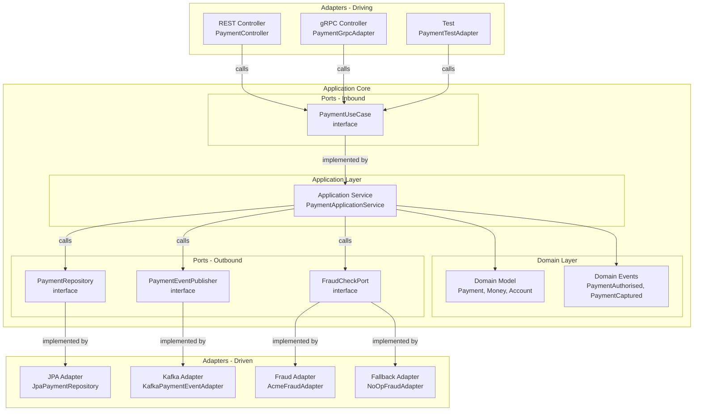

The hexagonal architecture pattern, introduced by Alistair Cockburn in 2005, solves a problem that is endemic to fintech systems built with Spring Boot: business logic that is tightly entangled with the frameworks, databases, and external systems it happens to use today. When a team decides to migrate from PostgreSQL to CockroachDB, replace a third-party fraud vendor, or add a Kafka consumer alongside an existing REST API, entangled code makes those changes expensive and risky. Hexagonal architecture creates a clean separation between the core business logic and everything that touches the outside world, so infrastructure decisions can change without touching the domain. For payment systems where reliability and auditability are non-negotiable, the testability that hexagonal architecture enables — domain logic tested without a database or message broker — is as important as the structural benefit.

## Learning Objectives

- Describe the three layers of hexagonal architecture and the dependency rules that govern each
- Distinguish driving (primary) ports from driven (secondary) ports and explain why the distinction matters
- Implement an inbound port interface and application service for a payment use case
- Implement outbound port interfaces for persistence and event publishing with zero infrastructure imports in the domain
- Write JPA and Kafka adapter implementations that fulfil the outbound port contracts
- State the hexagonal dependency rule precisely and demonstrate how ArchUnit enforces it in a CI pipeline
- Compare hexagonal architecture with Clean Architecture and Onion Architecture, identifying the meaningful differences
- Design a Spring Boot package structure that makes the hexagonal boundaries visible and enforceable
- Write unit tests for domain and application service logic that execute without a Spring application context

## Business Context

Clearstream Financial's payment processing team maintains a monolithic Spring Boot application where JPA `@Entity` classes are used directly in REST controllers, `@Transactional` service methods call external HTTP APIs inline, and the fraud detection vendor is hardwired into the payment processing logic via a `@Autowired` service. When the fraud vendor suffered a 90-minute outage in March 2026, every payment authorisation failed because there was no circuit breaker or fallback — the vendor call and the payment logic were the same method. Replacing the vendor requires changes in 23 files across 11 packages. A hexagonal architecture would have isolated the fraud vendor behind an outbound port interface, making vendor replacement a single-adapter change and enabling a fallback implementation to be swapped in without touching the payment processing logic.

## Hexagonal Architecture Layers

The hexagonal architecture divides a service into three concentric areas with strict dependency rules.



**Domain Layer** — Contains the domain model (aggregates, value objects, domain events, domain exceptions). Zero dependencies on frameworks, libraries, or infrastructure. This layer could run in a standard Java SE main method.

**Application Layer** — Contains application services that orchestrate use cases by calling domain logic and outbound ports. May depend on the domain layer and on port interfaces. No infrastructure imports. Spring annotations like `@Transactional` are acceptable here but must be the only Spring dependency.

**Adapter Layer** — Contains the driving adapters (REST controllers, gRPC handlers, Kafka consumers, CLI runners) and driven adapters (JPA repositories, Kafka producers, HTTP clients to external services). Adapters import and implement port interfaces. Adapters may depend on Spring, JPA, Kafka, Feign, and any other framework.

> [!IMPORTANT]
> The dependency rule is absolute: nothing in the domain or application layer may import from the adapter layer. The import direction is always inward — adapters import ports, ports are defined in the application core. If you see `import org.springframework.data.jpa.repository.JpaRepository` in a domain class, the dependency rule has been violated.

## Inbound Port: PaymentUseCase

The inbound (driving) port defines what the application core offers to the outside world. It is an interface in the application layer, implemented by the application service.

```java
// application/port/in/PaymentUseCase.java
public interface PaymentUseCase {

    PaymentId authorisePayment(AuthorisePaymentCommand command);

    void capturePayment(CapturePaymentCommand command);

    void voidPayment(VoidPaymentCommand command);

    PaymentDetails getPayment(PaymentId paymentId);
}
```

```java
// application/port/in/AuthorisePaymentCommand.java
public record AuthorisePaymentCommand(
    MerchantId merchantId,
    Money amount,
    CardToken cardToken,
    String idempotencyKey
) {
    public AuthorisePaymentCommand {
        Objects.requireNonNull(merchantId);
        Objects.requireNonNull(amount);
        Objects.requireNonNull(cardToken);
        Objects.requireNonNull(idempotencyKey);
        if (idempotencyKey.isBlank()) {
            throw new IllegalArgumentException("idempotencyKey must not be blank");
        }
    }
}
```

## Application Service

The `PaymentApplicationService` implements the inbound port and orchestrates the use case by calling the domain model and outbound ports.

```java
// application/service/PaymentApplicationService.java
@Service
@Transactional
public class PaymentApplicationService implements PaymentUseCase {

    private final PaymentRepository paymentRepository;
    private final PaymentEventPublisher eventPublisher;
    private final FraudCheckPort fraudCheckPort;
    private final MerchantRepository merchantRepository;

    public PaymentApplicationService(
            PaymentRepository paymentRepository,
            PaymentEventPublisher eventPublisher,
            FraudCheckPort fraudCheckPort,
            MerchantRepository merchantRepository) {
        this.paymentRepository = paymentRepository;
        this.eventPublisher = eventPublisher;
        this.fraudCheckPort = fraudCheckPort;
        this.merchantRepository = merchantRepository;
    }

    @Override
    public PaymentId authorisePayment(AuthorisePaymentCommand command) {
        // Idempotency check — application-level concern
        paymentRepository.findByIdempotencyKey(command.idempotencyKey())
            .ifPresent(existing -> { throw new DuplicatePaymentException(command.idempotencyKey()); });

        // Load merchant via outbound port
        Merchant merchant = merchantRepository.findById(command.merchantId())
            .orElseThrow(() -> new MerchantNotFoundException(command.merchantId()));

        // Fraud check via outbound port — no HTTP client here
        FraudAssessment fraudAssessment = fraudCheckPort.assess(
            new FraudCheckRequest(merchant.id(), command.amount(), command.cardToken())
        );

        if (fraudAssessment.isHighRisk()) {
            throw new PaymentDeclinedForFraudException(fraudAssessment.riskScore());
        }

        // Domain logic — no infrastructure concern
        Payment payment = Payment.authorise(
            merchant.id(),
            command.amount(),
            command.cardToken(),
            command.idempotencyKey()
        );

        // Persist via outbound port
        paymentRepository.save(payment);

        // Publish domain events via outbound port
        payment.drainDomainEvents()
            .forEach(eventPublisher::publish);

        return payment.id();
    }

    @Override
    public void capturePayment(CapturePaymentCommand command) {
        Payment payment = paymentRepository.findByIdForUpdate(command.paymentId())
            .orElseThrow(() -> new PaymentNotFoundException(command.paymentId()));

        payment.capture(command.captureAmount());

        paymentRepository.save(payment);
        payment.drainDomainEvents().forEach(eventPublisher::publish);
    }

    @Override
    public void voidPayment(VoidPaymentCommand command) {
        Payment payment = paymentRepository.findByIdForUpdate(command.paymentId())
            .orElseThrow(() -> new PaymentNotFoundException(command.paymentId()));

        payment.voidPayment(command.voidReason());

        paymentRepository.save(payment);
        payment.drainDomainEvents().forEach(eventPublisher::publish);
    }

    @Override
    @Transactional(readOnly = true)
    public PaymentDetails getPayment(PaymentId paymentId) {
        return paymentRepository.findById(paymentId)
            .map(PaymentDetails::from)
            .orElseThrow(() -> new PaymentNotFoundException(paymentId));
    }
}
```

## Outbound Ports

Outbound (driven) ports define what the application core needs from the outside world. They are interfaces in the application layer, implemented by adapters in the infrastructure layer.

```java
// application/port/out/PaymentRepository.java
public interface PaymentRepository {
    Optional<Payment> findById(PaymentId paymentId);
    Optional<Payment> findByIdForUpdate(PaymentId paymentId);
    Optional<Payment> findByIdempotencyKey(String idempotencyKey);
    void save(Payment payment);
}

// application/port/out/PaymentEventPublisher.java
public interface PaymentEventPublisher {
    void publish(DomainEvent event);
}

// application/port/out/FraudCheckPort.java
public interface FraudCheckPort {
    FraudAssessment assess(FraudCheckRequest request);
}
```

## JPA Adapter

The JPA adapter lives in the infrastructure layer and implements the `PaymentRepository` outbound port. It is the only place in the codebase where JPA annotations appear.

```java
// adapter/out/persistence/JpaPaymentRepository.java
@Repository
public class JpaPaymentRepository implements PaymentRepository {

    private final PaymentJpaEntityRepository springDataRepository;
    private final PaymentPersistenceMapper mapper;

    public JpaPaymentRepository(PaymentJpaEntityRepository springDataRepository,
                                PaymentPersistenceMapper mapper) {
        this.springDataRepository = springDataRepository;
        this.mapper = mapper;
    }

    @Override
    public Optional<Payment> findById(PaymentId paymentId) {
        return springDataRepository.findById(paymentId.value())
            .map(mapper::toDomain);
    }

    @Override
    @Lock(LockModeType.PESSIMISTIC_WRITE)
    public Optional<Payment> findByIdForUpdate(PaymentId paymentId) {
        return springDataRepository.findWithLockById(paymentId.value())
            .map(mapper::toDomain);
    }

    @Override
    public Optional<Payment> findByIdempotencyKey(String idempotencyKey) {
        return springDataRepository.findByIdempotencyKey(idempotencyKey)
            .map(mapper::toDomain);
    }

    @Override
    public void save(Payment payment) {
        PaymentJpaEntity entity = mapper.toEntity(payment);
        springDataRepository.save(entity);
    }
}
```

```java
// adapter/out/persistence/PaymentJpaEntity.java
@Entity
@Table(name = "payments")
public class PaymentJpaEntity {

    @Id
    private UUID id;

    @Column(nullable = false)
    private UUID merchantId;

    @Column(precision = 19, scale = 4, nullable = false)
    private BigDecimal amount;

    @Column(length = 3, nullable = false)
    private String currencyCode;

    @Enumerated(EnumType.STRING)
    @Column(nullable = false)
    private PaymentStatusJpa status;

    @Column(nullable = false, unique = true)
    private String idempotencyKey;

    @Version
    private Long version;

    @Column(nullable = false)
    private Instant createdAt;

    @Column
    private Instant capturedAt;

    // getters, setters (JPA requirement for managed entities)
}
```

## Kafka Adapter

The Kafka adapter implements the `PaymentEventPublisher` outbound port. The domain model never imports Kafka classes.

```java
// adapter/out/messaging/KafkaPaymentEventAdapter.java
@Component
public class KafkaPaymentEventAdapter implements PaymentEventPublisher {

    private static final String PAYMENT_EVENTS_TOPIC = "payment-events";

    private final KafkaTemplate<String, PaymentEventMessage> kafkaTemplate;
    private final PaymentEventMessageMapper messageMapper;

    public KafkaPaymentEventAdapter(KafkaTemplate<String, PaymentEventMessage> kafkaTemplate,
                                     PaymentEventMessageMapper messageMapper) {
        this.kafkaTemplate = kafkaTemplate;
        this.messageMapper = messageMapper;
    }

    @Override
    public void publish(DomainEvent event) {
        PaymentEventMessage message = messageMapper.toMessage(event);
        kafkaTemplate.send(PAYMENT_EVENTS_TOPIC, message.paymentId(), message)
            .whenComplete((result, ex) -> {
                if (ex != null) {
                    // Log and potentially write to outbox for retry
                    throw new EventPublishingException("Failed to publish event: " + event, ex);
                }
            });
    }
}
```

## Driving Adapter: REST Controller

```java
// adapter/in/web/PaymentController.java
@RestController
@RequestMapping("/v1/payments")
public class PaymentController {

    private final PaymentUseCase paymentUseCase;

    public PaymentController(PaymentUseCase paymentUseCase) {
        this.paymentUseCase = paymentUseCase;
    }

    @PostMapping("/authorise")
    @ResponseStatus(HttpStatus.CREATED)
    public AuthorisePaymentResponse authorisePayment(
            @Valid @RequestBody AuthorisePaymentRequest request) {
        AuthorisePaymentCommand command = new AuthorisePaymentCommand(
            MerchantId.of(request.merchantId()),
            Money.of(request.amount(), request.currency()),
            CardToken.of(request.cardToken()),
            request.idempotencyKey()
        );
        PaymentId paymentId = paymentUseCase.authorisePayment(command);
        return new AuthorisePaymentResponse(paymentId.value().toString());
    }

    @PostMapping("/{paymentId}/capture")
    @ResponseStatus(HttpStatus.OK)
    public void capturePayment(@PathVariable String paymentId,
                               @Valid @RequestBody CapturePaymentRequest request) {
        paymentUseCase.capturePayment(new CapturePaymentCommand(
            PaymentId.of(paymentId),
            Money.of(request.captureAmount(), request.currency())
        ));
    }
}
```

> [!NOTE]
> The REST controller imports `PaymentUseCase` (the inbound port interface), not `PaymentApplicationService` (the implementation). This means the controller can be tested by injecting a mock or stub implementation of `PaymentUseCase` without starting a Spring application context or any infrastructure.

## Package Structure

The package structure makes the hexagonal boundaries explicit and enforceable.

```
com.meridian.payment/
├── domain/
│   ├── model/
│   │   ├── Payment.java                 ← Aggregate root
│   │   ├── PaymentId.java               ← Value object
│   │   ├── PaymentState.java            ← Sealed interface
│   │   └── Money.java                   ← Value object
│   ├── event/
│   │   ├── DomainEvent.java
│   │   ├── PaymentAuthorisedEvent.java
│   │   └── PaymentCapturedEvent.java
│   └── exception/
│       ├── InsufficientFundsException.java
│       └── PaymentDeclinedForFraudException.java
├── application/
│   ├── port/
│   │   ├── in/
│   │   │   ├── PaymentUseCase.java      ← Inbound port
│   │   │   ├── AuthorisePaymentCommand.java
│   │   │   └── CapturePaymentCommand.java
│   │   └── out/
│   │       ├── PaymentRepository.java   ← Outbound port
│   │       ├── PaymentEventPublisher.java
│   │       └── FraudCheckPort.java
│   └── service/
│       └── PaymentApplicationService.java
└── adapter/
    ├── in/
    │   └── web/
    │       ├── PaymentController.java
    │       ├── AuthorisePaymentRequest.java
    │       └── AuthorisePaymentResponse.java
    └── out/
        ├── persistence/
        │   ├── JpaPaymentRepository.java
        │   ├── PaymentJpaEntity.java
        │   └── PaymentPersistenceMapper.java
        ├── messaging/
        │   ├── KafkaPaymentEventAdapter.java
        │   └── PaymentEventMessageMapper.java
        └── fraud/
            ├── AcmeFraudAdapter.java
            └── NoOpFraudAdapter.java
```

## Comparison: Hexagonal vs Clean vs Onion

| Dimension | Hexagonal | Clean Architecture | Onion Architecture |
|---|---|---|---|
| **Core metaphor** | Hexagon with driving/driven sides | Concentric circles, outer depends on inner | Concentric onion layers |
| **Port concept** | Explicit port interfaces on both sides | Use Case interfaces (inbound); Gateway/Repository interfaces (outbound) | Service interfaces at domain/application boundary |
| **Number of layers** | 3 (Domain, Application, Adapters) | 4 (Entities, Use Cases, Interface Adapters, Frameworks) | 4+ (Domain Model, Domain Services, Application, Infrastructure) |
| **Naming convention** | Ports and Adapters (Cockburn's terms) | Entities, Use Cases, Gateways (Martin's terms) | Domain, Application, Infrastructure (Palermo's terms) |
| **Dependency rule** | Nothing in core imports from adapters | Outer rings depend on inner; inner rings know nothing of outer | Outer layers depend on inner; inner layers define interfaces |
| **Meaningful difference** | Explicitly distinguishes driving vs driven ports | Explicitly names 4 layers; slightly more prescriptive | Identical to hexagonal in practice; different terminology |

> [!NOTE]
> Hexagonal, Clean, and Onion Architecture are three formulations of the same core idea: the dependency inversion principle applied at an architectural scale. The meaningful choice for a Java/Spring Boot team is not which name to use — it is which package structure to adopt and which ArchUnit rules to enforce. The names are less important than the discipline.

## Testing Strategy

Hexagonal architecture enables a testing strategy that keeps slow infrastructure tests (database, Kafka, HTTP mocks) separated from fast business logic tests.

```java
// Unit test — no Spring context, no database, executes in <1ms
class PaymentApplicationServiceTest {

    private PaymentRepository paymentRepository = mock(PaymentRepository.class);
    private PaymentEventPublisher eventPublisher = mock(PaymentEventPublisher.class);
    private FraudCheckPort fraudCheckPort = mock(FraudCheckPort.class);
    private MerchantRepository merchantRepository = mock(MerchantRepository.class);

    private PaymentApplicationService sut = new PaymentApplicationService(
        paymentRepository, eventPublisher, fraudCheckPort, merchantRepository
    );

    @Test
    void authorisePayment_whenHighRiskFraudScore_throwsDeclinedException() {
        // Arrange
        AuthorisePaymentCommand command = new AuthorisePaymentCommand(
            MerchantId.of("merchant-1"),
            Money.of("100.00", "GBP"),
            CardToken.of("tok_visa_test"),
            "idempotency-key-1"
        );
        when(merchantRepository.findById(any())).thenReturn(Optional.of(testMerchant()));
        when(fraudCheckPort.assess(any())).thenReturn(FraudAssessment.highRisk(0.92));
        when(paymentRepository.findByIdempotencyKey(any())).thenReturn(Optional.empty());

        // Act & Assert
        assertThatThrownBy(() -> sut.authorisePayment(command))
            .isInstanceOf(PaymentDeclinedForFraudException.class);

        // Verify no payment was persisted
        verify(paymentRepository, never()).save(any());
        verify(eventPublisher, never()).publish(any());
    }
}
```

```java
// ArchUnit dependency rule enforcement
@AnalyzeClasses(packages = "com.meridian.payment")
class HexagonalArchitectureTest {

    @ArchTest
    static final ArchRule domainHasNoDependenciesOutsideDomain =
        classes().that().resideInAPackage("..domain..")
            .should().onlyDependOnClassesThat()
            .resideInAnyPackage("..domain..", "java..", "javax..");

    @ArchTest
    static final ArchRule applicationHasNoDependencyOnAdapters =
        noClasses().that().resideInAPackage("..application..")
            .should().dependOnClassesThat()
            .resideInAPackage("..adapter..");

    @ArchTest
    static final ArchRule adaptersDontDependOnEachOther =
        noClasses().that().resideInAPackage("..adapter.in..")
            .should().dependOnClassesThat()
            .resideInAPackage("..adapter.out..");
}
```

> [!WARNING]
> ArchUnit tests must run in CI on every PR, not just locally. A dependency rule violation that passes code review and merges to main is expensive to fix retroactively. Add `@AnalyzeClasses` tests to the standard test suite alongside unit and integration tests, and treat architecture rule failures as build failures.

## Knowledge Check

**Q:** A team member adds `@Autowired private KafkaTemplate<String, Object> kafkaTemplate` to the `PaymentApplicationService` class to publish events directly without going through the `PaymentEventPublisher` port. Identify two specific consequences of this violation beyond "it's not the pattern."

**A:** First, the `PaymentApplicationService` now has a compile-time dependency on the Kafka library. Every test of the application service — including pure unit tests that test business logic like fraud rejection or insufficient funds handling — now requires either a live Kafka broker, an embedded Kafka test dependency, or a complex `@MockBean` setup that starts a partial Spring context. Test execution time increases from milliseconds to seconds per test class, and the test isolation is broken: a Kafka configuration issue will cause business logic tests to fail. Second, replacing Kafka with a different message broker (e.g., moving to AWS SNS for a customer using AWS-native infrastructure) now requires modifying the `PaymentApplicationService` — a core application class — rather than writing a new adapter. The business logic and the infrastructure choice are now coupled: a change to infrastructure technology forces a change to the class that enforces business invariants, increasing the blast radius of infrastructure changes and violating the Single Responsibility Principle at the architectural level.

**Q:** A team is debating whether to put the `@Transactional` annotation on the `PaymentApplicationService` or on the `JpaPaymentRepository` adapter. Where does it belong in a hexagonal architecture and why?

**A:** The `@Transactional` annotation belongs on the `PaymentApplicationService` (the application layer), not on the JPA adapter. The transaction boundary is a business concern: a payment authorisation use case is a single atomic operation that must either succeed completely or roll back completely — that is a business invariant, not a persistence detail. The application service is the appropriate place to declare that the entire operation runs in a single transaction because it has the full context of the use case. If the transaction annotation is on the JPA adapter, then each individual database call runs in its own transaction, meaning a failure during event publishing after a successful save would leave the database in a committed state without the corresponding events having been published — a business consistency violation. Additionally, placing `@Transactional` on the adapter creates an invisible dependency between the adapter and the application service's transactional requirements; changing the transaction behaviour requires changing the adapter, which is an infrastructure class, rather than the application class where the business requirement lives. The practical implication is that `@Transactional` from `org.springframework.transaction.annotation` is acceptable as the single Spring import in the application service layer.

## Practical Challenge

1. **Build the full hexagonal stack.** Implement a `FraudCheckPort` and two adapter implementations: (a) `AcmeFraudAdapter` that calls a hypothetical external fraud API at `POST https://api.acmefraud.com/v2/score` using Spring's `RestClient`, returning a `FraudAssessment` with a risk score, and (b) `NoOpFraudAdapter` that always returns `FraudAssessment.lowRisk(0.01)`. Wire both as Spring beans with the `NoOpFraudAdapter` annotated `@Primary` for the test profile and `@ConditionalOnProperty(name = "fraud.provider", havingValue = "acme")` for the production bean. Write a unit test for `AcmeFraudAdapter` using `MockRestServiceServer` that verifies the request structure and correctly maps a high-risk response.

2. **Enforce the dependency rule with ArchUnit.** Write a complete `HexagonalArchitectureTest` class using ArchUnit 1.3.x that enforces: (a) no domain class imports from `org.springframework`, JPA, or Kafka packages, (b) no application class imports from adapter packages, (c) all outbound port implementations in `adapter.out` implement an interface from `application.port.out`, and (d) all classes in `adapter.in.web` annotated with `@RestController` depend on an interface from `application.port.in`, not directly on `application.service`. Run the tests against the package structure defined in this lesson.

3. **Write a testing pyramid for the payment use case.** For the `authorisePayment` use case, write three levels of test: (a) a pure unit test (`PaymentApplicationServiceTest`) using Mockito that tests the fraud-rejection business rule without any Spring context, (b) a slice test (`@WebMvcTest` for the controller) that verifies the REST contract — correct HTTP status codes, request deserialization, and response serialisation — by mocking the `PaymentUseCase` port, and (c) a persistence adapter test (`@DataJpaTest` for `JpaPaymentRepository`) that verifies save and findById round-trip correctly with an H2 in-memory database. Each test class must start and complete in under 500ms individually.

4. **Migrate a layered architecture to hexagonal.** You are given a traditional three-layer Spring Boot application (`controller → service → repository`) for a loan origination feature. The `LoanService` class directly autowires `LoanRepository` (a Spring Data JPA interface), `CreditBureauClient` (a `@Component` wrapping RestTemplate calls), and `LoanEventPublisher` (a `@Component` wrapping KafkaTemplate). Redesign the package structure following the hexagonal pattern, identify the inbound port, the three outbound ports, write the interface definitions for each port, and describe (without implementing in full) what each adapter class would contain. Identify which of the existing test classes would need to be rewritten and which could be retained with minor modifications.

<!-- KNOWLEDGE-CHECK
{
  "questions": [
    {
      "text": "A team member adds @Autowired KafkaTemplate directly to PaymentApplicationService to publish events without going through the PaymentEventPublisher port. What is the first specific consequence of this violation?",
      "options": [
        "The application will fail to start because KafkaTemplate cannot be autowired into an application-layer class.",
        "Every unit test of PaymentApplicationService now requires either a live Kafka broker, embedded Kafka, or a complex Spring context — test execution time increases from milliseconds to seconds per test class.",
        "The PaymentApplicationService will publish duplicate events because Kafka's exactly-once semantics require using the outbound port interface.",
        "The domain events raised by the Payment aggregate will no longer be drained correctly after save."
      ],
      "correct": 1,
      "explanation": "The immediate consequence is test degradation. The application service now has a compile-time dependency on the Kafka library, so every unit test for business logic (fraud rejection, insufficient funds) now requires Kafka infrastructure. Test isolation is broken and execution time increases dramatically — the hexagonal architecture's core testability benefit is destroyed."
    },
    {
      "text": "In hexagonal architecture, where does the @Transactional annotation belong — on the application service or on the JPA adapter — and why?",
      "options": [
        "On the JPA adapter, because transactions are a persistence concern and belong in the infrastructure layer.",
        "On both the application service and the JPA adapter, to ensure each layer manages its own transaction boundary.",
        "On the application service, because the transaction boundary is a business concern — the entire use case is a single atomic operation.",
        "On neither; transactions should be managed by a separate TransactionManager bean injected into the application service."
      ],
      "correct": 2,
      "explanation": "@Transactional belongs on the application service because the transaction boundary is a business requirement: the entire use case must succeed or fail atomically. If placed on the JPA adapter, each individual database call runs in its own transaction, breaking the atomicity of the use case and enabling partial writes — a business consistency violation."
    },
    {
      "text": "Which of the following correctly describes the dependency rule in hexagonal architecture?",
      "options": [
        "Adapters may import from the domain layer, and the domain layer may import from the application layer.",
        "Nothing in the domain or application layer may import from the adapter layer; the import direction is always inward.",
        "The application layer may import from adapters to access the concrete implementations of its port interfaces.",
        "Driving adapters may import from driven adapters to coordinate request and response handling."
      ],
      "correct": 1,
      "explanation": "The hexagonal dependency rule is absolute: nothing in the domain or application layer may import from the adapter layer. Adapters import port interfaces defined in the application core. The import direction is always inward — from adapters toward the domain, never outward. Any import of an adapter class in a domain or application class is a dependency rule violation."
    }
  ]
}
-->

<!-- PRACTICAL-CHALLENGE
{
  "title": "Build and Test a Hexagonal Payment Service",
  "difficulty": "advanced",
  "estimatedMinutes": 60,
  "tasks": [
    {"id": "1", "description": "Implement a FraudCheckPort interface and two adapter implementations: (a) AcmeFraudAdapter that calls a hypothetical external fraud API at POST https://api.acmefraud.com/v2/score using Spring RestClient, and (b) NoOpFraudAdapter that always returns FraudAssessment.lowRisk(0.01). Wire both as Spring beans — NoOpFraudAdapter as @Primary for the test profile, AcmeFraudAdapter with @ConditionalOnProperty(name='fraud.provider', havingValue='acme'). Write a unit test for AcmeFraudAdapter using MockRestServiceServer verifying the request structure and high-risk response mapping."},
    {"id": "2", "description": "Write a complete HexagonalArchitectureTest class using ArchUnit 1.3.x that enforces: (a) no domain class imports from org.springframework, JPA, or Kafka packages, (b) no application class imports from adapter packages, (c) all outbound port implementations in adapter.out implement an interface from application.port.out, and (d) all @RestController classes in adapter.in.web depend on an interface from application.port.in rather than directly on application.service classes."},
    {"id": "3", "description": "Write a testing pyramid for the authorisePayment use case at three levels: (a) a pure unit test using Mockito testing the fraud-rejection business rule without any Spring context, (b) a @WebMvcTest slice test for the PaymentController verifying correct HTTP status codes and request deserialization by mocking the PaymentUseCase port, and (c) a @DataJpaTest for JpaPaymentRepository verifying save and findById round-trip with H2. Each test class must start and complete in under 500ms individually."},
    {"id": "4", "description": "Migrate a traditional three-layer LoanService (which directly autowires LoanRepository, CreditBureauClient, and LoanEventPublisher) to hexagonal architecture. Redesign the package structure, identify the inbound port and three outbound ports, write the interface definitions for each port, and describe what each adapter class would contain. Identify which existing test classes must be rewritten and which can be retained with minor modifications."}
  ]
}
-->
