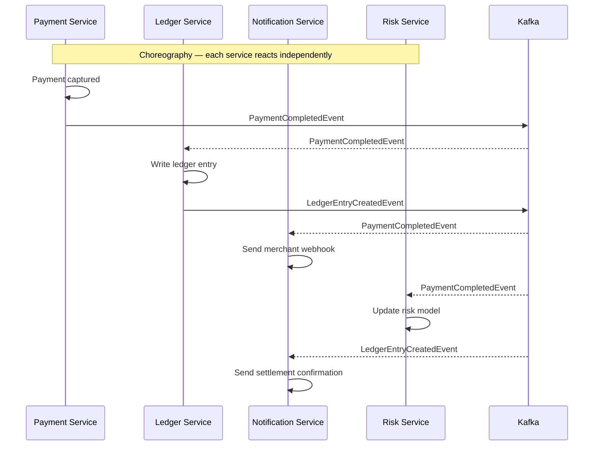
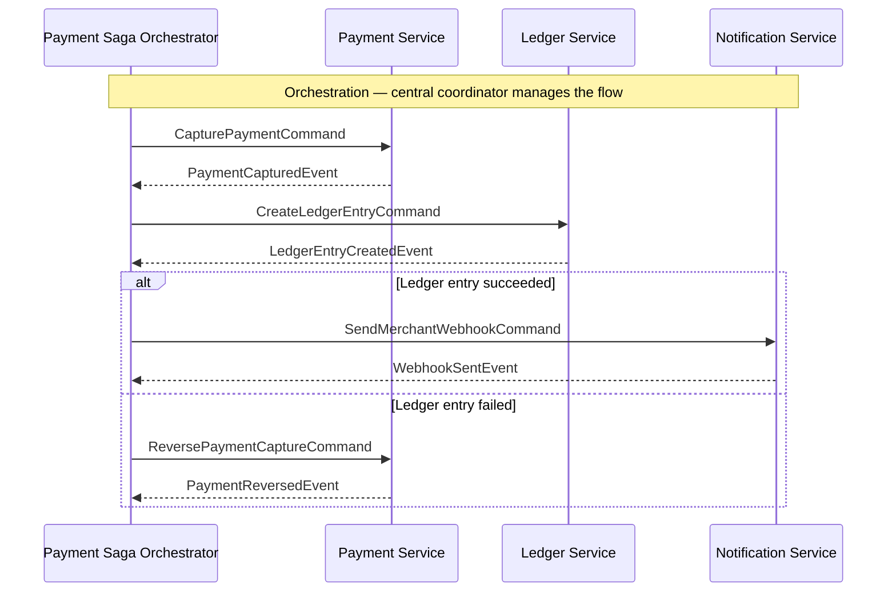

البنية القائمة على الأحداث (Event-Driven Architecture) ليست اختيارًا تقنيًا — بل فلسفة تصميم تحدد كيف تتواصل الخدمات في منصة مالية، وكيف تتطور باستقلال، وكيف تتعافى من الأعطال. فعندما تُفوَّض دفعة، يجب أن تتبعها سلسلة من عمليات العمل: يسجّل دفتر الأستاذ قيد يومية، ويحدّث نظام الاحتيال نموذج المخاطر، ويتلقى التاجر إشعار webhook، ويُحدَّث كشف حساب العميل. وربط هذه العمليات باستدعاءات متزامنة مباشرة يصنع سلسلة هشة يحجب فيها أي فشل واحد الدفعة. أما الأحداث فتفصل المُطلِق عن الاستجابة، فتعالج كل خدمة لاحقة بسرعتها وتتعافى باستقلال. والمهارة الحاسمة لمهندسي التقنية المالية الكبار ليست توصيل Kafka — بل فهم المفاضلات بين أنواع الأحداث، ومخاطر الترتيب الضمني، والانضباط المطلوب لإدارة إصدارات الأحداث عبر علاقات مستهلكين طويلة العمر.

## أهداف التعلّم

- التمييز بين أحداث المجال وأحداث التكامل والأوامر، وشرح متى يناسب كل منها
- تصميم غلاف حدث (event envelope) جيد البنية بكل حقول البيانات الوصفية المطلوبة لنظام مالي في الإنتاج
- مقارنة مفاضلات التنسيق الذاتي (Choreography) والتنسيق المركزي (Orchestration) باستخدام سيناريوهات فشل مالية ملموسة
- تنفيذ `PaymentCompletedEvent` بتعريف مخطط Avro ونشره من خدمة Spring Boot إلى Kafka
- تطبيق استراتيجيات إصدارات الأحداث — التغييرات الإضافية وتطور المخططات — دون كسر المستهلكين الحاليين
- كتابة اختبارات عقود يحددها المستهلك لمخططات الأحداث باستخدام Pact
- شرح إعادة تشغيل الأحداث (replay) والإسقاطات (projections) وكيف تتيح إعادة بناء نماذج القراءة
- وصف مخزن الأحداث (event store) ودوره في Event Sourcing
- تحديد خمسة أخطاء شائعة في البنية القائمة على الأحداث في تدفق دفع مالي وتصحيحها

## سياق العمل

‏TradeFlow منصة مدفوعات عابرة للحدود بين الشركات (مثال مركّب) تعالج 180,000 أمر دفع يوميًا بـ 47 عملة. في الربع الأول من 2025، استبدل الفريق سلسلة معالجة مدفوعات متزامنة (استدعاء REST ← استدعاء REST ← استدعاء REST) ببنية قائمة على الأحداث. واستخدم التنفيذ الأولي التنسيق الذاتي لكل التدفقات. وخلال شهرين، عادت ثلاث حوادث إنتاج إلى السبب الجذري نفسه: اعتماد ترتيب ضمني بين خدمة دفتر الأستاذ وخدمة تقارير الامتثال — فقد كانت تقارير الامتثال تُولَّد قبل كتابة قيد دفتر الأستاذ، فتنشأ فروقات في التقارير المالية. ولم يكن لدى الفريق رؤية لترتيب معالجة الأحداث، ولا أدوات لإعادة تشغيل الأحداث لإصلاح تباعد الحالة. واستهلكت الحوادث 340 ساعة هندسية في التشخيص وإعادة بناء الحالة. ويعالج هذا الدرس انضباط التصميم الذي كان سيمنع تلك الحوادث.

## أنواع الأحداث: أحداث المجال وأحداث التكامل والأوامر

ثلاثة أنواع متمايزة من الرسائل يُخلط بينها كثيرًا في الأنظمة القائمة على الأحداث. واستخدام النوع الخاطئ في سيناريو معين يجلب اقترانًا ومشكلات ترتيب وملكية غير واضحة.

**حدث المجال (Domain Event)** — حقيقة أن شيئًا ما حدث داخل سياق محدود. يطلقه تجميع. ونطاقه طبقة المجال. ولا يُسلسل للاستهلاك الخارجي بشكله الخام. مثال: `PaymentAuthorisedEvent` الذي يطلقه التجميع `Payment`.

**حدث التكامل (Integration Event)** — رسالة تُنشر إلى وسيط رسائل لتستهلكها سياقات محدودة أخرى أو خدمات خارجية. يُشتق حدث التكامل عادة من حدث مجال، لكنه مصمم للتشغيل البيني: له مخطط ثابت، وعقد بإصدارات، وغلاف صريح. مثال: `payment.authorised.v1` المنشور إلى Kafka.

**الأمر (Command)** — طلب لحدوث شيء ما، موجّه إلى مستلم محدد. وبخلاف الأحداث (الحقائق)، يمكن رفض الأوامر. مثال: `ProcessRefundCommand` المرسل من خدمة النزاعات إلى خدمة المدفوعات.

| الخاصية | حدث المجال | حدث التكامل | الأمر |
|---|---|---|---|
| **يمثل** | حقيقة حدثت | حقيقة للمستهلكين الخارجيين | طلبًا لفعل شيء |
| **المستلم** | مستمعون داخل العملية نفسها | عدة سياقات محدودة | مستلم واحد محدد |
| **قابلية الرفض** | لا يُرفض (حدث بالفعل) | لا يُرفض (حدث بالفعل) | يمكن رفضه |
| **إصدارات المخطط** | غير مطلوبة (داخلي) | مطلوبة (عقد بين الخدمات) | مطلوبة (عقد بين الخدمات) |
| **صيغة التسلسل** | كائنات Java (في الذاكرة) | ‏Avro، أو JSON Schema، أو Protobuf | ‏Avro، أو JSON Schema، أو Protobuf |
| **مثال مالي** | `PaymentAuthorisedEvent` (مجال) | `payment.authorised.v2` ‏(Kafka) | `ProcessRefundCommand` |

> [!NOTE]
> أحداث المجال وأحداث التكامل مفهومان مترابطان لكنهما منفصلان. ومن الأخطاء الشائعة نشر كائن حدث المجال مباشرة إلى Kafka. فحدث المجال تفصيل تنفيذي داخلي؛ وحدث التكامل عقد واجهة برمجية عام. فإذا أعدت تسمية حقول حدث المجال، ينكسر كل مستهلكي Kafka. أبقِ طبقة الترجمة صريحة.

## تصميم مخطط الحدث

لحدث التكامل جيد التصميم غلاف يحمل البيانات الوصفية للتوجيه والإصدار بشكل منفصل عن حمولة العمل. وتتيح هذه البنية للمستهلكين توجيه الأحداث، والتعامل مع عدة إصدارات، وتنفيذ منع التكرار دون تحليل الحمولة.

```json
{
  "eventId": "evt_01HXYZ7P3K4V9N2M8QRST0",
  "eventType": "payment.completed",
  "eventVersion": "2",
  "occurredAt": "2026-11-08T14:23:45.123Z",
  "producerService": "payment-service",
  "correlationId": "corr_01HXYZ6A2B3C4D5E6F7G8",
  "causationId": "evt_01HXYZ6A2B3C4D5E6F7G8",
  "partitionKey": "merchant-id:merch_01ABC",
  "payload": {
    "paymentId": "pay_01HXYZ7P3K4V9N2M8QRST0",
    "merchantId": "merch_01ABC",
    "amount": {
      "value": "149.99",
      "currency": "GBP"
    },
    "capturedAt": "2026-11-08T14:23:45.000Z",
    "cardNetwork": "VISA",
    "last4Digits": "4242"
  }
}
```

| الحقل | الغرض | مطلوب |
|---|---|---|
| `eventId` | معرّف فريد عالميًا؛ يتيح منع التكرار لدى المستهلك | نعم |
| `eventType` | مفتاح توجيه لاشتراك المستهلك | نعم |
| `eventVersion` | إصدار المخطط؛ يتيح مستهلكين متعددي الإصدارات | نعم |
| `occurredAt` | الطابع الزمني للحدث في العمل (لا وقت الإزاحة في Kafka) | نعم |
| `producerService` | التتبع؛ أي خدمة أطلقت الحدث | نعم |
| `correlationId` | تتبع الطلب من الطرف إلى الطرف عبر الخدمات | نعم |
| `causationId` | الحدث أو الأمر الذي سبّب هذا الحدث (السلسلة السببية) | مستحسن |
| `partitionKey` | تعيين قسم Kafka لضمانات الترتيب | مستحسن |

> [!IMPORTANT]
> الحقل `eventId` هو مفتاح منع التكرار لدى المستهلك. يجب على كل مستهلك يعالج حدث تكامل أن يتحقق مما إذا كان قد عالج حدثًا بالمعرّف `eventId` نفسه، وأن يتخطاه إن كان كذلك. وبدون هذا الفحص، تسبب إعادة تسليم Kafka (التي تحدث عند إعادة تشغيل المستهلك أو إعادة التوازن) معالجة مكررة — وفي التقنية المالية يعني ذلك معالجة دفع مكررة، أو قيودًا مكررة في دفتر الأستاذ، أو إرسال webhook مكررًا.

## الحدث PaymentCompletedEvent: مخطط Avro والنشر إلى Kafka

‏Avro صيغة التسلسل المفضلة لأحداث التكامل في أنظمة التقنية المالية في الإنتاج. فهي تدعم تطور المخطط، وترميزًا ثنائيًا مضغوطًا، والتكامل مع سجل المخططات (Schema Registry).

```json
// src/main/avro/payment-completed-v2.avsc
{
  "namespace": "com.meridian.payment.events",
  "type": "record",
  "name": "PaymentCompletedEvent",
  "doc": "Published when a payment capture is confirmed. Schema version 2.",
  "fields": [
    {"name": "eventId",          "type": "string",  "doc": "ULID; globally unique event identifier"},
    {"name": "eventVersion",     "type": "string",  "default": "2"},
    {"name": "occurredAt",       "type": "string",  "doc": "ISO-8601 UTC timestamp"},
    {"name": "correlationId",    "type": "string"},
    {"name": "paymentId",        "type": "string"},
    {"name": "merchantId",       "type": "string"},
    {"name": "amountValue",      "type": "string",  "doc": "Decimal string, e.g. 149.99"},
    {"name": "amountCurrency",   "type": "string",  "doc": "ISO-4217 currency code"},
    {"name": "cardNetwork",      "type": {"type": "enum", "name": "CardNetwork",
                                          "symbols": ["VISA","MASTERCARD","AMEX","UNKNOWN"]}},
    {"name": "last4Digits",      "type": "string"},
    {"name": "capturedAt",       "type": "string"},
    {"name": "merchantReference","type": ["null", "string"], "default": null,
     "doc": "Added in v2; null for events from services that have not upgraded"}
  ]
}
```

```java
// adapter/out/messaging/KafkaPaymentEventPublisher.java
@Component
public class KafkaPaymentEventPublisher implements PaymentEventPublisher {

    private static final String TOPIC = "payment.events";
    private final KafkaTemplate<String, PaymentCompletedEvent> kafkaTemplate;
    private final EventEnvelopeFactory envelopeFactory;

    @Override
    public void publish(DomainEvent domainEvent) {
        if (domainEvent instanceof PaymentCapturedEvent captured) {
            PaymentCompletedEvent avroEvent = toAvroEvent(captured);
            String partitionKey = "merchant:" + captured.merchantId().value();

            kafkaTemplate.send(TOPIC, partitionKey, avroEvent)
                .whenComplete((result, ex) -> {
                    if (ex != null) {
                        // Runs on a Kafka I/O thread after publish() returned:
                        // throwing here reaches nobody. Log, count, and rely on the
                        // outbox (Track 05) for guaranteed delivery.
                        log.error("Failed to publish PaymentCompletedEvent for payment {}",
                            captured.paymentId(), ex);
                    }
                });
        }
    }

    private PaymentCompletedEvent toAvroEvent(PaymentCapturedEvent captured) {
        return PaymentCompletedEvent.newBuilder()
            .setEventId(ULID.randomULID())
            .setEventVersion("2")
            .setOccurredAt(captured.occurredAt().toString())
            .setCorrelationId(MDC.get("correlationId"))
            .setPaymentId(captured.paymentId().value().toString())
            .setMerchantId(captured.merchantId().value())
            .setAmountValue(captured.amount().amount().toPlainString())
            .setAmountCurrency(captured.amount().currency().getCurrencyCode())
            .setCardNetwork(CardNetwork.valueOf(captured.cardNetwork().name()))
            .setLast4Digits(captured.last4Digits())
            .setCapturedAt(captured.capturedAt().toString())
            .setMerchantReference(captured.merchantReference())
            .build();
    }
}
```

```yaml
# application.yml — Kafka and Schema Registry configuration
spring:
  kafka:
    bootstrap-servers: ${KAFKA_BOOTSTRAP_SERVERS}
    producer:
      key-serializer: org.apache.kafka.common.serialization.StringSerializer
      value-serializer: io.confluent.kafka.serializers.KafkaAvroSerializer
      properties:
        schema.registry.url: ${SCHEMA_REGISTRY_URL}
        auto.register.schemas: false          # never auto-register in production
        use.latest.version: true
        acks: all                             # wait for all ISR replicas
        enable.idempotence: true              # no duplicates from producer retries (not end-to-end exactly-once)
        max.in.flight.requests.per.connection: 5
    consumer:
      group-id: ledger-service
      auto-offset-reset: earliest
      enable-auto-commit: false              # manual offset commit after processing
      key-deserializer: org.apache.kafka.common.serialization.StringDeserializer
      value-deserializer: io.confluent.kafka.serializers.KafkaAvroDeserializer
      properties:
        schema.registry.url: ${SCHEMA_REGISTRY_URL}
        specific.avro.reader: true
```

## التنسيق الذاتي أم التنسيق المركزي





في التنسيق الذاتي (Choreography) تتفاعل كل خدمة مع الأحداث باستقلال دون أن تعرف بقية الخدمات. وفي التنسيق المركزي (Orchestration) يرسل منسّق Saga الأوامر بالترتيب، ويعالج الفشل صراحة (مثل عكس التحصيل إذا فشل قيد دفتر الأستاذ).

| البُعد | التنسيق الذاتي | التنسيق المركزي |
|---|---|---|
| **الاقتران** | منخفض — الخدمات تتفاعل مع الأحداث ولا تعرف بعضها | متوسط — المنسّق يعرف كل المشاركين |
| **الرؤية** | منخفضة — التدفق ضمني؛ لا مكان واحد يُظهر الصورة كاملة | عالية — المنسّق يرى التدفق كاملًا |
| **معالجة الأخطاء** | معقدة — التعويض الموزع يتطلب سلاسل أحداث | صريحة — المنسّق يعالج المعاملات التعويضية |
| **التطور** | سهل إضافة مستهلكين جدد؛ وصعب تغيير الترتيب | يتطلب تحديث المنسّق لتغييرات التدفق |
| **التصحيح** | صعب — يتطلب تتبعًا موزعًا | أسهل — المنسّق يسجّل حالة الـ Saga كاملة |
| **الأنسب لـ** | التفاعلات المتوازية المستقلة (إشعار، إثراء، تحديث) | التدفقات المعاملاتية متعددة الخطوات مع تعويض |

> [!WARNING]
> التنسيق الذاتي الخالص مغرٍ لأنه يعظّم الفصل، لكنه يصنع اعتماديات ترتيب خفية. ففي حادثة TradeFlow من سياق العمل، كانت خدمة الامتثال تتفاعل مع `PaymentCompletedEvent` قبل أن تنتهي خدمة دفتر الأستاذ من الكتابة — مشكلة ترتيب كلاسيكية في التنسيق الذاتي. وللتدفقات متعددة الخطوات التي يهم فيها الترتيب أو يُطلب فيها تعويض، يكون التنسيق المركزي (نمط منسّق Saga) هو الخيار الصحيح حتى مع كلفة منسّق مركزي.

## استراتيجيات إصدارات الأحداث

تتطور مخططات الأحداث مع تغيّر متطلبات العمل. واستراتيجية الإصدارات تحدد هل يكون هذا التطور آمنًا أم كارثيًا للمستهلكين اللاحقين.

**تغييرات إضافية (متوافقة مع الإصدارات السابقة):**
- إضافة حقل اختياري جديد بقيمة افتراضية
- توسيع نوع (int ← long؛ يرفع Avro القيمة القديمة تلقائيًا)
- إعادة ترتيب الحقول (يطابق Avro الحقول بالاسم؛ وProtobuf برقم الحقل، طالما بقيت الأرقام كما هي)
- إضافة رمز إلى قائمة تعداد (enum) — فقط إذا عرّف التعداد رمزًا افتراضيًا (`default`)، فيرجع إليه القرّاء الذين لا يعرفون الرمز الجديد؛ وإلا فشل القرّاء القدامى

**تغييرات كاسرة (تتطلب تنسيقًا):**
- إعادة تسمية حقل (ما لم تُضف الاسم القديم كـ `alias` في Avro)
- حذف حقل ليس له قيمة افتراضية
- تغيير نوع حقل إلى نوع غير متوافق

```java
// EventVersioningStrategy.java — example multi-version consumer
@Component
public class PaymentEventConsumer {

    @Autowired
    private LedgerService ledgerService;

    @KafkaListener(topics = "payment.events", groupId = "ledger-service")
    public void onPaymentEvent(ConsumerRecord<String, GenericRecord> record) {
        GenericRecord avroRecord = record.value();
        String version = avroRecord.get("eventVersion").toString();

        switch (version) {
            case "1" -> handleV1(avroRecord);
            case "2" -> handleV2(avroRecord);
            // Never silently drop a financial event: fail so the error handler
            // sends it to the dead-letter topic where someone will look at it.
            default -> throw new UnsupportedEventVersionException(version);
        }
    }

    private void handleV1(GenericRecord record) {
        // V1 handler — no merchantReference field
        ledgerService.recordEntry(
            (String) record.get("paymentId"),
            new BigDecimal((String) record.get("amountValue")),
            Currency.getInstance((String) record.get("amountCurrency")),
            null  // merchantReference not available in v1
        );
    }

    private void handleV2(GenericRecord record) {
        // V2 handler — merchantReference available
        Object merchantRef = record.get("merchantReference");
        ledgerService.recordEntry(
            (String) record.get("paymentId"),
            new BigDecimal((String) record.get("amountValue")),
            Currency.getInstance((String) record.get("amountCurrency")),
            merchantRef != null ? merchantRef.toString() : null
        );
    }
}
```

## اختبار العقود الذي يحدده المستهلك

يضمن اختبار العقود الذي يحدده المستهلك (Consumer-Driven Contract) باستخدام Pact أن منتجي الأحداث ومستهلكيها متفقون على مخطط الحدث قبل النشر. فالمستهلك يحدد ما يتوقعه؛ والمنتِج يتحقق من قدرته على تلبية هذه التوقعات.

```java
// Consumer side — LedgerService defines what it expects from PaymentService
@ExtendWith(PactConsumerTestExt.class)
@PactTestFor(providerName = "payment-service", providerType = ProviderType.ASYNCH)
class LedgerServicePaymentEventContractTest {

    @Pact(consumer = "ledger-service", provider = "payment-service")
    MessagePact paymentCompletedEventPact(MessagePactBuilder builder) {
        return builder
            .expectsToReceive("a PaymentCompletedEvent v2")
            .withContent(new PactDslJsonBody()
                .stringType("eventId")
                .stringValue("eventVersion", "2")
                .stringType("occurredAt")
                .stringType("paymentId")
                .stringType("merchantId")
                .stringMatcher("amountValue", "\\d+\\.\\d{2}", "149.99")  // decimal string
                .stringMatcher("amountCurrency", "[A-Z]{3}")
                .stringType("capturedAt")
            )
            .toPact();
    }

    @Test
    @PactTestFor(pactMethod = "paymentCompletedEventPact")
    void processPaymentCompletedEvent_createsLedgerEntry(List<Message> messages) {
        // Parse the Pact-generated message and verify the consumer can process it
        String body = messages.get(0).contentsAsString();
        PaymentCompletedEventDto event = objectMapper.readValue(body, PaymentCompletedEventDto.class);

        LedgerEntry entry = ledgerService.recordPaymentEntry(event);

        assertThat(entry.paymentId()).isEqualTo(event.paymentId());
        assertThat(entry.amount().currency().getCurrencyCode()).isEqualTo(event.amountCurrency());
    }
}
```

```java
// Provider side — PaymentService verifies it satisfies the consumer's contract
@Provider("payment-service")
@PactBroker(url = "${PACT_BROKER_URL}")
class PaymentServiceContractVerificationTest {

    @BeforeEach
    void before(PactVerificationContext context) {
        context.setTarget(new MessageTestTarget());   // message pact: no HTTP server
    }

    @TestTemplate
    @ExtendWith(PactVerificationInvocationContextProvider.class)
    void verifyPact(PactVerificationContext context) {
        context.verifyInteraction();
    }

    // Must build the message with the real mapping code the producer uses
    @PactVerifyProvider("a PaymentCompletedEvent v2")
    String paymentCompletedEventV2() throws Exception {
        return objectMapper.writeValueAsString(
            PaymentCompletedEventJson.from(samplePaymentCapturedEvent()));
    }
}
```

> [!NOTE]
> تفحص عقود رسائل Pact بنية JSON للرسالة. فإذا كان الموضوع يحمل Avro عبر سجل مخططات، فإن فحص التوافق في السجل (مع `auto.register.schemas: false` وخطوة في CI تختبر المخططات الجديدة) يقوم بمعظم هذه المهمة؛ ويبقى Pact مفيدًا للتوقعات الدلالية مثل "الحقل amountValue نص عشري بمنزلتين".

## إعادة تشغيل الأحداث والإسقاطات

إعادة تشغيل الأحداث هي القدرة على إعادة معالجة الأحداث التاريخية لإعادة بناء نموذج قراءة أو تحديثه. وفي التقنية المالية، هذه القدرة ضرورية من أجل:
- إعادة بناء قاعدة بيانات التقارير بعد ترحيل المخطط
- ملء نموذج قراءة جديد لميزة جديدة (مثل ملخصات الأرصدة لكل عملة)
- التعافي من فشل خدمة لاحقة تسبب في أحداث فائتة

```java
// application/service/ProjectionRebuildService.java
@Service
public class ProjectionRebuildService {

    private final ConsumerFactory<String, GenericRecord> consumerFactory;
    private final LedgerProjectionRepository projectionRepository;

    public void rebuildLedgerProjection(String topic,
                                        Instant fromTimestamp,
                                        Instant toTimestamp) {
        Properties overrides = new Properties();
        overrides.put(ConsumerConfig.ENABLE_AUTO_COMMIT_CONFIG, "false");

        try (Consumer<String, GenericRecord> consumer = consumerFactory.createConsumer(
                 "ledger-rebuild-" + System.currentTimeMillis(), null, null, overrides)) {

            List<TopicPartition> partitions = consumer.partitionsFor(topic).stream()
                .map(p -> new TopicPartition(topic, p.partition()))
                .toList();

            // assign() first — seek() only works on assigned partitions
            consumer.assign(partitions);

            Map<TopicPartition, Long> timestampMap = partitions.stream()
                .collect(Collectors.toMap(tp -> tp, tp -> fromTimestamp.toEpochMilli()));
            Map<TopicPartition, OffsetAndTimestamp> offsets =
                consumer.offsetsForTimes(timestampMap);

            offsets.forEach((tp, offsetAndTimestamp) -> {
                if (offsetAndTimestamp != null) {
                    consumer.seek(tp, offsetAndTimestamp.offset());
                } else {
                    // No message at or after fromTimestamp in this partition
                    consumer.seekToEnd(List.of(tp));
                }
            });

            // Process events within the time window, partition by partition
            Set<TopicPartition> finished = new HashSet<>();
            while (finished.size() < partitions.size()) {
                ConsumerRecords<String, GenericRecord> records =
                    consumer.poll(Duration.ofSeconds(5));
                if (records.isEmpty()) break;   // caught up with the end of the log

                for (ConsumerRecord<String, GenericRecord> record : records) {
                    TopicPartition tp = new TopicPartition(record.topic(), record.partition());
                    if (finished.contains(tp)) continue;
                    if (Instant.ofEpochMilli(record.timestamp()).isAfter(toTimestamp)) {
                        finished.add(tp);
                        consumer.pause(List.of(tp));
                        continue;
                    }
                    projectionRepository.applyEvent(record.value());   // must be idempotent
                }
            }
        }
    }
}
```

يُسند المستهلك الأقسام أولًا ثم ينتقل إلى الإزاحة الموافقة لوقت البداية في كل قسم (`seek()` لا يعمل إلا على أقسام مُسندة). والأقسام التي لا تحتوي أي رسالة بعد وقت البداية ينتقل إلى نهايتها، حتى لا يعيد تشغيلها من البداية. ويُوقف كل قسم وحده عندما يتجاوز وقت النهاية. ويجب أن يكون تطبيق الحدث على الإسقاط آمنًا من التكرار.

> [!NOTE]
> مدة الاحتفاظ الافتراضية بالسجل في Kafka سبعة أيام. ولكي تكون إعادة التشغيل ممكنة بعد أسبوع، اضبط مدة الاحتفاظ على مستوى الموضوع بما يناسب احتياجات العمل، مثلًا `retention.ms=2592000000` (30 يومًا) لأحداث المدفوعات. ويمكن لـ Kafka أيضًا الاحتفاظ بالبيانات بلا حد (`retention.ms=-1`، ويُفضّل مع التخزين المتدرّج tiered storage)، لكن لـ Event Sourcing — تحميل التاريخ الكامل لتجميع واحد بسرعة والإلحاق مع تزامن متفائل — يناسب مخزن أحداث مخصص (جدول PostgreSQL مثل الذي يلي، أو EventStoreDB) أكثر من موضوع Kafka.

## أساسيات مخزن الأحداث

مخزن الأحداث قاعدة بيانات محسّنة لإلحاق تدفقات الأحداث وقراءتها. وبخلاف قاعدة البيانات التقليدية (التي تخزن الحالة الحالية)، يخزن مخزن الأحداث التاريخ الكامل لتغييرات الحالة. وتُشتق الحالة الحالية بإعادة تشغيل كل أحداث التجميع.

```sql
-- A minimal event store schema in PostgreSQL
CREATE TABLE event_store (
    global_sequence  BIGSERIAL    PRIMARY KEY,
    aggregate_type   VARCHAR(100) NOT NULL,
    aggregate_id     UUID         NOT NULL,
    event_type       VARCHAR(200) NOT NULL,
    event_version    INT          NOT NULL DEFAULT 1,
    aggregate_version INT         NOT NULL,
    payload          JSONB        NOT NULL,
    metadata         JSONB        NOT NULL DEFAULT '{}',
    occurred_at      TIMESTAMPTZ  NOT NULL DEFAULT NOW(),

    -- Optimistic concurrency: prevent two events with the same aggregate version
    UNIQUE (aggregate_id, aggregate_version)
);

CREATE INDEX idx_event_store_aggregate
    ON event_store (aggregate_id, aggregate_version);
CREATE INDEX idx_event_store_occurred_at
    ON event_store (occurred_at);
```

```java
// infrastructure/eventstore/PostgresEventStore.java
@Repository
public class PostgresEventStore {

    private final JdbcTemplate jdbcTemplate;
    private final ObjectMapper objectMapper;

    public void append(UUID aggregateId, String aggregateType,
                       int expectedVersion, List<DomainEvent> events) {
        for (int i = 0; i < events.size(); i++) {
            DomainEvent event = events.get(i);
            int newVersion = expectedVersion + i + 1;
            try {
                jdbcTemplate.update(
                    """
                    INSERT INTO event_store
                        (aggregate_type, aggregate_id, event_type, aggregate_version,
                         payload, occurred_at)
                    VALUES (?, ?, ?, ?, ?::jsonb, ?)
                    """,
                    aggregateType,
                    aggregateId,
                    event.getClass().getSimpleName(),
                    newVersion,
                    objectMapper.writeValueAsString(event),
                    event.occurredAt()
                );
            } catch (DuplicateKeyException e) {
                throw new OptimisticConcurrencyException(
                    "Concurrent modification detected for aggregate " + aggregateId
                        + " at version " + newVersion
                );
            } catch (JsonProcessingException e) {
                throw new EventSerializationException(e);
            }
        }
    }

    public List<StoredEvent> loadStream(UUID aggregateId) {
        return jdbcTemplate.query(
            "SELECT * FROM event_store WHERE aggregate_id = ? ORDER BY aggregate_version ASC",
            (rs, row) -> new StoredEvent(
                rs.getString("event_type"),
                rs.getString("payload"),
                rs.getInt("aggregate_version"),
                rs.getTimestamp("occurred_at").toInstant()
            ),
            aggregateId
        );
    }
}
```

يمنع قيد التفرّد على `(aggregate_id, aggregate_version)` كتابتين متزامنتين للإصدار نفسه من التجميع، فيتحول التعارض إلى `OptimisticConcurrencyException` بدل تاريخ متشعب.

## أخطاء شائعة

| الخطأ | الوصف | الوقاية |
|---|---|---|
| **عواصف الأحداث** | حدث واحد يطلق سلسلة من الأحداث تطلق أحداثًا أكثر، فتُغرق النظام | نمذجة الأحداث على مستوى حقائق العمل، لا العمليات التقنية؛ وضبط تنبيهات تأخر المستهلكين |
| **الترتيب الضمني** | يفترض المستهلكون ترتيبًا معينًا للأحداث غير مضمون | استخدم تقسيم Kafka للترتيب داخل مفتاح القسم؛ ولا تفترض أبدًا ترتيبًا بين الأقسام |
| **غياب منع التكرار** | يعالج المستهلك الحدث نفسه مرتين عند إعادة التسليم، فتتكرر الآثار | يجب على كل مستهلك إزالة التكرار على `eventId` ضمن معاملة أثره الجانبي نفسها (دلالات "مرة واحدة فقط" في Kafka تغطي المعالجة من Kafka إلى Kafka فقط) |
| **الأحداث المتضخمة** | أحداث تحمل حمولة كبيرة حتى تصبح واجهة برمجية خفية؛ فيقترن المستهلكون ببنية الحمولة | أبقِ حمولات الأحداث صغيرة؛ ويجلب المستهلكون البيانات الإضافية عبر واجهة برمجية عند الحاجة |
| **انتشار الأحداث بلا ضابط** | مئات أنواع الأحداث بلا تصنيف أو ملكية واضحة | احتفظ بكتالوج للأحداث؛ لكل نوع حدث فريق مالك محدد وتوثيق AsyncAPI |

```java
// Idempotency check pattern in a Kafka consumer
@KafkaListener(topics = "payment.events", groupId = "notification-service")
@Transactional
public void onPaymentCompleted(ConsumerRecord<String, PaymentCompletedEvent> record) {
    String eventId = record.value().getEventId();

    // Check idempotency before processing
    if (processedEventRepository.existsByEventId(eventId)) {
        log.info("Skipping already-processed event: {}", eventId);
        return;
    }

    // Process the event. An HTTP webhook cannot be rolled back: if the commit below
    // fails, the event is redelivered and the webhook is sent again — so the webhook
    // carries eventId as its Webhook-Id and the merchant de-duplicates on it.
    notificationService.sendMerchantWebhook(record.value());

    // Record as processed within the same transaction
    processedEventRepository.save(new ProcessedEvent(eventId, Instant.now()));
}
```

## متى تستخدم الأحداث ومتى تستخدم الاستدعاءات المباشرة

| السيناريو | التوصية | السبب |
|---|---|---|
| تحتاج الرد لمتابعة المعالجة | استدعاء متزامن مباشر | المستدعي يحتاج النتيجة فورًا |
| تفاعلات متوازية مستقلة (إشعار، إثراء، تدقيق) | أحداث | عدة مستهلكين، بلا اعتماد ترتيب |
| سير عمل طويل مع تعويض | Saga (أحداث بتنسيق مركزي) | معالجة الأخطاء المعقدة تتطلب تنسيقًا صريحًا |
| تحديث نموذج القراءة من نموذج الكتابة | أحداث | نمط الإسقاط في CQRS |
| متطلب زمن صارم (أقل من 50ms) | استدعاء مباشر | وسيط الرسائل يضيف زمنًا |
| عبور حدود السياقات المحدودة | أحداث تكامل | عقد مخطط صريح وتطور منفصل |

> [!WARNING]
> الأحداث ليست حلًا لكل شيء. فإدخال وسيط رسائل بين خدمتين تحتاجان إلى تبادل البيانات بشكل متزامن (مثل فحص احتيال يجب أن يكتمل قبل التفويض) يضيف زمنًا وتعقيدًا وأنماط فشل بلا فائدة. استخدم الأحداث حيث يقدّم الفصل والمعالجة غير المتزامنة قيمة حقيقية. والسؤال الذي يجب طرحه: "هل يحتاج المستدعي النتيجة، أم يكفيه أن يعرف أن الحدث استُلم؟"

## اختبر فهمك

**س:** تستهلك خدمة دفتر الأستاذ `PaymentCompletedEvent` من Kafka. وأثناء نافذة صيانة لوسيط Kafka، تأخر المستهلك 90 دقيقة. وعندما لحق، عالج 47,000 حدث بتتابع سريع. ثلاثة من هذه الأحداث لها قيم `eventId` سبق أن عالجتها خدمة دفتر الأستاذ (عولجت أصلًا عبر آلية أخرى أثناء الانقطاع). ماذا يجب أن يفعل تنفيذ المستهلك في خدمة دفتر الأستاذ للتعامل مع ذلك بشكل صحيح، وأي مخطط قاعدة بيانات يدعم هذا السلوك؟

**ج:** يجب أن ينفّذ المستهلك فحص منع التكرار باستخدام الحقل `eventId` قبل معالجة كل حدث. والتنفيذ الصحيح يستعلم جدول `processed_events` (أو ما يعادله) عن `eventId` قبل إنشاء قيد دفتر الأستاذ. فإذا وُجد، يتخطى المستهلك الحدث ويلتزم بإزاحة Kafka — لا يعيد المعالجة ولا يرمي خطأ. ويتطلب مخطط قاعدة البيانات جدول `processed_events` فيه على الأقل فهرس فريد على `event_id` وطابع زمني `processed_at` للتدقيق: `CREATE TABLE processed_events (event_id VARCHAR(50) PRIMARY KEY, processed_at TIMESTAMPTZ NOT NULL DEFAULT NOW(), consumer_group VARCHAR(100) NOT NULL)`. ويجب أن يحدث إدخال سجل `ProcessedEvent` وإنشاء قيد دفتر الأستاذ في معاملة قاعدة بيانات واحدة؛ فإذا تراجعت المعاملة، لا يُسجَّل لا الحدث ولا قيد دفتر الأستاذ، ويُعاد معالجة الحدث في المحاولة التالية. وهذا الجمع بين فحص منع التكرار والكتابة المعاملاتية يعطي أثرًا "مرة واحدة فقط" على دفتر الأستاذ رغم أن Kafka يسلّم "مرة واحدة على الأقل".

**س:** ينشر فريق `PaymentCompletedEvent` v1 إلى Kafka وتستهلكه ثلاث خدمات لاحقة. وتطلب إدارة المنتج إضافة حقل جديد `merchantReference` (مرجع التاجر الخاص للدفعة) إلى الحدث. اشرح مسار الترحيل المتوافق مع الإصدارات السابقة: ما التغييرات المطلوبة في المنتِج وفي كل مستهلك، وبأي ترتيب يجب أن تتم عمليات النشر؟

**ج:** لأن `merchantReference` حقل اختياري جديد (فبعض المدفوعات قد لا يكون لها مرجع تاجر)، فهذا تغيير إضافي متوافق، لكنه يتطلب تسلسل نشر دقيقًا لتجنب كسر المستهلكين. الخطوة 1: حدّث مخطط Avro لإضافة `merchantReference` كحقل يقبل القيمة null وقيمته الافتراضية `null`: ‏`{"name": "merchantReference", "type": ["null", "string"], "default": null}`. وسجّل إصدار المخطط الجديد في سجل المخططات بتوافق `BACKWARD` (أو `FULL`). فإضافة حقل اختياري بقيمة افتراضية متوافقة في الاتجاهين: القارئ بالإصدار v2 يستطيع قراءة بيانات v1 القديمة (تملأ القيمة الافتراضية الحقل المفقود)، والقارئ بالإصدار v1 يتجاهل الحقل الإضافي ببساطة. الخطوة 2: انشر المستهلكين الثلاثة اللاحقين أولًا. ويجب أن يتعامل كل مستهلك مع حالة أن تكون `merchantReference` فارغة (وستكون كذلك دائمًا في البداية). انشر المستهلكين قبل المنتِج حتى يكون كل المستهلكين قادرين على قراءة الحقل الجديد عندما يبدأ المنتِج بإرساله. الخطوة 3: انشر المنتِج المحدّث الذي يملأ `merchantReference` حيث يتوفر، ويضبطه على `null` حيث لا يتوفر. فترتيب النشر — المستهلكون أولًا ثم المنتِج — هو المفتاح: فتوافق `BACKWARD` لا يعد إلا بأن القرّاء الجدد يقرؤون البيانات القديمة، لذا فترقية القرّاء أولًا هي الخيار الآمن افتراضيًا — ومع بعض إعدادات القراءة (مثل تحليل JSON مكتوب يدويًا يرفض الحقول غير المعروفة)، فإن نشر المنتِج أولًا سيكسر المستهلكين. الخطوة 4: بعد التأكد من أن كل المستهلكين يعالجون أحداث v2 بشكل صحيح، حدّث كل مستهلك ليستخدم الحقل `merchantReference` فعليًا بما يناسب منطق عمله.

## تحدٍّ عملي

1. **صمّم كتالوج أحداث.** لمنصة محفظة رقمية بخمسة سياقات محدودة (إدارة المحافظ، ومعالجة المعاملات، و"اعرف عميلك" والامتثال، والإشعارات، والتحليلات)، صمّم كتالوج أحداث بثمانية أحداث تكامل على الأقل. لكل حدث حدّد: اسم نوع الحدث (باتباع صيغة التسمية `noun.verb.version`)، والسياق المنتِج، والسياق أو السياقات المستهلكة، وحقول الغلاف الخمسة الإلزامية، وثلاثة حقول للحمولة، وموضوع Kafka الذي يُنشر إليه. ونسّق الكتالوج كجدول Markdown. وحدّد الأحداث التي تتطلب منسّق Saga والأحداث المناسبة للتنسيق الذاتي الخالص.

2. **نفّذ اختبارات عقود يحددها المستهلك.** باستخدام Pact (لغة المستهلك في Java)، اكتب اختبار عقد مستهلك لخدمة `NotificationService` التي تستهلك أحداث `payment.completed.v2` من خدمة المدفوعات. يتوقع المستهلك: `eventId` (نص)، و`merchantId` (نص)، و`amountValue` (نص عشري يطابق `\d+\.\d{2}`)، و`amountCurrency` (نص من 3 أحرف كبيرة)، و`capturedAt` (نص بصيغة ISO-8601). واكتب اختبار التحقق المقابل من جهة المزوّد في خدمة المدفوعات. شغّل الاختبارين وأنتج ملف Pact. واكتب سير عمل GitHub Actions ينشر ملف Pact إلى Pact Broker ويشغّل تحقق المزوّد على كل طلب دمج في مستودع payment-service.

3. **نفّذ معالجة أحداث آمنة من التكرار.** اكتب `LedgerEventConsumer` يستمع لأحداث `payment.completed.v2` على Kafka وينشئ قيد دفتر أستاذ لكل دفعة. يجب على المستهلك: (أ) أن يتحقق من تكرار `eventId` باستخدام `ProcessedEventRepository` قبل المعالجة، (ب) أن يكتب قيد دفتر الأستاذ وسجل الحدث المعالج في كتلة `@Transactional` واحدة، (ج) أن يتعامل مع حالة كون `amountCurrency` عملة لا يدعمها دفتر الأستاذ (يسجّل تحذيرًا ويتخطى — دون أن يُفشل المستهلك)، (د) أن يطلق حدث التكامل `ledger.entry.created.v1` بعد نجاح المعالجة. واكتب اختبارات تغطي المسار السعيد، ومسار تخطي الحدث المكرر، ومسار العملة غير المدعومة.

4. **ابنِ آلية لإعادة تشغيل الأحداث.** اكتب مشغّل سطر أوامر في Spring Boot ‏(`CommandLineRunner`) يعيد تشغيل كل أحداث `payment.completed.v2` من موضوع Kafka بين طابعين زمنيين (يُمرَّران كوسيطين في سطر الأوامر بصيغة ISO-8601). يجب على أداة إعادة التشغيل: (أ) أن تنتقل إلى إزاحات Kafka الصحيحة باستخدام `offsetsForTimes()`، (ب) أن تعالج الأحداث باستخدام `LedgerEventConsumer` نفسه من المهمة 3 (فتستفيد من منع التكرار — يجب ألا تُنشئ إعادة التشغيل قيودًا مكررة)، (ج) أن تسجّل التقدم كل 1,000 حدث مع الطابع الزمني للحدث والتأخر عن الوقت الحقيقي، (د) أن تخرج بشكل نظيف عند بلوغ الطابع الزمني للنهاية. واختبر أداة إعادة التشغيل بإنتاج 10 أحداث اختبار، وحذف قيود دفتر الأستاذ المقابلة يدويًا، والتحقق من أن إعادة التشغيل تعيد إنشاء هذه القيود العشرة بالضبط دون تكرار.

<!-- KNOWLEDGE-CHECK
{
  "questions": [
    {
      "text": "تستهلك خدمة دفتر الأستاذ PaymentCompletedEvent من Kafka. وأثناء نافذة صيانة للوسيط مدتها 90 دقيقة، تأخر المستهلك. وعندما لحق، كانت لثلاثة أحداث قيم eventId سبقت معالجتها عبر آلية أخرى. ماذا يجب أن يفعل المستهلك؟",
      "options": [
        "يرمي استثناء ويوقف المستهلك للتحقيق اليدوي، لأن تكرار eventId يدل على تلف البيانات.",
        "يتحقق مما إذا كان eventId قد عولج سابقًا قبل إنشاء قيد دفتر الأستاذ، ويتخطى تلك الأحداث الثلاثة، ويلتزم بإزاحة Kafka بشكل طبيعي.",
        "يعالج الأحداث مجددًا لضمان مطابقة دفتر الأستاذ بالكامل، معتمدًا على قيود قاعدة البيانات لرفض التكرارات الحقيقية.",
        "يعود إلى أقدم إزاحة ويعيد معالجة كل الأحداث منذ بداية نافذة الانقطاع."
      ],
      "correct": 1,
      "explanation": "يجب أن ينفّذ المستهلك فحص منع التكرار باستخدام الحقل eventId. فإذا وُجد eventId في جدول processed_events، يتخطى المستهلك الحدث ويلتزم بإزاحة Kafka — لا يعيد المعالجة ولا يرمي خطأ. وهذا الجمع بين فحص منع التكرار والكتابة المعاملاتية يعطي أثرًا 'مرة واحدة فقط' على دفتر الأستاذ رغم أن Kafka يسلّم 'مرة واحدة على الأقل'."
    },
    {
      "text": "أي مما يلي يميّز بشكل صحيح حدث المجال عن حدث التكامل؟",
      "options": [
        "أحداث المجال تُخزن في قاعدة بيانات؛ وأحداث التكامل تُنشر مباشرة إلى Kafka دون حفظ.",
        "أحداث المجال حقائق تطلقها التجميعات للاستهلاك داخل العملية نفسها؛ وأحداث التكامل رسائل بإصدارات وعقود مخططات تُنشر إلى وسيط للاستهلاك بين الخدمات.",
        "أحداث المجال تستخدم تسلسل Avro؛ وأحداث التكامل تستخدم JSON لأنها تعبر حدود الخدمات.",
        "يمكن للمستمعين رفض أحداث المجال؛ أما أحداث التكامل فتمثل حقائق لا يمكن رفضها."
      ],
      "correct": 1,
      "explanation": "أحداث المجال حقائق داخلية تطلقها التجميعات، وتستهلكها معالجات أحداث التطبيق داخل العملية نفسها، وتُمثَّل ككائنات Java. أما أحداث التكامل فمصممة صراحة للتشغيل البيني بين الخدمات: لها مخططات ثابتة بإصدارات (Avro، وJSON Schema)، وغلاف حدث ببيانات وصفية، وتُنشر إلى وسيط رسائل. وإعادة تسمية حقول حدث مجال آمنة؛ أما فعل الشيء نفسه بحدث تكامل فيكسر كل المستهلكين."
    },
    {
      "text": "يستخدم فريق التنسيق الذاتي الخالص لكل تدفقات معالجة المدفوعات. تتفاعل خدمة الامتثال مع PaymentCompletedEvent قبل أن تنتهي خدمة دفتر الأستاذ من كتابة قيدها، فتُولَّد تقارير الامتثال دون سجل دفتر الأستاذ المقابل. ما العلاج المعماري الصحيح؟",
      "options": [
        "التحول من تسلسل Avro إلى JSON لتقرأ خدمة الامتثال الأحداث أسرع.",
        "إضافة تأخير Sleep(500ms) إلى مستهلك خدمة الامتثال لإعطاء خدمة دفتر الأستاذ وقتًا لإنهاء الكتابة.",
        "استخدام منسّق Saga لهذا التدفق متعدد الخطوات، فلا تُطلق خدمة الامتثال إلا بعد أن تطلق خدمة دفتر الأستاذ LedgerEntryCreatedEvent.",
        "زيادة عدد أقسام Kafka لتتلقى الخدمتان نسختيهما من الحدث في الوقت نفسه."
      ],
      "correct": 2,
      "explanation": "التنسيق الذاتي الخالص يصنع اعتماديات ترتيب خفية. فعندما يهم ترتيب معالجة الخدمات للحدث، يكون التنسيق المركزي هو الخيار الصحيح. ومنسّق Saga يطلق خدمة الامتثال فقط بعد أن تطلق خدمة دفتر الأستاذ LedgerEntryCreatedEvent، فيصبح اعتماد الترتيب صريحًا ومرئيًا وقابلًا للفرض."
    }
  ]
}
-->

<!-- PRACTICAL-CHALLENGE
{
  "title": "تصميم خط مدفوعات قائم على الأحداث وتنفيذه",
  "difficulty": "advanced",
  "estimatedMinutes": 60,
  "tasks": [
    {"id": "1", "description": "صمّم كتالوج أحداث لمنصة محفظة رقمية بخمسة سياقات محدودة (إدارة المحافظ، ومعالجة المعاملات، و'اعرف عميلك' والامتثال، والإشعارات، والتحليلات). عرّف ثمانية أحداث تكامل على الأقل بصيغة التسمية noun.verb.version. لكل حدث حدّد: السياق المنتِج، والسياق أو السياقات المستهلكة، وحقول الغلاف الخمسة الإلزامية، وثلاثة حقول للحمولة، وموضوع Kafka. وحدّد الأحداث التي تتطلب منسّق Saga والأحداث المناسبة للتنسيق الذاتي الخالص. ونسّق الكتالوج كجدول Markdown."},
    {"id": "2", "description": "باستخدام لغة المستهلك في Pact لـ Java، اكتب اختبار عقد مستهلك لخدمة NotificationService التي تستهلك أحداث payment.completed.v2. يتوقع المستهلك eventId (نص)، وmerchantId (نص)، وamountValue (نص عشري يطابق \\d+\\.\\d{2})، وamountCurrency (3 أحرف كبيرة)، وcapturedAt (ISO-8601). واكتب اختبار التحقق المقابل من جهة المزوّد في خدمة المدفوعات. واكتب سير عمل GitHub Actions ينشر ملف Pact إلى Pact Broker ويشغّل تحقق المزوّد على كل طلب دمج."},
    {"id": "3", "description": "اكتب LedgerEventConsumer يستمع لأحداث payment.completed.v2 على Kafka وينشئ قيد دفتر أستاذ. يجب على المستهلك: (أ) أن يتحقق من تكرار eventId باستخدام ProcessedEventRepository قبل المعالجة، (ب) أن يكتب قيد دفتر الأستاذ وسجل الحدث المعالج في كتلة @Transactional واحدة، (ج) أن يتعامل مع amountCurrency غير المدعومة بتسجيل تحذير والتخطي دون إفشال المستهلك، (د) أن يطلق حدث التكامل ledger.entry.created.v1 بعد نجاح المعالجة. واكتب اختبارات للمسار السعيد، ومسار تخطي المكرر، ومسار العملة غير المدعومة."},
    {"id": "4", "description": "اكتب CommandLineRunner في Spring Boot يعيد تشغيل كل أحداث payment.completed.v2 من موضوع Kafka بين طابعين زمنيين بصيغة ISO-8601 يُمرَّران كوسيطين في سطر الأوامر. يجب على أداة إعادة التشغيل: (أ) أن تنتقل إلى الإزاحات الصحيحة باستخدام offsetsForTimes()، (ب) أن تعالج الأحداث باستخدام LedgerEventConsumer الآمن من التكرار من المهمة 3، (ج) أن تسجّل التقدم كل 1,000 حدث مع الطابع الزمني للحدث والتأخر عن الوقت الحقيقي، (د) أن تخرج بشكل نظيف عند بلوغ طابع النهاية. واختبرها بإنتاج 10 أحداث، وحذف قيودها في دفتر الأستاذ، والتحقق من أن إعادة التشغيل تعيد إنشاء هذه القيود العشرة بالضبط."}
  ]
}
-->
