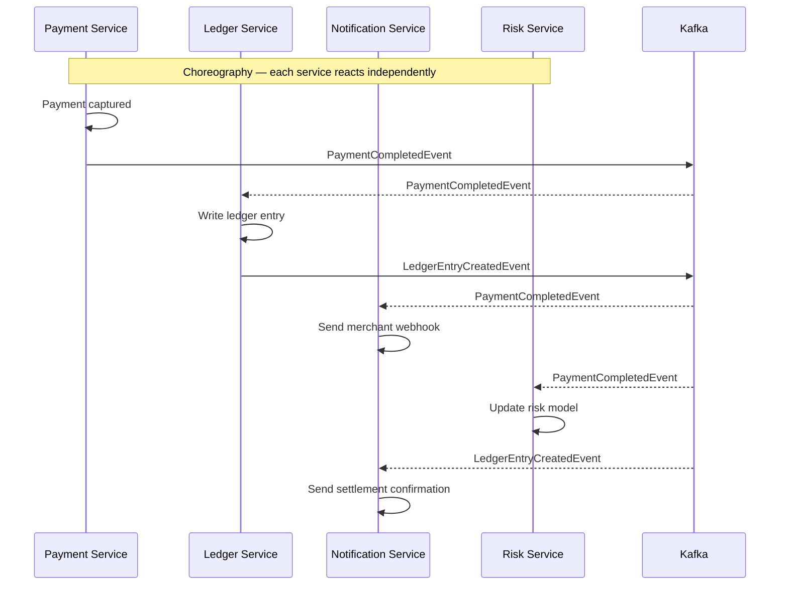
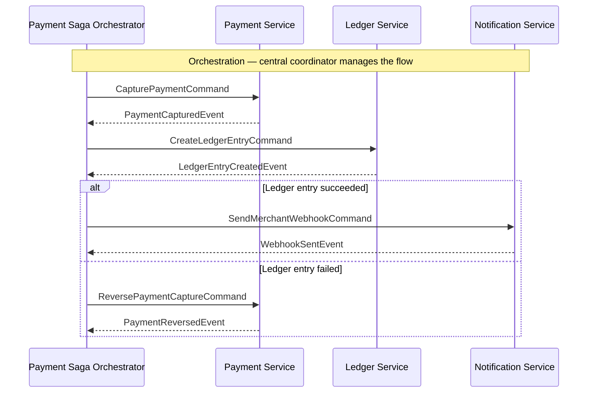

Event-driven architecture is not a technology choice — it is a design philosophy that shapes how services in a fintech platform communicate, evolve independently, and recover from failures. When a payment is authorised, a cascade of business processes must follow: the ledger must record a journal entry, the fraud system must update its risk model, the merchant must receive a webhook notification, and the customer's statement must be updated. Coupling these processes through direct synchronous calls creates a brittle chain where any one failure blocks the payment. Events decouple the trigger from the response, enabling each downstream service to process at its own pace and recover independently. For senior fintech engineers, the critical skill is not wiring up Kafka — it is understanding the trade-offs between event types, the dangers of implicit ordering, and the discipline required to version events across long-lived consumer relationships.

## Learning Objectives

- Distinguish between domain events, integration events, and commands and explain when each is appropriate
- Design a well-structured event envelope with all required metadata fields for a production fintech system
- Compare choreography and orchestration trade-offs using concrete fintech failure scenarios
- Implement a `PaymentCompletedEvent` with Avro schema definition and publish it from a Spring Boot service to Kafka
- Apply event versioning strategies — additive changes and schema evolution — without breaking existing consumers
- Write consumer-driven contract tests for event schemas using Pact
- Explain event replay, projections, and how they enable read model reconstruction
- Describe an event store and its role in event sourcing
- Identify and correct five common event-driven architecture pitfalls in a fintech payment flow

## Business Context

TradeFlow, a cross-border B2B payment platform, processes 180,000 payment orders per day across 47 currencies. In 2025 Q1, the team replaced a synchronous payment processing chain (REST call → REST call → REST call) with an event-driven architecture. The initial implementation used choreography for all flows. Within two months, three production incidents traced to the same root cause: an implicit ordering dependency between the Ledger Service and the Compliance Reporting Service — compliance reports were being generated before the ledger entry was written, causing financial reporting discrepancies. The team had no visibility into the event processing order and no tooling to replay events to fix the state divergence. The incidents consumed 340 engineering-hours in diagnostics and state reconstruction. This lesson addresses the design discipline that would have prevented those incidents.

## Event Types: Domain, Integration, and Commands

Three distinct message types are routinely confused in event-driven systems. Using the wrong type for a given scenario introduces coupling, ordering issues, and unclear ownership.

**Domain Event** — A fact that something happened within a bounded context. Raised by an aggregate. Scoped to the domain layer. Not serialised for external consumption in its raw form. Example: `PaymentAuthorisedEvent` raised by the `Payment` aggregate.

**Integration Event** — A message published to a message broker for consumption by other bounded contexts or external services. An integration event is typically derived from a domain event but is designed for interoperability: it has a stable schema, a versioned contract, and an explicit envelope. Example: `payment.authorised.v1` published to Kafka.

**Command** — A request for something to happen, directed at a specific recipient. Unlike events (facts), commands can be rejected. Example: `ProcessRefundCommand` sent from the Dispute Service to the Payment Service.

| Characteristic | Domain Event | Integration Event | Command |
|---|---|---|---|
| **Represents** | A fact that happened | A fact for external consumers | A request to do something |
| **Recipient** | In-process listeners | Multiple bounded contexts | A single specific recipient |
| **Rejectability** | Cannot be rejected (already happened) | Cannot be rejected (already happened) | Can be rejected |
| **Schema versioning** | Not required (internal) | Required (cross-service contract) | Required (cross-service contract) |
| **Serialisation format** | Java objects (in-memory) | Avro, JSON Schema, Protobuf | Avro, JSON Schema, Protobuf |
| **Fintech example** | `PaymentAuthorisedEvent` (domain) | `payment.authorised.v2` (Kafka) | `ProcessRefundCommand` |

> [!NOTE]
> Domain events and integration events are related but separate concepts. It is a common mistake to publish the domain event object directly to Kafka. The domain event is an internal implementation detail; the integration event is a public API contract. If you refactor the domain event's field names, all Kafka consumers break. Keep the translation layer explicit.

## Event Schema Design

A well-designed integration event has an envelope that carries routing and versioning metadata separately from the business payload. This structure allows consumers to route events, handle multiple versions, and implement idempotency without parsing the payload.

```json
{
  "eventId": "evt_01HXYZ7P3K4V9N2M8QRST0",
  "eventType": "payment.completed",
  "eventVersion": "2",
  "occurredAt": "2026-11-08T14:23:45.123Z",
  "producerService": "payment-service",
  "correlationId": "corr_01HXYZ6A2B3C4D5E6F7G8",
  "causationId": "evt_01HXYZ6A2B3C4D5E6F7G8",
  "partitionKey": "merchant-id:merch_01ABC",
  "payload": {
    "paymentId": "pay_01HXYZ7P3K4V9N2M8QRST0",
    "merchantId": "merch_01ABC",
    "amount": {
      "value": "149.99",
      "currency": "GBP"
    },
    "capturedAt": "2026-11-08T14:23:45.000Z",
    "cardNetwork": "VISA",
    "last4Digits": "4242"
  }
}
```

| Field | Purpose | Required |
|---|---|---|
| `eventId` | Globally unique identifier; enables consumer idempotency | Yes |
| `eventType` | Routing key for consumer subscription | Yes |
| `eventVersion` | Schema version; enables multi-version consumers | Yes |
| `occurredAt` | Business timestamp of the event (not Kafka offset time) | Yes |
| `producerService` | Traceability; which service raised this event | Yes |
| `correlationId` | End-to-end request tracing across services | Yes |
| `causationId` | The event or command that caused this event (causal chain) | Recommended |
| `partitionKey` | Kafka partition assignment for ordering guarantees | Recommended |

> [!IMPORTANT]
> The `eventId` field is the consumer's idempotency key. Every consumer that processes an integration event must check whether it has already processed an event with that `eventId` and skip it if so. Without this check, a Kafka redelivery (which happens on consumer restart or rebalance) causes duplicate processing — in fintech, duplicate payment processing, duplicate ledger entries, or duplicate webhook delivery.

## PaymentCompletedEvent: Avro Schema and Kafka Publishing

Avro is the preferred serialisation format for integration events in production fintech systems. It provides schema evolution support, compact binary encoding, and schema registry integration.

```json
// src/main/avro/payment-completed-v2.avsc
{
  "namespace": "com.meridian.payment.events",
  "type": "record",
  "name": "PaymentCompletedEvent",
  "doc": "Published when a payment capture is confirmed. Schema version 2.",
  "fields": [
    {"name": "eventId",          "type": "string",  "doc": "ULID; globally unique event identifier"},
    {"name": "eventVersion",     "type": "string",  "default": "2"},
    {"name": "occurredAt",       "type": "string",  "doc": "ISO-8601 UTC timestamp"},
    {"name": "correlationId",    "type": "string"},
    {"name": "paymentId",        "type": "string"},
    {"name": "merchantId",       "type": "string"},
    {"name": "amountValue",      "type": "string",  "doc": "Decimal string, e.g. 149.99"},
    {"name": "amountCurrency",   "type": "string",  "doc": "ISO-4217 currency code"},
    {"name": "cardNetwork",      "type": {"type": "enum", "name": "CardNetwork",
                                          "symbols": ["VISA","MASTERCARD","AMEX","UNKNOWN"]}},
    {"name": "last4Digits",      "type": "string"},
    {"name": "capturedAt",       "type": "string"},
    {"name": "merchantReference","type": ["null", "string"], "default": null,
     "doc": "Added in v2; null for events from services that have not upgraded"}
  ]
}
```

```java
// adapter/out/messaging/KafkaPaymentEventPublisher.java
@Component
public class KafkaPaymentEventPublisher implements PaymentEventPublisher {

    private static final String TOPIC = "payment.events";
    private final KafkaTemplate<String, PaymentCompletedEvent> kafkaTemplate;
    private final EventEnvelopeFactory envelopeFactory;

    @Override
    public void publish(DomainEvent domainEvent) {
        if (domainEvent instanceof PaymentCapturedEvent captured) {
            PaymentCompletedEvent avroEvent = toAvroEvent(captured);
            String partitionKey = "merchant:" + captured.merchantId().value();

            kafkaTemplate.send(TOPIC, partitionKey, avroEvent)
                .whenComplete((result, ex) -> {
                    if (ex != null) {
                        throw new EventPublishingException(
                            "Failed to publish PaymentCompletedEvent for payment: "
                                + captured.paymentId(), ex);
                    }
                });
        }
    }

    private PaymentCompletedEvent toAvroEvent(PaymentCapturedEvent captured) {
        return PaymentCompletedEvent.newBuilder()
            .setEventId(ULID.randomULID())
            .setEventVersion("2")
            .setOccurredAt(captured.occurredAt().toString())
            .setCorrelationId(MDC.get("correlationId"))
            .setPaymentId(captured.paymentId().value().toString())
            .setMerchantId(captured.merchantId().value())
            .setAmountValue(captured.amount().amount().toPlainString())
            .setAmountCurrency(captured.amount().currency().getCurrencyCode())
            .setCardNetwork(CardNetwork.valueOf(captured.cardNetwork().name()))
            .setLast4Digits(captured.last4Digits())
            .setCapturedAt(captured.capturedAt().toString())
            .setMerchantReference(captured.merchantReference())
            .build();
    }
}
```

```yaml
# application.yml — Kafka and Schema Registry configuration
spring:
  kafka:
    bootstrap-servers: ${KAFKA_BOOTSTRAP_SERVERS}
    producer:
      key-serializer: org.apache.kafka.common.serialization.StringSerializer
      value-serializer: io.confluent.kafka.serializers.KafkaAvroSerializer
      properties:
        schema.registry.url: ${SCHEMA_REGISTRY_URL}
        auto.register.schemas: false          # never auto-register in production
        use.latest.version: true
        acks: all                             # wait for all ISR replicas
        enable.idempotence: true              # exactly-once producer semantics
        max.in.flight.requests.per.connection: 5
    consumer:
      group-id: ledger-service
      auto-offset-reset: earliest
      enable-auto-commit: false              # manual offset commit after processing
      key-deserializer: org.apache.kafka.common.serialization.StringDeserializer
      value-deserializer: io.confluent.kafka.serializers.KafkaAvroDeserializer
      properties:
        schema.registry.url: ${SCHEMA_REGISTRY_URL}
        specific.avro.reader: true
```

## Choreography vs Orchestration





| Dimension | Choreography | Orchestration |
|---|---|---|
| **Coupling** | Low — services react to events, don't know each other | Medium — orchestrator knows all participants |
| **Visibility** | Low — flow is implicit; no single place shows the whole picture | High — orchestrator has full flow visibility |
| **Error handling** | Complex — distributed compensation requires event chains | Explicit — orchestrator handles compensating transactions |
| **Evolution** | Easy to add new consumers; hard to change ordering | Requires orchestrator update for flow changes |
| **Debugging** | Difficult — requires distributed tracing | Easier — orchestrator logs the full saga state |
| **Best for** | Independent parallel reactions (notify, enrich, update) | Multi-step transactional flows with compensation |

> [!WARNING]
> Pure choreography is tempting because it maximises decoupling, but it creates invisible ordering dependencies. In the TradeFlow incident from the Business Context, the Compliance Service was reacting to `PaymentCompletedEvent` before the Ledger Service had finished writing — a classic choreography ordering problem. For multi-step flows where ordering matters or compensation is required, orchestration (a Saga orchestrator pattern) is the correct choice even at the cost of a central coordinator.

## Event Versioning Strategies

Event schemas evolve as business requirements change. Versioning strategy determines whether that evolution is safe or catastrophic for downstream consumers.

**Additive changes (backward-compatible):**
- Adding a new optional field with a default value
- Adding a new enum value at the end of an enum list
- Widening a type (int → long)

**Breaking changes (require coordination):**
- Renaming a field
- Removing a field
- Changing a field's type
- Reordering fields (Avro uses field names, not positions — safe; Protobuf uses field numbers — safe if numbers are preserved)

```java
// EventVersioningStrategy.java — example multi-version consumer
@KafkaListener(topics = "payment.events", groupId = "ledger-service")
public class PaymentEventConsumer {

    @Autowired
    private LedgerService ledgerService;

    public void onPaymentEvent(ConsumerRecord<String, GenericRecord> record) {
        GenericRecord avroRecord = record.value();
        String version = (String) avroRecord.get("eventVersion");

        switch (version) {
            case "1" -> handleV1(avroRecord);
            case "2" -> handleV2(avroRecord);
            default -> log.warn("Unknown event version: {}. Skipping.", version);
        }
    }

    private void handleV1(GenericRecord record) {
        // V1 handler — no merchantReference field
        ledgerService.recordEntry(
            (String) record.get("paymentId"),
            new BigDecimal((String) record.get("amountValue")),
            Currency.getInstance((String) record.get("amountCurrency")),
            null  // merchantReference not available in v1
        );
    }

    private void handleV2(GenericRecord record) {
        // V2 handler — merchantReference available
        Object merchantRef = record.get("merchantReference");
        ledgerService.recordEntry(
            (String) record.get("paymentId"),
            new BigDecimal((String) record.get("amountValue")),
            Currency.getInstance((String) record.get("amountCurrency")),
            merchantRef != null ? merchantRef.toString() : null
        );
    }
}
```

## Consumer-Driven Contract Testing

Consumer-Driven Contract (CDC) testing with Pact ensures that event producers and consumers agree on the event schema before deployment. The consumer defines what it expects; the producer verifies it can satisfy those expectations.

```java
// Consumer side — LedgerService defines what it expects from PaymentService
@ExtendWith(PactConsumerTestExt.class)
@PactTestFor(providerName = "payment-service", providerType = ProviderType.ASYNCH)
class LedgerServicePaymentEventContractTest {

    @Pact(consumer = "ledger-service", provider = "payment-service")
    MessagePact paymentCompletedEventPact(MessagePactBuilder builder) {
        return builder
            .expectsToReceive("a PaymentCompletedEvent v2")
            .withContent(new PactDslJsonBody()
                .stringType("eventId")
                .stringValue("eventVersion", "2")
                .stringType("occurredAt")
                .stringType("paymentId")
                .stringType("merchantId")
                .decimalType("amountValue")        // expect a decimal string
                .stringMatcher("amountCurrency", "[A-Z]{3}")
                .stringType("capturedAt")
            )
            .toPact();
    }

    @Test
    @PactTestFor(pactMethod = "paymentCompletedEventPact")
    void processPaymentCompletedEvent_createsLedgerEntry(List<Message> messages) {
        // Parse the Pact-generated message and verify the consumer can process it
        String body = messages.get(0).contentsAsString();
        PaymentCompletedEventDto event = objectMapper.readValue(body, PaymentCompletedEventDto.class);

        LedgerEntry entry = ledgerService.recordPaymentEntry(event);

        assertThat(entry.paymentId()).isEqualTo(event.paymentId());
        assertThat(entry.amount().currency().getCurrencyCode()).isEqualTo(event.amountCurrency());
    }
}
```

```java
// Provider side — PaymentService verifies it satisfies the consumer's contract
@Provider("payment-service")
@PactBroker(url = "${PACT_BROKER_URL}")
@SpringBootTest
class PaymentServiceContractVerificationTest {

    @TestTemplate
    @ExtendWith(PactVerificationSpringProvider.class)
    void verifyPact(PactVerificationContext context) {
        context.verifyInteraction();
    }
}
```

## Event Replay and Projections

Event replay is the ability to re-process historical events to reconstruct or update a read model. In fintech, this capability is essential for:
- Rebuilding a reporting database after a schema migration
- Populating a new read model for a new feature (e.g., per-currency balance summaries)
- Recovering from a downstream service failure that caused missed events

```java
// application/service/ProjectionRebuildService.java
@Service
public class ProjectionRebuildService {

    private final KafkaConsumerFactory<String, GenericRecord> consumerFactory;
    private final LedgerProjectionRepository projectionRepository;

    public void rebuildLedgerProjection(String topic,
                                        Instant fromTimestamp,
                                        Instant toTimestamp) {
        Map<String, Object> consumerProps = new HashMap<>(
            consumerFactory.getConfigurationProperties()
        );
        consumerProps.put(ConsumerConfig.GROUP_ID_CONFIG,
            "ledger-rebuild-" + System.currentTimeMillis());
        consumerProps.put(ConsumerConfig.AUTO_OFFSET_RESET_CONFIG, "earliest");

        try (Consumer<String, GenericRecord> consumer =
                 consumerFactory.createConsumer(null, null, null, consumerProps)) {

            // Seek to the timestamp-based offset
            List<PartitionInfo> partitions = consumer.partitionsFor(topic);
            Map<TopicPartition, Long> timestampMap = partitions.stream()
                .collect(Collectors.toMap(
                    p -> new TopicPartition(topic, p.partition()),
                    p -> fromTimestamp.toEpochMilli()
                ));

            Map<TopicPartition, OffsetAndTimestamp> offsets =
                consumer.offsetsForTimes(timestampMap);

            offsets.forEach((tp, offsetAndTimestamp) -> {
                if (offsetAndTimestamp != null) {
                    consumer.seek(tp, offsetAndTimestamp.offset());
                }
            });

            // Process events within the time window
            consumer.assign(offsets.keySet());
            boolean running = true;
            while (running) {
                ConsumerRecords<String, GenericRecord> records =
                    consumer.poll(Duration.ofSeconds(5));
                if (records.isEmpty()) break;

                for (ConsumerRecord<String, GenericRecord> record : records) {
                    if (Instant.ofEpochMilli(record.timestamp()).isAfter(toTimestamp)) {
                        running = false;
                        break;
                    }
                    projectionRepository.applyEvent(record.value());
                }
            }
        }
    }
}
```

> [!NOTE]
> Kafka's default log retention is 7 days. For event replay to be viable beyond a week, configure topic-level retention to match your business needs: `retention.ms=2592000000` (30 days) for payment events is a reasonable baseline for most regulatory environments. For true event sourcing with indefinite replay, use a dedicated event store (EventStoreDB, AWS Kinesis Data Streams with extended retention) rather than relying on Kafka retention configuration.

## Event Store Basics

An event store is a database optimised for appending and reading streams of events. Unlike a traditional database (which stores the current state), an event store stores the full history of state changes. The current state is derived by replaying all events for an aggregate.

```sql
-- A minimal event store schema in PostgreSQL
CREATE TABLE event_store (
    global_sequence  BIGSERIAL    PRIMARY KEY,
    aggregate_type   VARCHAR(100) NOT NULL,
    aggregate_id     UUID         NOT NULL,
    event_type       VARCHAR(200) NOT NULL,
    event_version    INT          NOT NULL DEFAULT 1,
    aggregate_version INT         NOT NULL,
    payload          JSONB        NOT NULL,
    metadata         JSONB        NOT NULL DEFAULT '{}',
    occurred_at      TIMESTAMPTZ  NOT NULL DEFAULT NOW(),

    -- Optimistic concurrency: prevent two events with the same aggregate version
    UNIQUE (aggregate_id, aggregate_version)
);

CREATE INDEX idx_event_store_aggregate
    ON event_store (aggregate_id, aggregate_version);
CREATE INDEX idx_event_store_occurred_at
    ON event_store (occurred_at);
```

```java
// infrastructure/eventstore/PostgresEventStore.java
@Repository
public class PostgresEventStore {

    private final JdbcTemplate jdbcTemplate;
    private final ObjectMapper objectMapper;

    public void append(UUID aggregateId, String aggregateType,
                       int expectedVersion, List<DomainEvent> events) {
        for (int i = 0; i < events.size(); i++) {
            DomainEvent event = events.get(i);
            int newVersion = expectedVersion + i + 1;
            try {
                jdbcTemplate.update(
                    """
                    INSERT INTO event_store
                        (aggregate_type, aggregate_id, event_type, aggregate_version,
                         payload, occurred_at)
                    VALUES (?, ?, ?, ?, ?::jsonb, ?)
                    """,
                    aggregateType,
                    aggregateId,
                    event.getClass().getSimpleName(),
                    newVersion,
                    objectMapper.writeValueAsString(event),
                    event.occurredAt()
                );
            } catch (DuplicateKeyException e) {
                throw new OptimisticConcurrencyException(
                    "Concurrent modification detected for aggregate " + aggregateId
                        + " at version " + newVersion
                );
            } catch (JsonProcessingException e) {
                throw new EventSerializationException(e);
            }
        }
    }

    public List<StoredEvent> loadStream(UUID aggregateId) {
        return jdbcTemplate.query(
            "SELECT * FROM event_store WHERE aggregate_id = ? ORDER BY aggregate_version ASC",
            (rs, row) -> new StoredEvent(
                rs.getString("event_type"),
                rs.getString("payload"),
                rs.getInt("aggregate_version"),
                rs.getTimestamp("occurred_at").toInstant()
            ),
            aggregateId
        );
    }
}
```

## Common Pitfalls

| Pitfall | Description | Prevention |
|---|---|---|
| **Event storms** | A single event triggers a cascade of events that triggers more events, overwhelming the system | Model events at the business fact level, not the technical operation level; set consumer lag alerts |
| **Implicit ordering** | Consumers assume a specific order of events that is not guaranteed | Use Kafka partitioning for ordering within a partition key; never assume cross-partition order |
| **Missing idempotency** | A consumer processes the same event twice on redelivery, causing duplicate effects | Every consumer must check `eventId` before processing; use idempotency tables or Kafka's exactly-once semantics |
| **Fat events** | Events carry so much payload that they become a hidden API; consumers couple to payload structure | Keep event payloads minimal; consumers should fetch additional data via API if needed |
| **Event sprawl** | Hundreds of event types with no clear taxonomy or ownership | Maintain an event catalog; each event type has a designated owning team and AsyncAPI documentation |

```java
// Idempotency check pattern in a Kafka consumer
@KafkaListener(topics = "payment.events", groupId = "notification-service")
@Transactional
public void onPaymentCompleted(ConsumerRecord<String, PaymentCompletedEvent> record) {
    String eventId = record.value().getEventId();

    // Check idempotency before processing
    if (processedEventRepository.existsByEventId(eventId)) {
        log.info("Skipping already-processed event: {}", eventId);
        return;
    }

    // Process the event
    notificationService.sendMerchantWebhook(record.value());

    // Record as processed within the same transaction
    processedEventRepository.save(new ProcessedEvent(eventId, Instant.now()));
}
```

## When to Use Events vs Direct Calls

| Scenario | Recommendation | Reason |
|---|---|---|
| Need the response to continue processing | Direct synchronous call | Caller needs the result immediately |
| Independent parallel reactions (notify, enrich, audit) | Events | Multiple consumers, no ordering dependency |
| Long-running workflow with compensation | Saga (orchestrated events) | Complex error handling requires explicit coordination |
| Read model update from write model | Events | CQRS projection pattern |
| Hard real-time latency requirement (<50ms) | Direct call | Message broker adds latency overhead |
| Crossing bounded context boundaries | Integration events | Explicit schema contract, decoupled evolution |

> [!WARNING]
> Events are not a universal solution. Introducing a message broker between two services that need to exchange data synchronously (e.g., a fraud check that must complete before authorisation) adds latency, complexity, and failure modes without benefit. Use events where decoupling and async processing provide genuine value. The question to ask is: "Does the caller need the result, or is it enough to know the event was received?"

## Knowledge Check

**Q:** The Ledger Service consumes `PaymentCompletedEvent` from Kafka. During a Kafka broker maintenance window, the consumer falls 90 minutes behind. When the consumer catches up, it processes 47,000 events in rapid succession. Three of these events have `eventId` values that the Ledger Service has already processed (they were originally processed via a different mechanism during the outage). What must the Ledger Service's consumer implementation do to handle this correctly, and what database schema supports that behaviour?

**A:** The consumer must implement idempotency checking using the `eventId` field before processing each event. The correct implementation queries an `processed_events` table (or equivalent) for the `eventId` before creating the ledger entry. If the `eventId` is found, the consumer skips the event and commits the Kafka offset — it does not reprocess or raise an error. The database schema requires a `processed_events` table with at minimum a unique index on `event_id` and a `processed_at` timestamp for auditing: `CREATE TABLE processed_events (event_id VARCHAR(50) PRIMARY KEY, processed_at TIMESTAMPTZ NOT NULL DEFAULT NOW(), consumer_group VARCHAR(100) NOT NULL)`. The insert of the `ProcessedEvent` record and the creation of the ledger entry must happen in a single database transaction; if the transaction rolls back, neither the event nor the ledger entry is recorded, and the event will be reprocessed on the next attempt. This combination of idempotency checking and transactional write ensures exactly-once ledger semantics even with Kafka's at-least-once delivery guarantee.

**Q:** A team publishes `PaymentCompletedEvent` v1 to Kafka and three downstream services consume it. Product asks for a new field `merchantReference` (the merchant's own reference for the payment) to be added to the event. Walk through the backward-compatible migration path, explaining what changes are needed in the producer and each consumer, and in what order deployments must happen.

**A:** Since `merchantReference` is a new optional field (some payments may not have a merchant reference), this is a backward-compatible additive change, but it requires a careful deployment sequence to avoid consumer breakage. Step 1: Update the Avro schema to add `merchantReference` as a nullable field with a `null` default value: `{"name": "merchantReference", "type": ["null", "string"], "default": null}`. Register the new schema version in the Schema Registry with `BACKWARD` compatibility mode — this ensures existing v1 consumers can still read v2 events because the new field has a default. Step 2: Deploy the three downstream consumers first. Each consumer should handle the case where `merchantReference` is null (which it always will be initially). Deploy consumers before the producer so that when the producer starts sending the new field, all consumers are already capable of reading it. Step 3: Deploy the updated producer that populates `merchantReference` where available and sets it to `null` where not. The deployment order — consumers first, producer second — is the key: if the producer were deployed first, consumers reading v2 events with an unrecognised field would fail depending on their Avro reader configuration. With `BACKWARD` compatibility and consumers deployed first, the migration is zero-downtime. Step 4: After confirming all consumers are processing v2 events correctly, update each consumer to actively use the `merchantReference` field as appropriate for their business logic.

## Practical Challenge

1. **Design an event catalog.** For a digital wallet platform with five bounded contexts (Wallet Management, Transaction Processing, KYC & Compliance, Notifications, Analytics), design an event catalog with at least eight integration events. For each event, specify: event type name (using `noun.verb.version` naming convention), producing bounded context, consuming bounded context(s), the five mandatory envelope fields, three payload fields, and the Kafka topic it is published to. Format the catalog as a Markdown table. Identify which events would require a Saga orchestrator and which are suitable for pure choreography.

2. **Implement consumer-driven contract tests.** Using Pact (Java consumer DSL), write a consumer contract test for a `NotificationService` that consumes `payment.completed.v2` events from the Payment Service. The consumer expects: `eventId` (string), `merchantId` (string), `amountValue` (decimal string matching `\d+\.\d{2}`), `amountCurrency` (3-letter uppercase string), and `capturedAt` (ISO-8601 string). Write the corresponding provider verification test on the Payment Service side. Run both tests and produce a Pact file. Write a GitHub Actions workflow that publishes the Pact file to a Pact Broker and runs provider verification on every PR to the payment-service repository.

3. **Implement idempotent event processing.** Write a `LedgerEventConsumer` that listens to `payment.completed.v2` events on Kafka and creates a ledger entry for each payment. The consumer must: (a) check for duplicate `eventId` using a `ProcessedEventRepository` before processing, (b) write the ledger entry and the processed event record in a single `@Transactional` block, (c) handle the case where the `amountCurrency` is a currency the ledger does not support (log a warning and skip — do not fail the consumer), and (d) emit a `ledger.entry.created.v1` integration event after successful processing. Write tests covering the happy path, the duplicate event skip path, and the unsupported currency path.

4. **Build an event replay mechanism.** Write a Spring Boot command-line runner (`CommandLineRunner`) that replays all `payment.completed.v2` events from a Kafka topic between two provided timestamps (passed as command-line arguments in ISO-8601 format). The replayer must: (a) seek to the correct Kafka offsets using `offsetsForTimes()`, (b) process events using the same `LedgerEventConsumer` from task 3 (and therefore benefit from idempotency — replaying should not create duplicate ledger entries), (c) log progress every 1,000 events with the event timestamp and lag from real-time, and (d) exit cleanly when the end timestamp is reached. Test the replayer by producing 10 test events, manually deleting the corresponding ledger entries, and verifying that replay recreates exactly those 10 entries without duplicates.

<!-- KNOWLEDGE-CHECK
{
  "questions": [
    {
      "text": "The Ledger Service consumes PaymentCompletedEvent from Kafka. During a 90-minute broker maintenance window, the consumer falls behind. When it catches up, three events have eventId values already processed via a different mechanism. What must the consumer do?",
      "options": [
        "Raise an exception and halt the consumer for manual investigation, because duplicate eventIds indicate data corruption.",
        "Check whether the eventId has already been processed before creating the ledger entry, skip those three events, and commit the Kafka offset normally.",
        "Process the events again to ensure the ledger is fully reconciled, relying on database constraints to reject true duplicates.",
        "Roll back to the earliest offset and reprocess all events from the start of the outage window."
      ],
      "correct": 1,
      "explanation": "The consumer must implement idempotency checking using the eventId field. If the eventId is found in the processed_events table, the consumer skips the event and commits the Kafka offset — it does not reprocess or raise an error. This combination of idempotency checking and transactional write ensures exactly-once ledger semantics even with Kafka's at-least-once delivery guarantee."
    },
    {
      "text": "Which of the following correctly distinguishes a Domain Event from an Integration Event?",
      "options": [
        "Domain events are stored in a database; integration events are published directly to Kafka without persistence.",
        "Domain events are facts raised by aggregates for in-process consumption; integration events are versioned, schema-contracted messages published to a broker for cross-service consumption.",
        "Domain events use Avro serialisation; integration events use JSON because they cross service boundaries.",
        "Domain events can be rejected by listeners; integration events represent facts that cannot be rejected."
      ],
      "correct": 1,
      "explanation": "Domain events are internal facts raised by aggregates, consumed in-process by application event handlers, and serialised as Java objects. Integration events are explicitly designed for cross-service interoperability: they have stable versioned schemas (Avro, JSON Schema), an event envelope with metadata, and are published to a message broker. Refactoring a domain event's field names is safe; doing the same to an integration event breaks all consumers."
    },
    {
      "text": "A team is using pure choreography for all payment processing flows. The Compliance Service reacts to PaymentCompletedEvent before the Ledger Service has finished writing its entry, causing compliance reports to be generated without the corresponding ledger record. What is the correct architectural remedy?",
      "options": [
        "Switch from Avro to JSON serialisation to ensure the Compliance Service can read events faster.",
        "Add a Sleep(500ms) delay to the Compliance Service consumer to give the Ledger Service time to finish writing.",
        "Use a Saga orchestrator for this multi-step flow so the Compliance Service is only triggered after the Ledger Service emits a LedgerEntryCreatedEvent.",
        "Increase the Kafka partition count so both services receive their own copy of the event simultaneously."
      ],
      "correct": 2,
      "explanation": "Pure choreography creates invisible ordering dependencies. When the order in which services process an event matters, orchestration is the correct choice. A Saga orchestrator triggers the Compliance Service only after the Ledger Service emits LedgerEntryCreatedEvent, making the ordering dependency explicit, visible, and enforceable."
    }
  ]
}
-->

<!-- PRACTICAL-CHALLENGE
{
  "title": "Design and Implement an Event-Driven Payment Pipeline",
  "difficulty": "advanced",
  "estimatedMinutes": 60,
  "tasks": [
    {"id": "1", "description": "Design an event catalog for a digital wallet platform with five bounded contexts (Wallet Management, Transaction Processing, KYC & Compliance, Notifications, Analytics). Define at least eight integration events using noun.verb.version naming. For each event specify: producing context, consuming context(s), the five mandatory envelope fields, three payload fields, and the Kafka topic. Identify which events require a Saga orchestrator and which are suitable for pure choreography. Format the catalog as a Markdown table."},
    {"id": "2", "description": "Using Pact Java consumer DSL, write a consumer contract test for a NotificationService that consumes payment.completed.v2 events. The consumer expects eventId (string), merchantId (string), amountValue (decimal string matching \\d+\\.\\d{2}), amountCurrency (3-letter uppercase), and capturedAt (ISO-8601). Write the corresponding provider verification test on the Payment Service side. Write a GitHub Actions workflow that publishes the Pact file to a Pact Broker and runs provider verification on every PR."},
    {"id": "3", "description": "Write a LedgerEventConsumer that listens to payment.completed.v2 events on Kafka and creates a ledger entry. The consumer must: (a) check for duplicate eventId using ProcessedEventRepository before processing, (b) write the ledger entry and processed event record in a single @Transactional block, (c) handle unsupported amountCurrency by logging a warning and skipping without failing the consumer, and (d) emit a ledger.entry.created.v1 integration event after successful processing. Write tests covering the happy path, duplicate skip path, and unsupported currency path."},
    {"id": "4", "description": "Write a Spring Boot CommandLineRunner that replays all payment.completed.v2 events from a Kafka topic between two ISO-8601 timestamps provided as command-line arguments. The replayer must: (a) seek to correct Kafka offsets using offsetsForTimes(), (b) process events using the idempotent LedgerEventConsumer from task 3, (c) log progress every 1,000 events with event timestamp and real-time lag, and (d) exit cleanly when the end timestamp is reached. Test by producing 10 events, deleting their ledger entries, and verifying replay recreates exactly those 10 entries."}
  ]
}
-->
