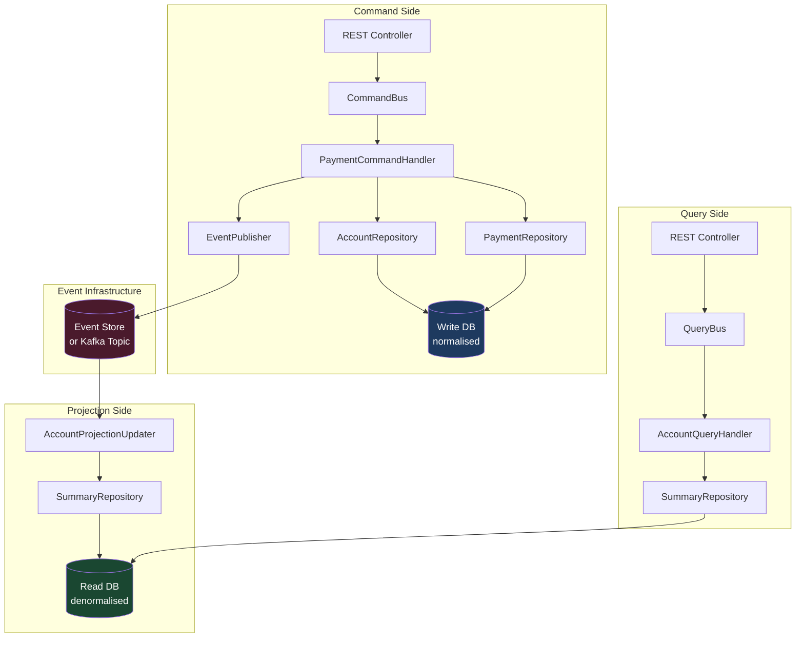

يعالج الفصل بين مسؤولية الأوامر والاستعلامات (CQRS) واحدة من أكثر مشكلات الأداء استمرارًا في الأنظمة المالية: عدم التماثل الجوهري بين القراءة والكتابة. فقد تعالج منصة دفع 2,000 عملية دفع في الثانية بينما تخدم في الوقت نفسه 200,000 استعلام عن الأرصدة وتاريخ المعاملات. وإجبار الحملين على المرور عبر نموذج المجال نفسه، وأداة ORM نفسها، وجدول قاعدة البيانات نفسه ليس خيارًا محايدًا — بل تصميم يضمن التنافس على الموارد، وجلب بيانات زائدة، وتنازلات في المخطط لا ترضي أيًا من الحملين.

## أهداف التعلّم

- توضيح عدم التماثل بين حمل القراءة وحمل الكتابة في الأنظمة المالية، ولماذا لا يستطيع نموذج واحد خدمة الاثنين على النحو الأمثل
- تنفيذ واجهتي `CommandBus` و`QueryBus` توجّهان العمليات إلى معالجات مخصصة
- بناء خط `ProcessPaymentCommand` ← `PaymentCommandHandler` مع تحقق صريح وإطلاق للأحداث
- تصميم نموذج قراءة غير مطبّع `account_summary` يملؤه `AccountProjectionUpdater` الذي يستهلك أحداث المجال
- شرح الاتساق النهائي في نموذج القراءة، وتنفيذ نمط "اقرأ ما كتبت" (read-your-writes) باستخدام رموز الإصدار
- كتابة اختبارات وحدة مستقلة لمعالجات الأوامر ومعالجات الاستعلامات دون سياق تطبيق كامل
- تحديد الظروف التي يضيف فيها CQRS تعقيدًا بلا فائدة (مجالات CRUD البسيطة)
- تتبع تدفق دفع كامل من استلام الأمر مرورًا بنشر الحدث وصولًا إلى تحديث نموذج القراءة

## سياق العمل

لنأخذ بنكًا رقميًا أوروبيًا يخدم 4 ملايين عميل (مثال مركّب) يصطدم بجدار خلال حملة استرداد نقدي في الجمعة السوداء. كانت استعلامات تاريخ المعاملات — العملاء يتحققون هل وصل الاسترداد النقدي — تُصدر مسحًا كاملًا للجدول `accounts` نفسه الذي يكتب فيه محرك الدفع تحت حمل الذروة. فقفزت أوقات انتظار الأقفال إلى 8 ثوانٍ. وبلغ زمن قبول المدفوعات، الذي يكون عادة أقل من 120ms عند p99، أربع عشرة ثانية. وأوقف البنك الحملة الساعة 11:40 صباحًا، وخسر ما يُقدّر بـ 2.3 مليون يورو من حجم المعاملات المخطط.

كان السبب الجذري كيان `Account` واحد يخدم مسار الكتابة (تغيير الرصيد، وإلحاق المعاملات) ومسار القراءة (عرض الرصيد، وتاريخ المعاملات، وتجميع الاسترداد النقدي). فإضافة فهارس لخدمة استعلامات القراءة أبطأت إنتاجية الكتابة؛ وإزالتها أعادت الكتابة لكنها كسرت أداء القراءة. وظل الفريق يلعب هذه اللعبة 18 شهرًا. لم يكن CQRS تمرينًا نظريًا — بل التغيير المعماري الذي حلّ أزمة إنتاج.

## مشكلة عدم التماثل بين القراءة والكتابة

لجانب الأوامر وجانب الاستعلامات في النظام المالي متطلبات لا يمكن التوفيق بينها عند دمجهما في نموذج واحد.

| الشأن | نموذج الكتابة | نموذج القراءة |
|---|---|---|
| الاتساق | صارم — ACID، والثوابت مفروضة | نهائي — التأخر البسيط مقبول |
| المخطط | مطبّع — تقليل التكرار | غير مطبّع — تقليل عمليات الربط (joins) |
| استراتيجية الفهارس | محسّنة للكتابة — فهارس قليلة | محسّنة للقراءة — فهارس مركّبة كثيرة |
| الأقفال | أقفال صفوف متشائمة أو متفائلة | بلا أقفال — النسخ المتماثلة للقراءة مقبولة |
| عمر البيانات | سجل تدقيق للإلحاق فقط | قابل للإسقاط — يمكن إعادة بنائه من الأحداث |
| نسبة الإنتاجية | ‏1x (المدفوعات: نحو 2k عملية في الثانية في الذروة) | ‏100x (فحوص الرصيد: نحو 200k في الثانية في الذروة) |

محاولة خدمة نسبة قراءة إلى كتابة 100:1 من الجدول نفسه هي الخطأ الأساسي. ويجعل CQRS هذا الفصل صريحًا في الشيفرة وفي البنية التحتية.

## واجهتا ناقل الأوامر وناقل الاستعلامات

يبدأ النمط بنقطتي دخول متمايزتين إلى طبقة التطبيق. ولا تعرف أي منهما شيئًا عن HTTP أو Kafka أو قواعد البيانات مباشرة.

```java
// Command marker interface — commands mutate state, return nothing (or a minimal receipt)
public interface Command {}

// Query marker interface — queries read state, never mutate
public interface Query<R> {}

// CommandBus routes a command to its single registered handler
public interface CommandBus {
    void dispatch(Command command);
}

// QueryBus routes a query to its single registered handler and returns a result
public interface QueryBus {
    <R> R dispatch(Query<R> query);
}
```

يربط التنفيذ `SimpleCommandBus` المعالجات عند بدء التشغيل. وفي Spring يتم ذلك عادة عبر مسح `@Component` مع خريطة `Map<Class<?>, CommandHandler<?>>`:

```java
@Component
public class SimpleCommandBus implements CommandBus {

    private final Map<Class<?>, CommandHandler<?>> handlers;

    public SimpleCommandBus(List<CommandHandler<?>> handlerList) {
        this.handlers = handlerList.stream()
            .collect(Collectors.toMap(
                h -> resolveCommandType(h.getClass()),
                Function.identity()
            ));
    }

    @Override
    @SuppressWarnings("unchecked")
    public void dispatch(Command command) {
        CommandHandler<Command> handler =
            (CommandHandler<Command>) handlers.get(command.getClass());
        if (handler == null) {
            throw new NoHandlerException("No handler registered for: " + command.getClass().getSimpleName());
        }
        handler.handle(command);
    }

    private Class<?> resolveCommandType(Class<?> handlerClass) {
        return Arrays.stream(handlerClass.getGenericInterfaces())
            .filter(t -> t instanceof ParameterizedType)
            .map(t -> (ParameterizedType) t)
            .filter(t -> t.getRawType().equals(CommandHandler.class))
            .map(t -> (Class<?>) t.getActualTypeArguments()[0])
            .findFirst()
            .orElseThrow(() -> new IllegalStateException("Cannot resolve command type for: " + handlerClass));
    }
}
```

## معالج أمر الدفع

يحمل الأمر `ProcessPaymentCommand` كل البيانات اللازمة لبدء دفعة. ويفرض المعالج ثوابت المجال، ويفوّض إلى التجميع، وينشر الأحداث — لكنه لا يلمس نماذج القراءة مباشرة أبدًا.

```java
public record ProcessPaymentCommand(
    UUID idempotencyKey,
    UUID sourceAccountId,
    UUID targetAccountId,
    Money amount,
    String reference,
    Currency currency
) implements Command {}

@Component
@RequiredArgsConstructor
public class PaymentCommandHandler implements CommandHandler<ProcessPaymentCommand> {

    private final AccountRepository accountRepository;
    private final PaymentRepository paymentRepository;
    private final DomainEventPublisher eventPublisher;
    private final IdempotencyStore idempotencyStore;

    @Override
    @Transactional
    public void handle(ProcessPaymentCommand command) {
        // Idempotency guard — same key = same outcome, no duplicate processing
        if (idempotencyStore.exists(command.idempotencyKey())) {
            log.info("Duplicate command ignored: {}", command.idempotencyKey());
            return;
        }

        // Lock both accounts in id order: no lost updates, no A→B / B→A deadlock
        Map<UUID, Account> locked = new HashMap<>();
        Stream.of(command.sourceAccountId(), command.targetAccountId()).sorted()
            .forEach(id -> locked.put(id, accountRepository.findByIdForUpdate(id)
                .orElseThrow(() -> new AccountNotFoundException(id))));
        Account source = locked.get(command.sourceAccountId());
        Account target = locked.get(command.targetAccountId());

        // Domain invariant enforced inside the aggregate
        Payment payment = source.initiatePaymentTo(target, command.amount(), command.reference());

        paymentRepository.save(payment);
        accountRepository.save(source);
        accountRepository.save(target);
        idempotencyStore.record(command.idempotencyKey());   // UNIQUE key: a concurrent duplicate fails here

        // eventPublisher is an outbox writer: the events are inserted as rows in THIS
        // transaction and relayed to the broker only after the commit (see warning below)
        payment.domainEvents().forEach(eventPublisher::publish);
        source.domainEvents().forEach(eventPublisher::publish);
        target.domainEvents().forEach(eventPublisher::publish);
    }
}
```

يقفل المعالج الحسابين بترتيب المعرّف حتى لا تضيع تحديثات ولا يحدث جمود بين تحويلين متعاكسين. والناشر هنا كاتب outbox: تُدخل الأحداث كصفوف في المعاملة نفسها ولا تُرحَّل إلى الوسيط إلا بعد الالتزام.

> [!WARNING]
> يجب أن ينشر معالج الأوامر الأحداث **بعد** التزام المعاملة، لا داخلها. فالنشر قبل الالتزام يخاطر بإرسال أحداث تشير إلى حالة لم تُحفظ أبدًا إذا تراجعت المعاملة. استخدم `@TransactionalEventListener(phase = AFTER_COMMIT)` في Spring أو نمط Transactional Outbox.

## معالج استعلام الحساب ونموذج القراءة

يعمل جانب القراءة على مخطط منفصل مصمم لأداء الاستعلامات. الجدول `account_summary` غير مطبّع: يخزن أرصدة محسوبة مسبقًا وعدد المعاملات الأخيرة، فيتجنب عمليات الربط وقت الاستعلام.

```sql
-- Read model schema — optimised for display, not for mutation
CREATE TABLE account_summary (
    account_id        UUID PRIMARY KEY,
    holder_name       VARCHAR(200) NOT NULL,
    available_balance NUMERIC(19, 4) NOT NULL,
    pending_balance   NUMERIC(19, 4) NOT NULL,
    currency          CHAR(3) NOT NULL,
    last_transaction_at TIMESTAMPTZ,
    transaction_count_30d INTEGER NOT NULL DEFAULT 0,
    version           BIGINT NOT NULL DEFAULT 0,
    updated_at        TIMESTAMPTZ NOT NULL
);

CREATE INDEX idx_account_summary_holder ON account_summary(holder_name);
CREATE INDEX idx_account_summary_updated ON account_summary(updated_at DESC);
```

```java
public record AccountBalanceQuery(UUID accountId) implements Query<AccountSummaryView> {}

public record AccountSummaryView(
    UUID accountId,
    String holderName,
    BigDecimal availableBalance,
    BigDecimal pendingBalance,
    String currency,
    Instant lastTransactionAt,
    int transactionCount30d,
    long version
) {}

@Component
@RequiredArgsConstructor
public class AccountQueryHandler implements QueryHandler<AccountBalanceQuery, AccountSummaryView> {

    private final AccountSummaryRepository summaryRepository;

    @Override
    @Transactional(readOnly = true)
    public AccountSummaryView handle(AccountBalanceQuery query) {
        return summaryRepository.findById(query.accountId())
            .map(this::toView)
            .orElseThrow(() -> new AccountNotFoundException(query.accountId()));
    }

    private AccountSummaryView toView(AccountSummaryEntity entity) {
        return new AccountSummaryView(
            entity.getAccountId(),
            entity.getHolderName(),
            entity.getAvailableBalance(),
            entity.getPendingBalance(),
            entity.getCurrency(),
            entity.getLastTransactionAt(),
            entity.getTransactionCount30d(),
            entity.getVersion()
        );
    }
}
```

## إسقاط نموذج القراءة

يشترك `AccountProjectionUpdater` في أحداث المجال ويحافظ على الجدول `account_summary`. وهو الجسر بين نموذج الكتابة ونموذج القراءة. ويحمل كل حدث الرصيد الجديد للحساب ورقم الإصدار الذي أنتجه في جانب الكتابة، فلا يحتاج الإسقاط أبدًا إلى الاستعلام من قاعدة بيانات الكتابة، ويستطيع تجاهل الأحداث المكررة وغير المرتبة بأمان. (للاختصار، المستمع هنا داخل العملية نفسها؛ وفي الإنتاج يستهلك الأحداث نفسها من Kafka أو من مرحّل outbox.)

```java
@Component
@RequiredArgsConstructor
@Slf4j
public class AccountProjectionUpdater {

    private final AccountSummaryRepository summaryRepository;

    @EventListener
    @Transactional
    public void on(AccountCreditedEvent event) {
        apply(event.accountId(), event.accountVersion(), event.balanceAfter(), event.occurredAt());
    }

    @EventListener
    @Transactional
    public void on(AccountDebitedEvent event) {
        apply(event.accountId(), event.accountVersion(), event.balanceAfter(), event.occurredAt());
    }

    private void apply(UUID accountId, long accountVersion, Money balanceAfter, Instant occurredAt) {
        AccountSummary summary = summaryRepository.findById(accountId)
            .orElseGet(() -> AccountSummary.empty(accountId));

        // Idempotent and order-safe: ignore events the projection has already applied
        if (accountVersion <= summary.getVersion()) {
            log.debug("Skipping stale event for account {} (v{} <= v{})",
                accountId, accountVersion, summary.getVersion());
            return;
        }

        summary.setAvailableBalance(balanceAfter.amount());
        summary.setLastTransactionAt(occurredAt);            // business time, not now()
        summary.setVersion(accountVersion);                  // same number as the write side
        summary.setUpdatedAt(Instant.now());
        // transaction_count_30d is a rolling window: a scheduled job recomputes it

        summaryRepository.save(summary);
    }
}
```

## مخطط بنية CQRS



## الاتساق النهائي و"اقرأ ما كتبت"

يتأخر نموذج القراءة عن نموذج الكتابة بالوقت اللازم لنشر الحدث وتحديث الإسقاط. ولمعظم الاستعلامات — "اعرض رصيدي" بعد ثلاثين ثانية من تسوية دفعة — فإن هذا التأخر (عادة أقل من 100ms) غير محسوس.

لكن مشكلة "اقرأ ما كتبت" حقيقية: يرسل العميل دفعة ثم يحدّث صفحة رصيده فورًا. وقد لا يكون الإسقاط قد عكس الخصم بعد.

أحد الحلول **رمز الإصدار**: يتضمن رد الأمر رقم الإصدار الذي بلغه نموذج الكتابة بعد التغيير. ولأن الإسقاط يخزن رقم الإصدار نفسه، يستطيع جانب الاستعلام معرفة هل لحق، ويعيد العميل المحاولة حتى يلحق.

```java
// Command response carries the version the write model advanced to
public record PaymentInitiatedReceipt(UUID paymentId, long accountVersion) {}

// Query includes an optional minimum version — if provided, wait for projection
public record AccountBalanceQuery(
    UUID accountId,
    @Nullable Long minimumVersion
) implements Query<AccountSummaryView> {}

@Component
@RequiredArgsConstructor
public class AccountQueryHandler implements QueryHandler<AccountBalanceQuery, AccountSummaryView> {

    private final AccountSummaryRepository summaryRepository;

    @Override
    @Transactional(readOnly = true)
    public AccountSummaryView handle(AccountBalanceQuery query) {
        if (query.minimumVersion() != null) {
            return summaryRepository.findByIdWithMinVersion(
                    query.accountId(), query.minimumVersion())
                .map(this::toView)
                .orElseThrow(() -> new ProjectionNotYetReadyException(
                    query.accountId(), query.minimumVersion()));
        }
        return summaryRepository.findById(query.accountId())
            .map(this::toView)
            .orElseThrow(() -> new AccountNotFoundException(query.accountId()));
    }
}
```

> [!NOTE]
> يجب أن يُطابَق الاستثناء `ProjectionNotYetReadyException` مع الرد HTTP 202 Accepted مع الترويسة `Retry-After: 1`، لا 404 ولا 500. ويجب أن يعيد العميل المحاولة لمدة ثانيتين تقريبًا قبل أن يستنتج أن الإسقاط عالق.

## متى لا تستخدم CQRS

يُدخل CQRS مخزني بيانات، ومجموعتين من النماذج، ونشر أحداث، وصيانة إسقاطات، واتساقًا نهائيًا يجب التفكير فيه. ولفئة كبيرة من وظائف المكاتب الخلفية المالية، هذا العبء غير مبرر.

| المؤشر | هل تستخدم CQRS؟ |
|---|---|
| حركة القراءة 10 أضعاف الكتابة أو أكثر، مع احتياجات مخطط مختلفة | نعم |
| مجال معقد بثوابت غنية (حساب، دفعة، حد) | نعم |
| تقارير تنظيمية على بنية تحتية منفصلة | نعم |
| واجهات CRUD إدارية داخلية (إعدادات الفروع، جداول الرسوم) | لا |
| خدمة لفريق واحد بأنماط وصول متجانسة | لا |
| منتج أولي (MVP) بأقل من 50 ألف مستخدم نشط يوميًا | لا |
| تحليلات فقط (بلا تغيير للبيانات) | لا — استخدم نسخة متماثلة للقراءة فقط |

> [!WARNING]
> تطبيق CQRS على خدمة CRUD بسيطة يضاعف قاعدة الشيفرة، ويضيف تأخر الإسقاط، ويزيد العبء التشغيلي — بلا فائدة. وكثير من الفرق تطبق CQRS على كل شيء باعتباره "أفضل ممارسة" دون تقييم الكلفة. احتفظ به للتجميعات التي تواجه عدم تماثل حقيقيًا في الحمل.

## اختبار معالجات الأوامر والاستعلامات

من فوائد CQRS التي لا تُقدَّر حق قدرها قابلية الاختبار. فمعالجات الأوامر والاستعلامات لا تقترن بـ HTTP ولا بـ Kafka، واقترانها بالبنية التحتية رقيق عبر الواجهات. فتُختبر بمعزل بشكل ممتاز.

```java
class PaymentCommandHandlerTest {

    private final AccountRepository accountRepository = mock(AccountRepository.class);
    private final PaymentRepository paymentRepository = mock(PaymentRepository.class);
    private final DomainEventPublisher eventPublisher = mock(DomainEventPublisher.class);
    private final IdempotencyStore idempotencyStore = mock(IdempotencyStore.class);

    private final PaymentCommandHandler handler = new PaymentCommandHandler(
        accountRepository, paymentRepository, eventPublisher, idempotencyStore);

    @Test
    void handle_validPayment_publishesPaymentCompletedEvent() {
        UUID idempotencyKey = UUID.randomUUID();
        Account source = Account.withBalance(Money.of(500, "GBP"));
        Account target = Account.empty();

        when(idempotencyStore.exists(idempotencyKey)).thenReturn(false);
        when(accountRepository.findByIdForUpdate(source.getId())).thenReturn(Optional.of(source));
        when(accountRepository.findByIdForUpdate(target.getId())).thenReturn(Optional.of(target));

        handler.handle(new ProcessPaymentCommand(
            idempotencyKey, source.getId(), target.getId(),
            Money.of(100, "GBP"), "Invoice #42", Currency.getInstance("GBP")
        ));

        ArgumentCaptor<DomainEvent> captor = ArgumentCaptor.forClass(DomainEvent.class);
        verify(eventPublisher, atLeastOnce()).publish(captor.capture());
        assertThat(captor.getAllValues())
            .anyMatch(e -> e instanceof PaymentCompletedEvent);
    }

    @Test
    void handle_duplicateIdempotencyKey_doesNotProcessAgain() {
        UUID idempotencyKey = UUID.randomUUID();
        when(idempotencyStore.exists(idempotencyKey)).thenReturn(true);

        handler.handle(new ProcessPaymentCommand(
            idempotencyKey, UUID.randomUUID(), UUID.randomUUID(),
            Money.of(50, "GBP"), "ref", Currency.getInstance("GBP")
        ));

        verifyNoInteractions(accountRepository, paymentRepository, eventPublisher);
    }
}

class AccountQueryHandlerTest {

    private final AccountSummaryRepository summaryRepository = mock(AccountSummaryRepository.class);
    private final AccountQueryHandler handler = new AccountQueryHandler(summaryRepository);

    @Test
    void handle_existingAccount_returnsView() {
        UUID accountId = UUID.randomUUID();
        AccountSummaryEntity entity = anAccountSummaryEntity(accountId, BigDecimal.valueOf(1200));
        when(summaryRepository.findById(accountId)).thenReturn(Optional.of(entity));

        AccountSummaryView view = handler.handle(new AccountBalanceQuery(accountId, null));

        assertThat(view.accountId()).isEqualTo(accountId);
        assertThat(view.availableBalance()).isEqualByComparingTo("1200");
    }

    @Test
    void handle_unknownAccount_throwsNotFoundException() {
        UUID accountId = UUID.randomUUID();
        when(summaryRepository.findById(accountId)).thenReturn(Optional.empty());

        assertThatThrownBy(() -> handler.handle(new AccountBalanceQuery(accountId, null)))
            .isInstanceOf(AccountNotFoundException.class);
    }
}
```

## اختبر فهمك

**س1: تستخدم خدمة الدفع لديك CQRS. يرسل عميل دفعة، وخلال 50ms يستعلم عن رصيده. لم يعكس الرصيد الخصم بعد. يتصل العميل بالدعم. كيف تشرح هذا وتعالجه معماريًا؟**

ج: هذه مشكلة "اقرأ ما كتبت" الناتجة عن الاتساق النهائي بين نموذج الكتابة وإسقاط القراءة. خيارات المعالجة بترتيب تصاعدي في تعقيد التنفيذ: (1) أعد رمز إصدار مع إيصال الدفع، واجعل نقطة نهاية الرصيد تقبل المعامل `minimumVersion`، مع إعادة المحاولة حتى يلحق الإسقاط؛ (2) لإعادة التوجيه الفورية بعد الدفع، قدّم الرصيد مباشرة من نموذج الكتابة متجاوزًا الإسقاط (كسر لـ CQRS في هذا التدفق وحده، مقبول كاستثناء)؛ (3) قلّل تأخر الإسقاط إلى أقل من 10ms باستخدام معالجة أحداث متزامنة بدل غير المتزامنة، مع قبول زيادة زمن مسار الكتابة. ولمعظم واجهات التقنية المالية، يغطي الخيار 1 مع إعادة محاولة من جهة العميل لمدة ثانية أو ثانيتين هذه الحالة دون تنازل معماري.

**س2: يقترح فريق تطبيق CQRS على خدمة إعدادات الفروع، التي تتيح لموظفي عمليات البنك تحديث ساعات العمل وجداول الرسوم وإعدادات المنتجات. حركة الكتابة 10 تحديثات يوميًا، وحركة القراءة 50 استعلامًا يوميًا. هل يجب أن يتبنوا CQRS؟**

ج: لا. مع 10 عمليات كتابة و50 قراءة يوميًا، لا يوجد عدم تماثل في الحمل يحتاج إلى معالجة. والتعقيد الذي يُدخله CQRS — مخزن قراءة منفصل، وصيانة الإسقاطات، ونشر الأحداث، واتساق نهائي يجب التفكير فيه — لا يقدّم أي فائدة هنا. ومستودع JPA واحد مع نسخة متماثلة للقراءة (إن لزم) هو الخيار الصحيح. فـ CQRS حل لعدم تماثل الحمل، لا قالب معماري عام. وتطبيقه على هذه الخدمة سيضاعف الشيفرة، ويضيف عبئًا تشغيليًا، ويربك من سيصونونها مستقبلًا.

## تحدٍّ عملي

**السيناريو:** أنت المهندس الرئيسي لمنصة مدفوعات تعالج 5,000 عملية في الثانية. ويتدهور زمن استعلامات الرصيد تحت الحمل لأن الاستعلامات وعمليات كتابة المدفوعات تتشارك نسخة PostgreSQL الأساسية نفسها. مهمتك إدخال CQRS في مجال الحسابات.

**المهمة 1 — نموذج الأوامر:** نفّذ `WithdrawFundsCommand` و`WithdrawFundsCommandHandler`. يجب على المعالج: التحقق من كفاية الرصيد عبر التجميع `Account`، وخصم المبلغ من الحساب، وحفظ التجميع المحدّث، وتسجيل منع التكرار، ونشر `FundsWithdrawnEvent`. واكتب اختبار وحدة يتحقق من أن سحب 200 جنيه من حساب رصيده 150 جنيهًا يرمي `InsufficientFundsException`.

**المهمة 2 — مخطط نموذج القراءة:** صمّم مخطط SQL لنموذج القراءة `transaction_history_view` يدعم بكفاءة استعلامات مثل "آخر 30 معاملة للحساب X، مرتبة حسب الوقت تنازليًا، ومصفّاة حسب النوع (DEBIT/CREDIT)". وضمّن الفهارس المناسبة واشرح اختيارك لها.

**المهمة 3 — محدّث الإسقاط:** نفّذ `TransactionHistoryProjectionUpdater` الذي يستمع إلى `FundsWithdrawnEvent` و`FundsDepositedEvent` ويحافظ على الجدول `transaction_history_view`. وتعامل مع الأحداث المكررة وغير المرتبة باستخدام رقم إصدار الحساب الذي يحمله كل حدث.

**المهمة 4 — اختبار الاتساق النهائي:** اكتب اختبار تكامل باستخدام ناقل أحداث في الذاكرة يتحقق من أنه بعد إرسال `WithdrawFundsCommand`، يعيد معالج الاستعلام خلال 100ms عرض `TransactionHistoryView` يتضمن معاملة السحب. ويجب ألا يستخدم الاختبار `Thread.sleep` — استخدم `Awaitility` بمهلة 200ms.

<!-- KNOWLEDGE-CHECK
{
  "questions": [
    {
      "id": "q1",
      "text": "يرسل عميل دفعة، وخلال 50ms يستعلم عن رصيده. لم يتحدّث نموذج القراءة بعد. ما رمز حالة HTTP الذي يجب أن تعيده نقطة نهاية الاستعلام عندما تكتشف أن الإسقاط متأخر عن الإصدار الأدنى المطلوب؟",
      "options": [
        "404 Not Found — الإصدار غير موجود بعد",
        "500 Internal Server Error — الإسقاط معطوب",
        "202 Accepted مع الترويسة Retry-After — البيانات ليست جاهزة بعد لكنها ستكون",
        "200 OK مع الرصيد القديم — أعد شيئًا دائمًا"
      ],
      "correct": 2,
      "explanation": "يوضح الرد 202 Accepted أن الطلب مفهوم وأن المورد موجود، لكن الإصدار المطلوب تحديدًا غير متاح بعد. ومع الترويسة Retry-After: 1، يخبر العميل بإعادة المحاولة بعد ثانية. والرد 404 خاطئ لأن الحساب موجود؛ و500 يوحي بخطأ في النظام بينما هذا سلوك متوقع؛ و200 مع بيانات قديمة يضلل العميل بصمت."
    },
    {
      "id": "q2",
      "text": "لديك إعداد CQRS ينشر فيه PaymentCommandHandler الحدث PaymentCompletedEvent داخل حدود @Transactional. ثم تتراجع المعاملة بسبب مخالفة قيد. ما العاقبة؟",
      "options": [
        "لا شيء — يتراجع Spring تلقائيًا عن الأحداث المنشورة",
        "نُشر الحدث إلى Kafka قبل التراجع، فستعالج المستهلكات اللاحقة دفعة لم تُحفظ أبدًا",
        "يُوضع الحدث في طابور ويُعاد تشغيله بعد اكتمال التراجع",
        "يرمي معالج الأوامر استثناء قبل نشر الحدث"
      ],
      "correct": 1,
      "explanation": "الأحداث المنشورة إلى Kafka (أو أي وسيط خارجي) داخل معاملة ليست جزءًا من تلك المعاملة. فإذا تراجعت معاملة قاعدة البيانات بعد إرسال الحدث، فإن الحدث يصف حالة لم توجد قط. استخدم @TransactionalEventListener(phase = AFTER_COMMIT) أو نمط Transactional Outbox لضمان ألا تُنشر الأحداث إلا بعد نجاح التزام المعاملة."
    }
  ]
}
-->

<!-- PRACTICAL-CHALLENGE
{
  "title": "CQRS — الفصل بين الأوامر والاستعلامات في أنظمة الدفع — تطبيق في بيئة الإنتاج",
  "difficulty": "advanced",
  "estimatedMinutes": 60,
  "tasks": [
    {
      "id": "1",
      "description": "نفّذ WithdrawFundsCommand وWithdrawFundsCommandHandler. يجب على المعالج: التحقق من كفاية الرصيد عبر التجميع Account، وخصم المبلغ، وحفظ التجميع المحدّث، وتسجيل منع التكرار، ونشر FundsWithdrawnEvent. واكتب اختبار وحدة يتحقق من أن سحب 200 جنيه من حساب رصيده 150 جنيهًا يرمي InsufficientFundsException."
    },
    {
      "id": "2",
      "description": "صمّم مخطط SQL لنموذج القراءة transaction_history_view يدعم بكفاءة استعلام 'آخر 30 معاملة للحساب X، مرتبة حسب الوقت تنازليًا، ومصفّاة حسب النوع (DEBIT/CREDIT)'. وضمّن الفهارس المناسبة واشرح اختيارك لها."
    },
    {
      "id": "3",
      "description": "نفّذ TransactionHistoryProjectionUpdater الذي يستمع إلى FundsWithdrawnEvent وFundsDepositedEvent ويحافظ على الجدول transaction_history_view. وتعامل مع الأحداث المكررة وغير المرتبة باستخدام رقم إصدار الحساب الذي يحمله كل حدث."
    },
    {
      "id": "4",
      "description": "اكتب اختبار تكامل باستخدام ناقل أحداث في الذاكرة يتحقق من أنه بعد إرسال WithdrawFundsCommand، يعيد معالج الاستعلام خلال 100ms عرض TransactionHistoryView يتضمن معاملة السحب. لا تستخدم Thread.sleep — استخدم Awaitility بمهلة 200ms."
    }
  ]
}
-->
