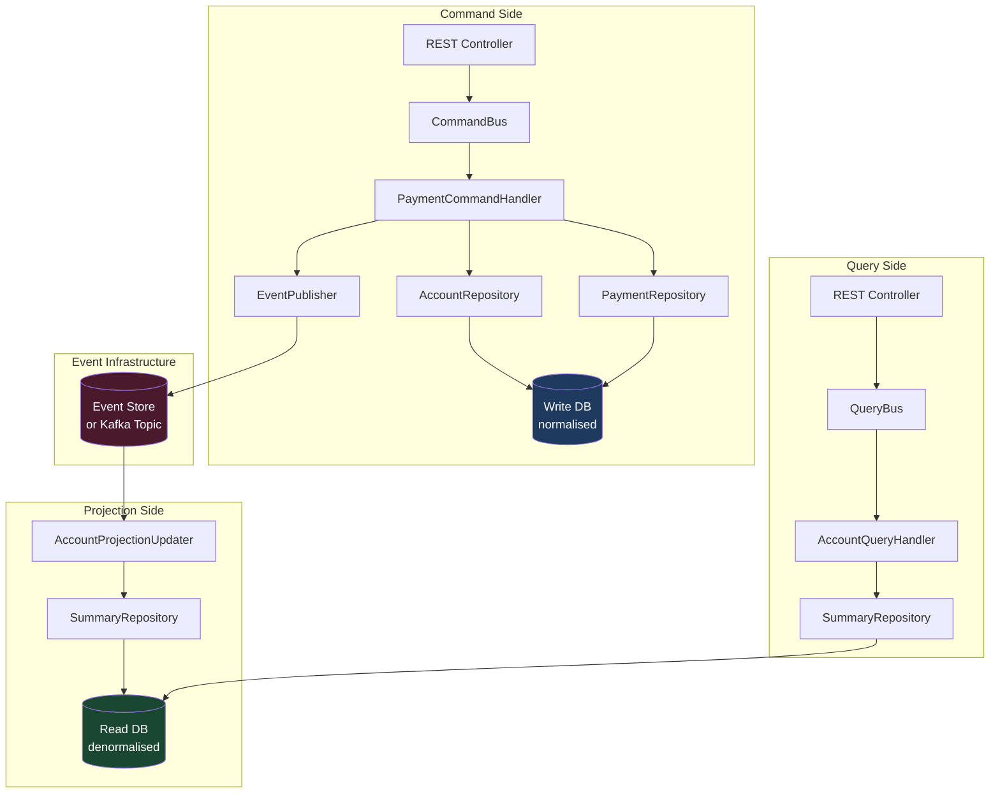

Command Query Responsibility Segregation addresses one of the most persistent performance problems in financial systems: the fundamental asymmetry between reads and writes. A payment platform may process 2,000 payment submissions per second while simultaneously serving 200,000 balance and transaction-history queries. Forcing both workloads through the same domain model, the same ORM, and the same database table is not a neutral choice — it is a design that guarantees contention, over-fetching, and schema compromises that satisfy neither workload well.

## Learning Objectives

- Articulate the read/write workload asymmetry in financial systems and why a single model cannot serve both optimally
- Implement `CommandBus` and `QueryBus` interfaces that route operations to dedicated handlers
- Build a `ProcessPaymentCommand` → `PaymentCommandHandler` pipeline with explicit validation and event emission
- Design a denormalised `account_summary` read model populated by an `AccountProjectionUpdater` consuming domain events
- Explain eventual consistency in the read model and implement a read-your-writes pattern using version tokens
- Write independent unit tests for command handlers and query handlers without full application context
- Identify the conditions under which CQRS adds complexity without benefit (simple CRUD domains)
- Trace a complete payment flow from command receipt through event publication to read-model update

## Business Context

In 2021, a European neobank serving 4 million customers hit a wall during its Black Friday cashback campaign. Transaction history queries — customers checking whether cashback had landed — were issuing full table scans against the same `accounts` table that the payment engine was writing to under peak load. Lock wait times spiked to 8 seconds. Payment acceptance latency, normally under 120ms at P99, reached 14 seconds. The bank halted the campaign at 11:40 AM, losing an estimated €2.3M in planned transaction volume.

The root cause was a single `Account` entity serving both the write path (balance mutation, transaction appends) and the read path (balance display, transaction history, cashback aggregation). Adding indexes to serve read queries slowed write throughput; removing them restored writes but broke read performance. The team had been playing this game for 18 months. CQRS was not a theoretical exercise — it was the architectural change that resolved a production crisis.

## The Read/Write Asymmetry Problem

The command side and query side of a financial system have irreconcilable requirements when unified in one model.

| Concern | Write Model | Read Model |
|---|---|---|
| Consistency | Strict — ACID, invariants enforced | Eventual — slightly stale is acceptable |
| Schema | Normalised — minimise redundancy | Denormalised — minimise joins |
| Index strategy | Write-optimised — few indexes | Read-optimised — many composite indexes |
| Locking | Pessimistic or optimistic row locks | No locks — read replicas acceptable |
| Data lifetime | Append-only audit trail | Projectable — can be rebuilt from events |
| Throughput ratio | 1x (payments: ~2k TPS peak) | 100x (balance checks: ~200k TPS peak) |

Attempting to serve a 100:1 read-to-write ratio from the same table is the core mistake. CQRS makes the split explicit in code and in infrastructure.

## Command and Query Bus Interfaces

The pattern begins with two distinct entry points into the application layer. Neither knows about HTTP, Kafka, or databases directly.

```java
// Command marker interface — commands mutate state, return nothing (or a minimal receipt)
public interface Command {}

// Query marker interface — queries read state, never mutate
public interface Query<R> {}

// CommandBus routes a command to its single registered handler
public interface CommandBus {
    void dispatch(Command command);
}

// QueryBus routes a query to its single registered handler and returns a result
public interface QueryBus {
    <R> R dispatch(Query<R> query);
}
```

The `SimpleCommandBus` implementation wires handlers at startup. In Spring, this is typically done via `@Component` scanning with a `Map<Class<?>, CommandHandler<?>>`:

```java
@Component
public class SimpleCommandBus implements CommandBus {

    private final Map<Class<?>, CommandHandler<?>> handlers;

    public SimpleCommandBus(List<CommandHandler<?>> handlerList) {
        this.handlers = handlerList.stream()
            .collect(Collectors.toMap(
                h -> resolveCommandType(h.getClass()),
                Function.identity()
            ));
    }

    @Override
    @SuppressWarnings("unchecked")
    public void dispatch(Command command) {
        CommandHandler<Command> handler =
            (CommandHandler<Command>) handlers.get(command.getClass());
        if (handler == null) {
            throw new NoHandlerException("No handler registered for: " + command.getClass().getSimpleName());
        }
        handler.handle(command);
    }

    private Class<?> resolveCommandType(Class<?> handlerClass) {
        return Arrays.stream(handlerClass.getGenericInterfaces())
            .filter(t -> t instanceof ParameterizedType)
            .map(t -> (ParameterizedType) t)
            .filter(t -> t.getRawType().equals(CommandHandler.class))
            .map(t -> (Class<?>) t.getActualTypeArguments()[0])
            .findFirst()
            .orElseThrow(() -> new IllegalStateException("Cannot resolve command type for: " + handlerClass));
    }
}
```

## Payment Command Handler

The `ProcessPaymentCommand` carries all the data necessary to initiate a payment. The handler enforces domain invariants, delegates to the aggregate, and publishes events — but never touches read models directly.

```java
public record ProcessPaymentCommand(
    UUID idempotencyKey,
    UUID sourceAccountId,
    UUID targetAccountId,
    Money amount,
    String reference,
    Currency currency
) implements Command {}

@Component
@RequiredArgsConstructor
public class PaymentCommandHandler implements CommandHandler<ProcessPaymentCommand> {

    private final AccountRepository accountRepository;
    private final PaymentRepository paymentRepository;
    private final DomainEventPublisher eventPublisher;
    private final IdempotencyStore idempotencyStore;

    @Override
    @Transactional
    public void handle(ProcessPaymentCommand command) {
        // Idempotency guard — same key = same outcome, no duplicate processing
        if (idempotencyStore.exists(command.idempotencyKey())) {
            log.info("Duplicate command ignored: {}", command.idempotencyKey());
            return;
        }

        Account source = accountRepository.findById(command.sourceAccountId())
            .orElseThrow(() -> new AccountNotFoundException(command.sourceAccountId()));

        Account target = accountRepository.findById(command.targetAccountId())
            .orElseThrow(() -> new AccountNotFoundException(command.targetAccountId()));

        // Domain invariant enforced inside the aggregate
        Payment payment = source.initiatePaymentTo(target, command.amount(), command.reference());

        paymentRepository.save(payment);
        accountRepository.save(source);
        accountRepository.save(target);
        idempotencyStore.record(command.idempotencyKey());

        // Events are collected by the aggregate, published here after persistence
        payment.domainEvents().forEach(eventPublisher::publish);
        source.domainEvents().forEach(eventPublisher::publish);
    }
}
```

> [!WARNING]
> The command handler must publish events **after** the transaction commits, not inside it. Publishing before commit risks sending events that reference state that never persisted if the transaction rolls back. Use Spring's `@TransactionalEventListener(phase = AFTER_COMMIT)` or the Transactional Outbox pattern.

## Account Query Handler and Read Model

The read side operates against a separate schema designed for query performance. The `account_summary` table is denormalised: it stores pre-computed balances and recent transaction counts, avoiding joins at query time.

```sql
-- Read model schema — optimised for display, not for mutation
CREATE TABLE account_summary (
    account_id        UUID PRIMARY KEY,
    holder_name       VARCHAR(200) NOT NULL,
    available_balance NUMERIC(19, 4) NOT NULL,
    pending_balance   NUMERIC(19, 4) NOT NULL,
    currency          CHAR(3) NOT NULL,
    last_transaction_at TIMESTAMPTZ,
    transaction_count_30d INTEGER NOT NULL DEFAULT 0,
    version           BIGINT NOT NULL DEFAULT 0,
    updated_at        TIMESTAMPTZ NOT NULL
);

CREATE INDEX idx_account_summary_holder ON account_summary(holder_name);
CREATE INDEX idx_account_summary_updated ON account_summary(updated_at DESC);
```

```java
public record AccountBalanceQuery(UUID accountId) implements Query<AccountSummaryView> {}

public record AccountSummaryView(
    UUID accountId,
    String holderName,
    BigDecimal availableBalance,
    BigDecimal pendingBalance,
    String currency,
    Instant lastTransactionAt,
    int transactionCount30d,
    long version
) {}

@Component
@RequiredArgsConstructor
public class AccountQueryHandler implements QueryHandler<AccountBalanceQuery, AccountSummaryView> {

    private final AccountSummaryRepository summaryRepository;

    @Override
    @Transactional(readOnly = true)
    public AccountSummaryView handle(AccountBalanceQuery query) {
        return summaryRepository.findById(query.accountId())
            .map(this::toView)
            .orElseThrow(() -> new AccountNotFoundException(query.accountId()));
    }

    private AccountSummaryView toView(AccountSummaryEntity entity) {
        return new AccountSummaryView(
            entity.getAccountId(),
            entity.getHolderName(),
            entity.getAvailableBalance(),
            entity.getPendingBalance(),
            entity.getCurrency(),
            entity.getLastTransactionAt(),
            entity.getTransactionCount30d(),
            entity.getVersion()
        );
    }
}
```

## Read Model Projection

The `AccountProjectionUpdater` subscribes to domain events and maintains the `account_summary` table. It is the bridge between the write model and the read model.

```java
@Component
@RequiredArgsConstructor
@Slf4j
public class AccountProjectionUpdater {

    private final AccountSummaryRepository summaryRepository;
    private final AccountRepository accountRepository; // write-side, used only at rebuild time

    @EventListener
    @Transactional
    public void on(PaymentCompletedEvent event) {
        updateSummary(event.sourceAccountId());
        updateSummary(event.targetAccountId());
    }

    @EventListener
    @Transactional
    public void on(AccountCreditedEvent event) {
        updateSummary(event.accountId());
    }

    @EventListener
    @Transactional
    public void on(AccountDebitedEvent event) {
        updateSummary(event.accountId());
    }

    private void updateSummary(UUID accountId) {
        // Fetch current write-side state to recompute read projection
        AccountSummary summary = summaryRepository.findById(accountId)
            .orElseGet(() -> AccountSummary.empty(accountId));

        // Re-query write side for fresh balances (simple projection strategy)
        AccountBalanceProjection projection = accountRepository.projectBalance(accountId);

        summary.setAvailableBalance(projection.availableBalance());
        summary.setPendingBalance(projection.pendingBalance());
        summary.setLastTransactionAt(Instant.now());
        summary.setTransactionCount30d(projection.transactionCount30d());
        summary.setVersion(summary.getVersion() + 1);
        summary.setUpdatedAt(Instant.now());

        summaryRepository.save(summary);
        log.debug("Projection updated for account {} to version {}", accountId, summary.getVersion());
    }
}
```

## CQRS Architecture Diagram



## Eventual Consistency and Read-Your-Writes

The read model lags behind the write model by the time it takes for an event to be published and the projection to be updated. For most queries — "show me my balance" thirty seconds after a payment settled — this lag (typically under 100ms) is imperceptible.

However, the read-your-writes problem is real: a customer submits a payment and immediately refreshes their balance. The projection may not yet reflect the debit.

One solution is a **version token**: the command response includes the version the write model is at after the mutation. The query side blocks (or retries) until the read model reaches that version.

```java
// Command response carries the version the write model advanced to
public record PaymentInitiatedReceipt(UUID paymentId, long accountVersion) {}

// Query includes an optional minimum version — if provided, wait for projection
public record AccountBalanceQuery(
    UUID accountId,
    @Nullable Long minimumVersion
) implements Query<AccountSummaryView> {}

@Component
@RequiredArgsConstructor
public class AccountQueryHandler implements QueryHandler<AccountBalanceQuery, AccountSummaryView> {

    private final AccountSummaryRepository summaryRepository;

    @Override
    @Transactional(readOnly = true)
    public AccountSummaryView handle(AccountBalanceQuery query) {
        if (query.minimumVersion() != null) {
            return summaryRepository.findByIdWithMinVersion(
                    query.accountId(), query.minimumVersion())
                .map(this::toView)
                .orElseThrow(() -> new ProjectionNotYetReadyException(
                    query.accountId(), query.minimumVersion()));
        }
        return summaryRepository.findById(query.accountId())
            .map(this::toView)
            .orElseThrow(() -> new AccountNotFoundException(query.accountId()));
    }
}
```

> [!NOTE]
> The `ProjectionNotYetReadyException` should map to HTTP 202 Accepted with a `Retry-After: 1` header, not 404 or 500. The client should poll for up to ~2 seconds before concluding the projection is stuck.

## When NOT to Use CQRS

CQRS introduces two data stores, two sets of models, event publication, projection maintenance, and eventual consistency to reason about. For a large category of financial back-office functionality, this overhead is unjustified.

| Signal | Use CQRS? |
|---|---|
| Read traffic 10x+ write traffic, different schema needs | Yes |
| Complex domain with rich invariants (account, payment, limit) | Yes |
| Regulatory reporting on separate infrastructure | Yes |
| Internal admin CRUD (branch configuration, fee schedules) | No |
| Single-team service with uniform access patterns | No |
| MVP with < 50k daily active users | No |
| Analytics-only (no mutation) | No — just use a read replica |

> [!WARNING]
> Applying CQRS to a simple CRUD service doubles the codebase, adds projection lag, and increases operational burden — with no benefit. Many teams apply CQRS uniformly as a "best practice" without evaluating the cost. Reserve it for the aggregates under real workload asymmetry.

## Testing Command and Query Handlers

One of the underappreciated benefits of CQRS is testability. Command handlers and query handlers have no HTTP coupling, no Kafka coupling, and thin infrastructure coupling via interfaces. They test beautifully in isolation.

```java
class PaymentCommandHandlerTest {

    private final AccountRepository accountRepository = mock(AccountRepository.class);
    private final PaymentRepository paymentRepository = mock(PaymentRepository.class);
    private final DomainEventPublisher eventPublisher = mock(DomainEventPublisher.class);
    private final IdempotencyStore idempotencyStore = mock(IdempotencyStore.class);

    private final PaymentCommandHandler handler = new PaymentCommandHandler(
        accountRepository, paymentRepository, eventPublisher, idempotencyStore);

    @Test
    void handle_validPayment_publishesPaymentCompletedEvent() {
        UUID idempotencyKey = UUID.randomUUID();
        Account source = Account.withBalance(Money.of(500, "GBP"));
        Account target = Account.empty();

        when(idempotencyStore.exists(idempotencyKey)).thenReturn(false);
        when(accountRepository.findById(source.getId())).thenReturn(Optional.of(source));
        when(accountRepository.findById(target.getId())).thenReturn(Optional.of(target));

        handler.handle(new ProcessPaymentCommand(
            idempotencyKey, source.getId(), target.getId(),
            Money.of(100, "GBP"), "Invoice #42", Currency.getInstance("GBP")
        ));

        ArgumentCaptor<DomainEvent> captor = ArgumentCaptor.forClass(DomainEvent.class);
        verify(eventPublisher, atLeastOnce()).publish(captor.capture());
        assertThat(captor.getAllValues())
            .anyMatch(e -> e instanceof PaymentCompletedEvent);
    }

    @Test
    void handle_duplicateIdempotencyKey_doesNotProcessAgain() {
        UUID idempotencyKey = UUID.randomUUID();
        when(idempotencyStore.exists(idempotencyKey)).thenReturn(true);

        handler.handle(new ProcessPaymentCommand(
            idempotencyKey, UUID.randomUUID(), UUID.randomUUID(),
            Money.of(50, "GBP"), "ref", Currency.getInstance("GBP")
        ));

        verifyNoInteractions(accountRepository, paymentRepository, eventPublisher);
    }
}

class AccountQueryHandlerTest {

    private final AccountSummaryRepository summaryRepository = mock(AccountSummaryRepository.class);
    private final AccountQueryHandler handler = new AccountQueryHandler(summaryRepository);

    @Test
    void handle_existingAccount_returnsView() {
        UUID accountId = UUID.randomUUID();
        AccountSummaryEntity entity = anAccountSummaryEntity(accountId, BigDecimal.valueOf(1200));
        when(summaryRepository.findById(accountId)).thenReturn(Optional.of(entity));

        AccountSummaryView view = handler.handle(new AccountBalanceQuery(accountId, null));

        assertThat(view.accountId()).isEqualTo(accountId);
        assertThat(view.availableBalance()).isEqualByComparingTo("1200");
    }

    @Test
    void handle_unknownAccount_throwsNotFoundException() {
        UUID accountId = UUID.randomUUID();
        when(summaryRepository.findById(accountId)).thenReturn(Optional.empty());

        assertThatThrownBy(() -> handler.handle(new AccountBalanceQuery(accountId, null)))
            .isInstanceOf(AccountNotFoundException.class);
    }
}
```

## Knowledge Check

**Q1: Your payment service uses CQRS. A customer submits a payment and within 50ms queries their balance. The balance has not yet reflected the debit. The customer calls support. How do you explain and mitigate this architecturally?**

A: This is the read-your-writes problem arising from eventual consistency between the write model and the read projection. Mitigation options in increasing implementation complexity: (1) return a version token with the payment receipt and have the balance endpoint accept a `minimumVersion` parameter, retrying until the projection catches up; (2) for the immediate post-payment redirect, serve balance directly from the write model bypassing the projection (breaking CQRS for this one flow, acceptable as an exception); (3) reduce projection lag to under 10ms using synchronous event processing rather than async, accepting the write-path latency increase. For most fintech UIs, option 1 combined with a 1-2 second client-side retry covers the case without architectural compromise.

**Q2: A team proposes applying CQRS to their branch configuration service, which allows bank operations staff to update opening hours, fee schedules, and product settings. Write traffic is 10 updates per day. Read traffic is 50 queries per day. Should they adopt CQRS?**

A: No. With 10 writes and 50 reads per day, there is no workload asymmetry to address. The complexity CQRS introduces — a separate read store, projection maintenance, event publishing, and eventual consistency to reason about — provides zero benefit here. A single JPA repository with a read replica (if needed) is the correct choice. CQRS is a solution to workload asymmetry, not a universal architecture template. Applying it to this service would double the code, add operational overhead, and confuse future maintainers.

## Practical Challenge

**Scenario:** You are the principal engineer for a payments platform processing 5,000 TPS. Balance query latency is degrading under load because queries and payment writes share the same PostgreSQL primary. Your task is to introduce CQRS for the account domain.

**Task 1 — Command Model:** Implement `WithdrawFundsCommand` and `WithdrawFundsCommandHandler`. The handler must: check sufficient balance via the `Account` aggregate, debit the account, persist the updated aggregate, record idempotency, and publish a `FundsWithdrawnEvent`. Write a unit test that verifies a withdrawal of £200 from an account with £150 balance raises `InsufficientFundsException`.

**Task 2 — Read Model Schema:** Design the SQL schema for a `transaction_history_view` read model that supports efficient queries for "last 30 transactions for account X, sorted by timestamp descending, filtered by type (DEBIT/CREDIT)". Include appropriate indexes and explain your index choices.

**Task 3 — Projection Updater:** Implement `TransactionHistoryProjectionUpdater` that listens to `FundsWithdrawnEvent` and `FundsDepositedEvent` and maintains the `transaction_history_view` table. Handle the case where the event arrives out of order (timestamp-based idempotency check).

**Task 4 — Eventual Consistency Test:** Write an integration test using an in-memory event bus that verifies: after dispatching `WithdrawFundsCommand`, within 100ms the query handler returns a `TransactionHistoryView` that includes the withdrawal transaction. The test should not use `Thread.sleep` — use `Awaitility` with a 200ms timeout.

<!-- KNOWLEDGE-CHECK
{
  "questions": [
    {
      "id": "q1",
      "text": "A customer submits a payment and within 50ms queries their balance. The read model has not yet updated. What HTTP status code should the query endpoint return when it detects the projection is behind the requested minimum version?",
      "options": [
        "404 Not Found — the version does not exist yet",
        "500 Internal Server Error — the projection is broken",
        "202 Accepted with Retry-After header — the data is not yet ready but will be",
        "200 OK with the stale balance — always return something"
      ],
      "correct": 2,
      "explanation": "202 Accepted communicates that the request was understood and the resource exists, but the specific version requested is not yet available. Combined with a Retry-After: 1 header, it tells the client to retry in 1 second. 404 is incorrect because the account exists; 500 implies a system error when this is expected behaviour; 200 with stale data silently misleads the client."
    },
    {
      "id": "q2",
      "text": "You have a CQRS setup where PaymentCommandHandler publishes PaymentCompletedEvent inside the @Transactional boundary. The transaction then rolls back due to a constraint violation. What is the consequence?",
      "options": [
        "Nothing — Spring automatically rolls back published events",
        "The event was published to Kafka before the rollback, so downstream consumers will process a payment that was never persisted",
        "The event is queued and replayed after the rollback completes",
        "The command handler throws an exception before the event is published"
      ],
      "correct": 1,
      "explanation": "Events published to Kafka (or any external broker) inside a transaction are not part of that transaction. If the database transaction rolls back after the event is sent, the event describes state that never existed. Use @TransactionalEventListener(phase = AFTER_COMMIT) or the Transactional Outbox pattern to ensure events are only published after the transaction successfully commits."
    }
  ]
}
-->

<!-- PRACTICAL-CHALLENGE
{
  "title": "CQRS \u2014 Separating Commands and Queries in Payment Systems \u2014 Production Implementation",
  "difficulty": "advanced",
  "estimatedMinutes": 60,
  "tasks": [
    {
      "id": "1",
      "description": "Implement `WithdrawFundsCommand` and `WithdrawFundsCommandHandler`. The handler must: check sufficient balance via the `Account` aggregate, debit the account, persist the updated aggregate, record ide"
    },
    {
      "id": "2",
      "description": "Design the SQL schema for a `transaction_history_view` read model that supports efficient queries for \"last 30 transactions for account X, sorted by timestamp descending, filtered by type (DEBIT/CREDI"
    },
    {
      "id": "3",
      "description": "Implement `TransactionHistoryProjectionUpdater` that listens to `FundsWithdrawnEvent` and `FundsDepositedEvent` and maintains the `transaction_history_view` table. Handle the case where the event arri"
    },
    {
      "id": "4",
      "description": "Write an integration test using an in-memory event bus that verifies: after dispatching `WithdrawFundsCommand`, within 100ms the query handler returns a `TransactionHistoryView` that includes the with"
    }
  ]
}
-->
