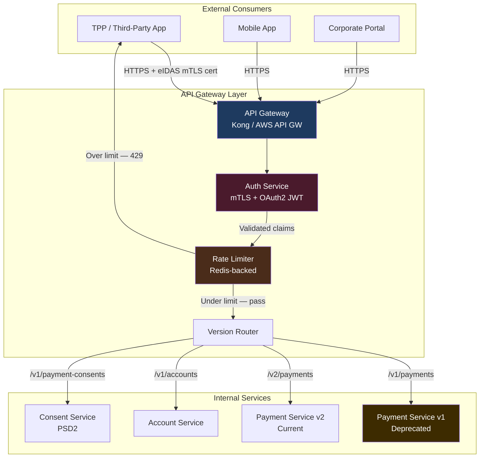

تصميم الواجهات البرمجية (API) في الخدمات المالية ليس شأنًا تقنيًا فحسب — بل شأن تجاري وتنظيمي. فواجهة بدء دفع سيئة الإدارة للإصدارات قد تجمّد آلاف تكاملات مزوّدي الطرف الثالث (TPP) في حالة توافق لسنوات. ونقطة نهاية دفع بلا مفتاح منع تكرار قد تسبب خصومات مكررة تتطلب مطابقة يدوية وإبلاغًا تنظيميًا. والسطح البرمجي لمنصة الدفع عقد له عواقب قانونية ومالية، والمهندسون الرئيسيون مسؤولون عن إتقانه من أول إصدار عام.

## أهداف التعلّم

- تطبيق نمذجة موارد REST على موارد الدفع والحسابات، بما في ذلك دلالات أفعال HTTP الصحيحة لمنع التكرار
- شرح متى تستخدم PUT أو PATCH أو POST في سياق تعديل الموارد المالية
- قراءة مواصفة OpenAPI 3.1 لنقطة نهاية بدء الدفع وكتابتها، بما في ذلك مخططات الأخطاء
- مقارنة استراتيجيات إصدار الواجهات عبر مسار URL، والترويسات، والتفاوض على المحتوى، مع المفاضلات للواجهات الخاضعة للتنظيم
- تعريف خدمة gRPC بلغة protobuf لبث المدفوعات لحظيًا، وفهم متى يتفوق gRPC على REST
- تنفيذ `@RestController` في Spring يعيد `ProblemDetail` وفق RFC 9457 لردود أخطاء منظمة يقرؤها الحاسوب
- تصميم ترقيم صفحات قائم على المؤشر (cursor) لقوائم تاريخ المعاملات الكبيرة، وشرح لماذا يفشل الترقيم بالإزاحة (offset) على نطاق واسع
- تطبيق ترويسات تحديد المعدل، وفهم حد PSD2 على عدد مرات وصول مزوّدي الطرف الثالث إلى الحساب دون حضور العميل

## سياق العمل

لنأخذ مجمّع خدمات مصرفية مفتوحة (مثال مركّب) واجهة بدء الدفع لديه في الإنتاج منذ عامين بلا استراتيجية إصدارات. يجب على الفريق إضافة عنوان دائن منظم إلزامي، لأن رسائل الدفع العابرة للحدود بمعيار ISO 20022 تتوقف عن قبول العناوين غير المنظمة اعتبارًا من نوفمبر 2026. ويواجه الفريق معضلة: كسر التكاملات القائمة بصمت، أو صيانة تنفيذين متوازيين. فيختار التغيير الكاسر الصامت، معتقدًا أن "معظم العملاء لن يتأثروا". وتنكسر 43 تكاملًا لمزوّدي الطرف الثالث خلال عطلة نهاية الأسبوع التالية، وتطرح الجهة الرقابية أسئلة، وتبلغ كلفة المعالجة — وقت المطورين، وإعادة اختبار مزوّدي الطرف الثالث، والمراسلات التنظيمية، وتعويض العملاء — مئات الآلاف من الجنيهات. فقد كان لدَين "غياب استراتيجية الإصدارات" قيمة نقدية محددة.

## تصميم موارد REST للمدفوعات

تتطابق الموارد المالية طبيعيًا مع REST عندما تُنمذج كأسماء من المجال، لا كاستدعاءات RPC قائمة على الأفعال. والخطأ الذي ترتكبه معظم الفرق هو استخدام REST كـ RPC — `POST /initiatePayment` بدل `POST /payments`.

```
# Payment resources — noun-based, hierarchical, predictable

POST   /payments                           # Initiate new payment
GET    /payments/{paymentId}               # Retrieve payment status
DELETE /payments/{paymentId}               # Cancel pending payment (state-dependent)

GET    /accounts/{accountId}               # Account details
GET    /accounts/{accountId}/transactions  # Transaction history (paginated)
GET    /accounts/{accountId}/balance       # Current balance

POST   /payment-consents                   # Create PSD2 consent
GET    /payment-consents/{consentId}       # Retrieve consent status
DELETE /payment-consents/{consentId}       # Revoke consent
```

### دلالات أفعال HTTP ومنع التكرار

| الفعل | آمن؟ | آمن من التكرار؟ | الاستخدام في التقنية المالية |
|---|---|---|---|
| GET | نعم | نعم | قراءة حالة الدفعة ورصيد الحساب |
| POST | لا | لا* | بدء الدفع (* يتطلب الترويسة Idempotency-Key) |
| PUT | لا | نعم | استبدال المورد كاملًا (نادر في المدفوعات) |
| PATCH | لا | لا* | تعديل جزئي — تحديث مرجع الدفعة |
| DELETE | لا | نعم | إلغاء الموافقة أو سحبها |

الفعل POST ليس آمنًا من التكرار بطبيعته، لكن بدء الدفع يجب أن يكون كذلك. والحل ترويسة `Idempotency-Key` يولّدها العميل. يخزن الخادم رد الطلب الأول ويعيد الرد المخزن حرفيًا (رمز الحالة والجسم نفسيهما) لأي إعادة محاولة بالمفتاح نفسه — دون إعادة المعالجة — مع إضافة الترويسة `Idempotent-Replayed: true` ليعرف العميل ذلك. أما الطلب المكرر الذي يصل بينما الطلب الأول ما زال قيد المعالجة فيحصل على `409 Conflict`.

```java
@RestController
@RequestMapping("/v2/payments")
@RequiredArgsConstructor
public class PaymentController {

    private final CommandBus commandBus;
    private final IdempotencyCache idempotencyCache;

    @PostMapping
    public ResponseEntity<PaymentInitiationResponse> initiatePayment(
            @RequestHeader("Idempotency-Key") UUID idempotencyKey,
            @Valid @RequestBody PaymentInitiationRequest request) {

        // Production: store the key and response in the payment's own database
        // transaction (ADR-0017, lesson 02) — a cache alone can lose them.
        return idempotencyCache.get(idempotencyKey, PaymentInitiationResponse.class)
            .map(cached -> ResponseEntity.status(HttpStatus.CREATED)   // same as the original
                .header("Location", "/v2/payments/" + cached.paymentId())
                .header("Idempotent-Replayed", "true")
                .body(cached))
            .orElseGet(() -> {
                ProcessPaymentCommand command = mapToCommand(idempotencyKey, request);
                commandBus.dispatch(command);

                PaymentInitiationResponse response = PaymentInitiationResponse.pending(
                    command.paymentId(), idempotencyKey);

                idempotencyCache.put(idempotencyKey, response, Duration.ofHours(24));
                return ResponseEntity.status(HttpStatus.CREATED)
                    .header("Location", "/v2/payments/" + command.paymentId())
                    .body(response);
            });
    }

    @ExceptionHandler(InsufficientFundsException.class)
    public ProblemDetail handleInsufficientFunds(InsufficientFundsException ex,
                                                  HttpServletRequest request) {
        ProblemDetail problem = ProblemDetail.forStatusAndDetail(
            HttpStatus.UNPROCESSABLE_ENTITY,
            "Account has insufficient available balance for the requested payment amount"
        );
        problem.setTitle("Insufficient Funds");
        problem.setType(URI.create("https://api.bank.com/problems/insufficient-funds"));
        problem.setInstance(URI.create(request.getRequestURI()));
        problem.setProperty("accountId", ex.getAccountId());
        problem.setProperty("requestedAmount", ex.getRequestedAmount());
        problem.setProperty("availableBalance", ex.getAvailableBalance());
        return problem;
    }

    @ExceptionHandler(PaymentLimitExceededException.class)
    public ProblemDetail handleLimitExceeded(PaymentLimitExceededException ex,
                                              HttpServletRequest request) {
        ProblemDetail problem = ProblemDetail.forStatusAndDetail(
            HttpStatus.UNPROCESSABLE_ENTITY,
            "Payment amount exceeds single-transaction or daily limit"
        );
        problem.setTitle("Payment Limit Exceeded");
        problem.setType(URI.create("https://api.bank.com/problems/limit-exceeded"));
        problem.setInstance(URI.create(request.getRequestURI()));
        problem.setProperty("limitType", ex.getLimitType());
        problem.setProperty("limitAmount", ex.getLimitAmount());
        return problem;
    }
}
```

## مقتطف من مواصفة OpenAPI 3.1

العقد القابل للقراءة آليًا إلزامي في البيئات الخاضعة لـ PSD2. فمزوّدو الطرف الثالث يعتمدون عليه لتوليد مكتبات SDK، والاختبار الآلي في بيئات التجربة، والتسجيل في الأدلة التنظيمية.

```yaml
openapi: "3.1.0"
info:
  title: Payment Initiation API
  version: "2.1.0"
  description: >
    PSD2-compliant payment initiation service. All mutating requests require
    a client-generated Idempotency-Key header to prevent duplicate processing.
    Errors are returned as application/problem+json (RFC 9457).

paths:
  /v2/payments:
    post:
      operationId: initiatePayment
      summary: Initiate a domestic or SEPA credit transfer
      parameters:
        - name: Idempotency-Key
          in: header
          required: true
          schema:
            type: string
            format: uuid
          description: >
            Client-generated UUID. The server returns the identical response
            for the same key within 24 hours without reprocessing.
      requestBody:
        required: true
        content:
          application/json:
            schema:
              $ref: '#/components/schemas/PaymentInitiationRequest'
      responses:
        '201':
          description: Payment accepted and queued for processing
          headers:
            Location:
              schema:
                type: string
              description: URL of the created payment resource
          content:
            application/json:
              schema:
                $ref: '#/components/schemas/PaymentInitiationResponse'
        '422':
          description: Business rule violation — insufficient funds or limit breach
          content:
            application/problem+json:
              schema:
                $ref: '#/components/schemas/ProblemDetail'
        '429':
          description: Rate limit exceeded (TPP throttling)
          headers:
            Retry-After:
              schema:
                type: integer
              description: Seconds until the rate limit window resets
            X-RateLimit-Limit:
              schema:
                type: integer
            X-RateLimit-Remaining:
              schema:
                type: integer
            X-RateLimit-Reset:
              schema:
                type: integer
              description: Unix epoch when limit resets

components:
  schemas:
    PaymentInitiationRequest:
      type: object
      required: [debtorAccount, creditorAccount, amount, currency]
      properties:
        debtorAccount:
          $ref: '#/components/schemas/AccountReference'
        creditorAccount:
          $ref: '#/components/schemas/AccountReference'
        creditorAgent:
          type: string
          description: BIC of creditor institution (optional for SEPA — IBAN-only since 2016)
          pattern: '^[A-Z]{6}[A-Z2-9][A-NP-Z0-9]([A-Z0-9]{3})?$'
        amount:
          type: string
          pattern: '^\d+\.\d{2}$'
          example: "150.00"
        currency:
          type: string
          pattern: '^[A-Z]{3}$'
          example: "GBP"
        remittanceInformation:
          type: string
          maxLength: 140
```

## استراتيجيات إصدار الواجهات

| الاستراتيجية | مثال | التخزين المؤقت | سهولة الاكتشاف | الحكم في التقنية المالية |
|---|---|---|---|---|
| مسار URL | `/v2/payments` | ممتاز | ممتاز | المفضّل للواجهات العامة الخاضعة للتنظيم |
| ترويسة الطلب | `API-Version: 2` | ضعيف (يتطلب Vary) | ضعيف | مقبول للخدمات الداخلية |
| التفاوض على المحتوى | `Accept: application/vnd.bank.v2+json` | ضعيف | جيد | معقد أكثر من اللازم لمعظم الفرق |
| معامل استعلام | `/payments?version=2` | مقبول | جيد | تجنّبه — يلوّث عناوين الموارد |

للواجهات الخاضعة للتنظيم، يُوصى بشدة بالإصدار عبر مسار URL، لأن بيئات التجربة التنظيمية تشير إلى مسارات محددة، والتوجيه عبر الوكيل سهل، والتصحيح بـ curl لا يحتاج ترويسات خاصة.

```java
// Deprecation signalling on v1 responses while v2 is live
@GetMapping("/{paymentId}")
public ResponseEntity<PaymentResponseV1> getPaymentV1(@PathVariable UUID paymentId) {
    return ResponseEntity.ok()
        .header("Deprecation", "@1767225600")                // RFC 9745: deprecated since 2026-01-01
        .header("Sunset", "Sat, 31 Dec 2026 23:59:59 GMT")   // RFC 8594: removal date
        .header("Link", "</v2/payments/" + paymentId + ">; rel=\"successor-version\"")
        .body(paymentServiceV1.find(paymentId));
}
```

## gRPC لبث المدفوعات لحظيًا

حيث يتفوق REST في الواجهات العامة القابلة للتخزين المؤقت والمقروءة للبشر، يتفوق gRPC في الخدمات الداخلية عالية الإنتاجية التي تحتاج البث أو كلفة تسلسل منخفضة جدًا. فرسائل Protocol Buffers عادة أصغر بعدة مرات من JSON المكافئ وأسرع في التحليل.

```protobuf
syntax = "proto3";
package com.bank.payments.v1;

import "google/protobuf/timestamp.proto";

service PaymentStreamService {
  // Bidirectional stream: client sends requests, server streams status updates
  rpc StreamPayments(stream PaymentRequest) returns (stream PaymentStatusUpdate);

  // Server-streaming: subscribe to real-time payment events for an account
  rpc SubscribeAccountPayments(AccountSubscriptionRequest) returns (stream PaymentEvent);
}

message PaymentRequest {
  string idempotency_key = 1;
  string debtor_account_id = 2;
  string creditor_account_id = 3;
  string amount = 4;        // decimal as string — never float for money
  string currency = 5;
  string reference = 6;
  google.protobuf.Timestamp requested_at = 7;
}

message PaymentStatusUpdate {
  string payment_id = 1;
  string idempotency_key = 2;
  PaymentStatus status = 3;
  string failure_reason = 4;
  google.protobuf.Timestamp updated_at = 5;
}

enum PaymentStatus {
  PAYMENT_STATUS_UNSPECIFIED = 0;
  PAYMENT_STATUS_PENDING = 1;
  PAYMENT_STATUS_PROCESSING = 2;
  PAYMENT_STATUS_COMPLETED = 3;
  PAYMENT_STATUS_FAILED = 4;
  PAYMENT_STATUS_CANCELLED = 5;
}
```

```java
@GrpcService
@RequiredArgsConstructor
public class PaymentStreamServiceImpl
        extends PaymentStreamServiceGrpc.PaymentStreamServiceImplBase {

    private final CommandBus commandBus;
    private final PaymentStatusObservable statusObservable;

    @Override
    public StreamObserver<PaymentRequest> streamPayments(
            StreamObserver<PaymentStatusUpdate> responseObserver) {

        return new StreamObserver<>() {
            @Override
            public void onNext(PaymentRequest request) {
                try {
                    commandBus.dispatch(mapToCommand(request));
                    // StreamObserver is not thread-safe: serialise onNext calls
                    statusObservable.subscribe(request.getIdempotencyKey(), update -> {
                        synchronized (responseObserver) { responseObserver.onNext(update); }
                    });
                } catch (InsufficientFundsException ex) {
                    // A business rejection is a status update, not a stream error:
                    // onError() would close the stream for every other payment in it
                    synchronized (responseObserver) {
                        responseObserver.onNext(PaymentStatusUpdate.newBuilder()
                            .setIdempotencyKey(request.getIdempotencyKey())
                            .setStatus(PaymentStatus.PAYMENT_STATUS_FAILED)
                            .setFailureReason("INSUFFICIENT_FUNDS")
                            .build());
                    }
                }
            }

            @Override public void onError(Throwable t) {
                log.warn("Client stream error", t);
            }

            @Override public void onCompleted() {
                responseObserver.onCompleted();
            }
        };
    }
}
```

لاحظ أن رفض العمل (مثل عدم كفاية الرصيد) يُرسل كتحديث حالة `PAYMENT_STATUS_FAILED`، لا كخطأ في البث: فاستدعاء `onError()` يغلق البث كله لكل المدفوعات الأخرى فيه. كما أن `StreamObserver` غير آمن للخيوط، فتُسلسل استدعاءات `onNext`.

**متى تختار gRPC ومتى تختار REST في التقنية المالية:**

| المعيار | اختر REST | اختر gRPC |
|---|---|---|
| نوع المستهلك | مزوّدو الطرف الثالث الخارجيون، والمتصفحات | الخدمات المصغّرة الداخلية، والمكاتب الخلفية |
| الحاجة إلى البث | لا | نعم — أحداث الدفع، وأسعار الصرف اللحظية، وإشارات الاحتيال |
| حساسية التسلسل | غير حرجة | إنتاجية عالية تتجاوز 50 ألف رسالة في الثانية |
| قابلية القراءة البشرية | مطلوبة | غير مطلوبة |
| سجل التدقيق التنظيمي | تسجيل URL مباشر | يتطلب تحليل إطارات ثنائية |

## مفاضلات GraphQL وREST للواجهات المصرفية

| الجانب | REST | GraphQL |
|---|---|---|
| دقة التفويض | لكل نقطة نهاية (سهل التدقيق) | لكل حقل (معقد، ويتطلب تحليلًا) |
| تسجيل الوصول في PSD2 | الرابط والفعل يكفيان | يتطلب تحليل جسم الاستعلام |
| التخزين المؤقت لـ HTTP | يعمل أصلًا (GET قابل للتخزين المؤقت) | ‏POST افتراضيًا — بلا تخزين مؤقت لـ HTTP |
| تحديد المعدل | لكل نقطة نهاية، ومباشر | يتطلب حساب كلفة كل استعلام |
| مرونة العميل | أشكال ثابتة | مرن — تطبيقات الجوال تطلب الحقول التي تحتاجها فقط |
| الإصدارات | إصدار عبر مسار URL | تطور المخطط (إضافي فقط) |

> [!WARNING]
> تتوقع جهات الإشراف على الخدمات المصرفية المفتوحة والمدققون سجلًا واضحًا لأي مزوّد طرف ثالث وصل إلى أي حساب وأي عملية. ومع GraphQL، يتطلب تحديد "أي مورد وُصل إليه" تحليل جسم طلب POST، لا قراءة الرابط. هذا ممكن لكنه يضيف تعقيدًا لأدوات التدقيق لا تكون معظم فرق الامتثال وSIEM مستعدة له. استخدم REST لكل نقاط النهاية الخاضعة للتنظيم؛ وGraphQL مناسب للأدوات الداخلية غير الخاضعة للتنظيم.

## مخطط التوجيه في بوابة الواجهات



## ترقيم الصفحات بالمؤشر لتاريخ المعاملات

قد يمتد تاريخ المعاملات سنوات — و50 مليون صف لحساب كثيف الحركة رقم واقعي. ويتدهور الترقيم بالإزاحة خطيًا مع الإزاحة: فالاستعلام `LIMIT 20 OFFSET 2000000` يتطلب أن تعالج قاعدة البيانات مليوني صف وتتخلص منها مع كل تقليب صفحة.

```java
// Cursor encodes the last-seen (timestamp, id) tuple — opaque to the client
public record TransactionCursor(Instant timestamp, UUID transactionId) {

    public static TransactionCursor decode(String encoded) {
        byte[] bytes = Base64.getUrlDecoder().decode(encoded);
        // Deserialise from JSON or binary within the opaque cursor
        return CURSOR_CODEC.decode(bytes);
    }

    public String encode() {
        return Base64.getUrlEncoder().encodeToString(CURSOR_CODEC.encode(this));
    }

    public static TransactionCursor latest() {
        return new TransactionCursor(Instant.now(), MAX_UUID);
    }
}

@GetMapping("/{accountId}/transactions")
public TransactionPage getTransactions(
        @PathVariable UUID accountId,
        @RequestParam(defaultValue = "20") @Max(100) int limit,
        @RequestParam(required = false) String cursor) {

    TransactionCursor decoded = cursor != null
        ? TransactionCursor.decode(cursor)
        : TransactionCursor.latest();

    // Fetch one extra to detect if more pages exist
    List<Transaction> results = transactionRepository
        .findByAccountBeforeCursor(accountId, decoded.timestamp(), decoded.transactionId(), limit + 1);

    boolean hasMore = results.size() > limit;
    List<Transaction> page = hasMore ? results.subList(0, limit) : results;

    String nextCursor = hasMore
        ? new TransactionCursor(page.getLast().getCreatedAt(), page.getLast().getId()).encode()
        : null;

    return new TransactionPage(page.stream().map(this::toView).toList(), nextCursor, limit);
}
```

```sql
-- Composite index enabling O(log N) seek regardless of table size
CREATE INDEX idx_tx_account_cursor
    ON transactions (account_id, created_at DESC, id DESC);

-- Cursor query — no offset scan, seeks directly to cursor position
SELECT * FROM transactions
WHERE account_id = :accountId
  AND (created_at, id) < (:cursorTimestamp, :cursorId)
ORDER BY created_at DESC, id DESC
LIMIT :limit;
```

## اختبر فهمك

**س1: يطلق تكامل لمزوّد طرف ثالث مع واجهة الدفع لديك عاصفة إعادة محاولة بسبب الشبكة، فيرسل طلب `POST /payments` نفسه ثلاث مرات متتالية بسرعة. عولج الطلب الأول بنجاح وخُصم من حساب العميل. ما الذي يمنع الخصم المكرر، وما الرد الذي يجب أن يعيده الطلبان الثاني والثالث؟**

ج: تمنع الترويسة `Idempotency-Key` المعالجة المكررة. فعند الاستلام الأول يعالج الخادم الدفعة ويخزن الرد مربوطًا بالمعرّف UUID الذي ولّده العميل. وفي الطلبات اللاحقة بالمفتاح نفسه، يعيد الخادم الرد المخزن فورًا — دون إعادة تنفيذ الأمر. والرد الصحيح للإعادة هو الرد الأصلي المخزن — `201 Created` بالجسم نفسه والترويسة `Location` نفسها — مع الترويسة `Idempotent-Replayed: true`، فيرى العميل الذي فقد الرد الأول بالضبط ما كان سيراه. (أما الطلب المكرر الذي يصل بينما الأول ما زال قيد المعالجة فيحصل على `409 Conflict` ويعيد المحاولة.) ويحدث الخصم مرة واحدة بالضبط مهما كان عدد إعادات المحاولة. ويجب تخزين مفاتيح منع التكرار مع سجل الدفعة لأغراض التدقيق وحل النزاعات.

**س2: تحتاج إلى إضافة حقل `creditorAddress` منظم وإلزامي إلى واجهة الدفع للامتثال لمعيار ISO 20022 في المدفوعات العابرة للحدود. والتكاملات القائمة لا ترسل هذا الحقل. ما أسلوب الإصدار الذي تتبعه، وما الترويسات التي تضيفها إلى v1 للإشارة إلى التغيير القادم؟**

ج: أدخل الحقل كاختياري في v1 فورًا — وهذا متوافق مع الإصدارات السابقة. واجعله إلزاميًا فقط في `/v2/payments`. وأضف الترويسات `Deprecation: @<unix time>` ‏(RFC 9745)، و`Sunset: <date 12 months out>` ‏(RFC 8594)، و`Link: </v2/payments>; rel="successor-version"` إلى كل ردود v1 للإشارة إلى مسار الترحيل. وأبلغ مزوّدي الطرف الثالث عبر بوابة المطورين لديك، وانشر دليل ترحيل. وشغّل v1 وv2 بالتوازي طوال فترة الإيقاف التدريجي. ولا تضف أبدًا حقولًا إلزامية بصمت إلى إصدار قائم من الواجهة — فهذا تغيير كاسر مهما بدا صغيرًا داخليًا.

## تحدٍّ عملي

**السيناريو:** تصمم الواجهة الخارجية لخدمة جديدة لبدء الدفع في الخدمات المصرفية المفتوحة في المملكة المتحدة، يجب أن تمتثل لـ PSD2 ولمعيار الخدمات المصرفية المفتوحة في المملكة المتحدة (الذي نشرته أصلًا هيئة OBIE).

**المهمة 1 — تصميم الموارد:** عرّف بنية الروابط الكاملة لكل من: بدء دفعة محلية، والتحقق من حالة الدفعة، وعرض معاملات الحساب (مع ترقيم الصفحات)، وسحب موافقة دفع. ولكل نقطة نهاية اذكر أفعال HTTP، ورموز حالة النجاح، ورمزي الخطأ الأكثر احتمالًا.

**المهمة 2 — مواصفة OpenAPI 3.1:** اكتب كتلة `paths` كاملة بمعيار OpenAPI 3.1 لـ `POST /v2/domestic-payments`. وضمّنها: معامل الترويسة `Idempotency-Key`، ومخطط جسم طلب فيه على الأقل `debtorAccount` و`creditorAccount` و`amount` و`currency` كحقول إلزامية، والردين `201` و`422` باستخدام `application/problem+json`، والرد `429` مع الترويستين `Retry-After` و`X-RateLimit-*`.

**المهمة 3 — ترقيم الصفحات:** نفّذ نقطة النهاية `GET /v2/accounts/{id}/transactions` في `TransactionHistoryController` باستخدام ترقيم بالمؤشر. يجب أن يرمّز المؤشر معرّف الحساب والطابع الزمني ومعرّف المعاملة UUID. واكتب اختبار وحدة يتحقق من أن طلبًا بمؤشر صالح يعيد المعاملات الأقدم من الطابع الزمني للمؤشر بترتيب تنازلي.

**المهمة 4 — معترض الإيقاف التدريجي:** نفّذ `HandlerInterceptor` في Spring يضيف الترويسات `Deprecation` و`Sunset` و`Link` (الإصدار اللاحق) إلى كل الردود الصادرة عن متحكمات موسومة بوسم مخصص `@DeprecatedApi(successor = "v2")` (لا `java.lang.Deprecated` الذي لا يقبل قيمة). واكتب اختبارًا يتحقق من وجود هذه الترويسات في نقاط نهاية v1 وغيابها في v2.

<!-- KNOWLEDGE-CHECK
{
  "questions": [
    {
      "id": "q1",
      "text": "يرسل مزوّد طرف ثالث طلب POST /payments نفسه ثلاث مرات بمفتاح Idempotency-Key نفسه. نجح الطلب الأول. ماذا يجب أن يعيد الطلبان 2 و3؟",
      "options": [
        "الرد الأصلي المخزن — 201 Created بالجسم نفسه والترويسة Location نفسها — مع الترويسة Idempotent-Replayed: true",
        "200 OK برد مبني من جديد، لأنه لم يُنشأ مورد جديد",
        "409 Conflict — يوجد مورد بهذا المفتاح بالفعل",
        "204 No Content — تم تجاهل المكرر بصمت"
      ],
      "correct": 0,
      "explanation": "الإعادة الآمنة من التكرار تعني أن يحصل العميل بالضبط على ما أعاده الطلب الأول، فيستطيع العميل الذي فقد الرد الأول المتابعة كأنه استلمه. وتخبره الترويسة Idempotent-Replayed أن هذا رد معاد. والرمز 409 مخصص للطلب المكرر الذي يصل بينما الأول ما زال قيد المعالجة، لا بعد انتهائه؛ والرمز 204 يحذف الجسم الذي يحتاجه العميل لتأكيد النتيجة الأصلية."
    },
    {
      "id": "q2",
      "text": "لماذا يفشل الترقيم بالإزاحة (LIMIT 20 OFFSET 50000) في جداول تاريخ المعاملات الكبيرة؟",
      "options": [
        "لا تدعم SQL قيم OFFSET أكبر من 32767",
        "يجب أن تمسح قاعدة البيانات كل الصفوف السابقة وتتخلص منها في كل استعلام، فيصبح الزمن متناسبًا مع الإزاحة",
        "الاستعلامات القائمة على OFFSET لا تستطيع استخدام فهارس B-tree",
        "يفيض عداد OFFSET في الجداول التي تتجاوز ملياري صف"
      ],
      "correct": 1,
      "explanation": "يتطلب الترقيم بالإزاحة أن تعالج قاعدة البيانات كل الصفوف حتى الإزاحة، رغم التخلص منها. فعند OFFSET 50000 تعالج قاعدة البيانات 50,000 صف مع كل تقليب صفحة. أما الترقيم بالمؤشر فيستخدم شرط WHERE على زوج مفهرس (الطابع الزمني، المعرّف)، فينتقل مباشرة إلى الموضع الصحيح بزمن O(log N) مهما كان حجم الجدول."
    }
  ]
}
-->

<!-- PRACTICAL-CHALLENGE
{
  "title": "تصميم الواجهات البرمجية — REST وGraphQL وgRPC في الخدمات المالية — تطبيق في بيئة الإنتاج",
  "difficulty": "advanced",
  "estimatedMinutes": 60,
  "tasks": [
    {
      "id": "1",
      "description": "عرّف بنية الروابط وأفعال HTTP ورموز الحالة لكل من: بدء دفعة محلية، واسترجاع حالة الدفعة، وعرض المعاملات مع ترقيم الصفحات، وسحب الموافقة"
    },
    {
      "id": "2",
      "description": "اكتب كتلة paths كاملة لـ POST /v2/domestic-payments مع الترويسة Idempotency-Key، ومخطط الطلب، والردين 201/422، والرد 429 مع ترويسات تحديد المعدل"
    },
    {
      "id": "3",
      "description": "نفّذ GET /v2/accounts/{id}/transactions مع ترقيم بالمؤشر يرمّز الطابع الزمني والمعرّف UUID. واكتب اختبار وحدة يتحقق من صحة ترتيب الفرز"
    },
    {
      "id": "4",
      "description": "نفّذ HandlerInterceptor في Spring يضيف الترويسات Deprecation وSunset وLink إلى نقاط النهاية الموسومة بالوسم المخصص @DeprecatedApi (في v1 فقط)، مع التحقق باختبار وحدة"
    }
  ]
}
-->
