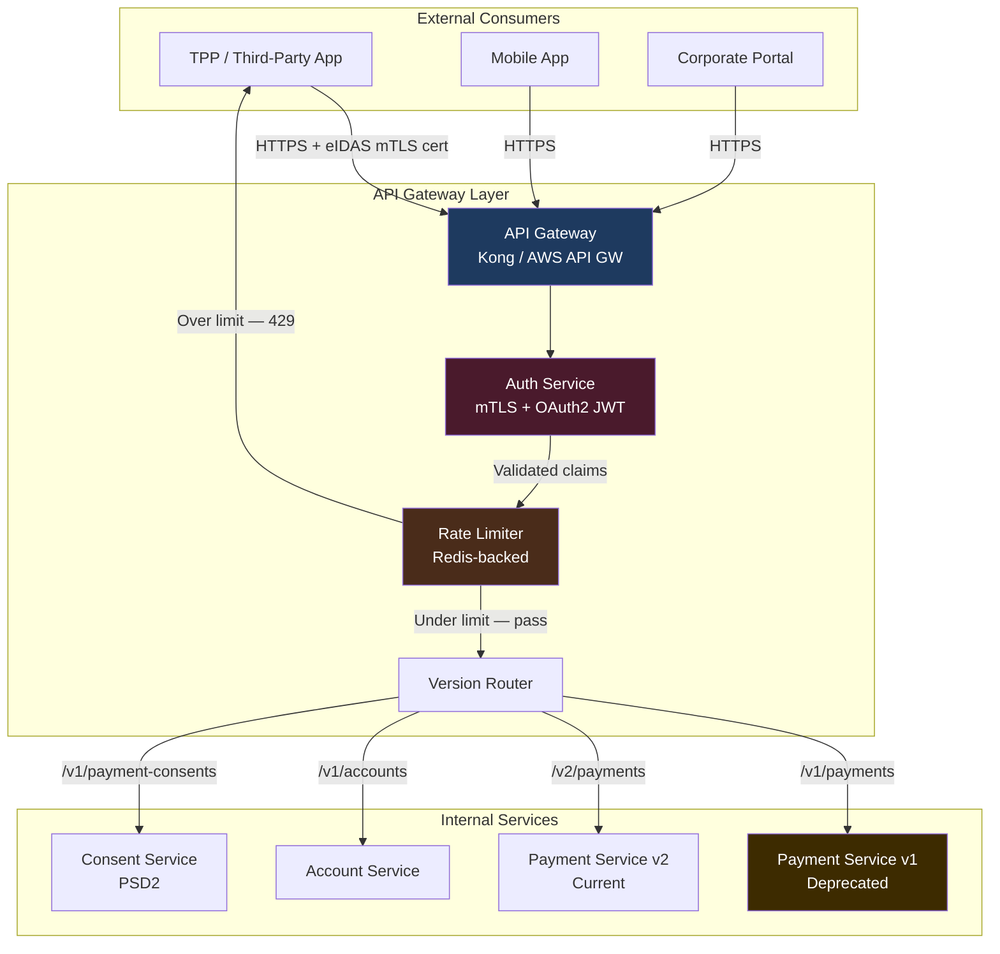

API design in financial services is not merely a technical concern — it is a commercial and regulatory one. A poorly versioned payment initiation API can lock thousands of TPP (Third Party Provider) integrations into a compatibility freeze for years. A missing idempotency key on a payment endpoint can cause duplicate charges requiring manual reconciliation and regulatory reporting. The API surface of a payment platform is a contract with legal and financial consequences, and principal engineers are accountable for getting it right from the first public version.

## Learning Objectives

- Apply RESTful resource modelling to payment and account resources, including correct HTTP method semantics for idempotency
- Explain when to use PUT vs PATCH vs POST in the context of financial resource mutation
- Read and write an OpenAPI 3.1 specification for a payment initiation endpoint, including error schemas
- Compare URL-path, header-based, and content-negotiation API versioning strategies with trade-offs for regulated APIs
- Define a gRPC protobuf service for real-time payment streaming and understand when gRPC outperforms REST
- Implement a Spring `@RestController` returning RFC 9457 `ProblemDetail` for structured, machine-readable error responses
- Design cursor-based pagination for large transaction history lists and explain why offset pagination fails at scale
- Apply PSD2-required rate limiting headers and understand TPP throttling obligations under Open Banking standards

## Business Context

In 2023, a UK open banking aggregator's payment initiation API had been in production for two years with no versioning strategy. When the team needed to add a mandatory `creditorAgent` (BIC) field for SEPA payments under new EBA guidance, they faced a dilemma: break existing integrations silently or maintain two parallel implementations indefinitely. They chose the silent breaking change, reasoning that "most clients wouldn't be affected." Forty-three TPP integrations broke over the following weekend. The FCA opened a supervisory review. The remediation cost — developer time, TPP re-testing, regulatory correspondence, and customer compensation — exceeded £800k. The technical debt of "no versioning strategy" had a precise monetary value.

## RESTful Resource Design for Payments

Financial resources map naturally to REST when modelled as domain nouns, not verb-based RPC calls. The mistake most teams make is using REST as RPC — `POST /initiatePayment` instead of `POST /payments`.

```
# Payment resources — noun-based, hierarchical, predictable

POST   /payments                           # Initiate new payment
GET    /payments/{paymentId}               # Retrieve payment status
DELETE /payments/{paymentId}               # Cancel pending payment (state-dependent)

GET    /accounts/{accountId}               # Account details
GET    /accounts/{accountId}/transactions  # Transaction history (paginated)
GET    /accounts/{accountId}/balance       # Current balance

POST   /payment-consents                   # Create PSD2 consent
GET    /payment-consents/{consentId}       # Retrieve consent status
DELETE /payment-consents/{consentId}       # Revoke consent
```

### HTTP Method Semantics and Idempotency

| Method | Safe? | Idempotent? | Fintech Use |
|---|---|---|---|
| GET | Yes | Yes | Read payment status, account balance |
| POST | No | No* | Initiate payment (* requires Idempotency-Key header) |
| PUT | No | Yes | Full resource replacement (rarely used for payments) |
| PATCH | No | No* | Partial amendment — update payment reference |
| DELETE | No | Yes | Cancel/revoke consent |

POST is not naturally idempotent, but payment initiation must be. The solution is a client-generated `Idempotency-Key` header. The server stores the response for the first request and returns the stored response verbatim for any retry with the same key — without reprocessing.

```java
@RestController
@RequestMapping("/v2/payments")
@RequiredArgsConstructor
public class PaymentController {

    private final CommandBus commandBus;
    private final IdempotencyCache idempotencyCache;

    @PostMapping
    public ResponseEntity<PaymentInitiationResponse> initiatePayment(
            @RequestHeader("Idempotency-Key") UUID idempotencyKey,
            @Valid @RequestBody PaymentInitiationRequest request) {

        return idempotencyCache.get(idempotencyKey, PaymentInitiationResponse.class)
            .map(cached -> ResponseEntity.ok()
                .header("X-Idempotency-Replayed", "true")
                .body(cached))
            .orElseGet(() -> {
                ProcessPaymentCommand command = mapToCommand(idempotencyKey, request);
                commandBus.dispatch(command);

                PaymentInitiationResponse response = PaymentInitiationResponse.pending(
                    command.paymentId(), idempotencyKey);

                idempotencyCache.put(idempotencyKey, response, Duration.ofHours(24));
                return ResponseEntity.status(HttpStatus.CREATED)
                    .header("Location", "/v2/payments/" + command.paymentId())
                    .body(response);
            });
    }

    @ExceptionHandler(InsufficientFundsException.class)
    public ProblemDetail handleInsufficientFunds(InsufficientFundsException ex,
                                                  HttpServletRequest request) {
        ProblemDetail problem = ProblemDetail.forStatusAndDetail(
            HttpStatus.UNPROCESSABLE_ENTITY,
            "Account has insufficient available balance for the requested payment amount"
        );
        problem.setTitle("Insufficient Funds");
        problem.setType(URI.create("https://api.bank.com/problems/insufficient-funds"));
        problem.setInstance(URI.create(request.getRequestURI()));
        problem.setProperty("accountId", ex.getAccountId());
        problem.setProperty("requestedAmount", ex.getRequestedAmount());
        problem.setProperty("availableBalance", ex.getAvailableBalance());
        return problem;
    }

    @ExceptionHandler(PaymentLimitExceededException.class)
    public ProblemDetail handleLimitExceeded(PaymentLimitExceededException ex,
                                              HttpServletRequest request) {
        ProblemDetail problem = ProblemDetail.forStatusAndDetail(
            HttpStatus.UNPROCESSABLE_ENTITY,
            "Payment amount exceeds single-transaction or daily limit"
        );
        problem.setTitle("Payment Limit Exceeded");
        problem.setType(URI.create("https://api.bank.com/problems/limit-exceeded"));
        problem.setInstance(URI.create(request.getRequestURI()));
        problem.setProperty("limitType", ex.getLimitType());
        problem.setProperty("limitAmount", ex.getLimitAmount());
        return problem;
    }
}
```

## OpenAPI 3.1 Specification Snippet

A machine-readable contract is mandatory in PSD2-regulated environments. TPPs depend on it for SDK generation, automated sandbox testing, and regulatory directory registration.

```yaml
openapi: "3.1.0"
info:
  title: Payment Initiation API
  version: "2.1.0"
  description: >
    PSD2-compliant payment initiation service. All mutating requests require
    a client-generated Idempotency-Key header to prevent duplicate processing.
    Errors are returned as application/problem+json (RFC 9457).

paths:
  /v2/payments:
    post:
      operationId: initiatePayment
      summary: Initiate a domestic or SEPA credit transfer
      parameters:
        - name: Idempotency-Key
          in: header
          required: true
          schema:
            type: string
            format: uuid
          description: >
            Client-generated UUID. The server returns the identical response
            for the same key within 24 hours without reprocessing.
      requestBody:
        required: true
        content:
          application/json:
            schema:
              $ref: '#/components/schemas/PaymentInitiationRequest'
      responses:
        '201':
          description: Payment accepted and queued for processing
          headers:
            Location:
              schema:
                type: string
              description: URL of the created payment resource
          content:
            application/json:
              schema:
                $ref: '#/components/schemas/PaymentInitiationResponse'
        '422':
          description: Business rule violation — insufficient funds or limit breach
          content:
            application/problem+json:
              schema:
                $ref: '#/components/schemas/ProblemDetail'
        '429':
          description: Rate limit exceeded (PSD2 TPP throttling)
          headers:
            Retry-After:
              schema:
                type: integer
              description: Seconds until the rate limit window resets
            X-RateLimit-Limit:
              schema:
                type: integer
            X-RateLimit-Remaining:
              schema:
                type: integer
            X-RateLimit-Reset:
              schema:
                type: integer
              description: Unix epoch when limit resets

components:
  schemas:
    PaymentInitiationRequest:
      type: object
      required: [debtorAccount, creditorAccount, amount, currency]
      properties:
        debtorAccount:
          $ref: '#/components/schemas/AccountReference'
        creditorAccount:
          $ref: '#/components/schemas/AccountReference'
        creditorAgent:
          type: string
          description: BIC of creditor institution (required for SEPA CT)
          pattern: '^[A-Z]{6}[A-Z2-9][A-NP-Z0-9]([A-Z0-9]{3})?$'
        amount:
          type: string
          pattern: '^\d+\.\d{2}$'
          example: "150.00"
        currency:
          type: string
          pattern: '^[A-Z]{3}$'
          example: "GBP"
        remittanceInformation:
          type: string
          maxLength: 140
```

## API Versioning Strategies

| Strategy | URL Example | Caching | Discoverability | Fintech Verdict |
|---|---|---|---|---|
| URL path | `/v2/payments` | Excellent | Excellent | Preferred for public regulated APIs |
| Request header | `API-Version: 2` | Poor (Vary required) | Poor | Acceptable for internal services |
| Content negotiation | `Accept: application/vnd.bank.v2+json` | Poor | Good | Overly complex for most teams |
| Query parameter | `/payments?version=2` | Acceptable | Good | Avoid — pollutes resource URLs |

For regulated APIs, URL path versioning is strongly recommended because regulatory sandboxes reference specific paths, proxy routing is trivial, and debugging with curl requires no special headers.

```java
// Deprecation signalling on v1 responses while v2 is live
@GetMapping("/{paymentId}")
public ResponseEntity<PaymentResponseV1> getPaymentV1(@PathVariable UUID paymentId) {
    return ResponseEntity.ok()
        .header("Deprecation", "true")
        .header("Sunset", "Sat, 31 Dec 2026 23:59:59 GMT")
        .header("Link", "</v2/payments/" + paymentId + ">; rel=\"successor-version\"")
        .body(paymentServiceV1.find(paymentId));
}
```

## gRPC for Real-Time Payment Streaming

Where REST excels for public, cacheable, human-readable APIs, gRPC excels for high-throughput internal services requiring streaming or sub-millisecond serialisation overhead. Protocol Buffers serialise 3-10x smaller than JSON and 5-10x faster.

```protobuf
syntax = "proto3";
package com.bank.payments.v1;

import "google/protobuf/timestamp.proto";

service PaymentStreamService {
  // Bidirectional stream: client sends requests, server streams status updates
  rpc StreamPayments(stream PaymentRequest) returns (stream PaymentStatusUpdate);

  // Server-streaming: subscribe to real-time payment events for an account
  rpc SubscribeAccountPayments(AccountSubscriptionRequest) returns (stream PaymentEvent);
}

message PaymentRequest {
  string idempotency_key = 1;
  string debtor_account_id = 2;
  string creditor_account_id = 3;
  string amount = 4;        // decimal as string — never float for money
  string currency = 5;
  string reference = 6;
  google.protobuf.Timestamp requested_at = 7;
}

message PaymentStatusUpdate {
  string payment_id = 1;
  string idempotency_key = 2;
  PaymentStatus status = 3;
  string failure_reason = 4;
  google.protobuf.Timestamp updated_at = 5;
}

enum PaymentStatus {
  PAYMENT_STATUS_UNSPECIFIED = 0;
  PENDING = 1;
  PROCESSING = 2;
  COMPLETED = 3;
  FAILED = 4;
  CANCELLED = 5;
}
```

```java
@GrpcService
@RequiredArgsConstructor
public class PaymentStreamServiceImpl
        extends PaymentStreamServiceGrpc.PaymentStreamServiceImplBase {

    private final CommandBus commandBus;
    private final PaymentStatusObservable statusObservable;

    @Override
    public StreamObserver<PaymentRequest> streamPayments(
            StreamObserver<PaymentStatusUpdate> responseObserver) {

        return new StreamObserver<>() {
            @Override
            public void onNext(PaymentRequest request) {
                try {
                    commandBus.dispatch(mapToCommand(request));
                    statusObservable.subscribe(request.getIdempotencyKey(),
                        update -> responseObserver.onNext(update));
                } catch (InsufficientFundsException ex) {
                    responseObserver.onError(
                        Status.FAILED_PRECONDITION
                            .withDescription("Insufficient funds: " + ex.getMessage())
                            .asRuntimeException());
                }
            }

            @Override public void onError(Throwable t) {
                log.warn("Client stream error", t);
            }

            @Override public void onCompleted() {
                responseObserver.onCompleted();
            }
        };
    }
}
```

**When to choose gRPC vs REST in fintech:**

| Criterion | Choose REST | Choose gRPC |
|---|---|---|
| Consumer type | External TPPs, browsers | Internal microservices, back-office |
| Streaming requirement | No | Yes — payment events, FX ticks, fraud signals |
| Serialisation sensitivity | Not critical | High throughput > 50k msg/sec |
| Human readability | Required | Not required |
| Regulatory audit trail | Straightforward URL logging | Requires parsing binary frames |

## GraphQL vs REST Trade-offs for Banking APIs

| Aspect | REST | GraphQL |
|---|---|---|
| Authorisation granularity | Per-endpoint (simple to audit) | Per-field (complex, requires parsing) |
| PSD2 access logging | URL + method is sufficient | Query body parsing required |
| HTTP caching | Works natively (GET is cacheable) | POST by default — no HTTP cache |
| Rate limiting | Per-endpoint, straightforward | Per-query cost calculation required |
| Client flexibility | Fixed shapes | Flexible — mobile apps query only needed fields |
| Versioning | URL path versioning | Schema evolution (additive only) |

> [!WARNING]
> PSD2 Article 32 requires PSPs to log all API access with the resource and operation accessed. With GraphQL, determining "what resource was accessed" requires parsing the POST body, not reading the URL. This is achievable but adds audit tooling complexity that most compliance and SIEM teams are not prepared for. Use REST for all regulated endpoints; GraphQL is appropriate for unregulated internal tooling.

## API Gateway Routing Diagram



## Cursor-Based Pagination for Transaction History

Transaction history can span years — 50 million rows per account is realistic for high-volume accounts. Offset pagination degrades linearly with the offset: `LIMIT 20 OFFSET 2000000` requires the database to process and discard two million rows on every page flip.

```java
// Cursor encodes the last-seen (timestamp, id) tuple — opaque to the client
public record TransactionCursor(Instant timestamp, UUID transactionId) {

    public static TransactionCursor decode(String encoded) {
        byte[] bytes = Base64.getUrlDecoder().decode(encoded);
        // Deserialise from JSON or binary within the opaque cursor
        return CURSOR_CODEC.decode(bytes);
    }

    public String encode() {
        return Base64.getUrlEncoder().encodeToString(CURSOR_CODEC.encode(this));
    }

    public static TransactionCursor latest() {
        return new TransactionCursor(Instant.now(), MAX_UUID);
    }
}

@GetMapping("/{accountId}/transactions")
public TransactionPage getTransactions(
        @PathVariable UUID accountId,
        @RequestParam(defaultValue = "20") @Max(100) int limit,
        @RequestParam(required = false) String cursor) {

    TransactionCursor decoded = cursor != null
        ? TransactionCursor.decode(cursor)
        : TransactionCursor.latest();

    // Fetch one extra to detect if more pages exist
    List<Transaction> results = transactionRepository
        .findByAccountBeforeCursor(accountId, decoded.timestamp(), decoded.transactionId(), limit + 1);

    boolean hasMore = results.size() > limit;
    List<Transaction> page = hasMore ? results.subList(0, limit) : results;

    String nextCursor = hasMore
        ? new TransactionCursor(page.getLast().getCreatedAt(), page.getLast().getId()).encode()
        : null;

    return new TransactionPage(page.stream().map(this::toView).toList(), nextCursor, limit);
}
```

```sql
-- Composite index enabling O(log N) seek regardless of table size
CREATE INDEX idx_tx_account_cursor
    ON transactions (account_id, created_at DESC, id DESC);

-- Cursor query — no offset scan, seeks directly to cursor position
SELECT * FROM transactions
WHERE account_id = :accountId
  AND (created_at, id) < (:cursorTimestamp, :cursorId)
ORDER BY created_at DESC, id DESC
LIMIT :limit;
```

## Knowledge Check

**Q1: A TPP integration with your payment API triggers a network retry storm, sending the same `POST /payments` request three times in quick succession. The first request was processed successfully and debited the customer's account. What prevents duplicate debits, and what HTTP response should requests two and three return?**

A: The `Idempotency-Key` header prevents duplicate processing. On first receipt the server processes the payment and caches the response keyed by the client-generated UUID. On subsequent requests with the same key, the server returns the cached response immediately — without re-executing the command. The correct response for the replay is `200 OK` (not `201 Created`, since no new resource is created) with `X-Idempotency-Replayed: true` header. The debit occurs exactly once regardless of retry count. Idempotency keys should be stored alongside the payment record for auditability and dispute resolution.

**Q2: You need to add a mandatory `creditorAgent` (BIC) field to your payment API for SEPA compliance. Existing integrations do not send this field. What versioning approach do you take, and what response headers do you add to v1 to signal the upcoming change?**

A: Introduce the field as optional in v1 immediately — this is backward compatible. Make it mandatory only in `/v2/payments`. Add `Deprecation: true`, `Sunset: <date 12 months out>`, and `Link: </v2/payments>; rel="successor-version"` headers to all v1 responses to signal the migration path. Notify TPPs via the Berlin Group directory and publish a migration guide. Run v1 and v2 in parallel for the sunset period. Never silently add mandatory fields to an existing API version — this is a breaking change regardless of how minor it appears internally.

## Practical Challenge

**Scenario:** You are designing the external-facing API for a new UK Open Banking payment initiation service that must comply with PSD2 and the Open Banking Implementation Entity (OBIE) specification.

**Task 1 — Resource Design:** Define the full URL structure for: initiating a domestic payment, checking payment status, listing an account's transactions (paginated), and revoking a payment consent. For each endpoint, list HTTP methods, success status codes, and the two most likely error status codes.

**Task 2 — OpenAPI 3.1 Spec:** Write a complete OpenAPI 3.1 `paths` block for `POST /v2/domestic-payments`. Include: the `Idempotency-Key` header parameter, a request body schema with at minimum `debtorAccount`, `creditorAccount`, `amount`, and `currency` as required fields, `201` and `422` responses using `application/problem+json`, and `429` with `Retry-After` and `X-RateLimit-*` headers.

**Task 3 — Pagination:** Implement a `TransactionHistoryController` endpoint `GET /v2/accounts/{id}/transactions` using cursor-based pagination. The cursor must encode account ID, timestamp, and transaction UUID. Write a unit test verifying that a request with a valid cursor returns transactions older than the cursor timestamp in descending order.

**Task 4 — Deprecation Interceptor:** Implement a Spring `HandlerInterceptor` that adds `Deprecation`, `Sunset`, and `Link` (successor version) headers to all responses from controllers annotated with a custom `@Deprecated("v2")` annotation. Write a test that verifies these headers are present on v1 endpoints and absent on v2 endpoints.

<!-- KNOWLEDGE-CHECK
{
  "questions": [
    {
      "id": "q1",
      "text": "A TPP sends the same POST /payments request three times with the same Idempotency-Key. The first request succeeded. What HTTP status code should requests 2 and 3 return?",
      "options": [
        "201 Created — the payment exists",
        "200 OK with X-Idempotency-Replayed: true header",
        "409 Conflict — a resource with this key already exists",
        "204 No Content — the duplicate was silently ignored"
      ],
      "correct": 1,
      "explanation": "200 OK with X-Idempotency-Replayed: true signals the response is served from cache without reprocessing. 201 is incorrect because no new resource was created. 409 implies an error condition, but idempotent replay is correct behaviour by design. 204 omits the payment response body the client needs to confirm the original outcome."
    },
    {
      "id": "q2",
      "text": "Why does offset-based pagination (LIMIT 20 OFFSET 50000) fail for large transaction history tables?",
      "options": [
        "SQL does not support OFFSET values above 32767",
        "The database must scan and discard all preceding rows on every query, making latency proportional to the offset",
        "OFFSET-based queries cannot use B-tree indexes",
        "The OFFSET counter overflows for tables with more than 2 billion rows"
      ],
      "correct": 1,
      "explanation": "Offset-based pagination requires the database to process all rows up to the offset, even though those rows are discarded. At OFFSET 50000, the database processes 50,000 rows per page flip. Cursor-based pagination uses a WHERE predicate on an indexed (timestamp, id) tuple, seeking directly to the right position in O(log N) time regardless of table size."
    }
  ]
}
-->

<!-- PRACTICAL-CHALLENGE
## Practical Challenge

**Scenario:** You are designing the external-facing API for a new UK Open Banking payment initiation service compliant with PSD2 and OBIE.

**Task 1 — Resource Design:** Define the URL structure, HTTP methods, and status codes for: domestic payment initiation, payment status retrieval, paginated transaction listing, and consent revocation.

**Task 2 — OpenAPI 3.1 Spec:** Write a complete paths block for POST /v2/domestic-payments with Idempotency-Key header, request schema, 201/422 responses, and 429 with rate-limit headers.

**Task 3 — Cursor Pagination:** Implement GET /v2/accounts/{id}/transactions with cursor-based pagination encoding timestamp and UUID. Write a unit test verifying sort order correctness.

**Task 4 — Deprecation Interceptor:** Implement a Spring HandlerInterceptor adding Deprecation, Sunset, and Link headers to v1 endpoints only, verified by unit test.
-->
