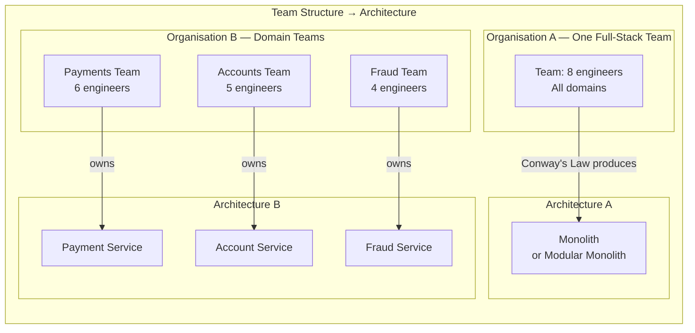
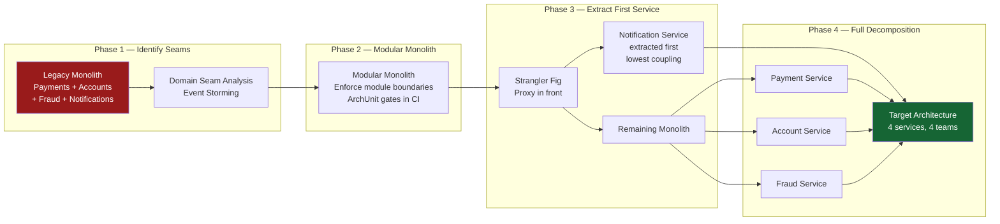

الجدل بين الخدمات المصغّرة والنظام الموحّد من أكثر القرارات التي يُساء طرحها في هندسة البرمجيات. فالسؤال ليس أبدًا "أيهما أفضل؟" — بل "أيهما يناسب هذا الفريق، وهذه المؤسسة، وهذه المرحلة من نضج المنتج؟" وكثيرًا ما يرث المهندسون الرئيسيون في التقنية المالية الإجابة الخاطئة عن هذا السؤال: إما نظامًا موزعًا بُني قبل فهم المجال (تفكيك سابق لأوانه)، أو نظامًا موحّدًا عمره عشر سنوات لم يعد ممكنًا تغييره بأمان (اقتران عرضي). وكلتا الحالتين مكلفة في التعافي منها، وكلتاهما يمكن تجنبهما.

## أهداف التعلّم

- توضيح المفاضلات المحددة بين النظام الموحّد، والنظام الموحّد المعياري، والخدمات المصغّرة في أبعاد النشر، والزمن، وهيكلة الفرق، والتعقيد التشغيلي
- تطبيق قانون Conway للتنبؤ بكيف ستشكّل هياكل التواصل في المؤسسة بنيتها البرمجية
- استخدام النظام الموحّد المعياري كخطوة وسيطة مقصودة بين النظام الموحّد والخدمات المصغّرة
- فرض حدود الوحدات بـ ArchUnit (أو Spring Modulith) لمنع الاقتران بين الوحدات
- شرح لماذا المعاملات الموزعة هي الكلفة التقنية الأساسية للخدمات المصغّرة، وتسمية ثلاثة أنماط لإدارتها
- وصف نمط Strangler Fig والمراحل الأربع اللازمة لترحيل خدمة مالية قديمة بأمان
- تحديد الظروف التي تكون فيها الخدمات المصغّرة الخيار الخاطئ — مرحلة الشركة الناشئة، والفريق الواحد، والاقتران الوثيق
- تطبيق إطار قرار مبني على حجم الفريق، والهيكل التنظيمي، والنضج التقني

## سياق العمل

لنأخذ بنكًا أوروبيًا (مثال مركّب) أعاد بناء منصته المصرفية للأفراد من نظام موحّد عمره 15 عامًا مبني بـ Oracle FORMS إلى 47 خدمة مصغّرة خلال 18 شهرًا. كلّف المشروع 14 مليون يورو. وعند الإطلاق، احتاج النظام 23 مساحة أسماء في Kubernetes، و180 صورة حاوية، وفريق هندسة منصات من 12 شخصًا لمجرد إبقائه يعمل. وقضى فريق تطوير المنتج المكوّن من 6 أشخاص وقتًا في تصحيح مقاطع التتبع الموزع أكثر من بناء الميزات. وبلغ زمن p99 لفحص رصيد بسيط — استعلام واحد في النظام الموحّد — 340ms بسبب 4 قفزات شبكة عبر خدمات المصادقة والحسابات والأرصدة والإشعارات.

وبعد عامين، دمج الفريق 38 من الخدمات الـ 47 في نظام موحّد معياري، مبقيًا فقط على الخدمات التي تطابق مجالات عمل مستقلة حقًا بفرق منفصلة. والدرس: الخدمات المصغّرة حل لمشكلة توسع تنظيمي. وعند تطبيقها قبل أوانها، تصنع نظامًا موزعًا دون الهيكل التنظيمي الذي يبرره.

## مقارنة البنى

| البُعد | النظام الموحّد | النظام الموحّد المعياري | الخدمات المصغّرة |
|---|---|---|---|
| **النشر** | منتج واحد، كل شيء أو لا شيء | منتج واحد، آمن على مستوى الوحدات | مستقل لكل خدمة |
| **الزمن** | استدعاء دالة داخل العملية (ميكروثوانٍ) | داخل العملية (ميكروثوانٍ) | قفزة شبكة (1-10ms تقريبًا لكل استدعاء) |
| **اتساق البيانات** | معاملات ACID عبر كل البيانات | ‏ACID داخل حدود الوحدة | اتساق نهائي بين الخدمات |
| **اقتران الفرق** | عالٍ — الجميع في مستودع واحد | متوسط — ملكية الوحدات | منخفض — كل فريق ينشر باستقلال |
| **التعقيد التشغيلي** | منخفض — عملية واحدة | منخفض — عملية واحدة | عالٍ — شبكة الخدمات، والتتبع الموزع |
| **دقة التوسع** | التطبيق كله | التطبيق كله | لكل خدمة |
| **معرفة المجال المطلوبة** | منخفضة — إعادة الهيكلة بحرية | متوسطة — عقود الوحدات | عالية — ملكية السياقات المحدودة |
| **عزل الأعطال** | ضعيف — عملية مشتركة | ضعيف — عملية مشتركة | جيد — نمط الحاجز (Bulkhead) |

## قانون Conway وهيكلة فرق التقنية المالية

قانون Conway ‏(1968): "أي مؤسسة تصمم نظامًا ستنتج تصميمًا بنيته نسخة من بنية التواصل في المؤسسة."

والعكس صحيح أيضًا — **مناورة Conway العكسية**: نظّم الفرق عمدًا لتنتج البنية التي تريدها. فإذا أردت خدمة مدفوعات مستقلة عن خدمة الحسابات، فيجب أن يكون لديك فريق يملك المدفوعات باستقلال عن الفريق الذي يملك الحسابات.



> [!WARNING]
> إذا نشرت خدمات مصغّرة لكن المهندسين ما زالوا يجلسون معًا وينسّقون كل تغيير عبر فريق واحد، فلديك التعقيد التشغيلي للخدمات المصغّرة مع اقتران النظام الموحّد. وهذا أسوأ ما في العالمين. قانون Conway ليس اختياريًا — إنه يصف الواقع.

## النظام الموحّد المعياري كحل وسط

يفصل النظام الموحّد المعياري (Modular Monolith) وحدات المجال داخل منتج واحد قابل للنشر. لكل وحدة واجهة عامة محددة جيدًا (واجهات برمجية)، وتنفيذ داخلي خاص، ومخطط قاعدة بيانات خاص بها. وتتواصل الوحدات عبر الواجهات فقط، لا عبر اعتماديات مباشرة على الأصناف.

```java
// Module API — the only public surface of the payments module
package com.bank.payments.api;

public interface PaymentService {
    PaymentReceipt initiatePayment(PaymentRequest request);
    PaymentStatus getStatus(UUID paymentId);
}

public interface PaymentEventSubscriber {
    void onPaymentCompleted(PaymentCompletedEvent event);
}
```

```java
// Module internal — hidden from other modules
package com.bank.payments.internal;

// This class is package-private or in a split-package — not accessible outside module
class PaymentProcessingEngine {
    // Complex orchestration, invisible to callers
}
```

في Spring Boot، يستطيع Spring Modulith التحقق من هذه الحدود مباشرة: كل حزمة من المستوى الأول تحت حزمة التطبيق وحدة، و`ApplicationModules.of(Application.class).verify()` يُفشل البناء عندما تصل وحدة إلى التفاصيل الداخلية لوحدة أخرى.

### فرض حدود الوحدات بـ ArchUnit

بدون فرض آلي، تتآكل حدود الوحدات خلال أشهر. فالمهندسون تحت ضغط الوقت يستوردون الأصناف الداخلية مباشرة، متجاوزين واجهة الوحدة. ويجعل ArchUnit الحد قابلًا للتنفيذ.

```java
@AnalyzeClasses(packages = "com.bank")
public class ModuleBoundaryTest {

    @ArchTest
    static final ArchRule paymentsModule_mustOnlyExposeApiPackage =
        classes()
            .that().resideInAPackage("com.bank.payments.internal..")
            .should().onlyBeAccessed()
            .byAnyPackage("com.bank.payments..");

    @ArchTest
    static final ArchRule accountsModule_mustNotDependOnPaymentsInternal =
        noClasses()
            .that().resideInAPackage("com.bank.accounts..")
            .should().dependOnClassesThat()
            .resideInAPackage("com.bank.payments.internal..");

    @ArchTest
    static final ArchRule fraudModule_mustOnlyDependOnPublishedApis =
        classes()
            .that().resideInAPackage("com.bank.fraud..")
            .should().onlyDependOnClassesThat()
            .resideInAnyPackage(
                "com.bank.fraud..",
                "com.bank.payments.api..",
                "com.bank.accounts.api..",
                "java..",
                "org.springframework.."
            );
}
```

## حدود المعاملات عبر حدود الخدمات

الكلفة التقنية الأكبر للخدمات المصغّرة هي فقدان معاملات ACID. فعندما تخصم دفعة من الحساب A وتودع في الحساب B، ويعيش الحسابان في خدمتين منفصلتين بقاعدتي بيانات منفصلتين، لا توجد معاملة قاعدة بيانات تستطيع التزام التغييرين ذريًا.

ثلاثة أنماط تعالج هذه المشكلة:

| النمط | الاتساق | التعقيد | الاستخدام في التقنية المالية |
|---|---|---|---|
| **الالتزام على مرحلتين (2PC)** | قوي، لكن المشاركين يتوقفون إذا تعطل المنسّق | عالٍ جدًا — منسّق، ودعم XA في كل مكان | الأنظمة القديمة؛ تجنّبه في الأنظمة الجديدة |
| **نمط Saga** | نهائي مع معاملات تعويضية | عالٍ — تنسيق ذاتي أو مركزي | المدفوعات، وإنشاء القروض |
| **Transactional Outbox** | نهائي، مرة واحدة على الأقل | متوسط — جدول outbox ومرحّل | موثوقية نشر الأحداث |

مشكلة المعاملات الموزعة هي أول سؤال يجب الإجابة عنه عند تقييم الخدمات المصغّرة. فإذا كانت عمليات العمل الحرجة لديك تمتد عبر بيانات تملكها عدة خدمات، فإما أنك اخترت حدود الخدمات الخاطئة، أو أنك تحتاج إلى استثمار كبير في تنسيق Saga.

```java
// Saga orchestrator for payment processing — explicit state machine
@Component
@RequiredArgsConstructor
public class PaymentSagaOrchestrator {

    private final AccountService accountService;
    private final FraudService fraudService;
    private final NotificationService notificationService;
    private final SagaStateRepository sagaStateRepository;

    // No @Transactional here: each step's state must commit on its own so that a
    // crashed saga can be resumed from the last completed step. Every remote call
    // carries the saga id as its idempotency key, so a resumed step is safe to repeat.
    public void execute(ProcessPaymentSaga saga) {
        try {
            // Step 1: Reserve funds (debit hold)
            ReservationId reservation = accountService.reserveFunds(
                saga.sagaId(), saga.sourceAccountId(), saga.amount());
            saga.setReservationId(reservation);
            sagaStateRepository.save(saga.withState(FUNDS_RESERVED));

            // Step 2: Fraud check
            FraudDecision decision = fraudService.evaluate(saga.toFraudRequest());
            if (decision.isRejected()) {
                compensate(saga); // release reservation
                saga.fail("Rejected by fraud engine: " + decision.reason());
                sagaStateRepository.save(saga.withState(FAILED));
                return;
            }
            sagaStateRepository.save(saga.withState(FRAUD_CLEARED));

            // Step 3: Complete transfer
            accountService.completeTransfer(saga.sourceAccountId(),
                saga.targetAccountId(), saga.amount(), reservation);
            sagaStateRepository.save(saga.withState(COMPLETED));

            // Step 4: Notify (best-effort — failure here does not roll back)
            notificationService.sendPaymentConfirmation(saga.customerId(), saga.paymentId());

        } catch (InsufficientFundsException | AccountNotFoundException ex) {
            // Business rejection: undo what was done and finish the saga
            compensate(saga);
            saga.fail(ex.getMessage());
            sagaStateRepository.save(saga.withState(FAILED));
        }
        // Technical failures (timeouts, crashes) are NOT caught: the saga stays in
        // its last committed state and a recovery job resumes it later.
    }

    private void compensate(ProcessPaymentSaga saga) {
        if (saga.getReservationId() != null) {
            accountService.releaseReservation(saga.sourceAccountId(), saga.getReservationId());
        }
    }
}
```

لا يحمل المنسّق الوسم `@Transactional`: فحالة كل خطوة يجب أن تلتزم وحدها حتى تُستأنف Saga المنهارة من آخر خطوة مكتملة. وكل استدعاء بعيد يحمل معرّف الـ Saga كمفتاح منع تكرار، فتكون إعادة الخطوة آمنة. وعند الرفض لسبب عمل يُنفَّذ التعويض وتُسجل الحالة FAILED؛ أما الأعطال التقنية (انقضاء المهلات، والانهيارات) فلا تُلتقط، فتبقى الـ Saga في آخر حالة ملتزمة وتستأنفها مهمة تعافٍ لاحقًا.

## رحلة الترحيل من النظام الموحّد إلى الخدمات المصغّرة



المراحل: (1) تحديد الفواصل الطبيعية في المجال بورشة Event Storming، (2) نظام موحّد معياري مع فرض حدود الوحدات في CI، (3) استخراج أول خدمة خلف وكيل Strangler Fig — عادة خدمة الإشعارات لأنها الأقل اقترانًا، (4) التفكيك الكامل إلى خدمات يملك كل منها فريق.

## متى تكون الخدمات المصغّرة الخيار الخاطئ

| المؤشر | الدلالة |
|---|---|
| حجم الفريق أقل من 15 مهندسًا | كلفة التنسيق في الخدمات المصغّرة تتجاوز الفائدة |
| المجال لم يُفهم بعد | حدود الخدمات المرسومة مبكرًا تحجّر افتراضات خاطئة |
| اقتران وثيق للبيانات بين المجالات | كل ميزة تتطلب معاملات بين الخدمات — فينفجر تعقيد الـ Saga |
| لا توجد سعة لهندسة المنصات | لا فريق يملك Kubernetes، وشبكة الخدمات، والتتبع الموزع، وإدارة الأسرار |
| مرحلة الشركة الناشئة أو المنتج الأولي | سرعة التكرار أهم من العزل التشغيلي |
| كل الخدمات تُنشر معًا | الخدمات المصغّرة ذات الإصدارات المتزامنة نظام موحّد موزع |

> [!NOTE]
> يقولها مقال Martin Fowler ‏"MonolithFirst" ‏(2015) هكذا: "لا ينبغي أن تبدأ مشروعًا جديدًا بالخدمات المصغّرة، حتى لو كنت متأكدًا أن تطبيقك سيكون كبيرًا بما يكفي ليستحق ذلك." (وينشر الموقع نفسه أيضًا رأيًا مخالفًا لـ Stefan Tilkov — والمقصود أن تقرر عن وعي.) ابدأ بنظام موحّد معياري. واستخرج الخدمات عندما يبرر ذلك هيكل الفريق ومعرفة المجال.

## اختبر فهمك

**س1: بنت شركة تقنية مالية ناشئة فيها 8 مهندسين نظامًا موحّدًا معياريًا لمنصة الدفع. يقترح المدير التقني الترحيل إلى الخدمات المصغّرة "استعدادًا للتوسع". ما توصيتك ولماذا؟**

ج: أوصي بعدم الترحيل في هذه المرحلة. فمع 8 مهندسين، سيستهلك العبء التشغيلي للخدمات المصغّرة — إدارة Kubernetes، والتتبع الموزع، وشبكة الخدمات، وتدوير الأسرار، وخطوط CI/CD مستقلة، وإدارة المعاملات الموزعة — سعة هندسية أكثر مما يوفره. والنظام الموحّد المعياري يوفر بالفعل الفائدة الأساسية: حدود وحدات نظيفة تمنع الاقتران، يفرضها ArchUnit. وعندما يكبر الفريق إلى 20 مهندسًا أو أكثر، ويظهر فريقا مجال منفصلان بإيقاعات إصدار مستقلة، تكون هذه إشارة استخراج أول خدمة. ابدأ بالوحدة الأقل اقترانًا (عادة الإشعارات أو التقارير).

**س2: أكملت Saga دفع الخطوة 2 (اجتياز فحص الاحتيال) لكنها فشلت في الخطوة 3 (إكمال التحويل) بسبب انقضاء مهلة قاعدة البيانات. ثم انهارت عملية المنسّق. ما الآليات التي تضمن وصول الـ Saga إلى حالة نهائية متسقة؟**

ج: تُحفظ حالة الـ Saga بعد كل خطوة في `sagaStateRepository`. وعند إعادة التشغيل، تفحص عملية تعافٍ الـ Sagas التي في حالات جارية (FRAUD_CLEARED وليست COMPLETED) وتستأنف من آخر خطوة ملتزمة. ويجب أن تكون الخطوة 3 آمنة من التكرار — يجب أن تتعامل العملية `completeTransfer` مع إعادة التنفيذ بأمان (بالتحقق من وجود تحويل مكتمل قبل الكتابة). ويُنفَّذ منع التكرار عادة عبر معرّف الحجز: إذا وُجد تحويل مكتمل بمعرّف الحجز نفسه، تصبح العملية بلا أثر. وهذا الجمع بين حالة Saga محفوظة وخطوات آمنة من التكرار هو ما يتيح للـ Sagas التعافي من أي فشل، بما في ذلك انهيار المنسّق.

## تحدٍّ عملي

**السيناريو:** أنت المهندس الرئيسي في بنك رقمي. نما فريق الهندسة من 10 إلى 35 مهندسًا في ثلاثة فرق مجال: المدفوعات، والحسابات، والاحتيال. وكان النظام الموحّد المعياري الحالي مستقرًا، لكن حدود الوحدات تتآكل — فتقرير الاقتران الأخير يُظهر 14 مخالفة ArchUnit أُدخلت خلال الربع الماضي.

**المهمة 1 — تدقيق الحدود:** اكتب ثلاثة اختبارات ArchUnit تفرض: (أ) وحدة الاحتيال لا تصل إلى بيانات الحسابات إلا عبر واجهة `AccountService`، ولا عبر مستودعات JPA أبدًا؛ (ب) لا تنشئ أي وحدة مباشرة كائنًا من صنف في الحزمة `internal` لوحدة أخرى؛ (ج) لا تُنشر أحداث المجال إلا عبر الواجهة `DomainEventPublisher`، لا عبر ربط `ApplicationEventPublisher` من Spring مباشرة في أصناف المجال.

**المهمة 2 — قرار الاستخراج:** باستخدام إطار القرار المبني على قانون Conway، حدّد الوحدة التي تُستخرج أولًا كخدمة مصغّرة. وبرّر اختيارك بناءً على: وضوح ملكية الفريق، ودرجة الاقتران (عدد الاعتماديات الواردة مقابل الصادرة)، وملكية البيانات، والنضج التشغيلي للفريق.

**المهمة 3 — خطة Strangler Fig:** صمّم المراحل الأربع لترحيل Strangler Fig للوحدة التي اخترتها في المهمة 2. ولكل مرحلة: حدّد آلية التوجيه، ودالة اللياقة التي يجب أن تنجح قبل الانتقال إلى المرحلة التالية، وإجراء التراجع.

**المهمة 4 — تصميم الـ Saga:** يعمل تدفق الدفع حاليًا كمعاملة ACID واحدة تمتد عبر الحسابات والاحتيال. وبعد الاستخراج سيمتد عبر خدمتين. صمّم الـ Saga ‏`ProcessPaymentSaga` بخطوات صريحة، ومعاملات تعويضية لكل سيناريو فشل، وانتقالات آلة الحالات. وحدّد الخطوات التي يجب أن تكون آمنة من التكرار، واشرح كيف يُنفَّذ منع التكرار لكل منها.

<!-- KNOWLEDGE-CHECK
{
  "questions": [
    {
      "id": "q1",
      "text": "يقترح فريق من 8 مهندسين ترحيل نظامهم الموحّد المعياري إلى 12 خدمة مصغّرة. ما أهم سؤال يجب طرحه قبل الموافقة؟",
      "options": [
        "ما لغات البرمجة التي ستستخدمها كل خدمة؟",
        "هل لدينا فرق منفصلة بإيقاعات إصدار مستقلة لكل خدمة مقترحة؟",
        "هل يستطيع خط CI/CD لدينا دعم 12 خطًا مستقلًا؟",
        "هل يدعم مزوّد السحابة لدينا 12 مساحة أسماء في Kubernetes؟"
      ],
      "correct": 1,
      "explanation": "يتنبأ قانون Conway بأنه إذا امتلك فريق واحد الخدمات الاثنتي عشرة كلها، فسينسّق التغييرات عليها معًا بطبيعة الحال — فينتج نظام موحّد موزع. والشرط المسبق للخدمات المصغّرة فرق مستقلة بإيقاعات إصدار ذاتية. أما خطوط CI/CD ومساحات أسماء Kubernetes فمشكلات تقنية قابلة للحل؛ والهيكل التنظيمي هو القيد الحاكم."
    },
    {
      "id": "q2",
      "text": "فشل اختبار ArchUnit لفرض حدود الوحدات في CI بعد أن استورد مطوّر صنفًا داخليًا من وحدة المدفوعات مباشرة في وحدة الحسابات. يجادل المطوّر بأن الحد 'مجرد سياسة داخلية'. كيف ترد؟",
      "options": [
        "أوافق — ArchUnit أداة اختيارية ويجب أن يقرر الفريق معاييره بنفسه",
        "أضيف استثناء لقاعدة ArchUnit لهذه الحالة تحديدًا",
        "أرفض طلب الدمج وأشترط أن تمر الاعتمادية عبر الواجهة العامة لوحدة المدفوعات؛ وأشرح أن الحدود غير المفروضة تتآكل خلال أشهر",
        "أنقل الصنف من internal إلى حزمة الواجهة لإرضاء القاعدة"
      ],
      "correct": 2,
      "explanation": "حدود الوحدات هي الاستثمار المعماري الذي يجعل النظام الموحّد المعياري قابلًا للصيانة. وإضافة الاستثناءات تُضعف القاعدة تدريجيًا — فكل استثناء يجعل تبرير التالي أسهل. والحل الصحيح هو توجيه الاعتمادية عبر الواجهة العامة، وقد يتطلب ذلك توسيع الواجهة إذا لم تكن الوظيفة المطلوبة مكشوفة بعد. أما نقل الصنف إلى حزمة الواجهة دون تفكير تصميمي فيلوّث العقد العام."
    }
  ]
}
-->

<!-- PRACTICAL-CHALLENGE
{
  "title": "الخدمات المصغّرة أم النظام الموحّد — القرار المعماري — تطبيق في بيئة الإنتاج",
  "difficulty": "advanced",
  "estimatedMinutes": 60,
  "tasks": [
    {
      "id": "1",
      "description": "اكتب ثلاثة اختبارات ArchUnit تفرض: (أ) وحدة الاحتيال لا تصل إلى بيانات الحسابات إلا عبر واجهة AccountService، ولا عبر مستودعات JPA أبدًا؛ (ب) لا تنشئ أي وحدة مباشرة كائنًا من صنف في الحزمة internal لوحدة أخرى؛ (ج) لا تُنشر أحداث المجال إلا عبر الواجهة DomainEventPublisher، لا عبر ربط ApplicationEventPublisher مباشرة في أصناف المجال."
    },
    {
      "id": "2",
      "description": "باستخدام إطار القرار المبني على قانون Conway، حدّد الوحدة التي تُستخرج أولًا كخدمة مصغّرة، وبرّر اختيارك بوضوح ملكية الفريق، ودرجة الاقتران (الاعتماديات الواردة مقابل الصادرة)، وملكية البيانات، والنضج التشغيلي للفريق."
    },
    {
      "id": "3",
      "description": "صمّم المراحل الأربع لترحيل Strangler Fig للوحدة التي اخترتها. ولكل مرحلة حدّد آلية التوجيه، ودالة اللياقة التي يجب أن تنجح قبل الانتقال إلى المرحلة التالية، وإجراء التراجع."
    },
    {
      "id": "4",
      "description": "صمّم الـ Saga ‏ProcessPaymentSaga التي ستمتد عبر خدمتين بعد الاستخراج، بخطوات صريحة، ومعاملات تعويضية لكل سيناريو فشل، وانتقالات آلة الحالات. وحدّد الخطوات التي يجب أن تكون آمنة من التكرار، واشرح كيف يُنفَّذ منع التكرار لكل منها."
    }
  ]
}
-->
