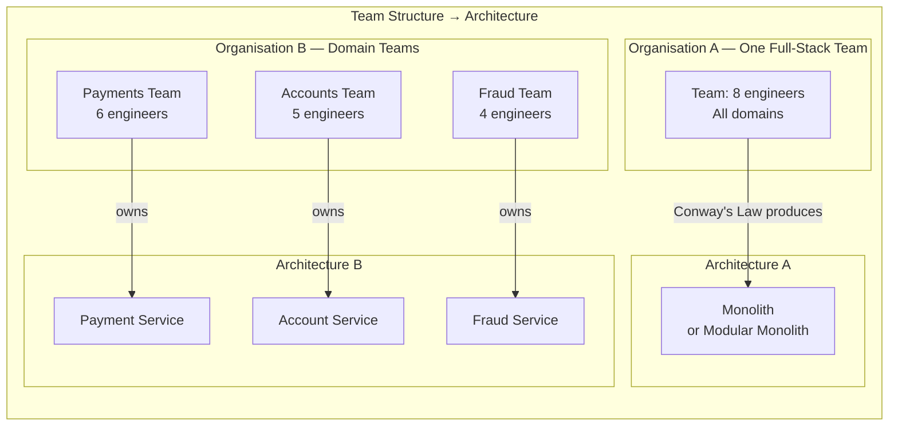
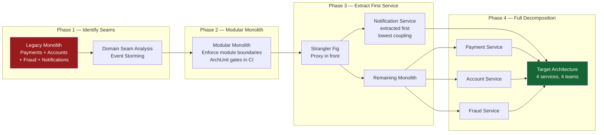

The microservices vs monolith debate is one of the most reliably misframed decisions in software engineering. The question is never "which is better?" — it is "which fits this team, this organisation, and this stage of product maturity?" Principal engineers in fintech frequently inherit the wrong answer to this question: either a distributed system built before the domain was understood (premature decomposition), or a ten-year-old monolith that can no longer be safely changed (accidental coupling). Both situations are expensive to recover from, and both are preventable.

## Learning Objectives

- Articulate the specific trade-offs between monolith, modular monolith, and microservices across deployment, latency, team topology, and operational complexity dimensions
- Apply Conway's Law to predict how an organisation's communication structure will shape its architecture
- Use the modular monolith as a deliberate intermediate step between monolith and microservices
- Implement `@Module` boundary enforcement with ArchUnit to prevent cross-module coupling
- Explain why distributed transactions are the core technical cost of microservices and name three patterns to manage them
- Describe the strangler fig pattern and the four phases required to migrate a legacy financial service safely
- Identify the conditions under which microservices are the wrong choice — startup stage, single team, tight coupling
- Apply a decision framework based on team size, organisational structure, and technical maturity

## Business Context

In 2019, a European bank rebuilt its retail banking platform from a 15-year-old Oracle FORMS monolith into 47 microservices over 18 months. The project cost €14M. At go-live, the system required 23 Kubernetes namespaces, 180 container images, and a 12-person platform engineering team just to keep it running. The 6-person product development team spent more time debugging distributed tracing spans than building features. P99 latency for a simple balance check — a single query in the monolith — was 340ms due to 4 network hops through authentication, account, balance, and notification services.

Two years later, the team collapsed 38 of the 47 services back into a modular monolith, retaining only the services that mapped to genuinely independent business domains with separate teams. The lesson: microservices are a solution to an organisational scaling problem. Applied prematurely, they create a distributed system without the organisational structure to justify one.

## Architecture Comparison

| Dimension | Monolith | Modular Monolith | Microservices |
|---|---|---|---|
| **Deployment** | Single artefact, all-or-nothing | Single artefact, module-safe | Independent per service |
| **Latency** | In-process function call (~μs) | In-process (~μs) | Network hop (~1-10ms per call) |
| **Data consistency** | ACID transactions across all data | ACID within module boundaries | Eventual consistency between services |
| **Team coupling** | High — everyone in one repo | Medium — module ownership | Low — independent team deploys |
| **Operational complexity** | Low — one process | Low — one process | High — service mesh, distributed tracing |
| **Scaling granularity** | Whole application | Whole application | Per service |
| **Domain knowledge required** | Low — refactor freely | Medium — module contracts | High — bounded context ownership |
| **Failure isolation** | Poor — shared process | Poor — shared process | Good — bulkhead pattern |

## Conway's Law and Fintech Team Structure

Conway's Law (1968): "Any organisation that designs a system will produce a design whose structure is a copy of the organisation's communication structure."

The inverse holds too — the **Inverse Conway Manoeuvre**: deliberately structure teams to produce the architecture you want. If you want a payments service independent from an accounts service, you must have a team that owns payments independently from the team that owns accounts.



> [!WARNING]
> If you deploy microservices but the engineers still sit together and coordinate every change via a single team, you have the operational complexity of microservices with the coupling of a monolith. This is the worst of both worlds. Conway's Law is not optional — it describes reality.

## The Modular Monolith as Middle Ground

The modular monolith separates the domain modules inside a single deployable artefact. Each module has a well-defined public API (interfaces), private internal implementation, and its own database schema. Modules communicate only via interfaces, never via direct class dependencies.

```java
// Module API — the only public surface of the payments module
package com.bank.payments.api;

public interface PaymentService {
    PaymentReceipt initiatePayment(PaymentRequest request);
    PaymentStatus getStatus(UUID paymentId);
}

public interface PaymentEventSubscriber {
    void onPaymentCompleted(PaymentCompletedEvent event);
}
```

```java
// Module internal — hidden from other modules
package com.bank.payments.internal;

// This class is package-private or in a split-package — not accessible outside module
class PaymentProcessingEngine {
    // Complex orchestration, invisible to callers
}
```

### Enforcing Module Boundaries with ArchUnit

Without automated enforcement, module boundaries erode within months. Engineers under time pressure import internal classes directly, bypassing the module API. ArchUnit makes the boundary executable.

```java
@AnalyzeClasses(packages = "com.bank")
public class ModuleBoundaryTest {

    @ArchTest
    static final ArchRule paymentsModule_mustOnlyExposeApiPackage =
        noClasses()
            .that().resideInAPackage("com.bank.payments.internal..")
            .should().beAccessedByClassesThat()
            .resideOutsideOfPackage("com.bank.payments..");

    @ArchTest
    static final ArchRule accountsModule_mustNotDependOnPaymentsInternal =
        noClasses()
            .that().resideInAPackage("com.bank.accounts..")
            .should().dependOnClassesThat()
            .resideInAPackage("com.bank.payments.internal..");

    @ArchTest
    static final ArchRule fraudModule_mustOnlyDependOnPublishedApis =
        classes()
            .that().resideInAPackage("com.bank.fraud..")
            .should().onlyDependOnClassesThat()
            .resideInAnyPackage(
                "com.bank.fraud..",
                "com.bank.payments.api..",
                "com.bank.accounts.api..",
                "java..",
                "org.springframework.."
            );
}
```

## Transaction Boundaries Across Service Boundaries

The most significant technical cost of microservices is the loss of ACID transactions. When a payment debits account A and credits account B, and those accounts live in separate services with separate databases, there is no database transaction that can atomically commit both changes.

Three patterns address this problem:

| Pattern | Consistency | Complexity | Fintech Use |
|---|---|---|---|
| **Two-Phase Commit (2PC)** | Strong (eventual on failure) | Very high — coordinator, protocol | Legacy, avoid in new systems |
| **Saga Pattern** | Eventual with compensating transactions | High — choreography or orchestration | Payments, loan origination |
| **Transactional Outbox** | Eventual, at-least-once | Medium — outbox table, relay | Event publishing reliability |

The distributed transaction problem is the first question to answer when evaluating microservices. If your critical business operations span data that multiple services own, you have either chosen the wrong service boundaries or you need to invest heavily in saga orchestration.

```java
// Saga orchestrator for payment processing — explicit state machine
@Component
@RequiredArgsConstructor
public class PaymentSagaOrchestrator {

    private final AccountService accountService;
    private final FraudService fraudService;
    private final NotificationService notificationService;
    private final SagaStateRepository sagaStateRepository;

    @Transactional
    public void execute(ProcessPaymentSaga saga) {
        try {
            // Step 1: Reserve funds (debit hold)
            ReservationId reservation = accountService.reserveFunds(
                saga.sourceAccountId(), saga.amount());
            saga.setReservationId(reservation);
            sagaStateRepository.save(saga.withState(FUNDS_RESERVED));

            // Step 2: Fraud check
            FraudDecision decision = fraudService.evaluate(saga.toFraudRequest());
            if (decision.isRejected()) {
                compensate(saga); // release reservation
                saga.fail("Rejected by fraud engine: " + decision.reason());
                return;
            }
            sagaStateRepository.save(saga.withState(FRAUD_CLEARED));

            // Step 3: Complete transfer
            accountService.completeTransfer(saga.sourceAccountId(),
                saga.targetAccountId(), saga.amount(), reservation);
            sagaStateRepository.save(saga.withState(COMPLETED));

            // Step 4: Notify (best-effort — failure here does not roll back)
            notificationService.sendPaymentConfirmation(saga.customerId(), saga.paymentId());

        } catch (InsufficientFundsException | AccountNotFoundException ex) {
            saga.fail(ex.getMessage());
            sagaStateRepository.save(saga.withState(FAILED));
        }
    }

    private void compensate(ProcessPaymentSaga saga) {
        if (saga.getReservationId() != null) {
            accountService.releaseReservation(saga.sourceAccountId(), saga.getReservationId());
        }
    }
}
```

## Monolith to Microservices: Migration Journey



## When Microservices Are the Wrong Choice

| Signal | Implication |
|---|---|
| Team size under 15 engineers | The coordination overhead of microservices exceeds the benefit |
| Domain not yet understood | Service boundaries set too early calcify wrong assumptions |
| Tight data coupling across domains | Every feature requires cross-service transactions — saga complexity explodes |
| No platform engineering capacity | No team to own Kubernetes, service mesh, distributed tracing, secrets management |
| Startup stage or MVP | Speed of iteration trumps operational isolation |
| All services deployed together | Microservices with synchronised releases are a distributed monolith |

> [!NOTE]
> Martin Fowler's recommendation, stated explicitly in 2015 and unchanged since: "Don't start a new project with microservices, even if you're sure your application will be large enough to make it worthwhile." Begin with a modular monolith. Extract services when team structure and domain knowledge justify it.

## Knowledge Check

**Q1: A fintech startup with 8 engineers has built a modular monolith for their payment platform. The CTO proposes migrating to microservices to "prepare for scale." What is your recommendation and why?**

A: Recommend against migration at this stage. With 8 engineers, the operational overhead of microservices — Kubernetes management, distributed tracing, service mesh, secrets rotation, independent CI/CD pipelines, and distributed transaction management — will consume more engineering capacity than it frees. The modular monolith already provides the key benefit: clean module boundaries that prevent coupling, enforced by ArchUnit. When the team grows to 20+ and two separate domain teams with independent release cadences emerge, that is the signal to extract the first service. Begin with the least-coupled module (typically notifications or reporting).

**Q2: A payment saga has completed step 2 (fraud check cleared) but fails at step 3 (transfer completion) due to a database timeout. The saga orchestrator process then crashes. What mechanisms ensure the saga reaches a consistent final state?**

A: The saga state is persisted after each step in `sagaStateRepository`. On restart, a recovery process scans for sagas in in-progress states (FRAUD_CLEARED but not COMPLETED) and replays from the last committed step. Step 3 must be idempotent — the `completeTransfer` operation must handle re-execution safely (by checking for an existing completed transfer before writing). The idempotency is typically implemented via the reservation ID: if a completed transfer with that reservation ID already exists, the operation is a no-op. This combination of persistent saga state and idempotent steps is what allows sagas to recover from arbitrary failures, including orchestrator crashes.

## Practical Challenge

**Scenario:** You are the principal engineer at a neobank. The engineering team has grown from 10 to 35 engineers across three domain teams: Payments, Accounts, and Fraud. The current modular monolith has been stable but module boundaries are degrading — the latest coupling report shows 14 ArchUnit violations introduced over the past quarter.

**Task 1 — Boundary Audit:** Write three ArchUnit tests that enforce: (a) the fraud module must only access account data through the `AccountService` API interface, never through JPA repositories; (b) no module may directly instantiate a class from another module's `internal` package; (c) domain events must only be published through the `DomainEventPublisher` interface, not through direct Spring `ApplicationEventPublisher` autowiring in domain classes.

**Task 2 — Extraction Decision:** Using the Conway's Law decision framework, determine which module to extract as the first microservice. Justify your choice based on: team ownership clarity, coupling score (number of incoming vs outgoing dependencies), data ownership, and operational maturity of the team.

**Task 3 — Strangler Fig Plan:** Design the four phases of a strangler fig migration for the module you chose in Task 2. For each phase: define the routing mechanism, the fitness function that must pass before advancing to the next phase, and the rollback procedure.

**Task 4 — Saga Design:** The payment flow currently runs as a single ACID transaction spanning accounts and fraud. After extraction, it will span two services. Design the saga for `ProcessPaymentSaga` with explicit steps, compensating transactions for each failure scenario, and the state machine transitions. Identify which steps must be idempotent and explain how idempotency is implemented for each.

<!-- KNOWLEDGE-CHECK
{
  "questions": [
    {
      "id": "q1",
      "text": "A team of 8 engineers proposes migrating their modular monolith to 12 microservices. What is the most important question to ask before approving this?",
      "options": [
        "Which programming languages will each service use?",
        "Do we have separate teams with independent release cadences for each proposed service?",
        "Can our CI/CD pipeline support 12 independent pipelines?",
        "Does our cloud provider support 12 Kubernetes namespaces?"
      ],
      "correct": 1,
      "explanation": "Conway's Law predicts that if one team owns all 12 services, they will naturally coordinate changes together — resulting in a distributed monolith. The prerequisite for microservices is independent teams with autonomous release cadences. CI/CD pipelines and Kubernetes namespaces are solvable technical problems; organisational structure is the governing constraint."
    },
    {
      "id": "q2",
      "text": "An ArchUnit test for module boundary enforcement fails in CI after a developer directly imported an internal class from the payments module in the accounts module. The developer argues the boundary is 'just an internal policy'. How do you respond?",
      "options": [
        "Agree — ArchUnit is an optional tool and the team should decide its own standards",
        "Add an exception to the ArchUnit rule for this specific case",
        "Decline the PR and require the dependency to go through the payments module's public API; explain that unenforced boundaries erode within months",
        "Move the class from internal to the API package to satisfy the rule"
      ],
      "correct": 2,
      "explanation": "Module boundaries are the architectural investment that makes the modular monolith maintainable. Adding exceptions erodes the rule gradually — each exception makes the next one easier to justify. The correct resolution is to route the dependency through the public API, which may require extending the API if the needed functionality is not yet exposed. Moving the class to the API package without design consideration pollutes the public contract."
    }
  ]
}
-->

<!-- PRACTICAL-CHALLENGE
## Practical Challenge

**Scenario:** You are the principal engineer at a neobank with 35 engineers across Payments, Accounts, and Fraud teams. The modular monolith has 14 ArchUnit violations introduced this quarter.

**Task 1 — Boundary Audit:** Write three ArchUnit tests enforcing: (a) fraud module accesses account data only via AccountService API; (b) no cross-module internal package access; (c) domain events only published through DomainEventPublisher interface.

**Task 2 — Extraction Decision:** Using Conway's Law, select the first module to extract as a microservice. Justify based on team ownership, coupling score, data ownership, and team operational maturity.

**Task 3 — Strangler Fig Plan:** Design four migration phases for your chosen module. For each phase: routing mechanism, fitness function, and rollback procedure.

**Task 4 — Saga Design:** Design ProcessPaymentSaga spanning payment and account services. Define steps, compensating transactions, state machine transitions, and idempotency strategy for each step.
-->
