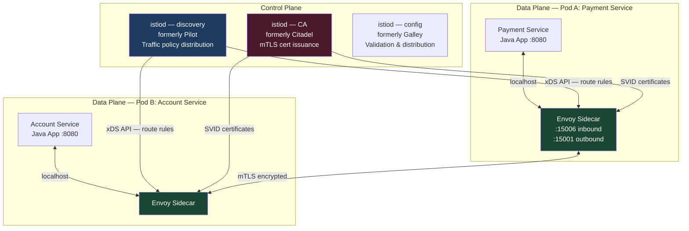
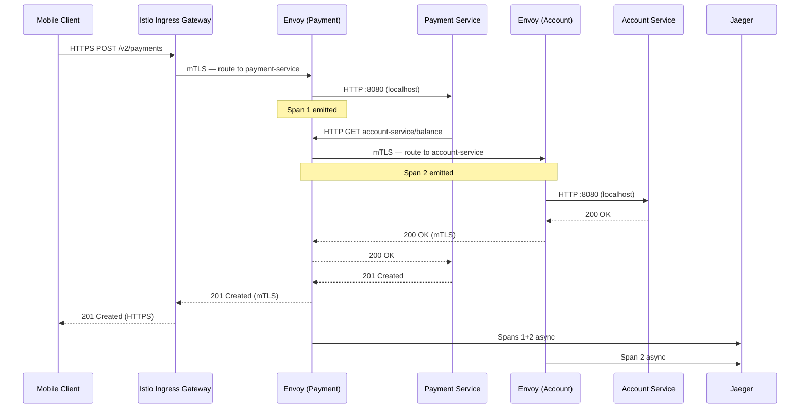

شبكة الخدمات (Service Mesh) بنية تحتية تجعل التواصل بين الخدمات المصغّرة قابلًا للمراقبة والتحكم والتأمين — دون تغيير شيفرة التطبيق. وفي الخدمات المالية تحديدًا، تجيب شبكة الخدمات عن سؤال امتثال تتركه بنى الخدمات المصغّرة مفتوحًا: "كيف تثبت أن كل بايت انتقل بين الخدمات الداخلية كان مشفرًا ومصادقًا عليه؟" فبدون شبكة خدمات، تتطلب الإجابة تضمين منطق TLS في كل خدمة، وإدارة تدوير الشهادات عبر عشرات الفرق، والأمل ألا يطلق أحد خدمة بدونه. ومع شبكة الخدمات، تكون الإجابة ملف YAML واحدًا ووسمًا في Kubernetes.

## أهداف التعلّم

- التمييز بين مستوى التحكم (control plane) ومستوى البيانات (data plane) في بنية شبكة الخدمات، وشرح ما يفعله istiod (الذي دمج المكوّنات السابقة Pilot وCitadel وGalley)
- شرح كيف يعمل حقن الوكيل الجانبي Envoy (sidecar) ولماذا لا يتطلب أي تغيير في شيفرة التطبيق
- تنفيذ mTLS بين الخدمات باستخدام `PeerAuthentication` في Istio، وشرح كيف يدعم متطلبات العزل في PCI DSS وتوقعات انعدام الثقة (zero trust)، وأمن المعالجة في المادة 32 من GDPR
- كتابة `VirtualService` بصيغة YAML ينفّذ توجيه Canary (‏10% من الحركة إلى إصدار جديد من خدمة المدفوعات)
- ضبط `DestinationRule` لقطع الدائرة على خدمة الحسابات
- وصف كيف تنتقل ترويسات التتبع الموزع (B3 / W3C TraceContext) عبر Envoy وتصل إلى Jaeger
- قياس كلفة زمن شبكة الخدمات (نحو 1ms لكل قفزة) وشرح متى تكون مقبولة ومتى لا تكون
- تحديد كلفة التعقيد التشغيلي لشبكة الخدمات ونضج الفريق المطلوب لتشغيلها بأمان

## سياق العمل

لنأخذ بنكًا بريطانيًا متوسط الحجم (مثال مركّب) يستعد لتقييم PCI DSS v4.0. يفرض المتطلب 4 في PCI DSS تشفيرًا قويًا لبيانات حامل البطاقة على الشبكات *المفتوحة والعامة*، لكن عنقود Kubernetes لدى البنك كان شبكة مسطحة مشتركة مع أحمال عمل خارج النطاق، وكانت سياسة الأمان الخاصة بالبنك تتطلب تشفير بيانات حامل البطاقة أثناء النقل في كل مكان. كان لدى البنك 34 خدمة مصغّرة، وستة فرق، ولا فرض موحّد لـ TLS. واكتُشف أن ثلاث خدمات ترسل بيانات متعلقة بالبطاقات عبر HTTP غير مشفر داخل العنقود، معتمدة على حجة "عزل الشبكة" التي لم يستطع المقيّم التحقق منها. فأعطى البنك نفسه 90 يومًا لإصلاح ذلك، وإلا بقي العنقود كله ضمن نطاق PCI.

درس فريق المعالجة مسارين: إضافة TLS في كل خدمة من الخدمات الـ 34 منفردة (نحو 6 أسابيع لكل خدمة، على مراحل متداخلة)، أو نشر Istio بوضع mTLS صارم على مستوى العنقود (نحو 3 أسابيع إجمالًا). فاختار Istio. وخلال 21 يومًا، أصبح كل التواصل داخل العنقود مفروضًا عليه mTLS، وأصبح تدوير الشهادات آليًا عبر istiod، وولّدت شبكة الخدمات الأدلة التي احتاجها المقيّم. لقد غطّت شبكة الخدمات كلفتها في عملية امتثال واحدة.

## بنية شبكة الخدمات: مستوى التحكم ومستوى البيانات



لا يلمس مستوى التحكم الحركة الحية أبدًا. فهو يوزع الإعدادات (عبر واجهة xDS) والشهادات على وكلاء Envoy. أما مستوى البيانات (وكلاء Envoy الجانبيون) فيتولى كل الحركة الفعلية — الاعتراض، والتشفير، وموازنة الحمل، وقطع الدائرة، وإصدار القياسات.

## حقن الوكيل الجانبي Envoy

يُحقن Envoy تلقائيًا في كل حاوية تشغيل (pod) في مساحة أسماء مفعّلة فيها شبكة الخدمات. ويتم الحقن عبر MutatingAdmissionWebhook في Kubernetes وقت إنشاء الـ pod — فتبقى حاوية التطبيق دون تعديل.

```yaml
# Enable automatic sidecar injection for a namespace
apiVersion: v1
kind: Namespace
metadata:
  name: payments
  labels:
    istio-injection: enabled  # Trigger for the MutatingAdmissionWebhook
```

بعد الحقن، يحتوي الـ pod على حاويتين: التطبيق و`istio-proxy` ‏(Envoy). وتعيد قواعد `iptables` في حاوية التهيئة توجيه كل الحركة الواردة والصادرة عبر منافذ Envoy. ويرتبط تطبيق Java بالعنوان `0.0.0.0:8080` ويتحدث إلى `localhost`. ولا يعرف أبدًا أن شبكة الخدمات موجودة.

```java
// Java service — zero mesh-specific code required
// Envoy intercepts all outbound calls transparently
@Service
@RequiredArgsConstructor
public class PaymentProcessingService {

    private final RestClient accountClient;  // calls http://account-service/accounts/{id}
    private final RestClient fraudClient;    // calls http://fraud-service/evaluate

    public PaymentResult process(Payment payment) {
        // These HTTP calls are intercepted by Envoy, encrypted to mTLS,
        // and load-balanced to healthy instances — no code change needed
        AccountBalance balance = accountClient.get()
            .uri("/accounts/{id}/balance", payment.sourceAccountId())
            .retrieve()
            .body(AccountBalance.class);

        FraudDecision decision = fraudClient.post()
            .uri("/evaluate")
            .body(FraudRequest.from(payment))
            .retrieve()
            .body(FraudDecision.class);

        return executePayment(payment, balance, decision);
    }
}
```

## mTLS للمصادقة بين الخدمات

يعني TLS المتبادل (mTLS) أن الطرفين يقدمان شهادتين — لا الخادم وحده كما في TLS العادي. ويحمل كل وكيل Envoy جانبي وثيقة هوية SPIFFE قابلة للتحقق (SVID) تصدرها سلطة الشهادات المدمجة في istiod. وتحمل هذه الشهادة هوية الخدمة (`spiffe://cluster.local/ns/payments/sa/payment-service`) وتُدوَّر تلقائيًا كل 24 ساعة.

```yaml
# Enforce strict mTLS for all services in the payments namespace
apiVersion: security.istio.io/v1beta1
kind: PeerAuthentication
metadata:
  name: payments-mtls-strict
  namespace: payments
spec:
  mtls:
    mode: STRICT  # Reject any connection not presenting a valid client certificate
```

```yaml
# Cluster-wide default — permissive during migration, switch to STRICT after all services enrolled
apiVersion: security.istio.io/v1beta1
kind: PeerAuthentication
metadata:
  name: default
  namespace: istio-system
spec:
  mtls:
    mode: PERMISSIVE  # Accept both mTLS and plain-text during migration window
```

> [!WARNING]
> لا تترك الوضع `PERMISSIVE` أبدًا في الإنتاج بعد اكتمال الترحيل. فالوضع المتساهل يسمح باتصالات غير مشفرة، فيُفشل فائدة الامتثال لـ PCI DSS. حدّد موعدًا نهائيًا للترحيل، وتتبع الاتصالات غير المحمية بـ mTLS عبر لوحة الأمان في Kiali، وافرض الوضع `STRICT` مساحة أسماء بعد أخرى مع انضمام الخدمات.

## توجيه Canary باستخدام VirtualService

```yaml
# Route 10% of traffic to payment-service v2, 90% to v1
# Used during canary deployment of a new payment processing algorithm
apiVersion: networking.istio.io/v1beta1
kind: VirtualService
metadata:
  name: payment-service-canary
  namespace: payments
spec:
  hosts:
    - payment-service
  http:
    - match:
        - headers:
            x-canary-user:
              exact: "true"   # Explicit opt-in for internal testing
      route:
        - destination:
            host: payment-service
            subset: v2
          weight: 100
    - route:
        - destination:
            host: payment-service
            subset: v1
          weight: 90
        - destination:
            host: payment-service
            subset: v2
          weight: 10
```

```yaml
# DestinationRule defines the v1 and v2 subsets via pod labels
apiVersion: networking.istio.io/v1beta1
kind: DestinationRule
metadata:
  name: payment-service
  namespace: payments
spec:
  host: payment-service
  subsets:
    - name: v1
      labels:
        version: v1
    - name: v2
      labels:
        version: v2
  trafficPolicy:
    connectionPool:
      http:
        http1MaxPendingRequests: 100
        http2MaxRequests: 1000
    outlierDetection:
      consecutive5xxErrors: 3
      interval: 30s
      baseEjectionTime: 30s
      maxEjectionPercent: 50
```

تنفّذ الكتلة `outlierDetection` قطع الدائرة على مستوى شبكة الخدمات — دون الحاجة إلى Resilience4j في التطبيق. فبعد 3 أخطاء 5xx متتالية من نسخة ما، يستبعد Envoy تلك النسخة من موازنة الحمل لمدة 30 ثانية.

## التتبع الموزع عبر Envoy

يولّد Envoy مقطع تتبع (span) لكل طلب يعالجه. ولكي ترتبط مقاطع التتبع عبر استدعاءات الخدمات، يجب أن ينقل التطبيق ترويسات التتبع من الطلبات الواردة إلى الطلبات الصادرة. وهذا هو التغيير الوحيد في الشيفرة المتعلق بشبكة الخدمات.

```java
// Trace header propagation (B3 / W3C)
// Micrometer Tracing handles this automatically in Spring Boot 3+
// Manual propagation for reference:

@Component
public class TracingPropagationFilter implements Filter {

    private static final List<String> TRACE_HEADERS = List.of(
        "x-request-id",
        "x-b3-traceid",
        "x-b3-spanid",
        "x-b3-parentspanid",
        "x-b3-sampled",
        "x-b3-flags",
        "traceparent",   // W3C TraceContext
        "tracestate"
    );

    @Override
    public void doFilter(ServletRequest req, ServletResponse res, FilterChain chain)
            throws IOException, ServletException {
        HttpServletRequest httpReq = (HttpServletRequest) req;
        // Headers are stored in a request-scoped bean and injected into outbound RestClient calls
        TraceContext.set(extractHeaders(httpReq));
        chain.doFilter(req, res);
    }

    private Map<String, String> extractHeaders(HttpServletRequest request) {
        return TRACE_HEADERS.stream()
            .filter(h -> request.getHeader(h) != null)
            .collect(Collectors.toMap(h -> h, request::getHeader));
    }
}
```

مع Micrometer Tracing (خليفة Spring Cloud Sleuth) ومُصدِّر OpenTelemetry أو Zipkin، يتولى الإعداد `management.tracing.propagation.type=w3c,b3` في `application.yml` نقل الترويسات تلقائيًا — طالما بُني العملاء الصادرون من `RestClient.Builder` الذي يضبطه Spring تلقائيًا. والمرشح اليدوي معروض للفهم فقط.

## مخطط طوبولوجيا شبكة الخدمات



## المراقبة: سجلات الوصول والمقاييس والتتبع

توفر شبكة الخدمات ثلاث إشارات مراقبة جاهزة، دون أي تجهيز في التطبيق:

**سجلات الوصول** — يسجّل كل Envoy أزواج الطلب/الرد، بما في ذلك العنقود الوجهة، وزمن الاستجابة، ورمز الحالة. والصيغة قابلة للضبط؛ وفي التقنية المالية المعيار هو JSON منظم يُرسل إلى نظام SIEM.

**المقاييس** — يصدر Envoy مقاييس Prometheus لكل خدمة، ولكل إصدار، ولكل عنقود وجهة. وأهم المقاييس: `istio_requests_total` (بالوسوم `response_code` و`source_workload` و`destination_service`)، و`istio_request_duration_milliseconds` (مدرّج تكراري).

**التتبع** — يولّد كل Envoy مقاطع تتبع متوافقة مع Zipkin وJaeger وOpenTelemetry. وتُظهر مقاطع التتبع المترابطة مخطط الاستدعاءات الكامل لطلب دفع واحد عبر كل الخدمات.

```yaml
# Telemetry configuration — emit traces for 1% of traffic (sampling rate)
apiVersion: telemetry.istio.io/v1alpha1
kind: Telemetry
metadata:
  name: payment-tracing
  namespace: payments
spec:
  tracing:
    - providers:
        - name: jaeger
      randomSamplingPercentage: 1.0   # 1% in production — increase for incident investigation
```

## المفاضلات: الزمن والتعقيد والنضج التشغيلي

| الشأن | الأثر | التخفيف |
|---|---|---|
| الزمن لكل قفزة | نحو 1ms لكل استدعاء خدمة | مقبول لمعظم التدفقات؛ تجنب سلاسل الاستدعاء العميقة (أكثر من 4 قفزات) |
| الذاكرة لكل وكيل جانبي | نحو 50-100MB لكل pod | خطط حدود موارد Kubernetes؛ يؤثر على كثافة الـ pods |
| التعقيد التشغيلي | عالٍ — منحنى تعلّم Istio حاد | يتطلب فريق منصات مخصصًا؛ لا تنشره بدونه |
| مخاطر الترقية | ترقيات Istio قد تكسر الخدمات | استخدم ترقيات Canary لمستوى التحكم؛ واختبر في بيئة ما قبل الإنتاج |
| تعقيد التصحيح | أخطاء إعدادات Envoy غامضة | تعلّم `istioctl proxy-config` و`istioctl analyze` |
| فشل تدوير الشهادات | الخدمات ترفض الاتصالات | راقب مقاييس سلطة الشهادات في istiod (مثل `citadel_server_csr_count`) وتنبيهات انتهاء الشهادات |

> [!NOTE]
> يزيل الوضع المحيطي (ambient mode) في Istio (متاح بشكل عام منذ Istio 1.24) الوكيل الجانبي لكل pod: فوكيل لكل عقدة (ztunnel) يوفر mTLS، ووكلاء waypoint اختياريون يضيفون ميزات الطبقة السابعة. وهو يقلل كلفة الذاكرة واحتكاك الترقيات؛ وتبقى مفاهيم السياسات في هذا الدرس كما هي.

> [!NOTE]
> زمن 1ms لكل قفزة هو الوسيط. ومع فرض سياسات شبكة Kubernetes، وتأخر بدء الوكلاء الجانبيين، والعقد المزدحمة، قد يبلغ زمن الذيل 5-10ms. فلتدفق دفع بأربع قفزات بين الخدمات، يضيف ذلك 4-40ms. قِس نشرك تحديدًا قبل الالتزام باتفاقيات مستوى خدمة تفترض كلفة صفرية لشبكة الخدمات.

## اختبر فهمك

**س1: أثناء تدقيق PCI DSS، يطلب منك المدقق إثبات أن بيانات البطاقات مشفرة بين خدمة الحسابات وخدمة المدفوعات داخل عنقود Kubernetes. كيف تقدم هذا الدليل باستخدام Istio؟**

ج: اعرض على المدقق ثلاثة أدلة: (1) المورد `PeerAuthentication` بالوضع `mode: STRICT` مطبقًا على مساحة الأسماء التي تحتوي الخدمتين — يفرض هذا الإعداد أن يرفض Envoy أي اتصال لا يقدم شهادة عميل mTLS صالحة؛ (2) لقطة شاشة لمخطط الخدمات في Kiali تُظهر أيقونة قفل mTLS على الحافة بين payment-service وaccount-service؛ (3) استعلام Prometheus على فترة حديثة يُظهر أن كل الطلبات بين الخدمتين تحمل `connection_security_policy="mutual_tls"` في `istio_requests_total`. وإضافة إلى ذلك، اعرض شهادات أحمال العمل (`istioctl proxy-config secret`) مؤكدًا هوية SPIFFE لكل خدمة وفترة تدويرها. فهذا يقدم دليلًا على التشفير دون الحاجة إلى مراجعة شيفرة التطبيق.

**س2: يعمل إصدار Canary لخدمة المدفوعات لديك بـ 10% من الحركة. تلاحظ أن المجموعة v2 تعيد نسبة أخطاء 2% مقابل 0.1% لـ v1. لم ينطلق قاطع الدائرة `outlierDetection`. لماذا، وماذا يجب أن تفعل؟**

ج: ينطلق `outlierDetection` بناءً على الأخطاء المتتالية (3 أخطاء 5xx متتالية من نسخة واحدة)، لا على نسبة الأخطاء الإجمالية في المجموعة. فإذا كانت الأخطاء موزعة على عدة نسخ من v2 — كل نسخة تحت الحد — فلن تُستبعد أي نسخة. كما أن نسبة أخطاء 2% قد تبقى تحت حد `consecutive5xxErrors: 3` لكل نسخة. والاستجابة الصحيحة: (1) اضبط وزن v2 على 0 فورًا في `VirtualService` لإيقاف تدفق الحركة الجديدة إلى v2؛ (2) حقق في سبب الأخطاء في سجلات وصول v2؛ (3) لا تتقدم بالـ Canary أكثر. ويجب أن تراقب بوابات صحة الـ Canary مقاييس نسبة الأخطاء على مستوى المجموعة (`istio_requests_total` مجمّعة حسب `destination_subset`) بشكل مستقل عن حالة قاطع الدائرة.

## تحدٍّ عملي

**السيناريو:** أنت قائد هندسة المنصات في بنك انتقل للتو إلى Kubernetes مع 12 خدمة مصغّرة. وتدقيق PCI DSS مجدول بعد 60 يومًا. تحتاج إلى تنفيذ mTLS عبر العنقود وإظهار قدرة النشر التجريبي (Canary) لخدمة المدفوعات.

**المهمة 1 — خطة نشر mTLS:** صمّم نشرًا لـ mTLS على مراحل. المرحلة 1: انشر Istio بالوضع PERMISSIVE على مستوى العنقود. المرحلة 2: افرض الوضع STRICT مساحة أسماء بعد أخرى. اكتب ملف `PeerAuthentication` لكل مرحلة، واستعلام Prometheus الذي تستخدمه لتحديد مساحات الأسماء التي ما زالت ترسل حركة بدون mTLS قبل التقدم.

**المهمة 2 — النشر التجريبي:** اكتب ملفي `VirtualService` و`DestinationRule` كاملين لنشر الإصدار v2 من payment-service بنسبة 5% من الحركة، مع: تجاوز بالترويسة (`X-Canary: true`) يوجه 100% إلى v2، وقطع دائرة عند خطأين 5xx متتاليين، ومدة استبعاد 60 ثانية. واشرح كيف تؤتمت التقدم من 5% ← 25% ← 50% ← 100% بناءً على حدود نسبة الأخطاء.

**المهمة 3 — نقل التتبع:** يبلغ فريق خدمة الاحتيال أن تتبعات Jaeger لديهم تُظهر مقاطع مكسورة — فطلبات الدفع الواردة تبدأ مقطعًا جذريًا جديدًا بدل متابعة تتبع الدفعة. شخّص السبب الجذري وقدّم الإصلاح كمقتطف إعدادات Spring. واكتب اختبارًا يتحقق من نقل ترويسات التتبع من الطلبات الواردة إلى استدعاءات RestClient الصادرة.

**المهمة 4 — ميزانية الزمن:** لتدفق الدفع لديك 5 قفزات بين الخدمات: البوابة ← الدفع ← الحسابات ← الاحتيال ← الإشعارات ← الدفع. وكلفة شبكة الخدمات 1ms لكل قفزة. واتفاقية مستوى الخدمة الحالية p99 أقل من 200ms. قِس p99 الأساسي (قبل شبكة الخدمات) واحسب ميزانية الزمن المتاحة لمنطق التطبيق بعد كلفة الشبكة. وإذا كانت الميزانية ضيقة جدًا، فاقترح القفزات التي تُدمج أو تُجعل غير متزامنة، مع التبرير.

<!-- KNOWLEDGE-CHECK
{
  "questions": [
    {
      "id": "q1",
      "text": "يوزع مستوى التحكم في Istio الإعدادات على وكلاء Envoy. ما البروتوكول الذي يستخدمه لذلك، وما الفائدة الأساسية لهذا الأسلوب؟",
      "options": [
        "ConfigMaps في Kubernetes — تُطبق التغييرات بإعادة تشغيل حاوية Envoy",
        "واجهة xDS عبر gRPC — يشترك وكلاء Envoy في تدفقات الإعدادات ويتلقون التحديثات دون إعادة تشغيل",
        "قراءة مباشرة من etcd — يستطلع Envoy خادم واجهة Kubernetes كل 30 ثانية",
        "استطلاع HTTP REST — يقدم Pilot الإعدادات كنقاط نهاية JSON"
      ],
      "correct": 1,
      "explanation": "يستخدم Istio واجهة xDS (خدمات الاكتشاف)، وهي بروتوكول بث gRPC أصيل في Envoy. يشترك وكلاء Envoy في خدمة اكتشاف المستمعات (LDS)، وخدمة اكتشاف المسارات (RDS)، وخدمة اكتشاف العناقيد (CDS)، وخدمة اكتشاف نقاط النهاية (EDS). وتنتقل تغييرات الإعدادات — بما فيها تغييرات أوزان التوجيه في النشر التجريبي — خلال ثوانٍ دون إعادة تشغيل الـ pods. وهذا ما يجعل تحويل الحركة لحظيًا ممكنًا."
    },
    {
      "id": "q2",
      "text": "ضبطت outlierDetection بالقيمة consecutive5xxErrors: 3 في DestinationRule لخدمة الحسابات. لخدمة الحسابات 5 نسخ. أعادت النسخة رقم 3 ثلاثة أخطاء 500 متتالية. ماذا يحدث؟",
      "options": [
        "تُستبعد النسخ الخمس كلها من موازنة الحمل",
        "تُستبعد النسخة رقم 3 وحدها لمدة baseEjectionTime؛ وتستمر النسخ الأخرى في تلقي الحركة",
        "يُضبط وزن VirtualService لخدمة الحسابات على 0 تلقائيًا",
        "ينطلق تنبيه PagerDuty لكن لا يحدث أي تغيير في التوجيه"
      ],
      "correct": 1,
      "explanation": "تعمل outlierDetection على مستوى كل نسخة. فلا تُستبعد إلا النسخة التي بلغت الحد (النسخة رقم 3) من موازنة الحمل لمدة baseEjectionTime. وتستمر النسخ الأربع الأخرى في تلقي الحركة بشكل طبيعي. وهذا نمط قاطع الدائرة مطبقًا على طبقة الوكيل — عزل النسخ غير السليمة مع الحفاظ على توفر الخدمة عبر النسخ السليمة."
    }
  ]
}
-->

<!-- PRACTICAL-CHALLENGE
{
  "title": "شبكة الخدمات — Istio وEnvoy في الخدمات المالية — تطبيق في بيئة الإنتاج",
  "difficulty": "advanced",
  "estimatedMinutes": 60,
  "tasks": [
    {
      "id": "1",
      "description": "صمّم نشرًا لـ mTLS على مراحل: المرحلة 1 نشر Istio بالوضع PERMISSIVE على مستوى العنقود، والمرحلة 2 فرض الوضع STRICT مساحة أسماء بعد أخرى. اكتب ملف PeerAuthentication لكل مرحلة، واستعلام Prometheus الذي يحدد مساحات الأسماء التي ما زالت ترسل حركة بدون mTLS قبل التقدم."
    },
    {
      "id": "2",
      "description": "اكتب ملفي VirtualService وDestinationRule كاملين لنشر الإصدار v2 من payment-service بنسبة 5%، مع تجاوز بالترويسة X-Canary: true يوجه 100% إلى v2، وقطع دائرة عند خطأين 5xx متتاليين، ومدة استبعاد 60 ثانية. واشرح كيف تؤتمت التقدم من 5% ← 25% ← 50% ← 100% بناءً على حدود نسبة الأخطاء."
    },
    {
      "id": "3",
      "description": "تُظهر تتبعات Jaeger لخدمة الاحتيال مقاطع مكسورة — فطلبات الدفع الواردة تبدأ مقطعًا جذريًا جديدًا. شخّص السبب الجذري وقدّم الإصلاح كمقتطف إعدادات Spring، واكتب اختبارًا يتحقق من نقل ترويسات التتبع إلى استدعاءات RestClient الصادرة."
    },
    {
      "id": "4",
      "description": "لتدفق الدفع 5 قفزات وكلفة شبكة الخدمات 1ms لكل قفزة، واتفاقية مستوى الخدمة p99 أقل من 200ms. قِس p99 الأساسي واحسب ميزانية الزمن المتبقية لمنطق التطبيق، واقترح القفزات التي تُدمج أو تُجعل غير متزامنة إذا كانت الميزانية غير كافية."
    }
  ]
}
-->
