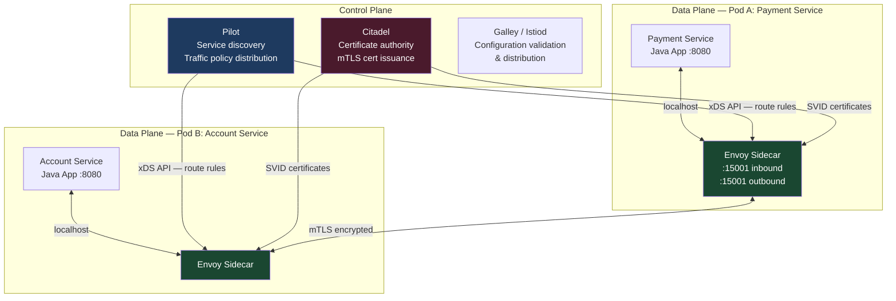
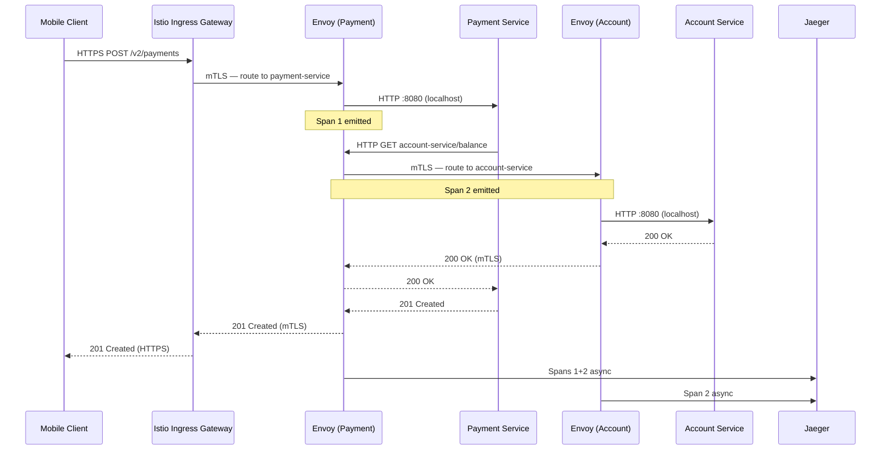

A service mesh is infrastructure that makes the communication between microservices observable, controllable, and secure — without changing application code. For financial services specifically, the service mesh answers a compliance question that microservices architectures otherwise leave open: "How do you prove that every byte transmitted between internal services was encrypted and authenticated?" Without a mesh, the answer requires embedding TLS logic in every service, managing certificate rotation across dozens of teams, and hoping no one ships a service without it. With a mesh, the answer is a single YAML file and a Kubernetes annotation.

## Learning Objectives

- Distinguish the control plane from the data plane in a service mesh architecture and explain what Istio's Pilot and Citadel components do
- Explain how Envoy sidecar injection works and why it requires no application code changes
- Implement mTLS between services using Istio `PeerAuthentication` and explain its relevance to PCI DSS Requirement 4 and GDPR transmission security
- Write a `VirtualService` YAML performing canary routing (10% traffic to a new payment service version)
- Configure a `DestinationRule` for circuit breaking on the account service
- Describe how distributed tracing headers (B3 / W3C TraceContext) propagate through Envoy and reach Jaeger
- Quantify the latency overhead of a service mesh (~1ms per hop) and explain when it is and is not acceptable
- Identify the operational complexity costs of a service mesh and the team maturity required to run it safely

## Business Context

In 2022, a tier-2 UK bank underwent a PCI DSS v4.0 audit. The auditors required evidence that all card data transmitted between internal microservices was encrypted in transit. The bank had 34 microservices, six teams, and no uniform TLS enforcement policy. Three services were found to be transmitting card-related data over unencrypted HTTP within the cluster, relying on "network segmentation" as a compensating control. The auditors rejected this control. The bank faced a remediation timeline of 90 days or risk losing PCI certification.

The remediation team evaluated two paths: instrument TLS in each of the 34 services individually (estimated 6 weeks per service, staggered), or deploy Istio with strict mTLS mode cluster-wide (estimated 3 weeks total). They chose Istio. Within 21 days, all intra-cluster communication was mTLS-enforced, certificate rotation was automated via Citadel, and the mesh generated the cryptographic evidence the auditors needed. The service mesh paid for itself in that one compliance exercise.

## Service Mesh Architecture: Control Plane vs Data Plane



The control plane never touches live traffic. It distributes configuration (via the xDS API) and certificates to Envoy proxies. The data plane (Envoy sidecars) handles all actual traffic — interception, encryption, load balancing, circuit breaking, and telemetry emission.

## Envoy Sidecar Injection

Envoy is injected automatically into every pod in a mesh-enabled namespace. The injection is performed by a Kubernetes MutatingAdmissionWebhook at pod creation time — the application container is unmodified.

```yaml
# Enable automatic sidecar injection for a namespace
apiVersion: v1
kind: Namespace
metadata:
  name: payments
  labels:
    istio-injection: enabled  # Trigger for the MutatingAdmissionWebhook
```

After injection, the pod has two containers: the application and `istio-proxy` (Envoy). `iptables` rules in the init container redirect all inbound and outbound traffic through Envoy's ports. The Java application binds to `0.0.0.0:8080` and talks to `localhost`. It never knows the mesh exists.

```java
// Java service — zero mesh-specific code required
// Envoy intercepts all outbound calls transparently
@Service
@RequiredArgsConstructor
public class PaymentProcessingService {

    private final RestClient accountClient;  // calls http://account-service/accounts/{id}
    private final RestClient fraudClient;    // calls http://fraud-service/evaluate

    public PaymentResult process(Payment payment) {
        // These HTTP calls are intercepted by Envoy, encrypted to mTLS,
        // and load-balanced to healthy instances — no code change needed
        AccountBalance balance = accountClient.get()
            .uri("/accounts/{id}/balance", payment.sourceAccountId())
            .retrieve()
            .body(AccountBalance.class);

        FraudDecision decision = fraudClient.post()
            .uri("/evaluate")
            .body(FraudRequest.from(payment))
            .retrieve()
            .body(FraudDecision.class);

        return executePayment(payment, balance, decision);
    }
}
```

## mTLS for Service-to-Service Authentication

Mutual TLS (mTLS) means both parties present certificates — not just the server as in standard TLS. Each Envoy sidecar holds a SPIFFE Verifiable Identity Document (SVID) issued by Citadel. This certificate encodes the service identity (`spiffe://cluster.local/ns/payments/sa/payment-service`) and rotates every 24 hours automatically.

```yaml
# Enforce strict mTLS for all services in the payments namespace
apiVersion: security.istio.io/v1beta1
kind: PeerAuthentication
metadata:
  name: payments-mtls-strict
  namespace: payments
spec:
  mtls:
    mode: STRICT  # Reject any connection not presenting a valid client certificate
```

```yaml
# Cluster-wide default — permissive during migration, switch to STRICT after all services enrolled
apiVersion: security.istio.io/v1beta1
kind: PeerAuthentication
metadata:
  name: default
  namespace: istio-system
spec:
  mtls:
    mode: PERMISSIVE  # Accept both mTLS and plain-text during migration window
```

> [!WARNING]
> Never leave `PERMISSIVE` mode in production after migration is complete. Permissive mode allows unencrypted connections, defeating the PCI DSS compliance benefit. Set a migration deadline, track non-mTLS connections via Kiali's security dashboard, and enforce `STRICT` mode namespace by namespace as services are enrolled.

## Canary Routing with VirtualService

```yaml
# Route 10% of traffic to payment-service v2, 90% to v1
# Used during canary deployment of a new payment processing algorithm
apiVersion: networking.istio.io/v1beta1
kind: VirtualService
metadata:
  name: payment-service-canary
  namespace: payments
spec:
  hosts:
    - payment-service
  http:
    - match:
        - headers:
            x-canary-user:
              exact: "true"   # Explicit opt-in for internal testing
      route:
        - destination:
            host: payment-service
            subset: v2
          weight: 100
    - route:
        - destination:
            host: payment-service
            subset: v1
          weight: 90
        - destination:
            host: payment-service
            subset: v2
          weight: 10
```

```yaml
# DestinationRule defines the v1 and v2 subsets via pod labels
apiVersion: networking.istio.io/v1beta1
kind: DestinationRule
metadata:
  name: payment-service
  namespace: payments
spec:
  host: payment-service
  subsets:
    - name: v1
      labels:
        version: v1
    - name: v2
      labels:
        version: v2
  trafficPolicy:
    connectionPool:
      http:
        http1MaxPendingRequests: 100
        http2MaxRequests: 1000
    outlierDetection:
      consecutive5xxErrors: 3
      interval: 30s
      baseEjectionTime: 30s
      maxEjectionPercent: 50
```

The `outlierDetection` block implements circuit breaking at the mesh level — no Resilience4j required in the application. After 3 consecutive 5xx errors from an instance, Envoy ejects it from the load balancing pool for 30 seconds.

## Distributed Tracing via Envoy

Envoy generates a trace span for every request it handles. For the trace to be correlated across service calls, the application must propagate the trace headers from incoming requests to outgoing requests. This is the only mesh-related code change required.

```java
// Spring Boot configuration for B3 / W3C trace header propagation
// Spring Cloud Sleuth (or Micrometer Tracing) handles this automatically
// Manual propagation for reference:

@Component
public class TracingPropagationFilter implements Filter {

    private static final List<String> TRACE_HEADERS = List.of(
        "x-request-id",
        "x-b3-traceid",
        "x-b3-spanid",
        "x-b3-parentspanid",
        "x-b3-sampled",
        "x-b3-flags",
        "traceparent",   // W3C TraceContext
        "tracestate"
    );

    @Override
    public void doFilter(ServletRequest req, ServletResponse res, FilterChain chain)
            throws IOException, ServletException {
        HttpServletRequest httpReq = (HttpServletRequest) req;
        // Headers are stored in a request-scoped bean and injected into outbound RestClient calls
        TraceContext.set(extractHeaders(httpReq));
        chain.doFilter(req, res);
    }

    private Map<String, String> extractHeaders(HttpServletRequest request) {
        return TRACE_HEADERS.stream()
            .filter(h -> request.getHeader(h) != null)
            .collect(Collectors.toMap(h -> h, request::getHeader));
    }
}
```

With Micrometer Tracing + Zipkin/Jaeger, `spring.sleuth.propagation.type=B3,W3C` in `application.yml` handles header propagation automatically. The manual filter is shown for understanding.

## Service Mesh Topology Diagram



## Observability: Access Logs, Metrics, and Traces

A service mesh provides three observability signals out of the box, without application instrumentation:

**Access logs** — every Envoy logs request/response pairs including upstream cluster, response time, and status code. Format is configurable; in fintech, structured JSON to a SIEM is standard.

**Metrics** — Envoy emits Prometheus metrics per service, per version, and per upstream cluster. Key metrics: `istio_requests_total` (with `response_code`, `source_workload`, `destination_service` labels), `istio_request_duration_milliseconds` (histogram).

**Traces** — every Envoy generates spans compatible with Zipkin/Jaeger/OpenTelemetry. Correlated traces show the full call graph for a single payment request across all services.

```yaml
# Telemetry configuration — emit traces for 1% of traffic (sampling rate)
apiVersion: telemetry.istio.io/v1alpha1
kind: Telemetry
metadata:
  name: payment-tracing
  namespace: payments
spec:
  tracing:
    - providers:
        - name: jaeger
      randomSamplingPercentage: 1.0   # 1% in production — increase for incident investigation
```

## Trade-offs: Latency, Complexity, and Operational Maturity

| Concern | Impact | Mitigation |
|---|---|---|
| Latency per hop | ~1ms added per service call | Acceptable for most flows; avoid deep call chains (>4 hops) |
| Memory per sidecar | ~50-100MB per pod | Plan Kubernetes resource limits; affects pod density |
| Operational complexity | High — Istio has a steep learning curve | Requires dedicated platform team; don't deploy without one |
| Upgrade risk | Istio upgrades can break services | Use canary control plane upgrades; test in staging |
| Debugging complexity | Envoy config errors are cryptic | Learn `istioctl proxy-config` and `istioctl analyze` |
| Certificate rotation failure | Services reject connections | Monitor `citadel_server_csr_count` and cert expiry alerts |

> [!NOTE]
> The 1ms per-hop latency is the median. Under Kubernetes network policy enforcement, Envoy sidecar startup delays, and busy nodes, tail latency can reach 5-10ms. For a payment flow with 4 service hops, this adds up to 4-40ms. Profile your specific deployment before committing to SLOs that assume zero mesh overhead.

## Knowledge Check

**Q1: During a PCI DSS audit, the auditor asks you to prove that card data is encrypted between the account service and the payment service inside the Kubernetes cluster. How do you provide this evidence using Istio?**

A: Show the auditor three artefacts: (1) the `PeerAuthentication` resource with `mode: STRICT` applied to the namespace containing both services — this configuration enforces that Envoy rejects any connection not presenting a valid mTLS client certificate; (2) a Kiali service graph screenshot showing the mTLS lock icon on the edge between payment-service and account-service; (3) an Envoy access log entry showing `upstream_transport_failure_reason: null` and the connection details. Additionally, show a Citadel certificate inspection confirming the SVID for each service and its rotation frequency. This provides cryptographic evidence of encryption without requiring application-level code review.

**Q2: Your payment service canary is running at 10% traffic. You observe that the v2 subset is returning 2% error rates vs 0.1% for v1. The `outlierDetection` circuit breaker has not triggered. Why not, and what should you do?**

A: `outlierDetection` triggers on `consecutiveErrors` (3 consecutive 5xx from a single instance), not on aggregate error rate across the subset. If errors are spread across multiple v2 instances — each instance below the threshold — no individual instance is ejected. Additionally, 2% error rate may be below the `consecutive5xxErrors: 3` threshold per instance. The correct response is: (1) immediately set v2 weight to 0 in the `VirtualService` to stop new traffic flowing to v2; (2) investigate the error cause in v2 access logs; (3) do not advance the canary further. Canary health gates should monitor subset-level error rate metrics (`istio_requests_total` grouped by `destination_subset`) independently of circuit breaker state.

## Practical Challenge

**Scenario:** You are the platform engineering lead at a bank that has just migrated to Kubernetes with 12 microservices. A PCI DSS audit is scheduled in 60 days. You need to implement mTLS across the cluster and demonstrate canary deployment capability for the payment service.

**Task 1 — mTLS Rollout Plan:** Design a phased mTLS rollout. Phase 1: deploy Istio with PERMISSIVE mode cluster-wide. Phase 2: enforce STRICT mode namespace by namespace. Write the `PeerAuthentication` YAML for each phase and the Prometheus query you use to identify namespaces still sending non-mTLS traffic before advancing.

**Task 2 — Canary Deployment:** Write the complete `VirtualService` and `DestinationRule` YAML for deploying payment-service v2 at 5% traffic, with: a header override (`X-Canary: true`) that routes 100% to v2, circuit breaking on 2 consecutive 5xx errors, and a 60-second ejection time. Explain how you automate the progression from 5% → 25% → 50% → 100% based on error rate thresholds.

**Task 3 — Trace Propagation:** The fraud service team reports that their Jaeger traces show broken spans — incoming payment requests start a new root span rather than continuing the payment's trace. Diagnose the root cause and provide the fix as a Spring configuration snippet. Write a test that verifies trace headers are propagated from incoming requests to outbound RestClient calls.

**Task 4 — Latency Budget:** Your payment flow has 5 service hops: gateway → payment → account → fraud → notification → payment. Mesh overhead is 1ms per hop. The existing SLO is P99 < 200ms. Measure the baseline (pre-mesh) P99 and calculate the available latency budget for the application logic after mesh overhead. If the budget is too tight, propose which hops to collapse or make asynchronous, with reasoning.

<!-- KNOWLEDGE-CHECK
{
  "questions": [
    {
      "id": "q1",
      "text": "Istio's control plane distributes configuration to Envoy proxies. What protocol does it use for this, and what is the key benefit of this approach?",
      "options": [
        "Kubernetes ConfigMaps — changes are applied by restarting the Envoy container",
        "xDS API over gRPC — Envoy proxies subscribe to configuration streams and receive updates without restarts",
        "etcd direct read — Envoy polls the Kubernetes API server every 30 seconds",
        "HTTP REST polling — Pilot serves configuration as JSON endpoints"
      ],
      "correct": 1,
      "explanation": "Istio uses the xDS (discovery service) API, an Envoy-native gRPC streaming protocol. Envoy proxies subscribe to Listener Discovery Service (LDS), Route Discovery Service (RDS), Cluster Discovery Service (CDS), and Endpoint Discovery Service (EDS). Configuration changes — including route weight changes for canary deployments — propagate within seconds without pod restarts. This is what makes real-time traffic shifting possible."
    },
    {
      "id": "q2",
      "text": "You set outlierDetection with consecutive5xxErrors: 3 on the account service DestinationRule. The account service has 5 instances. Instance #3 returns 3 consecutive 500 errors. What happens?",
      "options": [
        "All 5 instances are ejected from the load balancing pool",
        "Only instance #3 is ejected for baseEjectionTime; other instances continue receiving traffic",
        "The VirtualService weight for account-service is set to 0 automatically",
        "A PagerDuty alert fires but no routing change occurs"
      ],
      "correct": 1,
      "explanation": "outlierDetection performs per-instance ejection. Only the instance that triggered the threshold (instance #3) is ejected from the load balancing pool for baseEjectionTime. The other 4 instances continue receiving traffic normally. This is the circuit breaker pattern applied at the proxy layer — isolating unhealthy instances while preserving service availability through healthy ones."
    }
  ]
}
-->

<!-- PRACTICAL-CHALLENGE
{
  "title": "Service Mesh \u2014 Istio and Envoy in Financial Services \u2014 Production Implementation",
  "difficulty": "advanced",
  "estimatedMinutes": 60,
  "tasks": [
    {
      "id": "1",
      "description": "Design a phased rollout (PERMISSIVE \u2192 STRICT per namespace). Write PeerAuthentication YAML for each phase and the Prometheus query identifying namespaces still sending non-mTLS traffic"
    },
    {
      "id": "2",
      "description": "Write VirtualService and DestinationRule YAML for payment-service v2 at 5% with header override, circuit breaking on 2 consecutive 5xx, and 60-second ejection. Explain automation for 5% \u2192 25% \u2192 50% \u2192"
    },
    {
      "id": "3",
      "description": "The fraud service shows broken Jaeger spans. Diagnose the root cause and provide a Spring configuration fix. Write a test verifying trace header propagation through RestClient calls"
    },
    {
      "id": "4",
      "description": "With 5 service hops and 1ms mesh overhead each, calculate the remaining application latency budget within a P99 < 200ms SLO. Propose which hops to collapse or make async if the budget is insufficient"
    }
  ]
}
-->
